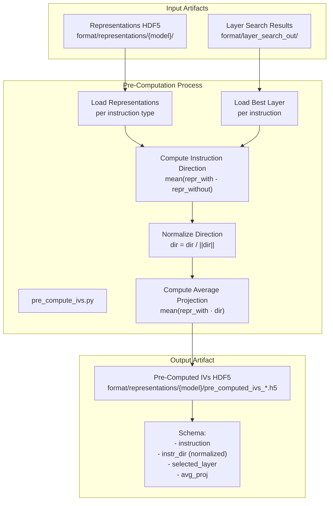
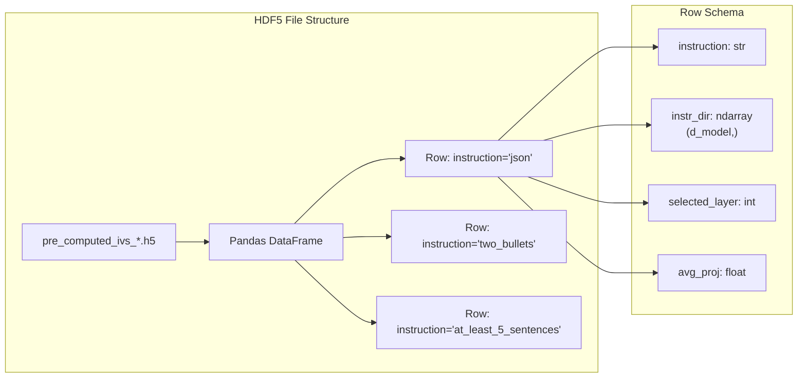

<!-- source: DeepWiki mcp.deepwiki.com · repo microsoft/llm-steer-instruct · page 4.3 Pre-Computing Instruction Vectors · fetched 2026-10-26 -->

# Pre-Computing Instruction Vectors

<details>
<summary>Relevant source files</summary>

The following files were used as context for generating this wiki page:

- [README.md](README.md)
- [composition/evaluate_format_plus_length.py](composition/evaluate_format_plus_length.py)
- [composition/load_results.py](composition/load_results.py)
- [config/composition/evaluation.yaml](config/composition/evaluation.yaml)
- [ifeval_scripts/README.md](ifeval_scripts/README.md)
- [requirements.txt](requirements.txt)

</details>


## Purpose and Scope

This document explains how steering vectors are pre-computed from representations and stored for efficient inference-time application. Pre-computing instruction vectors (IVs) is an optional optimization step that aggregates the paired representations computed in [4.1](#4.1) and the optimal layer selections from [4.2](#4.2) into ready-to-use steering vectors stored in HDF5 files.

Pre-computation is performed by the `format/pre_compute_ivs.py` script and is currently only used in the format instructions module. For applying steering vectors during inference, see [4.4](#4.4).

**Sources:** [README.md:76-77]()

---

## Overview of Pre-Computation

Pre-computing instruction vectors serves two main purposes:

1. **Efficiency**: Computing steering directions and aggregating representations across examples is done once offline, rather than repeatedly during evaluation
2. **Consistency**: Using the same pre-aggregated vectors across multiple evaluation runs ensures reproducible results

The pre-computation process transforms raw representation differences into normalized steering directions and computes statistical properties needed for the direction projection steering method.



**Diagram: Pre-Computation Pipeline Flow**

**Sources:** [README.md:76-77](), [composition/evaluate_format_plus_length.py:77-86]()

---

## Input Requirements

The pre-computation process requires two types of input artifacts:

### 1. Representation Files

HDF5 files containing paired representations computed in [4.1](#4.1), stored in `format/representations/{model_name}/{subset_folder}/`:

- **With instruction**: `last_token_rs` field containing hidden states for prompts with instructions
- **Without instruction**: `last_token_rs_no_instr` field containing hidden states for base prompts
- **Metadata**: `instruction_id_list`, `prompt`, `prompt_without_instruction`

### 2. Layer Search Results

JSONL files from [4.2](#4.2) containing the best layer selection for each instruction type, stored in `format/layer_search_out/`:

- Validation accuracy per layer per instruction
- Perplexity scores (optional)
- Selected best layer for each instruction

**Sources:** [composition/evaluate_format_plus_length.py:77-86]()

---

## Computation Process

### Computing Instruction Directions

For each unique instruction type, the pre-computation script:

1. **Filters representations** for examples containing that instruction
2. **Computes representation differences** at the selected layer:
   ```
   Δ_i = repr_with_instruction[i] - repr_without_instruction[i]
   ```
3. **Aggregates across examples** by computing the mean:
   ```
   instruction_direction = mean(Δ_1, Δ_2, ..., Δ_n)
   ```
4. **Normalizes the direction**:
   ```
   instruction_direction = instruction_direction / ||instruction_direction||
   ```

### Computing Average Projections

For the direction projection steering method (see [4.4](#4.4)), the script computes the average projection of the "with instruction" representations onto the steering direction:

```
avg_projection = mean(repr_with_instruction[i] · instruction_direction)
```

This value represents the typical magnitude along the instruction direction when the instruction is present, used as the target value during steering.

### Aggregating by Instruction Type

The script processes all unique instruction types found in the data, creating one steering vector entry per instruction. Instructions are identified by their `instruction_id_list` field from the IFEval dataset structure.

**Sources:** [composition/evaluate_format_plus_length.py:132-142]()

---

## Storage Format and Structure

### HDF5 File Organization

Pre-computed instruction vectors are stored in HDF5 files within the representations directory:

```
format/representations/{model_name}/{subset_folder}/
├── pre_computed_ivs_layer_{layer_idx}.h5          # Specific layer
├── pre_computed_ivs_best_layer_validation.h5      # Best layer (no perplexity)
└── pre_computed_ivs_best_layer_validation_with_perplexity_{instr|no_instr}.h5
```

### Data Schema

Each HDF5 file contains a pandas DataFrame with the following columns:

| Column | Type | Description |
|--------|------|-------------|
| `instruction` | string | Instruction identifier (e.g., "json", "two_bullets") |
| `instr_dir` | array | Normalized steering direction vector (shape: d_model) |
| `selected_layer` | int | Layer index where steering should be applied |
| `avg_proj` | float | Average projection value for direction projection method |



**Diagram: Pre-Computed IV Storage Schema**

**Sources:** [composition/evaluate_format_plus_length.py:86](), [composition/evaluate_format_plus_length.py:135-142]()

---

## File Naming Conventions

The naming convention encodes the selection criteria:

### Layer-Specific Files
```
pre_computed_ivs_layer_{layer_idx}.h5
```
Contains steering vectors for a specific layer (used when overriding the layer search).

### Best Layer Files
```
pre_computed_ivs_best_layer_validation.h5
```
Contains steering vectors using the best layer selected by accuracy alone.

### Best Layer with Perplexity
```
pre_computed_ivs_best_layer_validation_with_perplexity_{mode}.h5
```
Contains steering vectors using the best layer selected considering both accuracy and perplexity. The `{mode}` suffix is either:
- `_instr`: Best layer when instructions are included in the prompt
- `_no_instr`: Best layer when instructions are not included (steering-only mode)

**Sources:** [composition/evaluate_format_plus_length.py:81-84]()

---

## Loading Pre-Computed Vectors

During evaluation, pre-computed vectors are loaded using pandas HDF5 API:

```python
# Example from composition/evaluate_format_plus_length.py
if args.source_layer_idx == -1:
    # Use best layer
    use_perplexity_flag = '_with_perplexity' if args.use_perplexity else ''
    include_instr_flag = '_instr' if args.include_instructions else '_no_instr'
    file_path = f'{folder}/pre_computed_ivs_best_layer_validation{use_perplexity_flag}{include_instr_flag}.h5'
else:
    # Use specified layer
    file_path = f'{folder}/pre_computed_ivs_layer_{args.source_layer_idx}.h5'

pre_computed_ivs = pd.read_hdf(file_path, key='df')
```

### Lookup During Inference

For each test example, the evaluation script:

1. **Extracts the instruction identifier** from the example's `instruction_id_list_for_eval` field
2. **Filters the DataFrame** to find the matching instruction:
   ```python
   instr = row['instruction_id_list_for_eval'][0]
   instr_dir = pre_computed_ivs[pre_computed_ivs['instruction'] == instr]['instr_dir'].values[0]
   layer_idx = pre_computed_ivs[pre_computed_ivs['instruction'] == instr]['selected_layer'].values[0]
   avg_proj = pre_computed_ivs[pre_computed_ivs['instruction'] == instr]['avg_proj'].values[0]
   ```
3. **Converts to tensor** and applies during generation (see [4.4](#4.4))

**Sources:** [composition/evaluate_format_plus_length.py:77-86](), [composition/evaluate_format_plus_length.py:132-144]()

---

## When to Use Pre-Computed vs On-The-Fly Computation

### Pre-Computed Vectors (Format Instructions)

The format instructions module uses pre-computation because:

1. **Fixed instruction set**: IFEval format instructions are a well-defined set of constraint types
2. **Frequent reuse**: The same instructions appear across many evaluation examples
3. **Layer-specific optimization**: Each instruction type may benefit from steering at a different layer
4. **Direction projection method**: Requires pre-computed average projections for proper scaling

### On-The-Fly Computation (Length and Keywords)

The length and keywords modules compute steering vectors on-the-fly during evaluation because:

1. **Dynamic constraints**: Length values (e.g., "3 sentences" vs "5 sentences") vary per example
2. **Continuous space**: Length constraints span a continuous range rather than discrete types
3. **Simple aggregation**: Only mean computation across examples is needed
4. **Single layer**: Layer selection is consistent across constraint variations

The following table summarizes the trade-offs:

| Aspect | Pre-Computed | On-The-Fly |
|--------|-------------|------------|
| **Setup cost** | High (requires layer search + pre-computation) | Low (only representation computation) |
| **Inference speed** | Fast (simple lookup) | Moderate (compute mean per example) |
| **Memory usage** | Low (one vector per instruction type) | Higher (load all representations) |
| **Flexibility** | Fixed set of instructions | Dynamic constraint values |
| **Used in** | Format instructions | Length, keywords, composition |

**Sources:** [README.md:64-106](), [composition/evaluate_format_plus_length.py:88-115]()

---

## Configuration Parameters

Pre-computation behavior is controlled through Hydra configuration files. Key parameters include:

| Parameter | Description | Example Values |
|-----------|-------------|----------------|
| `source_layer_idx` | Layer for pre-computation (-1 for best layer) | `-1`, `12`, `16` |
| `use_perplexity` | Whether layer search used perplexity | `True`, `False` |
| `include_instructions` | Whether prompts included instructions during representation computation | `True`, `False` |
| `representations_folder` | Source folder for representations | `"all"`, `"subset_0.1"` |

**Sources:** [config/composition/evaluation.yaml:15-17]()

---

