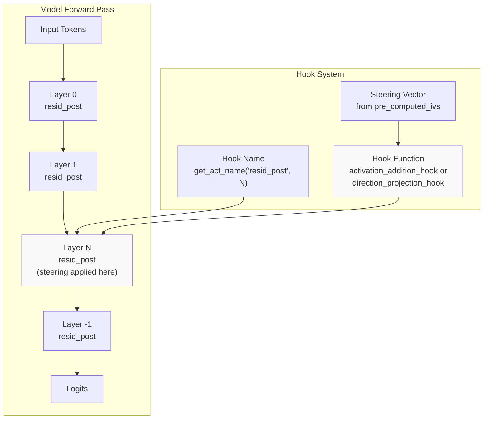
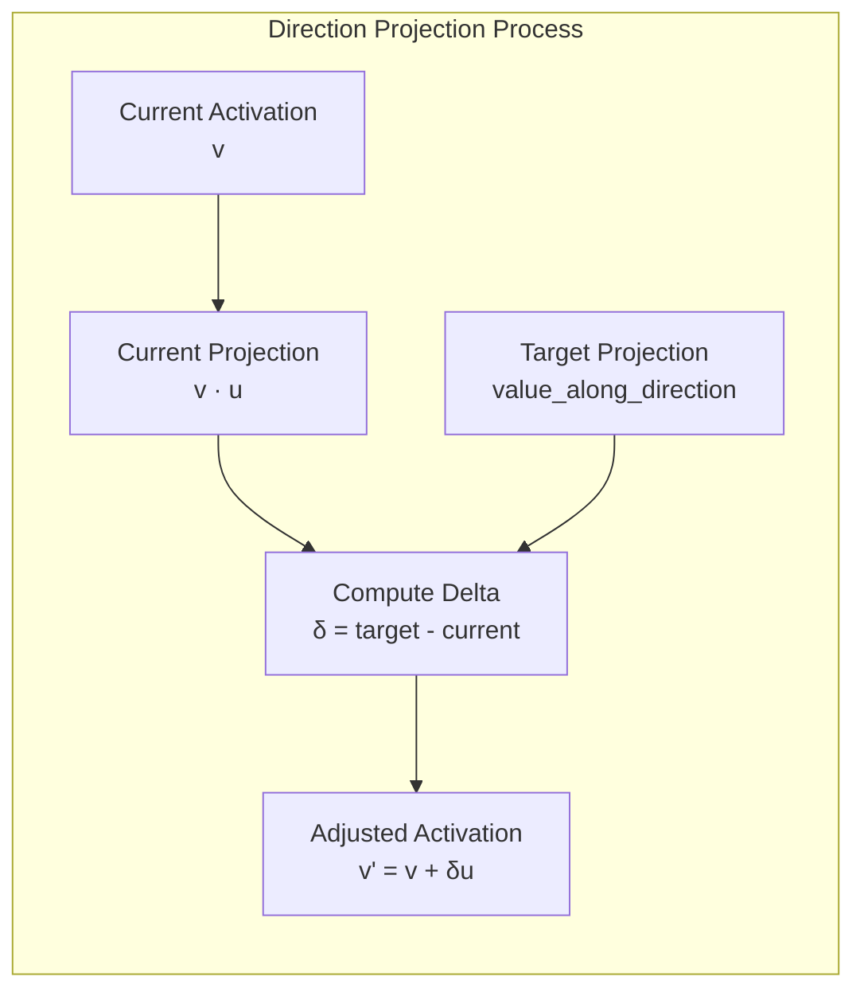
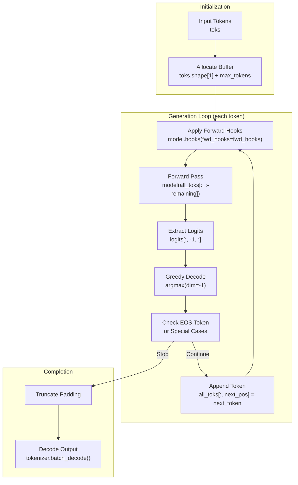
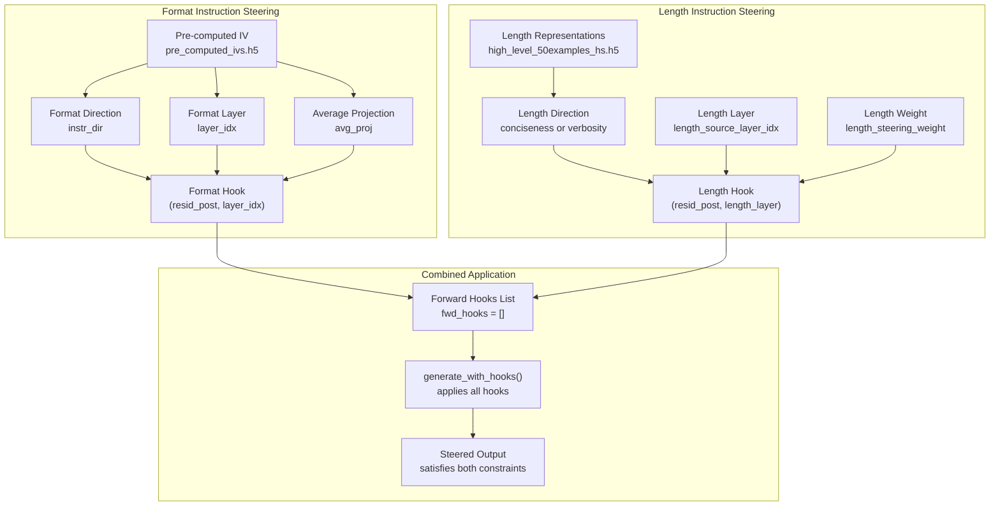

<!-- source: DeepWiki mcp.deepwiki.com · repo microsoft/llm-steer-instruct · page 4.4 Applying Steering During Inference · fetched 2026-10-26 -->

# Applying Steering During Inference

<details>
<summary>Relevant source files</summary>

The following files were used as context for generating this wiki page:

- [composition/evaluate_format_plus_length.py](composition/evaluate_format_plus_length.py)
- [composition/load_results.py](composition/load_results.py)
- [config/composition/evaluation.yaml](config/composition/evaluation.yaml)
- [config/length/length_evaluation.yaml](config/length/length_evaluation.yaml)
- [requirements.txt](requirements.txt)
- [utils/generation_utils.py](utils/generation_utils.py)

</details>


## Purpose and Scope

This document explains how pre-computed steering vectors are applied during model inference to influence instruction-following behavior. This is the final stage of the steering vector pipeline, where the representations and vectors computed in earlier stages are injected into the model's forward pass using activation hooks.

For information about computing steering vectors, see [Pre-Computing Instruction Vectors](#4.3). For the overall pipeline architecture, see [Steering Vector Pipeline](#4).

---

## Forward Hook Mechanism

The system uses `transformer_lens`'s `HookedTransformer` to inject steering vectors into specific layers during generation. Hooks are callback functions that intercept and modify activations at specified points in the model's forward pass.

### Hook Application Points

Steering vectors are applied to the residual stream at specific layers using the activation name `resid_post`. The system identifies the target layer and constructs a hook that will be called every time activations pass through that layer during generation.



**Sources:** [utils/generation_utils.py:62-96](), [composition/evaluate_format_plus_length.py:152-164]()

---

## Steering Methods

The system implements two distinct methods for applying steering vectors, each with different behavior and use cases.

### Activation Addition

Activation addition scales a steering direction by a weight and adds it to the residual stream activations. This is the simpler method and is used for most single-instruction steering.

**Function:** `activation_addition_hook(activation, hook, direction, weight=1)`

The hook modifies activations as:
```
new_activation = activation + (direction * weight)
```

**Parameters:**
| Parameter | Type | Description |
|-----------|------|-------------|
| `activation` | `torch.Tensor` | Current layer activations (batch_size, seq_len, d_model) |
| `hook` | `Hook` | Hook object (unused in function body) |
| `direction` | `torch.Tensor` | Pre-computed steering vector (d_model,) |
| `weight` | `float` | Scaling factor for steering strength |

**Configuration Example:**
```yaml
steering: 'add_vector'
steering_weight: 1.0
source_layer_idx: 12
```

**Sources:** [utils/generation_utils.py:43-49](), [composition/evaluate_format_plus_length.py:156-160]()

### Direction Projection

Direction projection adjusts activations so their projection along the steering direction matches a target value. This method is more precise and is used when the optimal projection value has been determined through layer search with perplexity optimization.

**Function:** `direction_projection_hook(activation, hook, direction, value_along_direction)`

The hook uses `adjust_vectors()` to modify each token's activation to achieve the target projection:



**Implementation:**
- `adjust_vectors()` computes current projections: `current_proj = v @ u`
- Calculates needed adjustment: `delta = target_values - current_proj`
- Adjusts activations: `adjusted_v = v + delta * u`

**Configuration Example:**
```yaml
steering: 'adjust_rs'
source_layer_idx: -1  # Use best layer from layer search
use_perplexity: True  # Use avg_proj from perplexity optimization
```

**Sources:** [utils/generation_utils.py:25-40](), [utils/generation_utils.py:52-59](), [composition/evaluate_format_plus_length.py:158-160]()

---

## Generation with Hooks

The `generate_with_hooks()` function implements autoregressive generation while applying steering hooks at each generation step.

### Generation Loop



### Key Features

**Greedy Decoding:** The function uses deterministic greedy decoding (`argmax`) to ensure reproducible results.

**Stopping Conditions:**
- Standard EOS token detection
- Phi-3 specific token 32007
- Question pattern detection (`Q:` sequence) to prevent runaway generation

**Hook Application:** Hooks are applied via context manager at each forward pass:
```python
with model.hooks(fwd_hooks=fwd_hooks):
    logits = model(all_toks[:, :-max_tokens_generated + i])
```

**Sources:** [utils/generation_utils.py:62-96]()

---

## Multi-Instruction Steering

The composition module demonstrates how multiple steering vectors can be applied simultaneously at different layers to satisfy multiple constraints.

### Hook Construction for Multiple Instructions



### Implementation Details

**Format Steering:** Uses either activation addition or direction projection based on configuration. The instruction-specific direction and layer are retrieved from pre-computed IVs:

```python
# Load pre-computed format steering vectors
instr_dir = pre_computed_ivs[pre_computed_ivs['instruction'] == instr]['instr_dir'].values[0]
layer_idx = pre_computed_ivs[pre_computed_ivs['instruction'] == instr]['selected_layer'].values[0]
avg_proj = pre_computed_ivs[pre_computed_ivs['instruction'] == instr]['avg_proj'].values[0]
```

**Length Steering:** Computes high-level directions for conciseness or verbosity from length-specific representations:

```python
# Conciseness: use shortest length representation
length_instr_dir = length_specific_representations[0] / length_specific_representations[0].norm()

# Verbosity: use longest length representation  
length_instr_dir = length_specific_representations[4] / length_specific_representations[4].norm()
```

**Hook List Construction:**

| Steering Type | Layer Selection | Method | Weight/Value Source |
|---------------|----------------|---------|---------------------|
| Format | From pre_computed_ivs | activation_addition or direction_projection | steering_weight or avg_proj |
| Length | Fixed (e.g., layer 12) | activation_addition | length_steering_weight |

**Sources:** [composition/evaluate_format_plus_length.py:76-168]()

---

## Configuration Parameters

### Single-Instruction Parameters

**Format/Keyword Instructions:**

| Parameter | Type | Purpose | Example Values |
|-----------|------|---------|----------------|
| `steering` | `string` | Steering method | `'none'`, `'add_vector'`, `'adjust_rs'` |
| `steering_weight` | `float` | Scaling for activation addition | `1.0`, `0.5`, `2.0` |
| `source_layer_idx` | `int` | Target layer for steering | `-1` (best), `12`, `20` |
| `use_perplexity` | `bool` | Use perplexity-optimized layer | `True`, `False` |
| `representations_folder` | `string` | Path to pre-computed IVs | `'all'`, `'subset_0.2'` |

### Multi-Instruction Parameters

**Composition (Format + Length):**

| Parameter | Type | Purpose | Example Values |
|-----------|------|---------|----------------|
| `include_instructions` | `bool` | Include format instruction in prompt | `True`, `False` |
| `include_length_instr` | `bool` | Include length instruction in prompt | `True`, `False` |
| `steering` | `string` | Format steering method | `'adjust_rs'`, `'add_vector'`, `'none'` |
| `length_steering` | `string` | Length steering direction | `'conciseness'`, `'verbosity'`, `'none'` |
| `length_steering_weight` | `float` | Length steering strength | `20`, `40`, `60` |
| `length_source_layer_idx` | `int` | Layer for length steering | `12` |
| `constraint_type` | `string` | Length constraint type | `'at_most'`, `'at_least'`, `'exactly'` |

**Sources:** [config/composition/evaluation.yaml:1-39](), [config/length/length_evaluation.yaml:1-30]()

---

## Standard vs. Hooked Generation

The system uses two generation pathways depending on whether steering is enabled:

### Standard Generation

When `steering='none'` and `length_steering='none'`, the system uses the standard `generate()` function without hooks:

```python
out1 = generate(model, tokenizer, example, device, max_new_tokens=args.max_generation_length)
```

This provides the baseline for comparison and is also used when no steering vectors are available for a given instruction.

### Hooked Generation

When any steering is enabled, the system constructs a hook list and uses `generate_with_hooks()`:

```python
fwd_hooks = []

# Add format steering hook if enabled
if args.steering != 'none' and layer_idx != -1:
    if args.steering == 'add_vector':
        hook_fn = functools.partial(activation_addition_hook, 
                                    direction=intervention_dir, 
                                    weight=args.steering_weight)
    elif args.steering == 'adjust_rs':
        hook_fn = functools.partial(direction_projection_hook, 
                                    direction=intervention_dir, 
                                    value_along_direction=avg_proj)
    fwd_hooks.append((tlutils.get_act_name('resid_post', layer_idx), hook_fn))

# Add length steering hook if enabled
if args.length_steering != 'none':
    length_hook_fn = functools.partial(activation_addition_hook, 
                                       direction=length_instr_dir, 
                                       weight=args.length_steering_weight)
    fwd_hooks.append((tlutils.get_act_name('resid_post', args.length_source_layer_idx), length_hook_fn))

# Generate with all hooks
out1 = generate_with_hooks(model, encoded_example['input_ids'], 
                          fwd_hooks=fwd_hooks, 
                          max_tokens_generated=args.max_generation_length)
```

**Sources:** [composition/evaluate_format_plus_length.py:149-171]()

---

## Evaluation Integration

After generation with steering, outputs are evaluated using the IFEval framework and additional metrics:

### Accuracy Evaluation

```python
prompt_to_response = {row['prompt']: row['response']}
output = test_instruction_following_loose(r, prompt_to_response)
row['follow_all_instructions'] = output.follow_all_instructions
```

### Length Metrics

```python
row['response_length_sent'] = len(nltk.sent_tokenize(row['response']))
row['response_length_words'] = len(row['response'].split())
```

These metrics enable direct comparison between steered and unsteered outputs to quantify the effectiveness of the applied steering vectors.

**Sources:** [composition/evaluate_format_plus_length.py:176-183]()

---

## Output Structure

Results are stored as JSONL files with the following hierarchical directory structure:

```
{module}/out/{model_name}/{instruction_flags}/{steering_config}/out.jsonl
```

**Directory Components:**

| Component | Example Values | Purpose |
|-----------|----------------|---------|
| `instruction_flags` | `instr`, `no_instr`, `instr_w_length_instr` | Whether instructions were included in prompts |
| `steering_config` | `adjust_rs_-1_perplexity`, `add_vector_12_1.0`, `no_steering` | Steering method, layer, and parameters |
| `length_config` | `conciseness_L12_w20`, `no_length_steering` | Length steering configuration (composition only) |

Each output record contains:
- Original prompt fields
- `model_input`: The actual prompt sent to the model
- `response`: Generated output
- `follow_all_instructions`: Boolean accuracy metric
- `response_length_sent`: Sentence count
- `response_length_words`: Word count

**Sources:** [composition/evaluate_format_plus_length.py:189-220](), [composition/load_results.py:23-49]()

---

