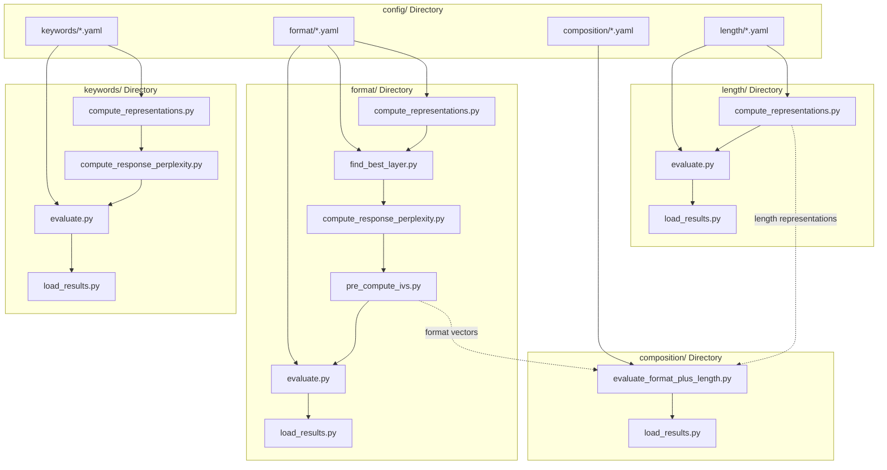
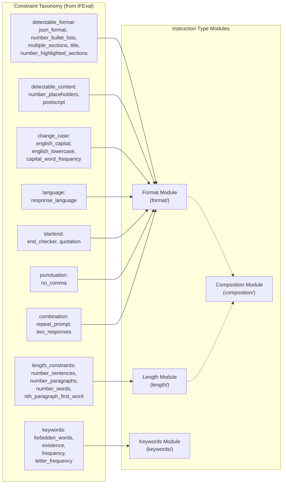
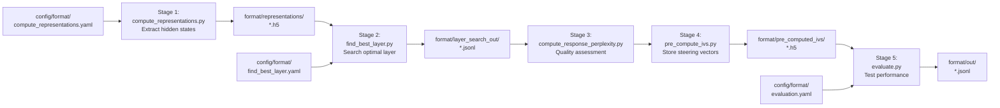
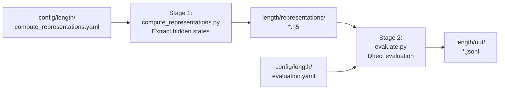
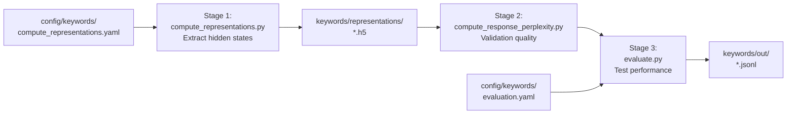
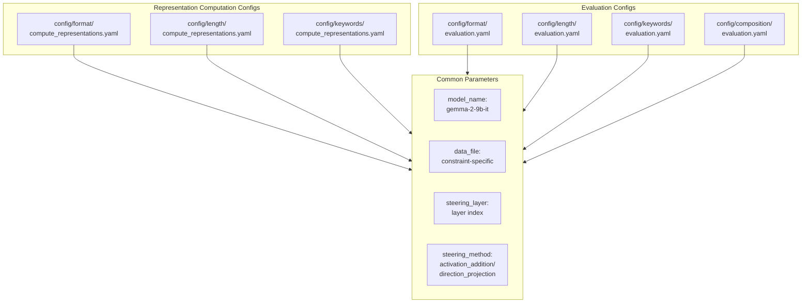
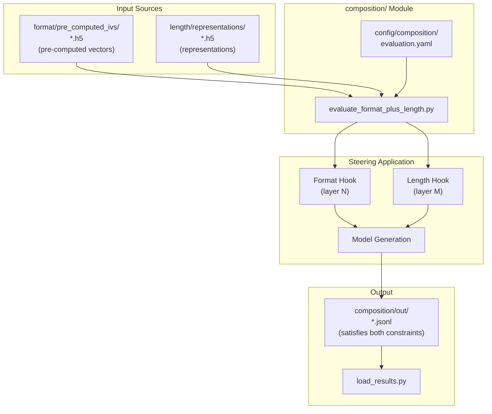

<!-- source: DeepWiki mcp.deepwiki.com · repo microsoft/llm-steer-instruct · page 5 Instruction Type Modules · fetched 2026-10-26 -->

# Instruction Type Modules

Relevant source files

The following files were used as context for generating this wiki page:

- [README.md](README.md)
- [data/format/all_base_x_all_instructions_filtered.jsonl](data/format/all_base_x_all_instructions_filtered.jsonl)
- [ifeval_scripts/README.md](ifeval_scripts/README.md)

## Purpose and Scope

This document provides an overview of the three primary instruction-type modules that implement activation steering for different categories of constraints: **format instructions**, **length instructions**, and **keyword instructions**. Each module follows a similar activation steering methodology but with workflows tailored to the specific characteristics of its constraint type. The document also covers the **composition module** that enables multi-instruction steering by combining vectors from multiple modules.

For detailed information about individual modules:
- Format instructions pipeline → see [Format Instructions Module](#5.1)
- Length instructions pipeline → see [Length Instructions Module](#5.2)  
- Keyword instructions pipeline → see [Keyword Instructions Module](#5.3)
- Multi-instruction composition → see [Multi-Instruction Composition](#5.4)

For foundational concepts about activation steering methodology → see [Activation Steering Methodology](#2.1)  
For the underlying constraint taxonomy → see [Instruction Types and Constraint Taxonomy](#2.2)

---

## Module Overview and Architecture

The repository implements three specialized modules organized in separate directories, each handling a distinct category of instruction-following constraints. These modules share common infrastructure (see [Infrastructure and Utilities](#3)) but differ significantly in their pipeline complexity and evaluation strategies.

### Directory Structure and Key Scripts

**Sources:** [README.md:22-48]()

---

## Constraint Taxonomy to Module Mapping

The instruction type modules correspond to specific categories within the IFEval constraint taxonomy, with each module specialized for evaluating and steering particular types of instructions.

**Sources:** [data/format/all_base_x_all_instructions_filtered.jsonl:1-20](), [README.md:62-107]()

---

## Pipeline Complexity Comparison

The three modules implement pipelines of varying complexity, reflecting the different challenges in steering each instruction type. The table below summarizes the key differences:

| Module | Stages | Layer Search | Perplexity Analysis | Pre-computation | Key Challenge |
|--------|--------|--------------|---------------------|-----------------|---------------|
| **Format** | 5 | ✓ (validate on subset) | ✓ (quality proxy) | ✓ (store vectors) | Rich taxonomy (28+ subtypes), quality preservation |
| **Length** | 2 | ✗ (direct evaluation) | ✗ | ✗ | High-level semantics, continuous values |
| **Keywords** | 3 | ✗ (direct evaluation) | ✓ (validation quality) | ✗ | Binary constraints, word-level precision |
| **Composition** | 1 | ✗ (reuses components) | ✗ | ✗ (loads from modules) | Multi-constraint coordination |

**Sources:** [README.md:62-115]()

### Format Instructions: Full 5-Stage Pipeline

The format module implements the most comprehensive pipeline due to its broad constraint taxonomy and the need to balance instruction adherence with response quality.

**Sources:** [README.md:62-82]()

### Length Instructions: Simplified 2-Stage Pipeline

The length module uses a streamlined pipeline that computes representations and directly evaluates without intermediate optimization steps.

**Sources:** [README.md:84-92]()

### Keywords Instructions: Intermediate 3-Stage Pipeline

The keywords module adds perplexity analysis to the basic pipeline for validation quality assessment, but skips layer search and pre-computation.

**Sources:** [README.md:95-107]()

---

## Common Patterns Across Modules

Despite pipeline differences, all modules share fundamental patterns in their implementation and configuration.

### Shared Script Names and Purposes

All modules include these core scripts:

| Script Name | Purpose | Format | Length | Keywords |
|-------------|---------|--------|--------|----------|
| `compute_representations.py` | Extract paired hidden states | ✓ | ✓ | ✓ |
| `evaluate.py` | Generate steered outputs | ✓ | ✓ | ✓ |
| `load_results.py` | Analyze metrics | ✓ | ✓ | ✓ |
| `compute_response_perplexity.py` | Quality proxy via GPT-2 | ✓ | ✗ | ✓ |
| `find_best_layer.py` | Layer optimization | ✓ | ✗ | ✗ |
| `pre_compute_ivs.py` | Vector storage | ✓ | ✗ | ✗ |

**Sources:** [README.md:22-48]()

### Configuration Management Pattern

Each module uses Hydra for declarative configuration management with YAML files structured consistently:

**Sources:** [README.md:18]()

### Data Flow Pattern

All modules process data through a consistent pipeline structure:

1. **Input:** Base queries from `data/ifeval_wo_instructions.jsonl` or constraint-specific files
2. **Paired Prompts:** With and without instructions (generated via prompt transformation)
3. **Representations:** Hidden states stored in `{module}/representations/*.h5`
4. **Outputs:** Generated responses in `{module}/out/*.jsonl`
5. **Evaluation:** IFEval metrics computed via `ifeval_scripts/`

**Sources:** [README.md:62-107]()

---

## Composition Module Architecture

The composition module implements multi-instruction steering by combining steering vectors from multiple modules, demonstrating the linear composability of activation steering.

The composition module:
- **Reuses artifacts** from format (pre-computed vectors) and length (representations)
- **Applies multiple hooks** at different layers simultaneously
- **Evaluates satisfaction** of both constraints using IFEval framework
- **Does not require** separate representation computation or layer search

**Sources:** [README.md:109-115]()

---

## Module Selection Guidelines

When working with this codebase, select the appropriate module based on the constraint category:

| Constraint Type | Module | Key Considerations |
|----------------|--------|-------------------|
| Response structure (JSON, bullets, sections) | `format/` | Use full pipeline with layer search for optimal quality |
| Response length (sentences, words, paragraphs) | `length/` | Direct evaluation sufficient; no layer optimization needed |
| Word inclusion/exclusion | `keywords/` | Include perplexity step for validation quality assessment |
| Multiple constraints simultaneously | `composition/` | Requires pre-computed artifacts from other modules |
| Case conversion, language, punctuation | `format/` | Treated as format constraints despite different semantics |

**Cross-Module Experiments:** The format module supports cross-model transfer (steering vectors from instruction-tuned models applied to base models) via the `cross_model` flag in evaluation configs. See [Cross-Model Experiments](#7.1) for details.

**Sources:** [README.md:62-115]()

---

## Next Steps

For detailed documentation of each module's implementation:
- **Format Module:** See [Format Instructions Module](#5.1) for the 5-stage pipeline, constraint subtypes, and pre-computation strategy
- **Length Module:** See [Length Instructions Module](#5.2) for high-level constraints and simplified evaluation
- **Keywords Module:** See [Keyword Instructions Module](#5.3) for keyword set management and validation strategies  
- **Composition Module:** See [Multi-Instruction Composition](#5.4) for multi-constraint coordination and hook management

For understanding the underlying activation steering methodology that all modules share, see [Activation Steering Methodology](#2.1).

---

