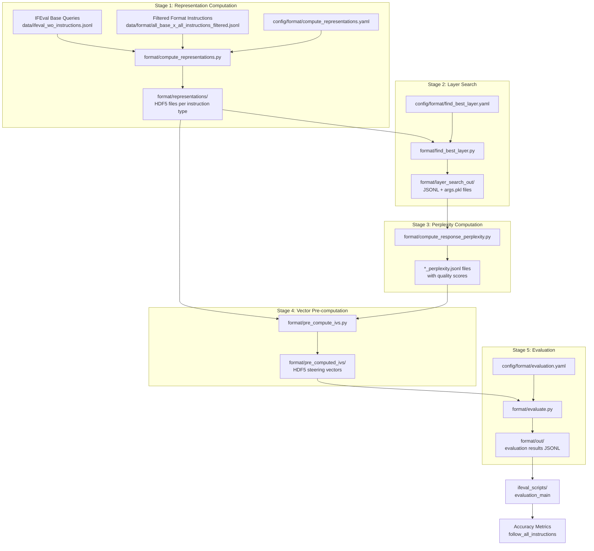
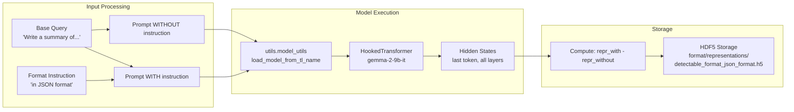
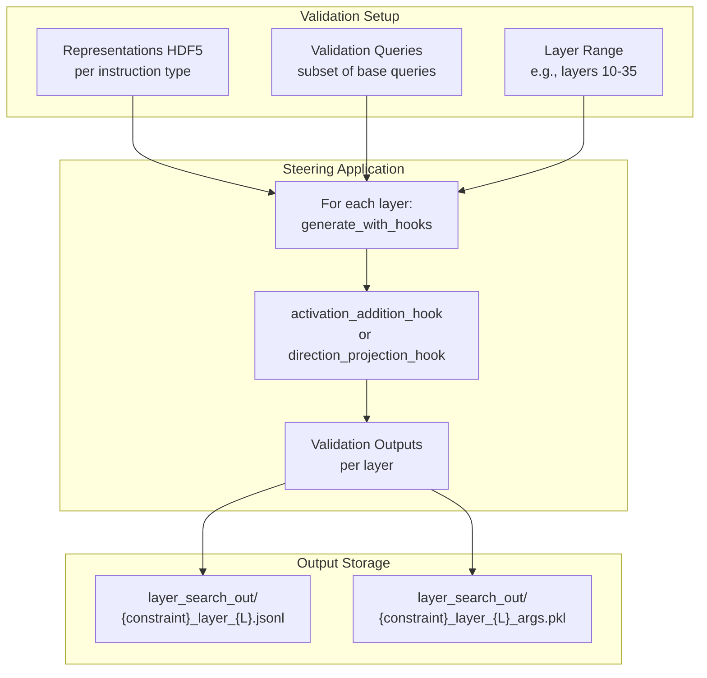
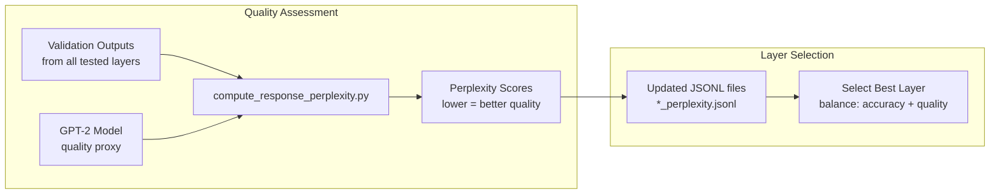
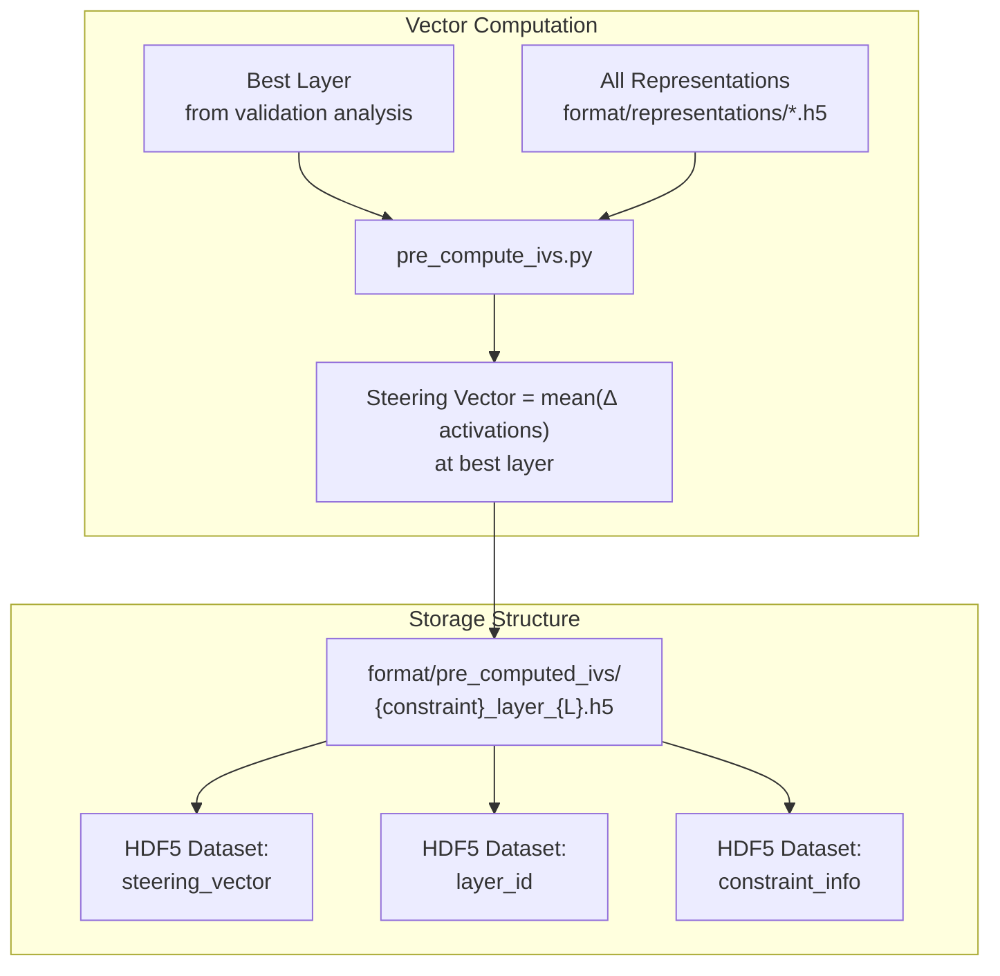
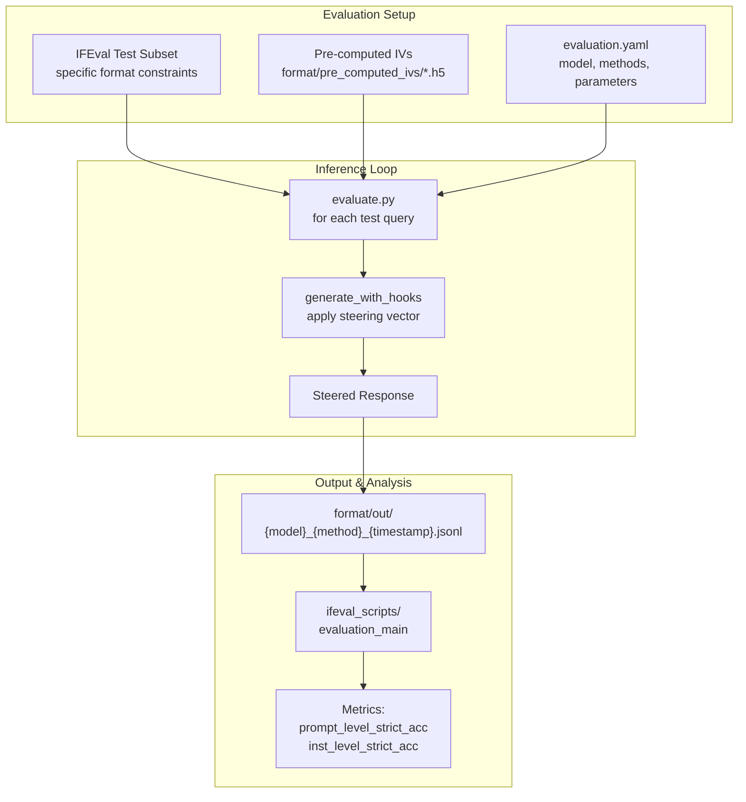
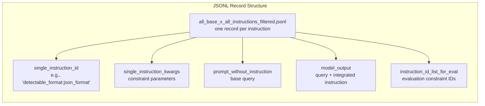
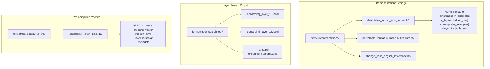
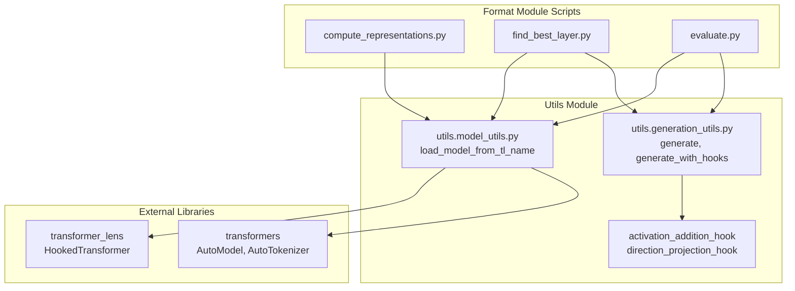
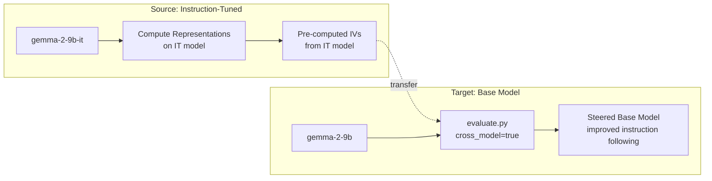

<!-- source: DeepWiki mcp.deepwiki.com · repo microsoft/llm-steer-instruct · page 5.1 Format Instructions Module · fetched 2026-10-26 -->

# Format Instructions Module

<details>
<summary>Relevant source files</summary>

The following files were used as context for generating this wiki page:

- [README.md](README.md)
- [data/format/all_base_x_all_instructions_filtered.jsonl](data/format/all_base_x_all_instructions_filtered.jsonl)
- [ifeval_scripts/README.md](ifeval_scripts/README.md)

</details>


## Purpose and Scope

The Format Instructions Module implements the most comprehensive activation steering pipeline for format-related constraints in language model outputs. This module handles 10 major format categories encompassing 28+ specific subtypes of formatting instructions, including JSON output, bullet lists, sections, case changes, language constraints, and positional requirements.

This page documents the complete 5-stage pipeline in the `format/` directory: representation computation, layer search, perplexity analysis, vector pre-computation, and evaluation. For length-based constraints (word/sentence counts), see [Length Instructions Module](#5.2). For keyword inclusion/exclusion, see [Keyword Instructions Module](#5.3). For combining multiple instruction types, see [Multi-Instruction Composition](#5.4).

## Format Instruction Taxonomy

The format instructions module processes constraints from multiple categories defined in the IFEval dataset. The following table categorizes the format instruction types handled by this module:

| Category | Instruction IDs | Example Constraint |
|----------|----------------|-------------------|
| **Detectable Format** | `detectable_format:json_format` | "Write response in JSON format" |
| | `detectable_format:number_bullet_lists` | "Use exactly 3 bullet points" |
| | `detectable_format:multiple_sections` | "Include at least 2 sections marked 'SECTION X'" |
| | `detectable_format:title` | "Include a title wrapped in <<title>>" |
| | `detectable_format:number_highlighted_sections` | "Highlight at least 2 sections with *text*" |
| | `detectable_format:constrained_response` | "Choose from predefined options" |
| **Change Case** | `change_case:english_lowercase` | "Use no capital letters" |
| | `change_case:english_capital` | "Answer in all capital letters" |
| | `change_case:capital_word_frequency` | "Use at least 5 all-caps words" |
| **Language** | `language:response_language_{code}` | "Respond entirely in Bengali (bn)" |
| **Start/End** | `startend:quotation` | "Wrap entire response in double quotes" |
| | `startend:end_checker` | "End with exact phrase: 'Is there anything else I can help with?'" |
| **Detectable Content** | `detectable_content:postscript` | "Add postscript starting with P.P.S" |
| | `detectable_content:number_placeholders` | "Include at least 3 placeholders like [address]" |

**Sources:** [data/format/all_base_x_all_instructions_filtered.jsonl:1-43]()

## Pipeline Architecture

### Complete 5-Stage Workflow



**Sources:** [README.md:62-82]()

### Stage 1: Compute Representations

The first stage extracts hidden state representations from paired inputs (with and without format instructions).



**Script:** `format/compute_representations.py` processes each format instruction type independently, generating paired prompts and storing the activation differences.

**Key Configuration Parameters:**
- `model_name`: e.g., "gemma-2-9b-it" 
- `specific_constraint`: Format instruction type to process
- `max_examples`: Number of examples to compute (default varies by constraint)
- `device`: GPU device for computation

**Sources:** [README.md:64-67]()

### Stage 2: Find Best Layer

This stage identifies the optimal layer for steering by testing multiple layers on validation data.



**Script:** `format/find_best_layer.py` tests steering at each layer in the specified range and saves outputs for subsequent perplexity-based selection.

**Key Configuration Parameters:**
- `layer_range`: Tuple defining layers to test (e.g., `[10, 35]`)
- `steering_method`: "activation_addition" or "direction_projection"
- `weight`: Scaling factor for activation addition
- `target_value`: Target projection value (if using direction_projection)

**Sources:** [README.md:68-71]()

### Stage 3: Compute Response Perplexity



**Script:** `format/compute_response_perplexity.py` loads each layer's validation results, computes perplexity using GPT-2 as a text quality proxy, and saves updated results.

**Process:**
1. Load validation results for each layer from `layer_search_out/`
2. For each response, compute perplexity using GPT-2
3. Save updated results with perplexity field
4. Manual selection of best layer based on instruction adherence and perplexity

**Sources:** [README.md:72-74]()

### Stage 4: Pre-compute Instruction Vectors



**Script:** `format/pre_compute_ivs.py` computes the final steering vectors at the optimal layer and stores them in HDF5 format for efficient inference-time loading.

**Process:**
1. Load representations from `format/representations/{constraint}.h5`
2. Extract activations at the specified best layer
3. Compute mean steering vector across all examples
4. Save to `format/pre_computed_ivs/{constraint}_layer_{layer}.h5`

**Sources:** [README.md:75-77]()

### Stage 5: Evaluate



**Script:** `format/evaluate.py` applies pre-computed steering vectors during generation and evaluates instruction adherence using the IFEval framework.

**Key Evaluation Modes:**
- **Standard:** Evaluate with steering on test data
- **No Steering Baseline:** Generate without steering for comparison
- **Cross-Model:** Apply steering vectors from instruction-tuned models (e.g., `gemma-2-9b-it`) to base models (e.g., `gemma-2-9b`)

**Configuration Parameters:**
- `model_name`: Target model for evaluation
- `cross_model`: Boolean flag for cross-model experiments
- `steering_method`: "activation_addition", "direction_projection", or "no_steering"
- `specific_constraint`: Format instruction type to evaluate
- `num_examples`: Number of test examples

**Sources:** [README.md:78-82]()

## Configuration Management

The format module uses Hydra for declarative configuration with stage-specific YAML files:

| Configuration File | Purpose | Key Parameters |
|-------------------|---------|----------------|
| `config/format/compute_representations.yaml` | Stage 1 settings | `model_name`, `specific_constraint`, `max_examples`, `device` |
| `config/format/find_best_layer.yaml` | Stage 2 settings | `layer_range`, `steering_method`, `weight`, `target_value`, `num_validation` |
| `config/format/evaluation.yaml` | Stage 5 settings | `model_name`, `cross_model`, `steering_method`, `num_examples`, `specific_constraint` |

**Example Configuration Structure:**
```yaml
# config/format/evaluation.yaml
model_name: gemma-2-9b
cross_model: false
steering_method: activation_addition
weight: 1.0
specific_constraint: detectable_format:json_format
num_examples: 100
```

**Sources:** [README.md:66-81]()

## Data Structures and Artifacts

### Input Data Format

The filtered format instructions file contains records with the following structure:



**Example Record Fields:**
- `single_instruction_id`: "detectable_format:number_bullet_lists"
- `single_instruction_kwargs`: `{"num_bullets": 3}`
- `prompt_without_instruction`: "Write a summary of..."
- `model_output`: "Write a summary of... Your answer should contain exactly 3 bullet points..."

**Sources:** [data/format/all_base_x_all_instructions_filtered.jsonl:1-43]()

### Intermediate Artifacts



**Sources:** [README.md:64-77]()

### Output Format

Evaluation results are stored in JSONL format with the following structure:

```json
{
  "prompt": "Write a summary... in JSON format.",
  "response": "{\"summary\": \"Raymond III was...\"}",
  "instruction_id_list": ["detectable_format:json_format"],
  "kwargs": [{}],
  "follow_all_instructions": true,
  "follow_instruction_list": [true]
}
```

**Output Directory:** `format/out/`

**Naming Convention:** `{model_name}_{steering_method}_{constraint}_{timestamp}.jsonl`

**Sources:** [README.md:78-82](), [ifeval_scripts/README.md:23-26]()

## Integration with Other Modules

### Dependencies on Core Infrastructure



**Cross-Module Usage:**
- The composition module ([Multi-Instruction Composition](#5.4)) uses pre-computed format vectors from `format/pre_computed_ivs/`
- Format representations can be transferred cross-model (instruction-tuned → base models)
- Results loading utilities in `format/load_results.py` provide analysis functions shared across modules

**Sources:** [README.md:43-47]()

## Execution Examples

### Running the Complete Pipeline

**1. Compute representations for JSON format:**
```bash
cd format
python compute_representations.py \
  model_name=gemma-2-9b-it \
  specific_constraint=detectable_format:json_format \
  max_examples=500
```

**2. Find best steering layer:**
```bash
python find_best_layer.py \
  model_name=gemma-2-9b-it \
  specific_constraint=detectable_format:json_format \
  layer_range=[10,35] \
  steering_method=activation_addition \
  weight=1.0
```

**3. Compute perplexity scores:**
```bash
python compute_response_perplexity.py
```

**4. Pre-compute steering vectors (after manual layer selection):**
```bash
python pre_compute_ivs.py \
  specific_constraint=detectable_format:json_format \
  best_layer=22
```

**5. Evaluate on test set:**
```bash
python evaluate.py \
  model_name=gemma-2-9b-it \
  specific_constraint=detectable_format:json_format \
  steering_method=activation_addition \
  num_examples=100
```

**Sources:** [README.md:62-82]()

## Format Instruction Categories

### Detectable Format Instructions

This category includes structured output formats that can be programmatically verified:

| Instruction Type | Parameters | Verification Method |
|-----------------|------------|-------------------|
| `json_format` | None | Parse as valid JSON |
| `number_bullet_lists` | `num_bullets` | Count bullet points (*, -) |
| `multiple_sections` | `section_spliter`, `num_sections` | Search for section markers |
| `title` | None | Check for `<<title>>` wrapper |
| `number_highlighted_sections` | `num_highlights` | Count `*highlighted*` sections |
| `constrained_response` | None | Match predefined response options |

**Sources:** [data/format/all_base_x_all_instructions_filtered.jsonl:19-22]()

### Case Change Instructions

Constraints on letter capitalization:

| Instruction Type | Constraint | Example |
|-----------------|-----------|---------|
| `english_lowercase` | No capital letters | "write everything in lowercase" |
| `english_capital` | All capital letters | "WRITE EVERYTHING IN CAPS" |
| `capital_word_frequency` | At least N all-caps words | "Use words like IMPORTANT at least 5 times" |

**Sources:** [data/format/all_base_x_all_instructions_filtered.jsonl:6-20]()

### Language Constraints

Force responses in specific languages:
- `language:response_language_{code}` where `code` is a language code (e.g., bn=Bengali, mr=Marathi)
- Entire response must be in the specified language

**Sources:** [data/format/all_base_x_all_instructions_filtered.jsonl:10-12]()

### Start/End Constraints

Positional requirements for response formatting:
- `startend:quotation`: Wrap entire response in double quotes
- `startend:end_checker`: End with exact specified phrase

**Sources:** [data/format/all_base_x_all_instructions_filtered.jsonl:3-16]()

## Cross-Model Transfer

The format module supports transferring steering vectors from instruction-tuned models to base models:



**Configuration for Cross-Model:**
```yaml
# Use steering vectors from IT model on base model
model_name: gemma-2-9b  # base model
cross_model: true
# Representations computed with: gemma-2-9b-it
```

This tests whether instruction-following behaviors learned by the instruction-tuned model can be transferred to improve the base model's instruction adherence.

**Sources:** [README.md:78-82]()

---

