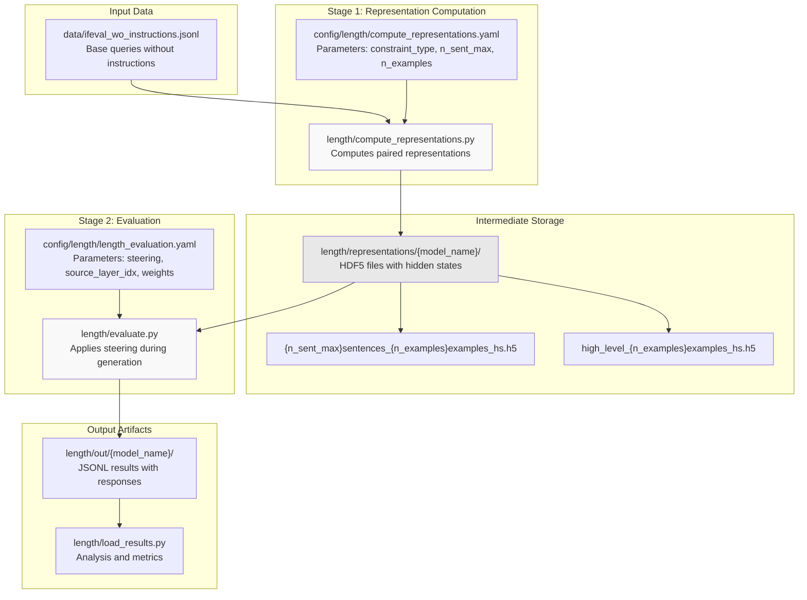
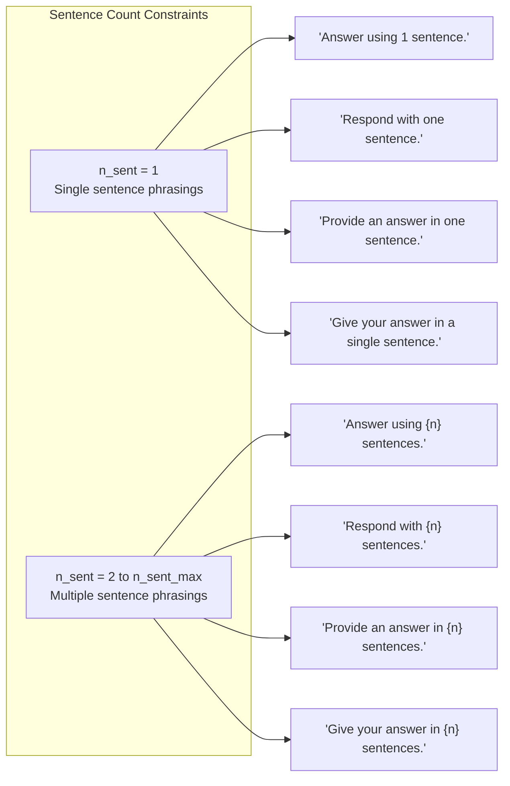
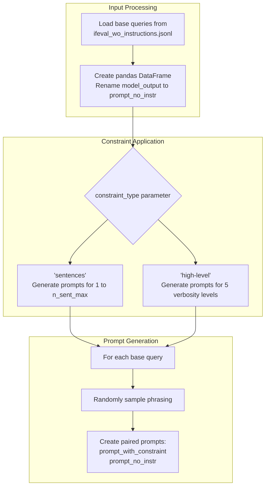
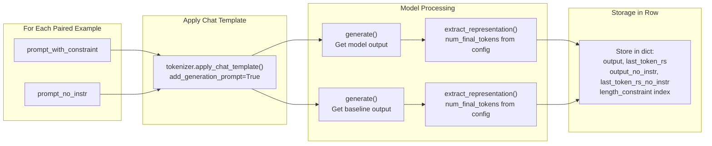
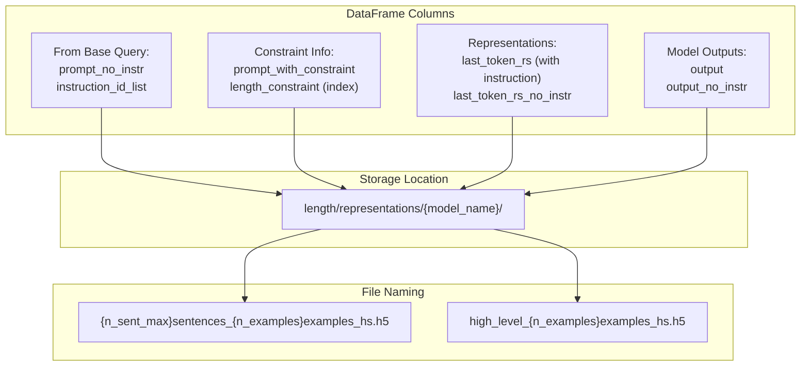
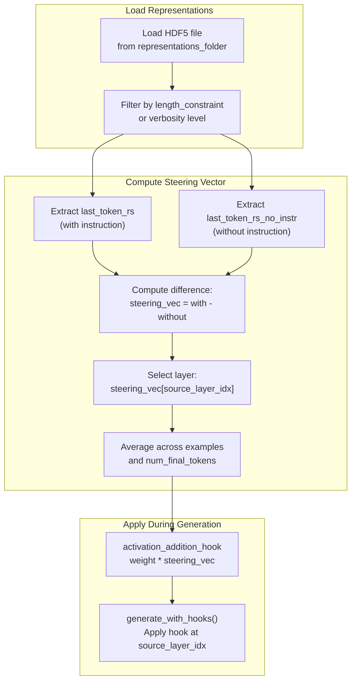
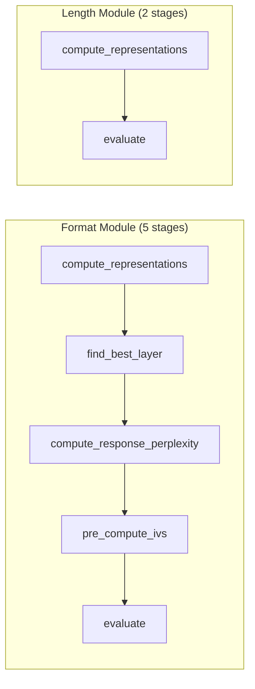
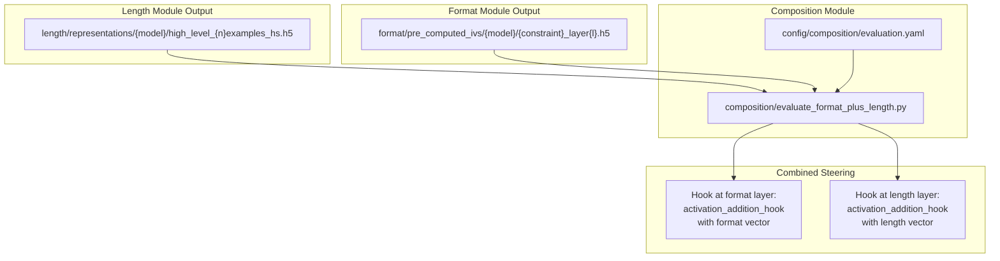

<!-- source: DeepWiki mcp.deepwiki.com · repo microsoft/llm-steer-instruct · page 5.2 Length Instructions Module · fetched 2026-10-26 -->

# Length Instructions Module

<details>
<summary>Relevant source files</summary>

The following files were used as context for generating this wiki page:

- [README.md](README.md)
- [config/keywords/compute_representations.yaml](config/keywords/compute_representations.yaml)
- [config/length/compute_representations.yaml](config/length/compute_representations.yaml)
- [config/length/length_evaluation.yaml](config/length/length_evaluation.yaml)
- [ifeval_scripts/README.md](ifeval_scripts/README.md)
- [keywords/compute_representations.py](keywords/compute_representations.py)
- [keywords/compute_response_perplexity.py](keywords/compute_response_perplexity.py)
- [keywords/load_results.py](keywords/load_results.py)
- [length/compute_representations.py](length/compute_representations.py)
- [utils/generation_utils.py](utils/generation_utils.py)

</details>


## Purpose and Scope

The Length Instructions Module handles steering language models to generate responses that satisfy specific length constraints. This module implements a simplified 2-stage pipeline for both quantitative constraints (specific sentence/word counts) and qualitative constraints (conciseness/verbosity levels). Unlike the Format Instructions Module (see [5.1](#5.1)) which has a 5-stage pipeline, length instructions use a streamlined approach that computes representations and directly applies steering during evaluation.

For multi-instruction experiments combining length with format constraints, see [Multi-Instruction Composition](#5.4). For the underlying activation steering methodology, see [Activation Steering Methodology](#2.1).

**Sources:** [README.md:84-93](), [README.md:16-48]()

---

## Module Architecture

The length module consists of two primary scripts and supporting configuration files:



**Sources:** [README.md:37-40](), [README.md:84-93](), [length/compute_representations.py:1-131]()

---

## Constraint Type Taxonomy

The module supports two distinct constraint categories, each with multiple phrasings to provide variability during representation computation:

### Quantitative Constraints: Sentence Counts



**Sources:** [length/compute_representations.py:37-52]()

### Qualitative Constraints: Verbosity Levels

The high-level constraint type maps to five verbosity levels (indexed 0-4):

| Level Index | Constraint Level | Example Phrasings |
|-------------|------------------|-------------------|
| 0 | Extra Short | "Be extremely concise.", "Be extremely brief.", "Keep it extremely short." |
| 1 | Short | "Be concise.", "Be brief.", "Keep it short." |
| 2 | Medium | "Don't be too concise or too verbose.", "The length should be moderate." |
| 3 | Verbose | "Be verbose.", "Provide a long answer.", "The answer should be long." |
| 4 | Extra Verbose | "Be extremely verbose.", "Provide an extremely long answer." |

**Sources:** [length/compute_representations.py:54-68]()

---

## Stage 1: Representation Computation

The `compute_representations.py` script extracts activation differences for length constraints using paired inputs.

### Data Preparation and Prompt Construction



**Sources:** [length/compute_representations.py:25-70]()

### Representation Extraction Pipeline

The core extraction process for each paired prompt:



The `extract_representation` function from `utils/generation_utils.py` extracts residual stream activations:

- Runs model with cache: `model.run_with_cache(model_input['input_ids'])`
- Extracts last N tokens: `cache['resid_post', layer_idx][:, -num_final_tokens:, :]`
- Returns stacked representations across all layers

**Sources:** [length/compute_representations.py:91-114](), [utils/generation_utils.py:122-135]()

### HDF5 Storage Format

The computed representations are stored in HDF5 files with the following structure:



The `last_token_rs` arrays have shape `(n_layers, num_final_tokens, hidden_dim)` containing residual stream activations.

**Sources:** [length/compute_representations.py:115-126](), [config/length/compute_representations.yaml:1-19]()

---

## Stage 2: Evaluation with Steering

The evaluation stage applies pre-computed steering vectors during model generation. Key configuration parameters control the steering behavior:

### Steering Methods

The `steering` parameter in `config/length/length_evaluation.yaml` supports multiple modes:

| Steering Mode | Description | Use Case |
|---------------|-------------|----------|
| `none` | No steering applied | Baseline comparison |
| `add_vector_length_specific` | Steer toward specific sentence count | Quantitative constraints |
| `add_vector_conciseness` | Steer toward shorter responses | High-level: extra short/short |
| `add_vector_verbosity` | Steer toward longer responses | High-level: verbose/extra verbose |

**Sources:** [config/length/length_evaluation.yaml:16]()

### Evaluation Configuration Parameters

The evaluation script uses the following key parameters:

```yaml
# Model and generation
model_name: 'phi-3'
max_generation_length: 1024

# Constraint specification
constraint_type: at_most  # or at_least, etc.
n_sent_max: 5
n_examples: 50

# Steering configuration
steering: 'add_vector_conciseness'
source_layer_idx: 12
steering_weights: [1]  # Can test multiple weights

# Representations
representations_folder: 'representations'
length_rep_file: high_level_50examples_hs.h5
```

The `source_layer_idx` specifies which layer's representations to use for computing the steering vector, while `steering_weights` allows testing multiple scaling factors.

**Sources:** [config/length/length_evaluation.yaml:1-30]()

### Steering Vector Computation

During evaluation, steering vectors are computed on-the-fly from representations:



The steering vector represents the activation difference that encodes the length instruction, averaged across multiple examples to improve robustness.

**Sources:** [utils/generation_utils.py:43-49](), [utils/generation_utils.py:62-96]()

---

## Simplified Pipeline Rationale

The length module omits three stages present in the format module:



**Omitted stages and their rationale:**

1. **`find_best_layer`**: Not implemented because length constraints may work consistently across layers, or the optimal layer is determined empirically and hard-coded in configuration
2. **`compute_response_perplexity`**: Quality assessment via perplexity may be less critical for length constraints compared to complex format requirements
3. **`pre_compute_ivs`**: Steering vectors are computed on-the-fly during evaluation rather than pre-computed, allowing more flexible experimentation with different constraint levels

**Sources:** [README.md:63-93]()

---

## Configuration Management

### Compute Representations Configuration

Key parameters in `config/length/compute_representations.yaml`:

| Parameter | Description | Example Values |
|-----------|-------------|----------------|
| `device` | Compute device | `'cuda'`, `'cpu'` |
| `model_name` | Model identifier | `'phi-3'`, `'gemma-2-9b-it'` |
| `max_new_tokens` | Tokens to generate during rep computation | `2` (minimal for efficiency) |
| `num_final_tokens` | Number of final tokens to extract | `1` (last token), `8` (multiple) |
| `constraint_type` | Type of length constraint | `'sentences'`, `'high-level'` |
| `n_sent_max` | Maximum sentence count (sentences only) | `10` |
| `n_examples` | Number of base queries to use | `50` |

**Sources:** [config/length/compute_representations.yaml:1-19]()

### Evaluation Configuration

Key parameters in `config/length/length_evaluation.yaml`:

| Parameter | Description | Impact |
|-----------|-------------|--------|
| `include_instructions` | Include instruction in prompt during evaluation | `False`: pure steering, `True`: steering + explicit instruction |
| `constraint_type` | Constraint type for IFEval evaluation | `'at_most'`, `'at_least'`, `'exactly'` |
| `steering` | Steering method to apply | Determines which vector computation approach |
| `source_layer_idx` | Layer to apply steering | Typically middle layers (e.g., 12 for 32-layer models) |
| `steering_weights` | List of weights to test | `[1]`, `[0.5, 1, 1.5, 2]` for ablation |

**Sources:** [config/length/length_evaluation.yaml:1-30]()

---

## Output Artifacts and Results Analysis

### Output Directory Structure

```
length/
├── representations/
│   └── {model_name}/
│       ├── {n_sent_max}sentences_{n_examples}examples_hs.h5
│       └── high_level_{n_examples}examples_hs.h5
└── out/
    └── {model_name}/
        └── {experiment_config}/
            └── out.jsonl
```

### JSONL Output Format

Each line in `out.jsonl` contains:

```json
{
  "prompt": "Original IFEval prompt with constraint",
  "response": "Model-generated response with steering",
  "follow_all_instructions": true,
  "follow_instruction_list": [true, true],
  "instruction_id_list": ["length_constraints:number_sentences:..."],
  "prompt_no_instr": "Base query without constraint"
}
```

**Sources:** Based on IFEval format patterns from [ifeval_scripts/README.md:18-31]()

### Results Loading and Analysis

The `load_results.py` script (referenced but not provided) typically:

1. Loads JSONL files from multiple experimental conditions
2. Computes aggregate metrics:
   - `follow_all_instructions` mean (accuracy)
   - Response length statistics
   - Per-constraint-level breakdown
3. Generates visualizations comparing steering methods

**Sources:** [README.md:39-40](), [keywords/load_results.py:1-56]() (analogous implementation)

---

## Integration with Composition Module

The length representations are used in multi-instruction steering (see [5.4](#5.4)):



The composition module loads both length representations and pre-computed format instruction vectors, applies steering hooks at potentially different layers, and evaluates on prompts with both constraint types.

**Sources:** [README.md:109-115]()

---

## Cross-Model Transfer Support

Like other instruction modules, length supports cross-model experiments where representations from instruction-tuned models steer base models. Configuration pattern:

```yaml
# In compute_representations.yaml
model_name: 'gemma-2-9b-it'  # Instruction-tuned

# In evaluation.yaml
model_name: 'gemma-2-9b'  # Base model
cross_model: true
```

The evaluation script loads representations computed on the instruction-tuned variant but applies steering to the base model, testing whether length-following behavior transfers across model variants.

**Sources:** [README.md:81-82]() (format example, same pattern applies)

---

## Key Implementation Details

### Chat Template Application

All prompts undergo chat template formatting before model processing:

```python
messages = [{"role": "user", "content": example}]
example = tokenizer.apply_chat_template(
    messages, 
    add_generation_prompt=True, 
    tokenize=False
)
```

This ensures prompts match the expected format for instruction-tuned models.

**Sources:** [length/compute_representations.py:97-100]()

### Representation Shape

The `last_token_rs` arrays have shape:
- Dimension 0: Number of layers (`model.cfg.n_layers`)
- Dimension 1: Number of final tokens (`num_final_tokens` from config)
- Dimension 2: Hidden dimension (`model.cfg.d_model`)

For `num_final_tokens=1`, this is `(n_layers, 1, hidden_dim)`.

**Sources:** [utils/generation_utils.py:132]()

### Progress Tracking

Representation computation uses `tqdm` progress bars:

```python
limit = args.n_examples * args.n_sent_max  # or * len(phrasings)
p_bar = tqdm.tqdm(total=limit)
# Inside loop:
p_bar.update(1)
```

This provides real-time feedback during the potentially lengthy computation process.

**Sources:** [length/compute_representations.py:79-88](), [length/compute_representations.py:88-113]()

---

