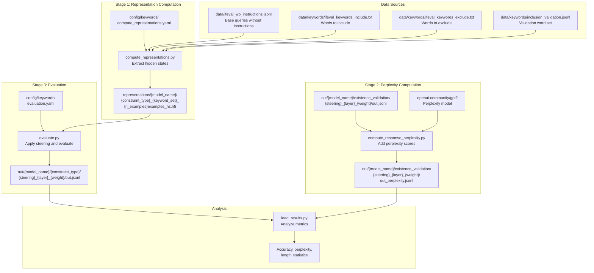
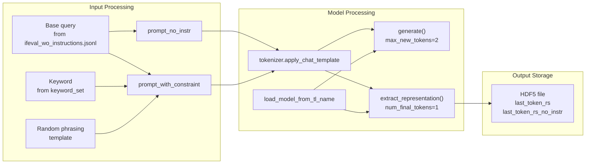
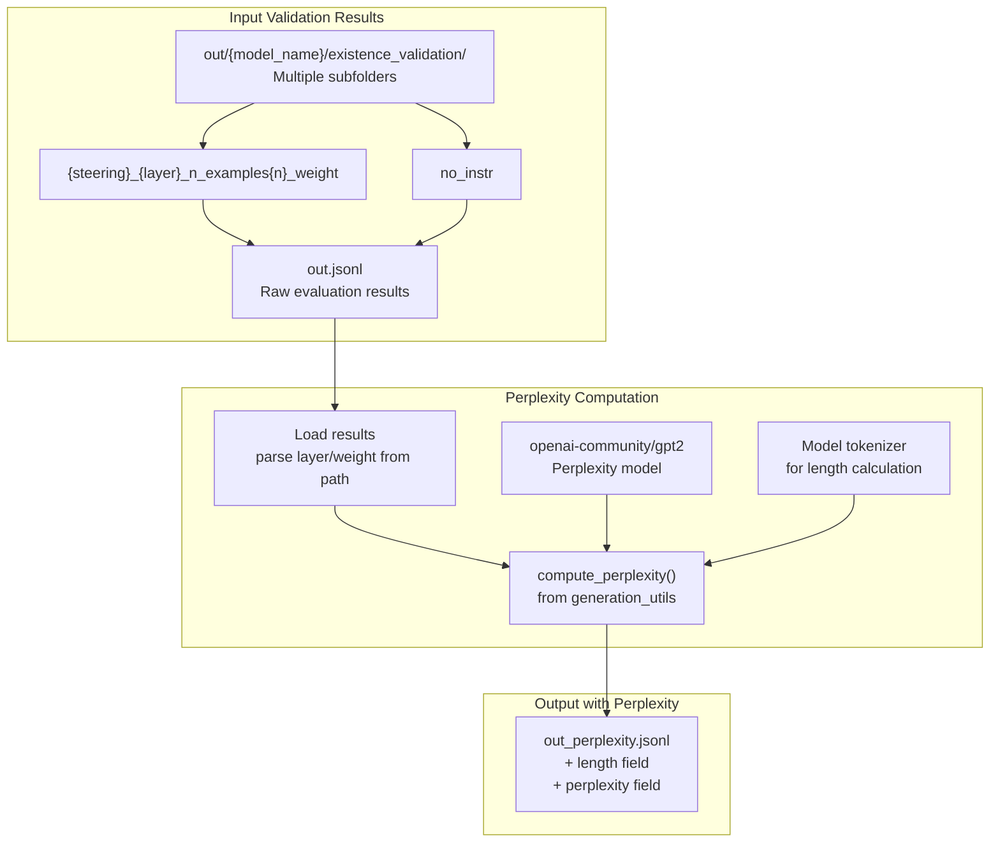
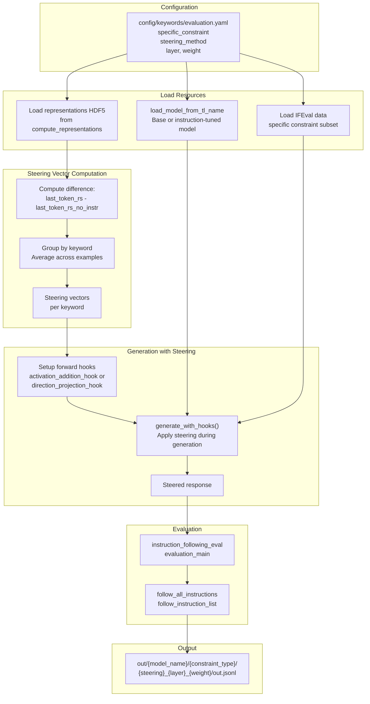
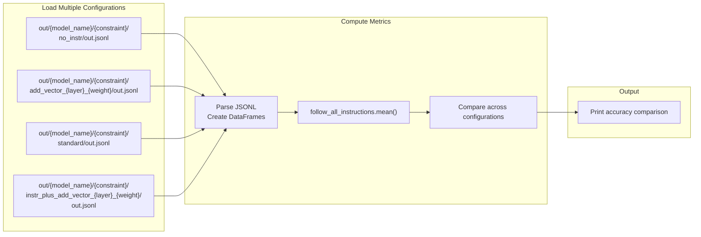

<!-- source: DeepWiki mcp.deepwiki.com · repo microsoft/llm-steer-instruct · page 5.3 Keyword Instructions Module · fetched 2026-10-26 -->

# Keyword Instructions Module

<details>
<summary>Relevant source files</summary>

The following files were used as context for generating this wiki page:

- [README.md](README.md)
- [config/keywords/compute_representations.yaml](config/keywords/compute_representations.yaml)
- [config/length/compute_representations.yaml](config/length/compute_representations.yaml)
- [ifeval_scripts/README.md](ifeval_scripts/README.md)
- [keywords/compute_representations.py](keywords/compute_representations.py)
- [keywords/compute_response_perplexity.py](keywords/compute_response_perplexity.py)
- [keywords/load_results.py](keywords/load_results.py)
- [length/compute_representations.py](length/compute_representations.py)

</details>


## Purpose and Scope

This document describes the Keyword Instructions Module, which implements activation steering for word-specific constraints—specifically, word inclusion and exclusion requirements. The module computes steering vectors that guide language models to include or exclude specific keywords in their responses. It follows a 3-stage pipeline: representation computation, perplexity evaluation, and final evaluation on the IFEval dataset.

For information about other instruction types, see [Format Instructions Module](#5.1) and [Length Instructions Module](#5.2). For combining keyword steering with other instruction types, see [Multi-Instruction Composition](#5.4).

**Sources:** [README.md:95-107](), [keywords/compute_representations.py:1-124](), [keywords/compute_response_perplexity.py:1-108](), [keywords/evaluate.py]()

## Module Overview

The Keyword Instructions Module is organized in the `keywords/` directory and consists of three primary processing stages plus a results loading utility:

| Script | Stage | Purpose |
|--------|-------|---------|
| `compute_representations.py` | 1 | Extract hidden states for paired inputs (with/without keyword constraints) |
| `compute_response_perplexity.py` | 2 | Compute GPT-2 perplexity scores for validation responses |
| `evaluate.py` | 3 | Evaluate steering on IFEval dataset with keyword constraints |
| `load_results.py` | Analysis | Load and analyze results, compute metrics |

This is a simplified pipeline compared to the format module (5 stages) but more elaborate than the length module (2 stages), as it includes perplexity computation for quality assessment.

**Sources:** [README.md:95-107](), [keywords/]()

## Pipeline Architecture



**Sources:** [README.md:95-107](), [keywords/compute_representations.py:1-124](), [keywords/compute_response_perplexity.py:1-108]()

## Keyword Set Management

The module supports three types of keyword sets, specified via the `keyword_set` configuration parameter:

### Keyword Set Types

| Set Name | File Path | Purpose | Usage |
|----------|-----------|---------|-------|
| `ifeval_include` | `data/keywords/ifeval_keywords_include.txt` | Words that must appear in response | Main evaluation on inclusion constraints |
| `ifeval_exclude` | `data/keywords/ifeval_keywords_exclude.txt` | Words that must not appear in response | Main evaluation on exclusion constraints |
| `validation` | `data/keywords/inclusion_validation.jsonl` | Validation set with likely_words field | Layer search and hyperparameter tuning |

The keyword files contain one word per line (for `.txt` files) or JSONL records with `likely_words` arrays (for validation set).

**Sources:** [keywords/compute_representations.py:40-57]()

### Constraint Phrasing Templates

The module uses multiple natural language phrasings to express keyword constraints, randomly selected during representation computation:

**Exclusion Phrasings** ([keywords/compute_representations.py:37]()):
```python
phrasings_exclude = [
    ' Do not include the word {}.',
    ' Make sure not to include the word "{}".',
    ' Do not use the word {}.',
    ' Do not say "{}".',
    ' Please exclude the word "{}".',
    ' The output should not contain the word "{}".'
]
```

**Inclusion Phrasings** ([keywords/compute_representations.py:38]()):
```python
phrasings_include = [
    ' Make sure to include the word "{}".',
    ' Please include the word "{}".',
    ' The output should contain the word "{}".',
    ' The output must contain the word "{}".',
    ' The output should say the word "{}".'
]
```

These phrasings are randomly selected for each word-prompt pair to increase diversity in the training data for steering vectors.

**Sources:** [keywords/compute_representations.py:37-38]()

## Stage 1: Compute Representations

### Script: `compute_representations.py`

This script extracts hidden state representations for paired inputs with and without keyword constraints.



**Sources:** [keywords/compute_representations.py:22-124]()

### Key Processing Steps

1. **Load Base Queries** ([keywords/compute_representations.py:25-33]()): Load queries from `ifeval_wo_instructions.jsonl`, excluding any that already have keyword instructions in their `instruction_id_list`.

2. **Filter Dataset** ([keywords/compute_representations.py:60]()): 
   ```python
   data_no_instr_df = data_no_instr_df[
       ~data_no_instr_df['instruction_id_list'].apply(
           lambda x: any(['keyword' in instr for instr in x])
       )
   ]
   ```

3. **Generate Prompt Pairs** ([keywords/compute_representations.py:64-76]()): For each word in the keyword set and each base query:
   - Select a random phrasing template
   - Create `prompt_with_constraint` by appending the keyword instruction
   - Store original query as `prompt_no_instr`

4. **Extract Representations** ([keywords/compute_representations.py:89-110]()): For each prompt pair:
   - Apply chat template
   - Generate short response (2 tokens) to get model state
   - Extract hidden states from the final token using `extract_representation()`
   - Store both `last_token_rs` (with constraint) and `last_token_rs_no_instr`

5. **Save to HDF5** ([keywords/compute_representations.py:115-119]()):
   ```python
   out_file = f'{folder}/{constraint_type}_{keyword_set}_{n_examples}examples_hs.h5'
   df.to_hdf(out_file, key='df', mode='w')
   ```

**Sources:** [keywords/compute_representations.py:22-124]()

### Configuration Parameters

From [config/keywords/compute_representations.yaml:1-21]():

| Parameter | Default | Description |
|-----------|---------|-------------|
| `device` | `'cuda'` | Device for model execution |
| `base_queries_path` | `'data/ifeval_wo_instructions.jsonl'` | Path to base queries |
| `model_name` | `'phi-3'` | Model identifier for loading |
| `max_new_tokens` | `2` | Tokens to generate (minimal for representation) |
| `num_final_tokens` | `1` | Number of final tokens to extract representations from |
| `constraint_type` | `'include'` | Either `'include'` or `'exclude'` |
| `keyword_set` | `'ifeval_include'` | One of: `ifeval_include`, `ifeval_exclude`, `validation` |
| `n_examples` | `1` | Number of base queries to use |

**Sources:** [config/keywords/compute_representations.yaml:1-21]()

## Stage 2: Compute Response Perplexity

### Script: `compute_response_perplexity.py`

This script augments validation results with perplexity scores computed using GPT-2 as a quality proxy. This helps identify optimal steering layers and weights.



**Sources:** [keywords/compute_response_perplexity.py:1-108]()

### Processing Logic

1. **Load Validation Results** ([keywords/compute_response_perplexity.py:20-50]()): 
   - Iterate through subfolders in `out/{model_name}/existence_validation/`
   - Parse layer and weight from subfolder names (format: `{steering}_{layer}_n_examples{n}_{weight}`)
   - Skip folders with `'adjust'` in name and folders already containing perplexity scores

2. **Initialize Models** ([keywords/compute_response_perplexity.py:58-67]()):
   ```python
   # Model tokenizer for length
   tokenizer = AutoTokenizer.from_pretrained(model_name_hf)
   
   # GPT-2 for perplexity
   perplexity_model = AutoModelForCausalLM.from_pretrained('openai-community/gpt2')
   perplexity_tokenizer = AutoTokenizer.from_pretrained('openai-community/gpt2')
   ```

3. **Compute Metrics** ([keywords/compute_response_perplexity.py:78-100]()): For each response:
   - Tokenize response and count tokens
   - Compute perplexity using `compute_perplexity()` from `utils/generation_utils.py`
   - Add `length` and `perplexity` fields to DataFrame

4. **Save Augmented Results** ([keywords/compute_response_perplexity.py:103-105]()):
   ```python
   new_path = paths_dict[key].replace('.jsonl', '_perplexity.jsonl')
   value.to_json(new_path, orient='records', lines=True)
   ```

**Sources:** [keywords/compute_response_perplexity.py:1-108]()

### Model Name Mapping

The script includes hardcoded mappings for model names ([keywords/compute_response_perplexity.py:58-62]()):

| Short Name | Hugging Face Name |
|------------|-------------------|
| `phi-3` | `microsoft/Phi-3-mini-4k-instruct` |
| `gemma-2-2b-it` | `google/gemma-2-2b-it` |

**Sources:** [keywords/compute_response_perplexity.py:58-62]()

## Stage 3: Evaluate

### Script: `evaluate.py`

This script applies steering vectors during inference and evaluates instruction-following accuracy on the IFEval dataset.



**Sources:** [keywords/evaluate.py](), [README.md:103-107]()

### Constraint Type Specification

The evaluation script supports different constraint specifications via the `specific_constraint` parameter:

| Value | Constraint Type | Dataset |
|-------|----------------|---------|
| `ifeval_include` | Word inclusion | IFEval test set with inclusion constraints |
| `ifeval_exclude` | Word exclusion | IFEval test set with exclusion constraints |
| `validation` | Validation set | Smaller validation dataset for hyperparameter search |

**Sources:** [README.md:103-107]()

### Steering Methods

The module supports the same steering methods as other instruction modules (see [Steering Methods Comparison](#7.2)):

1. **No Steering** (`no_instr`): Baseline without instruction or steering
2. **Standard** (`standard`): Include instruction in prompt but no steering
3. **Activation Addition** (`add_vector`): Add steering vector scaled by weight
4. **Instruction + Steering** (`instr_plus_add_vector`): Combine prompt instruction with steering
5. **Direction Projection** (`adjust_vector`): Project activations to target value

**Sources:** [keywords/evaluate.py](), [utils/generation_utils.py]()

## Results Analysis

### Script: `load_results.py`

This utility loads evaluation results from multiple steering configurations and computes comparative metrics.



**Sources:** [keywords/load_results.py:1-56]()

### Example Usage

From [keywords/load_results.py:15-53]():

```python
folder = f'{script_dir}/out'
model_name = 'phi-3'
constraint_type = 'existence'
steering = 'add_vector'
layer = 26
weight = 40
n_examples = 7

file = f'{folder}/{model_name}/{constraint_type}/{steering}_{layer}_n_examples{n_examples}_{weight}/out.jsonl'
with open(file, 'r') as f:
    results = [json.loads(line) for line in f]

df_steering = pd.DataFrame(results)

# Compare with other configurations...
print(f'No steering: {df_no_steering.follow_all_instructions.mean()}')
print(f'Steering: {df_steering.follow_all_instructions.mean()}')
print(f'Standard: {df_standard.follow_all_instructions.mean()}')
print(f'Instr + steering: {df_instr_plus_steering.follow_all_instructions.mean()}')
```

**Sources:** [keywords/load_results.py:15-53]()

## Output Directory Structure

The keywords module produces outputs in a hierarchical directory structure:

```
keywords/
├── representations/
│   └── {model_name}/
│       ├── include_ifeval_include_{n_examples}examples_hs.h5
│       ├── exclude_ifeval_exclude_{n_examples}examples_hs.h5
│       └── include_validation_{n_examples}examples_hs.h5
│
└── out/
    └── {model_name}/
        ├── {constraint_type}/
        │   ├── no_instr/
        │   │   └── out.jsonl
        │   ├── standard/
        │   │   └── out.jsonl
        │   ├── add_vector_{layer}_n_examples{n}_{weight}/
        │   │   └── out.jsonl
        │   └── instr_plus_add_vector_{layer}_n_examples{n}_{weight}/
        │       └── out.jsonl
        │
        └── existence_validation/
            ├── no_instr/
            │   ├── out.jsonl
            │   └── out_perplexity.jsonl
            └── add_vector_{layer}_n_examples{n}_{weight}/
                ├── out.jsonl
                └── out_perplexity.jsonl
```

**Sources:** [keywords/compute_representations.py:115-119](), [keywords/compute_response_perplexity.py:103-105](), [keywords/load_results.py:15-53]()

## Integration with Shared Infrastructure

The keywords module leverages shared utilities from the `utils/` directory:

| Utility | Function | Usage in Keywords Module |
|---------|----------|-------------------------|
| `model_utils.py` | `load_model_from_tl_name()` | Load model in both compute_representations and evaluate |
| `generation_utils.py` | `generate()` | Generate short responses for representation extraction |
| `generation_utils.py` | `extract_representation()` | Extract hidden states from final tokens |
| `generation_utils.py` | `generate_with_hooks()` | Apply steering during evaluation |
| `generation_utils.py` | `compute_perplexity()` | Compute GPT-2 perplexity in compute_response_perplexity |
| `generation_utils.py` | `activation_addition_hook()` | Steering hook for activation addition method |
| `generation_utils.py` | `direction_projection_hook()` | Steering hook for direction projection method |

**Sources:** [keywords/compute_representations.py:16-17](), [keywords/compute_response_perplexity.py:14](), See [Model Loading System](#3.1) and [Generation Utilities](#3.2)

## Comparison with Other Instruction Modules

The keywords module occupies a middle position in complexity between format and length modules:

| Module | Pipeline Stages | Pre-computation | Layer Search | Perplexity Eval |
|--------|----------------|-----------------|--------------|-----------------|
| Format | 5 | Yes (`pre_compute_ivs.py`) | Yes (`find_best_layer.py`) | Yes |
| Keywords | 3 | No | No (uses validation) | Yes |
| Length | 2 | No | No | No |

Key differences:

- **No pre-computation**: Keywords module computes steering vectors on-the-fly during evaluation by averaging representations grouped by keyword
- **Validation-based tuning**: Uses `existence_validation` directory and perplexity scores to select hyperparameters, but no dedicated layer search script
- **Simpler workflow**: Fewer stages make it easier to run experiments quickly

**Sources:** [README.md:63-115](), See [Format Instructions Module](#5.1) and [Length Instructions Module](#5.2)

---

