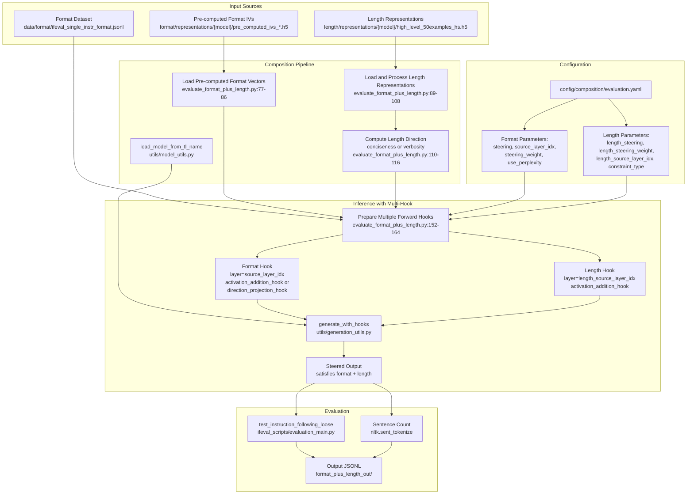
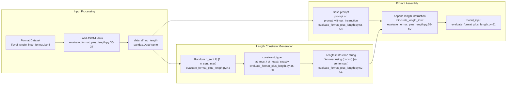
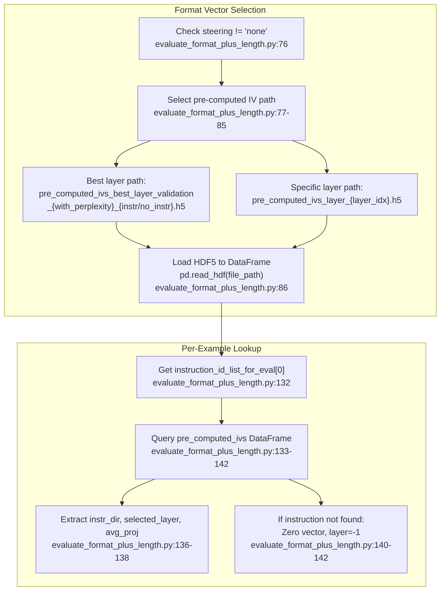
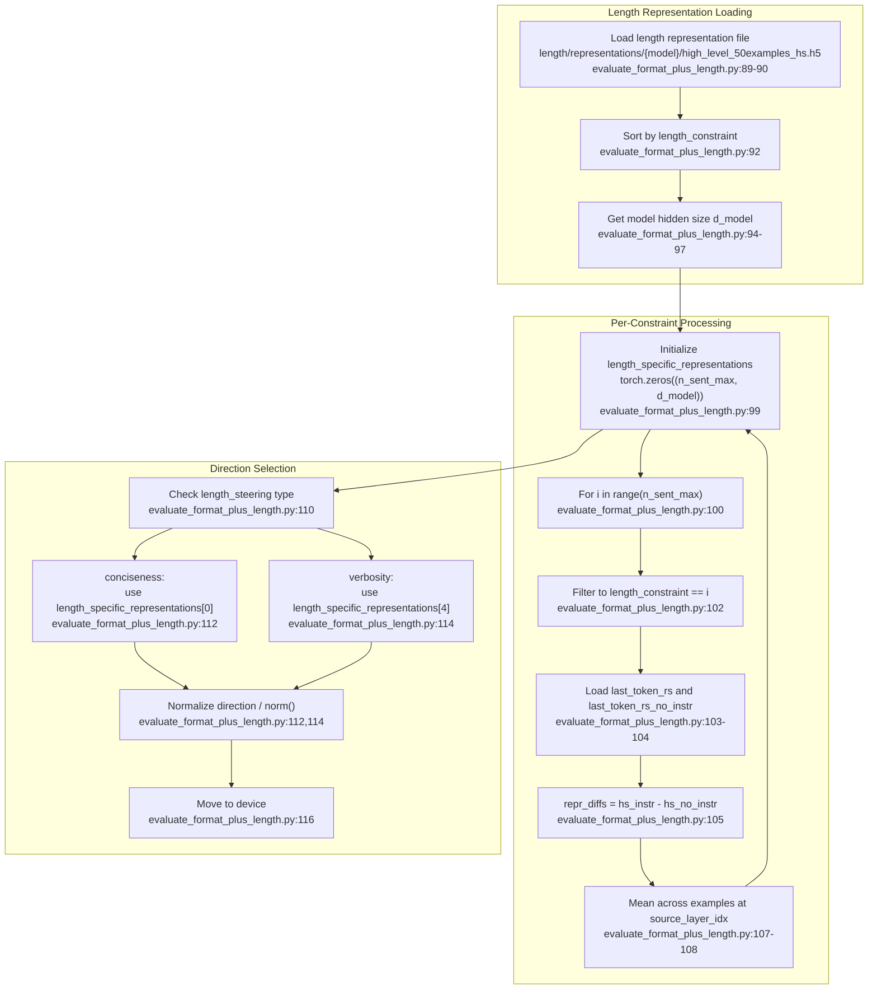
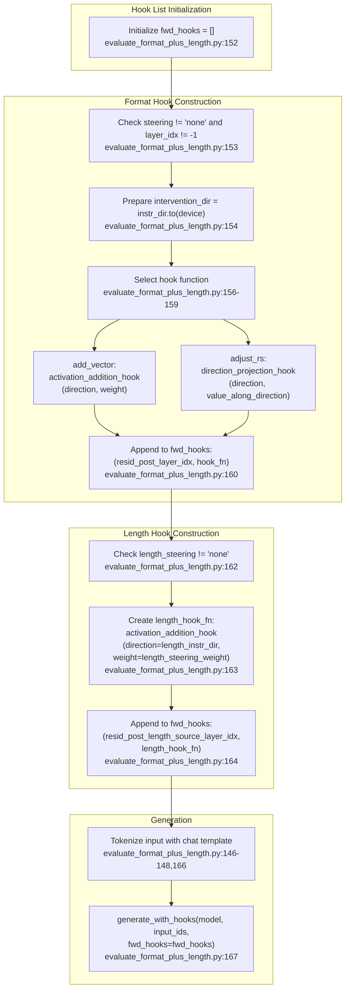
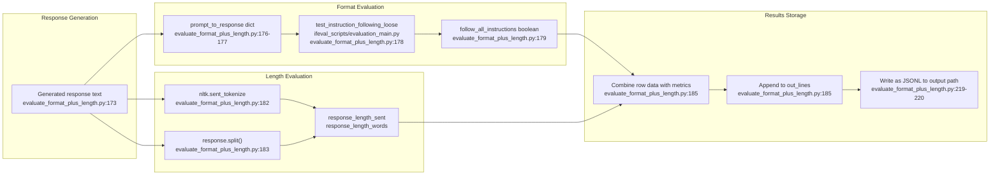
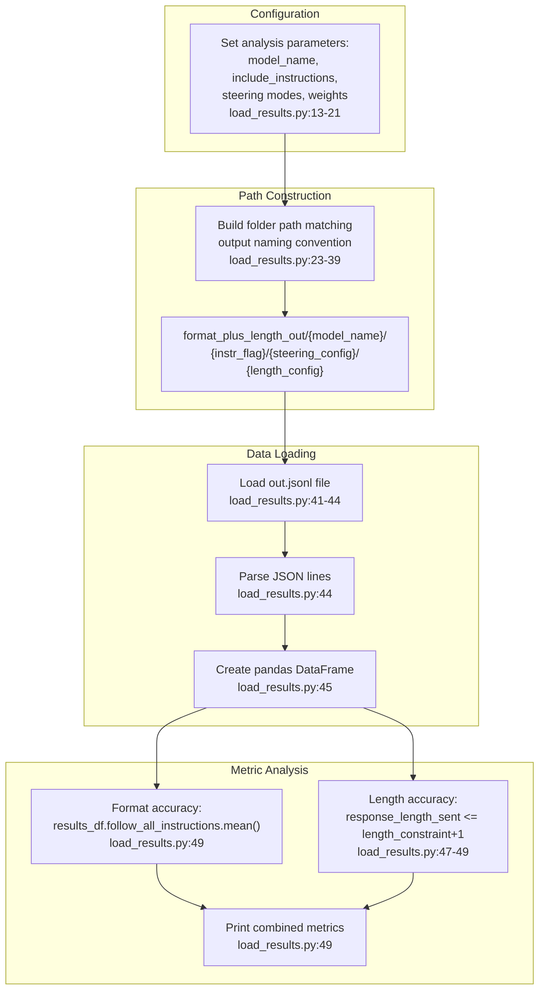

<!-- source: DeepWiki mcp.deepwiki.com · repo microsoft/llm-steer-instruct · page 5.4 Multi-Instruction Composition · fetched 2026-10-26 -->

# Multi-Instruction Composition

<details>
<summary>Relevant source files</summary>

The following files were used as context for generating this wiki page:

- [README.md](README.md)
- [composition/evaluate_format_plus_length.py](composition/evaluate_format_plus_length.py)
- [composition/load_results.py](composition/load_results.py)
- [config/composition/evaluation.yaml](config/composition/evaluation.yaml)
- [ifeval_scripts/README.md](ifeval_scripts/README.md)
- [requirements.txt](requirements.txt)

</details>


## Purpose and Scope

This document describes the multi-instruction composition module, which enables steering language models to satisfy multiple constraints simultaneously. The composition module combines steering vectors from different instruction types (format and length) and applies them together during inference to achieve adherence to multiple instructions at once.

For information about individual instruction types, see [Format Instructions Module](#5.1), [Length Instructions Module](#5.2), and [Keyword Instructions Module](#5.3). For details on the underlying steering methodology, see [Activation Steering Methodology](#2.1) and [Applying Steering During Inference](#4.4).

**Sources:** [README.md:109-114](), [composition/evaluate_format_plus_length.py:1-225](), [config/composition/evaluation.yaml:1-39]()

## System Architecture

The composition module implements a pipeline that combines pre-computed steering vectors from different instruction types and applies them simultaneously during model generation. The system leverages the linear composability of steering vectors by applying multiple forward hooks at different layers.



**Sources:** [composition/evaluate_format_plus_length.py:1-225](), [config/composition/evaluation.yaml:1-39](), [README.md:109-114]()

## Configuration Parameters

The composition module is configured via `config/composition/evaluation.yaml`, which combines parameters for both format and length steering.

### Core Configuration Structure

| Parameter | Description | Example Value |
|-----------|-------------|---------------|
| `data_path` | Path to format instruction dataset | `data/format/ifeval_single_instr_format.jsonl` |
| `output_path` | Output directory for results | `format_plus_length_out` |
| `model_name` | Model identifier | `phi-3`, `gemma-2-9b` |
| `max_generation_length` | Maximum tokens to generate | `2048` |
| `device` | Computation device | `cuda` |

### Format Instruction Parameters

| Parameter | Description | Values |
|-----------|-------------|--------|
| `include_instructions` | Include format instruction in prompt | `True` / `False` |
| `steering` | Format steering method | `none`, `add_vector`, `adjust_rs` |
| `source_layer_idx` | Layer for format steering (-1 = best layer) | `-1` or specific layer number |
| `steering_weight` | Weight for format vector addition | `1.0` |
| `use_perplexity` | Use perplexity-informed layer selection | `True` / `False` |
| `representations_folder` | Folder containing format representations | `all`, `subset_{ratio}` |

### Length Instruction Parameters

| Parameter | Description | Values |
|-----------|-------------|--------|
| `include_length_instr` | Include length instruction in prompt | `True` / `False` |
| `n_sent_max` | Maximum number of sentences for length constraints | `5` |
| `length_steering` | Type of length steering | `conciseness`, `verbosity`, `none` |
| `length_steering_weight` | Weight for length steering vector | `20` |
| `length_source_layer_idx` | Layer for length steering | `12` |
| `constraint_type` | Type of length constraint | `at_most`, `at_least`, `exactly` |
| `length_representations_folder` | Path to length representations | `length/representations` |
| `length_rep_file` | Specific representation file | `high_level_50examples_hs.h5` |

**Sources:** [config/composition/evaluation.yaml:1-39]()

## Data Preparation and Prompt Construction

The composition module constructs prompts that combine format and length constraints by augmenting the format instruction dataset with dynamically generated length constraints.



The prompt construction logic iterates through each format instruction example and augments it with a randomly sampled length constraint. The system stores `length_constraint = n_sent - 1` for evaluation purposes, enabling accurate comparison of the generated response length against the target.

**Sources:** [composition/evaluate_format_plus_length.py:39-66]()

## Steering Vector Loading and Processing

The composition module loads pre-computed steering vectors from two sources: format instruction vectors and length representations. These are processed into normalized directions for steering.

### Format Vector Loading



### Length Direction Computation

The length steering direction is computed by aggregating representations for different length constraints and selecting either the conciseness or verbosity direction.



**Sources:** [composition/evaluate_format_plus_length.py:76-116]()

## Multi-Hook Forward Pass

The core innovation of the composition module is the simultaneous application of multiple forward hooks at different layers during generation. This enables the model to satisfy multiple constraints at once.

### Hook Construction Logic



### Steering Method Combinations

The composition module supports different combinations of steering methods:

| Format Steering | Length Steering | Hook Composition |
|----------------|-----------------|------------------|
| `none` | `none` | No hooks, baseline generation |
| `add_vector` | `none` | Single format hook at `source_layer_idx` |
| `adjust_rs` | `none` | Single projection hook at `source_layer_idx` |
| `add_vector` | `conciseness`/`verbosity` | Two hooks: format at `source_layer_idx`, length at `length_source_layer_idx` |
| `adjust_rs` | `conciseness`/`verbosity` | Two hooks: projection at `source_layer_idx`, addition at `length_source_layer_idx` |

The hooks are applied simultaneously during the forward pass. When both format and length steering are active, the `fwd_hooks` list contains two tuples, each specifying a layer and hook function. The `generate_with_hooks` function [utils/generation_utils.py]() registers these hooks and they execute at their respective layers during each forward pass.

**Sources:** [composition/evaluate_format_plus_length.py:149-168]()

## Evaluation and Metrics

After generation, the composition module evaluates both format instruction adherence and length constraint satisfaction.



### Output Directory Structure

The output path is constructed hierarchically based on steering configuration:

```
format_plus_length_out/{model_name}/
    ├── instr/  (if include_instructions=True)
    │   └── {steering}_{source_layer_idx}[_perplexity]/
    │       └── {length_steering}_L{length_source_layer_idx}_w{length_steering_weight}/
    │           ├── out.jsonl
    │           └── args.json
    └── no_instr/  (if include_instructions=False)
        └── no_steering/
            └── {length_steering}_L{length_source_layer_idx}_w{length_steering_weight}/
                ├── out.jsonl
                └── args.json
```

The folder naming convention encodes the experimental configuration, making it easy to identify and compare different steering combinations. The `args.json` file stores the complete Hydra configuration for reproducibility.

**Sources:** [composition/evaluate_format_plus_length.py:175-220]()

## Results Analysis

The `composition/load_results.py` script provides utilities for loading and analyzing composition experiment results.

### Result Loading and Metric Computation



The length accuracy metric checks if `response_length_sent <= length_constraint + 1`, allowing for a one-sentence tolerance. This accounts for minor variations in sentence tokenization and provides a more robust evaluation metric.

**Sources:** [composition/load_results.py:1-52]()

## Dependencies and Integration Points

The composition module integrates with multiple components of the larger system:

### Required Pre-requisites

| Component | Purpose | Location |
|-----------|---------|----------|
| Format representations | Pre-computed format steering vectors | `format/representations/{model}/pre_computed_ivs_*.h5` |
| Length representations | High-level length constraint representations | `length/representations/{model}/high_level_50examples_hs.h5` |
| Model utilities | Model loading and configuration | `utils/model_utils.py` |
| Generation utilities | Hook-based generation | `utils/generation_utils.py` |
| IFEval scripts | Format instruction evaluation | `ifeval_scripts/evaluation_main.py` |

### External Dependencies

- **transformer_lens**: Provides `HookedTransformer` for activation manipulation and `utils.get_act_name` for layer name resolution
- **nltk**: Used for sentence tokenization in length evaluation
- **pandas**: DataFrame operations for representation loading and results analysis
- **hydra-core**: Configuration management
- **torch**: Tensor operations for representation processing

**Sources:** [composition/evaluate_format_plus_length.py:1-24](), [requirements.txt:1-14]()

---

