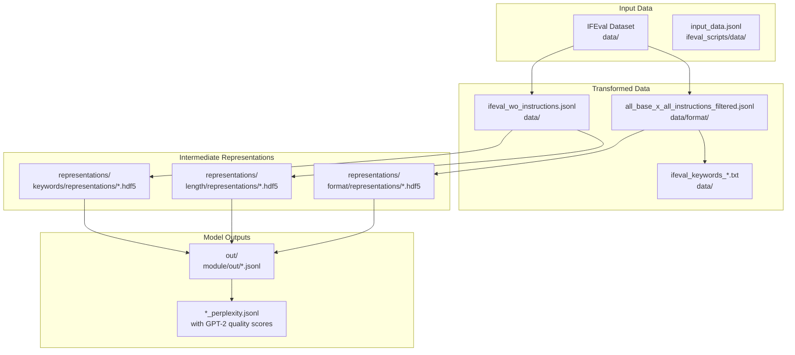
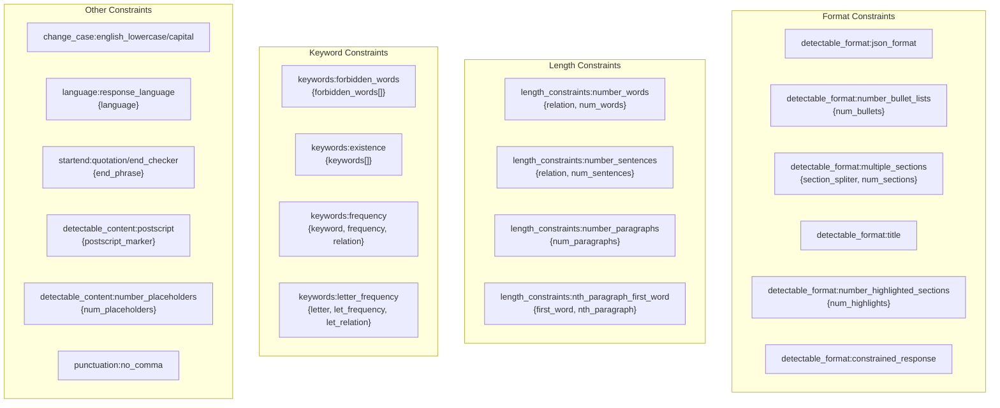
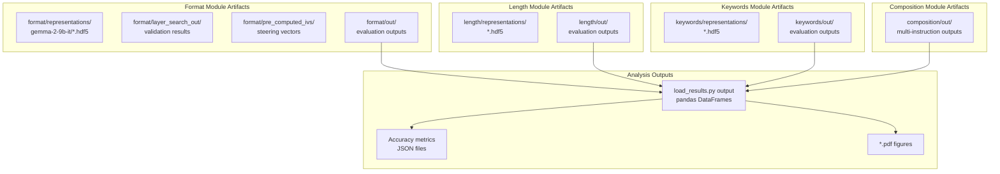
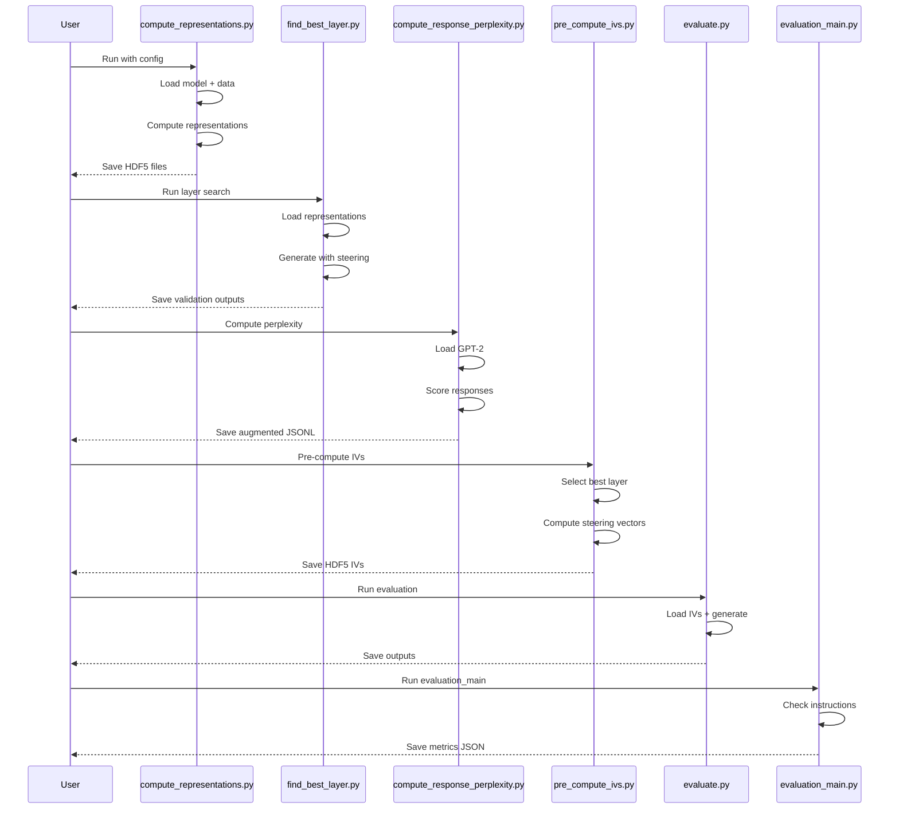
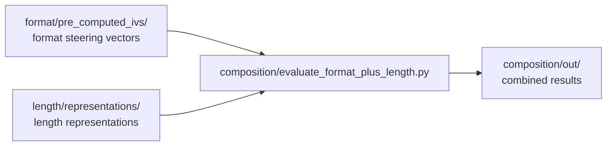

<!-- source: DeepWiki mcp.deepwiki.com · repo microsoft/llm-steer-instruct · page 6 Data and Evaluation · fetched 2026-10-26 -->

# Data and Evaluation

<details>
<summary>Relevant source files</summary>

The following files were used as context for generating this wiki page:

- [README.md](README.md)
- [data/format/all_base_x_all_instructions_filtered.jsonl](data/format/all_base_x_all_instructions_filtered.jsonl)
- [ifeval_scripts/README.md](ifeval_scripts/README.md)

</details>


This document provides an overview of the data sources, evaluation frameworks, and metrics computation used in the activation steering system. It covers the IFEval dataset integration, data transformation pipeline, evaluation methodologies, and output artifact formats.

For detailed information about specific evaluation components, see:
- Data sources and JSONL structures: [6.1](#6.1)
- IFEval framework integration details: [6.2](#6.2)
- Results loading and metrics calculation: [6.3](#6.3)
- Perplexity computation methodology: [6.4](#6.4)

## Overview

The evaluation system is built on the **IFEval (Instruction Following Evaluation)** benchmark, which provides a standardized framework for assessing instruction-following capabilities. The system extends IFEval with activation steering techniques and evaluates both instruction adherence and response quality through perplexity analysis.

## Data Sources and Pipeline

The system processes data through several stages, from raw IFEval prompts to filtered instruction-specific datasets:



**Sources:** [data/format/all_base_x_all_instructions_filtered.jsonl:1-50](), [README.md:16-48]()

## Core Data Structure

The primary data format is JSONL (JSON Lines), where each line represents a single prompt with its associated instructions and metadata. The structure includes:

| Field | Description | Example Value |
|-------|-------------|---------------|
| `prompt_without_instruction` | Base query without constraints | `"Write a summary of..."` |
| `model_output` | Prompt with instruction integrated | `"Write a summary... in JSON format."` |
| `single_instruction_id` | Constraint type identifier | `"detectable_format:json_format"` |
| `single_instruction_kwargs` | Constraint parameters | `{}` or `{"num_bullets": 3}` |
| `instruction_id_list` | List of all applied constraints | `["detectable_format:json_format"]` |
| `prompt_hash` | Unique identifier for the prompt | `"a005ba9813e40aa655c462db3ec57b43"` |
| `key` | Base prompt identifier | `1000` |
| `is_valid` | Validation flag | `true` |

**Example record structure:**

```json
{
  "single_instruction_kwargs": {},
  "prompt_hash": "a005ba9813e40aa655c462db3ec57b43",
  "single_instruction_id": "detectable_format:json_format",
  "model_output": "Write a summary of the wikipedia page in JSON format.",
  "prompt_without_instruction": "Write a summary of the wikipedia page.",
  "instruction_id_list": ["detectable_format:json_format"],
  "is_valid": true,
  "key": 1000
}
```

**Sources:** [data/format/all_base_x_all_instructions_filtered.jsonl:19-20]()

## Instruction Constraint Taxonomy

The system evaluates instruction-following across multiple constraint categories:



**Sources:** [data/format/all_base_x_all_instructions_filtered.jsonl:1-50]()

## Evaluation Pipeline Architecture

The evaluation process consists of multiple stages that produce different artifacts:

```mermaid
graph LR
    subgraph "Stage 1: Representation Computation"
        ComputeScript["compute_representations.py"]
        ModelGen["Model Forward Pass"]
        HDF5Storage["*.hdf5<br/>representations/"]
        
        ComputeScript --> ModelGen
        ModelGen --> HDF5Storage
    end
    
    subgraph "Stage 2: Layer Search (Format/Keywords only)"
        LayerSearch["find_best_layer.py<br/>(format only)"]
        ValidationGen["Generate on Validation Set"]
        LayerSearchOut["layer_search_out/<br/>*.jsonl"]
        
        HDF5Storage --> LayerSearch
        LayerSearch --> ValidationGen
        ValidationGen --> LayerSearchOut
    end
    
    subgraph "Stage 3: Perplexity Analysis"
        ComputePerp["compute_response_perplexity.py"]
        GPT2Model["GPT-2 Model"]
        PerplexityOut["*_perplexity.jsonl"]
        
        LayerSearchOut --> ComputePerp
        ComputePerp --> GPT2Model
        GPT2Model --> PerplexityOut
    end
    
    subgraph "Stage 4: Pre-compute IVs (Format only)"
        PreComputeScript["pre_compute_ivs.py"]
        IVStorage["pre_computed_ivs/<br/>*.hdf5"]
        
        HDF5Storage --> PreComputeScript
        PerplexityOut -.->|best layer info| PreComputeScript
        PreComputeScript --> IVStorage
    end
    
    subgraph "Stage 5: Evaluation"
        EvaluateScript["evaluate.py"]
        ModelSteering["Model + Steering Hooks"]
        EvalOut["out/<br/>*.jsonl"]
        
        IVStorage --> EvaluateScript
        HDF5Storage --> EvaluateScript
        EvaluateScript --> ModelSteering
        ModelSteering --> EvalOut
    end
    
    subgraph "Stage 6: IFEval Assessment"
        IFEvalMain["evaluation_main.py<br/>ifeval_scripts/"]
        MetricsOut["eval_results_*.json"]
        
        EvalOut --> IFEvalMain
        IFEvalMain --> MetricsOut
    end
```



**Sources:** [README.md:60-115](), [ifeval_scripts/README.md:20-31]()

## IFEval Framework Integration

The system integrates with the official IFEval evaluation code to compute instruction adherence metrics. The IFEval framework requires model outputs in a specific JSONL format:

```json
{
  "prompt": "Write a 300+ word summary ...",
  "response": "PUT YOUR MODEL RESPONSE HERE"
}
```

The evaluation script (`evaluation_main.py`) compares responses against the instruction criteria defined in `input_data.jsonl` and computes the following metrics:

| Metric | Description |
|--------|-------------|
| `prompt_level_strict_acc` | Strict accuracy per prompt (all instructions satisfied) |
| `prompt_level_loose_acc` | Loose accuracy per prompt (at least one instruction satisfied) |
| `inst_level_strict_acc` | Strict accuracy per instruction |
| `inst_level_loose_acc` | Loose accuracy per instruction |
| `follow_all_instructions` | Primary metric: percentage of prompts where all instructions are followed |

**Sources:** [ifeval_scripts/README.md:1-44](), [README.md:18]()

## Output Artifacts and Directory Structure

The system produces artifacts at each stage, stored in module-specific directories:



**Sources:** [README.md:22-47]()

## Perplexity-Based Quality Assessment

To ensure that steering doesn't degrade response quality, the system uses GPT-2 as a proxy model to compute perplexity scores. Lower perplexity indicates higher linguistic quality and coherence.

The perplexity computation process:

1. **Load model outputs** from validation or evaluation runs
2. **Compute token-level log probabilities** using GPT-2
3. **Calculate perplexity** as `exp(-mean(log_probs))`
4. **Augment JSONL** with perplexity field
5. **Use for layer selection** (choose layer with best instruction adherence and acceptable perplexity)

**Key scripts:**
- `format/compute_response_perplexity.py`
- `keywords/compute_response_perplexity.py`

**Sources:** [README.md:72-74](), [README.md:100-102]()

## Evaluation Workflow Example

The typical workflow for evaluating format instructions:



**Sources:** [README.md:60-81]()

## Data Validation and Filtering

The `all_base_x_all_instructions_filtered.jsonl` file contains pre-validated prompt-instruction pairs where:

- `is_valid` field indicates whether the instruction can be applied to the base prompt
- Each record includes both the base prompt and the instruction-augmented version
- Records are indexed by `key` (base prompt ID) and `uid` (unique constraint application ID)
- The `icl_prompt_with_single_instruction` field shows example prompts for in-context learning

**Sources:** [data/format/all_base_x_all_instructions_filtered.jsonl:1-50]()

## Cross-Module Data Sharing

For multi-instruction composition experiments, data is shared across modules:



The composition module loads:
- **Format steering vectors** from pre-computed HDF5 files
- **Length representations** computed on-the-fly or from cached HDF5 files
- Applies both simultaneously during generation

**Sources:** [README.md:109-114]()

---

