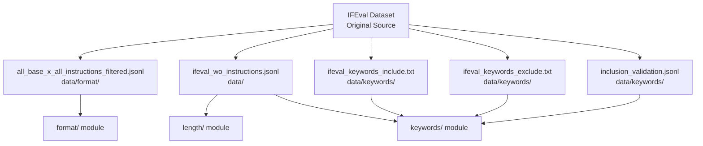
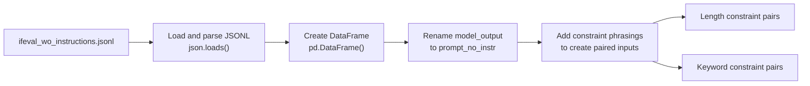
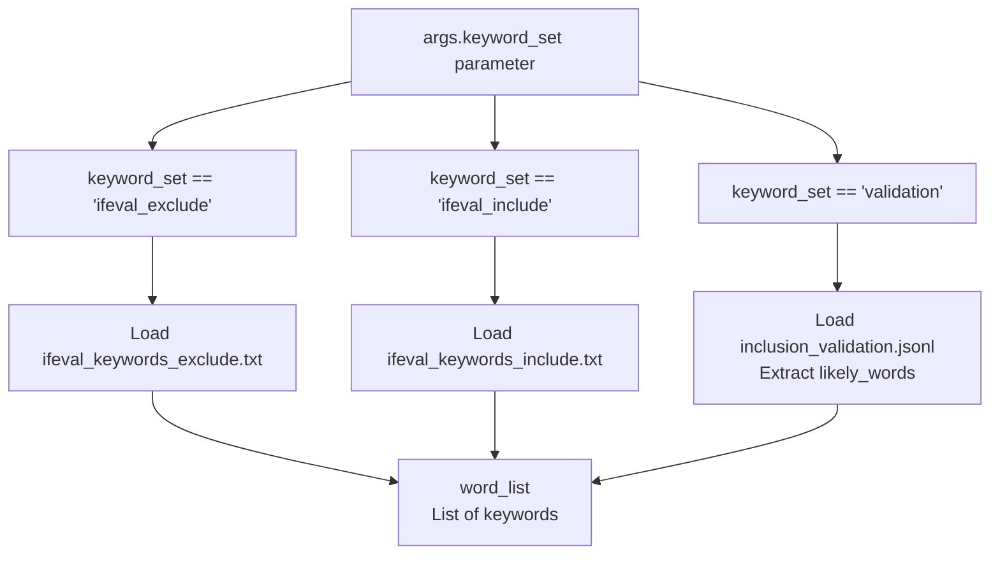
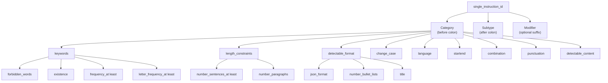
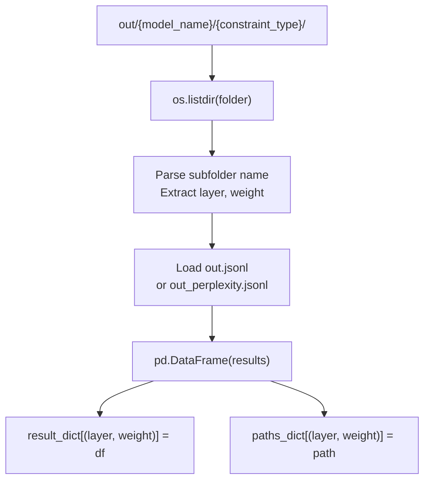
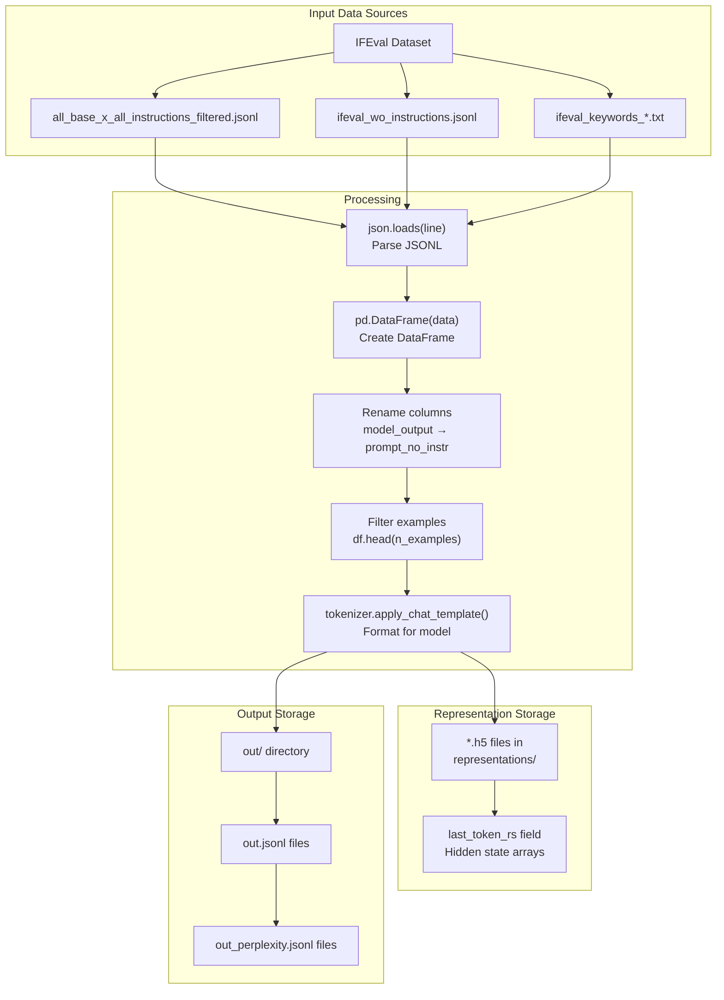

<!-- source: DeepWiki mcp.deepwiki.com · repo microsoft/llm-steer-instruct · page 6.1 Data Sources and Structure · fetched 2026-10-26 -->

# Data Sources and Structure

<details>
<summary>Relevant source files</summary>

The following files were used as context for generating this wiki page:

- [config/keywords/compute_representations.yaml](config/keywords/compute_representations.yaml)
- [config/length/compute_representations.yaml](config/length/compute_representations.yaml)
- [data/format/all_base_x_all_instructions_filtered.jsonl](data/format/all_base_x_all_instructions_filtered.jsonl)
- [keywords/compute_representations.py](keywords/compute_representations.py)
- [keywords/compute_response_perplexity.py](keywords/compute_response_perplexity.py)
- [keywords/load_results.py](keywords/load_results.py)
- [length/compute_representations.py](length/compute_representations.py)

</details>


## Purpose and Scope

This page documents the data sources and file structures used throughout the llm-steer-instruct system. It covers the IFEval dataset format, the structure of filtered prompts, base query files, keyword lists, and the JSONL record schemas used for inputs and outputs. For information about how these data sources are processed to extract representations, see [Representation Computation](#4.1). For details on output artifacts and caching strategies, see [Output Artifacts and Caching](#8.2).

## IFEval Dataset Overview

The system is built on top of the **IFEval** (Instruction Following Evaluation) dataset, which provides base prompts paired with various instruction constraints. The dataset is structured to systematically test instruction-following capabilities across multiple constraint types.

### Core Dataset Structure



**Sources:** [data/format/all_base_x_all_instructions_filtered.jsonl](), [keywords/compute_representations.py:26-27](), [keywords/compute_representations.py:40-56](), [length/compute_representations.py:26-28](), [config/keywords/compute_representations.yaml:2]()

## Filtered Prompts File Structure

The primary data file is `all_base_x_all_instructions_filtered.jsonl`, located in the `data/format/` directory. This file contains the cross-product of base prompts and instruction constraints, with each record representing a single prompt-constraint pairing.

### JSONL Record Schema

Each line in the filtered prompts file is a JSON object with the following structure:

| Field | Type | Description |
|-------|------|-------------|
| `single_instruction_id` | string | Identifier for the constraint type (e.g., `"keywords:forbidden_words"`, `"length_constraints:number_sentences_at least"`) |
| `single_instruction_kwargs` | object | Parameters specific to the constraint (e.g., `{"forbidden_words": ["moser", "glassworks"]}`) |
| `single_instruction_kwargs_str` | string | String representation of kwargs for readability |
| `prompt_hash` | string | Unique hash identifying the base prompt |
| `model_output` | string | The prompt with the constraint integrated |
| `prompt_without_instruction` | string | The original base prompt without any constraints |
| `prompt` | string | Full ICL prompt used to generate the constrained version |
| `icl_key` | integer | Key identifying the in-context learning example used |
| `icl_prompt_without_instruction` | string | ICL example's base prompt |
| `icl_prompt_with_single_instruction` | string | ICL example with constraint applied |
| `instruction_id_list` | array | List of instruction IDs (may be modified with suffixes) |
| `instruction_id_list_og` | array | Original instruction IDs from IFEval |
| `instruction_id_list_for_eval` | array | Instruction IDs to use during evaluation |
| `kwargs` | array | List of kwargs objects for each instruction |
| `is_valid` | boolean | Whether the record passes validation |
| `uid` | integer | Unique identifier for the record |
| `key` | integer | Base prompt key |

### Example Record

Here is an example record from the filtered prompts file showing a keyword exclusion constraint:

```json
{
  "single_instruction_id": "keywords:forbidden_words",
  "single_instruction_kwargs": {
    "forbidden_words": ["moser", "glassworks", "pravcice", "karlovy", "vary"]
  },
  "prompt_hash": "a21da7cc39d8ced6e3ed093b3072a2a2",
  "model_output": "Write a summary of the wikipedia page \"...\". Do not include the following keywords: Moser, Glassworks, Pravcice, Karlovy, Vary.",
  "prompt_without_instruction": "Write a summary of the wikipedia page \"...\".",
  "instruction_id_list": ["keywords:forbidden_words"],
  "kwargs": [{"forbidden_words": ["moser", "glassworks", "pravcice", "karlovy", "vary"]}],
  "is_valid": true,
  "uid": 2,
  "key": 1000
}
```

**Sources:** [data/format/all_base_x_all_instructions_filtered.jsonl:1-19]()

## Base Queries File

The `ifeval_wo_instructions.jsonl` file contains base prompts without any instruction constraints. This file is used by the length and keywords modules to generate paired inputs for representation extraction.

### Base Queries Schema

| Field | Type | Description |
|-------|------|-------------|
| `model_output` | string | The base prompt text (renamed to `prompt_no_instr` in processing) |
| `prompt` | string | Original ICL generation prompt |
| `instruction_id_list` | array | Empty or contains original constraint types from source |
| `prompt_hash` | string | Unique hash for the prompt |
| `key` | integer | Prompt identifier |

### Usage in Compute Representations



The length module loads this file and generates constraint variations:

```python
# Load base queries
with open(f'{project_dir}/data/ifeval_wo_instructions.jsonl') as f:
    data = [json.loads(d) for d in data]
data_no_instr_df = pd.DataFrame(data)
data_no_instr_df = data_no_instr_df.rename(columns={'model_output': 'prompt_no_instr'})
```

**Sources:** [length/compute_representations.py:26-34](), [keywords/compute_representations.py:26-33](), [config/keywords/compute_representations.yaml:2]()

## Keyword Lists

The keywords module uses three types of keyword lists stored in `data/keywords/`:

### Keyword File Types

| File | Purpose | Format |
|------|---------|--------|
| `ifeval_keywords_include.txt` | Words to test inclusion constraints | One word per line |
| `ifeval_keywords_exclude.txt` | Words to test exclusion constraints | One word per line |
| `inclusion_validation.jsonl` | Validation data with likely words | JSONL with `likely_words` field |

### Keyword Loading Logic



The keywords module determines which list to load based on configuration:

```python
if args.keyword_set == 'ifeval_exclude':
    with open(f'{project_dir}/data/keywords/ifeval_keywords_exclude.txt') as f:
        word_list = [w.strip() for w in f.readlines()]
elif args.keyword_set == 'ifeval_include':
    with open(f'{project_dir}/data/keywords/ifeval_keywords_include.txt') as f:
        word_list = [w.strip() for w in f.readlines()]
elif args.keyword_set == 'validation':
    with open(f'{project_dir}/data/keywords/inclusion_validation.jsonl') as f:
        data = [json.loads(d) for d in f.readlines()]
        word_list = list(set([w for l in df['likely_words'] for w in l]))
```

**Sources:** [keywords/compute_representations.py:40-56](), [config/keywords/compute_representations.yaml:10]()

## Constraint Taxonomy in Data

The filtered prompts file encodes a rich taxonomy of instruction constraints through the `single_instruction_id` field. This identifier uses a hierarchical naming scheme that maps to the constraint categories.

### Constraint ID Structure



### Example Constraint IDs from Data

The following table shows examples from the actual data file:

| `single_instruction_id` | Category | Constraint Type | Example Kwargs |
|------------------------|----------|-----------------|----------------|
| `keywords:forbidden_words` | keywords | Forbidden words | `{"forbidden_words": ["moser", "glassworks"]}` |
| `length_constraints:number_sentences_at least` | length_constraints | Minimum sentences | `{"relation": "at least", "num_sentences": 60}` |
| `startend:quotation` | startend | Quotation wrapping | `{}` |
| `combination:repeat_prompt` | combination | Prompt repetition | `{"prompt_to_repeat": "..."}` |
| `keywords:frequency_at least` | keywords | Keyword frequency | `{"relation": "at least", "keyword": "para", "frequency": 1}` |
| `change_case:english_lowercase` | change_case | Lowercase text | `{}` |
| `keywords:existence` | keywords | Required words | `{"keywords": ["people", "skills"]}` |
| `detectable_format:title` | detectable_format | Title format | `{}` |
| `keywords:letter_frequency_at least` | keywords | Letter frequency | `{"let_relation": "at least", "letter": "o", "let_frequency": 25}` |
| `language:response_language_bn` | language | Bengali language | `{"language": "bn"}` |
| `detectable_format:number_bullet_lists` | detectable_format | Bullet list count | `{"num_bullets": 3}` |
| `length_constraints:number_paragraphs` | length_constraints | Paragraph count | `{"num_paragraphs": 6}` |
| `detectable_content:number_placeholders` | detectable_content | Placeholder count | `{"num_placeholders": 3}` |
| `startend:end_checker` | startend | End phrase | `{"end_phrase": "Is there anything else..."}` |
| `detectable_content:postscript` | detectable_content | Postscript marker | `{"postscript_marker": "P.P.S"}` |
| `change_case:english_capital` | change_case | All capitals | `{}` |
| `combination:two_responses` | combination | Two-part response | `{}` |
| `change_case:capital_word_frequency` | change_case | Capital word count | `{}` |
| `detectable_format:json_format` | detectable_format | JSON structure | `{}` |

**Sources:** [data/format/all_base_x_all_instructions_filtered.jsonl:1-19]()

## Output Record Structure

When the system generates outputs, they are stored in JSONL files with the following schema:

### Output JSONL Fields

| Field | Type | Description |
|-------|------|-------------|
| `prompt` | string | The input prompt (may include instructions) |
| `response` | string | The model's generated response |
| `follow_all_instructions` | boolean | Whether all constraints were satisfied |
| `follow_instruction_list` | array | Per-instruction success flags |
| `instruction_id_list` | array | List of instruction IDs evaluated |
| `length` | integer | Token count of the response (when computed) |
| `perplexity` | float | Perplexity score from GPT-2 (when computed) |

### Output File Naming Convention

Output files follow a structured naming pattern that encodes experimental parameters:

```
{model_name}/{constraint_type}/{steering_method}_{layer}_n_examples{n}_{weight}/out.jsonl
```

Examples:
- `phi-3/existence/add_vector_26_n_examples7_40/out.jsonl`
- `phi-3/existence/no_instr/out.jsonl`
- `phi-3/existence/standard/out.jsonl`

When perplexity is computed, a new file is created:
- `phi-3/existence/add_vector_26_n_examples7_40/out_perplexity.jsonl`

**Sources:** [keywords/load_results.py:15-48](), [keywords/compute_response_perplexity.py:22-50](), [keywords/compute_response_perplexity.py:102-105]()

## Data Loading Patterns

### Loading Results for Analysis

The system uses consistent patterns for loading experimental results:



Example loading code:

```python
# Load results from output directory
folder = f'{script_dir}/out/{model_name}/existence_validation/'
subfolders = os.listdir(folder)
result_dict = {}
for subfolder in subfolders:
    # Parse experiment parameters from folder name
    layer = subfolder.split('_')[4]
    weight = subfolder.split('_')[-1]
    
    # Load JSONL results
    with open(folder + subfolder + '/out.jsonl') as f:
        results = [json.loads(line) for line in f]
    
    results_df = pd.DataFrame(results)
    result_dict[(int(layer), int(weight))] = results_df
```

**Sources:** [keywords/load_results.py:15-48](), [keywords/compute_response_perplexity.py:18-50]()

## Data Flow Summary

### Complete Data Pipeline



**Sources:** [keywords/compute_representations.py:26-119](), [length/compute_representations.py:26-126](), [keywords/load_results.py:15-48](), [keywords/compute_response_perplexity.py:22-105]()

---

