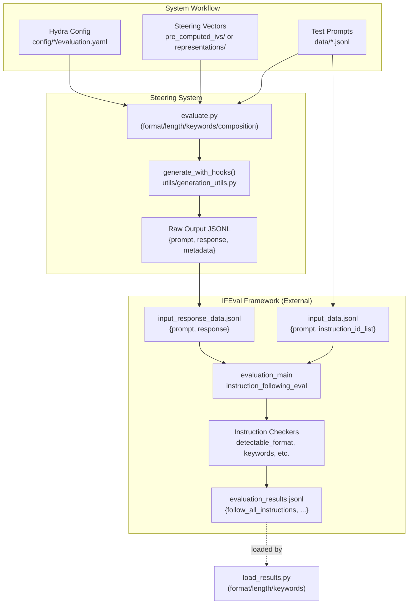
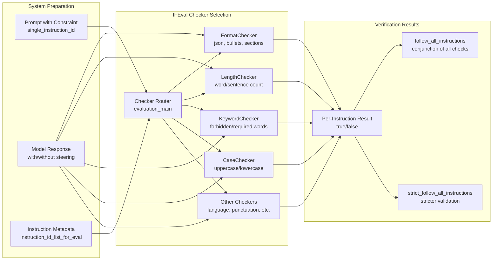
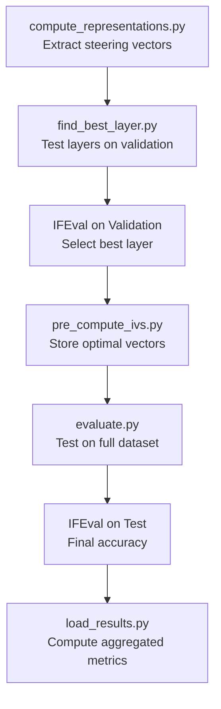
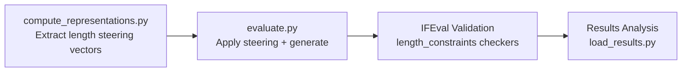
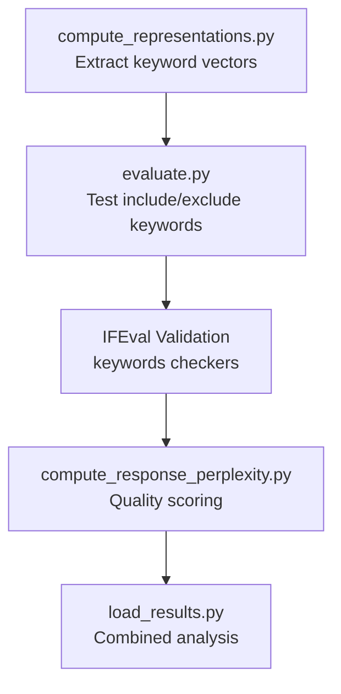
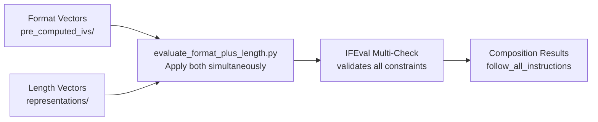

<!-- source: DeepWiki mcp.deepwiki.com · repo microsoft/llm-steer-instruct · page 6.2 IFEval Framework Integration · fetched 2026-10-26 -->

# IFEval Framework Integration

<details>
<summary>Relevant source files</summary>

The following files were used as context for generating this wiki page:

- [README.md](README.md)
- [data/format/all_base_x_all_instructions_filtered.jsonl](data/format/all_base_x_all_instructions_filtered.jsonl)
- [ifeval_scripts/README.md](ifeval_scripts/README.md)

</details>


## Purpose and Scope

This document explains how the llm-steer-instruct system integrates with the external IFEval (Instruction Following Evaluation) framework to provide standardized evaluation of instruction-following behavior. IFEval is an external framework from Google Research that verifies whether model outputs adhere to specific constraints.

For information about the metrics computed from IFEval results, see [Results Analysis and Metrics](#6.3). For details about the data structure that feeds into evaluation, see [Data Sources and Structure](#6.1).

**Sources:** [README.md:1-20](), [ifeval_scripts/README.md:1-44]()

---

## IFEval Framework Overview

IFEval is an open-source evaluation framework from Google Research that systematically assesses instruction-following capabilities in large language models. The framework validates whether model responses satisfy specific verifiable constraints rather than relying on subjective quality assessments.

### Framework Capabilities

IFEval provides deterministic checkers for multiple instruction categories:

| Instruction Category | Examples | IFEval Checker Module |
|---------------------|----------|----------------------|
| `detectable_format` | JSON format, bullet points, sections | Format validators |
| `length_constraints` | Sentence count, word count, paragraphs | Length counters |
| `keywords` | Forbidden words, required words, frequency | Keyword validators |
| `change_case` | All caps, all lowercase | Case validators |
| `language` | Response in specific language | Language detectors |
| `startend` | Start/end with phrase, quotation marks | Boundary validators |
| `punctuation` | No commas | Punctuation checkers |
| `combination` | Multiple constraints simultaneously | Composite validators |
| `detectable_content` | Placeholders, postscripts | Content pattern matchers |

The framework accepts JSONL files with `prompt` and `response` fields, executes the appropriate checkers based on instruction metadata, and returns pass/fail results for each instruction.

**Sources:** [ifeval_scripts/README.md:1-44](), [data/format/all_base_x_all_instructions_filtered.jsonl:1-50]()

---

## Integration Architecture



**Integration Flow:**

1. **Generation Phase**: The `evaluate.py` scripts use `generate_with_hooks()` to produce model outputs with steering applied
2. **Format Transformation**: Outputs are written to JSONL with required `prompt` and `response` fields
3. **IFEval Invocation**: The system calls `evaluation_main` from the external `instruction_following_eval` module
4. **Verification**: IFEval executes instruction-specific checkers based on `instruction_id_list` metadata
5. **Results Collection**: Evaluation results are written back to JSONL files with pass/fail metrics

**Sources:** [README.md:16-82](), [ifeval_scripts/README.md:20-31]()

---

## Data Format Requirements

### Input Data Structure

IFEval requires two synchronized JSONL files:

**File 1: `input_data.jsonl`** - Contains prompts and instruction metadata
```json
{
  "prompt": "Write a summary of the wikipedia page. Use at least 60 sentences.",
  "instruction_id_list": ["length_constraints:number_sentences_at least"],
  "kwargs": [{"relation": "at least", "num_sentences": 60}]
}
```

**File 2: `input_response_data.jsonl`** - Contains model responses
```json
{
  "prompt": "Write a summary of the wikipedia page. Use at least 60 sentences.",
  "response": "Raymond III was Count of Tripoli from 1152 to 1187..."
}
```

### Key Fields Mapping

| Field | Source in System | Purpose in IFEval |
|-------|------------------|-------------------|
| `prompt` | `prompt_without_instruction` + constraint text | Match responses to prompts |
| `response` | Model generation output | Text to validate |
| `instruction_id_list` | `instruction_id_list_for_eval` | Select which checkers to run |
| `kwargs` | Constraint parameters | Configure checker behavior |

### Instruction ID Format

The system uses hierarchical instruction IDs that map to IFEval checkers:

```
{category}:{specific_type}_{modifier}

Examples:
- length_constraints:number_sentences_at least
- detectable_format:json_format
- keywords:forbidden_words
- change_case:english_lowercase
```

The `instruction_id_list_for_eval` field contains processed IDs with modifiers (like `_at least`) that help IFEval select the appropriate validation logic.

**Sources:** [data/format/all_base_x_all_instructions_filtered.jsonl:1-50](), [ifeval_scripts/README.md:23-26]()

---

## Instruction Verification Process



### Checker Implementation

Each instruction type maps to specific verification logic:

**Format Instructions** (`detectable_format:*`)
- `json_format`: Validates JSON parsability with `json.loads()`
- `number_bullet_lists`: Counts markdown bullets and verifies exact count
- `multiple_sections`: Checks for section markers (e.g., "SECTION 1")
- `title`: Verifies presence of `<<title>>` markers
- `number_highlighted_sections`: Counts `*highlighted*` sections

**Length Instructions** (`length_constraints:*`)
- `number_words`: Counts words via `split()`, compares with threshold
- `number_sentences`: Splits by sentence delimiters, validates count
- `number_paragraphs`: Counts `\n\n` separators
- `nth_paragraph_first_word`: Extracts paragraph, checks first word

**Keyword Instructions** (`keywords:*`)
- `forbidden_words`: Searches response for prohibited terms (case-insensitive)
- `existence`: Verifies required keywords are present
- `frequency`: Counts keyword occurrences, compares with relation (`at least`, `less than`)
- `letter_frequency`: Counts specific letters, validates frequency

### Multi-Instruction Validation

When `instruction_id_list_for_eval` contains multiple IDs, IFEval:
1. Runs each checker independently
2. Computes per-instruction pass/fail
3. Aggregates results using logical AND for `follow_all_instructions`
4. Returns both individual and aggregate metrics

**Sources:** [data/format/all_base_x_all_instructions_filtered.jsonl:1-50]()

---

## Evaluation Metrics

### Primary Metrics

IFEval returns several standardized metrics in the results JSONL:

| Metric | Definition | Calculation |
|--------|------------|-------------|
| `follow_all_instructions` | Whether all instructions are satisfied | AND of all checker results |
| `follow_instruction_list` | Per-instruction pass/fail array | `[true, false, true, ...]` |
| `instruction_id_list` | Which instructions were checked | From input metadata |

### Aggregation Across Test Set

The `load_results.py` scripts compute dataset-level metrics:

```
Accuracy = (# prompts with follow_all_instructions = true) / (# total prompts)
```

This provides a single score for how well the model (with or without steering) follows instructions on the evaluation set.

### Usage in Steering Experiments

The system uses these metrics to:
1. **Layer Search**: Identify optimal steering layers by maximizing `follow_all_instructions` on validation data
2. **Steering Comparison**: Compare accuracy across steering methods (no steering, activation addition, direction projection)
3. **Cross-Model Evaluation**: Assess whether steering vectors transfer between models
4. **Composition Analysis**: Verify that multi-instruction steering satisfies all constraints simultaneously

**Sources:** [README.md:72-82](), [ifeval_scripts/README.md:1-44]()

---

## Integration in Module Workflows

### Format Instructions Module

The format module has the most comprehensive IFEval integration:



**Layer Search Integration** [format/find_best_layer.py]():
- Generates outputs with steering at multiple layers
- Calls IFEval to evaluate each layer's effectiveness
- Selects layer with highest `follow_all_instructions` rate

**Final Evaluation** [format/evaluate.py]():
- Uses optimal steering vectors from pre-computation
- Generates responses on test prompts
- Invokes IFEval for standardized validation

**Sources:** [README.md:63-82]()

### Length Instructions Module

Simplified workflow focusing on evaluation:



The length module skips layer search and directly evaluates with IFEval's length constraint checkers (`number_words`, `number_sentences`).

**Sources:** [README.md:84-93]()

### Keywords Instructions Module

Similar to format, includes perplexity analysis:



The keywords module uses IFEval to verify `forbidden_words` (exclude) and `existence` (include) constraints, complementing perplexity-based quality assessment.

**Sources:** [README.md:95-107]()

### Composition Module

Tests multi-instruction steering with IFEval validation:



IFEval's ability to validate multiple instructions simultaneously is critical for composition experiments, ensuring both format and length constraints are satisfied.

**Sources:** [README.md:109-115]()

---

## Calling IFEval from Python

The system invokes IFEval through its Python API:

```python
# Typical invocation pattern in evaluate.py scripts
from instruction_following_eval import evaluation_main

evaluation_main.main([
    f"--input_data={input_data_path}",           # Prompts with metadata
    f"--input_response_data={response_path}",    # Model outputs
    f"--output_dir={output_directory}"           # Results destination
])
```

### File Preparation

Before calling IFEval, evaluation scripts must:

1. **Write Response File**: Save model outputs in required format
   ```python
   {"prompt": prompt_text, "response": model_output}
   ```

2. **Prepare Input Data**: Ensure metadata includes `instruction_id_list_for_eval`

3. **Execute External Module**: Import and call `evaluation_main.main()`

4. **Parse Results**: Read generated `evaluation_results.jsonl` for metrics

### Configuration Requirements

The `config/*/evaluation.yaml` files specify:
- Input data paths (test prompts)
- Output directories for responses
- Model and steering parameters
- Whether to invoke IFEval after generation

**Sources:** [ifeval_scripts/README.md:20-31](), [README.md:16-115]()

---

## Instruction ID Taxonomy Mapping

The system's instruction taxonomy (see [Instruction Types and Constraint Taxonomy](#2.2)) maps directly to IFEval's checker modules:

### Complete Mapping Table

| System Category | Instruction ID Prefix | IFEval Checker | Validation Method |
|----------------|----------------------|----------------|-------------------|
| Format | `detectable_format:json_format` | FormatChecker | JSON parsing |
| Format | `detectable_format:number_bullet_lists` | FormatChecker | Count `* ` patterns |
| Format | `detectable_format:multiple_sections` | FormatChecker | Find "SECTION X" |
| Format | `detectable_format:title` | FormatChecker | Find `<<title>>` |
| Format | `detectable_format:number_highlighted_sections` | FormatChecker | Count `*text*` |
| Format | `detectable_format:constrained_response` | FormatChecker | Match fixed options |
| Length | `length_constraints:number_words` | LengthChecker | Word count via split |
| Length | `length_constraints:number_sentences` | LengthChecker | Sentence boundary detection |
| Length | `length_constraints:number_paragraphs` | LengthChecker | Count `\n\n` |
| Length | `length_constraints:nth_paragraph_first_word` | LengthChecker | Extract paragraph, check word |
| Keywords | `keywords:forbidden_words` | KeywordChecker | Case-insensitive search |
| Keywords | `keywords:existence` | KeywordChecker | Required keyword presence |
| Keywords | `keywords:frequency` | KeywordChecker | Count occurrences |
| Keywords | `keywords:letter_frequency` | KeywordChecker | Character counting |
| Case | `change_case:english_lowercase` | CaseChecker | Verify no uppercase |
| Case | `change_case:english_capital` | CaseChecker | Verify all uppercase |
| Case | `change_case:capital_word_frequency` | CaseChecker | Count all-caps words |
| Language | `language:response_language` | LanguageChecker | Language detection |
| Start/End | `startend:quotation` | BoundaryChecker | Check quote wrapping |
| Start/End | `startend:end_checker` | BoundaryChecker | Verify end phrase |
| Punctuation | `punctuation:no_comma` | PunctuationChecker | Search for commas |
| Combination | `combination:repeat_prompt` | CombinationChecker | Verify prompt repetition |
| Combination | `combination:two_responses` | CombinationChecker | Find `******` separator |
| Content | `detectable_content:number_placeholders` | ContentChecker | Count `[placeholder]` |
| Content | `detectable_content:postscript` | ContentChecker | Find "P.S." or "P.P.S" |

This comprehensive mapping ensures that all instruction types in the system can be automatically verified by IFEval's deterministic checkers.

**Sources:** [data/format/all_base_x_all_instructions_filtered.jsonl:1-50]()

---

## Summary

The IFEval integration provides standardized, deterministic evaluation of instruction-following behavior across all modules in the llm-steer-instruct system. By mapping the system's instruction taxonomy to IFEval's verification checkers, the framework enables:

- **Reproducible Evaluation**: Deterministic pass/fail validation independent of human judgment
- **Comprehensive Coverage**: Support for 28+ instruction subtypes across 10 categories
- **Layer Optimization**: Selection of optimal steering layers based on validation accuracy
- **Cross-Model Analysis**: Consistent metrics for comparing base and instruction-tuned models
- **Multi-Instruction Verification**: Validation that composition steering satisfies all constraints simultaneously

The external IFEval framework serves as the ground truth evaluator, ensuring that steering improvements translate to measurable increases in instruction adherence as measured by the `follow_all_instructions` metric.

**Sources:** [README.md:1-165](), [ifeval_scripts/README.md:1-44](), [data/format/all_base_x_all_instructions_filtered.jsonl:1-50]()

---

