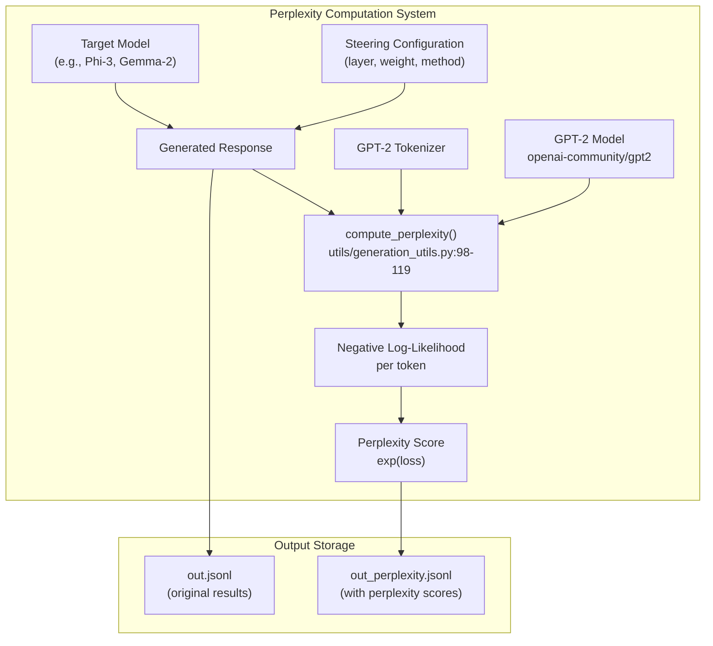
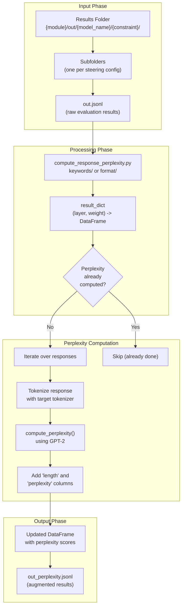
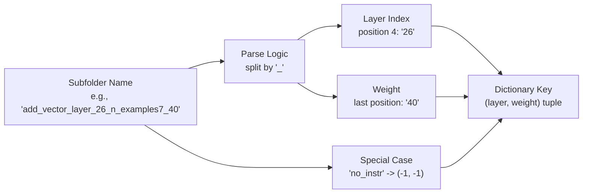
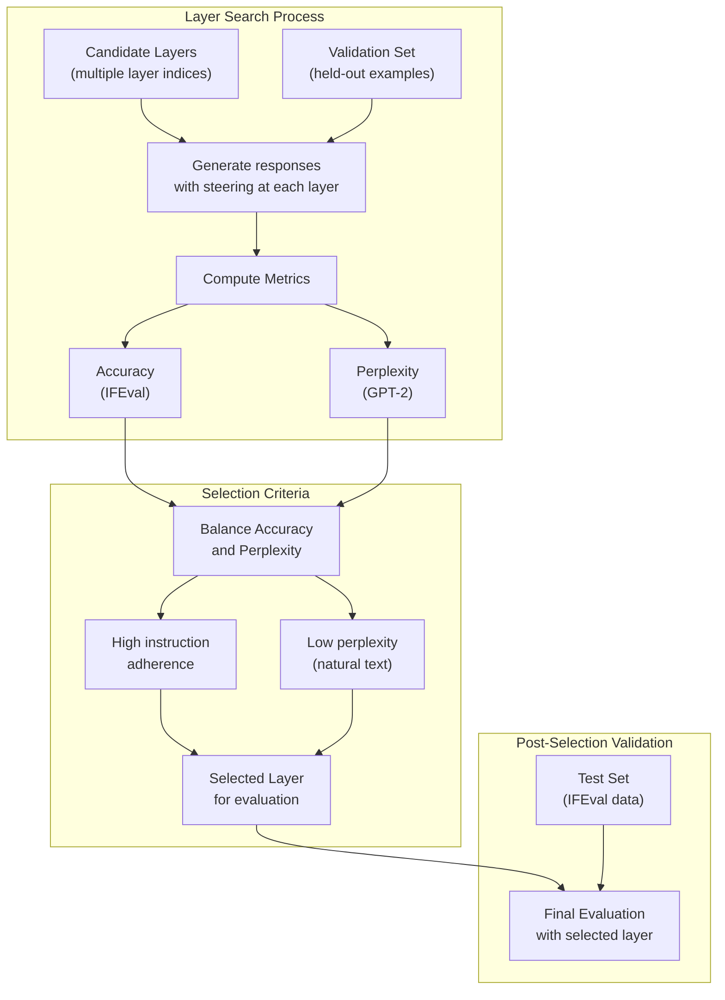
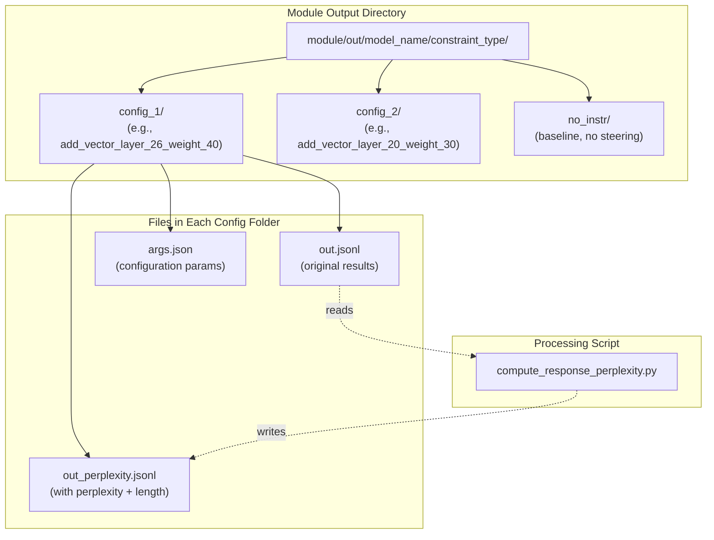

<!-- source: DeepWiki mcp.deepwiki.com · repo microsoft/llm-steer-instruct · page 6.4 Perplexity-Based Quality Assessment · fetched 2026-10-26 -->

# Perplexity-Based Quality Assessment

<details>
<summary>Relevant source files</summary>

The following files were used as context for generating this wiki page:

- [config/keywords/compute_representations.yaml](config/keywords/compute_representations.yaml)
- [config/length/compute_representations.yaml](config/length/compute_representations.yaml)
- [config/length/length_evaluation.yaml](config/length/length_evaluation.yaml)
- [keywords/compute_representations.py](keywords/compute_representations.py)
- [keywords/compute_response_perplexity.py](keywords/compute_response_perplexity.py)
- [keywords/load_results.py](keywords/load_results.py)
- [length/compute_representations.py](length/compute_representations.py)
- [utils/generation_utils.py](utils/generation_utils.py)

</details>


## Purpose and Scope

This document explains how the llm-steer-instruct framework uses perplexity as a proxy metric for response quality. Perplexity computation serves two primary purposes: (1) assessing the fluency and naturalness of model-generated responses under different steering configurations, and (2) informing the layer selection process by identifying steering vectors that maintain response quality while achieving instruction adherence.

For information about the layer selection optimization process that uses perplexity scores, see [Layer Search and Optimization](#4.2). For broader evaluation metrics including IFEval accuracy, see [Results Analysis and Metrics](#6.3).

## Perplexity as a Quality Metric

Perplexity measures how well a language model predicts a given text sequence. Lower perplexity indicates higher prediction confidence and generally correlates with more natural, fluent text. In the context of activation steering, perplexity serves as a critical guardrail metric: while steering vectors may successfully enforce instruction adherence, they may also degrade response quality by introducing unnatural or incoherent text. By computing perplexity on generated responses, the framework can identify steering configurations that balance instruction-following with response quality.

The framework specifically uses **GPT-2** (`openai-community/gpt2`) as the perplexity evaluation model, independent of which model is being steered. This provides a consistent quality metric across different target models and steering configurations.

Sources: [utils/generation_utils.py:98-119](), [keywords/compute_response_perplexity.py:58-67]()

## Implementation Architecture

### GPT-2 as the Proxy Model



**Figure 1: Perplexity Computation Architecture**

The perplexity model (GPT-2) is loaded independently from the target model being evaluated. This separation allows for consistent quality assessment regardless of which model family is being steered. The GPT-2 model is loaded on the same device (typically CUDA) as the target model for computational efficiency.

Sources: [keywords/compute_response_perplexity.py:65-67](), [utils/generation_utils.py:98-119]()

### The compute_perplexity Function

The core perplexity computation is implemented in `compute_perplexity()`:

| Component | Description | Location |
|-----------|-------------|----------|
| **Function** | `compute_perplexity(text, device, perplexity_model, perplexity_tokenizer)` | [utils/generation_utils.py:98-119]() |
| **Input** | Text string to evaluate | Parameter: `text` |
| **Tokenization** | Converts text to input IDs | Line 100-101 |
| **Length Handling** | Truncates to last 1024 tokens if longer | Lines 103-105 |
| **Loss Computation** | Computes negative log-likelihood using language modeling objective | Lines 108-115 |
| **Error Handling** | Returns 0.0 if computation fails | Lines 112-115 |
| **Output** | Perplexity value (exponential of loss) | Lines 117-119 |

The function implements several important safeguards:

1. **Token Length Limitation**: Responses longer than 1024 tokens are truncated to the last 1024 tokens to fit within GPT-2's context window [utils/generation_utils.py:103-105]()
2. **Exception Handling**: If perplexity computation fails (e.g., due to encoding issues), the function catches the exception and returns a zero loss, preventing pipeline failures [utils/generation_utils.py:109-115]()
3. **No Gradient Computation**: All computations are wrapped in `torch.no_grad()` for efficiency [utils/generation_utils.py:108]()

Sources: [utils/generation_utils.py:98-119]()

## Perplexity Computation Workflow

### Script-Based Batch Processing



**Figure 2: Perplexity Computation Workflow**

The perplexity computation follows a batch processing pattern implemented in module-specific scripts:

1. **Directory Scanning**: The script scans the output directory for subfolders representing different steering configurations [keywords/compute_response_perplexity.py:22-50]()
2. **Result Loading**: For each configuration, it loads the `out.jsonl` file containing raw evaluation results [keywords/compute_response_perplexity.py:45-49]()
3. **Perplexity Check**: The script checks if perplexity has already been computed by looking for the `'perplexity'` column [keywords/compute_response_perplexity.py:80-82]()
4. **Batch Processing**: If not computed, it iterates through all responses, computing perplexity for each [keywords/compute_response_perplexity.py:87-100]()
5. **Storage**: Results are saved to a new file with suffix `_perplexity.jsonl` [keywords/compute_response_perplexity.py:103-105]()

Sources: [keywords/compute_response_perplexity.py:1-108]()

### Parsing Steering Configurations

The script extracts steering configuration parameters (layer and weight) from subfolder names:



**Figure 3: Configuration Parameter Extraction**

For the baseline case where no steering is applied (`'no_instr'`), the script assigns layer and weight values of -1 to distinguish it from actual steering configurations [keywords/compute_response_perplexity.py:32-37]().

Sources: [keywords/compute_response_perplexity.py:32-37]()

## Integration with Layer Selection

Perplexity plays a crucial role in the layer search process by providing a quality constraint during optimization:



**Figure 4: Perplexity in Layer Selection**

The layer selection process evaluates multiple candidate layers by generating responses on a validation set. For each layer, both IFEval accuracy and perplexity are computed. The optimal layer is selected based on a balance between these metrics: high instruction adherence (accuracy) with low perplexity (quality). This prevents selecting layers that achieve perfect instruction-following at the cost of producing incoherent or unnatural responses.

Sources: [keywords/compute_response_perplexity.py:18-50]()

## Output Format and Storage

### Augmented JSONL Structure

After perplexity computation, each result record is augmented with two additional fields:

| Field | Type | Description | Computed By |
|-------|------|-------------|-------------|
| `response` | string | Original generated response | Model generation |
| `follow_all_instructions` | boolean | IFEval accuracy | IFEval framework |
| **`length`** | integer | **Token count using target tokenizer** | [keywords/compute_response_perplexity.py:89-90]() |
| **`perplexity`** | float | **GPT-2 perplexity score** | [keywords/compute_response_perplexity.py:93]() |

The `length` field uses the **target model's tokenizer** (e.g., Phi-3, Gemma-2) to count tokens, not GPT-2's tokenizer. This provides an accurate measure of response length in terms relevant to the model being evaluated.

Sources: [keywords/compute_response_perplexity.py:87-100]()

### File Organization Pattern



**Figure 5: Perplexity File Organization**

The perplexity computation script creates a parallel file structure:
- Original results remain in `out.jsonl`
- Augmented results with perplexity are saved to `out_perplexity.jsonl`
- Both files coexist in the same configuration subfolder

This pattern allows for:
1. **Idempotency**: The script can be re-run without overwriting original results
2. **Incremental Processing**: Already-computed perplexities are skipped [keywords/compute_response_perplexity.py:80-82]()
3. **Backward Compatibility**: Existing analysis scripts can continue using `out.jsonl` if perplexity is not needed

Sources: [keywords/compute_response_perplexity.py:103-105]()

## Module-Specific Implementation

### Keywords Module

The keywords module computes perplexity for validation results across different steering configurations:

```python
# Example path structure
keywords/out/phi-3/existence_validation/add_vector_layer_26_n_examples7_40/out.jsonl
keywords/out/phi-3/existence_validation/add_vector_layer_26_n_examples7_40/out_perplexity.jsonl
```

The script iterates through all subfolders in the validation directory, computing perplexity for each configuration [keywords/compute_response_perplexity.py:22-50]().

Sources: [keywords/compute_response_perplexity.py:1-108]()

### Format Module

While not shown in the provided files, the format module follows a similar pattern with its own `compute_response_perplexity.py` script. The format module computes perplexity after the layer search stage and before final evaluation to inform the selection of optimal steering layers for each format constraint subtype.

### Aggregated Analysis

After perplexity computation, results can be loaded and analyzed across configurations:

```python
# Dictionary structure: (layer, weight) -> DataFrame
accuracy_dict[key] = value['follow_all_instructions'].mean()
lengths_dict[key] = sum(lengths) / len(lengths)  
perplexity_dict[key] = sum(perplexities) / len(perplexities)
```

This aggregation pattern enables comparative analysis across steering configurations, identifying the parameter combinations that achieve the best trade-off between instruction adherence and response quality [keywords/compute_response_perplexity.py:70-100]().

Sources: [keywords/compute_response_perplexity.py:70-105]()

## Summary

The perplexity-based quality assessment system provides a critical quality control mechanism for activation steering. By using GPT-2 as a consistent proxy model, the framework can:

1. **Assess Response Quality**: Quantify the naturalness and fluency of steered responses
2. **Guide Layer Selection**: Balance instruction adherence with response quality during optimization
3. **Enable Comparative Analysis**: Compare different steering configurations objectively
4. **Detect Quality Degradation**: Identify when steering parameters cause unnatural generation

The system is implemented through module-specific scripts that batch-process evaluation results, augmenting them with perplexity scores and token lengths. This augmented data informs both the layer selection process and final evaluation analysis.

Sources: [utils/generation_utils.py:98-119](), [keywords/compute_response_perplexity.py:1-108]()

---

