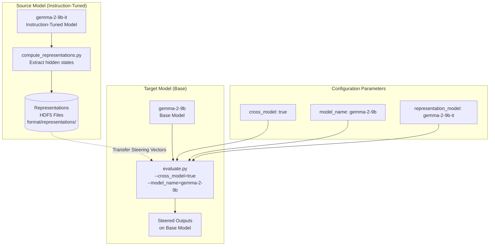
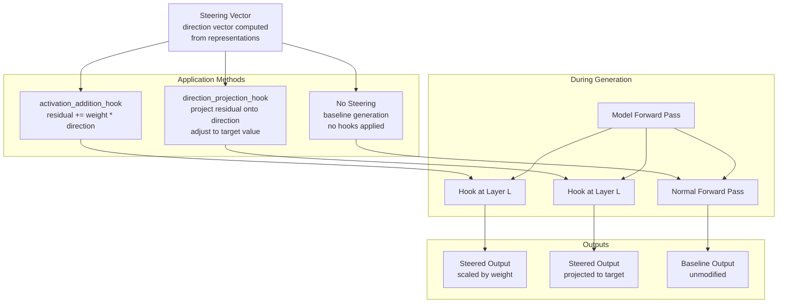
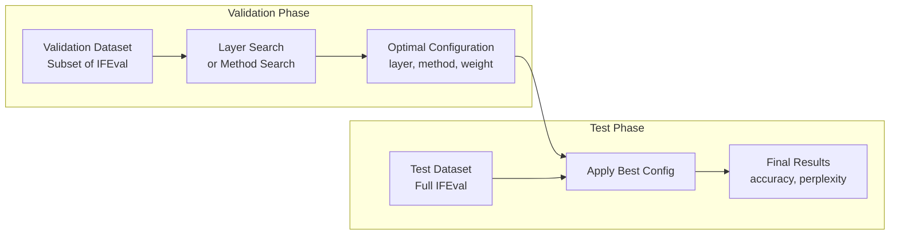

<!-- source: DeepWiki mcp.deepwiki.com · repo microsoft/llm-steer-instruct · page 7 Advanced Features · fetched 2026-10-26 -->

# Advanced Features

<details>
<summary>Relevant source files</summary>

The following files were used as context for generating this wiki page:

- [README.md](README.md)
- [ifeval_scripts/README.md](ifeval_scripts/README.md)
- [utils/model_utils.py](utils/model_utils.py)

</details>


## Purpose and Scope

This page documents the advanced capabilities of the llm-steer-instruct framework that extend beyond basic single-instruction steering. It covers two primary advanced features: **cross-model transfer experiments** (transferring steering vectors from instruction-tuned models to base models) and **steering method variations** (different approaches to applying steering vectors during inference).

For basic steering methodology and the core pipeline, see [Activation Steering Methodology](#2.1) and [Steering Vector Pipeline](#4). For multi-instruction composition (combining multiple steering vectors), see [Multi-Instruction Composition](#5.4).

**Sources:** [README.md:1-165]()

---

## Overview of Advanced Capabilities

The activation steering framework supports two key advanced experimental capabilities beyond the standard single-instruction steering pipeline:

| Feature | Description | Primary Use Case |
|---------|-------------|------------------|
| **Cross-Model Transfer** | Apply steering vectors computed from instruction-tuned models to base models | Test transferability of instruction-following behaviors across model variants |
| **Steering Method Variations** | Apply different mathematical approaches to inject steering vectors | Compare effectiveness and trade-offs of different steering techniques |

These features enable systematic investigation of steering vector properties, including their transferability across model checkpoints and the relative effectiveness of different application methods.

**Sources:** [README.md:81-82]()

---

## Cross-Model Transfer Architecture

Cross-model experiments test whether steering vectors learned from one model can improve instruction-following in a related model. The typical workflow transfers representations from instruction-tuned models (e.g., `gemma-2-9b-it`) to base models (e.g., `gemma-2-9b`).

### Cross-Model Transfer Pipeline



**Diagram: Cross-Model Steering Vector Transfer**

The pipeline consists of two phases:

1. **Representation Extraction Phase**: Run `compute_representations.py` on the instruction-tuned model to extract hidden states and compute steering vectors
2. **Cross-Model Evaluation Phase**: Run `evaluate.py` with the `cross_model` flag enabled, specifying the base model as the target

**Sources:** [README.md:81-82](), High-level diagrams (Diagram 6)

---

## Configuration for Cross-Model Experiments

Cross-model experiments require specific configuration parameters in the evaluation YAML files:

```yaml
# Enable cross-model transfer
cross_model: true

# Target model (base model to steer)
model_name: "gemma-2-9b"

# Source model (where representations were computed)
# This is implicit - representations must exist from gemma-2-9b-it
```

The system automatically loads representations from the instruction-tuned counterpart and applies them during generation with the base model. The key requirement is that representations must have been previously computed on the instruction-tuned model using the same constraint types.

### Model Pair Compatibility

| Base Model (Target) | Instruction-Tuned Model (Source) | Compatible |
|---------------------|----------------------------------|------------|
| `gemma-2-2b` | `gemma-2-2b-it` | ✓ |
| `gemma-2-9b` | `gemma-2-9b-it` | ✓ |
| Different architectures | Any | ✗ |

Cross-model transfer requires architectural compatibility between source and target models (same layer count, hidden dimensions, etc.).

For detailed configuration procedures, see [Cross-Model Experiments](#7.1).

**Sources:** [README.md:81-82](), [utils/model_utils.py:10-30]()

---

## Steering Methods Comparison

The framework implements three distinct methods for applying steering vectors during inference, each with different mathematical formulations and use cases.

### Steering Method Types



**Diagram: Three Steering Application Methods**

### Method Descriptions

| Method | Mathematical Operation | Configuration Parameter | Typical Use Case |
|--------|------------------------|-------------------------|------------------|
| **Activation Addition** | `residual += weight × direction` | `steering_method: "activation_addition"` | Standard steering with controllable intensity |
| **Direction Projection** | Adjust residual projection onto direction to target value | `steering_method: "direction_projection"` | Fine-grained control of activation magnitude |
| **No Steering** | No modification to activations | `steering_method: "no_steering"` | Baseline comparison |

The `weight` parameter controls steering intensity for activation addition, while direction projection uses a `target_value` parameter.

**Sources:** [README.md:11-12](), [utils/generation_utils.py](), High-level diagrams (Diagram 6)

---

## Activation Addition Method

The activation addition method scales the steering vector by a weight parameter and adds it to the residual stream at the target layer:

```
residual_new = residual_original + (weight × steering_vector)
```

**Key characteristics:**
- **Linear scaling**: Intensity proportional to weight parameter
- **Additive composition**: Multiple steering vectors can be summed
- **Default method**: Used in most experiments throughout the codebase
- **Typical weight range**: 1.0 to 5.0 (tunable via validation)

This method is implemented in the `activation_addition_hook` function in [utils/generation_utils.py]().

**Sources:** High-level diagrams (Diagram 2, Diagram 6)

---

## Direction Projection Method

The direction projection method adjusts the component of the residual stream along the steering direction to match a target activation value:

```
projection = dot(residual, direction)
residual_new = residual + (target_value - projection) × direction
```

**Key characteristics:**
- **Magnitude control**: Directly sets the activation level along the direction
- **Non-linear**: Effect depends on current activation state
- **Fine-grained tuning**: Useful when precise activation levels matter
- **Target value**: Typically determined from validation data

This method is particularly useful when the absolute magnitude of activations along the steering direction is known to correlate with instruction adherence.

**Sources:** High-level diagrams (Diagram 2, Diagram 6)

---

## Experimental Validation Pattern

Both cross-model experiments and steering method comparisons follow a consistent experimental pattern:



**Diagram: Validation-Test Experimental Pattern**

The validation phase identifies optimal configurations (layer selection, method selection, hyperparameters), which are then applied during the test phase for final evaluation.

**Sources:** [README.md:69-78]()

---

## Usage Examples

### Cross-Model Experiment Configuration

To run a cross-model experiment transferring steering from `gemma-2-9b-it` to `gemma-2-9b`:

```yaml
# config/format/evaluation.yaml
model_name: "gemma-2-9b"  # Base model
cross_model: true
steering_method: "activation_addition"
weight: 2.0
```

**Prerequisites:**
1. Representations must exist in `format/representations/` computed from `gemma-2-9b-it`
2. Pre-computed instruction vectors must exist in `format/pre_computed_ivs/`

### Steering Method Comparison

To compare different steering methods on the same model:

```yaml
# Run 1: Baseline
steering_method: "no_steering"

# Run 2: Activation Addition
steering_method: "activation_addition"
weight: 2.0

# Run 3: Direction Projection
steering_method: "direction_projection"
target_value: 15.0
```

Each run produces outputs in `format/out/` with different suffixes identifying the method used.

**Sources:** [README.md:79-82]()

---

## Implementation Integration Points

The advanced features integrate with the core infrastructure at several key points:

| Component | Integration Point | Purpose |
|-----------|-------------------|---------|
| `load_model_from_tl_name` | [utils/model_utils.py:10-30]() | Loads different models (base vs. instruction-tuned) |
| `generate_with_hooks` | [utils/generation_utils.py]() | Applies different steering methods via hooks |
| Configuration files | [config/format/evaluation.yaml]() | Specifies `cross_model` and `steering_method` |
| Representation loading | `evaluate.py` scripts | Loads representations from specified model |

The modular design allows mixing and matching: cross-model experiments can use any steering method, and steering method comparisons can be performed on any model.

**Sources:** [utils/model_utils.py:10-30](), [README.md:79-115]()

---

## Limitations and Considerations

### Cross-Model Transfer Limitations

- **Architecture requirement**: Models must share the same architecture (layer count, dimensions)
- **Representation compatibility**: Steering vectors assume similar activation distributions
- **Performance variability**: Transfer effectiveness varies by model pair and instruction type
- **No fine-tuning**: Method does not adapt vectors to target model characteristics

### Steering Method Trade-offs

| Consideration | Activation Addition | Direction Projection | No Steering |
|---------------|---------------------|----------------------|-------------|
| Computational overhead | Minimal | Minimal | None |
| Hyperparameter sensitivity | Moderate (weight) | High (target_value) | N/A |
| Composability | Excellent (linear) | Complex (non-linear) | N/A |
| Interpretability | High | Moderate | Perfect |

For detailed responsible AI considerations, see the [transparency note in README.md:118-119]().

**Sources:** [README.md:118-119]()

---

## Related Documentation

- For the basic steering methodology, see [Activation Steering Methodology](#2.1)
- For applying steering during inference, see [Applying Steering During Inference](#4.4)
- For multi-instruction steering, see [Multi-Instruction Composition](#5.4)
- For detailed cross-model procedures, see [Cross-Model Experiments](#7.1)
- For method comparison guidelines, see [Steering Methods Comparison](#7.2)

**Sources:** Table of contents

---

