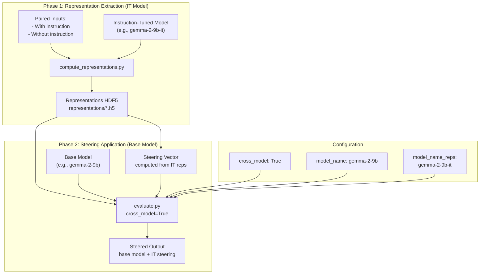
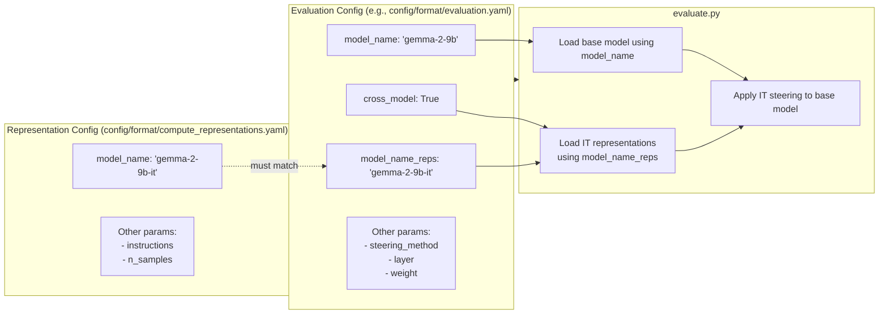
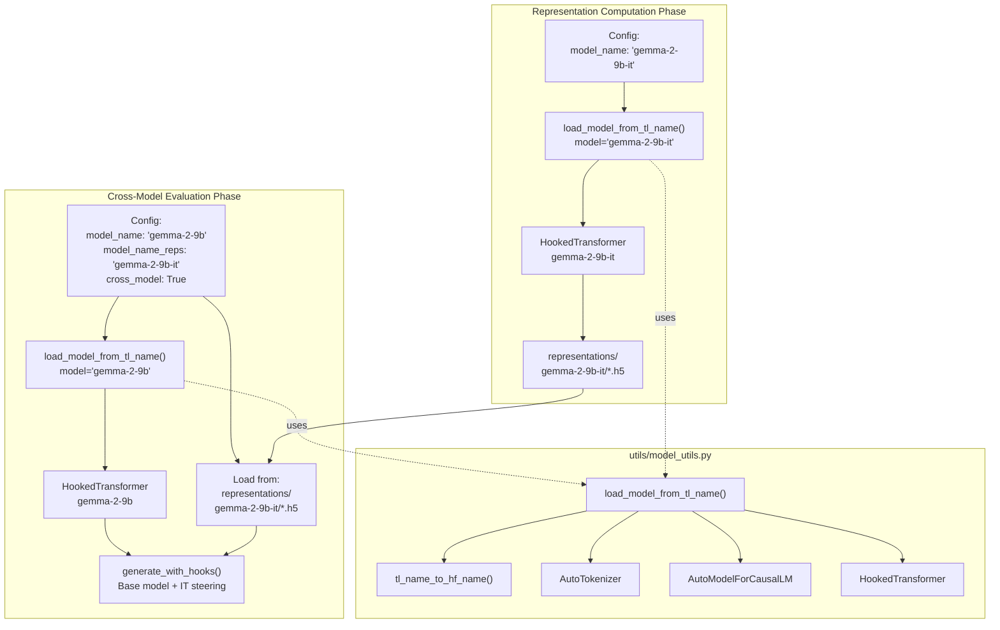
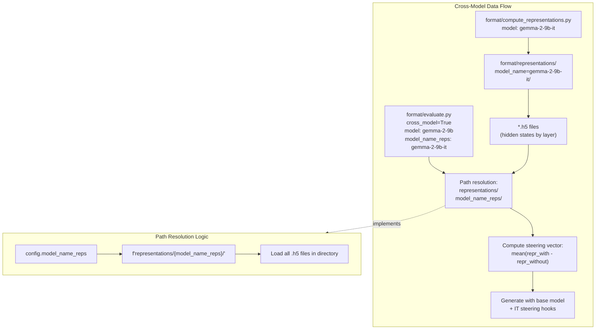
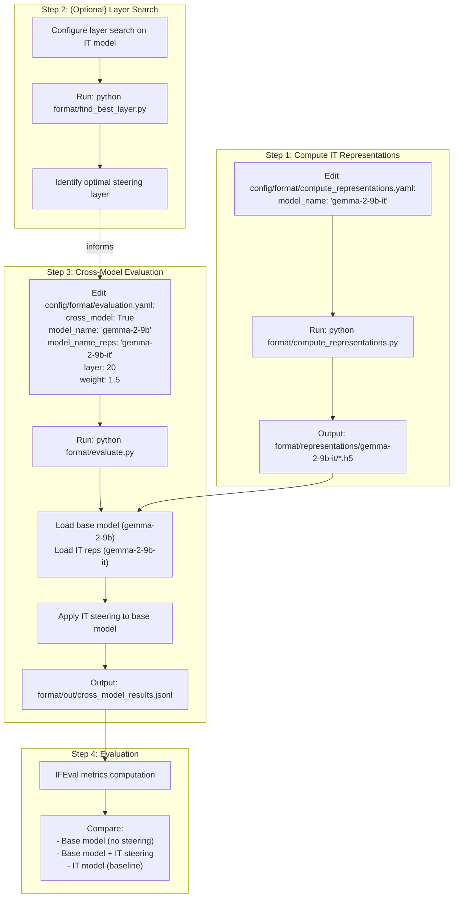
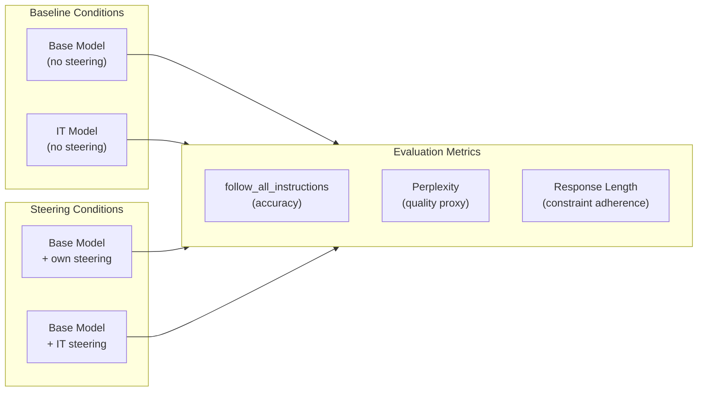

<!-- source: DeepWiki mcp.deepwiki.com · repo microsoft/llm-steer-instruct · page 7.1 Cross-Model Experiments · fetched 2026-10-26 -->

# Cross-Model Experiments

<details>
<summary>Relevant source files</summary>

The following files were used as context for generating this wiki page:

- [README.md](README.md)
- [ifeval_scripts/README.md](ifeval_scripts/README.md)
- [utils/model_utils.py](utils/model_utils.py)

</details>


## Purpose and Scope

This page documents the cross-model transfer capability in the llm-steer-instruct system, which enables steering vectors computed from instruction-tuned models to be applied to their base model counterparts. This feature tests whether instruction-following behaviors learned by instruction-tuned models can be transferred to improve base models through activation steering.

For information about the general activation steering methodology, see [Activation Steering Methodology](#2.1). For details on how steering is applied during inference, see [Applying Steering During Inference](#4.4). For information about different steering methods, see [Steering Methods Comparison](#7.2).

---

## Overview

Cross-model experiments investigate the **transferability of steering vectors** across model variants. Specifically, the system computes representations and steering vectors from an instruction-tuned model (e.g., `gemma-2-9b-it`), then applies these vectors to steer the corresponding base model (e.g., `gemma-2-9b`) during inference. This approach explores whether the instruction-following capabilities encoded in the instruction-tuned model's activations can be transferred to enhance the base model's behavior without additional fine-tuning.

The key hypothesis is that steering vectors capture general instruction-following directions in the model's activation space that are transferable between related model variants.

**Sources:** [README.md:81]()

---

## Cross-Model Transfer Workflow

The cross-model transfer process involves two distinct phases using different model variants:



**Workflow Details:**

1. **Phase 1 - Representation Extraction**: Run `compute_representations.py` with the instruction-tuned model to extract hidden states from paired inputs (with/without instructions)
2. **Phase 2 - Cross-Model Evaluation**: Run `evaluate.py` with `cross_model=True`, specifying the base model for inference while referencing representations from the IT model

**Sources:** [README.md:81](), Diagram 6 from high-level architecture

---

## Configuration Parameters

Cross-model experiments require specific configuration parameters to coordinate between the representation source model and the evaluation target model:

### Key Configuration Flags

| Parameter | Type | Purpose | Example Value |
|-----------|------|---------|---------------|
| `cross_model` | boolean | Enable cross-model transfer mode | `True` |
| `model_name` | string | Target base model for evaluation | `"gemma-2-9b"` |
| `model_name_reps` | string | Source IT model for representations | `"gemma-2-9b-it"` |

### Configuration Structure



### Example Configuration

For format instructions, the evaluation config would contain:

```yaml
cross_model: True
model_name: "gemma-2-9b"      # Base model for evaluation
model_name_reps: "gemma-2-9b-it"  # IT model for representations
steering_method: "activation_addition"
layer: 20
weight: 1.5
```

**Sources:** [README.md:81](), [utils/model_utils.py:10-30]()

---

## Supported Model Pairs

The system supports cross-model transfer between instruction-tuned models and their base counterparts. The key requirement is that both models share the same architecture and tokenizer:

### Compatible Model Pairs

| Instruction-Tuned Model | Base Model | Status |
|------------------------|------------|--------|
| `gemma-2-9b-it` | `gemma-2-9b` | Supported |
| `gemma-2-2b-it` | `gemma-2-2b` | Supported |
| Other Gemma variants | Corresponding base | Supported |
| Other model families | Corresponding base | Experimental |

### Model Loading Architecture



**Key Constraints:**

- Both models must use the same tokenizer (ensured by shared model family)
- Hidden state dimensions must match (ensured by shared architecture)
- Layer counts must be compatible (steering typically uses middle layers)

**Sources:** [README.md:81](), [utils/model_utils.py:4-30]()

---

## Implementation Details

### File Paths and Artifacts

Cross-model experiments rely on specific file path conventions to locate representations from the source IT model:



### Steering Vector Computation

When `cross_model=True`, the evaluation script:

1. **Loads base model** using `model_name` parameter via [utils/model_utils.py:10-30]()
2. **Loads IT representations** from HDF5 files in `representations/{model_name_reps}/`
3. **Computes steering vectors** as the mean difference: `mean(repr_with_instruction - repr_without_instruction)`
4. **Applies steering** to base model using activation hooks during generation

The steering vectors from the IT model are directly added to the base model's residual stream at the specified layer, without any transformation or alignment steps.

**Sources:** [README.md:64-81](), [utils/model_utils.py:10-30]()

---

## Execution Workflow

### Step-by-Step Process



### Command Sequence Example

For format instructions with Gemma 2 models:

```bash
# Step 1: Compute representations on IT model
python format/compute_representations.py \
    model_name=gemma-2-9b-it

# Step 2: Evaluate with cross-model steering
python format/evaluate.py \
    cross_model=True \
    model_name=gemma-2-9b \
    model_name_reps=gemma-2-9b-it \
    layer=20 \
    weight=1.5
```

**Sources:** [README.md:64-81]()

---

## Module Support

Cross-model experiments are supported across different instruction type modules with varying levels of integration:

### Module Compatibility Matrix

| Module | Cross-Model Support | Configuration Location | Notes |
|--------|-------------------|----------------------|-------|
| **Format** | ✓ Full | `config/format/evaluation.yaml` | Explicitly documented in README |
| **Length** | ✓ Full | `config/length/evaluation.yaml` | Same evaluation logic as format |
| **Keywords** | ✓ Full | `config/keywords/evaluation.yaml` | Same evaluation logic as format |
| **Composition** | ✓ Partial | `config/composition/evaluation.yaml` | Requires both format and length IT reps |

### Format Instructions

The most extensively tested module for cross-model experiments:

- **Script**: [format/evaluate.py]()
- **Config**: [config/format/evaluation.yaml]()
- **Representations**: Pre-computed via [format/compute_representations.py]()
- **Steering Vectors**: Can use [format/pre_compute_ivs.py]() for caching

### Length Instructions

Supports cross-model transfer with simplified pipeline:

- **Script**: [length/evaluate.py]()
- **Config**: [config/length/evaluation.yaml]()
- **Representations**: Computed via [length/compute_representations.py]()

### Keywords Instructions

Supports cross-model transfer for word inclusion/exclusion:

- **Script**: [keywords/evaluate.py]()
- **Config**: [config/keywords/evaluation.yaml]()
- **Representations**: Computed via [keywords/compute_representations.py]()

### Multi-Instruction Composition

For composition experiments combining format and length, both sets of representations must come from the same IT model:

```yaml
# config/composition/evaluation.yaml
cross_model: True
model_name: "gemma-2-9b"
model_name_reps_format: "gemma-2-9b-it"
model_name_reps_length: "gemma-2-9b-it"
```

**Sources:** [README.md:64-114]()

---

## Research Applications

Cross-model experiments enable several research questions:

### Key Research Questions

1. **Transferability of Instruction-Following**: Can steering vectors from instruction-tuned models improve base models without fine-tuning?

2. **Efficiency vs. Fine-Tuning**: How does cross-model steering compare to traditional instruction fine-tuning in terms of:
   - Instruction adherence accuracy
   - Computational cost
   - Text quality

3. **Generalization Across Model Families**: Do steering vectors generalize across:
   - Different model sizes (2B vs 9B)
   - Different model families (Gemma, Mistral, Llama)
   - Different instruction types (format, length, keywords)

4. **Layer-Specific Transfer**: Which layers produce the most transferable steering vectors?

### Experimental Comparisons



Cross-model experiments enable comparing:
- **Base model (no steering)**: Lower bound for instruction-following
- **IT model (no steering)**: Upper bound from fine-tuning
- **Base model + own steering**: Same-model activation steering
- **Base model + IT steering**: Cross-model transfer effectiveness

**Sources:** [README.md:11-13](), Diagram 6 from high-level architecture

---

## Limitations and Considerations

### Technical Constraints

1. **Architecture Compatibility**: Models must share the same architecture and hidden dimensions
2. **Tokenizer Compatibility**: Models must use identical tokenizers to ensure prompt alignment
3. **Layer Alignment**: Steering layer numbers must be valid for both source and target models

### Quality Trade-offs

Cross-model steering may result in:
- **Reduced text quality** compared to native IT model
- **Incomplete instruction adherence** in complex scenarios
- **Layer sensitivity**: Optimal layers may differ between IT and base models

### Computational Considerations

- **One-time cost**: Representations must be computed once on IT model
- **Reusable artifacts**: Same IT representations can be used for multiple cross-model experiments
- **Storage requirements**: HDF5 files store full hidden states for all layers

**Sources:** [README.md:118-119]()

---

## Output Files and Analysis

### Output Structure

Cross-model evaluation produces JSONL files with extended metadata:

```jsonl
{
  "prompt": "Write in JSON format...",
  "response": "model response text",
  "model_name": "gemma-2-9b",
  "model_name_reps": "gemma-2-9b-it",
  "cross_model": true,
  "steering_method": "activation_addition",
  "layer": 20,
  "weight": 1.5,
  "instruction_id_list": ["format:json_format"],
  "kwargs": {...}
}
```

### Analysis Scripts

Results can be analyzed using module-specific loading scripts:

- **Format**: [format/load_results.py]()
- **Length**: [length/load_results.py]()
- **Keywords**: [keywords/load_results.py]()
- **Composition**: [composition/load_results.py]()

These scripts compute metrics including:
- `follow_all_instructions`: Instruction adherence rate
- Response quality metrics
- Cross-model transfer effectiveness

**Sources:** [README.md:31-36](), [ifeval_scripts/README.md:23-30]()

---

## Integration with Other Features

### Combination with Other Steering Methods

Cross-model steering can be combined with different steering methods (see [Steering Methods Comparison](#7.2)):

```yaml
cross_model: True
model_name: "gemma-2-9b"
model_name_reps: "gemma-2-9b-it"
steering_method: "direction_projection"  # or "activation_addition"
```

### Multi-Instruction Cross-Model Steering

For composition experiments (see [Multi-Instruction Composition](#5.4)):

```yaml
cross_model: True
model_name: "gemma-2-9b"
format_model_name_reps: "gemma-2-9b-it"
length_model_name_reps: "gemma-2-9b-it"
```

**Sources:** [README.md:109-114]()

---

