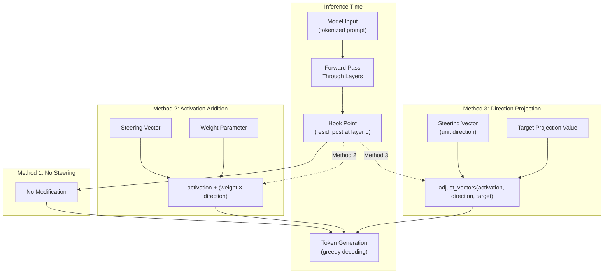
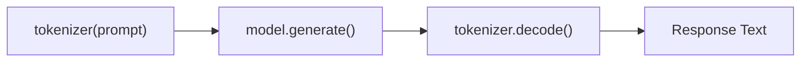
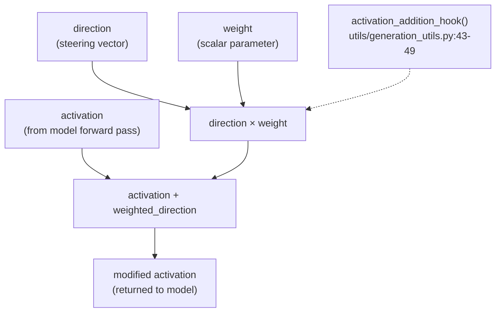
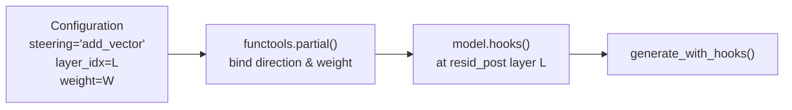
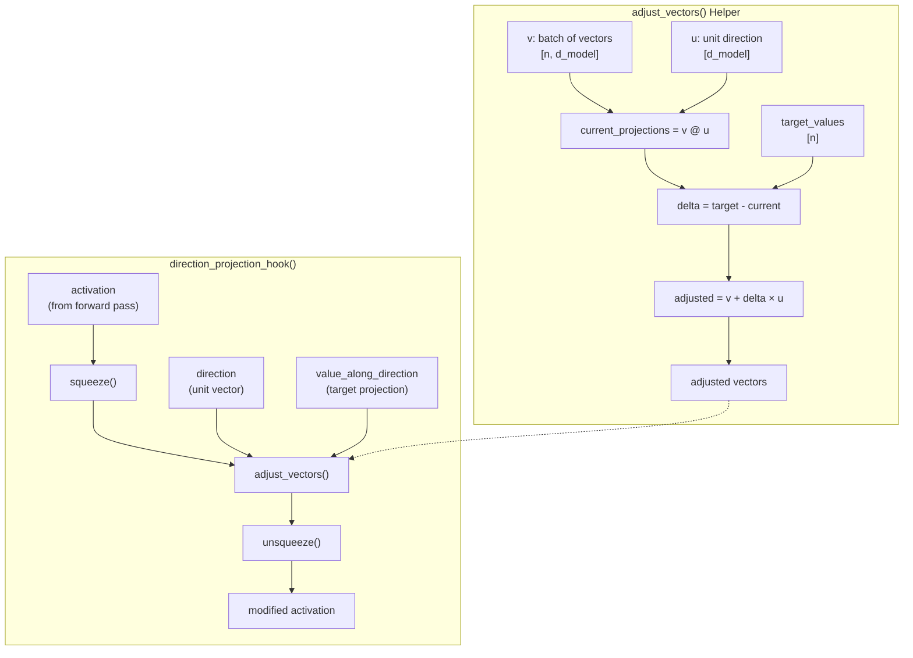
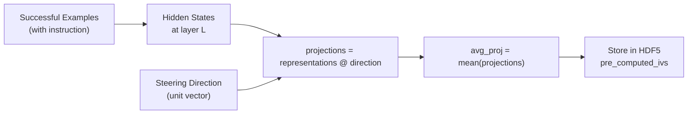
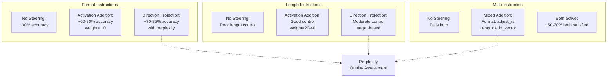
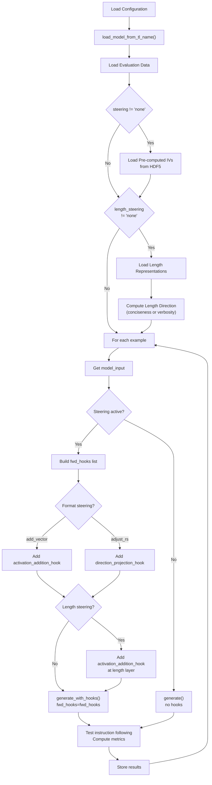
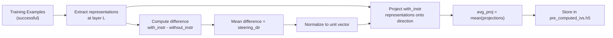
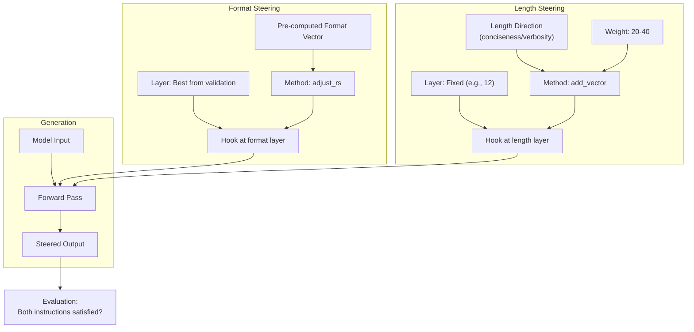

<!-- source: DeepWiki mcp.deepwiki.com · repo microsoft/llm-steer-instruct · page 7.2 Steering Methods Comparison · fetched 2026-10-26 -->

# Steering Methods Comparison

<details>
<summary>Relevant source files</summary>

The following files were used as context for generating this wiki page:

- [composition/evaluate_format_plus_length.py](composition/evaluate_format_plus_length.py)
- [composition/load_results.py](composition/load_results.py)
- [config/composition/evaluation.yaml](config/composition/evaluation.yaml)
- [config/length/length_evaluation.yaml](config/length/length_evaluation.yaml)
- [requirements.txt](requirements.txt)
- [utils/generation_utils.py](utils/generation_utils.py)

</details>


## Purpose and Scope

This page documents the three steering methods implemented in the llm-steer-instruct framework: **no steering** (baseline), **activation addition**, and **direction projection**. Each method represents a different approach to modifying model activations during inference to improve instruction-following behavior. This comparison covers the mathematical operations, implementation details, configuration parameters, and practical guidance on selecting the appropriate method for different use cases.

For information about how steering vectors are computed from representations, see [Pre-Computing Instruction Vectors](#4.3). For details on applying multiple steering vectors simultaneously, see [Multi-Instruction Composition](#5.4).

---

## Steering Method Overview

The framework implements three distinct approaches for controlling model behavior during generation:



**Sources:** [utils/generation_utils.py:43-59](), [composition/evaluate_format_plus_length.py:149-167]()

---

## No Steering (Baseline)

The baseline method performs standard inference without any activation modifications. This serves as the control condition for evaluating the effectiveness of steering interventions.

### Implementation

When steering is disabled, the model's forward pass proceeds normally without any hooks:



The `generate` function is called directly without applying any forward hooks.

### Configuration

In YAML configuration files, no steering is specified as:

```yaml
steering: 'none'
include_instructions: False  # Typically used with baseline
```

### Use Cases

No steering is used for:
- **Baseline measurements**: Establishing performance without intervention
- **Cross-model comparison**: Comparing base model capabilities to steered versions
- **Control experiments**: Validating that improvements come from steering, not other factors

| Configuration | Typical Accuracy | Use Case |
|--------------|------------------|----------|
| No steering + No instructions | ~20-40% | Pure baseline |
| No steering + With instructions | ~60-90% | Upper bound (instruction-tuned models) |

**Sources:** [utils/generation_utils.py:5-22](), [config/composition/evaluation.yaml:14](), [composition/evaluate_format_plus_length.py:149-150]()

---

## Activation Addition Method

Activation addition modifies the residual stream by adding a scaled steering vector to the model's activations at a specified layer.

### Mathematical Operation

For each token position during generation:

```
modified_activation = original_activation + (weight × steering_direction)
```

Where:
- `original_activation`: The model's natural activations at the hook point (shape: `[batch, seq_len, d_model]`)
- `steering_direction`: The pre-computed steering vector (shape: `[d_model]`)
- `weight`: A scalar multiplier controlling intervention strength

### Implementation

The core hook function:



The implementation is straightforward:

```python
def activation_addition_hook(activation, hook, direction, weight=1):
    return activation + (direction * weight)
```

### Hook Registration

Activation addition hooks are registered at specific layers during generation:



### Configuration Parameters

| Parameter | Type | Description | Typical Values |
|-----------|------|-------------|----------------|
| `steering` | string | Method identifier | `'add_vector'` |
| `source_layer_idx` | int | Layer to apply steering | 8-24 (model-dependent) |
| `steering_weight` | float | Scaling factor | 0.5 - 5.0 |
| `representations_folder` | string | Path to pre-computed vectors | `'all'`, `'subset_0.5'` |

Example configuration:

```yaml
steering: 'add_vector'
source_layer_idx: 12
steering_weight: 1.0
```

### Weight Selection

The weight parameter controls intervention strength:

- **Low weights (0.1 - 0.5)**: Subtle guidance, preserves model's natural behavior
- **Medium weights (0.5 - 2.0)**: Balanced steering, typical for format instructions
- **High weights (2.0 - 40.0)**: Strong intervention, used for length constraints

Length steering often requires much higher weights:

```yaml
length_steering_weight: 20  # Much higher than format steering
```

### Use Cases

Activation addition is preferred when:
- **Simple additive effect desired**: The steering direction should uniformly shift behavior
- **Variable strength needed**: Weight can be tuned to control intervention intensity
- **Multiple vectors composed**: Different weights can be applied to different instruction types
- **Exploratory experiments**: Easy to sweep weight parameters

**Sources:** [utils/generation_utils.py:43-49](), [composition/evaluate_format_plus_length.py:156-158](), [config/composition/evaluation.yaml:16]()

---

## Direction Projection Method

Direction projection adjusts activations such that their projection along the steering direction matches a target value computed from training examples.

### Mathematical Operation

For each token position, the activation is modified to achieve a specific projection:

```
current_projection = activation · direction
delta = target_value - current_projection
modified_activation = activation + (delta × direction)
```

This ensures that `modified_activation · direction = target_value`.

### Implementation

The projection method involves two functions:



The implementation:

```python
def adjust_vectors(v, u, target_values):
    current_projections = v @ u
    delta = target_values - current_projections
    adjusted_v = v + delta[:, None] * u
    return adjusted_v

def direction_projection_hook(activation, hook, direction, value_along_direction):
    adjusted_activations = adjust_vectors(
        activation.squeeze(), 
        direction, 
        value_along_direction
    )
    return adjusted_activations.unsqueeze(0)
```

### Target Value Computation

The target projection value (`avg_proj`) is computed during the pre-computation phase from examples that successfully follow the instruction:



### Configuration

Direction projection is specified as:

```yaml
steering: 'adjust_rs'  # "adjust residual stream"
source_layer_idx: -1   # Use best layer from validation
use_perplexity: True   # Layer selection includes perplexity
```

The `source_layer_idx: -1` indicates that the optimal layer determined during layer search should be used.

### Use Cases

Direction projection is preferred when:
- **Consistent magnitude needed**: Target value ensures uniform intervention strength across examples
- **Learned from data**: Target value reflects actual projection magnitudes in successful cases
- **Quality-aware steering**: Layer selection incorporates perplexity to balance accuracy and fluency
- **Production deployment**: Once validated, provides more predictable behavior than weight tuning

**Sources:** [utils/generation_utils.py:25-59](), [composition/evaluate_format_plus_length.py:159]()

---

## Method Comparison

### Operational Differences

| Aspect | No Steering | Activation Addition | Direction Projection |
|--------|-------------|---------------------|---------------------|
| **Mathematical Operation** | `activation` | `activation + w·d` | `activation + (t - activation·d)·d` |
| **Parameters** | None | weight (scalar) | target projection (scalar) |
| **Parameter Source** | N/A | Manual tuning | Learned from data |
| **Computational Cost** | Baseline | +1 addition | +2 dot products, +1 addition |
| **Predictability** | Deterministic | Varies with weight | Consistent projection |
| **Composability** | N/A | Multiple weights | Multiple targets |

### Performance Characteristics



### Selection Criteria

**Use No Steering when:**
- Establishing baseline performance
- Testing instruction-tuned models with explicit instructions
- Measuring upper bounds of model capability

**Use Activation Addition when:**
- Exploring different intervention strengths
- Combining multiple instruction types with different importance
- Implementing length constraints (requires high weights)
- Quick experimentation without pre-computing target values

**Use Direction Projection when:**
- Deploying validated steering configurations
- Maintaining consistent intervention magnitude
- Incorporating quality metrics (perplexity) into layer selection
- Prioritizing response fluency alongside instruction adherence

### Configuration Patterns

**Single Format Instruction (Activation Addition):**
```yaml
steering: 'add_vector'
source_layer_idx: 12
steering_weight: 1.0
include_instructions: False
```

**Single Format Instruction (Direction Projection):**
```yaml
steering: 'adjust_rs'
source_layer_idx: -1  # Use best validated layer
use_perplexity: True
include_instructions: False
```

**Format + Length Composition:**
```yaml
# Format steering (direction projection)
steering: 'adjust_rs'
source_layer_idx: -1
use_perplexity: True

# Length steering (activation addition)
length_steering: 'conciseness'
length_steering_weight: 20
length_source_layer_idx: 12
```

**Sources:** [composition/evaluate_format_plus_length.py:149-167](), [config/composition/evaluation.yaml:1-39]()

---

## Implementation Flow

The following diagram shows how steering methods are applied during evaluation:



**Code Mapping:**

| Diagram Node | Code Location |
|--------------|---------------|
| `load_model_from_tl_name()` | [utils/model_utils.py]() (referenced) |
| `Load Pre-computed IVs` | [composition/evaluate_format_plus_length.py:76-86]() |
| `Load Length Representations` | [composition/evaluate_format_plus_length.py:89-90]() |
| `activation_addition_hook` | [utils/generation_utils.py:43-49]() |
| `direction_projection_hook` | [utils/generation_utils.py:52-59]() |
| `generate_with_hooks()` | [utils/generation_utils.py:62-96]() |
| Hook registration logic | [composition/evaluate_format_plus_length.py:152-167]() |

**Sources:** [composition/evaluate_format_plus_length.py:26-224](), [utils/generation_utils.py:5-96]()

---

## Weight and Target Value Determination

### Activation Addition Weight Selection

Weights are typically determined through:

1. **Manual tuning**: Start with `weight=1.0` for format instructions
2. **Grid search**: Test multiple values (e.g., `[0.5, 1.0, 2.0, 5.0]`)
3. **Instruction-type specific**:
   - Format instructions: 0.5 - 2.0
   - Length instructions: 10 - 40

Configuration for grid search:

```yaml
steering_weights: [1]  # Single value
# or
steering_weights: [0.5, 1.0, 2.0, 5.0]  # Multiple values to test
```

### Direction Projection Target Computation

Target values are computed automatically during pre-computation:



The stored values include:
- `instr_dir`: Unit direction vector
- `avg_proj`: Mean projection value from successful examples
- `selected_layer`: Optimal layer for this instruction

**Sources:** [composition/evaluate_format_plus_length.py:133-142](), [config/length/length_evaluation.yaml:14]()

---

## Multi-Instruction Steering

When combining multiple instruction types, different steering methods can be used simultaneously:



### Hook Registration Order

Hooks are applied in the order they are registered. For format + length composition:

1. Format hook at layer L_format (typically later layers, 16-24)
2. Length hook at layer L_length (typically middle layers, 8-15)

Both hooks modify the residual stream independently at their respective layers.

### Typical Configuration

```yaml
# Format component
steering: 'adjust_rs'
source_layer_idx: -1
use_perplexity: True
steering_weight: 1.0

# Length component  
length_steering: 'conciseness'
length_source_layer_idx: 12
length_steering_weight: 20
```

This configuration demonstrates the common pattern: direction projection for format (for consistency) and activation addition for length (for controllable strength).

**Sources:** [composition/evaluate_format_plus_length.py:152-167](), [config/composition/evaluation.yaml:12-28]()

---

## Practical Recommendations

### Quick Start Recommendations

| Scenario | Recommended Method | Suggested Parameters |
|----------|-------------------|---------------------|
| **First-time format steering** | Activation Addition | `weight=1.0`, `layer=-1` (best) |
| **Production format steering** | Direction Projection | `layer=-1`, `use_perplexity=True` |
| **Length constraints** | Activation Addition | `weight=20-40`, `layer=12` |
| **Format + Length** | Mixed | Format: `adjust_rs`, Length: `add_vector` |
| **Experimentation** | Activation Addition | Grid search over weights |

### Debugging Guidelines

**If instruction adherence is too low:**
1. Increase `steering_weight` (for activation addition)
2. Verify pre-computed target values are non-zero (for direction projection)
3. Check that correct layer is selected
4. Ensure steering direction is normalized

**If response quality degrades:**
1. Decrease `steering_weight`
2. Enable `use_perplexity=True` for layer selection
3. Try direction projection instead of activation addition
4. Evaluate perplexity metrics

**If multiple instructions conflict:**
1. Use different layers for different instruction types
2. Balance weights between instruction types
3. Consider instruction compatibility

**Sources:** All sections above

---

