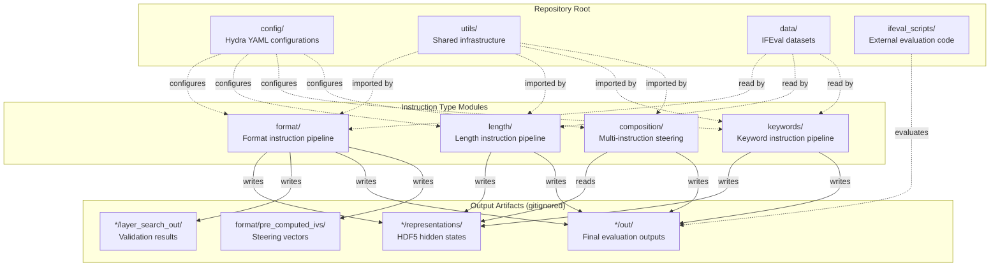
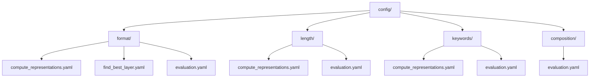
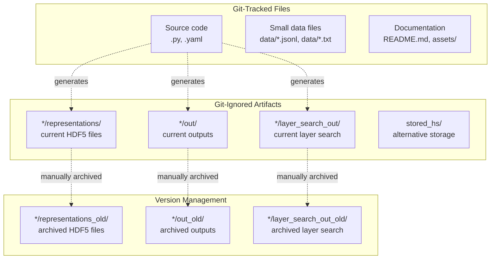
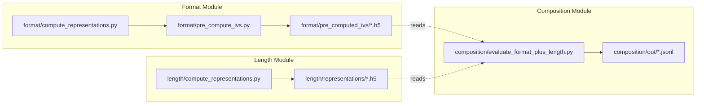

<!-- source: DeepWiki mcp.deepwiki.com · repo microsoft/llm-steer-instruct · page 8 Project Structure and Outputs · fetched 2026-10-26 -->

# Project Structure and Outputs

Relevant source files

The following files were used as context for generating this wiki page:

- [.gitignore](.gitignore)
- [README.md](README.md)
- [ifeval_scripts/README.md](ifeval_scripts/README.md)

## Purpose and Scope

This page documents the organization of the `llm-steer-instruct` repository, including its modular directory structure, output artifact management, and caching strategies. It provides a comprehensive reference for understanding where different components are located and how intermediate and final outputs are stored and managed.

For details on specific instruction modules and their pipelines, see [Instruction Type Modules](#5). For information about the configuration system, see [Configuration Management with Hydra](#3.3). For data sources and evaluation frameworks, see [Data and Evaluation](#6).

## Repository Organization Overview

The repository follows a modular architecture where each instruction type (format, length, keywords) has its own directory containing a complete pipeline of scripts. Shared infrastructure is centralized in `utils/`, configuration files are organized in `config/`, and evaluation integration is contained in `ifeval_scripts/`.

**Sources:** [README.md:16-48](), [.gitignore:1-16]()

## Module Directory Structure Pattern

Each instruction type module follows a consistent organizational pattern with pipeline scripts, configuration files, and output directories. The structure varies slightly based on the complexity of the pipeline.

### Format Module Structure

The format module implements the complete 5-stage pipeline and has the most comprehensive structure:

| Component | Location | Purpose |
|-----------|----------|---------|
| Pipeline Scripts | `format/*.py` | 5 stages: compute_representations, find_best_layer, compute_response_perplexity, pre_compute_ivs, evaluate |
| Configuration | `config/format/*.yaml` | Hydra configs for each stage |
| Representations | `format/representations/` | HDF5 files with hidden states |
| Layer Search | `format/layer_search_out/` | Validation outputs per layer |
| Pre-computed IVs | `format/pre_computed_ivs/` | Steering vectors ready for inference |
| Evaluation Results | `format/out/` | Final JSONL outputs |
| Analysis Script | `format/load_results.py` | Results loading and metrics |

**Sources:** [README.md:22-31](), [README.md:62-82]()

### Length Module Structure

The length module uses a simplified 2-stage pipeline:

| Component | Location | Purpose |
|-----------|----------|---------|
| Pipeline Scripts | `length/*.py` | 2 stages: compute_representations, evaluate |
| Configuration | `config/length/*.yaml` | Hydra configs for each stage |
| Representations | `length/representations/` | HDF5 files with hidden states |
| Evaluation Results | `length/out/` | Final JSONL outputs |
| Analysis Script | `length/load_results.py` | Results loading and metrics |

**Sources:** [README.md:37-39](), [README.md:84-92]()

### Keywords Module Structure

The keywords module implements a 3-stage pipeline:

| Component | Location | Purpose |
|-----------|----------|---------|
| Pipeline Scripts | `keywords/*.py` | 3 stages: compute_representations, compute_response_perplexity, evaluate |
| Configuration | `config/keywords/*.yaml` | Hydra configs for each stage |
| Representations | `keywords/representations/` | HDF5 files with hidden states |
| Evaluation Results | `keywords/out/` | Final JSONL outputs |
| Analysis Script | `keywords/load_results.py` | Results loading and metrics |
| Keyword Lists | `data/ifeval_keywords_*.txt` | Include/exclude word sets |

**Sources:** [README.md:32-36](), [README.md:95-107]()

### Composition Module Structure

The composition module combines pre-computed artifacts from other modules:

| Component | Location | Purpose |
|-----------|----------|---------|
| Pipeline Script | `composition/evaluate_format_plus_length.py` | Multi-instruction evaluation |
| Configuration | `config/composition/evaluation.yaml` | Hydra config |
| Input Dependencies | `format/pre_computed_ivs/`, `length/representations/` | Steering vectors and representations |
| Evaluation Results | `composition/out/` | Final JSONL outputs |
| Analysis Script | `composition/load_results.py` | Results loading and metrics |

**Sources:** [README.md:41-43](), [README.md:109-115]()

## Output Artifact Workflow

The following diagram shows how different types of output artifacts flow through the pipeline stages:

```mermaid
graph LR
    subgraph Stage1["Stage 1: Representation Computation"]
        ComputeReps["compute_representations.py"]
        RepsHDF5["representations/*.h5<br/>HDF5 hidden states"]
        ComputeReps -->|"writes"| RepsHDF5
    end
    
    subgraph Stage2["Stage 2: Layer Search (format only)"]
        FindLayer["find_best_layer.py"]
        LayerOut["layer_search_out/*.jsonl<br/>per-layer validation outputs"]
        RepsHDF5 -.->|"reads"| FindLayer
        FindLayer -->|"writes"| LayerOut
    end
    
    subgraph Stage3["Stage 3: Perplexity (format, keywords)"]
        ComputePerp["compute_response_perplexity.py"]
        PerpOut["layer_search_out/*_perplexity.jsonl<br/>outputs with quality scores"]
        LayerOut -.->|"reads"| ComputePerp
        ComputePerp -->|"writes"| PerpOut
    end
    
    subgraph Stage4["Stage 4: Pre-compute IVs (format only)"]
        PreCompute["pre_compute_ivs.py"]
        IVsHDF5["pre_computed_ivs/*.h5<br/>steering vectors"]
        RepsHDF5 -.->|"reads"| PreCompute
        PerpOut -.->|"reads optimal layer"| PreCompute
        PreCompute -->|"writes"| IVsHDF5
    end
    
    subgraph Stage5["Stage 5: Evaluation"]
        Evaluate["evaluate.py"]
        FinalOut["out/*.jsonl<br/>evaluation results"]
        IVsHDF5 -.->|"reads (format)"| Evaluate
        RepsHDF5 -.->|"reads (length, keywords)"| Evaluate
        Evaluate -->|"writes"| FinalOut
    end
    
    subgraph Analysis["Analysis"]
        LoadResults["load_results.py"]
        Metrics["Metrics and visualizations"]
        FinalOut -.->|"reads"| LoadResults
        LoadResults -->|"computes"| Metrics
    end
```

**Sources:** [README.md:62-115]()

## Configuration Directory Structure

The `config/` directory organizes Hydra YAML files by module and pipeline stage:

**Sources:** [README.md:24]()

## Shared Infrastructure

The `utils/` directory contains shared infrastructure used across all modules:

| File | Primary Components | Purpose |
|------|-------------------|---------|
| `utils/model_utils.py` | `load_model_from_tl_name()` | Model loading from transformer_lens and HuggingFace |
| `utils/generation_utils.py` | `generate()`, `generate_with_hooks()`, `activation_addition_hook()`, `direction_projection_hook()` | Text generation with steering |
| Other utilities | Various helper functions | Data loading, processing, etc. |

**Sources:** [README.md:44]()

## Data Directory Contents

The `data/` directory contains IFEval dataset files and derived artifacts:

| File | Description |
|------|-------------|
| Base IFEval data | Original dataset prompts and instructions |
| `all_base_x_all_instructions_filtered.jsonl` | Filtered prompts with constraint metadata |
| `ifeval_wo_instructions.jsonl` | Base queries without instructions |
| `ifeval_keywords_*.txt` | Keyword lists for inclusion/exclusion constraints |

**Sources:** [README.md:99]()

## Output Artifact Types and Formats

### HDF5 Representation Files

Located in `*/representations/*.h5`, these files store hidden states extracted during representation computation:

- **Structure**: Hierarchical HDF5 format with layers and samples
- **Contents**: Hidden states for the last token at each layer
- **Paired Data**: Separate entries for "with instruction" and "without instruction" variants
- **Usage**: Read by layer search, pre-computation, and evaluation stages

**Sources:** [README.md:67]()

### Layer Search Output Files

Located in `format/layer_search_out/*.jsonl`, these files contain validation results:

- **Format**: JSONL with one record per validation sample
- **Contents**: Model responses at different steering layers
- **Variants**: Files with and without perplexity scores (`*_perplexity.jsonl`)
- **Usage**: Informs selection of optimal steering layer

**Sources:** [README.md:69-74]()

### Pre-computed Instruction Vectors

Located in `format/pre_computed_ivs/*.h5`, these files store steering vectors:

- **Format**: HDF5 files
- **Contents**: Pre-computed steering vectors at optimal layers
- **Usage**: Loaded during evaluation for efficient steering application
- **Optimization**: Avoids recomputing differences during inference

**Sources:** [README.md:76-77]()

### Evaluation Output Files

Located in `*/out/*.jsonl`, these files contain final evaluation results:

- **Format**: JSONL with prompt and response pairs
- **Required Fields**: `prompt`, `response`
- **Usage**: Input to IFEval framework for instruction adherence metrics
- **Post-processing**: Can be augmented with perplexity scores

**Sources:** [README.md:79-81](), [ifeval_scripts/README.md:18-26]()

## Version Management and Gitignore Strategy

The repository uses a `.gitignore`-based strategy to manage large output artifacts while preserving historical versions when needed:

### Gitignore Patterns

The `.gitignore` file excludes the following patterns:

| Pattern | Purpose |
|---------|---------|
| `*/representations` | Ignore current HDF5 representation files |
| `*/representations_old/` | Ignore archived representation files |
| `*/out` | Ignore current evaluation outputs |
| `*/out_old` | Ignore archived evaluation outputs |
| `*/layer_search_out_old` | Ignore archived layer search outputs |
| `stored_hs/` | Ignore alternative hidden state storage |
| `__pycache__/`, `*.pyc` | Ignore Python cache files |
| `.vscode/`, `.DS_Store` | Ignore IDE and system files |

**Sources:** [.gitignore:1-16]()

### Version Management Rationale

The `_old` directory convention allows:
1. **Preservation**: Keep previous experimental results without git bloat
2. **Comparison**: Compare current results with historical baselines
3. **Rollback**: Restore previous artifacts if needed
4. **Disk Management**: Manually clean old versions when disk space is constrained

## External Integration: IFEval Scripts

The `ifeval_scripts/` directory contains the official IFEval evaluation code from Google Research:

- **Source**: Imported from https://github.com/google-research/google-research/tree/master/instruction_following_eval
- **Entry Point**: `evaluation_main` module
- **Input Format**: JSONL with `prompt` and `response` fields
- **Output**: Instruction adherence metrics in specified output directory
- **Dependencies**: Separate `requirements.txt` for IFEval dependencies

**Sources:** [README.md:18](), [ifeval_scripts/README.md:1-44]()

## Typical File Paths by Pipeline Stage

The following table maps pipeline stages to their typical input and output file paths:

| Stage | Script Example | Input Files | Output Files |
|-------|---------------|-------------|--------------|
| Representation Computation | `format/compute_representations.py` | `data/all_base_x_all_instructions_filtered.jsonl` | `format/representations/*.h5` |
| Layer Search | `format/find_best_layer.py` | `format/representations/*.h5` | `format/layer_search_out/*.jsonl` |
| Perplexity Computation | `format/compute_response_perplexity.py` | `format/layer_search_out/*.jsonl` | `format/layer_search_out/*_perplexity.jsonl` |
| Pre-compute IVs | `format/pre_compute_ivs.py` | `format/representations/*.h5`, `format/layer_search_out/*_perplexity.jsonl` | `format/pre_computed_ivs/*.h5` |
| Evaluation | `format/evaluate.py` | `format/pre_computed_ivs/*.h5`, `data/all_base_x_all_instructions_filtered.jsonl` | `format/out/*.jsonl` |
| IFEval Scoring | `ifeval_scripts/evaluation_main` | `*/out/*.jsonl` | `*/out/*_results.json` |
| Results Analysis | `*/load_results.py` | `*/out/*.jsonl` | Metrics, visualizations |

**Sources:** [README.md:62-115]()

## Cross-Module Dependencies

The composition module demonstrates cross-module artifact dependencies:

**Sources:** [README.md:109-115]()

This cross-module architecture allows:
- **Reuse**: Leverage expensive representation computation across experiments
- **Composition**: Combine steering vectors from different instruction types
- **Modularity**: Each module can be developed and tested independently
- **Efficiency**: Avoid redundant computation of shared artifacts

---

