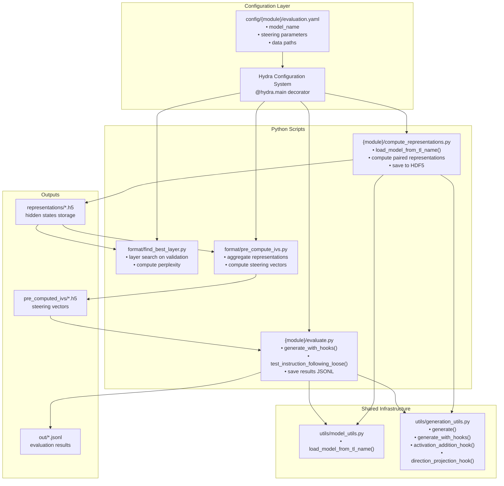
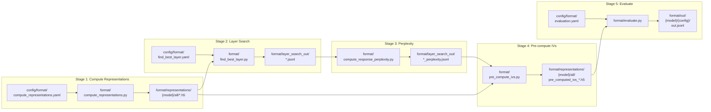

<!-- source: DeepWiki mcp.deepwiki.com · repo microsoft/llm-steer-instruct · page 9 Getting Started · fetched 2026-10-26 -->

# Getting Started

<details>
<summary>Relevant source files</summary>

The following files were used as context for generating this wiki page:

- [README.md](README.md)
- [composition/evaluate_format_plus_length.py](composition/evaluate_format_plus_length.py)
- [composition/load_results.py](composition/load_results.py)
- [config/composition/evaluation.yaml](config/composition/evaluation.yaml)
- [ifeval_scripts/README.md](ifeval_scripts/README.md)
- [requirements.txt](requirements.txt)

</details>


This page provides a practical guide for setting up the development environment and running your first activation steering experiments. It covers dependency installation, environment configuration, and step-by-step instructions for executing a complete experimental pipeline from representation computation through evaluation.

For detailed information about specific instruction types and their workflows, see [Instruction Type Modules](#5). For in-depth explanation of the underlying methodology, see [Activation Steering Methodology](#2.1).

---

## Prerequisites

Before beginning, ensure you have:

- **Python 3.8+** environment
- **CUDA-capable GPU** (recommended) for model inference
- **HuggingFace account** (optional) for accessing gated models
- **Disk space**: ~20GB for models and intermediate artifacts

---

## Installation

Install all required dependencies using the provided requirements file:

```bash
pip install -r requirements.txt
```

The key dependencies include:

| Package | Version | Purpose |
|---------|---------|---------|
| `transformer_lens` | 2.15.0 | Mechanistic interpretability framework, provides `HookedTransformer` |
| `transformers` | 4.44.2 | HuggingFace model loading (`AutoModel`, `AutoTokenizer`) |
| `hydra-core` | 1.3.2 | Configuration management for experiments |
| `torch` | 2.4.1 | PyTorch for model inference |
| `nltk` | 3.8.1 | Text processing for length constraints |
| `pandas` | 2.2.3 | Data manipulation and HDF5 storage |

**Sources:** [requirements.txt:1-14]()

---

## Environment Configuration

### HuggingFace Authentication

For accessing gated models (e.g., Gemma, Llama), set your HuggingFace token:

```bash
export HF_TOKEN="your_token_here"
```

Or configure it in your experiment YAML under `transformers_cache_dir`.

### Cache Directory

To avoid re-downloading models, set a cache directory in your configuration files:

```yaml
transformers_cache_dir: /path/to/cache
```

This parameter appears in all evaluation config files (e.g., [config/format/evaluation.yaml](), [config/length/evaluation.yaml]()).

### Device Selection

All scripts support GPU acceleration via the `device` parameter:

```yaml
device: 'cuda'  # Use 'cpu' for CPU-only execution
```

**Sources:** [config/composition/evaluation.yaml:1-8](), [README.md:52-58]()

---

## Repository Structure Overview

The codebase is organized around three instruction types plus composition:

```
.
├── config/                    # Hydra YAML configurations
│   ├── format/               # Format instruction configs
│   ├── length/               # Length instruction configs
│   ├── keywords/             # Keyword instruction configs
│   └── composition/          # Multi-instruction configs
├── format/                    # Format instruction scripts
├── length/                    # Length instruction scripts
├── keywords/                  # Keyword instruction scripts
├── composition/               # Multi-instruction scripts
├── utils/                     # Shared infrastructure
│   ├── model_utils.py        # load_model_from_tl_name()
│   └── generation_utils.py   # generate(), generate_with_hooks()
├── data/                      # IFEval dataset files
├── ifeval_scripts/           # External evaluation framework
└── requirements.txt
```

**Sources:** [README.md:16-48]()

---

## Execution Model: Configuration to Code



**Configuration to Code Mapping:** This diagram shows how Hydra YAML configurations drive Python script execution. Each module follows a similar pattern: compute representations → optimize layers → pre-compute vectors → evaluate. The `@hydra.main` decorator in each script loads parameters from the corresponding YAML file in `config/{module}/`.

**Sources:** [README.md:16-48](), [composition/evaluate_format_plus_length.py:26-28](), [config/composition/evaluation.yaml:1-39]()

---

## Running Your First Experiment: Format Instructions

This section walks through a complete experimental pipeline using format instructions as an example. The format module has the most comprehensive pipeline with 5 stages.

### Stage 1: Compute Representations

Compute hidden states for paired inputs (with/without instructions):

```bash
python format/compute_representations.py
```

This script:
1. Loads the model via `load_model_from_tl_name()` from [utils/model_utils.py]()
2. Processes pairs of prompts from the IFEval dataset
3. Extracts hidden states at all layers for the last token
4. Saves representations to `format/representations/{model_name}/all/*.h5`

**Key configuration parameters** ([config/format/compute_representations.yaml]()):
```yaml
model_name: 'gemma-2-9b-it'
device: 'cuda'
data_path: 'data/format/ifeval_single_instr_format.jsonl'
```

**Outputs:** HDF5 files containing tensors of shape `[num_examples, num_layers, d_model]`

### Stage 2: Find Best Layer

Identify the optimal steering layer using validation data:

```bash
python format/find_best_layer.py
```

This script:
1. Loads pre-computed representations
2. Tests steering at each layer on validation examples
3. Applies `activation_addition_hook()` or `direction_projection_hook()`
4. Saves outputs to `format/layer_search_out/`

**Key configuration parameters** ([config/format/find_best_layer.yaml]()):
```yaml
steering: 'adjust_rs'  # or 'add_vector'
validation_examples: 5  # examples per instruction type
```

### Stage 3: Compute Response Perplexity

Evaluate response quality using GPT-2 as a proxy:

```bash
python format/compute_response_perplexity.py
```

This script:
1. Loads validation outputs from Stage 2
2. Computes perplexity for each response
3. Saves augmented results to `*_perplexity.jsonl`

**Purpose:** Perplexity helps select layers that maintain response quality while improving instruction-following.

### Stage 4: Pre-Compute Instruction Vectors

Aggregate representations into steering vectors at the optimal layer:

```bash
python format/pre_compute_ivs.py
```

This script:
1. Loads representations from Stage 1
2. Reads layer selection results from Stage 2/3
3. Computes mean steering vector per instruction type
4. Saves to `format/representations/{model_name}/all/pre_computed_ivs_best_layer*.h5`

**Output format:** Pandas DataFrame with columns:
- `instruction`: Instruction type ID
- `instr_dir`: Normalized steering vector
- `avg_proj`: Average projection value
- `selected_layer`: Optimal layer index

### Stage 5: Evaluate

Run full evaluation on test data:

```bash
python format/evaluate.py
```

This script:
1. Loads pre-computed steering vectors
2. Generates responses with `generate_with_hooks()`
3. Evaluates using `test_instruction_following_loose()` from [ifeval_scripts/evaluation_main.py]()
4. Saves results to `format/out/{model_name}/{steering_config}/out.jsonl`

**Key configuration parameters** ([config/format/evaluation.yaml]()):
```yaml
steering: 'adjust_rs'      # 'add_vector', 'adjust_rs', or 'none'
source_layer_idx: -1       # -1 for best layer, or specific layer
steering_weight: 1.0       # weight for add_vector method
use_perplexity: True       # whether layer selection used perplexity
```

**Sources:** [README.md:62-82](), [composition/evaluate_format_plus_length.py:71-92]()

---

## Experiment Execution Flow



**Pipeline Execution Flow:** This diagram maps the 5-stage format instructions pipeline, showing data flow between stages. Each stage has a corresponding config file and produces intermediate artifacts. Stages 1-4 are preprocessing (run once), while Stage 5 is evaluation (run with different steering parameters).

**Sources:** [README.md:62-82]()

---

## Quick Start Examples

| Experiment Type | Command | Configuration File | Key Parameters |
|----------------|---------|-------------------|----------------|
| **Format Instructions** | `python format/evaluate.py` | `config/format/evaluation.yaml` | `steering`, `source_layer_idx` |
| **Length Instructions** | `python length/evaluate.py` | `config/length/evaluation.yaml` | `length_steering`, `length_steering_weight` |
| **Keyword Instructions** | `python keywords/evaluate.py` | `config/keywords/evaluation.yaml` | `specific_constraint` (`ifeval_include`/`ifeval_exclude`) |
| **Multi-Instruction** | `python composition/evaluate_format_plus_length.py` | `config/composition/evaluation.yaml` | Both format and length parameters |

### Dry Run Mode

All evaluation scripts support a dry run for quick testing:

```yaml
dry_run: True  # Process only first 3 examples
```

This appears in [config/composition/evaluation.yaml:2]() and similar files.

**Sources:** [README.md:84-115](), [composition/evaluate_format_plus_length.py:68-69]()

---

## Steering Methods

The system supports three steering approaches, controlled by the `steering` parameter:

| Method | Parameter Value | Hook Function | Description |
|--------|----------------|---------------|-------------|
| **No Steering** | `'none'` | N/A | Baseline generation without intervention |
| **Activation Addition** | `'add_vector'` | `activation_addition_hook()` | Add weighted steering vector: `activations += weight * direction` |
| **Direction Projection** | `'adjust_rs'` | `direction_projection_hook()` | Project residual stream to target value along direction |

**Hook Application:** Hooks are applied via `generate_with_hooks()` from [utils/generation_utils.py]():

```python
# Example from composition/evaluate_format_plus_length.py:157-160
hook_fn = functools.partial(
    activation_addition_hook, 
    direction=intervention_dir, 
    weight=args.steering_weight
)
fwd_hooks.append((
    tlutils.get_act_name('resid_post', layer_idx), 
    hook_fn
))
```

**Sources:** [composition/evaluate_format_plus_length.py:149-167]()

---

## Cross-Model Experiments

To transfer steering vectors from instruction-tuned models to base models:

1. **Compute representations** using the instruction-tuned model (e.g., `gemma-2-9b-it`)
2. **Evaluate** using the base model with `cross_model: True`:

```yaml
model_name: 'gemma-2-9b'  # Base model
cross_model: True         # Use representations from IT model
```

**Use Case:** Tests whether instruction-following behaviors learned by fine-tuned models can be transferred via activation steering.

**Sources:** [README.md:81-82]()

---

## Output Structure

Each experiment generates outputs in a structured directory:

```
{module}/out/{model_name}/{config}/
├── out.jsonl          # Evaluation results
├── args.json          # Experiment configuration
└── ...
```

**JSONL Record Structure:**
```json
{
  "prompt": "Original prompt with instruction",
  "response": "Generated response",
  "follow_all_instructions": true,
  "response_length_sent": 5,
  "response_length_words": 87,
  "instruction_id_list_for_eval": ["format:json_format"]
}
```

**Sources:** [composition/evaluate_format_plus_length.py:189-220](), [composition/load_results.py:41-49]()

---

## Loading and Analyzing Results

Use the provided `load_results.py` scripts to analyze outputs:

```python
import json
import pandas as pd

path_to_results = 'format/out/gemma-2-9b/adjust_rs_-1/out.jsonl'
with open(path_to_results, 'r') as f:
    results = [json.loads(line) for line in f]
results_df = pd.DataFrame(results)

# Compute accuracy
accuracy = results_df.follow_all_instructions.mean()
print(f"Instruction following accuracy: {accuracy:.3f}")
```

Each module has a `load_results.py` script (e.g., [composition/load_results.py:1-52]()) with example analysis code.

**Sources:** [composition/load_results.py:23-49]()

---

## Troubleshooting

### Common Issues

| Issue | Solution |
|-------|----------|
| **CUDA out of memory** | Reduce `max_generation_length` or use smaller model |
| **Missing HDF5 files** | Run `compute_representations.py` first |
| **Import errors** | Ensure `sys.path.append(project_dir)` in scripts |
| **Model download fails** | Set `HF_TOKEN` environment variable |

### Debugging Tips

1. **Enable dry run** (`dry_run: True`) to test with 3 examples
2. **Check intermediate outputs** in `representations/` and `layer_search_out/`
3. **Verify model loading** by checking `transformers_cache_dir`

**Sources:** [composition/evaluate_format_plus_length.py:68-69](), [config/composition/evaluation.yaml:2]()

---

## Next Steps

- For detailed methodology, see [Activation Steering Methodology](#2.1)
- For instruction taxonomy, see [Instruction Types and Constraint Taxonomy](#2.2)
- For specific workflows, see [Instruction Type Modules](#5)
- For evaluation metrics, see [Results Analysis and Metrics](#6.3)

---

