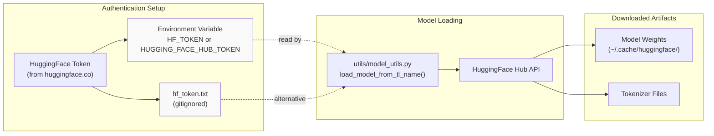
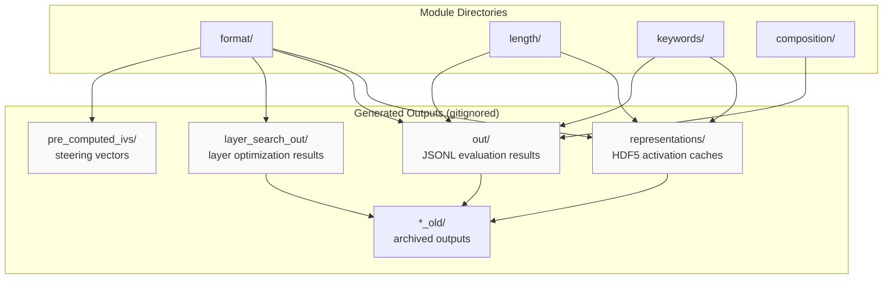

<!-- source: DeepWiki mcp.deepwiki.com · repo microsoft/llm-steer-instruct · page 9.1 Installation and Setup · fetched 2026-10-26 -->

# Installation and Setup

<details>
<summary>Relevant source files</summary>

The following files were used as context for generating this wiki page:

- [.gitignore](.gitignore)
- [README.md](README.md)
- [ifeval_scripts/README.md](ifeval_scripts/README.md)

</details>


## Purpose and Scope

This page documents the installation and environment setup required to run experiments in the llm-steer-instruct codebase. It covers dependency installation, environment configuration including HuggingFace authentication, and verification steps. For information about running your first experiment after setup, see [Running Your First Experiment](#9.2). For details about the configuration system itself, see [Configuration Management with Hydra](#3.3).

---

## System Requirements

The llm-steer-instruct framework requires:

- **Python 3.8+** (Python 3.10 recommended)
- **CUDA-compatible GPU** for running language models (8GB+ VRAM minimum, 24GB+ recommended for larger models)
- **Storage**: 50GB+ free disk space for model weights and cached representations
- **Memory**: 16GB+ RAM recommended

---

## Dependency Overview

The system relies on three categories of dependencies:

| Category | Key Packages | Purpose |
|----------|-------------|---------|
| **Model Infrastructure** | `transformer_lens`, `transformers`, `torch` | Model loading, inference, and activation manipulation |
| **Configuration & Data** | `hydra-core`, `h5py`, `datasets` | Experiment configuration and artifact storage |
| **Evaluation** | `instruction_following_eval` (external) | IFEval-based instruction adherence metrics |

```mermaid
graph TB
    subgraph "Core Dependencies"
        TransformerLens["transformer_lens<br/>(HookedTransformer)"]
        Transformers["transformers<br/>(AutoModel, AutoTokenizer)"]
        PyTorch["torch<br/>(GPU computation)"]
    end
    
    subgraph "Data & Storage"
        H5PY["h5py<br/>(HDF5 representations)"]
        Datasets["datasets<br/>(HuggingFace datasets)"]
        Hydra["hydra-core<br/>(configuration management)"]
    end
    
    subgraph "Evaluation Infrastructure"
        IFEval["instruction_following_eval<br/>(external package)"]
        GPT2["GPT-2 model<br/>(perplexity proxy)"]
    end
    
    subgraph "Utility Libraries"
        Numpy["numpy"]
        Pandas["pandas"]
        Matplotlib["matplotlib<br/>(visualization)"]
    end
    
    TransformerLens --> PyTorch
    Transformers --> PyTorch
    H5PY --> Numpy
    
    TransformerLens -.->|"used by"| ModelUtils["utils/model_utils.py<br/>load_model_from_tl_name"]
    Transformers -.->|"used by"| ModelUtils
    H5PY -.->|"used by"| ComputeReps["*/compute_representations.py"]
    Hydra -.->|"used by"| AllScripts["all experiment scripts"]
    IFEval -.->|"used by"| Evaluate["*/evaluate.py"]
    
    style TransformerLens fill:#f9f9f9
    style Transformers fill:#f9f9f9
    style H5PY fill:#f9f9f9
    style Hydra fill:#f9f9f9
```



**Sources:** [README.md:52-57](), [ifeval_scripts/README.md:10-14]()

---

## Core Package Installation

### Step 1: Install Python Dependencies

The primary installation method uses the provided `requirements.txt` file:

```bash
pip install -r requirements.txt
```

This installs all necessary packages including:
- `transformer_lens` for mechanistic interpretability and model hooks
- `transformers` and `torch` for model loading and inference
- `hydra-core` for configuration management
- `h5py` for efficient storage of activation representations
- `datasets` for loading IFEval and related datasets
- Standard scientific libraries (`numpy`, `pandas`, `matplotlib`)

**Sources:** [README.md:54-56]()

### Step 2: Install IFEval Framework

The system integrates with Google's IFEval framework for instruction-following evaluation. The framework is included in the repository under `ifeval_scripts/`:

```bash
# Install IFEval dependencies
pip install -r ifeval_scripts/requirements.txt
```

The IFEval framework is invoked programmatically from evaluation scripts via:
```python
from instruction_following_eval.evaluation_main import main as evaluation_main
```

This integration is used throughout the evaluation pipeline in scripts like `format/evaluate.py`, `length/evaluate.py`, and `keywords/evaluate.py`.

**Sources:** [ifeval_scripts/README.md:10-14](), [README.md:18]()

---

## Environment Configuration

### HuggingFace Authentication

Many models require authentication to download from HuggingFace Hub. The system expects a HuggingFace token to be available.



**Option 1: Environment Variable (Recommended)**
```bash
export HF_TOKEN="your_huggingface_token_here"
```

**Option 2: Token File**
Create a file named `hf_token.txt` in the repository root:
```bash
echo "your_huggingface_token_here" > hf_token.txt
```

The `.gitignore` file ensures this token file is never committed to version control.

**Sources:** [.gitignore:2](), [README.md:1-165]()

### Hydra Configuration Directory

The system uses Hydra for declarative configuration management. Ensure the `config/` directory structure is intact:

```
config/
├── format/
│   ├── compute_representations.yaml
│   ├── find_best_layer.yaml
│   └── evaluation.yaml
├── length/
│   ├── compute_representations.yaml
│   └── evaluation.yaml
├── keywords/
│   ├── compute_representations.yaml
│   └── evaluation.yaml
└── composition/
    └── evaluation.yaml
```

Hydra automatically discovers these configuration files when scripts are executed. No additional setup is required.

**Sources:** [README.md:18](), [README.md:23-47]()

---

## Output Directory Structure

After installation, the system will create several output directories during execution. These are automatically generated and excluded from version control:



The `.gitignore` configuration prevents these directories from being tracked:

| Directory Pattern | Purpose | Excluded by |
|------------------|---------|-------------|
| `*/representations/` | Cached activation representations (HDF5) | [.gitignore:14]() |
| `*/representations_old/` | Archived representations | [.gitignore:15]() |
| `*/out/` | Evaluation outputs (JSONL) | [.gitignore:13]() |
| `*/out_old/` | Archived outputs | [.gitignore:12]() |
| `*/layer_search_out_old/` | Archived layer search results | [.gitignore:11]() |
| `stored_hs/` | Alternative storage location | [.gitignore:1]() |

**Sources:** [.gitignore:1-16](), [README.md:23-47]()

---

## Verification Steps

After installation, verify the setup by checking the following:

### 1. Verify Core Dependencies

```bash
python -c "import transformer_lens; import transformers; import hydra; print('Core dependencies OK')"
```

### 2. Verify HuggingFace Access

```bash
python -c "from huggingface_hub import login; login(token=None); print('HF authentication OK')"
```

This should succeed if your token is properly configured.

### 3. Verify Model Loading

```bash
python -c "from utils.model_utils import load_model_from_tl_name; model = load_model_from_tl_name('gemma-2-2b-it'); print(f'Model loaded: {model.cfg.model_name}')"
```

This tests the complete model loading pipeline including HuggingFace authentication and transformer_lens integration.

### 4. Verify IFEval Integration

```bash
python -c "from instruction_following_eval.evaluation_main import main; print('IFEval framework OK')"
```

### 5. Check Configuration Access

```bash
python -c "import hydra; from omegaconf import OmegaConf; print('Hydra configuration OK')"
```

**Sources:** [README.md:52-57](), [ifeval_scripts/README.md:10-14]()

---

## Common Installation Issues

### Issue 1: CUDA Version Mismatch

**Symptom:** `RuntimeError: CUDA error: no kernel image is available for execution`

**Solution:** Ensure PyTorch is installed with the correct CUDA version:
```bash
pip install torch --index-url https://download.pytorch.org/whl/cu118
```

### Issue 2: HuggingFace Authentication Failure

**Symptom:** `GatedRepoError` or 403 errors when loading models

**Solution:** 
1. Verify your token has access to gated models (e.g., Gemma, Llama)
2. Accept model licenses on HuggingFace website
3. Set the token environment variable or create `hf_token.txt`

### Issue 3: Memory Errors During Model Loading

**Symptom:** `CUDA out of memory` errors

**Solution:**
- Use smaller model variants (e.g., `gemma-2-2b` instead of `gemma-2-9b`)
- Reduce batch size in configuration files
- Enable CPU offloading if available

### Issue 4: Missing HDF5 Dependencies

**Symptom:** `ImportError: libhdf5.so` not found

**Solution:**
```bash
# Ubuntu/Debian
sudo apt-get install libhdf5-dev

# macOS
brew install hdf5
```

**Sources:** [README.md:52-57](), [.gitignore:2]()

---

## Next Steps

After completing the installation and verification:

1. **Familiarize with Configuration**: Review YAML files in `config/` to understand available parameters
2. **Run First Experiment**: Follow [Running Your First Experiment](#9.2) for a step-by-step guide
3. **Understand Core Concepts**: Review [Activation Steering Methodology](#2.1) to understand the underlying technique

The system is now ready to compute representations, perform layer search, and evaluate instruction-following improvements through activation steering.

**Sources:** [README.md:1-165](), [.gitignore:1-16](), [ifeval_scripts/README.md:1-44]()

---

