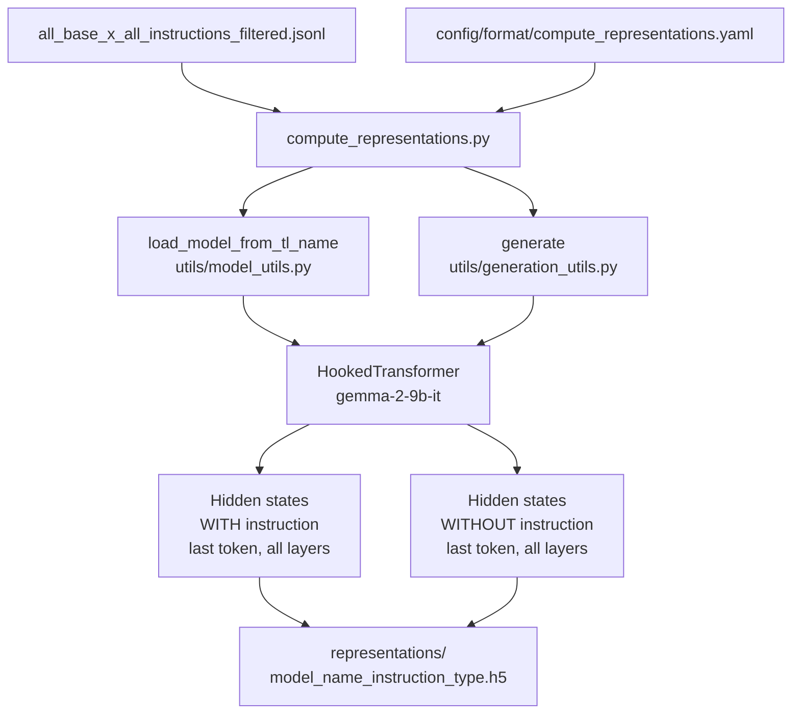
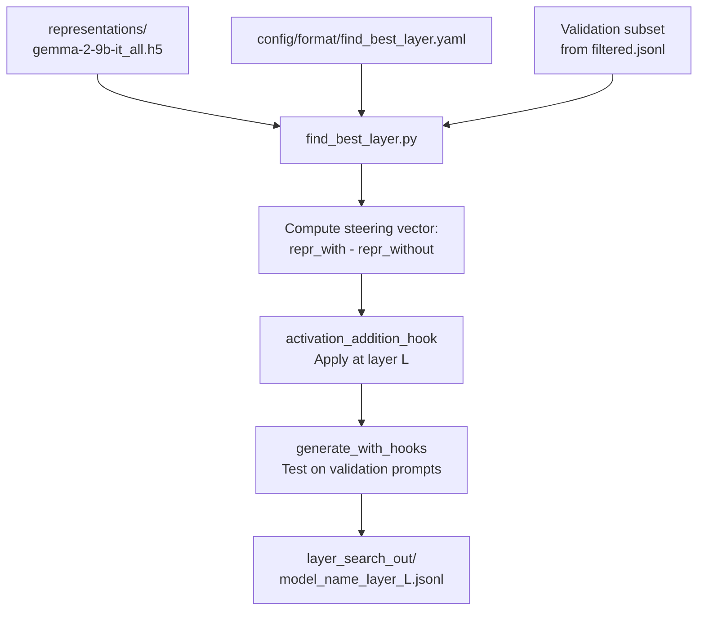
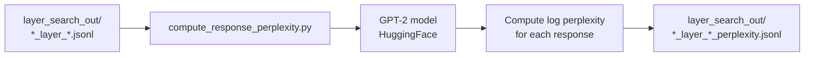
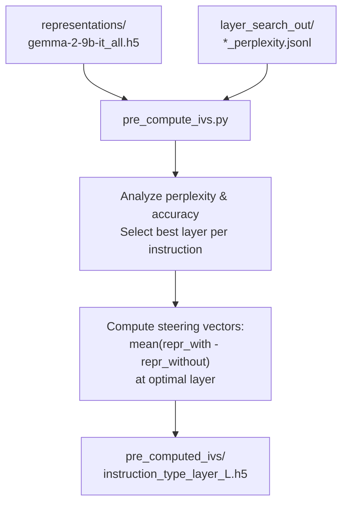
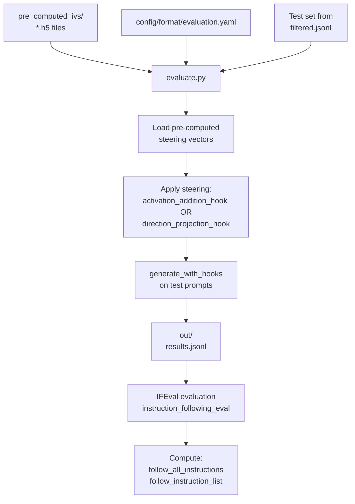

<!-- source: DeepWiki mcp.deepwiki.com · repo microsoft/llm-steer-instruct · page 9.2 Running Your First Experiment · fetched 2026-10-26 -->

# Running Your First Experiment

<details>
<summary>Relevant source files</summary>

The following files were used as context for generating this wiki page:

- [README.md](README.md)
- [data/format/all_base_x_all_instructions_filtered.jsonl](data/format/all_base_x_all_instructions_filtered.jsonl)
- [ifeval_scripts/README.md](ifeval_scripts/README.md)

</details>


This page provides a step-by-step guide to running a complete activation steering experiment from representation computation through evaluation. We use format instructions as the example workflow, which includes all five pipeline stages. This tutorial assumes you have already completed the installation steps described in [Installation and Setup](#9.1).

For understanding the underlying methodology, see [Activation Steering Methodology](#2.1). For details on other instruction types (length, keywords, composition), refer to [Instruction Type Modules](#5) and their respective subsections.

---

## Experiment Workflow Overview

A complete format instruction experiment consists of five sequential stages, each producing artifacts consumed by the next stage:

```mermaid
graph LR
    Config["config/format/<br/>compute_representations.yaml"]
    Script1["format/<br/>compute_representations.py"]
    Reps[("format/representations/<br/>*.h5 files")]
    
    Script2["format/<br/>find_best_layer.py"]
    LayerOut[("format/layer_search_out/<br/>*.jsonl")]
    
    Script3["format/<br/>compute_response_perplexity.py"]
    PerpOut[("format/layer_search_out/<br/>*_perplexity.jsonl")]
    
    Script4["format/<br/>pre_compute_ivs.py"]
    IVs[("format/pre_computed_ivs/<br/>*.h5")]
    
    Script5["format/<br/>evaluate.py"]
    Results[("format/out/<br/>*.jsonl")]
    
    Config --> Script1
    Script1 --> Reps
    Reps --> Script2
    Script2 --> LayerOut
    LayerOut --> Script3
    Script3 --> PerpOut
    PerpOut --> Script4
    Reps --> Script4
    Script4 --> IVs
    IVs --> Script5
    Script5 --> Results
```



**Sources:** [README.md:60-82](), [format/compute_representations.py](), [format/find_best_layer.py](), [format/compute_response_perplexity.py](), [format/pre_compute_ivs.py](), [format/evaluate.py]()

---

## Prerequisites and Data Preparation

Before starting, ensure you have:

| Requirement | Description | Location |
|------------|-------------|----------|
| **Base data** | IFEval dataset with filtered prompts | `data/format/all_base_x_all_instructions_filtered.jsonl` |
| **Model access** | HuggingFace authentication for model downloads | Environment variable or `~/.cache/huggingface/token` |
| **Disk space** | ~50GB for representations and outputs | Format directory |
| **GPU memory** | 16GB+ recommended for models like gemma-2-9b-it | CUDA device |

The primary data file `all_base_x_all_instructions_filtered.jsonl` contains paired prompts with and without instructions. Each record includes:

- `prompt_without_instruction`: Base query without any constraint
- `model_output`: Query with specific instruction integrated
- `single_instruction_id`: Constraint type (e.g., `detectable_format:json_format`)
- `single_instruction_kwargs`: Parameters for the constraint
- Additional metadata for evaluation

**Sources:** [data/format/all_base_x_all_instructions_filtered.jsonl:1-44](), [README.md:16-20]()

---

## Step 1: Compute Representations

### Overview

The first stage extracts hidden states from paired inputs to compute the "instruction direction" in activation space.



### Configuration

Edit `config/format/compute_representations.yaml` to specify:

```yaml
model_name: "gemma-2-9b-it"  # Model to use for representation extraction
instruction_set: "all"        # Which instruction types to process
batch_size: 8                 # Adjust based on GPU memory
max_samples: null             # Set to integer for testing, null for full dataset
output_dir: "format/representations"
```

**Sources:** [config/format/compute_representations.yaml]()

### Execution

Run the representation computation script:

```bash
cd format
python compute_representations.py
```

The script uses Hydra for configuration management, loading parameters from the YAML file. You can override config values from the command line:

```bash
python compute_representations.py model_name=gemma-2-2b-it max_samples=100
```

**Sources:** [format/compute_representations.py](), [README.md:64-67]()

### What Happens Internally

The script performs the following operations for each prompt pair:

1. **Load Model**: Calls `load_model_from_tl_name()` from [utils/model_utils.py]() to initialize a `HookedTransformer` instance
2. **Process Prompts**: 
   - Tokenizes `prompt_without_instruction` 
   - Tokenizes `model_output` (prompt WITH instruction)
3. **Extract Activations**: Runs forward passes and captures hidden states from the last token at each layer
4. **Store in HDF5**: Saves representations with structure:
   - `/{instruction_id}/{prompt_hash}/with_instruction`: Array of shape `[n_layers, d_model]`
   - `/{instruction_id}/{prompt_hash}/without_instruction`: Array of shape `[n_layers, d_model]`

**Sources:** [format/compute_representations.py](), [utils/model_utils.py](), [utils/generation_utils.py]()

### Expected Output

After completion, you should see:

```
format/representations/
└── gemma-2-9b-it_all.h5  # HDF5 file containing all representations
```

The file size will be several GB depending on the model and number of prompts processed. You can verify the structure:

```python
import h5py
with h5py.File('format/representations/gemma-2-9b-it_all.h5', 'r') as f:
    print(f.keys())  # Shows instruction types
    instruction_type = list(f.keys())[0]
    print(f[instruction_type].keys())  # Shows prompt hashes
```

**Sources:** [format/compute_representations.py]()

---

## Step 2: Find Best Layer

### Overview

This stage evaluates which transformer layer is optimal for steering by testing validation prompts at multiple layers.



### Configuration

Edit `config/format/find_best_layer.yaml`:

```yaml
model_name: "gemma-2-9b-it"
representation_file: "format/representations/gemma-2-9b-it_all.h5"
layers_to_test: [10, 15, 20, 25, 30]  # Which layers to evaluate
steering_strength: 1.0                 # Multiplier for steering vector
validation_size: 100                   # Number of prompts to test per layer
output_dir: "format/layer_search_out"
```

**Sources:** [config/format/find_best_layer.yaml]()

### Execution

```bash
cd format
python find_best_layer.py
```

This process is computationally expensive as it generates outputs for each validation prompt at each layer. Expect several hours for a full run with 5 layers and 100 validation prompts.

**Sources:** [format/find_best_layer.py](), [README.md:68-71]()

### What Happens Internally

For each layer L in `layers_to_test`:

1. **Compute Steering Vectors**: For each instruction type, compute `steering_vec = repr_with - repr_without` at layer L
2. **Apply Steering**: Use `activation_addition_hook()` from [utils/generation_utils.py]() to inject `steering_strength * steering_vec` into the residual stream at layer L
3. **Generate Outputs**: Run model with hooks on validation prompts
4. **Save Results**: Write JSONL with fields:
   - `prompt`: Input prompt with instruction
   - `output`: Model generation with steering
   - `instruction_id`: Constraint type
   - `layer`: Which layer steering was applied at

**Sources:** [format/find_best_layer.py](), [utils/generation_utils.py]()

### Expected Output

```
format/layer_search_out/
├── gemma-2-9b-it_layer_10.jsonl
├── gemma-2-9b-it_layer_15.jsonl
├── gemma-2-9b-it_layer_20.jsonl
├── gemma-2-9b-it_layer_25.jsonl
└── gemma-2-9b-it_layer_30.jsonl
```

Each file contains generated outputs for that specific layer.

**Sources:** [format/find_best_layer.py]()

---

## Step 3: Compute Response Perplexity

### Overview

This stage computes perplexity scores for each generated response using GPT-2 as a quality proxy, enabling selection of the best steering layer.



### Execution

```bash
cd format
python compute_response_perplexity.py
```

No configuration file is needed; the script automatically discovers all layer output files in `layer_search_out/` and processes them.

**Sources:** [format/compute_response_perplexity.py](), [README.md:72-74]()

### What Happens Internally

1. **Load Outputs**: Reads each `*_layer_*.jsonl` file
2. **Compute Perplexity**: For each response:
   - Tokenizes with GPT-2 tokenizer
   - Computes negative log-likelihood
   - Stores as `perplexity` field
3. **Save Augmented Data**: Writes new JSONL files with `_perplexity.jsonl` suffix containing all original fields plus perplexity scores

The perplexity metric serves as a proxy for response quality - lower perplexity indicates more natural text, helping identify layers that maintain quality while following instructions.

**Sources:** [format/compute_response_perplexity.py]()

### Expected Output

```
format/layer_search_out/
├── gemma-2-9b-it_layer_10_perplexity.jsonl
├── gemma-2-9b-it_layer_15_perplexity.jsonl
├── gemma-2-9b-it_layer_20_perplexity.jsonl
├── gemma-2-9b-it_layer_25_perplexity.jsonl
└── gemma-2-9b-it_layer_30_perplexity.jsonl
```

Each record now includes a `perplexity` field for analysis.

**Sources:** [format/compute_response_perplexity.py]()

---

## Step 4: Pre-compute Instruction Vectors

### Overview

Based on validation results, this stage pre-computes steering vectors at the optimal layer for efficient inference.



### Execution

```bash
cd format
python pre_compute_ivs.py
```

The script automatically analyzes the perplexity files to determine optimal layers, then computes and saves steering vectors.

**Sources:** [format/pre_compute_ivs.py](), [README.md:75-77]()

### What Happens Internally

1. **Load Validation Results**: Reads all `*_perplexity.jsonl` files
2. **Evaluate IFEval Metrics**: Calls the IFEval framework (see [ifeval_scripts/README.md]()) to compute instruction adherence for each layer
3. **Select Best Layer**: For each instruction type, chooses the layer that maximizes:
   - Instruction adherence (`follow_all_instructions` metric)
   - Subject to perplexity constraint (quality threshold)
4. **Compute Final Vectors**: For the selected layer, computes the mean steering vector across all training examples:
   ```
   steering_vector[instruction_type] = mean(repr_with - repr_without)
   ```
5. **Save to HDF5**: Stores vectors with structure:
   - `/{instruction_type}/steering_vector`: Array of shape `[d_model]`
   - `/{instruction_type}/metadata`: Optimal layer, validation scores

**Sources:** [format/pre_compute_ivs.py]()

### Expected Output

```
format/pre_computed_ivs/
├── detectable_format_json_format_layer_20.h5
├── detectable_format_number_bullet_lists_layer_18.h5
├── detectable_format_multiple_sections_layer_22.h5
└── ... (one file per instruction type)
```

These pre-computed vectors enable fast steering during evaluation without recomputing representations.

**Sources:** [format/pre_compute_ivs.py]()

---

## Step 5: Evaluate on Test Set

### Overview

The final stage evaluates the model with pre-computed steering vectors on the full IFEval test set.



### Configuration

Edit `config/format/evaluation.yaml`:

```yaml
model_name: "gemma-2-9b-it"
pre_computed_dir: "format/pre_computed_ivs"
steering_method: "activation_addition"  # or "direction_projection"
steering_strength: 1.0
test_size: null                         # null for full test set
output_dir: "format/out"
cross_model: false                      # Set true for cross-model experiments
```

**Key parameters:**
- `steering_method`: Choose between `activation_addition` (scale and add vector) or `direction_projection` (project to target magnitude)
- `cross_model`: When `true`, applies steering vectors from instruction-tuned model to base model
- `steering_strength`: Multiplier for steering intensity

**Sources:** [config/format/evaluation.yaml](), [README.md:78-81]()

### Execution

```bash
cd format
python evaluate.py
```

For cross-model experiments (transferring steering from `gemma-2-9b-it` to `gemma-2-9b`):

```bash
python evaluate.py model_name=gemma-2-9b cross_model=true
```

**Sources:** [format/evaluate.py](), [README.md:78-81]()

### What Happens Internally

1. **Load Model**: Initializes the target model (same model used for representations, or different model if `cross_model=true`)
2. **Load Steering Vectors**: Reads all pre-computed vectors from `pre_computed_ivs/`
3. **Process Test Set**: For each test prompt:
   - Identifies required instruction type
   - Loads corresponding steering vector and optimal layer
   - Applies steering hook (`activation_addition_hook` or `direction_projection_hook`)
   - Generates response with `generate_with_hooks()`
4. **Save Raw Outputs**: Writes JSONL with fields:
   - `prompt`: Test prompt
   - `response`: Model generation with steering
   - `instruction_id_list`: List of constraint types
   - `kwargs`: Constraint parameters
5. **Run IFEval**: Calls `evaluation_main` from [ifeval_scripts/]() to compute instruction adherence metrics
6. **Save Final Results**: Augments outputs with evaluation scores

**Sources:** [format/evaluate.py](), [utils/generation_utils.py](), [ifeval_scripts/README.md:22-31]()

### Expected Output

```
format/out/
├── gemma-2-9b-it_activation_addition_results.jsonl
└── gemma-2-9b-it_activation_addition_results_eval.json
```

The JSONL file contains all responses; the JSON file contains aggregate metrics:

```json
{
  "follow_all_instructions": 0.68,
  "follow_instruction_list": 0.75,
  "average_perplexity": 12.4,
  "num_evaluated": 541
}
```

**Sources:** [format/evaluate.py]()

---

## Analyzing Results

### Loading and Visualizing

Use the provided analysis script:

```bash
cd format
python load_results.py
```

This script from [format/load_results.py]() loads the evaluation outputs and computes:

| Metric | Description |
|--------|-------------|
| `follow_all_instructions` | Fraction of prompts where all instructions satisfied |
| `follow_instruction_list` | Per-instruction accuracy (lenient scoring) |
| `average_response_length` | Mean response length in tokens |
| `perplexity_distribution` | Statistics on response quality |

**Sources:** [format/load_results.py](), [README.md:31]()

### Comparing Steering Methods

To compare different steering approaches, run evaluations with different configurations:

```bash
# Baseline (no steering)
python evaluate.py steering_method=none output_suffix=baseline

# Activation addition
python evaluate.py steering_method=activation_addition output_suffix=act_add

# Direction projection  
python evaluate.py steering_method=direction_projection output_suffix=dir_proj
```

Then analyze comparative performance across methods.

**Sources:** [format/evaluate.py]()

---

## Troubleshooting Common Issues

### Out of Memory Errors

**Symptom:** CUDA OOM during representation computation or evaluation

**Solutions:**
- Reduce `batch_size` in configuration
- Use a smaller model (e.g., `gemma-2-2b-it` instead of `gemma-2-9b-it`)
- Clear cache between runs: `torch.cuda.empty_cache()`

### Missing Representations

**Symptom:** `find_best_layer.py` fails with "KeyError" for instruction type

**Solutions:**
- Ensure `compute_representations.py` completed successfully
- Check that `instruction_set` in config matches your needs
- Verify HDF5 file integrity: `h5py.File('representations/file.h5', 'r').keys()`

### IFEval Import Errors

**Symptom:** `ModuleNotFoundError: No module named 'instruction_following_eval'`

**Solutions:**
- Ensure `ifeval_scripts/` is in Python path
- Run from repository root, not from subdirectories
- Check that IFEval dependencies are installed

**Sources:** [ifeval_scripts/README.md:8-11]()

---

## Next Steps

After completing your first format instruction experiment, you can:

1. **Try Other Instruction Types**: Run similar workflows for [Length Instructions](#5.2) or [Keyword Instructions](#5.3), which have simplified pipelines
2. **Experiment with Multi-Instruction Steering**: Combine multiple constraints using [Multi-Instruction Composition](#5.4)
3. **Cross-Model Transfer**: Test whether steering vectors from instruction-tuned models improve base models (see [Cross-Model Experiments](#7.1))
4. **Hyperparameter Tuning**: Vary `steering_strength`, test different layers, or modify validation set size
5. **Custom Instructions**: Extend the framework with new constraint types following the established patterns

For detailed methodology, refer to [Activation Steering Methodology](#2.1). For understanding the data structures, see [Data Sources and Structure](#6.1).

**Sources:** [README.md:60-115](), [format/](), [length/](), [keywords/](), [composition/]()