# Page: Overview

# Overview

<details>
<summary>Relevant source files</summary>

The following files were used as context for generating this wiki page:

- [.gitignore](.gitignore)
- [README.md](README.md)
- [ifeval_scripts/README.md](ifeval_scripts/README.md)

</details>


## Purpose and Scope

This documentation provides a comprehensive technical reference for the **llm-steer-instruct** repository, which implements an activation steering framework for improving instruction-following behavior in large language models (LLMs). This page introduces the repository's architecture, core concepts, and organization, serving as an entry point to more detailed documentation.

For detailed explanations of the underlying activation steering methodology, see [Activation Steering Methodology](#2.1). For practical guidance on running experiments, see [Getting Started](#9).

**Sources:** [README.md:1-165]()

## What is llm-steer-instruct?

The llm-steer-instruct repository implements the method presented in the ICLR 2025 paper "Improving Instruction-Following in Language Models through Activation Steering." The core approach computes **steering vectors** as the difference in model activations between paired inputs—one with an instruction and one without—and applies these vectors during inference to guide generation toward satisfying desired constraints such as specific formatting, length requirements, or keyword inclusion/exclusion.

The method operates at the model activation level rather than requiring fine-tuning, making it computationally efficient and interpretable. The repository provides a complete pipeline for:

1. **Computing representations** from paired inputs using transformer models
2. **Searching for optimal steering layers** using validation data
3. **Pre-computing steering vectors** for efficient inference
4. **Evaluating instruction adherence** using the IFEval benchmark
5. **Analyzing results** through perplexity-based quality assessment

**Sources:** [README.md:1-14](), [README.md:119-120]()

## System Architecture

The repository is organized around three primary instruction-type modules (**format**, **length**, **keywords**) plus a **composition** module for multi-instruction steering. All modules share common infrastructure for model loading, generation, and configuration management.

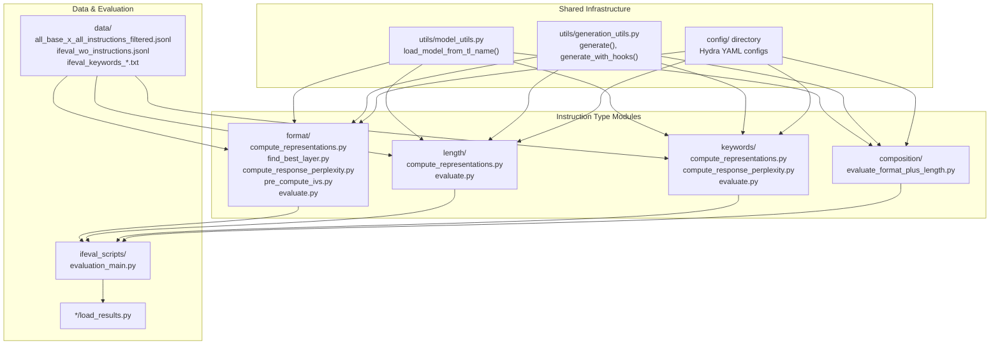

**Sources:** [README.md:16-48](), [.gitignore:1-16]()

## Key Components

### Infrastructure Layer

The repository provides shared utilities used across all instruction-type modules:

| Component | Location | Key Functions | Purpose |
|-----------|----------|---------------|---------|
| Model Loading | `utils/model_utils.py` | `load_model_from_tl_name()` | Loads models using transformer_lens and HuggingFace, provides HookedTransformer interface |
| Generation | `utils/generation_utils.py` | `generate()`, `generate_with_hooks()`, `activation_addition_hook()`, `direction_projection_hook()` | Handles text generation with and without steering hooks |
| Configuration | `config/` | Hydra YAML files | Declarative experiment configuration for reproducibility |

**Sources:** [README.md:44]()

### Instruction Type Modules

Each instruction type has its own directory with a complete pipeline:

#### Format Instructions (`format/`)
The most comprehensive pipeline with 5 stages:
- `compute_representations.py`: Extract hidden states from paired inputs
- `find_best_layer.py`: Search for optimal steering layer
- `compute_response_perplexity.py`: Compute quality metrics using GPT-2
- `pre_compute_ivs.py`: Pre-compute steering vectors
- `evaluate.py`: Generate and evaluate outputs

**Sources:** [README.md:62-81]()

#### Length Instructions (`length/`)
Simplified 2-stage pipeline for sentence/word constraints:
- `compute_representations.py`: Extract representations for length constraints
- `evaluate.py`: Evaluate with length steering

**Sources:** [README.md:84-92]()

#### Keyword Instructions (`keywords/`)
3-stage pipeline for word inclusion/exclusion:
- `compute_representations.py`: Compute keyword representations
- `compute_response_perplexity.py`: Quality assessment
- `evaluate.py`: Evaluate keyword adherence

**Sources:** [README.md:95-106]()

#### Multi-Instruction Composition (`composition/`)
Combines steering vectors from multiple instruction types:
- `evaluate_format_plus_length.py`: Apply multiple steering vectors simultaneously

**Sources:** [README.md:109-114]()

## Activation Steering Pipeline

The following diagram illustrates the complete workflow from data to evaluation, mapping each stage to specific Python scripts:

```mermaid
graph LR
    subgraph "Stage 1: Data Preparation"
        IFEvalData["IFEval Dataset<br/>data/all_base_x_all_instructions_filtered.jsonl"]
        BaseQueries["Base Queries<br/>data/ifeval_wo_instructions.jsonl"]
    end
    
    subgraph "Stage 2: Representation Extraction"
        ComputeReps["compute_representations.py<br/>(format/ length/ keywords/)"]
        RepsStorage["HDF5 Storage<br/>*/representations/*.h5"]
    end
    
    subgraph "Stage 3: Layer Optimization"
        LayerSearch["find_best_layer.py<br/>(format/)"]
        PerpCompute["compute_response_perplexity.py<br/>(format/ keywords/)"]
        ValidationOut["*/layer_search_out/*.jsonl"]
    end
    
    subgraph "Stage 4: Vector Pre-computation"
        PreComputeIV["pre_compute_ivs.py<br/>(format/)"]
        IVStorage["HDF5 Storage<br/>format/pre_computed_ivs/*.h5"]
    end
    
    subgraph "Stage 5: Evaluation"
        Evaluate["evaluate.py<br/>(format/ length/ keywords/)<br/>evaluate_format_plus_length.py<br/>(composition/)"]
        EvalOut["*/out/*.jsonl"]
    end
    
    subgraph "Stage 6: Analysis"
        IFEvalMain["ifeval_scripts/evaluation_main.py"]
        LoadResults["*/load_results.py"]
        Metrics["Accuracy Metrics<br/>follow_all_instructions"]
    end
    
    IFEvalData --> ComputeReps
    BaseQueries --> ComputeReps
    ComputeReps --> RepsStorage
    
    RepsStorage --> LayerSearch
    LayerSearch --> ValidationOut
    ValidationOut --> PerpCompute
    PerpCompute --> PreComputeIV
    
    RepsStorage --> PreComputeIV
    PreComputeIV --> IVStorage
    
    IVStorage --> Evaluate
    RepsStorage --> Evaluate
    Evaluate --> EvalOut
    
    EvalOut --> IFEvalMain
    IFEvalMain --> LoadResults
    LoadResults --> Metrics
```

**Sources:** [README.md:62-114](), [.gitignore:11-15]()

## Data Flow and Artifacts

The repository maintains a clear separation between intermediate artifacts and final outputs:

| Artifact Type | Location Pattern | Format | Purpose |
|---------------|------------------|--------|---------|
| Representations | `*/representations/*.h5` | HDF5 | Cached hidden states from paired inputs |
| Layer Search Results | `*/layer_search_out/*.jsonl` | JSONL | Validation outputs at different layers |
| Pre-computed Vectors | `format/pre_computed_ivs/*.h5` | HDF5 | Steering vectors for inference |
| Evaluation Outputs | `*/out/*.jsonl` | JSONL | Generated responses with metadata |
| Old Versions | `*/representations_old/`, `*/out_old/` | Various | Archived previous runs |

The `.gitignore` file excludes these artifacts from version control, as they are computationally expensive but reproducible:

**Sources:** [.gitignore:1-16]()

## Configuration System

The repository uses [Hydra](https://hydra.cc) for declarative configuration management. Each module has dedicated YAML files under `config/`:

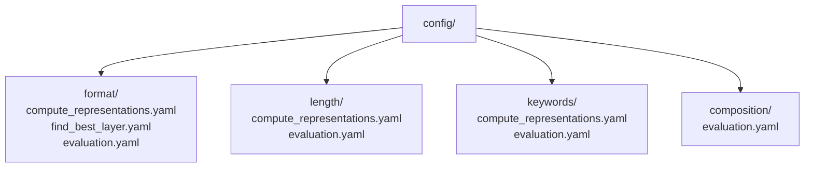

Configuration files control:
- Model selection (`model_name`, `cross_model` flag)
- Steering parameters (layer, weight, method)
- Data paths and constraints
- Evaluation settings

For detailed information on configuration parameters, see [Configuration Management with Hydra](#3.3).

**Sources:** [README.md:18](), [README.md:66-114]()

## Cross-Model Transfer Capability

A key feature of the system is the ability to transfer steering vectors from instruction-tuned models to base models. For example, representations computed on `gemma-2-9b-it` can steer `gemma-2-9b`:

1. Compute representations using instruction-tuned model
2. Enable `cross_model: true` in evaluation config
3. Set `model_name` to base model variant
4. Run evaluation using transferred steering vectors

This capability is documented in detail in [Cross-Model Experiments](#7.1).

**Sources:** [README.md:81]()

## Evaluation Framework

The repository integrates with the official [IFEval](https://github.com/google-research/google-research/tree/master/instruction_following_eval) framework for standardized evaluation of instruction-following behavior. The `ifeval_scripts/` directory contains the evaluation code, which computes metrics such as:

- `follow_all_instructions`: Binary metric for complete instruction adherence
- `follow_instruction_x`: Per-instruction adherence metrics
- Response quality assessment via perplexity

For details on evaluation metrics and procedures, see [IFEval Framework Integration](#6.2) and [Results Analysis and Metrics](#6.3).

**Sources:** [ifeval_scripts/README.md:1-44](), [README.md:18]()

## Repository Directory Structure

The repository follows a modular organization:

```
llm-steer-instruct/
├── config/              # Hydra YAML configurations for all modules
├── data/                # IFEval dataset, filtered prompts, keyword lists
├── format/              # Format instruction experiments (5-stage pipeline)
├── keywords/            # Keyword instruction experiments (3-stage pipeline)
├── length/              # Length instruction experiments (2-stage pipeline)
├── composition/         # Multi-instruction steering experiments
├── utils/               # Shared infrastructure (model_utils, generation_utils)
├── ifeval_scripts/      # Official IFEval evaluation code
├── requirements.txt     # Python dependencies
└── README.md            # Repository documentation
```

For a comprehensive guide to the directory structure, see [Directory Organization](#8.1).

**Sources:** [README.md:22-48]()

## Documentation Roadmap

This wiki is organized into the following major sections:

### Core Concepts ([#2](#2))
Understanding the fundamental methodology and constraint taxonomy that underlies all experiments.

### Infrastructure and Utilities ([#3](#3))
Documentation of shared components: model loading ([#3.1](#3.1)), generation utilities ([#3.2](#3.2)), and configuration management ([#3.3](#3.3)).

### Steering Vector Pipeline ([#4](#4))
Complete pipeline from representation extraction ([#4.1](#4.1)) through layer optimization ([#4.2](#4.2)), pre-computation ([#4.3](#4.3)), and inference-time application ([#4.4](#4.4)).

### Instruction Type Modules ([#5](#5))
Detailed documentation for format ([#5.1](#5.1)), length ([#5.2](#5.2)), keyword ([#5.3](#5.3)), and composition ([#5.4](#5.4)) modules.

### Data and Evaluation ([#6](#6))
Data sources ([#6.1](#6.1)), IFEval integration ([#6.2](#6.2)), metrics analysis ([#6.3](#6.3)), and perplexity assessment ([#6.4](#6.4)).

### Advanced Features ([#7](#7))
Cross-model experiments ([#7.1](#7.1)) and steering method comparisons ([#7.2](#7.2)).

### Project Structure and Outputs ([#8](#8))
Directory organization ([#8.1](#8.1)) and artifact management ([#8.2](#8.2)).

### Getting Started ([#9](#9))
Installation guide ([#9.1](#9.1)) and first experiment walkthrough ([#9.2](#9.2)).

## Quick Start

To begin using the repository:

1. **Installation**: Follow the setup instructions in [Installation and Setup](#9.1)
2. **First Experiment**: Run through the complete pipeline in [Running Your First Experiment](#9.2)
3. **Understanding**: Read [Activation Steering Methodology](#2.1) to understand the core technique
4. **Exploration**: Browse instruction-type modules ([#5](#5)) for specific use cases

**Sources:** [README.md:52-57](), [README.md:62-114]()

## Responsible AI Considerations

The repository includes a [transparency note](https://github.com/microsoft/llm-steer-instruct/blob/main/assets/Activation_Steering_for_Instruction%20_Following_RAI_transparency_note.pdf) outlining responsible AI considerations. Key points include:

- The method was tested on open-source models (Phi 3.5, Gemma, Mistral)
- Evaluated on IFEval dataset with GPT-4o assisting in quality scoring
- Limitations include potential text quality reduction and incomplete instruction adherence
- Users should balance instruction-following with quality and integrate with content filters
- Developed for research purposes primarily in English

**Sources:** [README.md:118-119]()

---

# Page: Core Concepts

# Core Concepts

<details>
<summary>Relevant source files</summary>

The following files were used as context for generating this wiki page:

- [README.md](README.md)
- [data/format/all_base_x_all_instructions_filtered.jsonl](data/format/all_base_x_all_instructions_filtered.jsonl)
- [ifeval_scripts/README.md](ifeval_scripts/README.md)

</details>


This document introduces the fundamental concepts underlying the activation steering approach used in this repository and the taxonomy of instructions that the system can handle. It provides conceptual background for understanding how the system improves instruction-following behavior in language models.

For detailed implementation of activation steering, see [Activation Steering Methodology](#2.1). For comprehensive documentation of constraint types, see [Instruction Types and Constraint Taxonomy](#2.2). For details on how prompts are engineered, see [Prompt Transformation System](#2.3).

---

## Overview

The llm-steer-instruct system applies **activation steering** to improve language models' ability to follow specific instructions. The approach is based on two core ideas:

1. **Steering vectors represent instruction-following behavior**: The difference in a model's internal activations when processing a prompt with versus without an instruction captures the neural pattern associated with that instruction.

2. **Instructions are categorized by constraint type**: The system handles a taxonomy of instruction types (format, length, keywords, etc.) that are evaluated using the IFEval framework.

The relationship between these concepts is illustrated below:

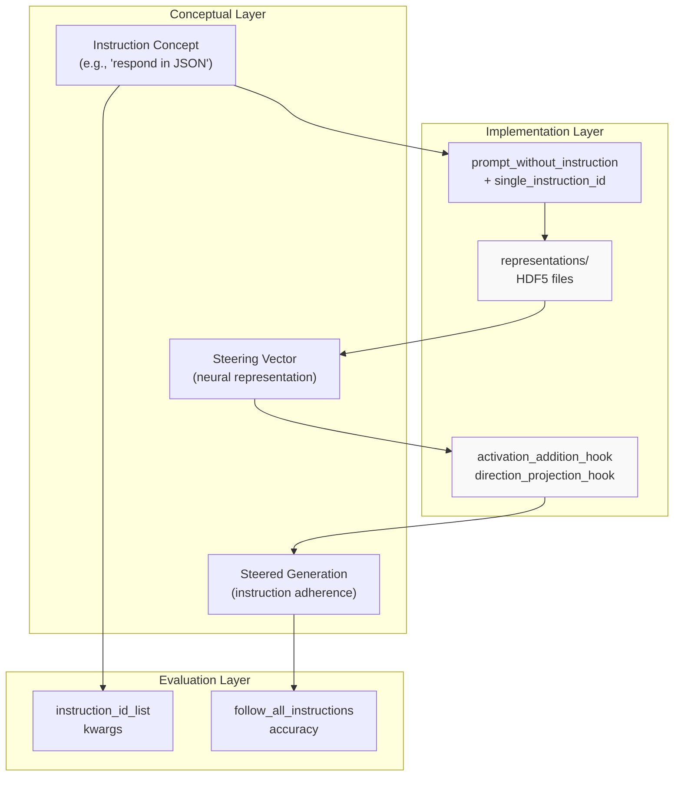

**Sources:** [README.md:9-12](), [data/format/all_base_x_all_instructions_filtered.jsonl:1-45]()

---

## Activation Steering Fundamentals

### Paired Input Methodology

Activation steering operates on the principle that the difference between a model's internal states on related inputs reveals the neural pattern associated with a specific behavior. The system computes steering vectors from **paired inputs**:

| Input Type | Description | Field in Data |
|------------|-------------|---------------|
| **Base prompt** | Query without instruction | `prompt_without_instruction` |
| **Constrained prompt** | Query with instruction applied | `model_output` |
| **Steering vector** | Difference in activations | Computed from HDF5 representations |

The pairing structure appears in the data format:

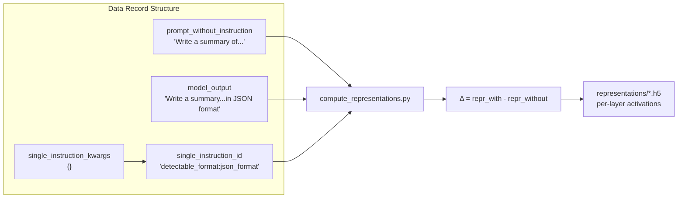

**Sources:** [data/format/all_base_x_all_instructions_filtered.jsonl:1](), [README.md:11-12]()

### Steering Vector Properties

Steering vectors have three key properties exploited by the system:

1. **Layer-specific**: Each steering vector is computed for specific transformer layers, requiring layer search to identify optimal steering locations
2. **Linearly composable**: Multiple steering vectors can be applied simultaneously for multi-instruction scenarios (see [Multi-Instruction Composition](#5.4))
3. **Transferable**: Steering vectors from instruction-tuned models can improve base models (see [Cross-Model Experiments](#7.1))

---

## Instruction Constraint Taxonomy

### Primary Constraint Categories

The system handles instructions organized into a hierarchical taxonomy. The top-level categories are:

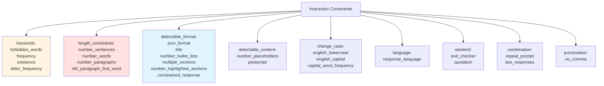

**Sources:** [data/format/all_base_x_all_instructions_filtered.jsonl:1-50]()

### Instruction ID Structure

Each instruction is identified by a composite key: `{category}:{subtype}_{modifier}`. Examples from the data:

| Full Instruction ID | Category | Subtype | Modifier | Example Kwargs |
|---------------------|----------|---------|----------|----------------|
| `keywords:forbidden_words` | keywords | forbidden_words | - | `{'forbidden_words': ['moser', 'glassworks']}` |
| `length_constraints:number_sentences_at least` | length_constraints | number_sentences | at least | `{'relation': 'at least', 'num_sentences': 60}` |
| `detectable_format:json_format` | detectable_format | json_format | - | `{}` |
| `keywords:frequency_less than` | keywords | frequency | less than | `{'relation': 'less than', 'keyword': 'right', 'frequency': 2}` |

The `instruction_id_list` field contains all instructions applied to a prompt, while `single_instruction_id` identifies individual constraints for steering vector computation.

**Sources:** [data/format/all_base_x_all_instructions_filtered.jsonl:1-10]()

### Module-to-Constraint Mapping

Different modules handle different constraint categories:

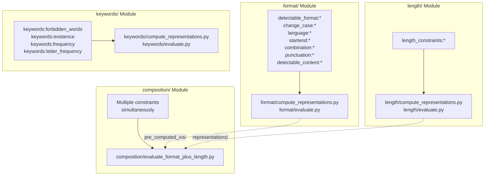

**Sources:** [README.md:22-47]()

---

## Data Flow and Representation Pipeline

### From Natural Language to Steering Vectors

The system transforms natural language instructions into steering vectors through a structured pipeline:

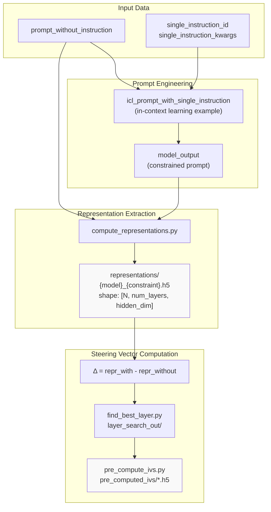

**Sources:** [README.md:64-77](), [data/format/all_base_x_all_instructions_filtered.jsonl:1]()

### Key Data Structures

The system uses specific JSON structures throughout the pipeline:

**Input Record** (`all_base_x_all_instructions_filtered.jsonl`):
```json
{
  "single_instruction_id": "detectable_format:json_format",
  "single_instruction_kwargs": {},
  "prompt_without_instruction": "Write a summary of...",
  "model_output": "Write a summary... in JSON format.",
  "instruction_id_list": ["detectable_format:json_format"],
  "instruction_id_list_for_eval": ["detectable_format:json_format"],
  "kwargs": [{}]
}
```

**HDF5 Representation Structure**:
- Dataset keys: `{prompt_hash}_{instruction_id}`
- Shape: `[num_layers, hidden_dimension]`
- Stores last token activations per layer

**Sources:** [data/format/all_base_x_all_instructions_filtered.jsonl:19-20]()

---

## Validation and Constraint Filtering

### The `is_valid` Field

Data records include an `is_valid` field indicating whether the constraint was successfully applied during prompt engineering. This filters prompts where constraint integration was problematic:

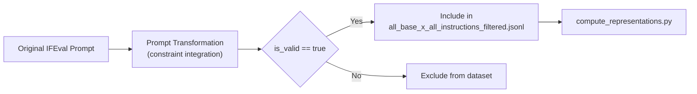

All records in `all_base_x_all_instructions_filtered.jsonl` have `"is_valid": true`, meaning only successfully transformed prompts are used for steering vector computation.

**Sources:** [data/format/all_base_x_all_instructions_filtered.jsonl:1-50]()

---

## Relationship to Evaluation

### IFEval Integration

The constraint taxonomy directly aligns with the IFEval evaluation framework. Each `instruction_id_list_for_eval` corresponds to specific IFEval checkers:

| Instruction Family | IFEval Checker | Verification Method |
|-------------------|----------------|---------------------|
| `detectable_format:json_format` | `is_json_format` | Parse response as JSON |
| `length_constraints:number_sentences` | `check_number_sentences` | Count sentences using NLTK |
| `keywords:forbidden_words` | `check_forbidden_words` | String matching (case-insensitive) |
| `startend:end_checker` | `check_ending` | Suffix matching |
| `detectable_format:number_bullet_lists` | `check_bullet_list` | Count markdown bullets |

The system evaluates steering effectiveness using the `follow_all_instructions` metric, which requires all constraints in `instruction_id_list_for_eval` to be satisfied.

**Sources:** [ifeval_scripts/README.md:1-44](), [data/format/all_base_x_all_instructions_filtered.jsonl:1]()

---

## Summary

The core concepts underlying this system are:

1. **Activation steering** computes instruction-specific neural patterns from paired inputs (with/without instruction)
2. **Constraint taxonomy** organizes instructions into 9 major categories with specific subtypes and parameters
3. **Modular implementation** maps constraint families to specialized modules (`format/`, `length/`, `keywords/`, `composition/`)
4. **Evaluation alignment** ensures steering targets match IFEval's standardized instruction-following metrics

These concepts enable the system to systematically improve instruction adherence across diverse constraint types by manipulating model activations during inference.

**Sources:** [README.md:1-165](), [data/format/all_base_x_all_instructions_filtered.jsonl:1-50](), [ifeval_scripts/README.md:1-44]()

---

# Page: Activation Steering Methodology

# Activation Steering Methodology

<details>
<summary>Relevant source files</summary>

The following files were used as context for generating this wiki page:

- [README.md](README.md)
- [config/length/length_evaluation.yaml](config/length/length_evaluation.yaml)
- [ifeval_scripts/README.md](ifeval_scripts/README.md)
- [utils/generation_utils.py](utils/generation_utils.py)

</details>


## Purpose and Scope

This document provides a detailed technical explanation of the activation steering methodology that underlies all experiments in this repository. Activation steering is the core technique used to improve instruction-following behavior in language models without fine-tuning. 

The methodology consists of four phases: (1) representation extraction from paired inputs, (2) steering vector computation, (3) inference-time steering application via forward hooks, and (4) evaluation. This document covers the theoretical foundations, mathematical formulations, and code implementations of each phase.

For information about specific instruction types that use this methodology, see [Instruction Types and Constraint Taxonomy](#2.2). For the complete pipeline implementation details, see [Steering Vector Pipeline](#4).

**Sources:** [README.md:9-14]()

---

## Overview of the Four-Phase Methodology

The activation steering approach computes a **steering vector** that represents the difference in model behavior when processing instructions. This vector is then added to the model's residual stream during inference to guide generation toward satisfying desired constraints.

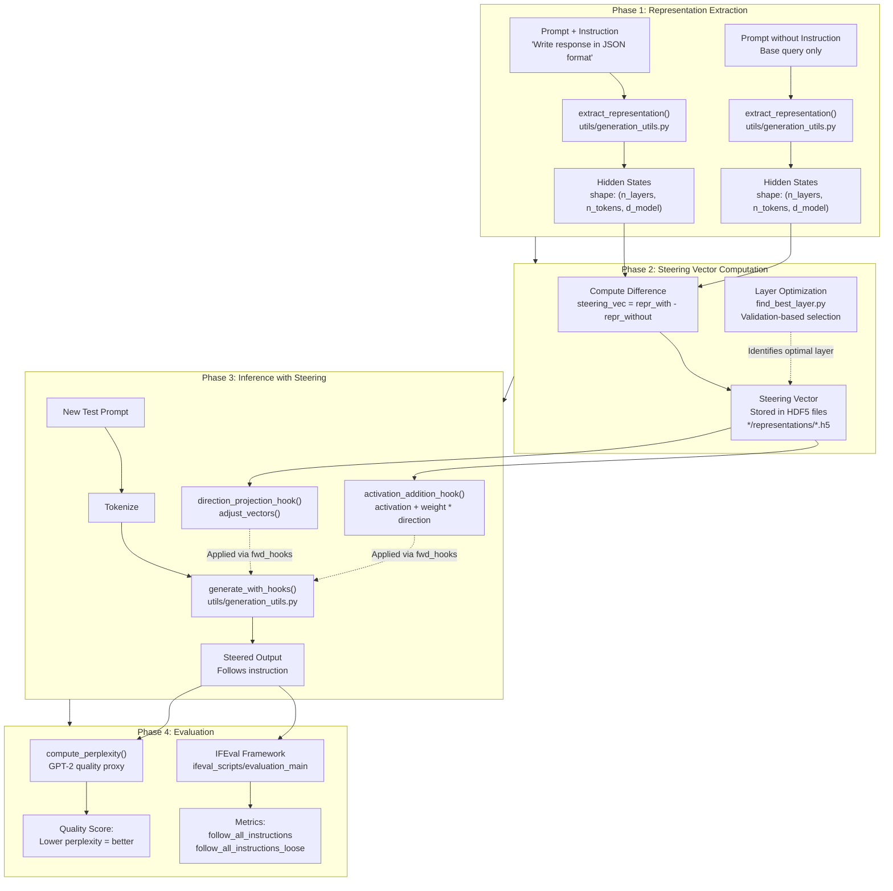

**Diagram: Complete Four-Phase Activation Steering Pipeline**

**Sources:** [README.md:11-12](), [utils/generation_utils.py:122-135](), [utils/generation_utils.py:62-96](), [utils/generation_utils.py:43-60]()

---

## Phase 1: Representation Extraction

The first phase extracts hidden state representations from the model when processing paired inputs: one with an instruction and one without. These representations capture the model's internal state at each layer.

### Technical Implementation

The `extract_representation()` function in `utils/generation_utils.py` performs this extraction:

| Parameter | Type | Purpose |
|-----------|------|---------|
| `model` | `HookedTransformer` | The language model with cache support |
| `tokenizer` | `AutoTokenizer` | Tokenizer for text processing |
| `problem` | `str` | Input prompt (with or without instruction) |
| `device` | `str` | Computation device ('cuda' or 'cpu') |
| `num_final_tokens` | `int` | Number of final tokens to extract (default: 8) |

**Returns:** `numpy.ndarray` of shape `(n_layers, num_final_tokens, d_model)` containing the residual stream activations from `resid_post` for each layer.

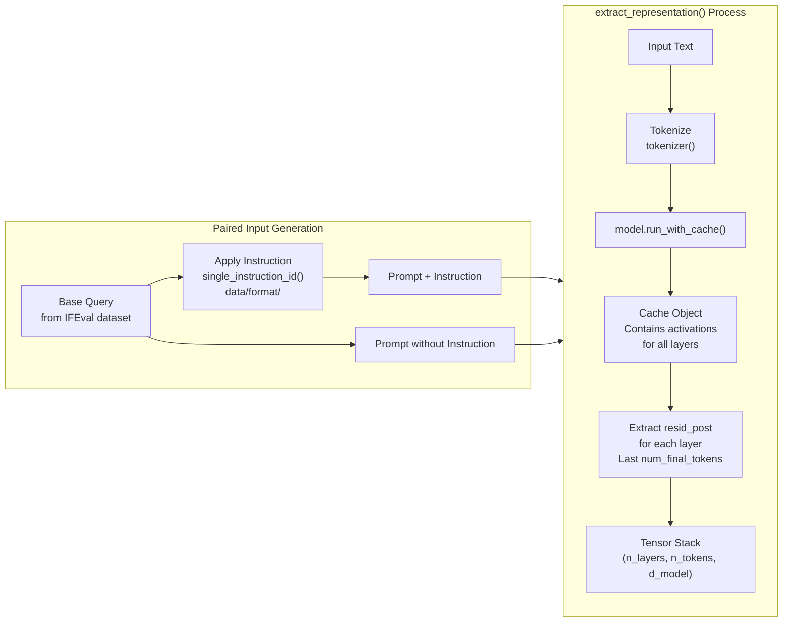

**Diagram: Representation Extraction Process and Data Flow**

### Storage Format

Extracted representations are stored in HDF5 files with the following structure:

```
representations/
├── format/representations/*.h5
├── length/representations/*.h5
└── keywords/representations/*.h5

HDF5 Structure:
- Dataset key: "{base_query_id}_{constraint_type}"
- Shape: (n_layers, num_final_tokens, d_model)
- Data type: float32
```

**Sources:** [utils/generation_utils.py:122-135](), [README.md:64-67](), [README.md:85-88](), [README.md:96-99]()

---

## Phase 2: Steering Vector Computation

Steering vectors are computed as the **difference** between representations extracted with and without instructions. This difference captures the activation patterns specific to instruction-following behavior.

### Mathematical Formulation

For a given instruction constraint `c` at layer `l`:

```
steering_vector[l] = mean(repr_with_instruction[l]) - mean(repr_without_instruction[l])
```

Where:
- `repr_with_instruction[l]` has shape `(num_final_tokens, d_model)`
- `repr_without_instruction[l]` has shape `(num_final_tokens, d_model)`
- `mean()` averages over the token dimension
- Result: `steering_vector[l]` has shape `(d_model,)`

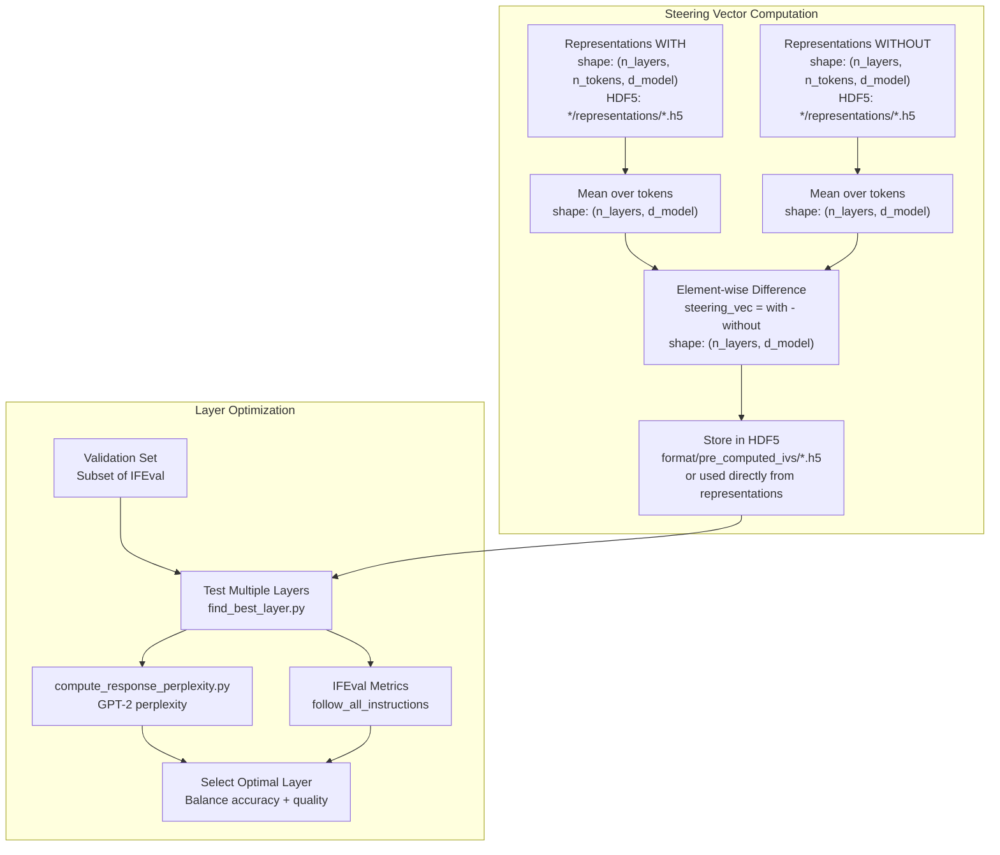

**Diagram: Steering Vector Computation and Layer Selection**

### Layer Selection Process

The optimal steering layer is identified through validation experiments:

| Script | Purpose | Output |
|--------|---------|--------|
| `format/find_best_layer.py` | Tests steering at multiple layers | `layer_search_out/*.jsonl` |
| `format/compute_response_perplexity.py` | Computes GPT-2 perplexity | `*_perplexity.jsonl` |
| Analysis | Selects layer maximizing accuracy while maintaining low perplexity | Optimal layer index |

### Pre-Computation for Format Instructions

For format instructions, steering vectors are pre-computed and stored for efficient inference:

```
format/pre_computed_ivs/
├── {model_name}_{constraint_type}_layer{N}_ivs.h5
└── Contains: steering vectors for specific constraints at optimal layers
```

**Sources:** [README.md:68-77](), [README.md:72-74](), [README.md:76-77]()

---

## Phase 3: Inference-Time Steering Application

During inference, steering vectors are applied to the model's residual stream using **forward hooks**. The repository implements two primary steering methods.

### Steering Methods

#### Method 1: Activation Addition

Adds a weighted steering vector to the residual stream at a specific layer:

```python
def activation_addition_hook(activation, hook, direction, weight=1):
    return activation + (direction * weight)
```

**Formula:** `activation_steered = activation_original + α × steering_vector`

Where `α` is the steering weight (configurable via `steering_weights` parameter).

#### Method 2: Direction Projection

Adjusts activations to achieve a target projection value along the steering direction:

```python
def direction_projection_hook(activation, hook, direction, value_along_direction):
    adjusted_activations = adjust_vectors(activation.squeeze(), direction, value_along_direction)
    return adjusted_activations.unsqueeze(0)
```

This uses the `adjust_vectors()` helper function [utils/generation_utils.py:25-40]() which:
1. Computes current projection: `current_proj = activation · direction`
2. Calculates needed adjustment: `δ = target_value - current_proj`
3. Adjusts activation: `activation_steered = activation + δ × direction`

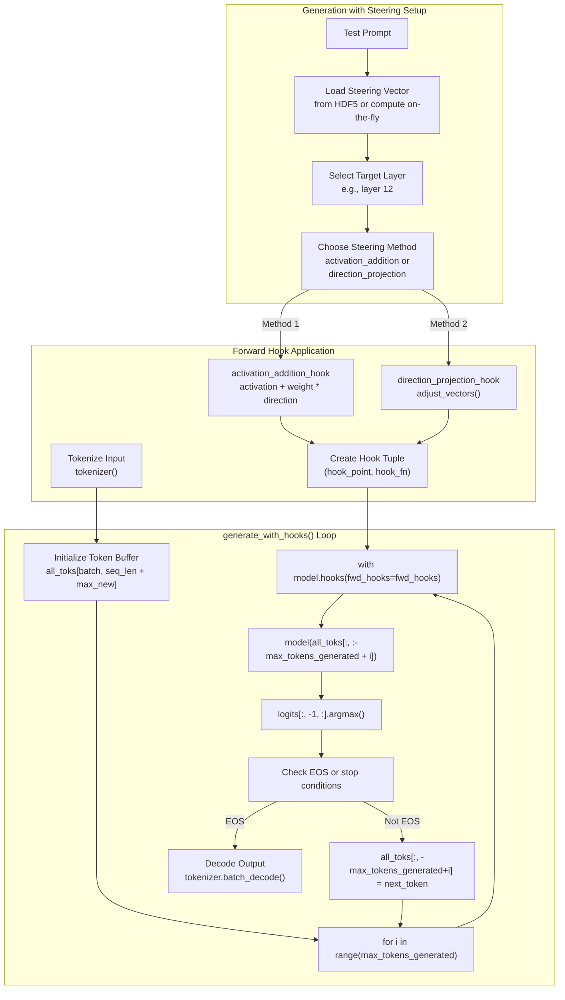

**Diagram: Inference-Time Steering Application via Forward Hooks**

### Hook Configuration

The `generate_with_hooks()` function accepts a list of forward hooks:

```python
fwd_hooks = [
    (f"blocks.{layer_idx}.hook_resid_post", 
     lambda act, hook: activation_addition_hook(act, hook, steering_vector, weight=1.0))
]
```

Hook points follow the TransformerLens naming convention:
- `blocks.{layer_idx}.hook_resid_post` - After layer residual stream
- Applied during each forward pass in the generation loop

**Sources:** [utils/generation_utils.py:43-50](), [utils/generation_utils.py:52-60](), [utils/generation_utils.py:62-96](), [utils/generation_utils.py:25-40]()

---

## Phase 4: Evaluation and Quality Assessment

The final phase evaluates the effectiveness of steering through instruction adherence metrics and text quality measures.

### Evaluation Framework

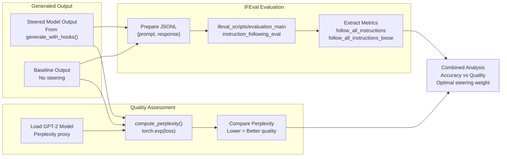

**Diagram: Evaluation Pipeline with IFEval and Perplexity Metrics**

### Key Metrics

| Metric | Description | Implementation |
|--------|-------------|----------------|
| `follow_all_instructions` | Strict adherence to all constraints | IFEval framework |
| `follow_all_instructions_loose` | Loose adherence (allows minor violations) | IFEval framework |
| `perplexity` | Text quality proxy using GPT-2 | `compute_perplexity()` [utils/generation_utils.py:98-119]() |
| `response_length` | Generated text length in characters | Direct measurement |

### Perplexity Computation

The `compute_perplexity()` function uses GPT-2 as a quality proxy:

```
perplexity = exp(cross_entropy_loss)
```

Where cross-entropy loss is computed over the generated text tokens. Lower perplexity indicates better fluency and coherence.

**Sources:** [utils/generation_utils.py:98-119](), [README.md:72-74](), [README.md:100-102](), [ifeval_scripts/README.md:18-31]()

---

## Steering Method Comparison

The repository supports three steering configurations:

| Configuration | `steering` Parameter | Behavior | Use Case |
|--------------|---------------------|----------|----------|
| **No Steering** | `'none'` | Baseline generation without modifications | Baseline comparison |
| **Activation Addition** | `'add_vector_{constraint_type}'` | Adds weighted steering vector | Primary steering method |
| **Direction Projection** | Uses `direction_projection_hook` | Projects activation to target value | Alternative steering approach |

Configuration example from [config/length/length_evaluation.yaml:16]():
```yaml
steering: 'none'  # or 'add_vector_length_specific', 'add_vector_conciseness', 'add_vector_verbosity'
steering_weights: [1]
source_layer_idx: 12
```

### Weight Sensitivity

Multiple steering weights can be tested to find the optimal balance between instruction adherence and text quality:

```yaml
steering_weights: [0.5, 1.0, 1.5, 2.0]
```

Higher weights increase instruction-following at the potential cost of output quality (higher perplexity).

**Sources:** [config/length/length_evaluation.yaml:16-17](), [utils/generation_utils.py:43-60]()

---

## Cross-Module Applicability

The activation steering methodology is consistently applied across all instruction types:

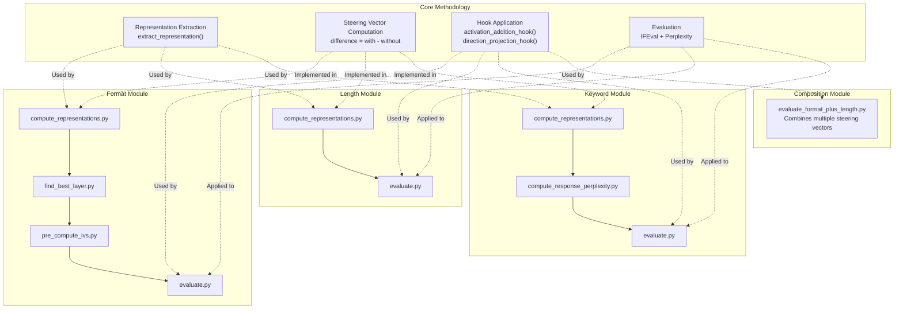

**Diagram: Methodology Application Across Instruction Modules**

Each instruction type implements the same four-phase methodology but may differ in:
- **Complexity of constraints:** Format instructions have 28+ subtypes
- **Pipeline stages:** Format uses 5 stages, length uses 2, keywords uses 3
- **Pre-computation:** Only format instructions pre-compute vectors
- **Composition:** Multiple steering vectors can be combined simultaneously

**Sources:** [README.md:22-48](), [README.md:62-82](), [README.md:84-92](), [README.md:95-106](), [README.md:109-114]()

---

## Summary of Code Entities

| Component | Location | Purpose |
|-----------|----------|---------|
| `extract_representation()` | [utils/generation_utils.py:122-135]() | Extract hidden states from model |
| `activation_addition_hook()` | [utils/generation_utils.py:43-50]() | Add weighted steering vector to activations |
| `direction_projection_hook()` | [utils/generation_utils.py:52-60]() | Project activations to target value |
| `adjust_vectors()` | [utils/generation_utils.py:25-40]() | Mathematical adjustment for projection |
| `generate_with_hooks()` | [utils/generation_utils.py:62-96]() | Generation loop with forward hooks |
| `compute_perplexity()` | [utils/generation_utils.py:98-119]() | Quality assessment via GPT-2 |
| `compute_representations.py` | `format/`, `length/`, `keywords/` | Extract paired representations |
| `find_best_layer.py` | `format/` | Identify optimal steering layer |
| `pre_compute_ivs.py` | `format/` | Pre-compute steering vectors |
| `evaluate.py` | `format/`, `length/`, `keywords/` | Apply steering and evaluate |

**Sources:** [utils/generation_utils.py:1-135](), [README.md:22-48]()

---

# Page: Instruction Types and Constraint Taxonomy

# Instruction Types and Constraint Taxonomy

<details>
<summary>Relevant source files</summary>

The following files were used as context for generating this wiki page:

- [README.md](README.md)
- [data/format/all_base_x_all_instructions_filtered.jsonl](data/format/all_base_x_all_instructions_filtered.jsonl)
- [ifeval_scripts/README.md](ifeval_scripts/README.md)

</details>


## Purpose and Scope

This page documents the comprehensive constraint taxonomy used throughout the llm-steer-instruct codebase. The taxonomy defines verifiable instruction types that can be systematically enforced through activation steering. Each constraint category includes specific subtypes with associated validation logic implemented in the IFEval framework.

For information about how these constraints are applied to prompts, see [Prompt Transformation System](#2.3). For the steering methodology that enforces these constraints, see [Activation Steering Methodology](#2.1).

## Constraint Taxonomy Overview

The codebase organizes constraints into nine primary categories, each containing multiple subtypes. These constraints are defined by `single_instruction_id` strings that combine a category with a specific subtype (e.g., `keywords:forbidden_words`, `detectable_format:json_format`).

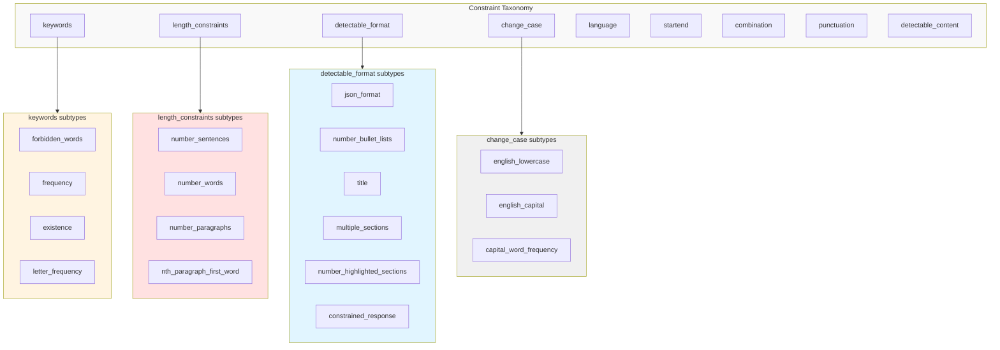

**Sources:** [data/format/all_base_x_all_instructions_filtered.jsonl:1-49]()

## Constraint Data Structure

Each constraint instance in the dataset follows a standardized JSONL record structure that connects natural language prompts with structured constraint metadata:

| Field | Type | Description | Example |
|-------|------|-------------|---------|
| `single_instruction_id` | string | Category and subtype identifier | `"keywords:forbidden_words"` |
| `single_instruction_kwargs` | dict | Parameters for the constraint | `{"forbidden_words": ["moser", "glassworks"]}` |
| `single_instruction_kwargs_str` | string | String representation of kwargs | `"{'forbidden_words': ['moser', 'glassworks']}"` |
| `prompt_without_instruction` | string | Base query without constraint | `"Write a summary of..."` |
| `model_output` | string | Prompt with integrated constraint | `"Write a summary... Do not include..."` |
| `instruction_id_list` | list | List of constraint IDs applied | `["keywords:forbidden_words"]` |
| `kwargs` | list | List of parameter dicts | `[{"forbidden_words": [...]}]` |
| `prompt_hash` | string | Unique identifier for the prompt | `"a21da7cc39d8ced6e3ed093b3072a2a2"` |

**Sources:** [data/format/all_base_x_all_instructions_filtered.jsonl:1-49]()

## Category 1: keywords

The `keywords` category constrains word usage in model outputs, supporting inclusion, exclusion, and frequency requirements.

### Subtypes and Parameters

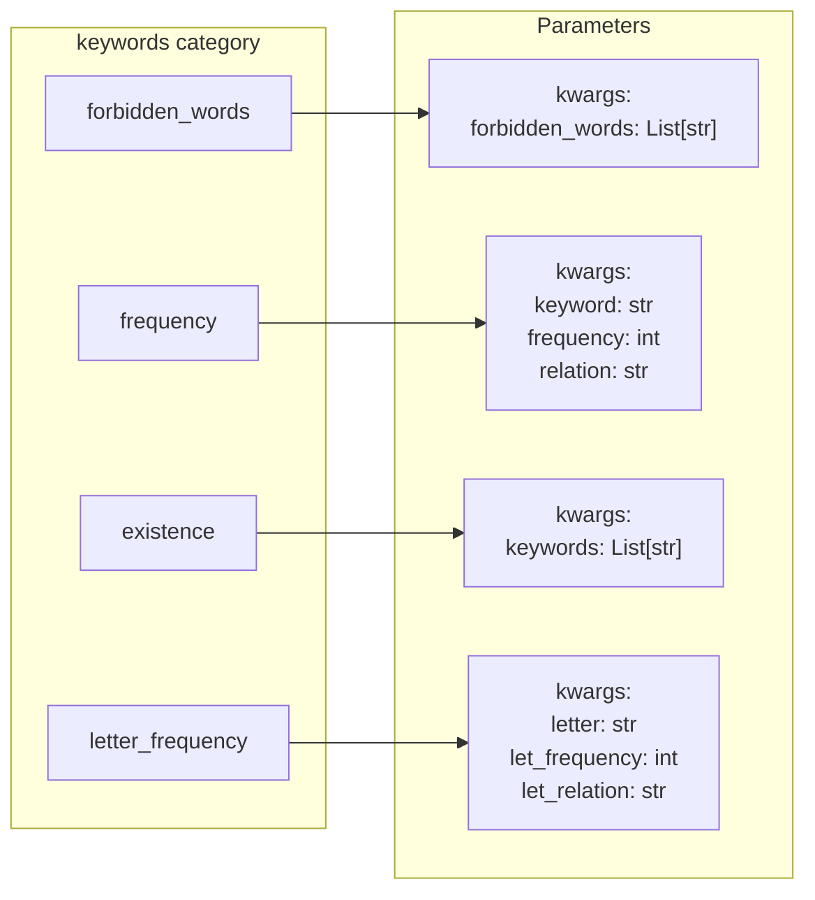

#### keywords:forbidden_words
Prohibits specific words from appearing in the response.
- **Parameters:** `forbidden_words: List[str]`
- **Example:** `{"forbidden_words": ["moser", "glassworks", "pravcice", "karlovy", "vary"]}`
- **Prompt Integration:** "Do not include the following keywords: Moser, Glassworks, Pravcice, Karlovy, Vary"

#### keywords:frequency
Constrains the number of times a specific keyword appears.
- **Parameters:** `keyword: str, frequency: int, relation: str`
- **Relations:** `"at least"`, `"less than"`
- **Example:** `{"relation": "at least", "keyword": "para", "frequency": 1}`
- **Prompt Integration:** "Use the word para at least once."

#### keywords:existence
Requires specific keywords to be present in the response.
- **Parameters:** `keywords: List[str]`
- **Example:** `{"keywords": ["people", "skills"]}`
- **Prompt Integration:** "Use the keyword 'people' and 'skills'."

#### keywords:letter_frequency
Constrains the frequency of specific letters.
- **Parameters:** `letter: str, let_frequency: int, let_relation: str`
- **Relations:** `"at least"`, `"less than"`
- **Example:** `{"let_relation": "at least", "letter": "o", "let_frequency": 25}`
- **Prompt Integration:** "Make sure the letter o appears at least 25 times in your response."

**Sources:** [data/format/all_base_x_all_instructions_filtered.jsonl:1-11]()

## Category 2: length_constraints

The `length_constraints` category controls the structural length of responses at different granularities (sentences, words, paragraphs).

### Subtypes and Module Mapping

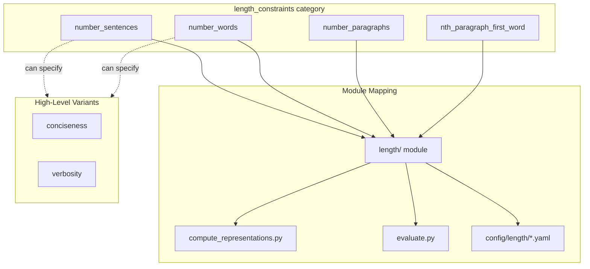

#### length_constraints:number_sentences
Controls sentence count with relational operators.
- **Parameters:** `num_sentences: int, relation: str`
- **Relations:** `"at least"`, `"less than"`
- **Instruction ID Variants:** `number_sentences_at least`, `number_sentences_less than`
- **Example:** `{"relation": "at least", "num_sentences": 60}`
- **Prompt Integration:** "Use at least 60 sentences."

#### length_constraints:number_words
Controls word count with relational operators.
- **Parameters:** `num_words: int, relation: str`
- **Relations:** `"at least"`, `"less than"`
- **Instruction ID Variants:** `number_words_at least`, `number_words_less than`
- **Example:** `{"relation": "at least", "num_words": 300}`
- **Prompt Integration:** "Your answer must be at least 300 words."

#### length_constraints:number_paragraphs
Requires an exact number of paragraphs.
- **Parameters:** `num_paragraphs: int`
- **Example:** `{"num_paragraphs": 6}`
- **Prompt Integration:** "There should be exactly 6 paragraphs separated by the markdown divider: ***"

#### length_constraints:nth_paragraph_first_word
Constrains the first word of a specific paragraph.
- **Parameters:** `first_word: str, num_paragraphs: int, nth_paragraph: int`
- **Example:** `{"first_word": "president", "num_paragraphs": 6, "nth_paragraph": 2}`
- **Prompt Integration:** "The second paragraph must start with the word \"President\"."

**Sources:** [data/format/all_base_x_all_instructions_filtered.jsonl:2,12,21,23,26,29,34,39,42,50](), [README.md:84-93]()

## Category 3: detectable_format

The `detectable_format` category defines structural formatting requirements like JSON, bullet lists, sections, and titles. This is the most extensively used category in the format module.

### Format Module Integration

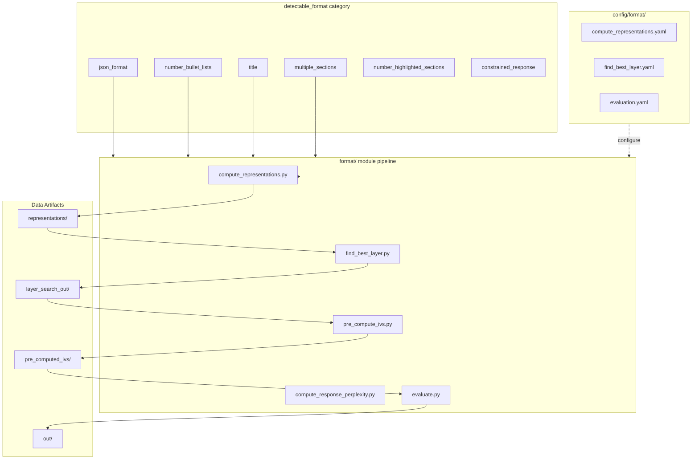

#### detectable_format:json_format
Requires the response to be valid JSON.
- **Parameters:** None (empty dict)
- **Prompt Integration:** "Write... in JSON format."

#### detectable_format:number_bullet_lists
Requires an exact number of bullet points.
- **Parameters:** `num_bullets: int`
- **Example:** `{"num_bullets": 3}`
- **Prompt Integration:** "Your answer should contain exactly 3 bullet points in markdown format. Use * to indicate bullets, like:* xyz* abc* opq"

#### detectable_format:title
Requires a title wrapped in double angular brackets.
- **Parameters:** None (empty dict)
- **Prompt Integration:** "Your answer must contain a title, wrapped in double angular brackets, i.e. <<title>>."

#### detectable_format:multiple_sections
Requires multiple sections with specific markers.
- **Parameters:** `section_spliter: str, num_sections: int`
- **Example:** `{"section_spliter": "SECTION", "num_sections": 2}`
- **Prompt Integration:** "Make sure to include at least two sections marking the beginning of each section with 'SECTION X'."

#### detectable_format:number_highlighted_sections
Requires highlighted text sections.
- **Parameters:** `num_highlights: int`
- **Example:** `{"num_highlights": 2}`
- **Prompt Integration:** "Highlight at least 2 text sections, i.e. *highlighted section*."

#### detectable_format:constrained_response
Requires choosing from predefined response options.
- **Parameters:** None (empty dict)
- **Prompt Integration:** "Choose from: [Option 1] [Option 2] [Option 3] Just choose one phrase from above as your answer."

**Sources:** [data/format/all_base_x_all_instructions_filtered.jsonl:8,11,13,20,22,25,28,30,33,38,40,41,43,46,47,49](), [README.md:62-82]()

## Category 4: change_case

The `change_case` category controls letter casing in responses.

#### change_case:english_lowercase
Requires all lowercase letters (no capitals).
- **Parameters:** None (empty dict)
- **Prompt Integration:** "make sure no capital letters are used."

#### change_case:english_capital
Requires all capital letters.
- **Parameters:** None (empty dict)
- **Prompt Integration:** "Answer in all capital letters."

#### change_case:capital_word_frequency
Requires a minimum number of all-caps words.
- **Parameters:** None (empty dict, defaults to 5 words)
- **Prompt Integration:** "In your response, use words with all capital letters (such as \"SUMMARY\") at least 5 times."

**Sources:** [data/format/all_base_x_all_instructions_filtered.jsonl:6,16,18,37,39,45]()

## Category 5: language

The `language` category enforces responses in specific languages.

#### language:response_language
Requires the entire response in a specified language.
- **Parameters:** `language: str` (ISO 639-1 language codes)
- **Example:** `{"language": "bn"}` (Bengali), `{"language": "mr"}` (Marathi)
- **Instruction ID Variants:** Language-specific IDs like `response_language_bn`, `response_language_mr`
- **Prompt Integration:** "but the response must be entirely in the Bengali language, no other language is allowed."

**Sources:** [data/format/all_base_x_all_instructions_filtered.jsonl:10,32,37]()

## Category 6: startend

The `startend` category constrains the beginning or ending of responses.

#### startend:quotation
Wraps the entire response in double quotation marks.
- **Parameters:** None (empty dict)
- **Prompt Integration:** "Wrap your entire response with double quotation marks."

#### startend:end_checker
Requires the response to end with a specific phrase.
- **Parameters:** `end_phrase: str`
- **Example:** `{"end_phrase": "Is there anything else I can help with?"}`
- **Prompt Integration:** "Your summary must end with the exact phrase \"Is there anything else I can help with?\"."

**Sources:** [data/format/all_base_x_all_instructions_filtered.jsonl:3,14,27,30,36,41]()

## Category 7: combination

The `combination` category handles meta-constraints that combine or repeat instructions.

#### combination:repeat_prompt
Requires repeating the request before providing the answer.
- **Parameters:** `prompt_to_repeat: str`
- **Prompt Integration:** "First repeat the request word for word without change, then give your answer (1. do not say any words or characters before repeating the request; 2. the request you need to repeat does not include this sentence)"

#### combination:two_responses
Requires two distinct responses separated by asterisks.
- **Parameters:** None (empty dict)
- **Prompt Integration:** "Separate the summary into two distinct parts, each part should be separated by 6 asterisk symbols, like below: [Part 1]******[Part 2]"

**Sources:** [data/format/all_base_x_all_instructions_filtered.jsonl:4,17,19,28,31,38,44]()

## Category 8: punctuation

The `punctuation` category controls punctuation usage.

#### punctuation:no_comma
Prohibits commas in the response.
- **Parameters:** None (empty dict)
- **Prompt Integration:** "Make sure to not include commas in your entire response."

**Sources:** [data/format/all_base_x_all_instructions_filtered.jsonl:44,50]()

## Category 9: detectable_content

The `detectable_content` category requires specific content elements like placeholders or postscripts.

#### detectable_content:number_placeholders
Requires placeholder text in square brackets.
- **Parameters:** `num_placeholders: int`
- **Example:** `{"num_placeholders": 3}`
- **Prompt Integration:** "Your answer must contain at least 3 placeholders represented by square brackets, such as [address]."

#### detectable_content:postscript
Requires a postscript with specific marker.
- **Parameters:** `postscript_marker: str`
- **Example:** `{"postscript_marker": "P.P.S"}`
- **Prompt Integration:** "At the end of your response, explicitly add a postscript starting with P.P.S."

**Sources:** [data/format/all_base_x_all_instructions_filtered.jsonl:13,15,35,40]()

## Constraint ID Naming Convention

Constraint IDs follow a hierarchical naming pattern that enables programmatic processing:

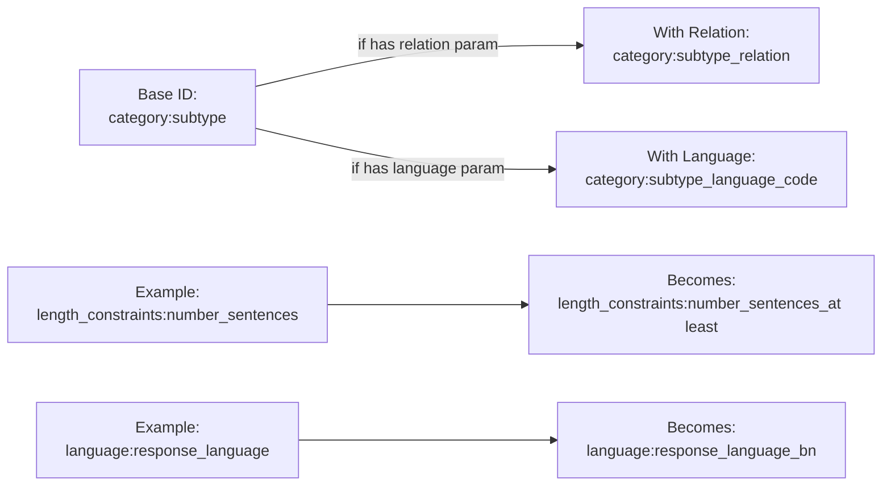

### Naming Rules

1. **Base Form:** `{category}:{subtype}` (e.g., `keywords:frequency`)
2. **Relation Suffixes:** Append `_{relation}` when `relation` parameter exists
   - `keywords:frequency` → `keywords:frequency_at least` or `keywords:frequency_less than`
   - `length_constraints:number_words` → `length_constraints:number_words_at least`
3. **Language Suffixes:** Append `_{language_code}` for language constraints
   - `language:response_language` → `language:response_language_bn` (Bengali)
4. **Field Storage:** Both forms stored in different fields:
   - `single_instruction_id`: Base form without suffixes
   - `instruction_id_list`: Contains suffixed variants used for evaluation

**Sources:** [data/format/all_base_x_all_instructions_filtered.jsonl:1-49]()

## Integration with IFEval Framework

The constraint taxonomy directly maps to validation logic in the `instruction_following_eval` framework:

```mermaid
graph TB
    subgraph DataStructure["JSONL Data Structure"]
        single_id["single_instruction_id"]
        kwargs["single_instruction_kwargs"]
        id_list["instruction_id_list"]
        id_list_eval["instruction_id_list_for_eval"]
    end
    
    subgraph IFEvalFramework["ifeval_scripts/<br/>instruction_following_eval"]
        evaluation_main["evaluation_main"]
        instruction_checkers["instruction_checkers.py"]
        validators["Validator Functions"]
    end
    
    subgraph ValidationMapping["Validation Mapping"]
        keywords_check["check_forbidden_words()<br/>check_frequency()<br/>check_existence()"]
        length_check["check_number_sentences()<br/>check_number_words()"]
        format_check["check_json_format()<br/>check_bullet_lists()"]
    end
    
    single_id --> evaluation_main
    kwargs --> evaluation_main
    id_list_eval --> evaluation_main
    
    evaluation_main --> instruction_checkers
    instruction_checkers --> validators
    
    validators --> keywords_check
    validators --> length_check
    validators --> format_check
```

The `instruction_id_list_for_eval` field contains the constraint IDs that map to specific checker functions in the IFEval framework. Each constraint type has corresponding validation logic that verifies whether a model's response satisfies the constraint.

**Sources:** [README.md:18](), [ifeval_scripts/README.md:1-44]()

## Constraint Application in Different Modules

Different modules utilize specific subsets of the constraint taxonomy:

| Module | Primary Constraints | Config Location | Purpose |
|--------|-------------------|-----------------|---------|
| `format/` | `detectable_format:*`, `change_case:*`, `language:*`, `startend:*`, `combination:*`, `punctuation:*`, `detectable_content:*` | `config/format/` | 28+ format subtypes |
| `length/` | `length_constraints:*` | `config/length/` | Sentence/word/paragraph counts |
| `keywords/` | `keywords:forbidden_words`, `keywords:existence` | `config/keywords/` | Word inclusion/exclusion |
| `composition/` | Multiple from format + length | `config/composition/` | Multi-constraint steering |

**Sources:** [README.md:16-115]()

## Data File Structure

The primary data file `all_base_x_all_instructions_filtered.jsonl` serves as the complete constraint catalog:

```mermaid
graph LR
    subgraph SourceData["data/format/"]
        all_base["all_base_x_all_instructions_filtered.jsonl"]
    end
    
    subgraph RecordFields["Record Fields"]
        hash["prompt_hash:<br/>unique identifier"]
        base_prompt["prompt_without_instruction:<br/>original query"]
        constrained["model_output:<br/>query + constraint"]
        metadata["single_instruction_id<br/>single_instruction_kwargs<br/>instruction_id_list"]
    end
    
    subgraph UsageByModules["Used By Modules"]
        format_compute["format/compute_representations.py"]
        length_compute["length/compute_representations.py"]
        keywords_compute["keywords/compute_representations.py"]
    end
    
    all_base --> RecordFields
    RecordFields --> UsageByModules
```

Each record enables paired comparison by providing both the constrained and unconstrained versions of the same query, which is fundamental to computing steering vectors as differences in representations.

**Sources:** [data/format/all_base_x_all_instructions_filtered.jsonl:1-49]()

---

# Page: Prompt Transformation System

# Prompt Transformation System

<details>
<summary>Relevant source files</summary>

The following files were used as context for generating this wiki page:

- [data/format/all_base_x_all_instructions_filtered.jsonl](data/format/all_base_x_all_instructions_filtered.jsonl)

</details>


## Purpose and Scope

The Prompt Transformation System is the foundational data preparation layer that converts base queries from the IFEval dataset into instruction-constrained prompts. This system takes a simple query (e.g., "Write a summary of...") and systematically integrates specific constraints (e.g., "use JSON format", "no commas", "at least 300 words") to create training and evaluation data for instruction-following experiments.

This page documents the structure of the transformed data file, the instruction taxonomy, and the prompt engineering methodology used to apply constraints. For information about the underlying constraint taxonomy, see [Instruction Types and Constraint Taxonomy](#2.2). For how these transformed prompts are used in representation computation, see [Representation Computation](#4.1).

## Overview: Prompt Transformation Architecture

The system uses a few-shot in-context learning (ICL) approach to consistently transform base queries by adding constraints, producing the primary data artifact used throughout the steering pipeline.

```mermaid
graph TB
    subgraph "Input Sources"
        IFEval[IFEval Base Queries]
        Constraints[Constraint Definitions<br/>single_instruction_id + kwargs]
    end
    
    subgraph "Transformation Process"
        ICLTemplate["ICL Prompt Template<br/>(few-shot examples)"]
        Generator[Language Model Generator<br/>produces model_output]
    end
    
    subgraph "Output: all_base_x_all_instructions_filtered.jsonl"
        TransformedPrompt["Transformed Prompt Records<br/>- prompt_without_instruction<br/>- single_instruction_id<br/>- single_instruction_kwargs<br/>- model_output<br/>- prompt (ICL template)<br/>- icl_prompt_with_single_instruction"]
    end
    
    IFEval --> ICLTemplate
    Constraints --> ICLTemplate
    ICLTemplate --> Generator
    Generator --> TransformedPrompt
    
    TransformedPrompt --> FormatModule[Format Module]
    TransformedPrompt --> LengthModule[Length Module]
    TransformedPrompt --> KeywordsModule[Keywords Module]
```

**Sources:** [data/format/all_base_x_all_instructions_filtered.jsonl:1-100]()

## Data File Structure

### Primary Data Artifact

The system produces `data/format/all_base_x_all_instructions_filtered.jsonl`, a JSONL file where each line represents a single prompt-constraint pairing. Each record contains multiple representations of the same query at different stages of transformation.

### Record Schema

The following table describes the key fields in each JSONL record:

| Field | Type | Description |
|-------|------|-------------|
| `prompt_without_instruction` | string | Original base query from IFEval without any constraints |
| `single_instruction_id` | string | Identifier for the constraint type (e.g., `keywords:forbidden_words`) |
| `single_instruction_kwargs` | object | Parameters for the constraint (e.g., `{"forbidden_words": ["moser", "glassworks"]}`) |
| `single_instruction_kwargs_str` | string | String representation of kwargs for readability |
| `model_output` | string | The transformed query with the constraint integrated |
| `prompt` | string | Full ICL template used to generate the transformation |
| `icl_key` | integer | Index into the ICL example set |
| `icl_prompt_without_instruction` | string | ICL example's base query |
| `icl_prompt_with_single_instruction` | string | ICL example's transformed query |
| `prompt_hash` | string | Hash identifier for deduplication |
| `instruction_id_list` | array | List of instruction IDs (supports multi-instruction) |
| `kwargs` | array | List of kwargs objects (supports multi-instruction) |
| `is_valid` | boolean | Validation flag for the transformation |
| `key` | integer | Base query identifier |
| `uid` | integer | Unique identifier for this specific transformation |

**Sources:** [data/format/all_base_x_all_instructions_filtered.jsonl:1-10]()

### Field Relationships

```mermaid
graph LR
    subgraph "Base Query"
        BaseQuery["prompt_without_instruction<br/>key: 1000<br/>'Write a summary of...'"]
    end
    
    subgraph "Constraint Specification"
        InstructionID["single_instruction_id<br/>'keywords:forbidden_words'"]
        Kwargs["single_instruction_kwargs<br/>{'forbidden_words': ['moser']}"]
    end
    
    subgraph "Transformation Inputs"
        ICLExample["icl_prompt_without_instruction<br/>icl_prompt_with_single_instruction<br/>icl_key: 1691"]
        Template["prompt<br/>(ICL template with example)"]
    end
    
    subgraph "Transformation Output"
        ModelOutput["model_output<br/>'Write a summary... Do not<br/>include the following keywords...'"]
    end
    
    BaseQuery --> Template
    InstructionID --> Template
    Kwargs --> Template
    ICLExample --> Template
    Template --> ModelOutput
    
    BaseQuery --> ModelOutput
    InstructionID --> ModelOutput
    Kwargs --> ModelOutput
```

**Sources:** [data/format/all_base_x_all_instructions_filtered.jsonl:1-2]()

## Instruction Types and Parameters

### Instruction ID Taxonomy

The `single_instruction_id` field follows a hierarchical naming convention: `category:subcategory[_relation]`. The following table shows the major categories observed in the dataset:

| Category | Subcategories | Example IDs | Purpose |
|----------|---------------|-------------|---------|
| `keywords` | `forbidden_words`, `frequency`, `existence`, `letter_frequency` | `keywords:forbidden_words`, `keywords:frequency_at least` | Control word/letter usage |
| `length_constraints` | `number_sentences`, `number_words`, `number_paragraphs`, `nth_paragraph_first_word` | `length_constraints:number_sentences_at least`, `length_constraints:number_words_less than` | Specify output length |
| `detectable_format` | `json_format`, `number_bullet_lists`, `multiple_sections`, `title`, `number_highlighted_sections`, `constrained_response` | `detectable_format:json_format`, `detectable_format:number_bullet_lists` | Define structural formats |
| `change_case` | `english_lowercase`, `english_capital`, `capital_word_frequency` | `change_case:english_lowercase` | Control capitalization |
| `language` | `response_language` | `language:response_language_bn` | Specify output language |
| `startend` | `quotation`, `end_checker` | `startend:quotation`, `startend:end_checker` | Control start/end formatting |
| `combination` | `repeat_prompt`, `two_responses` | `combination:repeat_prompt` | Meta-instructions about response structure |
| `punctuation` | `no_comma` | `punctuation:no_comma` | Control punctuation usage |
| `detectable_content` | `number_placeholders`, `postscript` | `detectable_content:postscript` | Require specific content elements |

### Relation Suffixes

Many instruction IDs include relation suffixes that specify comparison operators:
- `_at least`: Minimum threshold (e.g., `length_constraints:number_words_at least`)
- `_less than`: Maximum threshold (e.g., `length_constraints:number_sentences_less than`)
- No suffix: Exact match or boolean constraint

**Sources:** [data/format/all_base_x_all_instructions_filtered.jsonl:1-100]()

### Constraint Parameters (kwargs)

The `single_instruction_kwargs` field contains constraint-specific parameters. Examples:

```json
// Forbidden words
{"forbidden_words": ["moser", "glassworks", "pravcice", "karlovy", "vary"]}

// Sentence count with relation
{"relation": "at least", "num_sentences": 60}

// Keyword existence
{"keywords": ["people", "skills"]}

// Letter frequency
{"let_relation": "at least", "letter": "o", "let_frequency": 25}

// Language specification
{"language": "bn"}

// Bullet list count
{"num_bullets": 3}

// End phrase
{"end_phrase": "Is there anything else I can help with?"}
```

**Sources:** [data/format/all_base_x_all_instructions_filtered.jsonl:1-17]()

## In-Context Learning Prompt Template

### Template Structure

The transformation uses a standardized ICL template with the following structure:

```mermaid
graph TD
    subgraph "ICL Prompt Template Structure"
        Instruction["System Instruction<br/>'Given a simple question, we want to make<br/>the question a bit harder by adding constraints...'"]
        
        subgraph "Few-Shot Example"
            ExampleOriginal["<original_question><br/>icl_prompt_without_instruction<br/></original_question>"]
            ExampleConstraint["<constraint><br/>single_instruction_id<br/>single_instruction_kwargs<br/></constraint>"]
            ExampleOutput["<output><br/>icl_prompt_with_single_instruction<br/></output>"]
        end
        
        subgraph "Target Query"
            TargetOriginal["<original_question><br/>prompt_without_instruction<br/></original_question>"]
            TargetConstraint["<constraint><br/>single_instruction_id<br/>single_instruction_kwargs<br/></constraint>"]
            TargetOutput["<output>"]
        end
    end
    
    Instruction --> ExampleOriginal
    ExampleOriginal --> ExampleConstraint
    ExampleConstraint --> ExampleOutput
    ExampleOutput --> TargetOriginal
    TargetOriginal --> TargetConstraint
    TargetConstraint --> TargetOutput
```

**Sources:** [data/format/all_base_x_all_instructions_filtered.jsonl:1]()

### Actual Template Example

From line 1 of the data file, the full `prompt` field contains:

```
Given a simple question, we want to make the question a bit harder by adding contraints to the way it can be answered. You will be given the original question and a constraint to add to it, and should output the harder question with the constraint integrated into it. Nothing else should be added or removed from the question. Only the constraint should be added to the question.

For example:
<original_question>	
Request:  1. What are the best places to visit in Bohemia, Czech Republic?  2. Include a list of recommended hotels.
<\original_question>
<constraint>
keywords:forbidden_words
{'forbidden_words': ['moser', 'glassworks', 'pravcice', 'karlovy', 'vary']}
<\constraint>
<output>
Request:  1. What are the best places to visit in Bohemia, Czech Republic?  2. Include a list of recommended hotels.  4. Do not include the following keywords: Moser, Glassworks, Pravcice, Karlovy, Vary
<\output>

<original_question>
Write a summary of the wikipedia page "https://en.wikipedia.org/wiki/Raymond_III,_Count_of_Tripoli".
<\original_question>
<constraint>
keywords:forbidden_words
{'forbidden_words': ['moser', 'glassworks', 'pravcice', 'karlovy', 'vary']}
<\constraint>
<output>
```

Key characteristics:
1. **System instruction**: Emphasizes that ONLY the constraint should be added, nothing else modified
2. **XML-like delimiters**: Uses `<original_question>`, `<constraint>`, `<output>` tags
3. **One-shot learning**: Provides exactly one example before the target
4. **Explicit constraint display**: Shows both the instruction ID and the kwargs dictionary

**Sources:** [data/format/all_base_x_all_instructions_filtered.jsonl:1]()

## Transformation Process

### Constraint Integration Patterns

The system follows specific patterns for integrating different constraint types into the base query:

```mermaid
graph TD
    subgraph "Integration Patterns"
        Pattern1["Append to Query<br/>(most common)<br/>'...query. Do not include X.'"]
        Pattern2["Prepend to Query<br/>(rare)<br/>'First repeat... Then: query'"]
        Pattern3["Wrap Query<br/>'\"query\"'"]
        Pattern4["Replace Query Format<br/>'query in JSON format'"]
        Pattern5["Add Structural Requirements<br/>'query. Use exactly 3 bullet points.'"]
    end
    
    subgraph "Instruction Categories"
        Keywords[keywords:*]
        Length[length_constraints:*]
        Format[detectable_format:*]
        StartEnd[startend:*]
        Language[language:*]
    end
    
    Keywords --> Pattern1
    Length --> Pattern1
    Format --> Pattern4
    Format --> Pattern5
    StartEnd --> Pattern2
    StartEnd --> Pattern3
    Language --> Pattern1
```

**Sources:** [data/format/all_base_x_all_instructions_filtered.jsonl:1-50]()

### Integration Examples by Category

#### Keywords: Forbidden Words

**Base:** `"Write a summary of the wikipedia page..."`

**Constraint:** `{"forbidden_words": ["moser", "glassworks", "pravcice", "karlovy", "vary"]}`

**Output:** `"Write a summary of the wikipedia page... Do not include the following keywords: Moser, Glassworks, Pravcice, Karlovy, Vary."`

**Pattern:** Append natural language instruction listing the forbidden words

**Sources:** [data/format/all_base_x_all_instructions_filtered.jsonl:1]()

#### Length Constraints: Sentence Count

**Base:** `"Write a summary of the wikipedia page..."`

**Constraint:** `{"relation": "at least", "num_sentences": 60}`

**Output:** `"Write a summary of the wikipedia page... Use at least 60 sentences."`

**Pattern:** Append quantified length requirement

**Sources:** [data/format/all_base_x_all_instructions_filtered.jsonl:2]()

#### Detectable Format: JSON

**Base:** `"Write a summary of the wikipedia page..."`

**Constraint:** `{}`

**Output:** `"Write a summary of the wikipedia page... in JSON format."`

**Pattern:** Modify query to specify output format

**Sources:** [data/format/all_base_x_all_instructions_filtered.jsonl:19]()

#### Start/End: Quotation Wrapper

**Base:** `"Write a summary of the wikipedia page..."`

**Constraint:** `{}`

**Output:** `"Write a summary of the wikipedia page... Wrap your entire response with double quotation marks."`

**Pattern:** Append wrapping instruction

**Sources:** [data/format/all_base_x_all_instructions_filtered.jsonl:3]()

#### Language: Response Language

**Base:** `"Write a summary of the wikipedia page..."`

**Constraint:** `{"language": "bn"}`

**Output:** `"Write a summary of the wikipedia page..., but the response must be entirely in the Bengali language, no other language is allowed."`

**Pattern:** Append language specification with emphasis on exclusivity

**Sources:** [data/format/all_base_x_all_instructions_filtered.jsonl:10]()

## ICL Example Selection

### Example Pairing Strategy

The system uses the `icl_key` field to select appropriate few-shot examples. Each record includes:

```mermaid
graph LR
    subgraph "ICL Example Selection"
        ICLKey["icl_key<br/>(identifies source prompt)"]
        ICLBase["icl_prompt_without_instruction<br/>(example base query)"]
        ICLTransformed["icl_prompt_with_single_instruction<br/>(example with constraint applied)"]
    end
    
    subgraph "Target Transformation"
        TargetBase["prompt_without_instruction<br/>(query to transform)"]
        SameConstraint["Same constraint type<br/>and parameters"]
        TargetOutput["model_output<br/>(transformed query)"]
    end
    
    ICLKey --> ICLBase
    ICLKey --> ICLTransformed
    ICLBase --> ICLTransformed
    
    ICLTransformed --> TargetOutput
    TargetBase --> TargetOutput
    SameConstraint --> ICLTransformed
    SameConstraint --> TargetOutput
```

**Example from data:**
- Target query (key=1000): `"Write a summary of the wikipedia page..."`
- ICL example (icl_key=1691): `"Request: 1. What are the best places to visit in Bohemia, Czech Republic? 2. Include a list of recommended hotels."`
- Both use: `keywords:forbidden_words` with the same `forbidden_words` list

This ensures the model sees how to apply the specific constraint type before transforming the target query.

**Sources:** [data/format/all_base_x_all_instructions_filtered.jsonl:1]()

## Multi-Instruction Support

### Composite Constraint Fields

While most records contain single instructions, the schema supports multiple constraints through array fields:

| Field | Single-Instruction | Multi-Instruction |
|-------|-------------------|-------------------|
| `instruction_id_list` | `["keywords:forbidden_words"]` | `["keywords:forbidden_words", "length_constraints:number_words_at least"]` |
| `kwargs` | `[{"forbidden_words": [...]}]` | `[{"forbidden_words": [...]}, {"relation": "at least", "num_words": 300}]` |
| `instruction_id_list_og` | Original instruction list before preprocessing | Same as `instruction_id_list` in most cases |

The `instruction_id_list_for_eval` field is used during evaluation to determine which constraints to check.

**Sources:** [data/format/all_base_x_all_instructions_filtered.jsonl:1-5]()

## Record Validation and Metadata

### Validation Fields

- **`is_valid`**: Boolean flag indicating whether the transformation is considered valid
- **`prompt_hash`**: MD5 hash of the prompt for deduplication and tracking

### Identifier Fields

The system uses multiple identifiers for different tracking purposes:

```mermaid
graph TD
    subgraph "Identifier Hierarchy"
        Key["key<br/>(base query ID)<br/>Groups all variants of<br/>same base query"]
        UID["uid<br/>(unique transformation ID)<br/>Unique across all records"]
        PromptHash["prompt_hash<br/>(content hash)<br/>For deduplication"]
    end
    
    Key --> UID
    PromptHash -.->|validates| UID
```

**Example:**
- `key: 1000` - All records transforming "Write a summary of the wikipedia page..."
- `uid: 2, 4, 5, 6...` - Each specific transformation (different constraints)
- `prompt_hash: "a21da7cc39d8ced6e3ed093b3072a2a2"` - Unique to the specific ICL prompt

**Sources:** [data/format/all_base_x_all_instructions_filtered.jsonl:1-100]()

## Usage in Downstream Modules

### Data Flow to Instruction Modules

The transformed prompts in `all_base_x_all_instructions_filtered.jsonl` serve as input to the representation computation phase:

```mermaid
graph TB
    subgraph "Transformed Data"
        JSONL["all_base_x_all_instructions_filtered.jsonl"]
    end
    
    subgraph "Module-Specific Filtering"
        FormatFilter["Filter by instruction_id<br/>detectable_format:*<br/>change_case:*<br/>language:*<br/>startend:*<br/>combination:*<br/>punctuation:*<br/>detectable_content:*"]
        
        LengthFilter["Filter by instruction_id<br/>length_constraints:*"]
        
        KeywordFilter["Filter by instruction_id<br/>keywords:*"]
    end
    
    subgraph "Compute Representations"
        FormatCompute["format/<br/>compute_representations.py"]
        LengthCompute["length/<br/>compute_representations.py"]
        KeywordCompute["keywords/<br/>compute_representations.py"]
    end
    
    JSONL --> FormatFilter
    JSONL --> LengthFilter
    JSONL --> KeywordFilter
    
    FormatFilter --> FormatCompute
    LengthFilter --> LengthCompute
    KeywordFilter --> KeywordCompute
```

Each module's `compute_representations.py` script:
1. Loads `all_base_x_all_instructions_filtered.jsonl`
2. Filters records by relevant `single_instruction_id` patterns
3. Extracts `prompt_without_instruction` (base query)
4. Extracts `model_output` (query with constraint)
5. Generates paired representations for steering vector computation

**Sources:** [data/format/all_base_x_all_instructions_filtered.jsonl:1-100]()

## File Statistics and Coverage

Based on the provided sample (100 records):

### Instruction Type Distribution

| Instruction Category | Count in Sample | Examples |
|---------------------|-----------------|----------|
| `keywords:*` | ~20% | `forbidden_words`, `frequency`, `existence`, `letter_frequency` |
| `length_constraints:*` | ~18% | `number_sentences`, `number_words`, `number_paragraphs` |
| `detectable_format:*` | ~22% | `json_format`, `number_bullet_lists`, `multiple_sections`, `title` |
| `change_case:*` | ~8% | `english_lowercase`, `english_capital`, `capital_word_frequency` |
| `startend:*` | ~8% | `quotation`, `end_checker` |
| `language:*` | ~8% | `response_language_bn`, `response_language_mr`, `response_language_ur` |
| `combination:*` | ~8% | `repeat_prompt`, `two_responses` |
| `detectable_content:*` | ~6% | `number_placeholders`, `postscript` |
| `punctuation:*` | ~2% | `no_comma` |

### Base Query Diversity

The sample includes queries with different `key` values:
- `key: 1000` - Wikipedia summary task (many variants)
- `key: 1001` - Japan travel itinerary task (many variants)
- `key: 1005` - Resume writing task (many variants)
- `key: 1012` - Email resignation task (many variants)
- `key: 1019` - Question generation task (few variants)

This demonstrates the systematic pairing of each base query with multiple constraint types.

**Sources:** [data/format/all_base_x_all_instructions_filtered.jsonl:1-100]()

---

# Page: Infrastructure and Utilities

# Infrastructure and Utilities

<details>
<summary>Relevant source files</summary>

The following files were used as context for generating this wiki page:

- [config/length/length_evaluation.yaml](config/length/length_evaluation.yaml)
- [utils/generation_utils.py](utils/generation_utils.py)
- [utils/model_utils.py](utils/model_utils.py)

</details>


## Purpose and Scope

This document describes the shared infrastructure components in the `utils/` directory that provide foundational capabilities used across all instruction-type modules (format, length, keywords, and composition). These utilities abstract model loading, text generation, activation manipulation, and configuration management to ensure consistent behavior across experiments.

For instruction-specific implementation details, see [Instruction Type Modules](#5). For the specific pipeline stages that use these utilities, see [Steering Vector Pipeline](#4).

## Infrastructure Architecture

The infrastructure layer consists of three core components that all instruction modules depend on:

```mermaid
graph TB
    subgraph utils["utils/ Directory"]
        ModelUtils["model_utils.py<br/>- load_model_from_tl_name()<br/>- tl_name_to_hf_name()"]
        GenUtils["generation_utils.py<br/>- generate()<br/>- generate_with_hooks()<br/>- activation_addition_hook()<br/>- direction_projection_hook()<br/>- extract_representation()<br/>- compute_perplexity()"]
    end
    
    subgraph config["config/ Directory"]
        HydraConfig["Hydra YAML Configurations<br/>- format/*.yaml<br/>- length/*.yaml<br/>- keywords/*.yaml<br/>- composition/*.yaml"]
    end
    
    subgraph modules["Instruction Type Modules"]
        FormatModule["format/<br/>compute_representations.py<br/>evaluate.py<br/>etc."]
        LengthModule["length/<br/>compute_representations.py<br/>evaluate.py"]
        KeywordsModule["keywords/<br/>compute_representations.py<br/>evaluate.py"]
        CompModule["composition/<br/>evaluate_format_plus_length.py"]
    end
    
    subgraph external["External Dependencies"]
        TL["transformer_lens<br/>HookedTransformer"]
        HF["transformers<br/>AutoModel<br/>AutoTokenizer"]
    end
    
    ModelUtils --> TL
    ModelUtils --> HF
    GenUtils --> TL
    
    FormatModule --> ModelUtils
    FormatModule --> GenUtils
    FormatModule --> HydraConfig
    
    LengthModule --> ModelUtils
    LengthModule --> GenUtils
    LengthModule --> HydraConfig
    
    KeywordsModule --> ModelUtils
    KeywordsModule --> GenUtils
    KeywordsModule --> HydraConfig
    
    CompModule --> ModelUtils
    CompModule --> GenUtils
    CompModule --> HydraConfig
```

**Sources:** [utils/model_utils.py:1-30](), [utils/generation_utils.py:1-135](), [config/length/length_evaluation.yaml:1-30]()

The infrastructure provides three key services:

| Component | Primary Functions | Purpose |
|-----------|------------------|---------|
| Model Loading | `load_model_from_tl_name()`, `tl_name_to_hf_name()` | Load models from transformer_lens or HuggingFace, providing unified interface |
| Generation | `generate()`, `generate_with_hooks()` | Text generation with optional activation steering hooks |
| Activation Hooks | `activation_addition_hook()`, `direction_projection_hook()` | Inject steering vectors into model's residual stream |
| Configuration | Hydra YAML files | Declarative experiment configuration with parameter overrides |

## Model Loading System

The model loading system in [utils/model_utils.py]() provides a unified interface for loading models from both transformer_lens and HuggingFace. The primary function is `load_model_from_tl_name()`.

### Function: `load_model_from_tl_name()`

**Signature:**
```python
def load_model_from_tl_name(model_name, device='cuda', cache_dir=None, hf_token=None, hf_model=False)
```

**Parameters:**
- `model_name`: transformer_lens model identifier (e.g., `'phi-3'`, `'gemma-2-9b'`)
- `device`: Target device for model ('cuda' or 'cpu')
- `cache_dir`: Directory for caching downloaded models
- `hf_token`: HuggingFace authentication token for gated models
- `hf_model`: If True, returns HuggingFace model instead of HookedTransformer

**Returns:** Tuple of `(model, tokenizer)`

**Implementation Details:**

```mermaid
graph LR
    Input["model_name<br/>(transformer_lens)"]
    TLtoHF["tl_name_to_hf_name()<br/>Convert to HF name"]
    LoadTokenizer["AutoTokenizer.from_pretrained()"]
    
    CheckHFFlag{"hf_model<br/>flag?"}
    LoadHFModel["AutoModelForCausalLM<br/>.from_pretrained()"]
    LoadHookedModel["HookedTransformer<br/>.from_pretrained()"]
    
    Output["(model, tokenizer)"]
    
    Input --> TLtoHF
    TLtoHF --> LoadTokenizer
    TLtoHF --> CheckHFFlag
    CheckHFFlag -->|"True"| LoadHFModel
    CheckHFFlag -->|"False"| LoadHookedModel
    LoadTokenizer --> Output
    LoadHFModel --> Output
    LoadHookedModel --> Output
```

**Sources:** [utils/model_utils.py:10-30]()

The function first converts transformer_lens model names to HuggingFace names using `tl_name_to_hf_name()` [utils/model_utils.py:4-8](). For most models (Llama, Gemma, Mistral), it loads the HuggingFace model first, then wraps it in a `HookedTransformer` for mechanistic interpretability support [utils/model_utils.py:21-23]().

### Why HookedTransformer?

The `HookedTransformer` class from transformer_lens provides critical capabilities for activation steering:
- **Activation caching**: The `run_with_cache()` method extracts hidden states at all layers
- **Forward hooks**: Allows injection of custom functions during forward passes
- **Residual stream access**: Direct access to `resid_post` activations at each layer

These features enable the representation extraction and steering vector application that form the core of the activation steering methodology. See [Activation Steering Methodology](#2.1) for conceptual details.

**Sources:** [utils/model_utils.py:1-30]()

## Generation Utilities

The generation utilities in [utils/generation_utils.py]() provide functions for text generation with and without activation steering. These utilities are used across all evaluation scripts.

### Core Generation Functions

```mermaid
graph TB
    subgraph StandardGen["Standard Generation"]
        generate["generate(model, tokenizer,<br/>prompt, device,<br/>max_new_tokens)"]
        generateImpl["model.generate()<br/>Greedy decoding<br/>No hooks"]
    end
    
    subgraph SteeringGen["Generation with Steering"]
        generateHooks["generate_with_hooks(model, toks,<br/>max_tokens_generated,<br/>fwd_hooks)"]
        hookLoop["Token-by-token generation<br/>with model.hooks(fwd_hooks)"]
    end
    
    subgraph Hooks["Hook Functions"]
        actAdd["activation_addition_hook()<br/>activation + direction * weight"]
        dirProj["direction_projection_hook()<br/>adjust_vectors() to target"]
    end
    
    subgraph Support["Supporting Functions"]
        adjustVec["adjust_vectors(v, u, target)<br/>Linear algebra for projection"]
        extractRep["extract_representation()<br/>Extract residual stream states"]
        computePerp["compute_perplexity()<br/>GPT-2 quality proxy"]
    end
    
    generate --> generateImpl
    generateHooks --> hookLoop
    hookLoop --> Hooks
    Hooks --> actAdd
    Hooks --> dirProj
    dirProj --> adjustVec
```

**Sources:** [utils/generation_utils.py:5-96]()

### Function: `generate()`

Standard inference without steering. Used for baseline evaluations [utils/generation_utils.py:5-22]().

**Key Features:**
- Greedy decoding (`do_sample=False`)
- Automatically detects HookedTransformer vs. standard transformers models [utils/generation_utils.py:14-18]()
- Handles special EOS tokens (includes token 32007 for Phi models)

### Function: `generate_with_hooks()`

Token-by-token generation with forward hooks for activation steering [utils/generation_utils.py:62-95]().

**Signature:**
```python
def generate_with_hooks(model, toks, max_tokens_generated=64, fwd_hooks=[], verbose=False, return_decoded=True)
```

**Implementation Pattern:**
1. Initialize token buffer with input tokens [utils/generation_utils.py:71-72]()
2. For each generation step:
   - Apply forward hooks via `model.hooks(fwd_hooks=fwd_hooks)` [utils/generation_utils.py:77]()
   - Forward pass through model [utils/generation_utils.py:78]()
   - Greedy decode next token [utils/generation_utils.py:79]()
   - Check stopping conditions (EOS, special patterns) [utils/generation_utils.py:80-86]()
3. Return decoded text [utils/generation_utils.py:92-93]()

**Sources:** [utils/generation_utils.py:62-95]()

### Activation Manipulation Hooks

The system provides two methods for injecting steering vectors:

#### `activation_addition_hook()`

Adds a scaled steering vector to activations [utils/generation_utils.py:43-49]():

```
activation_new = activation + (direction * weight)
```

**Parameters:**
- `activation`: Current residual stream activations
- `direction`: Steering vector (precomputed difference)
- `weight`: Scaling factor (typically 1-5)

#### `direction_projection_hook()`

Projects activations to have a specific value along a direction [utils/generation_utils.py:52-59]():

```
activation_new = activation + (target - current_projection) * direction
```

Uses `adjust_vectors()` [utils/generation_utils.py:25-40]() to compute the adjustment needed. This method is more precise than addition when the desired activation level is known.

**Sources:** [utils/generation_utils.py:25-59]()

### Supporting Functions

#### `extract_representation()`

Extracts residual stream representations for the final tokens of a prompt [utils/generation_utils.py:122-135]().

**Returns:** NumPy array of shape `(n_layers, num_final_tokens, d_model)`

Used by `compute_representations.py` scripts across all instruction modules to extract paired representations (with and without instructions).

#### `compute_perplexity()`

Computes perplexity using GPT-2 as a quality proxy [utils/generation_utils.py:98-119]().

**Features:**
- Truncates to last 1024 tokens if longer [utils/generation_utils.py:104-105]()
- Error handling for problematic inputs [utils/generation_utils.py:109-115]()
- Returns `torch.exp(loss)` as perplexity score

Used in layer search to identify layers that maintain output quality while steering. See [Layer Search and Optimization](#4.2) for details.

**Sources:** [utils/generation_utils.py:98-135]()

## Configuration Management

The repository uses Hydra for configuration management, with YAML files in the `config/` directory organizing parameters by instruction type and pipeline stage.

### Configuration Structure

```
config/
├── format/
│   ├── compute_representations.yaml
│   ├── find_best_layer.yaml
│   ├── compute_response_perplexity.yaml
│   ├── pre_compute_ivs.yaml
│   └── evaluation.yaml
├── length/
│   ├── compute_representations.yaml
│   └── length_evaluation.yaml
├── keywords/
│   ├── compute_representations.yaml
│   ├── compute_response_perplexity.yaml
│   └── keywords_evaluation.yaml
└── composition/
    └── evaluation.yaml
```

**Sources:** [config/length/length_evaluation.yaml:1-30]()

### Configuration Parameters

Typical parameters across configuration files:

| Parameter Category | Examples | Purpose |
|-------------------|----------|---------|
| **Model Settings** | `model_name`, `device`, `transformers_cache_dir` | Model selection and environment |
| **Data Paths** | `base_queries_path`, `output_path`, `representations_folder` | Input/output file locations |
| **Generation** | `max_generation_length`, `max_new_tokens` | Generation limits |
| **Steering** | `steering`, `steering_weights`, `source_layer_idx` | Steering method and parameters |
| **Experiment** | `n_examples`, `dry_run`, `constraint_type` | Experiment scope |

### Example Configuration

From [config/length/length_evaluation.yaml:1-19]():

```yaml
device: 'cuda'
model_name: 'phi-3'
max_generation_length: 1024

steering: 'add_vector_conciseness'
source_layer_idx: 12
steering_weights: [1]

base_queries_path: 'data/ifeval_wo_instructions.jsonl'
representations_folder: 'representations'
length_rep_file: high_level_50examples_hs.h5
```

This configuration specifies:
- Using the Phi-3 model on CUDA
- Applying conciseness steering at layer 12
- Loading base queries from IFEval dataset
- Reading steering vectors from HDF5 file

### Hydra Integration

Each script uses Hydra's `@hydra.main()` decorator to load configurations:

```python
@hydra.main(config_path="../../config/length", config_name="length_evaluation", version_base=None)
def main(args):
    # Access parameters via args.parameter_name
    model, tokenizer = load_model_from_tl_name(args.model_name, device=args.device)
```

**Benefits:**
- **Command-line overrides**: Parameters can be overridden at runtime
- **Reproducibility**: Complete experiment configuration captured in YAML
- **Modularity**: Different stages use different configurations
- **Logging suppression**: Configured via `defaults` section [config/length/length_evaluation.yaml:22-30]()

**Sources:** [config/length/length_evaluation.yaml:1-30]()

## Integration Pattern

The following diagram illustrates how a typical evaluation script integrates all infrastructure components:

```mermaid
sequenceDiagram
    participant Script as "evaluate.py"
    participant Hydra as "Hydra Config"
    participant ModelUtils as "model_utils"
    participant GenUtils as "generation_utils"
    participant Model as "HookedTransformer"
    participant IFEval as "IFEval Framework"
    
    Script->>Hydra: @hydra.main() decorator
    Hydra->>Script: Load args from YAML
    
    Script->>ModelUtils: load_model_from_tl_name(args.model_name)
    ModelUtils->>Model: Initialize HookedTransformer
    ModelUtils->>Script: Return (model, tokenizer)
    
    Script->>Script: Load steering vectors from HDF5
    Script->>Script: Create fwd_hooks list with hooks
    
    loop For each test prompt
        Script->>GenUtils: generate_with_hooks(model, toks, fwd_hooks)
        GenUtils->>Model: Forward pass with hooks
        Model->>GenUtils: Generated tokens
        GenUtils->>Script: Decoded output
    end
    
    Script->>Script: Save outputs to JSONL
    Script->>IFEval: Run evaluation
    IFEval->>Script: Return metrics
```

**Sources:** [utils/model_utils.py:10-30](), [utils/generation_utils.py:62-95](), [config/length/length_evaluation.yaml:1-30]()

### Typical Usage Pattern

1. **Script initialization**: Import utilities and define Hydra main function
2. **Model loading**: Call `load_model_from_tl_name()` with config parameters
3. **Data loading**: Read base queries and steering vectors from paths in config
4. **Hook creation**: Instantiate hook functions with steering vectors and layers
5. **Generation loop**: Call `generate_with_hooks()` for each test case
6. **Output**: Save results to JSONL files specified in config
7. **Evaluation**: Run IFEval framework on outputs

This pattern is consistent across:
- [format/evaluate.py]() - Format instruction evaluation
- [length/evaluate.py]() - Length constraint evaluation  
- [keywords/evaluate.py]() - Keyword constraint evaluation
- [composition/evaluate_format_plus_length.py]() - Multi-instruction evaluation

For detailed examples of these usage patterns, see [Instruction Type Modules](#5).

**Sources:** [utils/model_utils.py:1-30](), [utils/generation_utils.py:1-135](), [config/length/length_evaluation.yaml:1-30]()

## Cross-Module Reusability

The infrastructure utilities enable consistent behavior across all instruction types:

| Utility | Format Module | Length Module | Keywords Module | Composition Module |
|---------|--------------|---------------|----------------|-------------------|
| `load_model_from_tl_name()` | ✓ | ✓ | ✓ | ✓ |
| `generate()` | ✓ (baseline) | ✓ (baseline) | ✓ (baseline) | ✓ (baseline) |
| `generate_with_hooks()` | ✓ | ✓ | ✓ | ✓ |
| `activation_addition_hook()` | ✓ | ✓ | ✓ | ✓ |
| `direction_projection_hook()` | ✓ | ✓ | ✓ | - |
| `extract_representation()` | ✓ | ✓ | ✓ | - |
| `compute_perplexity()` | ✓ | - | ✓ | - |

The composition module reuses pre-computed vectors from format and steering vectors computed on-the-fly for length, demonstrating the flexibility of the infrastructure layer.

**Sources:** [utils/model_utils.py:1-30](), [utils/generation_utils.py:1-135]()

---

**Next Sections:**
- For detailed documentation of model loading, see [Model Loading System](#3.1)
- For detailed documentation of generation utilities, see [Generation Utilities](#3.2)
- For detailed documentation of Hydra configuration, see [Configuration Management with Hydra](#3.3)
- For how these utilities are used in the steering pipeline, see [Steering Vector Pipeline](#4)

---

# Page: Model Loading System

# Model Loading System

<details>
<summary>Relevant source files</summary>

The following files were used as context for generating this wiki page:

- [utils/model_utils.py](utils/model_utils.py)

</details>


## Purpose and Scope

The Model Loading System provides a unified interface for loading large language models from both the `transformer_lens` and HuggingFace `transformers` libraries. This infrastructure component serves as the foundation for all model interactions in the repository, abstracting away the complexity of loading different model families (Llama, Gemma, Mistral) and wrapping them in `HookedTransformer` objects that enable activation steering.

This page documents the model loading functions in [utils/model_utils.py](). For information about how loaded models are used during generation and steering, see [3.2 Generation Utilities](#3.2). For details on configuration parameters that control model loading, see [3.3 Configuration Management with Hydra](#3.3).

**Sources:** [utils/model_utils.py:1-30]()

---

## Architecture Overview

The Model Loading System bridges two major Python libraries to provide mechanistic interpretability capabilities while maintaining compatibility with standard HuggingFace models:

```mermaid
graph TB
    subgraph "External Libraries"
        TL["transformer_lens<br/>HookedTransformer"]
        HF["transformers<br/>AutoModelForCausalLM<br/>AutoTokenizer"]
    end
    
    subgraph "Model Loading System (utils/model_utils.py)"
        TLName["tl_name_to_hf_name()"]
        LoadFunc["load_model_from_tl_name()"]
    end
    
    subgraph "Downstream Consumers"
        ComputeReps["compute_representations.py<br/>(format, length, keywords)"]
        Evaluate["evaluate.py<br/>(all modules)"]
        PreCompute["pre_compute_ivs.py"]
        GenUtils["generation_utils.py"]
    end
    
    TL --> LoadFunc
    HF --> LoadFunc
    TLName --> LoadFunc
    
    LoadFunc --> ComputeReps
    LoadFunc --> Evaluate
    LoadFunc --> PreCompute
    LoadFunc --> GenUtils
    
    LoadFunc -->|"Returns"| HookedTransformerObj["HookedTransformer instance<br/>+ AutoTokenizer"]
    LoadFunc -->|"Or returns"| HFModelObj["AutoModelForCausalLM instance<br/>+ AutoTokenizer"]
```

**Diagram: Model Loading System Architecture**

The system performs two critical functions:
1. **Name translation**: Converts `transformer_lens` model aliases to full HuggingFace model identifiers
2. **Model wrapping**: Loads HuggingFace models and wraps them in `HookedTransformer` objects that expose activation hooks for steering

**Sources:** [utils/model_utils.py:1-30]()

---

## Core Functions

### load_model_from_tl_name

The `load_model_from_tl_name` function is the primary entry point for all model loading operations in the repository.

**Function Signature:**
```python
load_model_from_tl_name(model_name, device='cuda', cache_dir=None, hf_token=None, hf_model=False)
```

**Parameters:**

| Parameter | Type | Default | Description |
|-----------|------|---------|-------------|
| `model_name` | `str` | Required | Transformer Lens model name (e.g., `"gemma-2-9b"`, `"llama-3-8b"`) |
| `device` | `str` | `'cuda'` | Device for model placement (`'cuda'`, `'cpu'`, or specific CUDA device) |
| `cache_dir` | `str` | `None` | Directory for caching downloaded model weights |
| `hf_token` | `str` | `None` | HuggingFace authentication token for gated models |
| `hf_model` | `bool` | `False` | If `True`, returns raw `AutoModelForCausalLM` instead of `HookedTransformer` |

**Returns:**

| Return Type | Condition | Contents |
|-------------|-----------|----------|
| `(HookedTransformer, AutoTokenizer)` | `hf_model=False` (default) | Model wrapped for activation access, tokenizer |
| `(AutoModelForCausalLM, AutoTokenizer)` | `hf_model=True` | Unwrapped HuggingFace model, tokenizer |

**Sources:** [utils/model_utils.py:10-30]()

### tl_name_to_hf_name

Helper function that translates `transformer_lens` model aliases to official HuggingFace model identifiers.

**Function Signature:**
```python
tl_name_to_hf_name(model_name)
```

This function wraps `loading_from_pretrained.get_official_model_name()` from the `transformer_lens` library to perform the name resolution. For example:
- `"gemma-2-9b"` → `"google/gemma-2-9b"`
- `"llama-3-8b"` → `"meta-llama/Llama-3-8b"`

**Sources:** [utils/model_utils.py:4-8]()

---

## Loading Process Flow

The model loading process follows a multi-stage pipeline that handles different model families with specific requirements:

```mermaid
graph TD
    Start["load_model_from_tl_name()"]
    
    Start --> NameConvert["tl_name_to_hf_name()<br/>Convert TL name to HF identifier"]
    
    NameConvert --> LoadTokenizer["AutoTokenizer.from_pretrained()<br/>trust_remote_code=True"]
    
    LoadTokenizer --> CheckHFFlag{"hf_model<br/>flag?"}
    
    CheckHFFlag -->|"True"| DirectHF["AutoModelForCausalLM.from_pretrained()<br/>Return unwrapped model"]
    
    CheckHFFlag -->|"False"| LoadHFModel["AutoModelForCausalLM.from_pretrained()<br/>Load as intermediate step"]
    
    LoadHFModel --> WrapHooked["HookedTransformer.from_pretrained()<br/>hf_model parameter<br/>Wrap with activation hooks"]
    
    WrapHooked --> ReturnHooked["Return (HookedTransformer, tokenizer)"]
    DirectHF --> ReturnDirect["Return (AutoModelForCausalLM, tokenizer)"]
```

**Diagram: Model Loading Process Flow**

**Key Implementation Details:**

1. **Name Resolution** [utils/model_utils.py:11](): The transformer_lens name is converted to the official HuggingFace identifier to ensure correct model retrieval.

2. **Tokenizer Loading** [utils/model_utils.py:14](): The tokenizer is loaded with `trust_remote_code=True` to support models with custom tokenization logic. Authentication tokens and cache directories are passed through.

3. **Two-Stage Model Loading** [utils/model_utils.py:21-23](): For most modern model families (Llama, Gemma, Mistral), the function performs a two-stage load:
   - First loads the HuggingFace `AutoModelForCausalLM` instance
   - Then wraps it in `HookedTransformer.from_pretrained()` with the `hf_model` parameter
   
   This two-stage approach is necessary because `HookedTransformer` needs access to the underlying model architecture to properly instrument activation hooks.

4. **Direct HF Return Path** [utils/model_utils.py:16-18](): When `hf_model=True`, the function returns immediately after loading the HuggingFace model, bypassing the `HookedTransformer` wrapper. This path is rarely used in the main codebase.

**Sources:** [utils/model_utils.py:10-30]()

---

## Model Family Support

The loading system explicitly handles different model families with tailored logic:

| Model Family | Handling Strategy | Loading Path |
|--------------|-------------------|--------------|
| **Llama** | Two-stage load (HF → Hooked) | [utils/model_utils.py:21-23]() |
| **Gemma** | Two-stage load (HF → Hooked) | [utils/model_utils.py:21-23]() |
| **Mistral** | Two-stage load (HF → Hooked) | [utils/model_utils.py:21-23]() |
| **Others** | Direct `HookedTransformer.from_pretrained()` | [utils/model_utils.py:27]() |

The conditional logic at [utils/model_utils.py:21]() shows a hardcoded `if True` statement, indicating that the two-stage loading path is currently used for all models. The commented logic suggests this was originally intended only for specific model families, but has been generalized.

**Authentication Requirements:**

Models from certain organizations (Meta's Llama, Google's Gemma) require HuggingFace authentication tokens. The `hf_token` parameter is passed through to both `AutoTokenizer` and `AutoModelForCausalLM` constructors [utils/model_utils.py:14,17,22]().

**Sources:** [utils/model_utils.py:21-27]()

---

## HookedTransformer Integration

The `HookedTransformer` class from `transformer_lens` is central to the activation steering methodology:

```mermaid
graph LR
    subgraph "Standard HuggingFace Model"
        HFModel["AutoModelForCausalLM<br/>forward()"]
        HFInternal["Internal layers<br/>No hook access"]
        HFModel --> HFInternal
    end
    
    subgraph "HookedTransformer Wrapper"
        HTModel["HookedTransformer<br/>forward()<br/>run_with_hooks()"]
        HTHooks["Hook Points<br/>hook_embed<br/>hook_resid_pre<br/>hook_resid_post<br/>hook_mlp_out<br/>..."]
        HTCache["ActivationCache<br/>Stores intermediate<br/>activations"]
        HTModel --> HTHooks
        HTModel --> HTCache
    end
    
    HFModel -->|"Wrapped by"| HTModel
    
    GenWithHooks["generate_with_hooks()<br/>(generation_utils.py)"]
    ComputeReps["compute_representations.py<br/>(extract hidden states)"]
    
    HTHooks --> GenWithHooks
    HTCache --> ComputeReps
```

**Diagram: HookedTransformer Wrapper Capabilities**

**Key Capabilities Enabled by HookedTransformer:**

1. **Hook Points**: Named locations in the forward pass where custom functions can intercept and modify activations. Critical for applying steering vectors (see [3.2 Generation Utilities](#3.2)).

2. **Activation Caching**: Automatic storage of intermediate activations using `ActivationCache`, enabling representation extraction without re-running the model (see [4.1 Representation Computation](#4.1)).

3. **Consistent API**: Unified interface across different model architectures, abstracting away implementation differences between model families.

The wrapper is constructed at [utils/model_utils.py:23]() with explicit parameters:
- `model_name`: Original transformer_lens name for proper hook point mapping
- `hf_model`: The loaded HuggingFace model to wrap
- `tokenizer`: The tokenizer for consistent text processing
- `device`: Target device for computation
- `cache_dir`: Directory for caching transformer_lens metadata

**Sources:** [utils/model_utils.py:2,23]()

---

## Integration with Downstream Systems

The Model Loading System is invoked by all major components of the repository:

**Primary Consumers:**

1. **Representation Computation** (see [4.1](#4.1)): 
   - `format/compute_representations.py`
   - `length/compute_representations.py`
   - `keywords/compute_representations.py`
   
   These scripts call `load_model_from_tl_name()` to load models for extracting hidden states from paired inputs (with/without instructions).

2. **Evaluation Scripts** (see [5.1](#5.1), [5.2](#5.2), [5.3](#5.3), [5.4](#5.4)):
   - `format/evaluate.py`
   - `length/evaluate.py`
   - `keywords/evaluate.py`
   - `composition/evaluate_format_plus_length.py`
   
   These scripts load models for inference with steering applied via forward hooks.

3. **Layer Search** (see [4.2](#4.2)):
   - `format/find_best_layer.py`
   
   Loads models to test steering effectiveness across different layers.

4. **Pre-computation** (see [4.3](#4.3)):
   - `format/pre_compute_ivs.py`
   
   Loads models to compute and cache steering vectors.

**Configuration Integration:**

All consumers specify the model through Hydra configuration files (see [3.3](#3.3)). The `model_name` parameter in configuration YAML files is passed directly to `load_model_from_tl_name()`. Common configuration patterns:

```yaml
model_name: "gemma-2-9b"
device: "cuda"
cache_dir: "/path/to/cache"
```

**Cross-Model Experiments** (see [7.1](#7.1)):

The system supports loading different models for representation extraction and evaluation. For example, computing representations on `"gemma-2-9b-it"` (instruction-tuned) and applying steering to `"gemma-2-9b"` (base model). This is enabled by calling `load_model_from_tl_name()` with different `model_name` parameters in different stages.

**Sources:** [utils/model_utils.py:1-30]()

---

## Error Handling and Edge Cases

**Cache Directory Management:**

The `cache_dir` parameter is passed through to all underlying library calls [utils/model_utils.py:14,17,22,23](), but the function does not validate directory existence or permissions. Consumers should ensure cache directories are writable before calling.

**Local Files Only:**

The `local_files_only=False` parameter is explicitly set in HuggingFace calls [utils/model_utils.py:17,23](), meaning the system will attempt to download models from HuggingFace Hub if not found in cache. Network access is required on first load.

**Trust Remote Code:**

The tokenizer is loaded with `trust_remote_code=True` [utils/model_utils.py:14](), which is necessary for models with custom tokenization logic (e.g., Gemma) but introduces potential security risks. This should only be used with trusted model sources.

**Sources:** [utils/model_utils.py:14,17,23]()

---

## Summary

The Model Loading System provides a critical abstraction layer that:

1. **Unifies** access to models from both `transformer_lens` and HuggingFace `transformers`
2. **Wraps** standard models in `HookedTransformer` objects for activation manipulation
3. **Handles** authentication, caching, and device placement consistently
4. **Supports** multiple model families with appropriate loading strategies
5. **Enables** all downstream steering and evaluation capabilities through a single interface

The two-stage loading process (HuggingFace model → HookedTransformer wrapper) is the key architectural decision that allows the repository to combine standard pre-trained models with mechanistic interpretability tools for activation steering experiments.

**Sources:** [utils/model_utils.py:1-30]()

---

# Page: Generation Utilities

# Generation Utilities

<details>
<summary>Relevant source files</summary>

The following files were used as context for generating this wiki page:

- [config/length/length_evaluation.yaml](config/length/length_evaluation.yaml)
- [utils/generation_utils.py](utils/generation_utils.py)
- [utils/model_utils.py](utils/model_utils.py)

</details>


## Purpose and Scope

This page documents the generation utilities module located in [utils/generation_utils.py](). This module provides the core text generation capabilities for the activation steering framework, including standard generation, generation with forward hooks for steering, and activation manipulation functions. These utilities form the foundation for applying steering vectors during inference across all instruction-type modules.

For information about model loading and initialization, see [Model Loading System](#3.1). For details on how these utilities are used in specific instruction pipelines, see [Steering Vector Pipeline](#4).

**Sources:** [utils/generation_utils.py:1-135]()

## Overview

The generation utilities module provides two primary generation interfaces and associated hook functions that enable activation steering. The module bridges standard transformer generation with mechanistic interpretability capabilities through `transformer_lens`'s `HookedTransformer` framework.

```mermaid
graph TB
    subgraph "Generation Interface"
        generate["generate()<br/>(standard generation)"]
        generate_with_hooks["generate_with_hooks()<br/>(steering-enabled generation)"]
    end
    
    subgraph "Steering Hooks"
        activation_addition["activation_addition_hook()<br/>(add weighted direction)"]
        direction_projection["direction_projection_hook()<br/>(project to target value)"]
    end
    
    subgraph "Helper Functions"
        adjust_vectors["adjust_vectors()<br/>(vector adjustment)"]
        extract_representation["extract_representation()<br/>(hidden state extraction)"]
        compute_perplexity["compute_perplexity()<br/>(quality assessment)"]
    end
    
    subgraph "External Dependencies"
        model["HookedTransformer or<br/>HuggingFace Model"]
        tokenizer["Tokenizer"]
    end
    
    model --> generate
    tokenizer --> generate
    
    model --> generate_with_hooks
    tokenizer --> generate_with_hooks
    
    activation_addition --> generate_with_hooks
    direction_projection --> generate_with_hooks
    
    adjust_vectors --> direction_projection
    
    model --> extract_representation
    tokenizer --> extract_representation
    
    model --> compute_perplexity
    tokenizer --> compute_perplexity
```

**Sources:** [utils/generation_utils.py:1-135]()

## Standard Generation Function

The `generate()` function provides standard text generation without any steering interventions. It serves as the baseline for comparing steered vs. unsteered outputs.

### Function Signature

```python
generate(model, tokenizer, prompt, device, max_new_tokens=512)
```

### Parameters and Behavior

| Parameter | Type | Description |
|-----------|------|-------------|
| `model` | `HookedTransformer` or `AutoModelForCausalLM` | The language model to use for generation |
| `tokenizer` | `AutoTokenizer` | The tokenizer for the model |
| `prompt` | `str` | Input text prompt |
| `device` | `str` or `torch.device` | Device for computation (e.g., 'cuda') |
| `max_new_tokens` | `int` | Maximum number of tokens to generate (default: 512) |

### Implementation Details

The function implements greedy decoding (deterministic generation with `do_sample=False`) and handles both `HookedTransformer` and standard HuggingFace models differently:

- **HookedTransformer detection**: Uses `hasattr(model, 'W_in')` to check if the model is a `HookedTransformer` instance [utils/generation_utils.py:14]()
- **Special token handling**: For HookedTransformer models, includes token 32007 (Phi-specific) as an additional EOS token [utils/generation_utils.py:16]()
- **Prompt length tracking**: Extracts only the newly generated tokens by tracking the input prompt length [utils/generation_utils.py:12,18]()

```mermaid
graph LR
    subgraph "generate() Flow"
        input["Input prompt<br/>(string)"]
        tokenize["Tokenize prompt"]
        check["Check model type<br/>(HookedTransformer?)"]
        gen_ht["Generate with<br/>HookedTransformer<br/>stop_at_eos=True"]
        gen_hf["Generate with<br/>HuggingFace model"]
        decode["Decode tokens<br/>skip_special_tokens=True"]
        output["Output text<br/>(string)"]
        
        input --> tokenize
        tokenize --> check
        check -->|"Yes (has W_in)"| gen_ht
        check -->|No| gen_hf
        gen_ht --> decode
        gen_hf --> decode
        decode --> output
    end
```

**Sources:** [utils/generation_utils.py:5-22]()

## Generation with Steering Hooks

The `generate_with_hooks()` function is the core mechanism for applying activation steering during text generation. It enables forward hooks to be injected at specific layers during the generation process.

### Function Signature

```python
generate_with_hooks(
    model,
    toks,
    max_tokens_generated=64,
    fwd_hooks=[],
    verbose=False,
    return_decoded=True
)
```

### Parameters

| Parameter | Type | Description |
|-----------|------|-------------|
| `model` | `HookedTransformer` | The model (must support `.hooks()` context manager) |
| `toks` | `torch.Tensor` | Tokenized input with shape `(batch_size, seq_len)` |
| `max_tokens_generated` | `int` | Maximum tokens to generate (default: 64) |
| `fwd_hooks` | `list` | List of forward hooks to apply during generation |
| `verbose` | `bool` | Whether to show progress bar |
| `return_decoded` | `bool` | Whether to return decoded strings or token tensors |

### Generation Loop Architecture

The function implements autoregressive generation with hooks applied at each forward pass:

```mermaid
graph TB
    subgraph "Initialization"
        init["Allocate token buffer<br/>shape: (batch, seq_len + max_tokens)"]
        copy["Copy input tokens<br/>to buffer"]
    end
    
    subgraph "Generation Loop (i = 0 to max_tokens)"
        hook_ctx["Enter hooks context<br/>model.hooks(fwd_hooks=fwd_hooks)"]
        forward["Forward pass<br/>model(all_toks[:, :-max_tokens+i])"]
        logits["Extract logits<br/>logits[:, -1, :]"]
        greedy["Greedy decode<br/>argmax(dim=-1)"]
        check_eos["Check EOS tokens<br/>(eos_token_id or 32007)"]
        check_q["Check Q: pattern<br/>(tokens 235368, 235292)"]
        store["Store next token<br/>all_toks[:, -max_tokens+i]"]
        
        hook_ctx --> forward
        forward --> logits
        logits --> greedy
        greedy --> check_eos
        check_eos -->|"Not EOS"| check_q
        check_eos -->|"Is EOS"| break1["Break loop"]
        check_q -->|"Not Q:"| store
        check_q -->|"Is Q:"| break2["Break loop<br/>remove Q"]
        store --> hook_ctx
    end
    
    subgraph "Finalization"
        truncate["Truncate padding"]
        decode_opt["Optionally decode<br/>(if return_decoded=True)"]
        return["Return output"]
    end
    
    init --> copy
    copy --> hook_ctx
    break1 --> truncate
    break2 --> truncate
    truncate --> decode_opt
    decode_opt --> return
```

### Special Stopping Conditions

The function implements several specialized stopping conditions beyond standard EOS detection:

1. **Standard EOS**: Stops when `model.tokenizer.eos_token_id` is generated [utils/generation_utils.py:80]()
2. **Phi-specific EOS**: Stops when token 32007 is generated [utils/generation_utils.py:80]()
3. **Q&A format detection**: Stops when detecting a new question pattern (`Q:`) to prevent the model from generating follow-up questions [utils/generation_utils.py:82-86]()

**Sources:** [utils/generation_utils.py:62-96]()

## Activation Manipulation Hooks

The module provides two primary hook functions for manipulating activations during generation. These hooks are passed to `generate_with_hooks()` via the `fwd_hooks` parameter.

### Activation Addition Hook

The `activation_addition_hook()` implements the simplest form of steering by adding a weighted direction vector to the residual stream.

```python
def activation_addition_hook(activation, hook, direction, weight=1):
    return activation + (direction * weight)
```

| Parameter | Type | Description |
|-----------|------|-------------|
| `activation` | `torch.Tensor` | Current activation tensor from the model |
| `hook` | `Hook` | Hook object (provided by `transformer_lens`) |
| `direction` | `torch.Tensor` | Steering direction vector |
| `weight` | `float` | Scaling factor for the steering direction (default: 1) |

This hook implements the equation: `activation' = activation + weight × direction`

**Usage Pattern:**
```python
hook = (layer_name, partial(activation_addition_hook, direction=steering_vec, weight=2.0))
```

**Sources:** [utils/generation_utils.py:43-49]()

### Direction Projection Hook

The `direction_projection_hook()` implements a more sophisticated steering approach by adjusting activations to have a specific projection value along a direction vector.

```python
def direction_projection_hook(
    activation, hook, direction, value_along_direction
):
    adjusted_activations = adjust_vectors(
        activation.squeeze(), direction, value_along_direction
    )
    return adjusted_activations.unsqueeze(0)
```

| Parameter | Type | Description |
|-----------|------|-------------|
| `activation` | `torch.Tensor` | Current activation tensor |
| `hook` | `Hook` | Hook object |
| `direction` | `torch.Tensor` | Unit direction vector |
| `value_along_direction` | `torch.Tensor` | Target projection value(s) |

This hook uses `adjust_vectors()` to ensure the activation has a specific component along the steering direction, regardless of its current value.

**Sources:** [utils/generation_utils.py:52-59]()

### Hook Comparison

```mermaid
graph TB
    subgraph "Activation Addition Hook"
        aa_input["activation<br/>(original)"]
        aa_dir["direction × weight"]
        aa_add["Add vectors"]
        aa_output["activation'<br/>(steered)"]
        
        aa_input --> aa_add
        aa_dir --> aa_add
        aa_add --> aa_output
    end
    
    subgraph "Direction Projection Hook"
        dp_input["activation<br/>(original)"]
        dp_project["Current projection<br/>activation · direction"]
        dp_delta["Δ = target - current"]
        dp_adjust["activation + Δ × direction"]
        dp_output["activation'<br/>(projected)"]
        
        dp_input --> dp_project
        dp_project --> dp_delta
        dp_delta --> dp_adjust
        dp_adjust --> dp_output
    end
```

| Aspect | Activation Addition | Direction Projection |
|--------|-------------------|---------------------|
| **Control** | Indirect (via weight) | Direct (target value) |
| **Computation** | Simple addition | Projection + adjustment |
| **Use Case** | General steering | Precise control of component |
| **Parameters** | `weight` (scalar) | `value_along_direction` (per-example) |

**Sources:** [utils/generation_utils.py:43-59]()

## Helper Functions

### Vector Adjustment Function

The `adjust_vectors()` function is the mathematical core of direction projection, implementing precise control over activation components.

```python
def adjust_vectors(v, u, target_values):
    current_projections = v @ u
    delta = target_values - current_projections
    adjusted_v = v + delta[:, None] * u
    return adjusted_v
```

**Mathematical Operation:**
Given vectors `v` (batch of activations), unit vector `u` (direction), and `target_values`:
1. Compute current projection: `proj = v · u`
2. Compute required delta: `Δ = target - proj`
3. Adjust vector: `v' = v + Δu`

| Parameter | Shape | Description |
|-----------|-------|-------------|
| `v` | `(n, d)` | Batch of vectors to adjust |
| `u` | `(d,)` | Unit direction vector |
| `target_values` | `(n,)` | Desired projection values |
| **Returns** | `(n, d)` | Adjusted vectors |

**Sources:** [utils/generation_utils.py:25-40]()

### Representation Extraction

The `extract_representation()` function extracts hidden states from a model's residual stream for computing steering vectors.

```python
extract_representation(model, tokenizer, problem, device, num_final_tokens=8)
```

**Key Features:**
- Uses `model.run_with_cache()` to capture intermediate activations [utils/generation_utils.py:130]()
- Extracts from `resid_post` (residual stream after each layer) [utils/generation_utils.py:132]()
- Returns representations from all layers for the final N tokens [utils/generation_utils.py:132]()
- Output shape: `(n_layers, num_final_tokens, hidden_dim)` converted to NumPy

| Parameter | Type | Description |
|-----------|------|-------------|
| `model` | `HookedTransformer` | Model to extract from |
| `tokenizer` | `AutoTokenizer` | Tokenizer for encoding |
| `problem` | `str` | Input prompt |
| `device` | `str` or `torch.device` | Computation device |
| `num_final_tokens` | `int` | Number of final tokens to extract (default: 8) |

**Sources:** [utils/generation_utils.py:122-135]()

### Perplexity Computation

The `compute_perplexity()` function computes perplexity scores using a separate model (typically GPT-2) as a proxy for response quality.

```python
compute_perplexity(text, device='cuda', perplexity_model=None, perplexity_tokenizer=None)
```

**Implementation Details:**
- Computes negative log-likelihood loss over tokens [utils/generation_utils.py:110-111]()
- Handles long texts by truncating to last 1024 tokens [utils/generation_utils.py:104-105]()
- Returns `exp(loss)` as perplexity score [utils/generation_utils.py:118]()
- Includes error handling for edge cases [utils/generation_utils.py:109-115]()

| Parameter | Type | Description |
|-----------|------|-------------|
| `text` | `str` | Text to evaluate |
| `device` | `str` | Computation device |
| `perplexity_model` | Model | Pre-loaded perplexity model (e.g., GPT-2) |
| `perplexity_tokenizer` | Tokenizer | Tokenizer for perplexity model |

**Usage Context:** This function is called in `compute_response_perplexity.py` scripts to assess the quality of generated responses and inform layer selection. See [Perplexity-Based Quality Assessment](#6.4) for details.

**Sources:** [utils/generation_utils.py:98-119]()

## Integration Patterns Across Modules

The generation utilities are used consistently across all instruction-type modules with standard patterns.

### Standard Usage Pattern

```mermaid
graph TB
    subgraph "Representation Computation Stage"
        rep_load["Load model<br/>(load_model_from_tl_name)"]
        rep_gen["Generate representations<br/>(extract_representation)"]
        rep_store["Store to HDF5"]
    end
    
    subgraph "Evaluation Stage"
        eval_load["Load model<br/>(load_model_from_tl_name)"]
        eval_prep["Prepare hooks<br/>(activation_addition_hook or<br/>direction_projection_hook)"]
        eval_gen["Generate with steering<br/>(generate_with_hooks)"]
        eval_base["Generate baseline<br/>(generate)"]
    end
    
    subgraph "Perplexity Assessment Stage"
        perp_load["Load GPT-2"]
        perp_comp["Compute perplexity<br/>(compute_perplexity)"]
    end
    
    rep_load --> rep_gen
    rep_gen --> rep_store
    
    rep_store --> eval_prep
    eval_load --> eval_gen
    eval_prep --> eval_gen
    eval_load --> eval_base
    
    eval_gen --> perp_comp
    perp_load --> perp_comp
```

### Module-Specific Variations

| Module | Uses `generate` | Uses `generate_with_hooks` | Uses `extract_representation` | Uses `compute_perplexity` |
|--------|----------------|---------------------------|------------------------------|--------------------------|
| **Format** | ✓ (baseline) | ✓ (steered) | ✓ (compute_representations) | ✓ (find_best_layer) |
| **Length** | ✓ (baseline) | ✓ (steered) | ✓ (compute_representations) | ✗ |
| **Keywords** | ✓ (baseline) | ✓ (steered) | ✓ (compute_representations) | ✓ (compute_response_perplexity) |
| **Composition** | ✓ (baseline) | ✓ (multi-hook) | ✗ (uses pre-computed) | ✗ |

**Key Observations:**
- All modules use both `generate()` (baseline) and `generate_with_hooks()` (steered generation)
- Representation extraction is used during the initial computation phase
- Perplexity computation is used selectively for quality assessment
- Composition module applies multiple hooks simultaneously for multi-instruction steering

**Sources:** [utils/generation_utils.py:1-135](), [config/length/length_evaluation.yaml:1-30]()

### Example Hook Configuration

From a typical evaluation configuration, hooks are constructed as tuples of `(layer_name, hook_function)`:

```python
# Activation addition example
fwd_hooks = [(f'blocks.{layer_idx}.hook_resid_post', 
              partial(activation_addition_hook, 
                     direction=steering_vec, 
                     weight=steering_weight))]

# Direction projection example
fwd_hooks = [(f'blocks.{layer_idx}.hook_resid_post',
              partial(direction_projection_hook,
                     direction=steering_vec,
                     value_along_direction=target_values))]
```

The layer name format `blocks.{layer_idx}.hook_resid_post` references the residual stream after the specified transformer layer in the `HookedTransformer` architecture.

**Sources:** [utils/generation_utils.py:43-59](), [config/length/length_evaluation.yaml:14-18]()

## Configuration Parameters

Generation utilities are controlled via Hydra configuration files. Key parameters include:

| Parameter | Example Value | Purpose |
|-----------|--------------|---------|
| `max_generation_length` | 1024 | Maximum tokens for `generate_with_hooks()` |
| `steering_weights` | `[1, 2, 3]` | Weight values to sweep for activation addition |
| `source_layer_idx` | 12 | Layer index to apply steering hooks |
| `steering` | `'add_vector_length_specific'` | Specifies which steering mode to use |

**Sources:** [config/length/length_evaluation.yaml:8-18]()

---

# Page: Configuration Management with Hydra

# Configuration Management with Hydra

<details>
<summary>Relevant source files</summary>

The following files were used as context for generating this wiki page:

- [README.md](README.md)
- [composition/evaluate_format_plus_length.py](composition/evaluate_format_plus_length.py)
- [composition/load_results.py](composition/load_results.py)
- [config/composition/evaluation.yaml](config/composition/evaluation.yaml)
- [config/keywords/compute_representations.yaml](config/keywords/compute_representations.yaml)
- [config/length/compute_representations.yaml](config/length/compute_representations.yaml)
- [ifeval_scripts/README.md](ifeval_scripts/README.md)
- [keywords/compute_representations.py](keywords/compute_representations.py)
- [keywords/compute_response_perplexity.py](keywords/compute_response_perplexity.py)
- [keywords/load_results.py](keywords/load_results.py)
- [length/compute_representations.py](length/compute_representations.py)
- [requirements.txt](requirements.txt)

</details>


## Purpose and Scope

This document explains the Hydra-based configuration management system used throughout the llm-steer-instruct repository. Hydra provides declarative YAML-based configuration files that control experimental parameters across all instruction-type modules (format, length, keywords, and composition). This page covers the configuration directory structure, common configuration patterns, key parameters, and how scripts integrate with Hydra.

For information about how models are loaded using these configurations, see [Model Loading System](#3.1). For details on generation parameters and hooks, see [Generation Utilities](#3.2). For examples of running complete experiments with these configurations, see [Running Your First Experiment](#9.2).

## Hydra Integration Architecture

The repository uses Hydra 1.3.2 to manage configurations for all experiments. Each major script that performs model inference or data processing is decorated with `@hydra.main` to automatically load and parse YAML configuration files.

```mermaid
graph TB
    subgraph "Configuration Files"
        ConfigRoot["config/ directory"]
        FormatYAML["format/<br/>compute_representations.yaml<br/>find_best_layer.yaml<br/>evaluation.yaml"]
        LengthYAML["length/<br/>compute_representations.yaml<br/>evaluation.yaml"]
        KeywordsYAML["keywords/<br/>compute_representations.yaml<br/>evaluation.yaml"]
        CompYAML["composition/<br/>evaluation.yaml"]
    end
    
    subgraph "Python Scripts"
        FormatScripts["format/compute_representations.py<br/>format/find_best_layer.py<br/>format/evaluate.py"]
        LengthScripts["length/compute_representations.py<br/>length/evaluate.py"]
        KeywordsScripts["keywords/compute_representations.py<br/>keywords/evaluate.py"]
        CompScripts["composition/evaluate_format_plus_length.py"]
    end
    
    subgraph "Hydra Components"
        HydraDecorator["@hydra.main decorator"]
        DictConfig["DictConfig object"]
        OmegaConf["OmegaConf.to_yaml()"]
    end
    
    ConfigRoot --> FormatYAML
    ConfigRoot --> LengthYAML
    ConfigRoot --> KeywordsYAML
    ConfigRoot --> CompYAML
    
    FormatYAML --> HydraDecorator
    LengthYAML --> HydraDecorator
    KeywordsYAML --> HydraDecorator
    CompYAML --> HydraDecorator
    
    HydraDecorator --> FormatScripts
    HydraDecorator --> LengthScripts
    HydraDecorator --> KeywordsScripts
    HydraDecorator --> CompScripts
    
    HydraDecorator --> DictConfig
    DictConfig --> OmegaConf
```

Sources: [README.md:18-48](), [composition/evaluate_format_plus_length.py:1-28](), [length/compute_representations.py:1-24](), [keywords/compute_representations.py:1-23]()

## Configuration Directory Structure

All configuration files are organized in the `config/` directory with subdirectories mirroring the main module structure:

```mermaid
graph TB
    ConfigRoot["config/"]
    
    FormatDir["format/"]
    FormatCompReps["compute_representations.yaml"]
    FormatLayer["find_best_layer.yaml"]
    FormatEval["evaluation.yaml"]
    
    LengthDir["length/"]
    LengthCompReps["compute_representations.yaml"]
    LengthEval["evaluation.yaml"]
    
    KeywordsDir["keywords/"]
    KeywordsCompReps["compute_representations.yaml"]
    KeywordsEval["evaluation.yaml"]
    
    CompDir["composition/"]
    CompEval["evaluation.yaml"]
    
    ConfigRoot --> FormatDir
    ConfigRoot --> LengthDir
    ConfigRoot --> KeywordsDir
    ConfigRoot --> CompDir
    
    FormatDir --> FormatCompReps
    FormatDir --> FormatLayer
    FormatDir --> FormatEval
    
    LengthDir --> LengthCompReps
    LengthDir --> LengthEval
    
    KeywordsDir --> KeywordsCompReps
    KeywordsDir --> KeywordsEval
    
    CompDir --> CompEval
```

Each instruction-type module has dedicated YAML files for different pipeline stages. The format module has the most comprehensive configuration files (5 stages), while length uses 2 files, and keywords uses 3 files.

Sources: [README.md:22-48]()

## Configuration File Structure

All configuration files follow a common structure with Hydra-specific settings and experiment parameters.

### Common Configuration Pattern

```mermaid
graph LR
    YAMLFile["YAML Configuration File"]
    
    CoreParams["Core Parameters<br/>device, model_name,<br/>data_path, output_path"]
    ExperimentParams["Experiment Parameters<br/>steering, layers,<br/>weights, constraints"]
    HydraSettings["Hydra Settings<br/>defaults, output_subdir,<br/>logging configuration"]
    
    YAMLFile --> CoreParams
    YAMLFile --> ExperimentParams
    YAMLFile --> HydraSettings
```

### Hydra-Specific Settings

Every configuration file includes Hydra settings to control output and logging behavior:

```yaml
defaults:
  - _self_
  - override hydra/hydra_logging: disabled
  - override hydra/job_logging: disabled

hydra:
  output_subdir: null
  run:
    dir: .
```

These settings disable Hydra's default output directory creation and keep the working directory as the project root, ensuring output files are written to predictable locations.

Sources: [config/composition/evaluation.yaml:31-39](), [config/keywords/compute_representations.yaml:13-21](), [config/length/compute_representations.yaml:11-19]()

## Key Configuration Parameters

### Infrastructure Parameters

These parameters are common across all configuration files:

| Parameter | Type | Purpose | Example Values |
|-----------|------|---------|----------------|
| `device` | string | Computation device | `'cuda'`, `'cpu'` |
| `model_name` | string | Model identifier | `'phi-3'`, `'gemma-2-9b'`, `'gemma-2-2b-it'` |
| `transformers_cache_dir` | string or null | HuggingFace cache location | `null` (default), custom path |
| `seed` | int | Random seed for reproducibility | `42` |
| `dry_run` | bool | Test mode flag | `False`, `True` |

Sources: [config/composition/evaluation.yaml:1-7](), [config/keywords/compute_representations.yaml:1-4](), [config/length/compute_representations.yaml:1-2]()

### Representation Computation Parameters

Used by `compute_representations.py` scripts:

| Parameter | Type | Purpose | Example Values |
|-----------|------|---------|----------------|
| `max_new_tokens` | int | Tokens to generate during extraction | `2` |
| `num_final_tokens` | int | Number of final tokens to extract | `1` |
| `n_examples` | int | Number of examples to process | `1`, `50` |
| `constraint_type` | string | Type of constraint being processed | `'include'`, `'exclude'`, `'high-level'`, `'sentences'` |

Sources: [config/keywords/compute_representations.yaml:7-11](), [config/length/compute_representations.yaml:4-9]()

### Evaluation Parameters

Used by `evaluate.py` scripts:

| Parameter | Type | Purpose | Example Values |
|-----------|------|---------|----------------|
| `data_path` | string | Path to evaluation data | `'data/format/ifeval_single_instr_format.jsonl'` |
| `output_path` | string | Output directory name | `'format_plus_length_out'` |
| `max_generation_length` | int | Maximum tokens in generated response | `2048` |
| `include_instructions` | bool | Whether to include explicit instructions | `True`, `False` |
| `steering` | string | Steering method | `'none'`, `'add_vector'`, `'adjust_rs'` |
| `source_layer_idx` | int | Layer for steering application | `-1` (auto), `12`, `26` |
| `steering_weight` | float | Weight for activation addition | `1.0`, `20`, `40` |

Sources: [config/composition/evaluation.yaml:4-18]()

### Composition-Specific Parameters

The composition module combines format and length steering with additional parameters:

| Parameter | Type | Purpose | Example Values |
|-----------|------|---------|----------------|
| `representations_folder` | string | Path to format representations | `'all'`, `'subset_0.1'` |
| `use_perplexity` | bool | Use perplexity-based layer selection | `True`, `False` |
| `include_length_instr` | bool | Include length instruction in prompt | `True`, `False` |
| `length_steering` | string | Length steering direction | `'conciseness'`, `'verbosity'`, `'none'` |
| `length_steering_weight` | float | Weight for length steering | `20`, `40` |
| `length_source_layer_idx` | int | Layer for length steering | `12` |
| `length_representations_folder` | string | Path to length representations | `'length/representations'` |
| `length_rep_file` | string | Specific representation file | `'high_level_50examples_hs.h5'` |

Sources: [config/composition/evaluation.yaml:13-28]()

## Using Hydra in Scripts

### The @hydra.main Decorator Pattern

All scripts that use Hydra follow this pattern:

```mermaid
graph TB
    ScriptFile["Python Script<br/>(e.g., compute_representations.py)"]
    
    Imports["Import hydra and omegaconf<br/>from omegaconf import DictConfig<br/>import hydra"]
    ConfigPath["Define config_path<br/>config_path = os.path.join(project_dir, 'config/module')"]
    Decorator["Apply @hydra.main decorator<br/>@hydra.main(config_path=..., config_name=...)"]
    Function["Define main function<br/>def run_experiment(args: DictConfig)"]
    Access["Access parameters<br/>args.device, args.model_name, etc."]
    
    ScriptFile --> Imports
    Imports --> ConfigPath
    ConfigPath --> Decorator
    Decorator --> Function
    Function --> Access
```

### Example: compute_representations.py Integration

The `length/compute_representations.py` script demonstrates the standard pattern:

```python
# Define configuration path
config_path = os.path.join(project_dir, 'config/length')

# Apply Hydra decorator
@hydra.main(config_path=config_path, config_name='compute_representations')
def compute_representations(args: DictConfig):
    # Access configuration parameters
    model, tokenizer = load_model_from_tl_name(
        args.model_name, 
        device=args.device, 
        cache_dir=args.transformers_cache_dir
    )
    # ... rest of the function
```

Sources: [length/compute_representations.py:19-74]()

### Example: evaluate_format_plus_length.py Integration

The composition evaluation script shows a more complex configuration usage:

```python
config_path = os.path.join(project_dir, 'config/composition')

@hydra.main(config_path=config_path, config_name='evaluation')
def run_experiment(args: DictConfig):
    print(OmegaConf.to_yaml(args))  # Print full configuration
    
    # Use format steering parameters
    if args.steering != 'none':
        if args.source_layer_idx == -1:
            # Load best layer based on configuration flags
            use_perplexity_flag = '_with_perplexity' if args.use_perplexity else ''
            include_instr_flag = '_instr' if args.include_instructions else '_no_instr'
            file_path = f'{folder}/pre_computed_ivs_best_layer_validation{use_perplexity_flag}{include_instr_flag}.h5'
    
    # Use length steering parameters
    if args.length_steering != 'none':
        if 'conciseness' in args.length_steering:
            length_instr_dir = length_specific_representations[0]
        elif 'verbosity' in args.length_steering:
            length_instr_dir = length_specific_representations[4]
```

Sources: [composition/evaluate_format_plus_length.py:23-116]()

### DictConfig Access Patterns

Configuration parameters are accessed as attributes of the `DictConfig` object:

```mermaid
graph LR
    DictConfig["args: DictConfig"]
    
    DeviceAccess["args.device"]
    ModelAccess["args.model_name"]
    SteeringAccess["args.steering"]
    LayerAccess["args.source_layer_idx"]
    WeightAccess["args.steering_weight"]
    
    DictConfig --> DeviceAccess
    DictConfig --> ModelAccess
    DictConfig --> SteeringAccess
    DictConfig --> LayerAccess
    DictConfig --> WeightAccess
    
    InfraUse["Infrastructure Functions<br/>load_model_from_tl_name()"]
    SteeringUse["Steering Logic<br/>activation_addition_hook()"]
    OutputUse["Output Path Construction<br/>folder naming"]
    
    DeviceAccess --> InfraUse
    ModelAccess --> InfraUse
    SteeringAccess --> SteeringUse
    LayerAccess --> SteeringUse
    WeightAccess --> SteeringUse
    
    SteeringAccess --> OutputUse
    LayerAccess --> OutputUse
    WeightAccess --> OutputUse
```

Sources: [composition/evaluate_format_plus_length.py:71-220](), [keywords/compute_representations.py:22-82]()

## Configuration Overrides

### Command-Line Override Syntax

Hydra supports command-line parameter overrides without modifying YAML files. The standard syntax is:

```bash
python script.py parameter=value
```

### Common Override Patterns

**Override model and device:**
```bash
python length/compute_representations.py model_name=gemma-2-2b-it device=cuda
```

**Override steering parameters:**
```bash
python format/evaluate.py steering=add_vector source_layer_idx=12 steering_weight=1.5
```

**Override data paths:**
```bash
python keywords/compute_representations.py \
    base_queries_path=data/custom_queries.jsonl \
    n_examples=100
```

**Enable dry run mode:**
```bash
python composition/evaluate_format_plus_length.py dry_run=True
```

### Cross-Model Configuration

For cross-model experiments (transferring steering vectors from instruction-tuned to base models), the configuration parameters work together:

```mermaid
graph TB
    RepModel["Representation Computation<br/>model_name=gemma-2-9b-it"]
    RepCompute["compute_representations.py<br/>Extract steering vectors"]
    RepStorage["HDF5 Storage<br/>representations/gemma-2-9b-it/"]
    
    EvalConfig["Evaluation Configuration<br/>model_name=gemma-2-9b<br/>cross_model=True"]
    EvalScript["evaluate.py<br/>Load vectors from IT model"]
    BaseModel["Base Model<br/>Apply steering during generation"]
    
    RepModel --> RepCompute
    RepCompute --> RepStorage
    RepStorage --> EvalScript
    EvalConfig --> EvalScript
    EvalScript --> BaseModel
```

The cross-model transfer relies on configuration specifying both the evaluation model and the path to representations computed on the instruction-tuned variant.

Sources: [README.md:78-82]()

## Configuration and Output Path Mapping

Output paths are systematically constructed from configuration parameters, ensuring reproducible and organized results:

```mermaid
graph TB
    ConfigParams["Configuration Parameters"]
    
    ModelParam["model_name"]
    InstrParam["include_instructions"]
    SteeringParam["steering"]
    LayerParam["source_layer_idx"]
    WeightParam["steering_weight"]
    
    PathConstruction["Path Construction Logic"]
    
    BaseFolder["output_path/model_name/"]
    InstrFolder["instr/ or no_instr/"]
    SteeringFolder["steering_layerIdx/<br/>or no_steering/"]
    WeightFolder["_weight/<br/>(if add_vector)"]
    
    FinalPath["Final Output Path<br/>out.jsonl"]
    ArgsFile["args.json<br/>(configuration dump)"]
    
    ConfigParams --> ModelParam
    ConfigParams --> InstrParam
    ConfigParams --> SteeringParam
    ConfigParams --> LayerParam
    ConfigParams --> WeightParam
    
    ModelParam --> PathConstruction
    InstrParam --> PathConstruction
    SteeringParam --> PathConstruction
    LayerParam --> PathConstruction
    WeightParam --> PathConstruction
    
    PathConstruction --> BaseFolder
    BaseFolder --> InstrFolder
    InstrFolder --> SteeringFolder
    SteeringFolder --> WeightFolder
    
    WeightFolder --> FinalPath
    WeightFolder --> ArgsFile
```

Example path construction from `composition/evaluate_format_plus_length.py`:

```python
folder = os.path.join(script_dir, args.output_path, args.model_name)

if args.include_instructions:
    folder += '/instr'
else:
    folder += '/no_instr'

if args.steering != 'none':
    folder += f'/{args.steering}_{args.source_layer_idx}'
    if args.use_perplexity:
        folder += '_perplexity'
    if args.steering == 'add_vector':
        folder += f'_{args.steering_weight}'
else:
    folder += '/no_steering'

if args.length_steering != 'none':
    folder += f'_{args.length_steering}_L{args.length_source_layer_idx}_w{args.length_steering_weight}'
```

The configuration is also dumped to `args.json` in each output directory for full reproducibility:

```python
with open(f'{folder}/args.json', 'w') as f:
    f.write(OmegaConf.to_yaml(args))
```

Sources: [composition/evaluate_format_plus_length.py:189-220](), [keywords/load_results.py:13-40](), [composition/load_results.py:13-40]()

## Configuration Validation and Defaults

### Parameter Dependencies

Some parameters have logical dependencies enforced in the code:

```mermaid
graph TB
    SteeringMode["steering parameter"]
    
    None["'none'"]
    AddVector["'add_vector'"]
    AdjustRS["'adjust_rs'"]
    
    NoSteering["No steering applied<br/>Baseline generation"]
    NeedLayer["Requires source_layer_idx"]
    NeedWeight["Requires steering_weight"]
    NeedAvgProj["Uses avg_proj from<br/>pre-computed vectors"]
    
    SteeringMode --> None
    SteeringMode --> AddVector
    SteeringMode --> AdjustRS
    
    None --> NoSteering
    AddVector --> NeedLayer
    AddVector --> NeedWeight
    AdjustRS --> NeedLayer
    AdjustRS --> NeedAvgProj
```

### Special Values

| Parameter | Special Value | Meaning |
|-----------|---------------|---------|
| `source_layer_idx` | `-1` | Auto-select best layer from validation results |
| `transformers_cache_dir` | `null` | Use HuggingFace default cache directory |
| `use_perplexity` | `True` | Consider perplexity when selecting best layer |
| `dry_run` | `True` | Process only first 3 examples for testing |
| `representations_folder` | `'all'` | Use representations from all training examples |
| `representations_folder` | `'subset_0.1'` | Use representations from 10% subset |

Sources: [config/composition/evaluation.yaml:15-18](), [composition/evaluate_format_plus_length.py:68-87]()

---

# Page: Steering Vector Pipeline

# Steering Vector Pipeline

<details>
<summary>Relevant source files</summary>

The following files were used as context for generating this wiki page:

- [README.md](README.md)
- [config/keywords/compute_representations.yaml](config/keywords/compute_representations.yaml)
- [config/length/compute_representations.yaml](config/length/compute_representations.yaml)
- [ifeval_scripts/README.md](ifeval_scripts/README.md)
- [keywords/compute_representations.py](keywords/compute_representations.py)
- [keywords/compute_response_perplexity.py](keywords/compute_response_perplexity.py)
- [keywords/load_results.py](keywords/load_results.py)
- [length/compute_representations.py](length/compute_representations.py)

</details>


## Purpose and Scope

This document describes the complete pipeline for computing and applying steering vectors to improve instruction-following behavior in language models. The pipeline transforms paired inputs (with and without instructions) into steering vectors that can be injected into the model's residual stream during inference.

This page provides an overview of the entire pipeline and its stages. For detailed information about specific components:
- For model loading and generation utilities used by the pipeline, see [Infrastructure and Utilities](#3)
- For instruction-specific implementations (format, length, keywords), see [Instruction Type Modules](#5)
- For evaluation and metrics, see [Data and Evaluation](#6)

---

## Pipeline Overview

The steering vector pipeline consists of four main stages that transform instruction data into improved model behavior:

1. **Representation Computation**: Extract hidden states from paired inputs (with and without instructions)
2. **Layer Search and Optimization**: Identify optimal layers for steering using validation data
3. **Pre-Computing Instruction Vectors**: Compute steering vectors from representations and store for reuse
4. **Applying Steering During Inference**: Inject steering vectors into model residual stream via forward hooks

```mermaid
graph TD
    subgraph Stage1["Stage 1: Representation Computation"]
        CR["compute_representations.py"]
        PairedInputs["Paired Inputs:<br/>prompt + instruction<br/>prompt without instruction"]
        Model1["HookedTransformer"]
        ExtractRep["extract_representation()"]
        HDF5Storage["HDF5 Files:<br/>*/representations/*.h5"]
        
        CR --> PairedInputs
        PairedInputs --> Model1
        Model1 --> ExtractRep
        ExtractRep --> HDF5Storage
    end
    
    subgraph Stage2["Stage 2: Layer Search"]
        FBL["find_best_layer.py"]
        ValidationData["Validation Data"]
        GenWithHooks["generate_with_hooks()"]
        ComputePerp["compute_response_perplexity.py"]
        LayerSearchOut["*/layer_search_out/<br/>JSONL + perplexity scores"]
        
        HDF5Storage --> FBL
        ValidationData --> FBL
        FBL --> GenWithHooks
        GenWithHooks --> LayerSearchOut
        LayerSearchOut --> ComputePerp
        ComputePerp --> LayerSearchOut
    end
    
    subgraph Stage3["Stage 3: Pre-Compute IVs"]
        PreCompute["pre_compute_ivs.py"]
        ComputeDiff["Compute Difference:<br/>repr_with - repr_without"]
        PreComputedIVs["*/pre_computed_ivs/<br/>HDF5 steering vectors"]
        
        HDF5Storage --> PreCompute
        LayerSearchOut --> PreCompute
        PreCompute --> ComputeDiff
        ComputeDiff --> PreComputedIVs
    end
    
    subgraph Stage4["Stage 4: Apply Steering"]
        Evaluate["evaluate.py"]
        TestPrompts["Test Prompts"]
        SteeringHooks["activation_addition_hook()<br/>direction_projection_hook()"]
        SteeringGeneration["generate_with_hooks()"]
        FinalOutput["*/out/<br/>steered outputs JSONL"]
        
        PreComputedIVs --> Evaluate
        TestPrompts --> Evaluate
        Evaluate --> SteeringHooks
        SteeringHooks --> SteeringGeneration
        SteeringGeneration --> FinalOutput
    end
    
    Stage1 --> Stage2
    Stage2 --> Stage3
    Stage3 --> Stage4
```

**Sources:** [README.md:60-82](), [README.md:84-92](), [README.md:95-106]()

---

## Stage-by-Stage Workflow

### Stage 1: Representation Computation

The first stage extracts hidden states from the model by running it on paired inputs. For each training example, the pipeline generates two representations:

| Input Type | Description | Example |
|------------|-------------|---------|
| **With Instruction** | Base prompt + constraint instruction | "What is Paris? Answer using 1 sentence." |
| **Without Instruction** | Base prompt only | "What is Paris?" |

The `compute_representations.py` script processes these pairs and stores the hidden states at each layer for the final token(s) of the input.

**Key Functions:**
- `load_model_from_tl_name()`: Loads model as `HookedTransformer` ([utils/model_utils.py]())
- `extract_representation()`: Extracts hidden states from specified token positions ([utils/generation_utils.py]())
- `generate()`: Generates output to verify instruction following ([utils/generation_utils.py]())

**Storage Format:**
Representations are stored as HDF5 files in the `*/representations/` directory with structure:
- `last_token_rs`: Array of shape `[n_layers, d_model]` containing hidden states
- `last_token_rs_no_instr`: Corresponding hidden states without instruction
- Metadata columns: `prompt_with_constraint`, `prompt_no_instr`, constraint parameters

```mermaid
graph LR
    subgraph InputPreparation["Input Preparation"]
        BaseQuery["Base Query<br/>(ifeval_wo_instructions.jsonl)"]
        ConstraintTransform["Add Constraint Instruction"]
        WithInstr["Prompt + Instruction"]
        WithoutInstr["Prompt Only"]
        
        BaseQuery --> ConstraintTransform
        ConstraintTransform --> WithInstr
        BaseQuery --> WithoutInstr
    end
    
    subgraph ModelExecution["Model Execution"]
        ApplyChat["tokenizer.apply_chat_template()"]
        HookedTF["HookedTransformer.run_with_cache()"]
        ExtractHS["Extract Hidden States:<br/>cache['resid_post', layer][:, -1, :]"]
        
        WithInstr --> ApplyChat
        WithoutInstr --> ApplyChat
        ApplyChat --> HookedTF
        HookedTF --> ExtractHS
    end
    
    subgraph Storage["Storage"]
        CreateDF["Create DataFrame"]
        HDFWrite["df.to_hdf()<br/>*/representations/*.h5"]
        
        ExtractHS --> CreateDF
        CreateDF --> HDFWrite
    end
    
    InputPreparation --> ModelExecution
    ModelExecution --> Storage
```

**Configuration Parameters:**
- `model_name`: Model identifier (e.g., "phi-3", "gemma-2-9b-it")
- `n_examples`: Number of base queries to process
- `num_final_tokens`: Number of final tokens to extract (typically 1)
- `constraint_type`: Type of constraint (e.g., "sentences", "high-level", "include")

**Sources:** [length/compute_representations.py:1-131](), [keywords/compute_representations.py:1-124](), [config/length/compute_representations.yaml:1-19](), [config/keywords/compute_representations.yaml:1-21]()

---

### Stage 2: Layer Search and Optimization

The second stage identifies which layer(s) produce the most effective steering vectors. This is critical because different layers capture different types of information, and optimal steering layers vary by instruction type.

**Process:**
1. Load pre-computed representations from Stage 1
2. For each layer, compute steering vector as difference: `repr_with - repr_without`
3. Apply steering at each layer to validation data
4. Generate outputs and compute perplexity scores
5. Select best layer based on instruction adherence and quality metrics

**Scripts:**
- `find_best_layer.py`: Runs steering experiments across layers ([format/find_best_layer.py]())
- `compute_response_perplexity.py`: Computes GPT-2 perplexity as quality proxy ([keywords/compute_response_perplexity.py](), [format/compute_response_perplexity.py]())

```mermaid
graph TD
    subgraph LayerIteration["Layer Iteration"]
        Representations["Load Representations<br/>(HDF5)"]
        IterLayers["For each layer L in range"]
        ComputeVector["Compute Steering Vector:<br/>iv = mean(repr_with - repr_without)"]
        
        Representations --> IterLayers
        IterLayers --> ComputeVector
    end
    
    subgraph ValidationGeneration["Validation Generation"]
        ValData["Validation Prompts"]
        GenHooks["generate_with_hooks()<br/>with activation_addition_hook"]
        StoreOutput["Store output JSONL:<br/>layer_search_out/add_vector_L_w/"]
        
        ComputeVector --> GenHooks
        ValData --> GenHooks
        GenHooks --> StoreOutput
    end
    
    subgraph QualityAssessment["Quality Assessment"]
        LoadOutputs["Load all outputs"]
        ComputePerp["compute_perplexity()<br/>using GPT-2"]
        AddPerp["Add perplexity column"]
        SavePerp["Save *_perplexity.jsonl"]
        
        StoreOutput --> LoadOutputs
        LoadOutputs --> ComputePerp
        ComputePerp --> AddPerp
        AddPerp --> SavePerp
    end
    
    subgraph Selection["Layer Selection"]
        AnalyzeMetrics["Analyze:<br/>accuracy + perplexity"]
        BestLayer["Select best layer:<br/>high accuracy, low perplexity"]
        
        SavePerp --> AnalyzeMetrics
        AnalyzeMetrics --> BestLayer
    end
    
    LayerIteration --> ValidationGeneration
    ValidationGeneration --> QualityAssessment
    QualityAssessment --> Selection
```

**Validation Metrics:**

| Metric | Description | Purpose |
|--------|-------------|---------|
| `follow_all_instructions` | Boolean indicating instruction adherence | Primary success measure |
| `perplexity` | GPT-2 perplexity of response | Quality proxy (lower is better) |
| `length` | Token count of response | Secondary quality indicator |

**Layer Selection Strategy:**
The optimal layer balances instruction adherence with response quality. Typically:
- Lower layers: More semantic information, but may degrade quality
- Middle layers: Often optimal balance
- Upper layers: Better quality preservation, but weaker steering

**Sources:** [README.md:68-71](), [keywords/compute_response_perplexity.py:1-108](), [keywords/load_results.py:15-54]()

---

### Stage 3: Pre-Computing Instruction Vectors

Once the optimal layer is identified, Stage 3 computes the final steering vectors for efficient inference. This stage averages representations across multiple examples to create robust steering vectors.

**Computation:**
```
For each constraint c:
    repr_with = average of all representations with constraint c
    repr_without = average of all representations without constraint
    steering_vector[c] = repr_with - repr_without
```

**Script:** `pre_compute_ivs.py` ([format/pre_compute_ivs.py]())

```mermaid
graph TD
    subgraph LoadData["Load Data"]
        LoadReps["Load Representations<br/>(*.h5)"]
        LoadLayerInfo["Load Best Layer Info<br/>(layer_search_out/)"]
        TargetLayer["Extract Target Layer:<br/>best_layer"]
        
        LoadReps --> TargetLayer
        LoadLayerInfo --> TargetLayer
    end
    
    subgraph GroupByConstraint["Group by Constraint"]
        ExtractLayer["Extract representations<br/>at target layer"]
        GroupData["Group by constraint type/<br/>value"]
        
        TargetLayer --> ExtractLayer
        ExtractLayer --> GroupData
    end
    
    subgraph ComputeVectors["Compute Steering Vectors"]
        AvgWith["Average repr_with<br/>for each group"]
        AvgWithout["Average repr_without<br/>for each group"]
        ComputeDiff["iv = avg_with - avg_without"]
        
        GroupData --> AvgWith
        GroupData --> AvgWithout
        AvgWith --> ComputeDiff
        AvgWithout --> ComputeDiff
    end
    
    subgraph Storage["Storage"]
        CreateDict["Create dict:<br/>{constraint: vector}"]
        SaveHDF5["Save to HDF5:<br/>pre_computed_ivs/"]
        
        ComputeDiff --> CreateDict
        CreateDict --> SaveHDF5
    end
    
    LoadData --> GroupByConstraint
    GroupByConstraint --> ComputeVectors
    ComputeVectors --> Storage
```

**Storage Structure:**
Pre-computed steering vectors are stored in `*/pre_computed_ivs/` as HDF5 files with:
- Keys: Constraint identifiers (e.g., format types, sentence counts)
- Values: Steering vectors of shape `[d_model]`
- Metadata: Layer number, model name, number of examples averaged

**Benefits of Pre-Computation:**
1. **Efficiency**: Compute once, reuse for all test examples
2. **Consistency**: Same steering vector applied across experiments
3. **Scalability**: Fast inference without repeated representation extraction
4. **Composability**: Multiple vectors can be loaded and combined (see [Multi-Instruction Composition](#5.4))

**Sources:** [README.md:75-77]()

---

### Stage 4: Applying Steering During Inference

The final stage applies pre-computed steering vectors during model generation using forward hooks that modify the residual stream.

**Steering Methods:**

The system supports three steering methods controlled via configuration:

| Method | Function | Formula | Use Case |
|--------|----------|---------|----------|
| **No Steering** | Baseline | `activations` (unchanged) | Baseline comparison |
| **Activation Addition** | `activation_addition_hook` | `activations + weight * direction` | Standard steering, scales vector |
| **Direction Projection** | `direction_projection_hook` | Adjust projection onto `direction` | Fine-grained control of target value |

```mermaid
graph TD
    subgraph Setup["Evaluation Setup"]
        LoadIVs["Load Pre-computed IVs<br/>(*.h5)"]
        LoadTestData["Load Test Prompts<br/>(IFEval subset)"]
        ConfigSteering["Configure Steering:<br/>method, layer, weight"]
        
        LoadIVs --> ConfigSteering
        LoadTestData --> ConfigSteering
    end
    
    subgraph HookRegistration["Hook Registration"]
        SelectMethod["Select Steering Method:<br/>add_vector or adjust_value"]
        CreateHook["Create Hook Function:<br/>activation_addition_hook or<br/>direction_projection_hook"]
        RegisterHook["Register at target layer:<br/>model.blocks[L].hook_resid_post"]
        
        ConfigSteering --> SelectMethod
        SelectMethod --> CreateHook
        CreateHook --> RegisterHook
    end
    
    subgraph Generation["Generation with Steering"]
        ForEachPrompt["For each test prompt"]
        SelectIV["Select steering vector<br/>for prompt's constraint"]
        CallGenWithHooks["generate_with_hooks()<br/>with registered hooks"]
        HookFires["Hook modifies activations:<br/>activations += weight * iv"]
        GenerateTokens["Model generates tokens<br/>with modified residual stream"]
        
        RegisterHook --> ForEachPrompt
        ForEachPrompt --> SelectIV
        SelectIV --> CallGenWithHooks
        CallGenWithHooks --> HookFires
        HookFires --> GenerateTokens
    end
    
    subgraph Output["Output Collection"]
        StoreResponse["Store response"]
        SaveJSONL["Save to */out/<br/>JSONL format"]
        
        GenerateTokens --> StoreResponse
        StoreResponse --> SaveJSONL
    end
    
    Setup --> HookRegistration
    HookRegistration --> Generation
    Generation --> Output
```

**Activation Addition Implementation:**
The `activation_addition_hook` function ([utils/generation_utils.py]()) modifies the residual stream:

```
def activation_addition_hook(activations, hook, direction, weight):
    """Add scaled steering vector to residual stream"""
    return activations + weight * direction
```

**Direction Projection Implementation:**
The `direction_projection_hook` function adjusts the component along the steering direction to a target value:

```
def direction_projection_hook(activations, hook, direction, target_value):
    """Adjust projection onto direction to target value"""
    current_proj = (activations @ direction) / (direction @ direction)
    adjustment = (target_value - current_proj) * direction
    return activations + adjustment
```

**Cross-Model Experiments:**
The pipeline supports transferring steering vectors from instruction-tuned models to base models:
- Set `cross_model: true` in configuration
- Compute representations using instruction-tuned model (e.g., "gemma-2-9b-it")
- Apply to base model during evaluation (e.g., "gemma-2-9b")

**Sources:** [README.md:78-81](), [keywords/load_results.py:15-54]()

---

## Data Flow and Artifacts

The pipeline creates a series of intermediate artifacts that enable caching and reproducibility:

```mermaid
graph TD
    subgraph Inputs["Input Data"]
        BaseQueries["data/ifeval_wo_instructions.jsonl"]
        ConstraintDefs["Constraint Definitions<br/>(config YAML)"]
    end
    
    subgraph Stage1Artifacts["Stage 1: Representations"]
        RepHDF5["*/representations/<br/>model_name/<br/>constraint_params_hs.h5"]
        RepContents["Contents:<br/>- last_token_rs [n_examples, n_layers, d_model]<br/>- last_token_rs_no_instr<br/>- prompts and metadata"]
    end
    
    subgraph Stage2Artifacts["Stage 2: Layer Search"]
        LayerSearchJSON["*/layer_search_out/<br/>add_vector_L_w/<br/>out.jsonl"]
        PerpJSON["*/layer_search_out/<br/>add_vector_L_w/<br/>out_perplexity.jsonl"]
        PerpContents["Contents:<br/>- prompt, response<br/>- follow_all_instructions<br/>- length, perplexity"]
    end
    
    subgraph Stage3Artifacts["Stage 3: Pre-computed IVs"]
        IVHDF5["*/pre_computed_ivs/<br/>model_name/<br/>constraint_type.h5"]
        IVContents["Contents:<br/>- Dict[constraint -> vector]<br/>- vector shape: [d_model]<br/>- metadata: layer, n_examples"]
    end
    
    subgraph Stage4Artifacts["Stage 4: Outputs"]
        OutJSONL["*/out/<br/>model_name/<br/>constraint/<br/>method_L_w/<br/>out.jsonl"]
        OutContents["Contents:<br/>- prompt, response<br/>- follow_all_instructions<br/>- kwargs, instruction_id_list"]
    end
    
    BaseQueries --> RepHDF5
    ConstraintDefs --> RepHDF5
    RepHDF5 --> RepContents
    
    RepContents --> LayerSearchJSON
    LayerSearchJSON --> PerpJSON
    PerpJSON --> PerpContents
    
    RepContents --> IVHDF5
    PerpContents --> IVHDF5
    IVHDF5 --> IVContents
    
    IVContents --> OutJSONL
    OutJSONL --> OutContents
```

**Artifact Details:**

| Artifact | Location | Format | Key Fields | Size Considerations |
|----------|----------|--------|------------|---------------------|
| Representations | `*/representations/` | HDF5 | `last_token_rs`, `last_token_rs_no_instr` | Large (GB scale for many examples) |
| Layer Search | `*/layer_search_out/` | JSONL | `follow_all_instructions`, `perplexity` | Medium (MB scale) |
| Pre-computed IVs | `*/pre_computed_ivs/` | HDF5 | Dict of steering vectors | Small (MB scale) |
| Final Outputs | `*/out/` | JSONL | `response`, `follow_all_instructions` | Medium (MB scale) |

**Caching Strategy:**
The HDF5-based storage enables efficient caching:
- Representations can be reused across multiple layer search runs
- Pre-computed IVs enable fast evaluation without recomputing
- Old versions preserved in `*_old/` directories for comparison

**Sources:** [README.md:16-48](), [length/compute_representations.py:115-126](), [keywords/compute_representations.py:112-119]()

---

## Module-Specific Variations

While all instruction types follow the four-stage pipeline, they differ in implementation details:

### Format Instructions (5-Stage Pipeline)

The format module implements all four stages with an explicit layer search stage:
1. `compute_representations.py` - Extract representations
2. `find_best_layer.py` - Search for optimal layer
3. `compute_response_perplexity.py` - Add quality metrics
4. `pre_compute_ivs.py` - Pre-compute steering vectors
5. `evaluate.py` - Apply steering and evaluate

**Sources:** [README.md:62-82]()

### Length Instructions (2-Stage Pipeline)

The length module simplifies the pipeline by computing steering vectors on-the-fly:
1. `compute_representations.py` - Extract representations
2. `evaluate.py` - Compute and apply steering vectors during evaluation

No explicit layer search or pre-computation stage. Steering vectors are computed from representations at evaluation time.

**Sources:** [README.md:84-92](), [length/compute_representations.py:1-131]()

### Keyword Instructions (3-Stage Pipeline)

The keywords module includes layer search but skips pre-computation:
1. `compute_representations.py` - Extract representations for keyword constraints
2. `compute_response_perplexity.py` - Compute quality metrics
3. `evaluate.py` - Compute and apply steering vectors during evaluation

**Sources:** [README.md:95-106](), [keywords/compute_representations.py:1-124](), [keywords/compute_response_perplexity.py:1-108]()

### Multi-Instruction Composition

The composition module combines pre-computed steering vectors from multiple instruction types:
- Loads format steering vectors from `format/pre_computed_ivs/`
- Loads length representations from `length/representations/`
- Computes length steering vectors on-the-fly
- Applies both vectors simultaneously at different layers

See [Multi-Instruction Composition](#5.4) for details.

**Sources:** [README.md:109-114]()

---

## Configuration and Execution

Each stage is configured via Hydra YAML files in the `config/` directory:

```mermaid
graph LR
    subgraph ConfigFiles["Configuration Files"]
        CompRepsYAML["config/*/compute_representations.yaml"]
        FindLayerYAML["config/format/find_best_layer.yaml"]
        EvalYAML["config/*/evaluation.yaml"]
    end
    
    subgraph ConfigParams["Key Parameters"]
        ModelParams["Model:<br/>- model_name<br/>- device<br/>- cache_dir"]
        ConstraintParams["Constraint:<br/>- constraint_type<br/>- n_examples<br/>- specific parameters"]
        SteeringParams["Steering:<br/>- layer<br/>- weight<br/>- method<br/>- cross_model"]
    end
    
    subgraph Scripts["Execution Scripts"]
        ComputeReps["compute_representations.py"]
        FindLayer["find_best_layer.py"]
        Evaluate["evaluate.py"]
    end
    
    CompRepsYAML --> ModelParams
    CompRepsYAML --> ConstraintParams
    FindLayerYAML --> SteeringParams
    EvalYAML --> SteeringParams
    
    ModelParams --> ComputeReps
    ConstraintParams --> ComputeReps
    SteeringParams --> FindLayer
    SteeringParams --> Evaluate
```

**Common Configuration Parameters:**

| Parameter | Stage | Description | Example Values |
|-----------|-------|-------------|----------------|
| `model_name` | All | Model identifier | "phi-3", "gemma-2-9b-it" |
| `device` | All | Computation device | "cuda", "cpu" |
| `n_examples` | 1 | Number of training examples | 50, 100, 500 |
| `num_final_tokens` | 1 | Tokens to extract representations from | 1 (typical) |
| `layer` | 2,4 | Target steering layer | 15, 20, 26 |
| `weight` | 2,4 | Steering strength multiplier | 10, 20, 40 |
| `cross_model` | 4 | Enable cross-model transfer | true, false |

**Execution Example:**
```bash
# Stage 1: Compute representations
python format/compute_representations.py

# Stage 2: Find best layer
python format/find_best_layer.py

# Stage 3: Compute perplexity
python format/compute_response_perplexity.py

# Stage 4: Pre-compute IVs
python format/pre_compute_ivs.py

# Stage 5: Evaluate
python format/evaluate.py
```

**Sources:** [config/keywords/compute_representations.yaml:1-21](), [config/length/compute_representations.yaml:1-19](), [README.md:60-115]()

---

# Page: Representation Computation

# Representation Computation

<details>
<summary>Relevant source files</summary>

The following files were used as context for generating this wiki page:

- [README.md](README.md)
- [config/keywords/compute_representations.yaml](config/keywords/compute_representations.yaml)
- [config/length/compute_representations.yaml](config/length/compute_representations.yaml)
- [ifeval_scripts/README.md](ifeval_scripts/README.md)
- [keywords/compute_representations.py](keywords/compute_representations.py)
- [keywords/compute_response_perplexity.py](keywords/compute_response_perplexity.py)
- [keywords/load_results.py](keywords/load_results.py)
- [length/compute_representations.py](length/compute_representations.py)

</details>


## Purpose and Scope

This page documents the representation computation phase of the activation steering pipeline, which extracts hidden states from paired inputs (with and without instructions) and stores them for subsequent processing. For information about how these representations are used to find optimal steering layers, see [Layer Search and Optimization](#4.2). For information about how representations are converted into steering vectors, see [Pre-Computing Instruction Vectors](#4.3).

Representation computation is implemented separately for each instruction type module (format, length, keywords), with each having its own `compute_representations.py` script. Despite implementation differences, all modules follow the same fundamental approach: generate paired prompts, run the model on both versions, extract hidden states, and store results in HDF5 format.

## Overview of Representation Computation

Representation computation is the first phase in the steering vector pipeline. It produces the raw activation data needed to compute steering directions by capturing how the model's internal representations differ when processing instructions versus base queries.

```mermaid
graph TD
    subgraph "Input Data"
        BaseQueries["Base Queries<br/>(data/ifeval_wo_instructions.jsonl)"]
        KeywordLists["Keyword Lists<br/>(data/keywords/*.txt)"]
    end
    
    subgraph "Paired Input Generation"
        PromptTransform["Prompt Transformation<br/>Add constraint phrasings"]
        PairedInputs["Paired Inputs<br/>prompt_no_instr<br/>prompt_with_constraint"]
    end
    
    subgraph "Model Processing"
        ModelLoader["load_model_from_tl_name<br/>(utils/model_utils.py)"]
        ChatTemplate["apply_chat_template<br/>(tokenizer method)"]
        GenerateFunc["generate()<br/>(utils/generation_utils.py)"]
        ExtractFunc["extract_representation()<br/>(utils/generation_utils.py)"]
    end
    
    subgraph "Hidden State Extraction"
        WithInstr["last_token_rs<br/>(hidden states with instruction)"]
        WithoutInstr["last_token_rs_no_instr<br/>(hidden states without instruction)"]
    end
    
    subgraph "Storage"
        HDF5["HDF5 Files<br/>*/representations/{model_name}/*.h5"]
    end
    
    BaseQueries --> PromptTransform
    KeywordLists --> PromptTransform
    PromptTransform --> PairedInputs
    
    ModelLoader --> GenerateFunc
    ModelLoader --> ExtractFunc
    PairedInputs --> ChatTemplate
    ChatTemplate --> GenerateFunc
    ChatTemplate --> ExtractFunc
    
    GenerateFunc --> WithInstr
    GenerateFunc --> WithoutInstr
    ExtractFunc --> WithInstr
    ExtractFunc --> WithoutInstr
    
    WithInstr --> HDF5
    WithoutInstr --> HDF5
```

**Sources:** [README.md:64-67](), [README.md:85-88](), [README.md:96-99](), [length/compute_representations.py:1-131](), [keywords/compute_representations.py:1-124]()

## Paired Input Generation

Each representation computation process creates paired inputs by taking base queries and adding constraint-specific instructions. The pairing ensures that the only difference between the two inputs is the presence or absence of the instruction, allowing the steering vector to capture the instruction-specific representation.

### Base Query Loading

All modules load base queries from `data/ifeval_wo_instructions.jsonl`, which contains prompts stripped of their original IFEval instructions. The file structure includes:

| Field | Description |
|-------|-------------|
| `model_output` | The base query text (renamed to `prompt_no_instr`) |
| `instruction_id_list` | List of instruction IDs originally associated with the prompt |
| `key` | Unique identifier for the prompt |

**Sources:** [length/compute_representations.py:26-34](), [keywords/compute_representations.py:26-33]()

### Constraint-Specific Transformations

Each module implements constraint-specific logic to generate prompts with instructions:

#### Length Constraints

The length module supports two constraint types configured via `constraint_type` parameter:

**Sentence-based constraints** (`constraint_type: 'sentences'`):
- Generates prompts with specific sentence count requirements (1 to `n_sent_max`)
- Uses varied phrasings: `"Answer using {} sentences."`, `"Respond with {} sentences."`, etc.
- Special handling for single-sentence requests with dedicated phrasings

**High-level constraints** (`constraint_type: 'high-level'`):
- Generates prompts across five verbosity levels: extra short, short, medium, verbose, extra verbose
- Uses natural language phrasings: `"Be extremely concise."`, `"Be verbose."`, etc.

**Sources:** [length/compute_representations.py:37-69]()

#### Keyword Constraints

The keyword module generates inclusion or exclusion instructions for specific words:

```mermaid
graph LR
    subgraph "Keyword Sources"
        IFEvalInclude["ifeval_keywords_include.txt"]
        IFEvalExclude["ifeval_keywords_exclude.txt"]
        ValidationSet["inclusion_validation.jsonl"]
    end
    
    subgraph "Phrasing Selection"
        IncludePhrase["Include Phrasings<br/>'Make sure to include the word {}.'<br/>'Please include the word {}.'"]
        ExcludePhrase["Exclude Phrasings<br/>'Do not include the word {}.'<br/>'Please exclude the word {}.'"]
    end
    
    subgraph "Output"
        PairedPrompts["Paired Prompts<br/>prompt_no_instr + word instruction<br/>prompt_no_instr"]
    end
    
    IFEvalInclude --> IncludePhrase
    IFEvalExclude --> ExcludePhrase
    ValidationSet --> IncludePhrase
    
    IncludePhrase --> PairedPrompts
    ExcludePhrase --> PairedPrompts
```

The module filters out base queries that already have keyword-related instructions in their `instruction_id_list` to avoid interference.

**Sources:** [keywords/compute_representations.py:37-75](), [config/keywords/compute_representations.yaml:9-11]()

#### Format Constraints

While the format module's `compute_representations.py` is not provided in the files, the README indicates it follows a similar pattern, processing format-specific constraints from the IFEval dataset's detectable_format categories.

**Sources:** [README.md:64-67]()

## Model Forward Pass and Hidden State Extraction

After generating paired inputs, the scripts perform model forward passes to extract hidden states. This process uses utilities from `utils/generation_utils.py` and `utils/model_utils.py`.

### Model Loading

Models are loaded using `load_model_from_tl_name`, which returns a `HookedTransformer` instance and tokenizer:

```mermaid
graph TD
    ConfigParam["model_name parameter<br/>(e.g., 'phi-3', 'gemma-2-2b-it')"]
    LoadFunc["load_model_from_tl_name()<br/>utils/model_utils.py"]
    TransformerLens["HookedTransformer<br/>(transformer_lens library)"]
    Tokenizer["AutoTokenizer<br/>(transformers library)"]
    
    ConfigParam --> LoadFunc
    LoadFunc --> TransformerLens
    LoadFunc --> Tokenizer
    
    TransformerLens --> Device["model.to(device)"]
```

**Sources:** [length/compute_representations.py:74-76](), [keywords/compute_representations.py:80-82](), [config/keywords/compute_representations.yaml:6](), [config/length/compute_representations.yaml:4]()

### Chat Template Application

Before model processing, prompts are formatted using the tokenizer's chat template:

```python
messages = [{"role": "user", "content": example}]
formatted_prompt = tokenizer.apply_chat_template(
    messages, 
    add_generation_prompt=True, 
    tokenize=False
)
```

This ensures prompts follow the model's expected chat format (e.g., special tokens for user/assistant turns).

**Sources:** [length/compute_representations.py:97-100](), [keywords/compute_representations.py:94-97]()

### Hidden State Extraction Process

For each paired input, the system performs two operations:

1. **Generation** (`generate()`): Produces a short output (typically 2 tokens configured via `max_new_tokens`)
2. **Representation Extraction** (`extract_representation()`): Captures hidden states from the final token(s) of the prompt

```mermaid
graph TD
    subgraph "For Each Paired Input"
        WithInstr["Prompt with Instruction"]
        WithoutInstr["Prompt without Instruction"]
    end
    
    subgraph "Processing Pipeline"
        Gen1["generate(model, tokenizer, prompt_with_instr, device)<br/>max_new_tokens=2"]
        Extract1["extract_representation(model, tokenizer, prompt_with_instr, device)<br/>num_final_tokens=1"]
        
        Gen2["generate(model, tokenizer, prompt_no_instr, device)<br/>max_new_tokens=2"]
        Extract2["extract_representation(model, tokenizer, prompt_no_instr, device)<br/>num_final_tokens=1"]
    end
    
    subgraph "Outputs"
        Output1["output<br/>(generated text)"]
        Repr1["last_token_rs<br/>(shape: [n_layers, hidden_dim])"]
        
        Output2["output_no_instr<br/>(generated text)"]
        Repr2["last_token_rs_no_instr<br/>(shape: [n_layers, hidden_dim])"]
    end
    
    WithInstr --> Gen1
    WithInstr --> Extract1
    Gen1 --> Output1
    Extract1 --> Repr1
    
    WithoutInstr --> Gen2
    WithoutInstr --> Extract2
    Gen2 --> Output2
    Extract2 --> Repr2
```

The `num_final_tokens` parameter (typically set to 1) specifies how many final tokens' hidden states to extract. The `extract_representation` function returns hidden states across all layers of the model.

**Sources:** [length/compute_representations.py:102-110](), [keywords/compute_representations.py:99-107](), [config/keywords/compute_representations.yaml:8](), [config/length/compute_representations.yaml:6]()

## HDF5 Storage Format

Computed representations are stored in HDF5 files using pandas DataFrame serialization. This format enables efficient storage and retrieval of large numpy arrays (hidden states) alongside metadata.

### File Naming Conventions

Each module uses a consistent naming pattern:

| Module | File Path Pattern |
|--------|------------------|
| Length (sentences) | `length/representations/{model_name}/{n_sent_max}sentences_{n_examples}examples_hs.h5` |
| Length (high-level) | `length/representations/{model_name}/high_level_{n_examples}examples_hs.h5` |
| Keywords | `keywords/representations/{model_name}/{constraint_type}_{keyword_set}_{n_examples}examples_hs.h5` |

**Sources:** [length/compute_representations.py:117-124](), [keywords/compute_representations.py:115-119]()

### DataFrame Schema

The stored DataFrames contain the following columns:

```mermaid
graph TD
    subgraph "Input Fields (from base queries)"
        Key["key<br/>(unique identifier)"]
        PromptNoInstr["prompt_no_instr<br/>(base query text)"]
        InstrIDList["instruction_id_list<br/>(original IFEval IDs)"]
    end
    
    subgraph "Generated Fields"
        PromptWithConstr["prompt_with_constraint<br/>(query + instruction)"]
        ConstrMetadata["Constraint Metadata<br/>(e.g., length_constraint, word)"]
    end
    
    subgraph "Model Outputs"
        Output["output<br/>(generated text with instruction)"]
        OutputNoInstr["output_no_instr<br/>(generated text without instruction)"]
    end
    
    subgraph "Hidden States"
        LastTokenRS["last_token_rs<br/>(numpy array: [n_layers, hidden_dim])"]
        LastTokenRSNoInstr["last_token_rs_no_instr<br/>(numpy array: [n_layers, hidden_dim])"]
    end
    
    Key --> Storage["HDF5 File Storage<br/>df.to_hdf(file, key='df', mode='w')"]
    PromptNoInstr --> Storage
    InstrIDList --> Storage
    PromptWithConstr --> Storage
    ConstrMetadata --> Storage
    Output --> Storage
    OutputNoInstr --> Storage
    LastTokenRS --> Storage
    LastTokenRSNoInstr --> Storage
```

The critical fields are `last_token_rs` and `last_token_rs_no_instr`, which store the model's hidden states (residual stream activations) at all layers for the final prompt token. These arrays have shape `[n_layers, hidden_dim]` where `n_layers` depends on the model architecture and `hidden_dim` is the model's hidden dimension.

**Sources:** [length/compute_representations.py:115-126](), [keywords/compute_representations.py:112-119]()

## Module-Specific Implementations

### Format Instructions Module

The format instructions module (`format/compute_representations.py`) processes format-specific constraints from the IFEval dataset. While the implementation file is not provided, the README indicates it follows the standard representation computation pattern.

**Configuration:** `config/format/compute_representations.yaml`

**Output Directory:** `format/representations/{model_name}/`

**Pipeline Position:** First stage in the 5-stage format pipeline (compute → layer search → perplexity → pre-compute → evaluate)

**Sources:** [README.md:64-67]()

### Length Instructions Module

The length module computes representations for two distinct constraint types:

#### Sentence Count Constraints

Generates `n_examples * n_sent_max` paired inputs by combining each base query with sentence count requirements from 1 to `n_sent_max`:

```mermaid
graph LR
    BaseQuery["Base Query<br/>(n_examples queries)"]
    Expand["Cartesian Product<br/>with sentence counts 1..n_sent_max"]
    Paired["Paired Inputs<br/>(n_examples * n_sent_max pairs)"]
    
    BaseQuery --> Expand
    Expand --> Paired
```

For single sentences, uses specialized phrasings like `"Answer using 1 sentence."` vs. `"Respond with one sentence."` to provide variation.

**Sources:** [length/compute_representations.py:37-52](), [config/length/compute_representations.yaml:7-8]()

#### High-Level Verbosity Constraints

Generates `n_examples * 5` paired inputs by combining each base query with five verbosity levels:

| Level | Index | Example Phrasing |
|-------|-------|-----------------|
| Extra Short | 0 | `"Be extremely concise."` |
| Short | 1 | `"Be concise."` |
| Medium | 2 | `"Don't be too concise or too verbose."` |
| Verbose | 3 | `"Be verbose."` |
| Extra Verbose | 4 | `"Be extremely verbose."` |

The `length_constraint` field stores the level index (0-4) for later use.

**Sources:** [length/compute_representations.py:54-68]()

#### Execution Parameters

| Parameter | Default | Description |
|-----------|---------|-------------|
| `device` | `'cuda'` | Device for model execution |
| `model_name` | `'phi-3'` | Model identifier |
| `max_new_tokens` | `2` | Tokens to generate (minimal for representation extraction) |
| `num_final_tokens` | `1` | Number of final prompt tokens to extract representations from |
| `constraint_type` | `'high-level'` | Type of length constraint (`'sentences'` or `'high-level'`) |
| `n_sent_max` | `10` | Maximum sentence count (for sentence-based constraints) |
| `n_examples` | `50` | Number of base queries to use |

**Sources:** [config/length/compute_representations.yaml:1-9]()

### Keyword Instructions Module

The keyword module computes representations for word inclusion and exclusion constraints. It processes keyword lists and generates paired inputs for each (base_query, word) combination.

#### Keyword Set Selection

The `keyword_set` parameter determines which word list to use:

```mermaid
graph TD
    KeywordSet["keyword_set parameter"]
    
    IFEvalInclude["'ifeval_include'<br/>data/keywords/ifeval_keywords_include.txt"]
    IFEvalExclude["'ifeval_exclude'<br/>data/keywords/ifeval_keywords_exclude.txt"]
    ValidationSet["'validation'<br/>data/keywords/inclusion_validation.jsonl"]
    
    KeywordSet --> IFEvalInclude
    KeywordSet --> IFEvalExclude
    KeywordSet --> ValidationSet
    
    IFEvalInclude --> Processing["Process each word<br/>with n_examples base queries"]
    IFEvalExclude --> Processing
    ValidationSet --> Processing
```

The validation set extracts words from the `likely_words` field in the JSONL file, providing a curated set for validation purposes.

**Sources:** [keywords/compute_representations.py:40-57]()

#### Filtering and Expansion

The module filters out base queries that already have keyword-related instructions in their `instruction_id_list`:

```python
data_no_instr_df = data_no_instr_df[
    ~data_no_instr_df['instruction_id_list'].apply(
        lambda x: any(['keyword' in instr for instr in x])
    )
]
```

Then generates `n_examples * len(word_list)` paired inputs by creating one pair for each (query, word) combination.

**Sources:** [keywords/compute_representations.py:60-75]()

#### Execution Parameters

| Parameter | Default | Description |
|-----------|---------|-------------|
| `device` | `'cuda'` | Device for model execution |
| `base_queries_path` | `'data/ifeval_wo_instructions.jsonl'` | Path to base queries |
| `model_name` | `'phi-3'` | Model identifier |
| `max_new_tokens` | `2` | Tokens to generate |
| `num_final_tokens` | `1` | Number of final prompt tokens for representation extraction |
| `constraint_type` | `'include'` | Constraint type (`'include'` or `'exclude'`) |
| `keyword_set` | `'ifeval_include'` | Keyword list to use |
| `n_examples` | `1` | Number of base queries to use |

**Sources:** [config/keywords/compute_representations.yaml:1-11]()

## Configuration Management

All representation computation scripts use Hydra for configuration management, allowing flexible parameter control via YAML files and command-line overrides.

### Common Configuration Pattern

Each module's configuration follows this structure:

```yaml
device: 'cuda'
transformers_cache_dir: null
model_name: 'phi-3'
max_new_tokens: 2
num_final_tokens: 1

# Module-specific parameters
constraint_type: ...
n_examples: ...

# Hydra configuration (disables logging)
defaults:
  - _self_
  - override hydra/hydra_logging: disabled
  - override hydra/job_logging: disabled

hydra:
  output_subdir: null
  run:
    dir: .
```

The Hydra logging is disabled to avoid cluttering the output directory, and the working directory is set to `.` to maintain expected relative paths.

**Sources:** [config/keywords/compute_representations.yaml:1-21](), [config/length/compute_representations.yaml:1-19]()

### Running with Custom Parameters

Scripts can be run with parameter overrides:

```bash
# Override model and constraint type
python length/compute_representations.py \
    model_name='gemma-2-2b-it' \
    constraint_type='sentences' \
    n_sent_max=15 \
    n_examples=100

# Override keyword set and device
python keywords/compute_representations.py \
    keyword_set='ifeval_exclude' \
    constraint_type='exclude' \
    device='cuda:1'
```

**Sources:** [README.md:64-67](), [README.md:85-88](), [README.md:96-99]()

## Computational Considerations

Representation computation is the most computationally intensive phase of the pipeline, as it requires running full model forward passes for every paired input. Key considerations:

- **Batch Processing:** The scripts process inputs sequentially with progress bars (using `tqdm`). For large-scale experiments, parallelization across multiple GPUs could be implemented.

- **Token Limit:** `max_new_tokens=2` is used because only the prompt representations are needed, not full generations. This minimizes computation time.

- **Caching Strategy:** HDF5 files serve as a cache, allowing downstream stages (layer search, pre-computation, evaluation) to reuse representations without re-running the model.

- **Memory Management:** Hidden states for all layers are kept in memory during extraction. For very large models, this may require significant GPU memory.

**Sources:** [length/compute_representations.py:88-113](), [keywords/compute_representations.py:86-110](), [config/keywords/compute_representations.yaml:7](), [config/length/compute_representations.yaml:5]()

---

# Page: Layer Search and Optimization

# Layer Search and Optimization

<details>
<summary>Relevant source files</summary>

The following files were used as context for generating this wiki page:

- [.gitignore](.gitignore)
- [README.md](README.md)
- [ifeval_scripts/README.md](ifeval_scripts/README.md)

</details>


## Purpose and Scope

This document describes the layer search and optimization process used to identify the optimal layers for applying activation steering. Layer search is a critical validation step in the steering vector pipeline that determines where in the model's architecture steering vectors should be applied to maximize instruction-following performance while maintaining response quality.

The layer search process involves:
1. Running validation experiments with steering applied at different layers
2. Computing perplexity scores to assess response quality
3. Selecting optimal layers based on instruction adherence and quality metrics

For information about how representations are computed before layer search, see [Representation Computation](#4.1). For details on how the selected layers are used to pre-compute steering vectors, see [Pre-Computing Instruction Vectors](#4.3).

**Note:** Layer search is primarily implemented for format instructions. Length and keyword instruction modules use simplified approaches that compute steering vectors directly from representations without explicit layer search validation.

## Layer Search Workflow

The layer search process consists of two main stages executed sequentially:

```mermaid
graph TB
    subgraph "Stage 1: Layer Search Execution"
        Config1["config/format/find_best_layer.yaml<br/>layer_range, val_size, model_name"]
        Reps["representations/<br/>HDF5 files with hidden states"]
        Script1["format/find_best_layer.py"]
        ValData["Validation subset of data"]
        
        Config1 --> Script1
        Reps --> Script1
        ValData --> Script1
        
        Script1 --> TestLayers["Test steering at each layer<br/>activation_addition_hook"]
        TestLayers --> RawOut["layer_search_out/<br/>Raw JSONL outputs<br/>per layer"]
    end
    
    subgraph "Stage 2: Perplexity Computation"
        Script2["format/compute_response_perplexity.py"]
        GPT2["GPT-2 model<br/>quality proxy"]
        
        RawOut --> Script2
        GPT2 --> Script2
        Script2 --> PerpOut["layer_search_out/<br/>*_perplexity.jsonl<br/>with quality scores"]
    end
    
    subgraph "Stage 3: Layer Selection"
        PerpOut --> Analysis["Manual or automated analysis<br/>instruction adherence + perplexity"]
        Analysis --> BestLayer["Selected optimal layer<br/>used in pre_compute_ivs.py"]
    end
    
    BestLayer -.->|"informs"| PreComp["format/pre_compute_ivs.py<br/>compute final steering vectors"]
    
    style Script1 fill:#f9f9f9
    style Script2 fill:#f9f9f9
    style BestLayer fill:#f9f9f9
```

**Diagram: Complete Layer Search and Selection Pipeline**

Sources: [README.md:68-77](), [.gitignore:11]()

## Layer Search Execution

### Configuration and Parameters

Layer search is configured through Hydra YAML files that specify the search space and validation parameters:

| Parameter | Description | Example Value |
|-----------|-------------|---------------|
| `layer_range` | Range of layers to test | `[10, 15, 20, 25, 30]` |
| `val_size` | Number of validation examples | `100` |
| `model_name` | Target model for validation | `gemma-2-9b-it` |
| `steering_method` | How to apply steering | `activation_addition` |
| `weight` | Steering vector scaling factor | `1.0` |

The configuration file `config/format/find_best_layer.yaml` defines these parameters and is loaded by the `find_best_layer.py` script using Hydra decorators.

Sources: [README.md:69-71]()

### Validation Process

```mermaid
graph LR
    subgraph "Input Data"
        ValSet["Validation prompts<br/>subset of IFEval data"]
        Reps["representations/*.h5<br/>HDF5 with hidden states<br/>per instruction type"]
    end
    
    subgraph "find_best_layer.py Execution"
        LoadModel["load_model_from_tl_name()<br/>HookedTransformer instance"]
        LoadReps["Load representations<br/>from HDF5 by prompt_id"]
        
        ForEachLayer["For each layer in layer_range:"]
        ComputeIV["Compute steering vector<br/>diff = repr_with - repr_without"]
        ApplySteering["generate_with_hooks()<br/>activation_addition_hook<br/>at target layer"]
        SaveOutput["Save generated response<br/>to layer_search_out/"]
    end
    
    ValSet --> LoadReps
    Reps --> LoadReps
    
    LoadModel --> ApplySteering
    LoadReps --> ForEachLayer
    ForEachLayer --> ComputeIV
    ComputeIV --> ApplySteering
    ApplySteering --> SaveOutput
    
    style ForEachLayer fill:#f9f9f9
    style ApplySteering fill:#f9f9f9
```

**Diagram: Layer Search Execution Flow**

The `find_best_layer.py` script iterates through the specified layer range, applying steering at each layer and collecting outputs. For each validation example and layer combination:

1. **Load representations**: Retrieves pre-computed hidden states from HDF5 files based on `prompt_id` and instruction type
2. **Compute steering vector**: Calculates the difference between "with instruction" and "without instruction" representations
3. **Apply steering**: Uses `generate_with_hooks()` to inject the steering vector via `activation_addition_hook` at the target layer
4. **Store output**: Saves the generated response to JSONL files organized by layer

Sources: [README.md:68-71]()

## Perplexity-Based Quality Assessment

### Perplexity Computation

After layer search generates responses, the `compute_response_perplexity.py` script augments the results with quality scores:

```mermaid
graph TB
    subgraph "Input"
        SearchOut["layer_search_out/<br/>Raw JSONL files<br/>one per layer"]
    end
    
    subgraph "compute_response_perplexity.py"
        LoadJSON["Load JSONL records<br/>prompt + response pairs"]
        LoadGPT2["Load GPT-2 model<br/>quality proxy scorer"]
        
        ForEachResp["For each response:"]
        Tokenize["Tokenize response text"]
        ComputeNLL["Compute negative log-likelihood<br/>using GPT-2 forward pass"]
        CalcPerp["perplexity = exp(mean_nll)"]
        Annotate["Add perplexity field<br/>to JSONL record"]
    end
    
    subgraph "Output"
        PerpJSON["layer_search_out/<br/>*_perplexity.jsonl<br/>with quality scores"]
    end
    
    SearchOut --> LoadJSON
    LoadJSON --> ForEachResp
    LoadGPT2 --> ComputeNLL
    ForEachResp --> Tokenize
    Tokenize --> ComputeNLL
    ComputeNLL --> CalcPerp
    CalcPerp --> Annotate
    Annotate --> PerpJSON
    
    style ForEachResp fill:#f9f9f9
    style ComputeNLL fill:#f9f9f9
```

**Diagram: Perplexity Computation Pipeline**

The perplexity computation serves as a quality proxy because:
- **Lower perplexity** indicates text that is more fluent and natural according to GPT-2's language model
- **Higher perplexity** suggests degraded quality, unnatural phrasing, or incoherent responses
- GPT-2 provides a fast, reproducible quality metric without requiring human evaluation

Sources: [README.md:72-74](), [README.md:100-102]()

### Quality-Accuracy Tradeoff

Layer selection must balance two competing objectives:

| Metric | Description | Optimization Goal |
|--------|-------------|-------------------|
| **Instruction Adherence** | Measured by IFEval `follow_all_instructions` | Maximize |
| **Response Perplexity** | GPT-2 negative log-likelihood | Minimize |

```mermaid
graph LR
    subgraph "Layer Selection Analysis"
        PerpData["Perplexity scores<br/>per layer"]
        AccData["IFEval accuracy<br/>per layer"]
        
        Combine["Analyze tradeoff:<br/>high accuracy + low perplexity"]
        
        EarlyLayer["Early layers<br/>low accuracy<br/>good perplexity"]
        MidLayer["Middle layers<br/>balanced performance<br/>OPTIMAL RANGE"]
        LateLayer["Late layers<br/>high accuracy<br/>degraded perplexity"]
    end
    
    PerpData --> Combine
    AccData --> Combine
    
    Combine --> EarlyLayer
    Combine --> MidLayer
    Combine --> LateLayer
    
    MidLayer --> Selected["Selected layer<br/>passed to pre_compute_ivs.py"]
    
    style MidLayer fill:#f9f9f9
    style Selected fill:#f9f9f9
```

**Diagram: Layer Selection Tradeoff Analysis**

Empirically, middle-to-later layers often provide the best balance, achieving strong instruction adherence without excessive perplexity degradation. The exact optimal layer varies by:
- Model architecture and size
- Instruction type (format, length, keywords)
- Specific constraint being steered

Sources: [README.md:72-77]()

## Output Artifacts and Storage

### Directory Structure

Layer search produces organized artifacts in the `layer_search_out/` directories:

```
format/layer_search_out/
├── layer_10_validation_outputs.jsonl       # Raw outputs for layer 10
├── layer_10_validation_outputs_perplexity.jsonl  # With perplexity scores
├── layer_15_validation_outputs.jsonl
├── layer_15_validation_outputs_perplexity.jsonl
├── layer_20_validation_outputs.jsonl
├── layer_20_validation_outputs_perplexity.jsonl
├── ...
└── args.txt                                 # Stored configuration parameters
```

The `.gitignore` file excludes `*/layer_search_out_old` directories, indicating that old validation runs are preserved for comparison while new runs overwrite the main `layer_search_out/` directory.

Sources: [.gitignore:11](), [README.md:68-71]()

### JSONL Record Format

Each validation output record contains:

```json
{
  "prompt_id": "abc123",
  "instruction_type": "json_format",
  "prompt": "Write your response in JSON format. How do I...",
  "response": "{\n  \"answer\": \"To do this...\"\n}",
  "layer": 20,
  "weight": 1.0,
  "perplexity": 15.3
}
```

| Field | Description |
|-------|-------------|
| `prompt_id` | Unique identifier linking to source data |
| `instruction_type` | Specific constraint being validated |
| `prompt` | Input prompt with instruction |
| `response` | Model-generated output with steering |
| `layer` | Layer where steering was applied |
| `weight` | Steering vector scaling factor |
| `perplexity` | GPT-2 quality score (added by compute_response_perplexity.py) |

This structured format enables systematic comparison across layers and automated selection of optimal configurations.

Sources: [README.md:68-77]()

## Integration with Pre-Computation Phase

### Layer Selection to Pre-Computation Flow

```mermaid
graph TB
    subgraph "Layer Search Phase"
        FindBest["format/find_best_layer.py<br/>Test multiple layers"]
        CompPerp["format/compute_response_perplexity.py<br/>Add quality metrics"]
        Analysis["Analyze results<br/>Select optimal layer"]
        
        FindBest --> CompPerp
        CompPerp --> Analysis
    end
    
    subgraph "Pre-Computation Phase"
        PreCompScript["format/pre_compute_ivs.py"]
        OptLayer["optimal_layer parameter<br/>from layer search results"]
        Reps2["representations/*.h5<br/>Full dataset representations"]
        
        OptLayer --> PreCompScript
        Reps2 --> PreCompScript
        
        PreCompScript --> ComputeAll["Compute steering vectors<br/>for all instruction types<br/>at optimal layer"]
        ComputeAll --> StoreIVs["pre_computed_ivs/*.h5<br/>HDF5 steering vectors"]
    end
    
    Analysis --> OptLayer
    
    StoreIVs --> Eval["format/evaluate.py<br/>Apply steering on test data"]
    
    style Analysis fill:#f9f9f9
    style OptLayer fill:#f9f9f9
    style ComputeAll fill:#f9f9f9
```

**Diagram: Layer Search to Pre-Computation Integration**

The selected optimal layer from the validation process becomes a key parameter for `pre_compute_ivs.py`, which:

1. **Loads representations**: Accesses the full training dataset representations (not just validation subset)
2. **Computes steering vectors**: Calculates `repr_with - repr_without` at the optimal layer for all instruction types
3. **Stores vectors**: Saves pre-computed steering vectors to HDF5 files in `pre_computed_ivs/` directory
4. **Enables efficient inference**: Evaluation scripts load pre-computed vectors instead of computing them on-the-fly

This caching strategy significantly improves inference efficiency during full evaluation on test data.

Sources: [README.md:75-77](), [README.md:78-81]()

## Simplified Approaches in Other Modules

### Length Instructions

The length instruction module uses a simplified approach without explicit layer search:

- **No `find_best_layer.py` script**: Layer selection is not performed
- **Direct evaluation**: `length/evaluate.py` computes steering vectors on-the-fly during evaluation
- **Fixed layer strategy**: May use a predetermined layer based on format instruction findings or apply steering across multiple layers simultaneously

This simplification reflects that length constraints may be less sensitive to layer selection than complex format constraints.

Sources: [README.md:84-92]()

### Keyword Instructions

The keyword module includes perplexity computation but no dedicated layer search script:

- **Perplexity computation**: `keywords/compute_response_perplexity.py` exists for quality assessment
- **No explicit layer search**: Optimal layers may be determined through manual experimentation or inherited from format instruction findings
- **Validation evaluation**: The `evaluate.py` script supports a `validation` mode for testing different configurations

Sources: [README.md:95-106]()

### Module Comparison Table

| Module | Layer Search Script | Perplexity Script | Pre-Compute Script | Approach |
|--------|---------------------|-------------------|-------------------|----------|
| **Format** | `find_best_layer.py` | `compute_response_perplexity.py` | `pre_compute_ivs.py` | Full pipeline with validation |
| **Length** | ❌ | ❌ | ❌ | Direct evaluation |
| **Keywords** | ❌ | `compute_response_perplexity.py` | ❌ | Quality-aware direct evaluation |

Sources: [README.md:62-106]()

## Layer Search Configuration Reference

### Configuration File Structure

The `config/format/find_best_layer.yaml` file specifies layer search parameters:

```yaml
# Model configuration
model_name: gemma-2-9b-it
device: cuda

# Layer search parameters
layer_range: [10, 15, 20, 25, 30]
val_size: 100

# Steering configuration
steering_method: activation_addition
weight: 1.0

# Data paths
representations_dir: format/representations/
output_dir: format/layer_search_out/

# Instruction types to validate
instruction_types:
  - json_format
  - bullet_list
  - title_format
  # ... additional types
```

### Key Configuration Parameters

| Parameter | Type | Description |
|-----------|------|-------------|
| `layer_range` | List[int] | Layers to test for steering application |
| `val_size` | int | Number of validation examples per instruction type |
| `steering_method` | str | `activation_addition` or `direction_projection` |
| `weight` | float | Scaling factor for steering vectors |
| `instruction_types` | List[str] | Specific instruction constraints to validate |

These parameters enable systematic exploration of the layer search space and reproducible validation experiments.

Sources: [README.md:69-71]()

---

# Page: Pre-Computing Instruction Vectors

# Pre-Computing Instruction Vectors

<details>
<summary>Relevant source files</summary>

The following files were used as context for generating this wiki page:

- [README.md](README.md)
- [composition/evaluate_format_plus_length.py](composition/evaluate_format_plus_length.py)
- [composition/load_results.py](composition/load_results.py)
- [config/composition/evaluation.yaml](config/composition/evaluation.yaml)
- [ifeval_scripts/README.md](ifeval_scripts/README.md)
- [requirements.txt](requirements.txt)

</details>


## Purpose and Scope

This document explains how steering vectors are pre-computed from representations and stored for efficient inference-time application. Pre-computing instruction vectors (IVs) is an optional optimization step that aggregates the paired representations computed in [4.1](#4.1) and the optimal layer selections from [4.2](#4.2) into ready-to-use steering vectors stored in HDF5 files.

Pre-computation is performed by the `format/pre_compute_ivs.py` script and is currently only used in the format instructions module. For applying steering vectors during inference, see [4.4](#4.4).

**Sources:** [README.md:76-77]()

---

## Overview of Pre-Computation

Pre-computing instruction vectors serves two main purposes:

1. **Efficiency**: Computing steering directions and aggregating representations across examples is done once offline, rather than repeatedly during evaluation
2. **Consistency**: Using the same pre-aggregated vectors across multiple evaluation runs ensures reproducible results

The pre-computation process transforms raw representation differences into normalized steering directions and computes statistical properties needed for the direction projection steering method.

```mermaid
graph TB
    subgraph "Input Artifacts"
        Reps["Representations HDF5<br/>format/representations/{model}/"]
        LayerSearch["Layer Search Results<br/>format/layer_search_out/"]
    end
    
    subgraph "Pre-Computation Process"
        Script["pre_compute_ivs.py"]
        LoadReps["Load Representations<br/>per instruction type"]
        LoadBestLayers["Load Best Layer<br/>per instruction"]
        ComputeDir["Compute Instruction Direction<br/>mean(repr_with - repr_without)"]
        Normalize["Normalize Direction<br/>dir = dir / ||dir||"]
        ComputeProj["Compute Average Projection<br/>mean(repr_with · dir)"]
    end
    
    subgraph "Output Artifact"
        PreComputed["Pre-Computed IVs HDF5<br/>format/representations/{model}/pre_computed_ivs_*.h5"]
        Schema["Schema:<br/>- instruction<br/>- instr_dir (normalized)<br/>- selected_layer<br/>- avg_proj"]
    end
    
    Reps --> LoadReps
    LayerSearch --> LoadBestLayers
    LoadReps --> ComputeDir
    LoadBestLayers --> ComputeDir
    ComputeDir --> Normalize
    Normalize --> ComputeProj
    ComputeProj --> PreComputed
    PreComputed --> Schema
```

**Diagram: Pre-Computation Pipeline Flow**

**Sources:** [README.md:76-77](), [composition/evaluate_format_plus_length.py:77-86]()

---

## Input Requirements

The pre-computation process requires two types of input artifacts:

### 1. Representation Files

HDF5 files containing paired representations computed in [4.1](#4.1), stored in `format/representations/{model_name}/{subset_folder}/`:

- **With instruction**: `last_token_rs` field containing hidden states for prompts with instructions
- **Without instruction**: `last_token_rs_no_instr` field containing hidden states for base prompts
- **Metadata**: `instruction_id_list`, `prompt`, `prompt_without_instruction`

### 2. Layer Search Results

JSONL files from [4.2](#4.2) containing the best layer selection for each instruction type, stored in `format/layer_search_out/`:

- Validation accuracy per layer per instruction
- Perplexity scores (optional)
- Selected best layer for each instruction

**Sources:** [composition/evaluate_format_plus_length.py:77-86]()

---

## Computation Process

### Computing Instruction Directions

For each unique instruction type, the pre-computation script:

1. **Filters representations** for examples containing that instruction
2. **Computes representation differences** at the selected layer:
   ```
   Δ_i = repr_with_instruction[i] - repr_without_instruction[i]
   ```
3. **Aggregates across examples** by computing the mean:
   ```
   instruction_direction = mean(Δ_1, Δ_2, ..., Δ_n)
   ```
4. **Normalizes the direction**:
   ```
   instruction_direction = instruction_direction / ||instruction_direction||
   ```

### Computing Average Projections

For the direction projection steering method (see [4.4](#4.4)), the script computes the average projection of the "with instruction" representations onto the steering direction:

```
avg_projection = mean(repr_with_instruction[i] · instruction_direction)
```

This value represents the typical magnitude along the instruction direction when the instruction is present, used as the target value during steering.

### Aggregating by Instruction Type

The script processes all unique instruction types found in the data, creating one steering vector entry per instruction. Instructions are identified by their `instruction_id_list` field from the IFEval dataset structure.

**Sources:** [composition/evaluate_format_plus_length.py:132-142]()

---

## Storage Format and Structure

### HDF5 File Organization

Pre-computed instruction vectors are stored in HDF5 files within the representations directory:

```
format/representations/{model_name}/{subset_folder}/
├── pre_computed_ivs_layer_{layer_idx}.h5          # Specific layer
├── pre_computed_ivs_best_layer_validation.h5      # Best layer (no perplexity)
└── pre_computed_ivs_best_layer_validation_with_perplexity_{instr|no_instr}.h5
```

### Data Schema

Each HDF5 file contains a pandas DataFrame with the following columns:

| Column | Type | Description |
|--------|------|-------------|
| `instruction` | string | Instruction identifier (e.g., "json", "two_bullets") |
| `instr_dir` | array | Normalized steering direction vector (shape: d_model) |
| `selected_layer` | int | Layer index where steering should be applied |
| `avg_proj` | float | Average projection value for direction projection method |

```mermaid
graph LR
    subgraph "HDF5 File Structure"
        File["pre_computed_ivs_*.h5"]
        DF["Pandas DataFrame"]
        Row1["Row: instruction='json'"]
        Row2["Row: instruction='two_bullets'"]
        Row3["Row: instruction='at_least_5_sentences'"]
    end
    
    subgraph "Row Schema"
        InstrID["instruction: str"]
        InstrDir["instr_dir: ndarray<br/>(d_model,)"]
        Layer["selected_layer: int"]
        AvgProj["avg_proj: float"]
    end
    
    File --> DF
    DF --> Row1
    DF --> Row2
    DF --> Row3
    Row1 --> InstrID
    Row1 --> InstrDir
    Row1 --> Layer
    Row1 --> AvgProj
```

**Diagram: Pre-Computed IV Storage Schema**

**Sources:** [composition/evaluate_format_plus_length.py:86](), [composition/evaluate_format_plus_length.py:135-142]()

---

## File Naming Conventions

The naming convention encodes the selection criteria:

### Layer-Specific Files
```
pre_computed_ivs_layer_{layer_idx}.h5
```
Contains steering vectors for a specific layer (used when overriding the layer search).

### Best Layer Files
```
pre_computed_ivs_best_layer_validation.h5
```
Contains steering vectors using the best layer selected by accuracy alone.

### Best Layer with Perplexity
```
pre_computed_ivs_best_layer_validation_with_perplexity_{mode}.h5
```
Contains steering vectors using the best layer selected considering both accuracy and perplexity. The `{mode}` suffix is either:
- `_instr`: Best layer when instructions are included in the prompt
- `_no_instr`: Best layer when instructions are not included (steering-only mode)

**Sources:** [composition/evaluate_format_plus_length.py:81-84]()

---

## Loading Pre-Computed Vectors

During evaluation, pre-computed vectors are loaded using pandas HDF5 API:

```python
# Example from composition/evaluate_format_plus_length.py
if args.source_layer_idx == -1:
    # Use best layer
    use_perplexity_flag = '_with_perplexity' if args.use_perplexity else ''
    include_instr_flag = '_instr' if args.include_instructions else '_no_instr'
    file_path = f'{folder}/pre_computed_ivs_best_layer_validation{use_perplexity_flag}{include_instr_flag}.h5'
else:
    # Use specified layer
    file_path = f'{folder}/pre_computed_ivs_layer_{args.source_layer_idx}.h5'

pre_computed_ivs = pd.read_hdf(file_path, key='df')
```

### Lookup During Inference

For each test example, the evaluation script:

1. **Extracts the instruction identifier** from the example's `instruction_id_list_for_eval` field
2. **Filters the DataFrame** to find the matching instruction:
   ```python
   instr = row['instruction_id_list_for_eval'][0]
   instr_dir = pre_computed_ivs[pre_computed_ivs['instruction'] == instr]['instr_dir'].values[0]
   layer_idx = pre_computed_ivs[pre_computed_ivs['instruction'] == instr]['selected_layer'].values[0]
   avg_proj = pre_computed_ivs[pre_computed_ivs['instruction'] == instr]['avg_proj'].values[0]
   ```
3. **Converts to tensor** and applies during generation (see [4.4](#4.4))

**Sources:** [composition/evaluate_format_plus_length.py:77-86](), [composition/evaluate_format_plus_length.py:132-144]()

---

## When to Use Pre-Computed vs On-The-Fly Computation

### Pre-Computed Vectors (Format Instructions)

The format instructions module uses pre-computation because:

1. **Fixed instruction set**: IFEval format instructions are a well-defined set of constraint types
2. **Frequent reuse**: The same instructions appear across many evaluation examples
3. **Layer-specific optimization**: Each instruction type may benefit from steering at a different layer
4. **Direction projection method**: Requires pre-computed average projections for proper scaling

### On-The-Fly Computation (Length and Keywords)

The length and keywords modules compute steering vectors on-the-fly during evaluation because:

1. **Dynamic constraints**: Length values (e.g., "3 sentences" vs "5 sentences") vary per example
2. **Continuous space**: Length constraints span a continuous range rather than discrete types
3. **Simple aggregation**: Only mean computation across examples is needed
4. **Single layer**: Layer selection is consistent across constraint variations

The following table summarizes the trade-offs:

| Aspect | Pre-Computed | On-The-Fly |
|--------|-------------|------------|
| **Setup cost** | High (requires layer search + pre-computation) | Low (only representation computation) |
| **Inference speed** | Fast (simple lookup) | Moderate (compute mean per example) |
| **Memory usage** | Low (one vector per instruction type) | Higher (load all representations) |
| **Flexibility** | Fixed set of instructions | Dynamic constraint values |
| **Used in** | Format instructions | Length, keywords, composition |

**Sources:** [README.md:64-106](), [composition/evaluate_format_plus_length.py:88-115]()

---

## Configuration Parameters

Pre-computation behavior is controlled through Hydra configuration files. Key parameters include:

| Parameter | Description | Example Values |
|-----------|-------------|----------------|
| `source_layer_idx` | Layer for pre-computation (-1 for best layer) | `-1`, `12`, `16` |
| `use_perplexity` | Whether layer search used perplexity | `True`, `False` |
| `include_instructions` | Whether prompts included instructions during representation computation | `True`, `False` |
| `representations_folder` | Source folder for representations | `"all"`, `"subset_0.1"` |

**Sources:** [config/composition/evaluation.yaml:15-17]()

---

# Page: Applying Steering During Inference

# Applying Steering During Inference

<details>
<summary>Relevant source files</summary>

The following files were used as context for generating this wiki page:

- [composition/evaluate_format_plus_length.py](composition/evaluate_format_plus_length.py)
- [composition/load_results.py](composition/load_results.py)
- [config/composition/evaluation.yaml](config/composition/evaluation.yaml)
- [config/length/length_evaluation.yaml](config/length/length_evaluation.yaml)
- [requirements.txt](requirements.txt)
- [utils/generation_utils.py](utils/generation_utils.py)

</details>


## Purpose and Scope

This document explains how pre-computed steering vectors are applied during model inference to influence instruction-following behavior. This is the final stage of the steering vector pipeline, where the representations and vectors computed in earlier stages are injected into the model's forward pass using activation hooks.

For information about computing steering vectors, see [Pre-Computing Instruction Vectors](#4.3). For the overall pipeline architecture, see [Steering Vector Pipeline](#4).

---

## Forward Hook Mechanism

The system uses `transformer_lens`'s `HookedTransformer` to inject steering vectors into specific layers during generation. Hooks are callback functions that intercept and modify activations at specified points in the model's forward pass.

### Hook Application Points

Steering vectors are applied to the residual stream at specific layers using the activation name `resid_post`. The system identifies the target layer and constructs a hook that will be called every time activations pass through that layer during generation.

```mermaid
graph TB
    subgraph "Model Forward Pass"
        Input["Input Tokens"]
        Layer0["Layer 0<br/>resid_post"]
        Layer1["Layer 1<br/>resid_post"]
        LayerN["Layer N<br/>resid_post<br/>(steering applied here)"]
        LayerLast["Layer -1<br/>resid_post"]
        Output["Logits"]
    end
    
    subgraph "Hook System"
        HookName["Hook Name<br/>get_act_name('resid_post', N)"]
        HookFn["Hook Function<br/>activation_addition_hook or<br/>direction_projection_hook"]
        SteeringVec["Steering Vector<br/>from pre_computed_ivs"]
    end
    
    Input --> Layer0
    Layer0 --> Layer1
    Layer1 --> LayerN
    LayerN --> LayerLast
    LayerLast --> Output
    
    HookName --> LayerN
    HookFn --> LayerN
    SteeringVec --> HookFn
    
    style LayerN fill:#f9f9f9
    style HookFn fill:#f9f9f9
```

**Sources:** [utils/generation_utils.py:62-96](), [composition/evaluate_format_plus_length.py:152-164]()

---

## Steering Methods

The system implements two distinct methods for applying steering vectors, each with different behavior and use cases.

### Activation Addition

Activation addition scales a steering direction by a weight and adds it to the residual stream activations. This is the simpler method and is used for most single-instruction steering.

**Function:** `activation_addition_hook(activation, hook, direction, weight=1)`

The hook modifies activations as:
```
new_activation = activation + (direction * weight)
```

**Parameters:**
| Parameter | Type | Description |
|-----------|------|-------------|
| `activation` | `torch.Tensor` | Current layer activations (batch_size, seq_len, d_model) |
| `hook` | `Hook` | Hook object (unused in function body) |
| `direction` | `torch.Tensor` | Pre-computed steering vector (d_model,) |
| `weight` | `float` | Scaling factor for steering strength |

**Configuration Example:**
```yaml
steering: 'add_vector'
steering_weight: 1.0
source_layer_idx: 12
```

**Sources:** [utils/generation_utils.py:43-49](), [composition/evaluate_format_plus_length.py:156-160]()

### Direction Projection

Direction projection adjusts activations so their projection along the steering direction matches a target value. This method is more precise and is used when the optimal projection value has been determined through layer search with perplexity optimization.

**Function:** `direction_projection_hook(activation, hook, direction, value_along_direction)`

The hook uses `adjust_vectors()` to modify each token's activation to achieve the target projection:

```mermaid
graph LR
    subgraph "Direction Projection Process"
        Current["Current Activation<br/>v"]
        Projection["Current Projection<br/>v · u"]
        Target["Target Projection<br/>value_along_direction"]
        Delta["Compute Delta<br/>δ = target - current"]
        Adjusted["Adjusted Activation<br/>v' = v + δu"]
    end
    
    Current --> Projection
    Projection --> Delta
    Target --> Delta
    Delta --> Adjusted
```

**Implementation:**
- `adjust_vectors()` computes current projections: `current_proj = v @ u`
- Calculates needed adjustment: `delta = target_values - current_proj`
- Adjusts activations: `adjusted_v = v + delta * u`

**Configuration Example:**
```yaml
steering: 'adjust_rs'
source_layer_idx: -1  # Use best layer from layer search
use_perplexity: True  # Use avg_proj from perplexity optimization
```

**Sources:** [utils/generation_utils.py:25-40](), [utils/generation_utils.py:52-59](), [composition/evaluate_format_plus_length.py:158-160]()

---

## Generation with Hooks

The `generate_with_hooks()` function implements autoregressive generation while applying steering hooks at each generation step.

### Generation Loop

```mermaid
graph TB
    subgraph "Initialization"
        InputToks["Input Tokens<br/>toks"]
        AllocBuffer["Allocate Buffer<br/>toks.shape[1] + max_tokens"]
    end
    
    subgraph "Generation Loop (each token)"
        ApplyHooks["Apply Forward Hooks<br/>model.hooks(fwd_hooks=fwd_hooks)"]
        Forward["Forward Pass<br/>model(all_toks[:, :-remaining])"]
        Logits["Extract Logits<br/>logits[:, -1, :]"]
        Greedy["Greedy Decode<br/>argmax(dim=-1)"]
        CheckEOS["Check EOS Token<br/>or Special Cases"]
        AppendToken["Append Token<br/>all_toks[:, next_pos] = next_token"]
    end
    
    subgraph "Completion"
        Truncate["Truncate Padding"]
        Decode["Decode Output<br/>tokenizer.batch_decode()"]
    end
    
    InputToks --> AllocBuffer
    AllocBuffer --> ApplyHooks
    ApplyHooks --> Forward
    Forward --> Logits
    Logits --> Greedy
    Greedy --> CheckEOS
    CheckEOS -->|Continue| AppendToken
    AppendToken --> ApplyHooks
    CheckEOS -->|Stop| Truncate
    Truncate --> Decode
```

### Key Features

**Greedy Decoding:** The function uses deterministic greedy decoding (`argmax`) to ensure reproducible results.

**Stopping Conditions:**
- Standard EOS token detection
- Phi-3 specific token 32007
- Question pattern detection (`Q:` sequence) to prevent runaway generation

**Hook Application:** Hooks are applied via context manager at each forward pass:
```python
with model.hooks(fwd_hooks=fwd_hooks):
    logits = model(all_toks[:, :-max_tokens_generated + i])
```

**Sources:** [utils/generation_utils.py:62-96]()

---

## Multi-Instruction Steering

The composition module demonstrates how multiple steering vectors can be applied simultaneously at different layers to satisfy multiple constraints.

### Hook Construction for Multiple Instructions

```mermaid
graph TB
    subgraph "Format Instruction Steering"
        FormatIV["Pre-computed IV<br/>pre_computed_ivs.h5"]
        FormatDir["Format Direction<br/>instr_dir"]
        FormatLayer["Format Layer<br/>layer_idx"]
        FormatProj["Average Projection<br/>avg_proj"]
        FormatHook["Format Hook<br/>(resid_post, layer_idx)"]
    end
    
    subgraph "Length Instruction Steering"
        LengthRep["Length Representations<br/>high_level_50examples_hs.h5"]
        LengthDir["Length Direction<br/>conciseness or verbosity"]
        LengthLayer["Length Layer<br/>length_source_layer_idx"]
        LengthWeight["Length Weight<br/>length_steering_weight"]
        LengthHook["Length Hook<br/>(resid_post, length_layer)"]
    end
    
    subgraph "Combined Application"
        HookList["Forward Hooks List<br/>fwd_hooks = []"]
        GenerateWithHooks["generate_with_hooks()<br/>applies all hooks"]
        Output["Steered Output<br/>satisfies both constraints"]
    end
    
    FormatIV --> FormatDir
    FormatIV --> FormatLayer
    FormatIV --> FormatProj
    FormatDir --> FormatHook
    FormatLayer --> FormatHook
    FormatProj --> FormatHook
    
    LengthRep --> LengthDir
    LengthDir --> LengthHook
    LengthLayer --> LengthHook
    LengthWeight --> LengthHook
    
    FormatHook --> HookList
    LengthHook --> HookList
    HookList --> GenerateWithHooks
    GenerateWithHooks --> Output
```

### Implementation Details

**Format Steering:** Uses either activation addition or direction projection based on configuration. The instruction-specific direction and layer are retrieved from pre-computed IVs:

```python
# Load pre-computed format steering vectors
instr_dir = pre_computed_ivs[pre_computed_ivs['instruction'] == instr]['instr_dir'].values[0]
layer_idx = pre_computed_ivs[pre_computed_ivs['instruction'] == instr]['selected_layer'].values[0]
avg_proj = pre_computed_ivs[pre_computed_ivs['instruction'] == instr]['avg_proj'].values[0]
```

**Length Steering:** Computes high-level directions for conciseness or verbosity from length-specific representations:

```python
# Conciseness: use shortest length representation
length_instr_dir = length_specific_representations[0] / length_specific_representations[0].norm()

# Verbosity: use longest length representation  
length_instr_dir = length_specific_representations[4] / length_specific_representations[4].norm()
```

**Hook List Construction:**

| Steering Type | Layer Selection | Method | Weight/Value Source |
|---------------|----------------|---------|---------------------|
| Format | From pre_computed_ivs | activation_addition or direction_projection | steering_weight or avg_proj |
| Length | Fixed (e.g., layer 12) | activation_addition | length_steering_weight |

**Sources:** [composition/evaluate_format_plus_length.py:76-168]()

---

## Configuration Parameters

### Single-Instruction Parameters

**Format/Keyword Instructions:**

| Parameter | Type | Purpose | Example Values |
|-----------|------|---------|----------------|
| `steering` | `string` | Steering method | `'none'`, `'add_vector'`, `'adjust_rs'` |
| `steering_weight` | `float` | Scaling for activation addition | `1.0`, `0.5`, `2.0` |
| `source_layer_idx` | `int` | Target layer for steering | `-1` (best), `12`, `20` |
| `use_perplexity` | `bool` | Use perplexity-optimized layer | `True`, `False` |
| `representations_folder` | `string` | Path to pre-computed IVs | `'all'`, `'subset_0.2'` |

### Multi-Instruction Parameters

**Composition (Format + Length):**

| Parameter | Type | Purpose | Example Values |
|-----------|------|---------|----------------|
| `include_instructions` | `bool` | Include format instruction in prompt | `True`, `False` |
| `include_length_instr` | `bool` | Include length instruction in prompt | `True`, `False` |
| `steering` | `string` | Format steering method | `'adjust_rs'`, `'add_vector'`, `'none'` |
| `length_steering` | `string` | Length steering direction | `'conciseness'`, `'verbosity'`, `'none'` |
| `length_steering_weight` | `float` | Length steering strength | `20`, `40`, `60` |
| `length_source_layer_idx` | `int` | Layer for length steering | `12` |
| `constraint_type` | `string` | Length constraint type | `'at_most'`, `'at_least'`, `'exactly'` |

**Sources:** [config/composition/evaluation.yaml:1-39](), [config/length/length_evaluation.yaml:1-30]()

---

## Standard vs. Hooked Generation

The system uses two generation pathways depending on whether steering is enabled:

### Standard Generation

When `steering='none'` and `length_steering='none'`, the system uses the standard `generate()` function without hooks:

```python
out1 = generate(model, tokenizer, example, device, max_new_tokens=args.max_generation_length)
```

This provides the baseline for comparison and is also used when no steering vectors are available for a given instruction.

### Hooked Generation

When any steering is enabled, the system constructs a hook list and uses `generate_with_hooks()`:

```python
fwd_hooks = []

# Add format steering hook if enabled
if args.steering != 'none' and layer_idx != -1:
    if args.steering == 'add_vector':
        hook_fn = functools.partial(activation_addition_hook, 
                                    direction=intervention_dir, 
                                    weight=args.steering_weight)
    elif args.steering == 'adjust_rs':
        hook_fn = functools.partial(direction_projection_hook, 
                                    direction=intervention_dir, 
                                    value_along_direction=avg_proj)
    fwd_hooks.append((tlutils.get_act_name('resid_post', layer_idx), hook_fn))

# Add length steering hook if enabled
if args.length_steering != 'none':
    length_hook_fn = functools.partial(activation_addition_hook, 
                                       direction=length_instr_dir, 
                                       weight=args.length_steering_weight)
    fwd_hooks.append((tlutils.get_act_name('resid_post', args.length_source_layer_idx), length_hook_fn))

# Generate with all hooks
out1 = generate_with_hooks(model, encoded_example['input_ids'], 
                          fwd_hooks=fwd_hooks, 
                          max_tokens_generated=args.max_generation_length)
```

**Sources:** [composition/evaluate_format_plus_length.py:149-171]()

---

## Evaluation Integration

After generation with steering, outputs are evaluated using the IFEval framework and additional metrics:

### Accuracy Evaluation

```python
prompt_to_response = {row['prompt']: row['response']}
output = test_instruction_following_loose(r, prompt_to_response)
row['follow_all_instructions'] = output.follow_all_instructions
```

### Length Metrics

```python
row['response_length_sent'] = len(nltk.sent_tokenize(row['response']))
row['response_length_words'] = len(row['response'].split())
```

These metrics enable direct comparison between steered and unsteered outputs to quantify the effectiveness of the applied steering vectors.

**Sources:** [composition/evaluate_format_plus_length.py:176-183]()

---

## Output Structure

Results are stored as JSONL files with the following hierarchical directory structure:

```
{module}/out/{model_name}/{instruction_flags}/{steering_config}/out.jsonl
```

**Directory Components:**

| Component | Example Values | Purpose |
|-----------|----------------|---------|
| `instruction_flags` | `instr`, `no_instr`, `instr_w_length_instr` | Whether instructions were included in prompts |
| `steering_config` | `adjust_rs_-1_perplexity`, `add_vector_12_1.0`, `no_steering` | Steering method, layer, and parameters |
| `length_config` | `conciseness_L12_w20`, `no_length_steering` | Length steering configuration (composition only) |

Each output record contains:
- Original prompt fields
- `model_input`: The actual prompt sent to the model
- `response`: Generated output
- `follow_all_instructions`: Boolean accuracy metric
- `response_length_sent`: Sentence count
- `response_length_words`: Word count

**Sources:** [composition/evaluate_format_plus_length.py:189-220](), [composition/load_results.py:23-49]()

---

# Page: Instruction Type Modules

# Instruction Type Modules

<details>
<summary>Relevant source files</summary>

The following files were used as context for generating this wiki page:

- [README.md](README.md)
- [data/format/all_base_x_all_instructions_filtered.jsonl](data/format/all_base_x_all_instructions_filtered.jsonl)
- [ifeval_scripts/README.md](ifeval_scripts/README.md)

</details>


## Purpose and Scope

This document provides an overview of the three primary instruction-type modules that implement activation steering for different categories of constraints: **format instructions**, **length instructions**, and **keyword instructions**. Each module follows a similar activation steering methodology but with workflows tailored to the specific characteristics of its constraint type. The document also covers the **composition module** that enables multi-instruction steering by combining vectors from multiple modules.

For detailed information about individual modules:
- Format instructions pipeline → see [Format Instructions Module](#5.1)
- Length instructions pipeline → see [Length Instructions Module](#5.2)  
- Keyword instructions pipeline → see [Keyword Instructions Module](#5.3)
- Multi-instruction composition → see [Multi-Instruction Composition](#5.4)

For foundational concepts about activation steering methodology → see [Activation Steering Methodology](#2.1)  
For the underlying constraint taxonomy → see [Instruction Types and Constraint Taxonomy](#2.2)

---

## Module Overview and Architecture

The repository implements three specialized modules organized in separate directories, each handling a distinct category of instruction-following constraints. These modules share common infrastructure (see [Infrastructure and Utilities](#3)) but differ significantly in their pipeline complexity and evaluation strategies.

### Directory Structure and Key Scripts

```mermaid
graph TB
    subgraph format["format/ Directory"]
        f_compute["compute_representations.py"]
        f_layer["find_best_layer.py"]
        f_perp["compute_response_perplexity.py"]
        f_pre["pre_compute_ivs.py"]
        f_eval["evaluate.py"]
        f_load["load_results.py"]
    end
    
    subgraph length["length/ Directory"]
        l_compute["compute_representations.py"]
        l_eval["evaluate.py"]
        l_load["load_results.py"]
    end
    
    subgraph keywords["keywords/ Directory"]
        k_compute["compute_representations.py"]
        k_perp["compute_response_perplexity.py"]
        k_eval["evaluate.py"]
        k_load["load_results.py"]
    end
    
    subgraph composition["composition/ Directory"]
        c_eval["evaluate_format_plus_length.py"]
        c_load["load_results.py"]
    end
    
    subgraph config["config/ Directory"]
        cfg_format["format/*.yaml"]
        cfg_length["length/*.yaml"]
        cfg_keywords["keywords/*.yaml"]
        cfg_comp["composition/*.yaml"]
    end
    
    cfg_format --> f_compute
    cfg_format --> f_layer
    cfg_format --> f_eval
    
    cfg_length --> l_compute
    cfg_length --> l_eval
    
    cfg_keywords --> k_compute
    cfg_keywords --> k_eval
    
    cfg_comp --> c_eval
    
    f_compute --> f_layer
    f_layer --> f_perp
    f_perp --> f_pre
    f_pre --> f_eval
    f_eval --> f_load
    
    l_compute --> l_eval
    l_eval --> l_load
    
    k_compute --> k_perp
    k_perp --> k_eval
    k_eval --> k_load
    
    f_pre -.->|"format vectors"| c_eval
    l_compute -.->|"length representations"| c_eval
    c_eval --> c_load
```

**Sources:** [README.md:22-48]()

---

## Constraint Taxonomy to Module Mapping

The instruction type modules correspond to specific categories within the IFEval constraint taxonomy, with each module specialized for evaluating and steering particular types of instructions.

```mermaid
graph LR
    subgraph Taxonomy["Constraint Taxonomy (from IFEval)"]
        detect_format["detectable_format:<br/>json_format, number_bullet_lists,<br/>multiple_sections, title,<br/>number_highlighted_sections"]
        detect_content["detectable_content:<br/>number_placeholders,<br/>postscript"]
        change_case["change_case:<br/>english_capital,<br/>english_lowercase,<br/>capital_word_frequency"]
        language["language:<br/>response_language"]
        startend["startend:<br/>end_checker, quotation"]
        punctuation["punctuation:<br/>no_comma"]
        
        length_const["length_constraints:<br/>number_sentences,<br/>number_paragraphs,<br/>number_words,<br/>nth_paragraph_first_word"]
        
        keywords_cat["keywords:<br/>forbidden_words,<br/>existence,<br/>frequency,<br/>letter_frequency"]
        
        combination["combination:<br/>repeat_prompt,<br/>two_responses"]
    end
    
    subgraph Modules["Instruction Type Modules"]
        format_mod["Format Module<br/>(format/)"]
        length_mod["Length Module<br/>(length/)"]
        keywords_mod["Keywords Module<br/>(keywords/)"]
        comp_mod["Composition Module<br/>(composition/)"]
    end
    
    detect_format --> format_mod
    detect_content --> format_mod
    change_case --> format_mod
    language --> format_mod
    startend --> format_mod
    punctuation --> format_mod
    combination --> format_mod
    
    length_const --> length_mod
    
    keywords_cat --> keywords_mod
    
    format_mod -.-> comp_mod
    length_mod -.-> comp_mod
```

**Sources:** [data/format/all_base_x_all_instructions_filtered.jsonl:1-20](), [README.md:62-107]()

---

## Pipeline Complexity Comparison

The three modules implement pipelines of varying complexity, reflecting the different challenges in steering each instruction type. The table below summarizes the key differences:

| Module | Stages | Layer Search | Perplexity Analysis | Pre-computation | Key Challenge |
|--------|--------|--------------|---------------------|-----------------|---------------|
| **Format** | 5 | ✓ (validate on subset) | ✓ (quality proxy) | ✓ (store vectors) | Rich taxonomy (28+ subtypes), quality preservation |
| **Length** | 2 | ✗ (direct evaluation) | ✗ | ✗ | High-level semantics, continuous values |
| **Keywords** | 3 | ✗ (direct evaluation) | ✓ (validation quality) | ✗ | Binary constraints, word-level precision |
| **Composition** | 1 | ✗ (reuses components) | ✗ | ✗ (loads from modules) | Multi-constraint coordination |

**Sources:** [README.md:62-115]()

### Format Instructions: Full 5-Stage Pipeline

The format module implements the most comprehensive pipeline due to its broad constraint taxonomy and the need to balance instruction adherence with response quality.

```mermaid
graph LR
    stage1["Stage 1:<br/>compute_representations.py<br/>Extract hidden states"]
    stage2["Stage 2:<br/>find_best_layer.py<br/>Search optimal layer"]
    stage3["Stage 3:<br/>compute_response_perplexity.py<br/>Quality assessment"]
    stage4["Stage 4:<br/>pre_compute_ivs.py<br/>Store steering vectors"]
    stage5["Stage 5:<br/>evaluate.py<br/>Test performance"]
    
    config1["config/format/<br/>compute_representations.yaml"]
    config2["config/format/<br/>find_best_layer.yaml"]
    config3["config/format/<br/>evaluation.yaml"]
    
    repr_out["format/representations/<br/>*.h5"]
    layer_out["format/layer_search_out/<br/>*.jsonl"]
    iv_out["format/pre_computed_ivs/<br/>*.h5"]
    eval_out["format/out/<br/>*.jsonl"]
    
    config1 --> stage1
    stage1 --> repr_out
    repr_out --> stage2
    config2 --> stage2
    stage2 --> layer_out
    layer_out --> stage3
    stage3 --> stage4
    stage4 --> iv_out
    iv_out --> stage5
    config3 --> stage5
    stage5 --> eval_out
```

**Sources:** [README.md:62-82]()

### Length Instructions: Simplified 2-Stage Pipeline

The length module uses a streamlined pipeline that computes representations and directly evaluates without intermediate optimization steps.

```mermaid
graph LR
    stage1["Stage 1:<br/>compute_representations.py<br/>Extract hidden states"]
    stage2["Stage 2:<br/>evaluate.py<br/>Direct evaluation"]
    
    config1["config/length/<br/>compute_representations.yaml"]
    config2["config/length/<br/>evaluation.yaml"]
    
    repr_out["length/representations/<br/>*.h5"]
    eval_out["length/out/<br/>*.jsonl"]
    
    config1 --> stage1
    stage1 --> repr_out
    repr_out --> stage2
    config2 --> stage2
    stage2 --> eval_out
```

**Sources:** [README.md:84-92]()

### Keywords Instructions: Intermediate 3-Stage Pipeline

The keywords module adds perplexity analysis to the basic pipeline for validation quality assessment, but skips layer search and pre-computation.

```mermaid
graph LR
    stage1["Stage 1:<br/>compute_representations.py<br/>Extract hidden states"]
    stage2["Stage 2:<br/>compute_response_perplexity.py<br/>Validation quality"]
    stage3["Stage 3:<br/>evaluate.py<br/>Test performance"]
    
    config1["config/keywords/<br/>compute_representations.yaml"]
    config2["config/keywords/<br/>evaluation.yaml"]
    
    repr_out["keywords/representations/<br/>*.h5"]
    eval_out["keywords/out/<br/>*.jsonl"]
    
    config1 --> stage1
    stage1 --> repr_out
    repr_out --> stage2
    stage2 --> stage3
    config2 --> stage3
    stage3 --> eval_out
```

**Sources:** [README.md:95-107]()

---

## Common Patterns Across Modules

Despite pipeline differences, all modules share fundamental patterns in their implementation and configuration.

### Shared Script Names and Purposes

All modules include these core scripts:

| Script Name | Purpose | Format | Length | Keywords |
|-------------|---------|--------|--------|----------|
| `compute_representations.py` | Extract paired hidden states | ✓ | ✓ | ✓ |
| `evaluate.py` | Generate steered outputs | ✓ | ✓ | ✓ |
| `load_results.py` | Analyze metrics | ✓ | ✓ | ✓ |
| `compute_response_perplexity.py` | Quality proxy via GPT-2 | ✓ | ✗ | ✓ |
| `find_best_layer.py` | Layer optimization | ✓ | ✗ | ✗ |
| `pre_compute_ivs.py` | Vector storage | ✓ | ✗ | ✗ |

**Sources:** [README.md:22-48]()

### Configuration Management Pattern

Each module uses Hydra for declarative configuration management with YAML files structured consistently:

```mermaid
graph TB
    subgraph compute["Representation Computation Configs"]
        fc["config/format/<br/>compute_representations.yaml"]
        lc["config/length/<br/>compute_representations.yaml"]
        kc["config/keywords/<br/>compute_representations.yaml"]
    end
    
    subgraph eval["Evaluation Configs"]
        fe["config/format/<br/>evaluation.yaml"]
        le["config/length/<br/>evaluation.yaml"]
        ke["config/keywords/<br/>evaluation.yaml"]
        ce["config/composition/<br/>evaluation.yaml"]
    end
    
    subgraph params["Common Parameters"]
        model["model_name:<br/>gemma-2-9b-it"]
        data["data_file:<br/>constraint-specific"]
        layer["steering_layer:<br/>layer index"]
        method["steering_method:<br/>activation_addition/<br/>direction_projection"]
    end
    
    fc --> params
    lc --> params
    kc --> params
    fe --> params
    le --> params
    ke --> params
    ce --> params
```

**Sources:** [README.md:18]()

### Data Flow Pattern

All modules process data through a consistent pipeline structure:

1. **Input:** Base queries from `data/ifeval_wo_instructions.jsonl` or constraint-specific files
2. **Paired Prompts:** With and without instructions (generated via prompt transformation)
3. **Representations:** Hidden states stored in `{module}/representations/*.h5`
4. **Outputs:** Generated responses in `{module}/out/*.jsonl`
5. **Evaluation:** IFEval metrics computed via `ifeval_scripts/`

**Sources:** [README.md:62-107]()

---

## Composition Module Architecture

The composition module implements multi-instruction steering by combining steering vectors from multiple modules, demonstrating the linear composability of activation steering.

```mermaid
graph TB
    subgraph inputs["Input Sources"]
        format_ivs["format/pre_computed_ivs/<br/>*.h5<br/>(pre-computed vectors)"]
        length_reps["length/representations/<br/>*.h5<br/>(representations)"]
    end
    
    subgraph composition["composition/ Module"]
        eval_script["evaluate_format_plus_length.py"]
        config["config/composition/<br/>evaluation.yaml"]
    end
    
    subgraph steering["Steering Application"]
        hook1["Format Hook<br/>(layer N)"]
        hook2["Length Hook<br/>(layer M)"]
        model["Model Generation"]
    end
    
    subgraph output["Output"]
        results["composition/out/<br/>*.jsonl<br/>(satisfies both constraints)"]
        load["load_results.py"]
    end
    
    format_ivs --> eval_script
    length_reps --> eval_script
    config --> eval_script
    
    eval_script --> hook1
    eval_script --> hook2
    hook1 --> model
    hook2 --> model
    model --> results
    results --> load
```

The composition module:
- **Reuses artifacts** from format (pre-computed vectors) and length (representations)
- **Applies multiple hooks** at different layers simultaneously
- **Evaluates satisfaction** of both constraints using IFEval framework
- **Does not require** separate representation computation or layer search

**Sources:** [README.md:109-115]()

---

## Module Selection Guidelines

When working with this codebase, select the appropriate module based on the constraint category:

| Constraint Type | Module | Key Considerations |
|----------------|--------|-------------------|
| Response structure (JSON, bullets, sections) | `format/` | Use full pipeline with layer search for optimal quality |
| Response length (sentences, words, paragraphs) | `length/` | Direct evaluation sufficient; no layer optimization needed |
| Word inclusion/exclusion | `keywords/` | Include perplexity step for validation quality assessment |
| Multiple constraints simultaneously | `composition/` | Requires pre-computed artifacts from other modules |
| Case conversion, language, punctuation | `format/` | Treated as format constraints despite different semantics |

**Cross-Module Experiments:** The format module supports cross-model transfer (steering vectors from instruction-tuned models applied to base models) via the `cross_model` flag in evaluation configs. See [Cross-Model Experiments](#7.1) for details.

**Sources:** [README.md:62-115]()

---

## Next Steps

For detailed documentation of each module's implementation:
- **Format Module:** See [Format Instructions Module](#5.1) for the 5-stage pipeline, constraint subtypes, and pre-computation strategy
- **Length Module:** See [Length Instructions Module](#5.2) for high-level constraints and simplified evaluation
- **Keywords Module:** See [Keyword Instructions Module](#5.3) for keyword set management and validation strategies  
- **Composition Module:** See [Multi-Instruction Composition](#5.4) for multi-constraint coordination and hook management

For understanding the underlying activation steering methodology that all modules share, see [Activation Steering Methodology](#2.1).

---

# Page: Format Instructions Module

# Format Instructions Module

<details>
<summary>Relevant source files</summary>

The following files were used as context for generating this wiki page:

- [README.md](README.md)
- [data/format/all_base_x_all_instructions_filtered.jsonl](data/format/all_base_x_all_instructions_filtered.jsonl)
- [ifeval_scripts/README.md](ifeval_scripts/README.md)

</details>


## Purpose and Scope

The Format Instructions Module implements the most comprehensive activation steering pipeline for format-related constraints in language model outputs. This module handles 10 major format categories encompassing 28+ specific subtypes of formatting instructions, including JSON output, bullet lists, sections, case changes, language constraints, and positional requirements.

This page documents the complete 5-stage pipeline in the `format/` directory: representation computation, layer search, perplexity analysis, vector pre-computation, and evaluation. For length-based constraints (word/sentence counts), see [Length Instructions Module](#5.2). For keyword inclusion/exclusion, see [Keyword Instructions Module](#5.3). For combining multiple instruction types, see [Multi-Instruction Composition](#5.4).

## Format Instruction Taxonomy

The format instructions module processes constraints from multiple categories defined in the IFEval dataset. The following table categorizes the format instruction types handled by this module:

| Category | Instruction IDs | Example Constraint |
|----------|----------------|-------------------|
| **Detectable Format** | `detectable_format:json_format` | "Write response in JSON format" |
| | `detectable_format:number_bullet_lists` | "Use exactly 3 bullet points" |
| | `detectable_format:multiple_sections` | "Include at least 2 sections marked 'SECTION X'" |
| | `detectable_format:title` | "Include a title wrapped in <<title>>" |
| | `detectable_format:number_highlighted_sections` | "Highlight at least 2 sections with *text*" |
| | `detectable_format:constrained_response` | "Choose from predefined options" |
| **Change Case** | `change_case:english_lowercase` | "Use no capital letters" |
| | `change_case:english_capital` | "Answer in all capital letters" |
| | `change_case:capital_word_frequency` | "Use at least 5 all-caps words" |
| **Language** | `language:response_language_{code}` | "Respond entirely in Bengali (bn)" |
| **Start/End** | `startend:quotation` | "Wrap entire response in double quotes" |
| | `startend:end_checker` | "End with exact phrase: 'Is there anything else I can help with?'" |
| **Detectable Content** | `detectable_content:postscript` | "Add postscript starting with P.P.S" |
| | `detectable_content:number_placeholders` | "Include at least 3 placeholders like [address]" |

**Sources:** [data/format/all_base_x_all_instructions_filtered.jsonl:1-43]()

## Pipeline Architecture

### Complete 5-Stage Workflow

```mermaid
graph TB
    subgraph "Stage 1: Representation Computation"
        Input["IFEval Base Queries<br/>data/ifeval_wo_instructions.jsonl"]
        FilteredData["Filtered Format Instructions<br/>data/format/all_base_x_all_instructions_filtered.jsonl"]
        ComputeScript["format/compute_representations.py"]
        ComputeConfig["config/format/compute_representations.yaml"]
        
        Input --> ComputeScript
        FilteredData --> ComputeScript
        ComputeConfig --> ComputeScript
        ComputeScript --> RepOutput["format/representations/<br/>HDF5 files per instruction type"]
    end
    
    subgraph "Stage 2: Layer Search"
        RepOutput --> LayerScript["format/find_best_layer.py"]
        LayerConfig["config/format/find_best_layer.yaml"]
        LayerConfig --> LayerScript
        LayerScript --> LayerOutput["format/layer_search_out/<br/>JSONL + args.pkl files"]
    end
    
    subgraph "Stage 3: Perplexity Computation"
        LayerOutput --> PerpScript["format/compute_response_perplexity.py"]
        PerpScript --> PerpOutput["*_perplexity.jsonl files<br/>with quality scores"]
    end
    
    subgraph "Stage 4: Vector Pre-computation"
        RepOutput --> PreCompScript["format/pre_compute_ivs.py"]
        PerpOutput --> PreCompScript
        PreCompScript --> IVOutput["format/pre_computed_ivs/<br/>HDF5 steering vectors"]
    end
    
    subgraph "Stage 5: Evaluation"
        IVOutput --> EvalScript["format/evaluate.py"]
        EvalConfig["config/format/evaluation.yaml"]
        EvalConfig --> EvalScript
        EvalScript --> Results["format/out/<br/>evaluation results JSONL"]
    end
    
    Results --> IFEval["ifeval_scripts/<br/>evaluation_main"]
    IFEval --> Metrics["Accuracy Metrics<br/>follow_all_instructions"]
```

**Sources:** [README.md:62-82]()

### Stage 1: Compute Representations

The first stage extracts hidden state representations from paired inputs (with and without format instructions).

```mermaid
graph LR
    subgraph "Input Processing"
        BaseQuery["Base Query<br/>'Write a summary of...'"]
        FormatInst["Format Instruction<br/>'in JSON format'"]
        PromptWith["Prompt WITH instruction"]
        PromptWithout["Prompt WITHOUT instruction"]
        
        BaseQuery --> PromptWith
        FormatInst --> PromptWith
        BaseQuery --> PromptWithout
    end
    
    subgraph "Model Execution"
        PromptWith --> ModelUtils["utils.model_utils<br/>load_model_from_tl_name"]
        PromptWithout --> ModelUtils
        ModelUtils --> HookedModel["HookedTransformer<br/>gemma-2-9b-it"]
        HookedModel --> HiddenStates["Hidden States<br/>last token, all layers"]
    end
    
    subgraph "Storage"
        HiddenStates --> Difference["Compute: repr_with - repr_without"]
        Difference --> HDF5["HDF5 Storage<br/>format/representations/<br/>detectable_format_json_format.h5"]
    end
```

**Script:** `format/compute_representations.py` processes each format instruction type independently, generating paired prompts and storing the activation differences.

**Key Configuration Parameters:**
- `model_name`: e.g., "gemma-2-9b-it" 
- `specific_constraint`: Format instruction type to process
- `max_examples`: Number of examples to compute (default varies by constraint)
- `device`: GPU device for computation

**Sources:** [README.md:64-67]()

### Stage 2: Find Best Layer

This stage identifies the optimal layer for steering by testing multiple layers on validation data.

```mermaid
graph TB
    subgraph "Validation Setup"
        RepData["Representations HDF5<br/>per instruction type"]
        ValQueries["Validation Queries<br/>subset of base queries"]
        LayerRange["Layer Range<br/>e.g., layers 10-35"]
    end
    
    subgraph "Steering Application"
        RepData --> SteeredGen["For each layer:<br/>generate_with_hooks"]
        ValQueries --> SteeredGen
        LayerRange --> SteeredGen
        SteeredGen --> Hook["activation_addition_hook<br/>or direction_projection_hook"]
        Hook --> Outputs["Validation Outputs<br/>per layer"]
    end
    
    subgraph "Output Storage"
        Outputs --> JSONL["layer_search_out/<br/>{constraint}_layer_{L}.jsonl"]
        Outputs --> Args["layer_search_out/<br/>{constraint}_layer_{L}_args.pkl"]
    end
```

**Script:** `format/find_best_layer.py` tests steering at each layer in the specified range and saves outputs for subsequent perplexity-based selection.

**Key Configuration Parameters:**
- `layer_range`: Tuple defining layers to test (e.g., `[10, 35]`)
- `steering_method`: "activation_addition" or "direction_projection"
- `weight`: Scaling factor for activation addition
- `target_value`: Target projection value (if using direction_projection)

**Sources:** [README.md:68-71]()

### Stage 3: Compute Response Perplexity

```mermaid
graph LR
    subgraph "Quality Assessment"
        LayerOutputs["Validation Outputs<br/>from all tested layers"]
        GPT2Model["GPT-2 Model<br/>quality proxy"]
        
        LayerOutputs --> PerpCompute["compute_response_perplexity.py"]
        GPT2Model --> PerpCompute
        PerpCompute --> Scores["Perplexity Scores<br/>lower = better quality"]
    end
    
    subgraph "Layer Selection"
        Scores --> Updated["Updated JSONL files<br/>*_perplexity.jsonl"]
        Updated --> Selection["Select Best Layer<br/>balance: accuracy + quality"]
    end
```

**Script:** `format/compute_response_perplexity.py` loads each layer's validation results, computes perplexity using GPT-2 as a text quality proxy, and saves updated results.

**Process:**
1. Load validation results for each layer from `layer_search_out/`
2. For each response, compute perplexity using GPT-2
3. Save updated results with perplexity field
4. Manual selection of best layer based on instruction adherence and perplexity

**Sources:** [README.md:72-74]()

### Stage 4: Pre-compute Instruction Vectors

```mermaid
graph TB
    subgraph "Vector Computation"
        BestLayer["Best Layer<br/>from validation analysis"]
        Representations["All Representations<br/>format/representations/*.h5"]
        
        BestLayer --> PreCompute["pre_compute_ivs.py"]
        Representations --> PreCompute
        PreCompute --> SteeringVec["Steering Vector = mean(Δ activations)<br/>at best layer"]
    end
    
    subgraph "Storage Structure"
        SteeringVec --> IVFile["format/pre_computed_ivs/<br/>{constraint}_layer_{L}.h5"]
        IVFile --> Dataset1["HDF5 Dataset:<br/>steering_vector"]
        IVFile --> Dataset2["HDF5 Dataset:<br/>layer_id"]
        IVFile --> Dataset3["HDF5 Dataset:<br/>constraint_info"]
    end
```

**Script:** `format/pre_compute_ivs.py` computes the final steering vectors at the optimal layer and stores them in HDF5 format for efficient inference-time loading.

**Process:**
1. Load representations from `format/representations/{constraint}.h5`
2. Extract activations at the specified best layer
3. Compute mean steering vector across all examples
4. Save to `format/pre_computed_ivs/{constraint}_layer_{layer}.h5`

**Sources:** [README.md:75-77]()

### Stage 5: Evaluate

```mermaid
graph TB
    subgraph "Evaluation Setup"
        TestData["IFEval Test Subset<br/>specific format constraints"]
        PreComputedIV["Pre-computed IVs<br/>format/pre_computed_ivs/*.h5"]
        EvalConfig["evaluation.yaml<br/>model, methods, parameters"]
    end
    
    subgraph "Inference Loop"
        TestData --> EvalLoop["evaluate.py<br/>for each test query"]
        PreComputedIV --> EvalLoop
        EvalConfig --> EvalLoop
        
        EvalLoop --> GenWithHooks["generate_with_hooks<br/>apply steering vector"]
        GenWithHooks --> Response["Steered Response"]
    end
    
    subgraph "Output & Analysis"
        Response --> OutFile["format/out/<br/>{model}_{method}_{timestamp}.jsonl"]
        OutFile --> IFEvalCheck["ifeval_scripts/<br/>evaluation_main"]
        IFEvalCheck --> Metrics["Metrics:<br/>prompt_level_strict_acc<br/>inst_level_strict_acc"]
    end
```

**Script:** `format/evaluate.py` applies pre-computed steering vectors during generation and evaluates instruction adherence using the IFEval framework.

**Key Evaluation Modes:**
- **Standard:** Evaluate with steering on test data
- **No Steering Baseline:** Generate without steering for comparison
- **Cross-Model:** Apply steering vectors from instruction-tuned models (e.g., `gemma-2-9b-it`) to base models (e.g., `gemma-2-9b`)

**Configuration Parameters:**
- `model_name`: Target model for evaluation
- `cross_model`: Boolean flag for cross-model experiments
- `steering_method`: "activation_addition", "direction_projection", or "no_steering"
- `specific_constraint`: Format instruction type to evaluate
- `num_examples`: Number of test examples

**Sources:** [README.md:78-82]()

## Configuration Management

The format module uses Hydra for declarative configuration with stage-specific YAML files:

| Configuration File | Purpose | Key Parameters |
|-------------------|---------|----------------|
| `config/format/compute_representations.yaml` | Stage 1 settings | `model_name`, `specific_constraint`, `max_examples`, `device` |
| `config/format/find_best_layer.yaml` | Stage 2 settings | `layer_range`, `steering_method`, `weight`, `target_value`, `num_validation` |
| `config/format/evaluation.yaml` | Stage 5 settings | `model_name`, `cross_model`, `steering_method`, `num_examples`, `specific_constraint` |

**Example Configuration Structure:**
```yaml
# config/format/evaluation.yaml
model_name: gemma-2-9b
cross_model: false
steering_method: activation_addition
weight: 1.0
specific_constraint: detectable_format:json_format
num_examples: 100
```

**Sources:** [README.md:66-81]()

## Data Structures and Artifacts

### Input Data Format

The filtered format instructions file contains records with the following structure:

```mermaid
graph LR
    subgraph "JSONL Record Structure"
        Record["all_base_x_all_instructions_filtered.jsonl<br/>one record per instruction"]
        
        Record --> Field1["single_instruction_id<br/>e.g., 'detectable_format:json_format'"]
        Record --> Field2["single_instruction_kwargs<br/>constraint parameters"]
        Record --> Field3["prompt_without_instruction<br/>base query"]
        Record --> Field4["model_output<br/>query + integrated instruction"]
        Record --> Field5["instruction_id_list_for_eval<br/>evaluation constraint IDs"]
    end
```

**Example Record Fields:**
- `single_instruction_id`: "detectable_format:number_bullet_lists"
- `single_instruction_kwargs`: `{"num_bullets": 3}`
- `prompt_without_instruction`: "Write a summary of..."
- `model_output`: "Write a summary of... Your answer should contain exactly 3 bullet points..."

**Sources:** [data/format/all_base_x_all_instructions_filtered.jsonl:1-43]()

### Intermediate Artifacts

```mermaid
graph TB
    subgraph "Representations Storage"
        RepDir["format/representations/"]
        RepDir --> File1["detectable_format_json_format.h5"]
        RepDir --> File2["detectable_format_number_bullet_lists.h5"]
        RepDir --> File3["change_case_english_lowercase.h5"]
        
        File1 --> Structure["HDF5 Structure:<br/>- differences [n_examples, n_layers, hidden_dim]<br/>- prompts [n_examples]<br/>- layer_ids [n_layers]"]
    end
    
    subgraph "Layer Search Output"
        LayerDir["format/layer_search_out/"]
        LayerDir --> JSONL1["{constraint}_layer_10.jsonl"]
        LayerDir --> JSONL2["{constraint}_layer_15.jsonl"]
        LayerDir --> Args["*_args.pkl<br/>experiment parameters"]
    end
    
    subgraph "Pre-computed Vectors"
        IVDir["format/pre_computed_ivs/"]
        IVDir --> IV1["{constraint}_layer_{best}.h5"]
        IV1 --> IVStructure["HDF5 Structure:<br/>- steering_vector [hidden_dim]<br/>- layer_id scalar<br/>- metadata"]
    end
```

**Sources:** [README.md:64-77]()

### Output Format

Evaluation results are stored in JSONL format with the following structure:

```json
{
  "prompt": "Write a summary... in JSON format.",
  "response": "{\"summary\": \"Raymond III was...\"}",
  "instruction_id_list": ["detectable_format:json_format"],
  "kwargs": [{}],
  "follow_all_instructions": true,
  "follow_instruction_list": [true]
}
```

**Output Directory:** `format/out/`

**Naming Convention:** `{model_name}_{steering_method}_{constraint}_{timestamp}.jsonl`

**Sources:** [README.md:78-82](), [ifeval_scripts/README.md:23-26]()

## Integration with Other Modules

### Dependencies on Core Infrastructure

```mermaid
graph TB
    subgraph "Format Module Scripts"
        ComputeRep["compute_representations.py"]
        FindLayer["find_best_layer.py"]
        Evaluate["evaluate.py"]
    end
    
    subgraph "Utils Module"
        ModelUtils["utils.model_utils.py<br/>load_model_from_tl_name"]
        GenUtils["utils.generation_utils.py<br/>generate, generate_with_hooks"]
        ActHooks["activation_addition_hook<br/>direction_projection_hook"]
    end
    
    subgraph "External Libraries"
        TL["transformer_lens<br/>HookedTransformer"]
        HF["transformers<br/>AutoModel, AutoTokenizer"]
    end
    
    ComputeRep --> ModelUtils
    FindLayer --> ModelUtils
    Evaluate --> ModelUtils
    
    FindLayer --> GenUtils
    Evaluate --> GenUtils
    GenUtils --> ActHooks
    
    ModelUtils --> TL
    ModelUtils --> HF
```

**Cross-Module Usage:**
- The composition module ([Multi-Instruction Composition](#5.4)) uses pre-computed format vectors from `format/pre_computed_ivs/`
- Format representations can be transferred cross-model (instruction-tuned → base models)
- Results loading utilities in `format/load_results.py` provide analysis functions shared across modules

**Sources:** [README.md:43-47]()

## Execution Examples

### Running the Complete Pipeline

**1. Compute representations for JSON format:**
```bash
cd format
python compute_representations.py \
  model_name=gemma-2-9b-it \
  specific_constraint=detectable_format:json_format \
  max_examples=500
```

**2. Find best steering layer:**
```bash
python find_best_layer.py \
  model_name=gemma-2-9b-it \
  specific_constraint=detectable_format:json_format \
  layer_range=[10,35] \
  steering_method=activation_addition \
  weight=1.0
```

**3. Compute perplexity scores:**
```bash
python compute_response_perplexity.py
```

**4. Pre-compute steering vectors (after manual layer selection):**
```bash
python pre_compute_ivs.py \
  specific_constraint=detectable_format:json_format \
  best_layer=22
```

**5. Evaluate on test set:**
```bash
python evaluate.py \
  model_name=gemma-2-9b-it \
  specific_constraint=detectable_format:json_format \
  steering_method=activation_addition \
  num_examples=100
```

**Sources:** [README.md:62-82]()

## Format Instruction Categories

### Detectable Format Instructions

This category includes structured output formats that can be programmatically verified:

| Instruction Type | Parameters | Verification Method |
|-----------------|------------|-------------------|
| `json_format` | None | Parse as valid JSON |
| `number_bullet_lists` | `num_bullets` | Count bullet points (*, -) |
| `multiple_sections` | `section_spliter`, `num_sections` | Search for section markers |
| `title` | None | Check for `<<title>>` wrapper |
| `number_highlighted_sections` | `num_highlights` | Count `*highlighted*` sections |
| `constrained_response` | None | Match predefined response options |

**Sources:** [data/format/all_base_x_all_instructions_filtered.jsonl:19-22]()

### Case Change Instructions

Constraints on letter capitalization:

| Instruction Type | Constraint | Example |
|-----------------|-----------|---------|
| `english_lowercase` | No capital letters | "write everything in lowercase" |
| `english_capital` | All capital letters | "WRITE EVERYTHING IN CAPS" |
| `capital_word_frequency` | At least N all-caps words | "Use words like IMPORTANT at least 5 times" |

**Sources:** [data/format/all_base_x_all_instructions_filtered.jsonl:6-20]()

### Language Constraints

Force responses in specific languages:
- `language:response_language_{code}` where `code` is a language code (e.g., bn=Bengali, mr=Marathi)
- Entire response must be in the specified language

**Sources:** [data/format/all_base_x_all_instructions_filtered.jsonl:10-12]()

### Start/End Constraints

Positional requirements for response formatting:
- `startend:quotation`: Wrap entire response in double quotes
- `startend:end_checker`: End with exact specified phrase

**Sources:** [data/format/all_base_x_all_instructions_filtered.jsonl:3-16]()

## Cross-Model Transfer

The format module supports transferring steering vectors from instruction-tuned models to base models:

```mermaid
graph LR
    subgraph "Source: Instruction-Tuned"
        ITModel["gemma-2-9b-it"]
        ITReps["Compute Representations<br/>on IT model"]
        ITVectors["Pre-computed IVs<br/>from IT model"]
        
        ITModel --> ITReps
        ITReps --> ITVectors
    end
    
    subgraph "Target: Base Model"
        BaseModel["gemma-2-9b"]
        Eval["evaluate.py<br/>cross_model=true"]
        Steered["Steered Base Model<br/>improved instruction following"]
        
        ITVectors -.->|"transfer"| Eval
        BaseModel --> Eval
        Eval --> Steered
    end
```

**Configuration for Cross-Model:**
```yaml
# Use steering vectors from IT model on base model
model_name: gemma-2-9b  # base model
cross_model: true
# Representations computed with: gemma-2-9b-it
```

This tests whether instruction-following behaviors learned by the instruction-tuned model can be transferred to improve the base model's instruction adherence.

**Sources:** [README.md:78-82]()

---

# Page: Length Instructions Module

# Length Instructions Module

<details>
<summary>Relevant source files</summary>

The following files were used as context for generating this wiki page:

- [README.md](README.md)
- [config/keywords/compute_representations.yaml](config/keywords/compute_representations.yaml)
- [config/length/compute_representations.yaml](config/length/compute_representations.yaml)
- [config/length/length_evaluation.yaml](config/length/length_evaluation.yaml)
- [ifeval_scripts/README.md](ifeval_scripts/README.md)
- [keywords/compute_representations.py](keywords/compute_representations.py)
- [keywords/compute_response_perplexity.py](keywords/compute_response_perplexity.py)
- [keywords/load_results.py](keywords/load_results.py)
- [length/compute_representations.py](length/compute_representations.py)
- [utils/generation_utils.py](utils/generation_utils.py)

</details>


## Purpose and Scope

The Length Instructions Module handles steering language models to generate responses that satisfy specific length constraints. This module implements a simplified 2-stage pipeline for both quantitative constraints (specific sentence/word counts) and qualitative constraints (conciseness/verbosity levels). Unlike the Format Instructions Module (see [5.1](#5.1)) which has a 5-stage pipeline, length instructions use a streamlined approach that computes representations and directly applies steering during evaluation.

For multi-instruction experiments combining length with format constraints, see [Multi-Instruction Composition](#5.4). For the underlying activation steering methodology, see [Activation Steering Methodology](#2.1).

**Sources:** [README.md:84-93](), [README.md:16-48]()

---

## Module Architecture

The length module consists of two primary scripts and supporting configuration files:

```mermaid
graph TB
    subgraph "Input Data"
        BaseQueries["data/ifeval_wo_instructions.jsonl<br/>Base queries without instructions"]
    end
    
    subgraph "Stage 1: Representation Computation"
        ComputeRep["length/compute_representations.py<br/>Computes paired representations"]
        ConfigComp["config/length/compute_representations.yaml<br/>Parameters: constraint_type, n_sent_max, n_examples"]
    end
    
    subgraph "Intermediate Storage"
        RepHDF5["length/representations/{model_name}/<br/>HDF5 files with hidden states"]
        SentFile["{n_sent_max}sentences_{n_examples}examples_hs.h5"]
        HighFile["high_level_{n_examples}examples_hs.h5"]
        RepHDF5 --> SentFile
        RepHDF5 --> HighFile
    end
    
    subgraph "Stage 2: Evaluation"
        Evaluate["length/evaluate.py<br/>Applies steering during generation"]
        ConfigEval["config/length/length_evaluation.yaml<br/>Parameters: steering, source_layer_idx, weights"]
    end
    
    subgraph "Output Artifacts"
        OutJSONL["length/out/{model_name}/<br/>JSONL results with responses"]
        LoadResults["length/load_results.py<br/>Analysis and metrics"]
    end
    
    BaseQueries --> ComputeRep
    ConfigComp --> ComputeRep
    ComputeRep --> RepHDF5
    
    RepHDF5 --> Evaluate
    ConfigEval --> Evaluate
    Evaluate --> OutJSONL
    OutJSONL --> LoadResults
    
    style ComputeRep fill:#f9f9f9
    style Evaluate fill:#f9f9f9
    style RepHDF5 fill:#e8e8e8
```

**Sources:** [README.md:37-40](), [README.md:84-93](), [length/compute_representations.py:1-131]()

---

## Constraint Type Taxonomy

The module supports two distinct constraint categories, each with multiple phrasings to provide variability during representation computation:

### Quantitative Constraints: Sentence Counts

```mermaid
graph LR
    subgraph "Sentence Count Constraints"
        Single["n_sent = 1<br/>Single sentence phrasings"]
        Multiple["n_sent = 2 to n_sent_max<br/>Multiple sentence phrasings"]
    end
    
    Single --> P1["'Answer using 1 sentence.'"]
    Single --> P2["'Respond with one sentence.'"]
    Single --> P3["'Provide an answer in one sentence.'"]
    Single --> P4["'Give your answer in a single sentence.'"]
    
    Multiple --> P5["'Answer using {n} sentences.'"]
    Multiple --> P6["'Respond with {n} sentences.'"]
    Multiple --> P7["'Provide an answer in {n} sentences.'"]
    Multiple --> P8["'Give your answer in {n} sentences.'"]
```

**Sources:** [length/compute_representations.py:37-52]()

### Qualitative Constraints: Verbosity Levels

The high-level constraint type maps to five verbosity levels (indexed 0-4):

| Level Index | Constraint Level | Example Phrasings |
|-------------|------------------|-------------------|
| 0 | Extra Short | "Be extremely concise.", "Be extremely brief.", "Keep it extremely short." |
| 1 | Short | "Be concise.", "Be brief.", "Keep it short." |
| 2 | Medium | "Don't be too concise or too verbose.", "The length should be moderate." |
| 3 | Verbose | "Be verbose.", "Provide a long answer.", "The answer should be long." |
| 4 | Extra Verbose | "Be extremely verbose.", "Provide an extremely long answer." |

**Sources:** [length/compute_representations.py:54-68]()

---

## Stage 1: Representation Computation

The `compute_representations.py` script extracts activation differences for length constraints using paired inputs.

### Data Preparation and Prompt Construction

```mermaid
graph TB
    subgraph "Input Processing"
        LoadData["Load base queries from<br/>ifeval_wo_instructions.jsonl"]
        DataFrame["Create pandas DataFrame<br/>Rename model_output to prompt_no_instr"]
    end
    
    subgraph "Constraint Application"
        ConstraintType{"constraint_type parameter"}
        SentencePath["'sentences'<br/>Generate prompts for 1 to n_sent_max"]
        HighLevelPath["'high-level'<br/>Generate prompts for 5 verbosity levels"]
    end
    
    subgraph "Prompt Generation"
        ForEachBase["For each base query"]
        SamplePhrasing["Randomly sample phrasing"]
        CreatePair["Create paired prompts:<br/>prompt_with_constraint<br/>prompt_no_instr"]
    end
    
    LoadData --> DataFrame
    DataFrame --> ConstraintType
    ConstraintType --> SentencePath
    ConstraintType --> HighLevelPath
    SentencePath --> ForEachBase
    HighLevelPath --> ForEachBase
    ForEachBase --> SamplePhrasing
    SamplePhrasing --> CreatePair
```

**Sources:** [length/compute_representations.py:25-70]()

### Representation Extraction Pipeline

The core extraction process for each paired prompt:

```mermaid
graph LR
    subgraph "For Each Paired Example"
        WithInstr["prompt_with_constraint"]
        NoInstr["prompt_no_instr"]
    end
    
    subgraph "Apply Chat Template"
        Template["tokenizer.apply_chat_template()<br/>add_generation_prompt=True"]
    end
    
    subgraph "Model Processing"
        Generate1["generate()<br/>Get model output"]
        Extract1["extract_representation()<br/>num_final_tokens from config"]
        Generate2["generate()<br/>Get baseline output"]
        Extract2["extract_representation()<br/>num_final_tokens from config"]
    end
    
    subgraph "Storage in Row"
        Store["Store in dict:<br/>output, last_token_rs<br/>output_no_instr, last_token_rs_no_instr<br/>length_constraint index"]
    end
    
    WithInstr --> Template
    NoInstr --> Template
    Template --> Generate1
    Generate1 --> Extract1
    Template --> Generate2
    Generate2 --> Extract2
    Extract1 --> Store
    Extract2 --> Store
```

The `extract_representation` function from `utils/generation_utils.py` extracts residual stream activations:

- Runs model with cache: `model.run_with_cache(model_input['input_ids'])`
- Extracts last N tokens: `cache['resid_post', layer_idx][:, -num_final_tokens:, :]`
- Returns stacked representations across all layers

**Sources:** [length/compute_representations.py:91-114](), [utils/generation_utils.py:122-135]()

### HDF5 Storage Format

The computed representations are stored in HDF5 files with the following structure:

```mermaid
graph TB
    subgraph "DataFrame Columns"
        BaseCol["From Base Query:<br/>prompt_no_instr<br/>instruction_id_list"]
        ConstraintCol["Constraint Info:<br/>prompt_with_constraint<br/>length_constraint (index)"]
        RepCol["Representations:<br/>last_token_rs (with instruction)<br/>last_token_rs_no_instr"]
        OutputCol["Model Outputs:<br/>output<br/>output_no_instr"]
    end
    
    subgraph "File Naming"
        SentFile["{n_sent_max}sentences_{n_examples}examples_hs.h5"]
        HighFile["high_level_{n_examples}examples_hs.h5"]
    end
    
    subgraph "Storage Location"
        Path["length/representations/{model_name}/"]
    end
    
    BaseCol --> Path
    ConstraintCol --> Path
    RepCol --> Path
    OutputCol --> Path
    Path --> SentFile
    Path --> HighFile
```

The `last_token_rs` arrays have shape `(n_layers, num_final_tokens, hidden_dim)` containing residual stream activations.

**Sources:** [length/compute_representations.py:115-126](), [config/length/compute_representations.yaml:1-19]()

---

## Stage 2: Evaluation with Steering

The evaluation stage applies pre-computed steering vectors during model generation. Key configuration parameters control the steering behavior:

### Steering Methods

The `steering` parameter in `config/length/length_evaluation.yaml` supports multiple modes:

| Steering Mode | Description | Use Case |
|---------------|-------------|----------|
| `none` | No steering applied | Baseline comparison |
| `add_vector_length_specific` | Steer toward specific sentence count | Quantitative constraints |
| `add_vector_conciseness` | Steer toward shorter responses | High-level: extra short/short |
| `add_vector_verbosity` | Steer toward longer responses | High-level: verbose/extra verbose |

**Sources:** [config/length/length_evaluation.yaml:16]()

### Evaluation Configuration Parameters

The evaluation script uses the following key parameters:

```yaml
# Model and generation
model_name: 'phi-3'
max_generation_length: 1024

# Constraint specification
constraint_type: at_most  # or at_least, etc.
n_sent_max: 5
n_examples: 50

# Steering configuration
steering: 'add_vector_conciseness'
source_layer_idx: 12
steering_weights: [1]  # Can test multiple weights

# Representations
representations_folder: 'representations'
length_rep_file: high_level_50examples_hs.h5
```

The `source_layer_idx` specifies which layer's representations to use for computing the steering vector, while `steering_weights` allows testing multiple scaling factors.

**Sources:** [config/length/length_evaluation.yaml:1-30]()

### Steering Vector Computation

During evaluation, steering vectors are computed on-the-fly from representations:

```mermaid
graph TB
    subgraph "Load Representations"
        LoadHDF5["Load HDF5 file<br/>from representations_folder"]
        FilterRows["Filter by length_constraint<br/>or verbosity level"]
    end
    
    subgraph "Compute Steering Vector"
        GetWith["Extract last_token_rs<br/>(with instruction)"]
        GetWithout["Extract last_token_rs_no_instr<br/>(without instruction)"]
        Diff["Compute difference:<br/>steering_vec = with - without"]
        SelectLayer["Select layer:<br/>steering_vec[source_layer_idx]"]
        Average["Average across examples<br/>and num_final_tokens"]
    end
    
    subgraph "Apply During Generation"
        Hook["activation_addition_hook<br/>weight * steering_vec"]
        Generate["generate_with_hooks()<br/>Apply hook at source_layer_idx"]
    end
    
    LoadHDF5 --> FilterRows
    FilterRows --> GetWith
    FilterRows --> GetWithout
    GetWith --> Diff
    GetWithout --> Diff
    Diff --> SelectLayer
    SelectLayer --> Average
    Average --> Hook
    Hook --> Generate
```

The steering vector represents the activation difference that encodes the length instruction, averaged across multiple examples to improve robustness.

**Sources:** [utils/generation_utils.py:43-49](), [utils/generation_utils.py:62-96]()

---

## Simplified Pipeline Rationale

The length module omits three stages present in the format module:

```mermaid
graph LR
    subgraph "Format Module (5 stages)"
        F1["compute_representations"]
        F2["find_best_layer"]
        F3["compute_response_perplexity"]
        F4["pre_compute_ivs"]
        F5["evaluate"]
        F1 --> F2
        F2 --> F3
        F3 --> F4
        F4 --> F5
    end
    
    subgraph "Length Module (2 stages)"
        L1["compute_representations"]
        L2["evaluate"]
        L1 --> L2
    end
```

**Omitted stages and their rationale:**

1. **`find_best_layer`**: Not implemented because length constraints may work consistently across layers, or the optimal layer is determined empirically and hard-coded in configuration
2. **`compute_response_perplexity`**: Quality assessment via perplexity may be less critical for length constraints compared to complex format requirements
3. **`pre_compute_ivs`**: Steering vectors are computed on-the-fly during evaluation rather than pre-computed, allowing more flexible experimentation with different constraint levels

**Sources:** [README.md:63-93]()

---

## Configuration Management

### Compute Representations Configuration

Key parameters in `config/length/compute_representations.yaml`:

| Parameter | Description | Example Values |
|-----------|-------------|----------------|
| `device` | Compute device | `'cuda'`, `'cpu'` |
| `model_name` | Model identifier | `'phi-3'`, `'gemma-2-9b-it'` |
| `max_new_tokens` | Tokens to generate during rep computation | `2` (minimal for efficiency) |
| `num_final_tokens` | Number of final tokens to extract | `1` (last token), `8` (multiple) |
| `constraint_type` | Type of length constraint | `'sentences'`, `'high-level'` |
| `n_sent_max` | Maximum sentence count (sentences only) | `10` |
| `n_examples` | Number of base queries to use | `50` |

**Sources:** [config/length/compute_representations.yaml:1-19]()

### Evaluation Configuration

Key parameters in `config/length/length_evaluation.yaml`:

| Parameter | Description | Impact |
|-----------|-------------|--------|
| `include_instructions` | Include instruction in prompt during evaluation | `False`: pure steering, `True`: steering + explicit instruction |
| `constraint_type` | Constraint type for IFEval evaluation | `'at_most'`, `'at_least'`, `'exactly'` |
| `steering` | Steering method to apply | Determines which vector computation approach |
| `source_layer_idx` | Layer to apply steering | Typically middle layers (e.g., 12 for 32-layer models) |
| `steering_weights` | List of weights to test | `[1]`, `[0.5, 1, 1.5, 2]` for ablation |

**Sources:** [config/length/length_evaluation.yaml:1-30]()

---

## Output Artifacts and Results Analysis

### Output Directory Structure

```
length/
├── representations/
│   └── {model_name}/
│       ├── {n_sent_max}sentences_{n_examples}examples_hs.h5
│       └── high_level_{n_examples}examples_hs.h5
└── out/
    └── {model_name}/
        └── {experiment_config}/
            └── out.jsonl
```

### JSONL Output Format

Each line in `out.jsonl` contains:

```json
{
  "prompt": "Original IFEval prompt with constraint",
  "response": "Model-generated response with steering",
  "follow_all_instructions": true,
  "follow_instruction_list": [true, true],
  "instruction_id_list": ["length_constraints:number_sentences:..."],
  "prompt_no_instr": "Base query without constraint"
}
```

**Sources:** Based on IFEval format patterns from [ifeval_scripts/README.md:18-31]()

### Results Loading and Analysis

The `load_results.py` script (referenced but not provided) typically:

1. Loads JSONL files from multiple experimental conditions
2. Computes aggregate metrics:
   - `follow_all_instructions` mean (accuracy)
   - Response length statistics
   - Per-constraint-level breakdown
3. Generates visualizations comparing steering methods

**Sources:** [README.md:39-40](), [keywords/load_results.py:1-56]() (analogous implementation)

---

## Integration with Composition Module

The length representations are used in multi-instruction steering (see [5.4](#5.4)):

```mermaid
graph TB
    subgraph "Length Module Output"
        LengthRep["length/representations/{model}/high_level_{n}examples_hs.h5"]
    end
    
    subgraph "Format Module Output"
        FormatIV["format/pre_computed_ivs/{model}/{constraint}_layer{l}.h5"]
    end
    
    subgraph "Composition Module"
        CompEval["composition/evaluate_format_plus_length.py"]
        CompConfig["config/composition/evaluation.yaml"]
    end
    
    LengthRep --> CompEval
    FormatIV --> CompEval
    CompConfig --> CompEval
    
    subgraph "Combined Steering"
        Hook1["Hook at format layer:<br/>activation_addition_hook<br/>with format vector"]
        Hook2["Hook at length layer:<br/>activation_addition_hook<br/>with length vector"]
    end
    
    CompEval --> Hook1
    CompEval --> Hook2
```

The composition module loads both length representations and pre-computed format instruction vectors, applies steering hooks at potentially different layers, and evaluates on prompts with both constraint types.

**Sources:** [README.md:109-115]()

---

## Cross-Model Transfer Support

Like other instruction modules, length supports cross-model experiments where representations from instruction-tuned models steer base models. Configuration pattern:

```yaml
# In compute_representations.yaml
model_name: 'gemma-2-9b-it'  # Instruction-tuned

# In evaluation.yaml
model_name: 'gemma-2-9b'  # Base model
cross_model: true
```

The evaluation script loads representations computed on the instruction-tuned variant but applies steering to the base model, testing whether length-following behavior transfers across model variants.

**Sources:** [README.md:81-82]() (format example, same pattern applies)

---

## Key Implementation Details

### Chat Template Application

All prompts undergo chat template formatting before model processing:

```python
messages = [{"role": "user", "content": example}]
example = tokenizer.apply_chat_template(
    messages, 
    add_generation_prompt=True, 
    tokenize=False
)
```

This ensures prompts match the expected format for instruction-tuned models.

**Sources:** [length/compute_representations.py:97-100]()

### Representation Shape

The `last_token_rs` arrays have shape:
- Dimension 0: Number of layers (`model.cfg.n_layers`)
- Dimension 1: Number of final tokens (`num_final_tokens` from config)
- Dimension 2: Hidden dimension (`model.cfg.d_model`)

For `num_final_tokens=1`, this is `(n_layers, 1, hidden_dim)`.

**Sources:** [utils/generation_utils.py:132]()

### Progress Tracking

Representation computation uses `tqdm` progress bars:

```python
limit = args.n_examples * args.n_sent_max  # or * len(phrasings)
p_bar = tqdm.tqdm(total=limit)
# Inside loop:
p_bar.update(1)
```

This provides real-time feedback during the potentially lengthy computation process.

**Sources:** [length/compute_representations.py:79-88](), [length/compute_representations.py:88-113]()

---

# Page: Keyword Instructions Module

# Keyword Instructions Module

<details>
<summary>Relevant source files</summary>

The following files were used as context for generating this wiki page:

- [README.md](README.md)
- [config/keywords/compute_representations.yaml](config/keywords/compute_representations.yaml)
- [config/length/compute_representations.yaml](config/length/compute_representations.yaml)
- [ifeval_scripts/README.md](ifeval_scripts/README.md)
- [keywords/compute_representations.py](keywords/compute_representations.py)
- [keywords/compute_response_perplexity.py](keywords/compute_response_perplexity.py)
- [keywords/load_results.py](keywords/load_results.py)
- [length/compute_representations.py](length/compute_representations.py)

</details>


## Purpose and Scope

This document describes the Keyword Instructions Module, which implements activation steering for word-specific constraints—specifically, word inclusion and exclusion requirements. The module computes steering vectors that guide language models to include or exclude specific keywords in their responses. It follows a 3-stage pipeline: representation computation, perplexity evaluation, and final evaluation on the IFEval dataset.

For information about other instruction types, see [Format Instructions Module](#5.1) and [Length Instructions Module](#5.2). For combining keyword steering with other instruction types, see [Multi-Instruction Composition](#5.4).

**Sources:** [README.md:95-107](), [keywords/compute_representations.py:1-124](), [keywords/compute_response_perplexity.py:1-108](), [keywords/evaluate.py]()

## Module Overview

The Keyword Instructions Module is organized in the `keywords/` directory and consists of three primary processing stages plus a results loading utility:

| Script | Stage | Purpose |
|--------|-------|---------|
| `compute_representations.py` | 1 | Extract hidden states for paired inputs (with/without keyword constraints) |
| `compute_response_perplexity.py` | 2 | Compute GPT-2 perplexity scores for validation responses |
| `evaluate.py` | 3 | Evaluate steering on IFEval dataset with keyword constraints |
| `load_results.py` | Analysis | Load and analyze results, compute metrics |

This is a simplified pipeline compared to the format module (5 stages) but more elaborate than the length module (2 stages), as it includes perplexity computation for quality assessment.

**Sources:** [README.md:95-107](), [keywords/]()

## Pipeline Architecture

```mermaid
graph TB
    subgraph "Data Sources"
        BaseQueries["data/ifeval_wo_instructions.jsonl<br/>Base queries without instructions"]
        IncludeKeywords["data/keywords/ifeval_keywords_include.txt<br/>Words to include"]
        ExcludeKeywords["data/keywords/ifeval_keywords_exclude.txt<br/>Words to exclude"]
        ValidationKeywords["data/keywords/inclusion_validation.jsonl<br/>Validation word set"]
    end
    
    subgraph "Stage 1: Representation Computation"
        ComputeReps["compute_representations.py<br/>Extract hidden states"]
        Config1["config/keywords/<br/>compute_representations.yaml"]
        RepresentationsOut["representations/{model_name}/<br/>{constraint_type}_{keyword_set}_<br/>{n_examples}examples_hs.h5"]
        
        Config1 --> ComputeReps
        BaseQueries --> ComputeReps
        IncludeKeywords --> ComputeReps
        ExcludeKeywords --> ComputeReps
        ValidationKeywords --> ComputeReps
        ComputeReps --> RepresentationsOut
    end
    
    subgraph "Stage 2: Perplexity Computation"
        ValResults["out/{model_name}/existence_validation/<br/>{steering}_{layer}_{weight}/out.jsonl"]
        ComputePerp["compute_response_perplexity.py<br/>Add perplexity scores"]
        GPT2["openai-community/gpt2<br/>Perplexity model"]
        PerplexityOut["out/{model_name}/existence_validation/<br/>{steering}_{layer}_{weight}/<br/>out_perplexity.jsonl"]
        
        ValResults --> ComputePerp
        GPT2 --> ComputePerp
        ComputePerp --> PerplexityOut
    end
    
    subgraph "Stage 3: Evaluation"
        Evaluate["evaluate.py<br/>Apply steering and evaluate"]
        Config3["config/keywords/<br/>evaluation.yaml"]
        EvalOut["out/{model_name}/{constraint_type}/<br/>{steering}_{layer}_{weight}/out.jsonl"]
        
        Config3 --> Evaluate
        RepresentationsOut --> Evaluate
        Evaluate --> EvalOut
    end
    
    subgraph "Analysis"
        LoadResults["load_results.py<br/>Analyze metrics"]
        MetricsOut["Accuracy, perplexity,<br/>length statistics"]
        
        EvalOut --> LoadResults
        PerplexityOut --> LoadResults
        LoadResults --> MetricsOut
    end
```

**Sources:** [README.md:95-107](), [keywords/compute_representations.py:1-124](), [keywords/compute_response_perplexity.py:1-108]()

## Keyword Set Management

The module supports three types of keyword sets, specified via the `keyword_set` configuration parameter:

### Keyword Set Types

| Set Name | File Path | Purpose | Usage |
|----------|-----------|---------|-------|
| `ifeval_include` | `data/keywords/ifeval_keywords_include.txt` | Words that must appear in response | Main evaluation on inclusion constraints |
| `ifeval_exclude` | `data/keywords/ifeval_keywords_exclude.txt` | Words that must not appear in response | Main evaluation on exclusion constraints |
| `validation` | `data/keywords/inclusion_validation.jsonl` | Validation set with likely_words field | Layer search and hyperparameter tuning |

The keyword files contain one word per line (for `.txt` files) or JSONL records with `likely_words` arrays (for validation set).

**Sources:** [keywords/compute_representations.py:40-57]()

### Constraint Phrasing Templates

The module uses multiple natural language phrasings to express keyword constraints, randomly selected during representation computation:

**Exclusion Phrasings** ([keywords/compute_representations.py:37]()):
```python
phrasings_exclude = [
    ' Do not include the word {}.',
    ' Make sure not to include the word "{}".',
    ' Do not use the word {}.',
    ' Do not say "{}".',
    ' Please exclude the word "{}".',
    ' The output should not contain the word "{}".'
]
```

**Inclusion Phrasings** ([keywords/compute_representations.py:38]()):
```python
phrasings_include = [
    ' Make sure to include the word "{}".',
    ' Please include the word "{}".',
    ' The output should contain the word "{}".',
    ' The output must contain the word "{}".',
    ' The output should say the word "{}".'
]
```

These phrasings are randomly selected for each word-prompt pair to increase diversity in the training data for steering vectors.

**Sources:** [keywords/compute_representations.py:37-38]()

## Stage 1: Compute Representations

### Script: `compute_representations.py`

This script extracts hidden state representations for paired inputs with and without keyword constraints.

```mermaid
graph LR
    subgraph "Input Processing"
        BaseQuery["Base query<br/>from ifeval_wo_instructions.jsonl"]
        Keyword["Keyword<br/>from keyword_set"]
        Phrasing["Random phrasing<br/>template"]
        
        BaseQuery --> PromptNoInstr["prompt_no_instr"]
        BaseQuery --> PromptWithConstraint["prompt_with_constraint"]
        Keyword --> PromptWithConstraint
        Phrasing --> PromptWithConstraint
    end
    
    subgraph "Model Processing"
        ChatTemplate["tokenizer.apply_chat_template"]
        Model["load_model_from_tl_name"]
        Generate["generate()<br/>max_new_tokens=2"]
        ExtractRep["extract_representation()<br/>num_final_tokens=1"]
        
        PromptNoInstr --> ChatTemplate
        PromptWithConstraint --> ChatTemplate
        ChatTemplate --> Generate
        ChatTemplate --> ExtractRep
        Model --> Generate
        Model --> ExtractRep
    end
    
    subgraph "Output Storage"
        HDF5["HDF5 file<br/>last_token_rs<br/>last_token_rs_no_instr"]
        
        ExtractRep --> HDF5
    end
```

**Sources:** [keywords/compute_representations.py:22-124]()

### Key Processing Steps

1. **Load Base Queries** ([keywords/compute_representations.py:25-33]()): Load queries from `ifeval_wo_instructions.jsonl`, excluding any that already have keyword instructions in their `instruction_id_list`.

2. **Filter Dataset** ([keywords/compute_representations.py:60]()): 
   ```python
   data_no_instr_df = data_no_instr_df[
       ~data_no_instr_df['instruction_id_list'].apply(
           lambda x: any(['keyword' in instr for instr in x])
       )
   ]
   ```

3. **Generate Prompt Pairs** ([keywords/compute_representations.py:64-76]()): For each word in the keyword set and each base query:
   - Select a random phrasing template
   - Create `prompt_with_constraint` by appending the keyword instruction
   - Store original query as `prompt_no_instr`

4. **Extract Representations** ([keywords/compute_representations.py:89-110]()): For each prompt pair:
   - Apply chat template
   - Generate short response (2 tokens) to get model state
   - Extract hidden states from the final token using `extract_representation()`
   - Store both `last_token_rs` (with constraint) and `last_token_rs_no_instr`

5. **Save to HDF5** ([keywords/compute_representations.py:115-119]()):
   ```python
   out_file = f'{folder}/{constraint_type}_{keyword_set}_{n_examples}examples_hs.h5'
   df.to_hdf(out_file, key='df', mode='w')
   ```

**Sources:** [keywords/compute_representations.py:22-124]()

### Configuration Parameters

From [config/keywords/compute_representations.yaml:1-21]():

| Parameter | Default | Description |
|-----------|---------|-------------|
| `device` | `'cuda'` | Device for model execution |
| `base_queries_path` | `'data/ifeval_wo_instructions.jsonl'` | Path to base queries |
| `model_name` | `'phi-3'` | Model identifier for loading |
| `max_new_tokens` | `2` | Tokens to generate (minimal for representation) |
| `num_final_tokens` | `1` | Number of final tokens to extract representations from |
| `constraint_type` | `'include'` | Either `'include'` or `'exclude'` |
| `keyword_set` | `'ifeval_include'` | One of: `ifeval_include`, `ifeval_exclude`, `validation` |
| `n_examples` | `1` | Number of base queries to use |

**Sources:** [config/keywords/compute_representations.yaml:1-21]()

## Stage 2: Compute Response Perplexity

### Script: `compute_response_perplexity.py`

This script augments validation results with perplexity scores computed using GPT-2 as a quality proxy. This helps identify optimal steering layers and weights.

```mermaid
graph TB
    subgraph "Input Validation Results"
        ValidationDir["out/{model_name}/existence_validation/<br/>Multiple subfolders"]
        Subfolder1["{steering}_{layer}_n_examples{n}_weight"]
        Subfolder2["no_instr"]
        OutJsonl["out.jsonl<br/>Raw evaluation results"]
        
        ValidationDir --> Subfolder1
        ValidationDir --> Subfolder2
        Subfolder1 --> OutJsonl
        Subfolder2 --> OutJsonl
    end
    
    subgraph "Perplexity Computation"
        LoadResults["Load results<br/>parse layer/weight from path"]
        GPT2Model["openai-community/gpt2<br/>Perplexity model"]
        ComputePerp["compute_perplexity()<br/>from generation_utils"]
        Tokenizer["Model tokenizer<br/>for length calculation"]
        
        OutJsonl --> LoadResults
        LoadResults --> ComputePerp
        GPT2Model --> ComputePerp
        Tokenizer --> ComputePerp
    end
    
    subgraph "Output with Perplexity"
        NewJsonl["out_perplexity.jsonl<br/>+ length field<br/>+ perplexity field"]
        
        ComputePerp --> NewJsonl
    end
```

**Sources:** [keywords/compute_response_perplexity.py:1-108]()

### Processing Logic

1. **Load Validation Results** ([keywords/compute_response_perplexity.py:20-50]()): 
   - Iterate through subfolders in `out/{model_name}/existence_validation/`
   - Parse layer and weight from subfolder names (format: `{steering}_{layer}_n_examples{n}_{weight}`)
   - Skip folders with `'adjust'` in name and folders already containing perplexity scores

2. **Initialize Models** ([keywords/compute_response_perplexity.py:58-67]()):
   ```python
   # Model tokenizer for length
   tokenizer = AutoTokenizer.from_pretrained(model_name_hf)
   
   # GPT-2 for perplexity
   perplexity_model = AutoModelForCausalLM.from_pretrained('openai-community/gpt2')
   perplexity_tokenizer = AutoTokenizer.from_pretrained('openai-community/gpt2')
   ```

3. **Compute Metrics** ([keywords/compute_response_perplexity.py:78-100]()): For each response:
   - Tokenize response and count tokens
   - Compute perplexity using `compute_perplexity()` from `utils/generation_utils.py`
   - Add `length` and `perplexity` fields to DataFrame

4. **Save Augmented Results** ([keywords/compute_response_perplexity.py:103-105]()):
   ```python
   new_path = paths_dict[key].replace('.jsonl', '_perplexity.jsonl')
   value.to_json(new_path, orient='records', lines=True)
   ```

**Sources:** [keywords/compute_response_perplexity.py:1-108]()

### Model Name Mapping

The script includes hardcoded mappings for model names ([keywords/compute_response_perplexity.py:58-62]()):

| Short Name | Hugging Face Name |
|------------|-------------------|
| `phi-3` | `microsoft/Phi-3-mini-4k-instruct` |
| `gemma-2-2b-it` | `google/gemma-2-2b-it` |

**Sources:** [keywords/compute_response_perplexity.py:58-62]()

## Stage 3: Evaluate

### Script: `evaluate.py`

This script applies steering vectors during inference and evaluates instruction-following accuracy on the IFEval dataset.

```mermaid
graph TB
    subgraph "Configuration"
        EvalConfig["config/keywords/evaluation.yaml<br/>specific_constraint<br/>steering_method<br/>layer, weight"]
    end
    
    subgraph "Load Resources"
        LoadModel["load_model_from_tl_name<br/>Base or instruction-tuned model"]
        LoadReps["Load representations HDF5<br/>from compute_representations"]
        LoadIFEval["Load IFEval data<br/>specific constraint subset"]
        
        EvalConfig --> LoadModel
        EvalConfig --> LoadReps
        EvalConfig --> LoadIFEval
    end
    
    subgraph "Steering Vector Computation"
        ComputeDiff["Compute difference:<br/>last_token_rs - last_token_rs_no_instr"]
        GroupByWord["Group by keyword<br/>Average across examples"]
        SteeringVec["Steering vectors<br/>per keyword"]
        
        LoadReps --> ComputeDiff
        ComputeDiff --> GroupByWord
        GroupByWord --> SteeringVec
    end
    
    subgraph "Generation with Steering"
        SetupHooks["Setup forward hooks<br/>activation_addition_hook or<br/>direction_projection_hook"]
        GenerateWithHooks["generate_with_hooks()<br/>Apply steering during generation"]
        Response["Steered response"]
        
        SteeringVec --> SetupHooks
        SetupHooks --> GenerateWithHooks
        LoadModel --> GenerateWithHooks
        LoadIFEval --> GenerateWithHooks
        GenerateWithHooks --> Response
    end
    
    subgraph "Evaluation"
        IFEvalFramework["instruction_following_eval<br/>evaluation_main"]
        Metrics["follow_all_instructions<br/>follow_instruction_list"]
        
        Response --> IFEvalFramework
        IFEvalFramework --> Metrics
    end
    
    subgraph "Output"
        SaveResults["out/{model_name}/{constraint_type}/<br/>{steering}_{layer}_{weight}/out.jsonl"]
        
        Metrics --> SaveResults
    end
```

**Sources:** [keywords/evaluate.py](), [README.md:103-107]()

### Constraint Type Specification

The evaluation script supports different constraint specifications via the `specific_constraint` parameter:

| Value | Constraint Type | Dataset |
|-------|----------------|---------|
| `ifeval_include` | Word inclusion | IFEval test set with inclusion constraints |
| `ifeval_exclude` | Word exclusion | IFEval test set with exclusion constraints |
| `validation` | Validation set | Smaller validation dataset for hyperparameter search |

**Sources:** [README.md:103-107]()

### Steering Methods

The module supports the same steering methods as other instruction modules (see [Steering Methods Comparison](#7.2)):

1. **No Steering** (`no_instr`): Baseline without instruction or steering
2. **Standard** (`standard`): Include instruction in prompt but no steering
3. **Activation Addition** (`add_vector`): Add steering vector scaled by weight
4. **Instruction + Steering** (`instr_plus_add_vector`): Combine prompt instruction with steering
5. **Direction Projection** (`adjust_vector`): Project activations to target value

**Sources:** [keywords/evaluate.py](), [utils/generation_utils.py]()

## Results Analysis

### Script: `load_results.py`

This utility loads evaluation results from multiple steering configurations and computes comparative metrics.

```mermaid
graph LR
    subgraph "Load Multiple Configurations"
        NoSteer["out/{model_name}/{constraint}/<br/>no_instr/out.jsonl"]
        WithSteer["out/{model_name}/{constraint}/<br/>add_vector_{layer}_{weight}/out.jsonl"]
        Standard["out/{model_name}/{constraint}/<br/>standard/out.jsonl"]
        Combined["out/{model_name}/{constraint}/<br/>instr_plus_add_vector_{layer}_{weight}/<br/>out.jsonl"]
    end
    
    subgraph "Compute Metrics"
        ParseJsonl["Parse JSONL<br/>Create DataFrames"]
        CalcAccuracy["follow_all_instructions.mean()"]
        CompareConfigs["Compare across configurations"]
        
        NoSteer --> ParseJsonl
        WithSteer --> ParseJsonl
        Standard --> ParseJsonl
        Combined --> ParseJsonl
        ParseJsonl --> CalcAccuracy
        CalcAccuracy --> CompareConfigs
    end
    
    subgraph "Output"
        PrintResults["Print accuracy comparison"]
        
        CompareConfigs --> PrintResults
    end
```

**Sources:** [keywords/load_results.py:1-56]()

### Example Usage

From [keywords/load_results.py:15-53]():

```python
folder = f'{script_dir}/out'
model_name = 'phi-3'
constraint_type = 'existence'
steering = 'add_vector'
layer = 26
weight = 40
n_examples = 7

file = f'{folder}/{model_name}/{constraint_type}/{steering}_{layer}_n_examples{n_examples}_{weight}/out.jsonl'
with open(file, 'r') as f:
    results = [json.loads(line) for line in f]

df_steering = pd.DataFrame(results)

# Compare with other configurations...
print(f'No steering: {df_no_steering.follow_all_instructions.mean()}')
print(f'Steering: {df_steering.follow_all_instructions.mean()}')
print(f'Standard: {df_standard.follow_all_instructions.mean()}')
print(f'Instr + steering: {df_instr_plus_steering.follow_all_instructions.mean()}')
```

**Sources:** [keywords/load_results.py:15-53]()

## Output Directory Structure

The keywords module produces outputs in a hierarchical directory structure:

```
keywords/
├── representations/
│   └── {model_name}/
│       ├── include_ifeval_include_{n_examples}examples_hs.h5
│       ├── exclude_ifeval_exclude_{n_examples}examples_hs.h5
│       └── include_validation_{n_examples}examples_hs.h5
│
└── out/
    └── {model_name}/
        ├── {constraint_type}/
        │   ├── no_instr/
        │   │   └── out.jsonl
        │   ├── standard/
        │   │   └── out.jsonl
        │   ├── add_vector_{layer}_n_examples{n}_{weight}/
        │   │   └── out.jsonl
        │   └── instr_plus_add_vector_{layer}_n_examples{n}_{weight}/
        │       └── out.jsonl
        │
        └── existence_validation/
            ├── no_instr/
            │   ├── out.jsonl
            │   └── out_perplexity.jsonl
            └── add_vector_{layer}_n_examples{n}_{weight}/
                ├── out.jsonl
                └── out_perplexity.jsonl
```

**Sources:** [keywords/compute_representations.py:115-119](), [keywords/compute_response_perplexity.py:103-105](), [keywords/load_results.py:15-53]()

## Integration with Shared Infrastructure

The keywords module leverages shared utilities from the `utils/` directory:

| Utility | Function | Usage in Keywords Module |
|---------|----------|-------------------------|
| `model_utils.py` | `load_model_from_tl_name()` | Load model in both compute_representations and evaluate |
| `generation_utils.py` | `generate()` | Generate short responses for representation extraction |
| `generation_utils.py` | `extract_representation()` | Extract hidden states from final tokens |
| `generation_utils.py` | `generate_with_hooks()` | Apply steering during evaluation |
| `generation_utils.py` | `compute_perplexity()` | Compute GPT-2 perplexity in compute_response_perplexity |
| `generation_utils.py` | `activation_addition_hook()` | Steering hook for activation addition method |
| `generation_utils.py` | `direction_projection_hook()` | Steering hook for direction projection method |

**Sources:** [keywords/compute_representations.py:16-17](), [keywords/compute_response_perplexity.py:14](), See [Model Loading System](#3.1) and [Generation Utilities](#3.2)

## Comparison with Other Instruction Modules

The keywords module occupies a middle position in complexity between format and length modules:

| Module | Pipeline Stages | Pre-computation | Layer Search | Perplexity Eval |
|--------|----------------|-----------------|--------------|-----------------|
| Format | 5 | Yes (`pre_compute_ivs.py`) | Yes (`find_best_layer.py`) | Yes |
| Keywords | 3 | No | No (uses validation) | Yes |
| Length | 2 | No | No | No |

Key differences:

- **No pre-computation**: Keywords module computes steering vectors on-the-fly during evaluation by averaging representations grouped by keyword
- **Validation-based tuning**: Uses `existence_validation` directory and perplexity scores to select hyperparameters, but no dedicated layer search script
- **Simpler workflow**: Fewer stages make it easier to run experiments quickly

**Sources:** [README.md:63-115](), See [Format Instructions Module](#5.1) and [Length Instructions Module](#5.2)

---

# Page: Multi-Instruction Composition

# Multi-Instruction Composition

<details>
<summary>Relevant source files</summary>

The following files were used as context for generating this wiki page:

- [README.md](README.md)
- [composition/evaluate_format_plus_length.py](composition/evaluate_format_plus_length.py)
- [composition/load_results.py](composition/load_results.py)
- [config/composition/evaluation.yaml](config/composition/evaluation.yaml)
- [ifeval_scripts/README.md](ifeval_scripts/README.md)
- [requirements.txt](requirements.txt)

</details>


## Purpose and Scope

This document describes the multi-instruction composition module, which enables steering language models to satisfy multiple constraints simultaneously. The composition module combines steering vectors from different instruction types (format and length) and applies them together during inference to achieve adherence to multiple instructions at once.

For information about individual instruction types, see [Format Instructions Module](#5.1), [Length Instructions Module](#5.2), and [Keyword Instructions Module](#5.3). For details on the underlying steering methodology, see [Activation Steering Methodology](#2.1) and [Applying Steering During Inference](#4.4).

**Sources:** [README.md:109-114](), [composition/evaluate_format_plus_length.py:1-225](), [config/composition/evaluation.yaml:1-39]()

## System Architecture

The composition module implements a pipeline that combines pre-computed steering vectors from different instruction types and applies them simultaneously during model generation. The system leverages the linear composability of steering vectors by applying multiple forward hooks at different layers.

```mermaid
graph TB
    subgraph "Input Sources"
        FormatData["Format Dataset<br/>data/format/ifeval_single_instr_format.jsonl"]
        FormatVectors["Pre-computed Format IVs<br/>format/representations/{model}/pre_computed_ivs_*.h5"]
        LengthReps["Length Representations<br/>length/representations/{model}/high_level_50examples_hs.h5"]
    end
    
    subgraph "Configuration"
        CompConfig["config/composition/evaluation.yaml"]
        FormatParams["Format Parameters:<br/>steering, source_layer_idx,<br/>steering_weight, use_perplexity"]
        LengthParams["Length Parameters:<br/>length_steering, length_steering_weight,<br/>length_source_layer_idx, constraint_type"]
    end
    
    subgraph "Composition Pipeline"
        LoadModel["load_model_from_tl_name<br/>utils/model_utils.py"]
        LoadFormatVec["Load Pre-computed Format Vectors<br/>evaluate_format_plus_length.py:77-86"]
        LoadLengthRep["Load and Process Length Representations<br/>evaluate_format_plus_length.py:89-108"]
        ComputeLengthDir["Compute Length Direction<br/>conciseness or verbosity<br/>evaluate_format_plus_length.py:110-116"]
    end
    
    subgraph "Inference with Multi-Hook"
        PrepareHooks["Prepare Multiple Forward Hooks<br/>evaluate_format_plus_length.py:152-164"]
        FormatHook["Format Hook<br/>layer=source_layer_idx<br/>activation_addition_hook or<br/>direction_projection_hook"]
        LengthHook["Length Hook<br/>layer=length_source_layer_idx<br/>activation_addition_hook"]
        GenerateWithHooks["generate_with_hooks<br/>utils/generation_utils.py"]
        SteeringOutput["Steered Output<br/>satisfies format + length"]
    end
    
    subgraph "Evaluation"
        IFEval["test_instruction_following_loose<br/>ifeval_scripts/evaluation_main.py"]
        LengthMetric["Sentence Count<br/>nltk.sent_tokenize"]
        OutputFile["Output JSONL<br/>format_plus_length_out/"]
    end
    
    CompConfig --> FormatParams
    CompConfig --> LengthParams
    FormatData --> PrepareHooks
    FormatVectors --> LoadFormatVec
    LengthReps --> LoadLengthRep
    LoadLengthRep --> ComputeLengthDir
    
    LoadModel --> GenerateWithHooks
    LoadFormatVec --> PrepareHooks
    ComputeLengthDir --> PrepareHooks
    FormatParams --> PrepareHooks
    LengthParams --> PrepareHooks
    
    PrepareHooks --> FormatHook
    PrepareHooks --> LengthHook
    FormatHook --> GenerateWithHooks
    LengthHook --> GenerateWithHooks
    GenerateWithHooks --> SteeringOutput
    
    SteeringOutput --> IFEval
    SteeringOutput --> LengthMetric
    IFEval --> OutputFile
    LengthMetric --> OutputFile
```

**Sources:** [composition/evaluate_format_plus_length.py:1-225](), [config/composition/evaluation.yaml:1-39](), [README.md:109-114]()

## Configuration Parameters

The composition module is configured via `config/composition/evaluation.yaml`, which combines parameters for both format and length steering.

### Core Configuration Structure

| Parameter | Description | Example Value |
|-----------|-------------|---------------|
| `data_path` | Path to format instruction dataset | `data/format/ifeval_single_instr_format.jsonl` |
| `output_path` | Output directory for results | `format_plus_length_out` |
| `model_name` | Model identifier | `phi-3`, `gemma-2-9b` |
| `max_generation_length` | Maximum tokens to generate | `2048` |
| `device` | Computation device | `cuda` |

### Format Instruction Parameters

| Parameter | Description | Values |
|-----------|-------------|--------|
| `include_instructions` | Include format instruction in prompt | `True` / `False` |
| `steering` | Format steering method | `none`, `add_vector`, `adjust_rs` |
| `source_layer_idx` | Layer for format steering (-1 = best layer) | `-1` or specific layer number |
| `steering_weight` | Weight for format vector addition | `1.0` |
| `use_perplexity` | Use perplexity-informed layer selection | `True` / `False` |
| `representations_folder` | Folder containing format representations | `all`, `subset_{ratio}` |

### Length Instruction Parameters

| Parameter | Description | Values |
|-----------|-------------|--------|
| `include_length_instr` | Include length instruction in prompt | `True` / `False` |
| `n_sent_max` | Maximum number of sentences for length constraints | `5` |
| `length_steering` | Type of length steering | `conciseness`, `verbosity`, `none` |
| `length_steering_weight` | Weight for length steering vector | `20` |
| `length_source_layer_idx` | Layer for length steering | `12` |
| `constraint_type` | Type of length constraint | `at_most`, `at_least`, `exactly` |
| `length_representations_folder` | Path to length representations | `length/representations` |
| `length_rep_file` | Specific representation file | `high_level_50examples_hs.h5` |

**Sources:** [config/composition/evaluation.yaml:1-39]()

## Data Preparation and Prompt Construction

The composition module constructs prompts that combine format and length constraints by augmenting the format instruction dataset with dynamically generated length constraints.

```mermaid
graph LR
    subgraph "Input Processing"
        FormatDataset["Format Dataset<br/>ifeval_single_instr_format.jsonl"]
        LoadData["Load JSONL data<br/>evaluate_format_plus_length.py:35-37"]
        DataFrameNoLength["data_df_no_length<br/>pandas.DataFrame"]
    end
    
    subgraph "Length Constraint Generation"
        RandomSample["Random n_sent ∈ [1, n_sent_max]<br/>evaluate_format_plus_length.py:43"]
        ConstraintType["constraint_type<br/>at_most / at_least / exactly<br/>evaluate_format_plus_length.py:45-50"]
        LengthInstr["Length instruction string<br/>'Answer using {constr} {n} sentences.'<br/>evaluate_format_plus_length.py:52-54"]
    end
    
    subgraph "Prompt Assembly"
        BasePrompt["Base prompt<br/>prompt or prompt_without_instruction<br/>evaluate_format_plus_length.py:55-58"]
        AppendLength["Append length instruction<br/>if include_length_instr<br/>evaluate_format_plus_length.py:59-60"]
        FinalPrompt["model_input<br/>evaluate_format_plus_length.py:61"]
    end
    
    FormatDataset --> LoadData
    LoadData --> DataFrameNoLength
    DataFrameNoLength --> RandomSample
    RandomSample --> ConstraintType
    ConstraintType --> LengthInstr
    DataFrameNoLength --> BasePrompt
    BasePrompt --> AppendLength
    LengthInstr --> AppendLength
    AppendLength --> FinalPrompt
```

The prompt construction logic iterates through each format instruction example and augments it with a randomly sampled length constraint. The system stores `length_constraint = n_sent - 1` for evaluation purposes, enabling accurate comparison of the generated response length against the target.

**Sources:** [composition/evaluate_format_plus_length.py:39-66]()

## Steering Vector Loading and Processing

The composition module loads pre-computed steering vectors from two sources: format instruction vectors and length representations. These are processed into normalized directions for steering.

### Format Vector Loading

```mermaid
graph TB
    subgraph "Format Vector Selection"
        CheckSteering["Check steering != 'none'<br/>evaluate_format_plus_length.py:76"]
        SelectPath["Select pre-computed IV path<br/>evaluate_format_plus_length.py:77-85"]
        BestLayer["Best layer path:<br/>pre_computed_ivs_best_layer_validation<br/>_{with_perplexity}_{instr/no_instr}.h5"]
        SpecificLayer["Specific layer path:<br/>pre_computed_ivs_layer_{layer_idx}.h5"]
        LoadHDF5["Load HDF5 to DataFrame<br/>pd.read_hdf(file_path)<br/>evaluate_format_plus_length.py:86"]
    end
    
    subgraph "Per-Example Lookup"
        GetInstrID["Get instruction_id_list_for_eval[0]<br/>evaluate_format_plus_length.py:132"]
        LookupVector["Query pre_computed_ivs DataFrame<br/>evaluate_format_plus_length.py:133-142"]
        ExtractData["Extract instr_dir, selected_layer, avg_proj<br/>evaluate_format_plus_length.py:136-138"]
        HandleMissing["If instruction not found:<br/>Zero vector, layer=-1<br/>evaluate_format_plus_length.py:140-142"]
    end
    
    CheckSteering --> SelectPath
    SelectPath --> BestLayer
    SelectPath --> SpecificLayer
    BestLayer --> LoadHDF5
    SpecificLayer --> LoadHDF5
    LoadHDF5 --> GetInstrID
    GetInstrID --> LookupVector
    LookupVector --> ExtractData
    LookupVector --> HandleMissing
```

### Length Direction Computation

The length steering direction is computed by aggregating representations for different length constraints and selecting either the conciseness or verbosity direction.

```mermaid
graph TB
    subgraph "Length Representation Loading"
        LoadLengthFile["Load length representation file<br/>length/representations/{model}/high_level_50examples_hs.h5<br/>evaluate_format_plus_length.py:89-90"]
        SortByConstraint["Sort by length_constraint<br/>evaluate_format_plus_length.py:92"]
        GetDModel["Get model hidden size d_model<br/>evaluate_format_plus_length.py:94-97"]
    end
    
    subgraph "Per-Constraint Processing"
        InitTensor["Initialize length_specific_representations<br/>torch.zeros((n_sent_max, d_model))<br/>evaluate_format_plus_length.py:99"]
        IterateConstraints["For i in range(n_sent_max)<br/>evaluate_format_plus_length.py:100"]
        FilterDF["Filter to length_constraint == i<br/>evaluate_format_plus_length.py:102"]
        LoadHiddenStates["Load last_token_rs and last_token_rs_no_instr<br/>evaluate_format_plus_length.py:103-104"]
        ComputeDiff["repr_diffs = hs_instr - hs_no_instr<br/>evaluate_format_plus_length.py:105"]
        MeanDiff["Mean across examples at source_layer_idx<br/>evaluate_format_plus_length.py:107-108"]
    end
    
    subgraph "Direction Selection"
        CheckSteeringType["Check length_steering type<br/>evaluate_format_plus_length.py:110"]
        Conciseness["conciseness:<br/>use length_specific_representations[0]<br/>evaluate_format_plus_length.py:112"]
        Verbosity["verbosity:<br/>use length_specific_representations[4]<br/>evaluate_format_plus_length.py:114"]
        Normalize["Normalize direction / norm()<br/>evaluate_format_plus_length.py:112,114"]
        MoveToDevice["Move to device<br/>evaluate_format_plus_length.py:116"]
    end
    
    LoadLengthFile --> SortByConstraint
    SortByConstraint --> GetDModel
    GetDModel --> InitTensor
    InitTensor --> IterateConstraints
    IterateConstraints --> FilterDF
    FilterDF --> LoadHiddenStates
    LoadHiddenStates --> ComputeDiff
    ComputeDiff --> MeanDiff
    MeanDiff --> InitTensor
    InitTensor --> CheckSteeringType
    CheckSteeringType --> Conciseness
    CheckSteeringType --> Verbosity
    Conciseness --> Normalize
    Verbosity --> Normalize
    Normalize --> MoveToDevice
```

**Sources:** [composition/evaluate_format_plus_length.py:76-116]()

## Multi-Hook Forward Pass

The core innovation of the composition module is the simultaneous application of multiple forward hooks at different layers during generation. This enables the model to satisfy multiple constraints at once.

### Hook Construction Logic

```mermaid
graph TB
    subgraph "Hook List Initialization"
        InitHooks["Initialize fwd_hooks = []<br/>evaluate_format_plus_length.py:152"]
    end
    
    subgraph "Format Hook Construction"
        CheckFormatSteering["Check steering != 'none' and layer_idx != -1<br/>evaluate_format_plus_length.py:153"]
        PrepareFormatDir["Prepare intervention_dir = instr_dir.to(device)<br/>evaluate_format_plus_length.py:154"]
        SelectFormatHook["Select hook function<br/>evaluate_format_plus_length.py:156-159"]
        AddVector["add_vector:<br/>activation_addition_hook<br/>(direction, weight)"]
        AdjustRS["adjust_rs:<br/>direction_projection_hook<br/>(direction, value_along_direction)"]
        AppendFormatHook["Append to fwd_hooks:<br/>(resid_post_layer_idx, hook_fn)<br/>evaluate_format_plus_length.py:160"]
    end
    
    subgraph "Length Hook Construction"
        CheckLengthSteering["Check length_steering != 'none'<br/>evaluate_format_plus_length.py:162"]
        CreateLengthHook["Create length_hook_fn:<br/>activation_addition_hook<br/>(direction=length_instr_dir,<br/>weight=length_steering_weight)<br/>evaluate_format_plus_length.py:163"]
        AppendLengthHook["Append to fwd_hooks:<br/>(resid_post_length_source_layer_idx,<br/>length_hook_fn)<br/>evaluate_format_plus_length.py:164"]
    end
    
    subgraph "Generation"
        TokenizeInput["Tokenize input with chat template<br/>evaluate_format_plus_length.py:146-148,166"]
        CallGenerateWithHooks["generate_with_hooks(model, input_ids,<br/>fwd_hooks=fwd_hooks)<br/>evaluate_format_plus_length.py:167"]
    end
    
    InitHooks --> CheckFormatSteering
    CheckFormatSteering --> PrepareFormatDir
    PrepareFormatDir --> SelectFormatHook
    SelectFormatHook --> AddVector
    SelectFormatHook --> AdjustRS
    AddVector --> AppendFormatHook
    AdjustRS --> AppendFormatHook
    AppendFormatHook --> CheckLengthSteering
    CheckLengthSteering --> CreateLengthHook
    CreateLengthHook --> AppendLengthHook
    AppendLengthHook --> TokenizeInput
    TokenizeInput --> CallGenerateWithHooks
```

### Steering Method Combinations

The composition module supports different combinations of steering methods:

| Format Steering | Length Steering | Hook Composition |
|----------------|-----------------|------------------|
| `none` | `none` | No hooks, baseline generation |
| `add_vector` | `none` | Single format hook at `source_layer_idx` |
| `adjust_rs` | `none` | Single projection hook at `source_layer_idx` |
| `add_vector` | `conciseness`/`verbosity` | Two hooks: format at `source_layer_idx`, length at `length_source_layer_idx` |
| `adjust_rs` | `conciseness`/`verbosity` | Two hooks: projection at `source_layer_idx`, addition at `length_source_layer_idx` |

The hooks are applied simultaneously during the forward pass. When both format and length steering are active, the `fwd_hooks` list contains two tuples, each specifying a layer and hook function. The `generate_with_hooks` function [utils/generation_utils.py]() registers these hooks and they execute at their respective layers during each forward pass.

**Sources:** [composition/evaluate_format_plus_length.py:149-168]()

## Evaluation and Metrics

After generation, the composition module evaluates both format instruction adherence and length constraint satisfaction.

```mermaid
graph LR
    subgraph "Response Generation"
        GeneratedResponse["Generated response text<br/>evaluate_format_plus_length.py:173"]
    end
    
    subgraph "Format Evaluation"
        PreparePromptMap["prompt_to_response dict<br/>evaluate_format_plus_length.py:176-177"]
        CallIFEval["test_instruction_following_loose<br/>ifeval_scripts/evaluation_main.py<br/>evaluate_format_plus_length.py:178"]
        FollowAllInstr["follow_all_instructions boolean<br/>evaluate_format_plus_length.py:179"]
    end
    
    subgraph "Length Evaluation"
        SentenceTokenize["nltk.sent_tokenize<br/>evaluate_format_plus_length.py:182"]
        WordSplit["response.split()<br/>evaluate_format_plus_length.py:183"]
        LengthMetrics["response_length_sent<br/>response_length_words"]
    end
    
    subgraph "Results Storage"
        RowDict["Combine row data with metrics<br/>evaluate_format_plus_length.py:185"]
        AppendToList["Append to out_lines<br/>evaluate_format_plus_length.py:185"]
        WriteJSONL["Write as JSONL to output path<br/>evaluate_format_plus_length.py:219-220"]
    end
    
    GeneratedResponse --> PreparePromptMap
    GeneratedResponse --> SentenceTokenize
    GeneratedResponse --> WordSplit
    PreparePromptMap --> CallIFEval
    CallIFEval --> FollowAllInstr
    SentenceTokenize --> LengthMetrics
    WordSplit --> LengthMetrics
    FollowAllInstr --> RowDict
    LengthMetrics --> RowDict
    RowDict --> AppendToList
    AppendToList --> WriteJSONL
```

### Output Directory Structure

The output path is constructed hierarchically based on steering configuration:

```
format_plus_length_out/{model_name}/
    ├── instr/  (if include_instructions=True)
    │   └── {steering}_{source_layer_idx}[_perplexity]/
    │       └── {length_steering}_L{length_source_layer_idx}_w{length_steering_weight}/
    │           ├── out.jsonl
    │           └── args.json
    └── no_instr/  (if include_instructions=False)
        └── no_steering/
            └── {length_steering}_L{length_source_layer_idx}_w{length_steering_weight}/
                ├── out.jsonl
                └── args.json
```

The folder naming convention encodes the experimental configuration, making it easy to identify and compare different steering combinations. The `args.json` file stores the complete Hydra configuration for reproducibility.

**Sources:** [composition/evaluate_format_plus_length.py:175-220]()

## Results Analysis

The `composition/load_results.py` script provides utilities for loading and analyzing composition experiment results.

### Result Loading and Metric Computation

```mermaid
graph TB
    subgraph "Configuration"
        SetParams["Set analysis parameters:<br/>model_name, include_instructions,<br/>steering modes, weights<br/>load_results.py:13-21"]
    end
    
    subgraph "Path Construction"
        BuildFolder["Build folder path matching<br/>output naming convention<br/>load_results.py:23-39"]
        FormatPath["format_plus_length_out/{model_name}/<br/>{instr_flag}/{steering_config}/<br/>{length_config}"]
    end
    
    subgraph "Data Loading"
        LoadJSONL["Load out.jsonl file<br/>load_results.py:41-44"]
        ParseJSON["Parse JSON lines<br/>load_results.py:44"]
        CreateDF["Create pandas DataFrame<br/>load_results.py:45"]
    end
    
    subgraph "Metric Analysis"
        FormatAccuracy["Format accuracy:<br/>results_df.follow_all_instructions.mean()<br/>load_results.py:49"]
        LengthAccuracy["Length accuracy:<br/>response_length_sent <= length_constraint+1<br/>load_results.py:47-49"]
        PrintMetrics["Print combined metrics<br/>load_results.py:49"]
    end
    
    SetParams --> BuildFolder
    BuildFolder --> FormatPath
    FormatPath --> LoadJSONL
    LoadJSONL --> ParseJSON
    ParseJSON --> CreateDF
    CreateDF --> FormatAccuracy
    CreateDF --> LengthAccuracy
    FormatAccuracy --> PrintMetrics
    LengthAccuracy --> PrintMetrics
```

The length accuracy metric checks if `response_length_sent <= length_constraint + 1`, allowing for a one-sentence tolerance. This accounts for minor variations in sentence tokenization and provides a more robust evaluation metric.

**Sources:** [composition/load_results.py:1-52]()

## Dependencies and Integration Points

The composition module integrates with multiple components of the larger system:

### Required Pre-requisites

| Component | Purpose | Location |
|-----------|---------|----------|
| Format representations | Pre-computed format steering vectors | `format/representations/{model}/pre_computed_ivs_*.h5` |
| Length representations | High-level length constraint representations | `length/representations/{model}/high_level_50examples_hs.h5` |
| Model utilities | Model loading and configuration | `utils/model_utils.py` |
| Generation utilities | Hook-based generation | `utils/generation_utils.py` |
| IFEval scripts | Format instruction evaluation | `ifeval_scripts/evaluation_main.py` |

### External Dependencies

- **transformer_lens**: Provides `HookedTransformer` for activation manipulation and `utils.get_act_name` for layer name resolution
- **nltk**: Used for sentence tokenization in length evaluation
- **pandas**: DataFrame operations for representation loading and results analysis
- **hydra-core**: Configuration management
- **torch**: Tensor operations for representation processing

**Sources:** [composition/evaluate_format_plus_length.py:1-24](), [requirements.txt:1-14]()

---

# Page: Data and Evaluation

# Data and Evaluation

<details>
<summary>Relevant source files</summary>

The following files were used as context for generating this wiki page:

- [README.md](README.md)
- [data/format/all_base_x_all_instructions_filtered.jsonl](data/format/all_base_x_all_instructions_filtered.jsonl)
- [ifeval_scripts/README.md](ifeval_scripts/README.md)

</details>


This document provides an overview of the data sources, evaluation frameworks, and metrics computation used in the activation steering system. It covers the IFEval dataset integration, data transformation pipeline, evaluation methodologies, and output artifact formats.

For detailed information about specific evaluation components, see:
- Data sources and JSONL structures: [6.1](#6.1)
- IFEval framework integration details: [6.2](#6.2)
- Results loading and metrics calculation: [6.3](#6.3)
- Perplexity computation methodology: [6.4](#6.4)

## Overview

The evaluation system is built on the **IFEval (Instruction Following Evaluation)** benchmark, which provides a standardized framework for assessing instruction-following capabilities. The system extends IFEval with activation steering techniques and evaluates both instruction adherence and response quality through perplexity analysis.

## Data Sources and Pipeline

The system processes data through several stages, from raw IFEval prompts to filtered instruction-specific datasets:

```mermaid
graph TB
    subgraph "Input Data"
        IFEvalRaw["IFEval Dataset<br/>data/"]
        InputData["input_data.jsonl<br/>ifeval_scripts/data/"]
    end
    
    subgraph "Transformed Data"
        FilteredPrompts["all_base_x_all_instructions_filtered.jsonl<br/>data/format/"]
        BaseQueries["ifeval_wo_instructions.jsonl<br/>data/"]
        KeywordLists["ifeval_keywords_*.txt<br/>data/"]
    end
    
    subgraph "Intermediate Representations"
        FormatReps["representations/<br/>format/representations/*.hdf5"]
        LengthReps["representations/<br/>length/representations/*.hdf5"]
        KeywordReps["representations/<br/>keywords/representations/*.hdf5"]
    end
    
    subgraph "Model Outputs"
        RawOutputs["out/<br/>module/out/*.jsonl"]
        PerplexityOutputs["*_perplexity.jsonl<br/>with GPT-2 quality scores"]
    end
    
    IFEvalRaw --> FilteredPrompts
    IFEvalRaw --> BaseQueries
    FilteredPrompts --> KeywordLists
    
    FilteredPrompts --> FormatReps
    BaseQueries --> LengthReps
    BaseQueries --> KeywordReps
    
    FormatReps --> RawOutputs
    LengthReps --> RawOutputs
    KeywordReps --> RawOutputs
    
    RawOutputs --> PerplexityOutputs
```

**Sources:** [data/format/all_base_x_all_instructions_filtered.jsonl:1-50](), [README.md:16-48]()

## Core Data Structure

The primary data format is JSONL (JSON Lines), where each line represents a single prompt with its associated instructions and metadata. The structure includes:

| Field | Description | Example Value |
|-------|-------------|---------------|
| `prompt_without_instruction` | Base query without constraints | `"Write a summary of..."` |
| `model_output` | Prompt with instruction integrated | `"Write a summary... in JSON format."` |
| `single_instruction_id` | Constraint type identifier | `"detectable_format:json_format"` |
| `single_instruction_kwargs` | Constraint parameters | `{}` or `{"num_bullets": 3}` |
| `instruction_id_list` | List of all applied constraints | `["detectable_format:json_format"]` |
| `prompt_hash` | Unique identifier for the prompt | `"a005ba9813e40aa655c462db3ec57b43"` |
| `key` | Base prompt identifier | `1000` |
| `is_valid` | Validation flag | `true` |

**Example record structure:**

```json
{
  "single_instruction_kwargs": {},
  "prompt_hash": "a005ba9813e40aa655c462db3ec57b43",
  "single_instruction_id": "detectable_format:json_format",
  "model_output": "Write a summary of the wikipedia page in JSON format.",
  "prompt_without_instruction": "Write a summary of the wikipedia page.",
  "instruction_id_list": ["detectable_format:json_format"],
  "is_valid": true,
  "key": 1000
}
```

**Sources:** [data/format/all_base_x_all_instructions_filtered.jsonl:19-20]()

## Instruction Constraint Taxonomy

The system evaluates instruction-following across multiple constraint categories:

```mermaid
graph TB
    subgraph "Format Constraints"
        JSON["detectable_format:json_format"]
        Bullets["detectable_format:number_bullet_lists<br/>{num_bullets}"]
        Sections["detectable_format:multiple_sections<br/>{section_spliter, num_sections}"]
        Title["detectable_format:title"]
        Highlights["detectable_format:number_highlighted_sections<br/>{num_highlights}"]
        Constrained["detectable_format:constrained_response"]
    end
    
    subgraph "Length Constraints"
        NumWords["length_constraints:number_words<br/>{relation, num_words}"]
        NumSentences["length_constraints:number_sentences<br/>{relation, num_sentences}"]
        NumParagraphs["length_constraints:number_paragraphs<br/>{num_paragraphs}"]
        NthPara["length_constraints:nth_paragraph_first_word<br/>{first_word, nth_paragraph}"]
    end
    
    subgraph "Keyword Constraints"
        Forbidden["keywords:forbidden_words<br/>{forbidden_words[]}"]
        Existence["keywords:existence<br/>{keywords[]}"]
        Frequency["keywords:frequency<br/>{keyword, frequency, relation}"]
        LetterFreq["keywords:letter_frequency<br/>{letter, let_frequency, let_relation}"]
    end
    
    subgraph "Other Constraints"
        Case["change_case:english_lowercase/capital"]
        Language["language:response_language<br/>{language}"]
        StartEnd["startend:quotation/end_checker<br/>{end_phrase}"]
        Postscript["detectable_content:postscript<br/>{postscript_marker}"]
        Placeholders["detectable_content:number_placeholders<br/>{num_placeholders}"]
        NoPunctuation["punctuation:no_comma"]
    end
```

**Sources:** [data/format/all_base_x_all_instructions_filtered.jsonl:1-50]()

## Evaluation Pipeline Architecture

The evaluation process consists of multiple stages that produce different artifacts:

```mermaid
graph LR
    subgraph "Stage 1: Representation Computation"
        ComputeScript["compute_representations.py"]
        ModelGen["Model Forward Pass"]
        HDF5Storage["*.hdf5<br/>representations/"]
        
        ComputeScript --> ModelGen
        ModelGen --> HDF5Storage
    end
    
    subgraph "Stage 2: Layer Search (Format/Keywords only)"
        LayerSearch["find_best_layer.py<br/>(format only)"]
        ValidationGen["Generate on Validation Set"]
        LayerSearchOut["layer_search_out/<br/>*.jsonl"]
        
        HDF5Storage --> LayerSearch
        LayerSearch --> ValidationGen
        ValidationGen --> LayerSearchOut
    end
    
    subgraph "Stage 3: Perplexity Analysis"
        ComputePerp["compute_response_perplexity.py"]
        GPT2Model["GPT-2 Model"]
        PerplexityOut["*_perplexity.jsonl"]
        
        LayerSearchOut --> ComputePerp
        ComputePerp --> GPT2Model
        GPT2Model --> PerplexityOut
    end
    
    subgraph "Stage 4: Pre-compute IVs (Format only)"
        PreComputeScript["pre_compute_ivs.py"]
        IVStorage["pre_computed_ivs/<br/>*.hdf5"]
        
        HDF5Storage --> PreComputeScript
        PerplexityOut -.->|best layer info| PreComputeScript
        PreComputeScript --> IVStorage
    end
    
    subgraph "Stage 5: Evaluation"
        EvaluateScript["evaluate.py"]
        ModelSteering["Model + Steering Hooks"]
        EvalOut["out/<br/>*.jsonl"]
        
        IVStorage --> EvaluateScript
        HDF5Storage --> EvaluateScript
        EvaluateScript --> ModelSteering
        ModelSteering --> EvalOut
    end
    
    subgraph "Stage 6: IFEval Assessment"
        IFEvalMain["evaluation_main.py<br/>ifeval_scripts/"]
        MetricsOut["eval_results_*.json"]
        
        EvalOut --> IFEvalMain
        IFEvalMain --> MetricsOut
    end
```

**Sources:** [README.md:60-115](), [ifeval_scripts/README.md:20-31]()

## IFEval Framework Integration

The system integrates with the official IFEval evaluation code to compute instruction adherence metrics. The IFEval framework requires model outputs in a specific JSONL format:

```json
{
  "prompt": "Write a 300+ word summary ...",
  "response": "PUT YOUR MODEL RESPONSE HERE"
}
```

The evaluation script (`evaluation_main.py`) compares responses against the instruction criteria defined in `input_data.jsonl` and computes the following metrics:

| Metric | Description |
|--------|-------------|
| `prompt_level_strict_acc` | Strict accuracy per prompt (all instructions satisfied) |
| `prompt_level_loose_acc` | Loose accuracy per prompt (at least one instruction satisfied) |
| `inst_level_strict_acc` | Strict accuracy per instruction |
| `inst_level_loose_acc` | Loose accuracy per instruction |
| `follow_all_instructions` | Primary metric: percentage of prompts where all instructions are followed |

**Sources:** [ifeval_scripts/README.md:1-44](), [README.md:18]()

## Output Artifacts and Directory Structure

The system produces artifacts at each stage, stored in module-specific directories:

```mermaid
graph TB
    subgraph "Format Module Artifacts"
        F1["format/representations/<br/>gemma-2-9b-it/*.hdf5"]
        F2["format/layer_search_out/<br/>validation results"]
        F3["format/pre_computed_ivs/<br/>steering vectors"]
        F4["format/out/<br/>evaluation outputs"]
    end
    
    subgraph "Length Module Artifacts"
        L1["length/representations/<br/>*.hdf5"]
        L2["length/out/<br/>evaluation outputs"]
    end
    
    subgraph "Keywords Module Artifacts"
        K1["keywords/representations/<br/>*.hdf5"]
        K2["keywords/out/<br/>evaluation outputs"]
    end
    
    subgraph "Composition Module Artifacts"
        C1["composition/out/<br/>multi-instruction outputs"]
    end
    
    subgraph "Analysis Outputs"
        Results["load_results.py output<br/>pandas DataFrames"]
        Metrics["Accuracy metrics<br/>JSON files"]
        Visualizations["*.pdf figures"]
    end
    
    F4 --> Results
    L2 --> Results
    K2 --> Results
    C1 --> Results
    
    Results --> Metrics
    Results --> Visualizations
```

**Sources:** [README.md:22-47]()

## Perplexity-Based Quality Assessment

To ensure that steering doesn't degrade response quality, the system uses GPT-2 as a proxy model to compute perplexity scores. Lower perplexity indicates higher linguistic quality and coherence.

The perplexity computation process:

1. **Load model outputs** from validation or evaluation runs
2. **Compute token-level log probabilities** using GPT-2
3. **Calculate perplexity** as `exp(-mean(log_probs))`
4. **Augment JSONL** with perplexity field
5. **Use for layer selection** (choose layer with best instruction adherence and acceptable perplexity)

**Key scripts:**
- `format/compute_response_perplexity.py`
- `keywords/compute_response_perplexity.py`

**Sources:** [README.md:72-74](), [README.md:100-102]()

## Evaluation Workflow Example

The typical workflow for evaluating format instructions:

```mermaid
sequenceDiagram
    participant User
    participant ComputeReps as compute_representations.py
    participant FindLayer as find_best_layer.py
    participant ComputePerp as compute_response_perplexity.py
    participant PreCompute as pre_compute_ivs.py
    participant Evaluate as evaluate.py
    participant IFEval as evaluation_main.py
    
    User->>ComputeReps: Run with config
    ComputeReps->>ComputeReps: Load model + data
    ComputeReps->>ComputeReps: Compute representations
    ComputeReps-->>User: Save HDF5 files
    
    User->>FindLayer: Run layer search
    FindLayer->>FindLayer: Load representations
    FindLayer->>FindLayer: Generate with steering
    FindLayer-->>User: Save validation outputs
    
    User->>ComputePerp: Compute perplexity
    ComputePerp->>ComputePerp: Load GPT-2
    ComputePerp->>ComputePerp: Score responses
    ComputePerp-->>User: Save augmented JSONL
    
    User->>PreCompute: Pre-compute IVs
    PreCompute->>PreCompute: Select best layer
    PreCompute->>PreCompute: Compute steering vectors
    PreCompute-->>User: Save HDF5 IVs
    
    User->>Evaluate: Run evaluation
    Evaluate->>Evaluate: Load IVs + generate
    Evaluate-->>User: Save outputs
    
    User->>IFEval: Run evaluation_main
    IFEval->>IFEval: Check instructions
    IFEval-->>User: Save metrics JSON
```

**Sources:** [README.md:60-81]()

## Data Validation and Filtering

The `all_base_x_all_instructions_filtered.jsonl` file contains pre-validated prompt-instruction pairs where:

- `is_valid` field indicates whether the instruction can be applied to the base prompt
- Each record includes both the base prompt and the instruction-augmented version
- Records are indexed by `key` (base prompt ID) and `uid` (unique constraint application ID)
- The `icl_prompt_with_single_instruction` field shows example prompts for in-context learning

**Sources:** [data/format/all_base_x_all_instructions_filtered.jsonl:1-50]()

## Cross-Module Data Sharing

For multi-instruction composition experiments, data is shared across modules:

```mermaid
graph LR
    FormatPreComp["format/pre_computed_ivs/<br/>format steering vectors"]
    LengthReps["length/representations/<br/>length representations"]
    CompEval["composition/evaluate_format_plus_length.py"]
    CompOut["composition/out/<br/>combined results"]
    
    FormatPreComp --> CompEval
    LengthReps --> CompEval
    CompEval --> CompOut
```

The composition module loads:
- **Format steering vectors** from pre-computed HDF5 files
- **Length representations** computed on-the-fly or from cached HDF5 files
- Applies both simultaneously during generation

**Sources:** [README.md:109-114]()

---

# Page: Data Sources and Structure

# Data Sources and Structure

<details>
<summary>Relevant source files</summary>

The following files were used as context for generating this wiki page:

- [config/keywords/compute_representations.yaml](config/keywords/compute_representations.yaml)
- [config/length/compute_representations.yaml](config/length/compute_representations.yaml)
- [data/format/all_base_x_all_instructions_filtered.jsonl](data/format/all_base_x_all_instructions_filtered.jsonl)
- [keywords/compute_representations.py](keywords/compute_representations.py)
- [keywords/compute_response_perplexity.py](keywords/compute_response_perplexity.py)
- [keywords/load_results.py](keywords/load_results.py)
- [length/compute_representations.py](length/compute_representations.py)

</details>


## Purpose and Scope

This page documents the data sources and file structures used throughout the llm-steer-instruct system. It covers the IFEval dataset format, the structure of filtered prompts, base query files, keyword lists, and the JSONL record schemas used for inputs and outputs. For information about how these data sources are processed to extract representations, see [Representation Computation](#4.1). For details on output artifacts and caching strategies, see [Output Artifacts and Caching](#8.2).

## IFEval Dataset Overview

The system is built on top of the **IFEval** (Instruction Following Evaluation) dataset, which provides base prompts paired with various instruction constraints. The dataset is structured to systematically test instruction-following capabilities across multiple constraint types.

### Core Dataset Structure

```mermaid
graph TB
    IFEval["IFEval Dataset<br/>Original Source"]
    FilteredPrompts["all_base_x_all_instructions_filtered.jsonl<br/>data/format/"]
    BaseQueries["ifeval_wo_instructions.jsonl<br/>data/"]
    KeywordInclude["ifeval_keywords_include.txt<br/>data/keywords/"]
    KeywordExclude["ifeval_keywords_exclude.txt<br/>data/keywords/"]
    ValidationKeywords["inclusion_validation.jsonl<br/>data/keywords/"]
    
    IFEval --> FilteredPrompts
    IFEval --> BaseQueries
    IFEval --> KeywordInclude
    IFEval --> KeywordExclude
    IFEval --> ValidationKeywords
    
    FilteredPrompts --> FormatModule["format/ module"]
    BaseQueries --> LengthModule["length/ module"]
    BaseQueries --> KeywordsModule["keywords/ module"]
    KeywordInclude --> KeywordsModule
    KeywordExclude --> KeywordsModule
    ValidationKeywords --> KeywordsModule
```

**Sources:** [data/format/all_base_x_all_instructions_filtered.jsonl](), [keywords/compute_representations.py:26-27](), [keywords/compute_representations.py:40-56](), [length/compute_representations.py:26-28](), [config/keywords/compute_representations.yaml:2]()

## Filtered Prompts File Structure

The primary data file is `all_base_x_all_instructions_filtered.jsonl`, located in the `data/format/` directory. This file contains the cross-product of base prompts and instruction constraints, with each record representing a single prompt-constraint pairing.

### JSONL Record Schema

Each line in the filtered prompts file is a JSON object with the following structure:

| Field | Type | Description |
|-------|------|-------------|
| `single_instruction_id` | string | Identifier for the constraint type (e.g., `"keywords:forbidden_words"`, `"length_constraints:number_sentences_at least"`) |
| `single_instruction_kwargs` | object | Parameters specific to the constraint (e.g., `{"forbidden_words": ["moser", "glassworks"]}`) |
| `single_instruction_kwargs_str` | string | String representation of kwargs for readability |
| `prompt_hash` | string | Unique hash identifying the base prompt |
| `model_output` | string | The prompt with the constraint integrated |
| `prompt_without_instruction` | string | The original base prompt without any constraints |
| `prompt` | string | Full ICL prompt used to generate the constrained version |
| `icl_key` | integer | Key identifying the in-context learning example used |
| `icl_prompt_without_instruction` | string | ICL example's base prompt |
| `icl_prompt_with_single_instruction` | string | ICL example with constraint applied |
| `instruction_id_list` | array | List of instruction IDs (may be modified with suffixes) |
| `instruction_id_list_og` | array | Original instruction IDs from IFEval |
| `instruction_id_list_for_eval` | array | Instruction IDs to use during evaluation |
| `kwargs` | array | List of kwargs objects for each instruction |
| `is_valid` | boolean | Whether the record passes validation |
| `uid` | integer | Unique identifier for the record |
| `key` | integer | Base prompt key |

### Example Record

Here is an example record from the filtered prompts file showing a keyword exclusion constraint:

```json
{
  "single_instruction_id": "keywords:forbidden_words",
  "single_instruction_kwargs": {
    "forbidden_words": ["moser", "glassworks", "pravcice", "karlovy", "vary"]
  },
  "prompt_hash": "a21da7cc39d8ced6e3ed093b3072a2a2",
  "model_output": "Write a summary of the wikipedia page \"...\". Do not include the following keywords: Moser, Glassworks, Pravcice, Karlovy, Vary.",
  "prompt_without_instruction": "Write a summary of the wikipedia page \"...\".",
  "instruction_id_list": ["keywords:forbidden_words"],
  "kwargs": [{"forbidden_words": ["moser", "glassworks", "pravcice", "karlovy", "vary"]}],
  "is_valid": true,
  "uid": 2,
  "key": 1000
}
```

**Sources:** [data/format/all_base_x_all_instructions_filtered.jsonl:1-19]()

## Base Queries File

The `ifeval_wo_instructions.jsonl` file contains base prompts without any instruction constraints. This file is used by the length and keywords modules to generate paired inputs for representation extraction.

### Base Queries Schema

| Field | Type | Description |
|-------|------|-------------|
| `model_output` | string | The base prompt text (renamed to `prompt_no_instr` in processing) |
| `prompt` | string | Original ICL generation prompt |
| `instruction_id_list` | array | Empty or contains original constraint types from source |
| `prompt_hash` | string | Unique hash for the prompt |
| `key` | integer | Prompt identifier |

### Usage in Compute Representations

```mermaid
graph LR
    BaseQueriesFile["ifeval_wo_instructions.jsonl"]
    LoadData["Load and parse JSONL<br/>json.loads()"]
    CreateDF["Create DataFrame<br/>pd.DataFrame()"]
    RenameColumn["Rename model_output<br/>to prompt_no_instr"]
    AddConstraints["Add constraint phrasings<br/>to create paired inputs"]
    
    BaseQueriesFile --> LoadData
    LoadData --> CreateDF
    CreateDF --> RenameColumn
    RenameColumn --> AddConstraints
    
    AddConstraints --> LengthPairs["Length constraint pairs"]
    AddConstraints --> KeywordPairs["Keyword constraint pairs"]
```

The length module loads this file and generates constraint variations:

```python
# Load base queries
with open(f'{project_dir}/data/ifeval_wo_instructions.jsonl') as f:
    data = [json.loads(d) for d in data]
data_no_instr_df = pd.DataFrame(data)
data_no_instr_df = data_no_instr_df.rename(columns={'model_output': 'prompt_no_instr'})
```

**Sources:** [length/compute_representations.py:26-34](), [keywords/compute_representations.py:26-33](), [config/keywords/compute_representations.yaml:2]()

## Keyword Lists

The keywords module uses three types of keyword lists stored in `data/keywords/`:

### Keyword File Types

| File | Purpose | Format |
|------|---------|--------|
| `ifeval_keywords_include.txt` | Words to test inclusion constraints | One word per line |
| `ifeval_keywords_exclude.txt` | Words to test exclusion constraints | One word per line |
| `inclusion_validation.jsonl` | Validation data with likely words | JSONL with `likely_words` field |

### Keyword Loading Logic

```mermaid
graph TD
    ConfigParam["args.keyword_set parameter"]
    
    IfEvalExclude["keyword_set == 'ifeval_exclude'"]
    IfEvalInclude["keyword_set == 'ifeval_include'"]
    Validation["keyword_set == 'validation'"]
    
    LoadExclude["Load ifeval_keywords_exclude.txt"]
    LoadInclude["Load ifeval_keywords_include.txt"]
    LoadValidation["Load inclusion_validation.jsonl<br/>Extract likely_words"]
    
    WordList["word_list<br/>List of keywords"]
    
    ConfigParam --> IfEvalExclude
    ConfigParam --> IfEvalInclude
    ConfigParam --> Validation
    
    IfEvalExclude --> LoadExclude
    IfEvalInclude --> LoadInclude
    Validation --> LoadValidation
    
    LoadExclude --> WordList
    LoadInclude --> WordList
    LoadValidation --> WordList
```

The keywords module determines which list to load based on configuration:

```python
if args.keyword_set == 'ifeval_exclude':
    with open(f'{project_dir}/data/keywords/ifeval_keywords_exclude.txt') as f:
        word_list = [w.strip() for w in f.readlines()]
elif args.keyword_set == 'ifeval_include':
    with open(f'{project_dir}/data/keywords/ifeval_keywords_include.txt') as f:
        word_list = [w.strip() for w in f.readlines()]
elif args.keyword_set == 'validation':
    with open(f'{project_dir}/data/keywords/inclusion_validation.jsonl') as f:
        data = [json.loads(d) for d in f.readlines()]
        word_list = list(set([w for l in df['likely_words'] for w in l]))
```

**Sources:** [keywords/compute_representations.py:40-56](), [config/keywords/compute_representations.yaml:10]()

## Constraint Taxonomy in Data

The filtered prompts file encodes a rich taxonomy of instruction constraints through the `single_instruction_id` field. This identifier uses a hierarchical naming scheme that maps to the constraint categories.

### Constraint ID Structure

```mermaid
graph TB
    ConstraintID["single_instruction_id"]
    
    Category["Category<br/>(before colon)"]
    Subtype["Subtype<br/>(after colon)"]
    Modifier["Modifier<br/>(optional suffix)"]
    
    ConstraintID --> Category
    ConstraintID --> Subtype
    ConstraintID --> Modifier
    
    Category --> Keywords["keywords"]
    Category --> Length["length_constraints"]
    Category --> Format["detectable_format"]
    Category --> ChangeCase["change_case"]
    Category --> Language["language"]
    Category --> StartEnd["startend"]
    Category --> Combination["combination"]
    Category --> Punctuation["punctuation"]
    Category --> Content["detectable_content"]
    
    Keywords --> KW1["forbidden_words"]
    Keywords --> KW2["existence"]
    Keywords --> KW3["frequency_at least"]
    Keywords --> KW4["letter_frequency_at least"]
    
    Length --> L1["number_sentences_at least"]
    Length --> L2["number_paragraphs"]
    
    Format --> F1["json_format"]
    Format --> F2["number_bullet_lists"]
    Format --> F3["title"]
```

### Example Constraint IDs from Data

The following table shows examples from the actual data file:

| `single_instruction_id` | Category | Constraint Type | Example Kwargs |
|------------------------|----------|-----------------|----------------|
| `keywords:forbidden_words` | keywords | Forbidden words | `{"forbidden_words": ["moser", "glassworks"]}` |
| `length_constraints:number_sentences_at least` | length_constraints | Minimum sentences | `{"relation": "at least", "num_sentences": 60}` |
| `startend:quotation` | startend | Quotation wrapping | `{}` |
| `combination:repeat_prompt` | combination | Prompt repetition | `{"prompt_to_repeat": "..."}` |
| `keywords:frequency_at least` | keywords | Keyword frequency | `{"relation": "at least", "keyword": "para", "frequency": 1}` |
| `change_case:english_lowercase` | change_case | Lowercase text | `{}` |
| `keywords:existence` | keywords | Required words | `{"keywords": ["people", "skills"]}` |
| `detectable_format:title` | detectable_format | Title format | `{}` |
| `keywords:letter_frequency_at least` | keywords | Letter frequency | `{"let_relation": "at least", "letter": "o", "let_frequency": 25}` |
| `language:response_language_bn` | language | Bengali language | `{"language": "bn"}` |
| `detectable_format:number_bullet_lists` | detectable_format | Bullet list count | `{"num_bullets": 3}` |
| `length_constraints:number_paragraphs` | length_constraints | Paragraph count | `{"num_paragraphs": 6}` |
| `detectable_content:number_placeholders` | detectable_content | Placeholder count | `{"num_placeholders": 3}` |
| `startend:end_checker` | startend | End phrase | `{"end_phrase": "Is there anything else..."}` |
| `detectable_content:postscript` | detectable_content | Postscript marker | `{"postscript_marker": "P.P.S"}` |
| `change_case:english_capital` | change_case | All capitals | `{}` |
| `combination:two_responses` | combination | Two-part response | `{}` |
| `change_case:capital_word_frequency` | change_case | Capital word count | `{}` |
| `detectable_format:json_format` | detectable_format | JSON structure | `{}` |

**Sources:** [data/format/all_base_x_all_instructions_filtered.jsonl:1-19]()

## Output Record Structure

When the system generates outputs, they are stored in JSONL files with the following schema:

### Output JSONL Fields

| Field | Type | Description |
|-------|------|-------------|
| `prompt` | string | The input prompt (may include instructions) |
| `response` | string | The model's generated response |
| `follow_all_instructions` | boolean | Whether all constraints were satisfied |
| `follow_instruction_list` | array | Per-instruction success flags |
| `instruction_id_list` | array | List of instruction IDs evaluated |
| `length` | integer | Token count of the response (when computed) |
| `perplexity` | float | Perplexity score from GPT-2 (when computed) |

### Output File Naming Convention

Output files follow a structured naming pattern that encodes experimental parameters:

```
{model_name}/{constraint_type}/{steering_method}_{layer}_n_examples{n}_{weight}/out.jsonl
```

Examples:
- `phi-3/existence/add_vector_26_n_examples7_40/out.jsonl`
- `phi-3/existence/no_instr/out.jsonl`
- `phi-3/existence/standard/out.jsonl`

When perplexity is computed, a new file is created:
- `phi-3/existence/add_vector_26_n_examples7_40/out_perplexity.jsonl`

**Sources:** [keywords/load_results.py:15-48](), [keywords/compute_response_perplexity.py:22-50](), [keywords/compute_response_perplexity.py:102-105]()

## Data Loading Patterns

### Loading Results for Analysis

The system uses consistent patterns for loading experimental results:

```mermaid
graph TD
    OutputFolder["out/{model_name}/{constraint_type}/"]
    
    ListSubfolders["os.listdir(folder)"]
    
    ParseFilename["Parse subfolder name<br/>Extract layer, weight"]
    
    LoadJSONL["Load out.jsonl<br/>or out_perplexity.jsonl"]
    
    CreateDF["pd.DataFrame(results)"]
    
    ResultDict["result_dict[(layer, weight)] = df"]
    PathsDict["paths_dict[(layer, weight)] = path"]
    
    OutputFolder --> ListSubfolders
    ListSubfolders --> ParseFilename
    ParseFilename --> LoadJSONL
    LoadJSONL --> CreateDF
    CreateDF --> ResultDict
    CreateDF --> PathsDict
```

Example loading code:

```python
# Load results from output directory
folder = f'{script_dir}/out/{model_name}/existence_validation/'
subfolders = os.listdir(folder)
result_dict = {}
for subfolder in subfolders:
    # Parse experiment parameters from folder name
    layer = subfolder.split('_')[4]
    weight = subfolder.split('_')[-1]
    
    # Load JSONL results
    with open(folder + subfolder + '/out.jsonl') as f:
        results = [json.loads(line) for line in f]
    
    results_df = pd.DataFrame(results)
    result_dict[(int(layer), int(weight))] = results_df
```

**Sources:** [keywords/load_results.py:15-48](), [keywords/compute_response_perplexity.py:18-50]()

## Data Flow Summary

### Complete Data Pipeline

```mermaid
graph TB
    subgraph "Input Data Sources"
        IFEvalDataset["IFEval Dataset"]
        FilteredFile["all_base_x_all_instructions_filtered.jsonl"]
        BaseQueriesFile["ifeval_wo_instructions.jsonl"]
        KeywordFiles["ifeval_keywords_*.txt"]
    end
    
    subgraph "Processing"
        LoadJSON["json.loads(line)<br/>Parse JSONL"]
        CreatePandas["pd.DataFrame(data)<br/>Create DataFrame"]
        RenameFields["Rename columns<br/>model_output → prompt_no_instr"]
        FilterExamples["Filter examples<br/>df.head(n_examples)"]
        ApplyTemplate["tokenizer.apply_chat_template()<br/>Format for model"]
    end
    
    subgraph "Representation Storage"
        HDF5Files["*.h5 files in<br/>representations/"]
        LastTokenRS["last_token_rs field<br/>Hidden state arrays"]
    end
    
    subgraph "Output Storage"
        OutFolder["out/ directory"]
        OutJSONL["out.jsonl files"]
        PerplexityJSONL["out_perplexity.jsonl files"]
    end
    
    IFEvalDataset --> FilteredFile
    IFEvalDataset --> BaseQueriesFile
    IFEvalDataset --> KeywordFiles
    
    FilteredFile --> LoadJSON
    BaseQueriesFile --> LoadJSON
    KeywordFiles --> LoadJSON
    
    LoadJSON --> CreatePandas
    CreatePandas --> RenameFields
    RenameFields --> FilterExamples
    FilterExamples --> ApplyTemplate
    
    ApplyTemplate --> HDF5Files
    HDF5Files --> LastTokenRS
    
    ApplyTemplate --> OutFolder
    OutFolder --> OutJSONL
    OutJSONL --> PerplexityJSONL
```

**Sources:** [keywords/compute_representations.py:26-119](), [length/compute_representations.py:26-126](), [keywords/load_results.py:15-48](), [keywords/compute_response_perplexity.py:22-105]()

---

# Page: IFEval Framework Integration

# IFEval Framework Integration

<details>
<summary>Relevant source files</summary>

The following files were used as context for generating this wiki page:

- [README.md](README.md)
- [data/format/all_base_x_all_instructions_filtered.jsonl](data/format/all_base_x_all_instructions_filtered.jsonl)
- [ifeval_scripts/README.md](ifeval_scripts/README.md)

</details>


## Purpose and Scope

This document explains how the llm-steer-instruct system integrates with the external IFEval (Instruction Following Evaluation) framework to provide standardized evaluation of instruction-following behavior. IFEval is an external framework from Google Research that verifies whether model outputs adhere to specific constraints.

For information about the metrics computed from IFEval results, see [Results Analysis and Metrics](#6.3). For details about the data structure that feeds into evaluation, see [Data Sources and Structure](#6.1).

**Sources:** [README.md:1-20](), [ifeval_scripts/README.md:1-44]()

---

## IFEval Framework Overview

IFEval is an open-source evaluation framework from Google Research that systematically assesses instruction-following capabilities in large language models. The framework validates whether model responses satisfy specific verifiable constraints rather than relying on subjective quality assessments.

### Framework Capabilities

IFEval provides deterministic checkers for multiple instruction categories:

| Instruction Category | Examples | IFEval Checker Module |
|---------------------|----------|----------------------|
| `detectable_format` | JSON format, bullet points, sections | Format validators |
| `length_constraints` | Sentence count, word count, paragraphs | Length counters |
| `keywords` | Forbidden words, required words, frequency | Keyword validators |
| `change_case` | All caps, all lowercase | Case validators |
| `language` | Response in specific language | Language detectors |
| `startend` | Start/end with phrase, quotation marks | Boundary validators |
| `punctuation` | No commas | Punctuation checkers |
| `combination` | Multiple constraints simultaneously | Composite validators |
| `detectable_content` | Placeholders, postscripts | Content pattern matchers |

The framework accepts JSONL files with `prompt` and `response` fields, executes the appropriate checkers based on instruction metadata, and returns pass/fail results for each instruction.

**Sources:** [ifeval_scripts/README.md:1-44](), [data/format/all_base_x_all_instructions_filtered.jsonl:1-50]()

---

## Integration Architecture

```mermaid
graph TB
    subgraph "Steering System"
        EvalScript["evaluate.py<br/>(format/length/keywords/composition)"]
        GenWithSteering["generate_with_hooks()<br/>utils/generation_utils.py"]
        OutputFile["Raw Output JSONL<br/>{prompt, response, metadata}"]
    end
    
    subgraph "IFEval Framework (External)"
        InputData["input_data.jsonl<br/>{prompt, instruction_id_list}"]
        InputResponse["input_response_data.jsonl<br/>{prompt, response}"]
        EvalMain["evaluation_main<br/>instruction_following_eval"]
        Checkers["Instruction Checkers<br/>detectable_format, keywords, etc."]
        Results["evaluation_results.jsonl<br/>{follow_all_instructions, ...}"]
    end
    
    subgraph "System Workflow"
        Config["Hydra Config<br/>config/*/evaluation.yaml"]
        SteeringVectors["Steering Vectors<br/>pre_computed_ivs/ or representations/"]
        TestPrompts["Test Prompts<br/>data/*.jsonl"]
    end
    
    Config --> EvalScript
    SteeringVectors --> EvalScript
    TestPrompts --> EvalScript
    
    EvalScript --> GenWithSteering
    GenWithSteering --> OutputFile
    
    OutputFile --> InputResponse
    TestPrompts --> InputData
    
    InputData --> EvalMain
    InputResponse --> EvalMain
    EvalMain --> Checkers
    Checkers --> Results
    
    Results -.->|"loaded by"| LoadResults["load_results.py<br/>(format/length/keywords)"]
```

**Integration Flow:**

1. **Generation Phase**: The `evaluate.py` scripts use `generate_with_hooks()` to produce model outputs with steering applied
2. **Format Transformation**: Outputs are written to JSONL with required `prompt` and `response` fields
3. **IFEval Invocation**: The system calls `evaluation_main` from the external `instruction_following_eval` module
4. **Verification**: IFEval executes instruction-specific checkers based on `instruction_id_list` metadata
5. **Results Collection**: Evaluation results are written back to JSONL files with pass/fail metrics

**Sources:** [README.md:16-82](), [ifeval_scripts/README.md:20-31]()

---

## Data Format Requirements

### Input Data Structure

IFEval requires two synchronized JSONL files:

**File 1: `input_data.jsonl`** - Contains prompts and instruction metadata
```json
{
  "prompt": "Write a summary of the wikipedia page. Use at least 60 sentences.",
  "instruction_id_list": ["length_constraints:number_sentences_at least"],
  "kwargs": [{"relation": "at least", "num_sentences": 60}]
}
```

**File 2: `input_response_data.jsonl`** - Contains model responses
```json
{
  "prompt": "Write a summary of the wikipedia page. Use at least 60 sentences.",
  "response": "Raymond III was Count of Tripoli from 1152 to 1187..."
}
```

### Key Fields Mapping

| Field | Source in System | Purpose in IFEval |
|-------|------------------|-------------------|
| `prompt` | `prompt_without_instruction` + constraint text | Match responses to prompts |
| `response` | Model generation output | Text to validate |
| `instruction_id_list` | `instruction_id_list_for_eval` | Select which checkers to run |
| `kwargs` | Constraint parameters | Configure checker behavior |

### Instruction ID Format

The system uses hierarchical instruction IDs that map to IFEval checkers:

```
{category}:{specific_type}_{modifier}

Examples:
- length_constraints:number_sentences_at least
- detectable_format:json_format
- keywords:forbidden_words
- change_case:english_lowercase
```

The `instruction_id_list_for_eval` field contains processed IDs with modifiers (like `_at least`) that help IFEval select the appropriate validation logic.

**Sources:** [data/format/all_base_x_all_instructions_filtered.jsonl:1-50](), [ifeval_scripts/README.md:23-26]()

---

## Instruction Verification Process

```mermaid
graph LR
    subgraph "System Preparation"
        PromptGen["Prompt with Constraint<br/>single_instruction_id"]
        ModelOutput["Model Response<br/>with/without steering"]
        Metadata["Instruction Metadata<br/>instruction_id_list_for_eval"]
    end
    
    subgraph "IFEval Checker Selection"
        Router["Checker Router<br/>evaluation_main"]
        FormatCheck["FormatChecker<br/>json, bullets, sections"]
        LengthCheck["LengthChecker<br/>word/sentence count"]
        KeywordCheck["KeywordChecker<br/>forbidden/required words"]
        CaseCheck["CaseChecker<br/>uppercase/lowercase"]
        OtherCheck["Other Checkers<br/>language, punctuation, etc."]
    end
    
    subgraph "Verification Results"
        InstrResult["Per-Instruction Result<br/>true/false"]
        FollowAll["follow_all_instructions<br/>conjunction of all checks"]
        FollowStrict["strict_follow_all_instructions<br/>stricter validation"]
    end
    
    PromptGen --> Router
    ModelOutput --> FormatCheck
    ModelOutput --> LengthCheck
    ModelOutput --> KeywordCheck
    ModelOutput --> CaseCheck
    ModelOutput --> OtherCheck
    Metadata --> Router
    
    Router --> FormatCheck
    Router --> LengthCheck
    Router --> KeywordCheck
    Router --> CaseCheck
    Router --> OtherCheck
    
    FormatCheck --> InstrResult
    LengthCheck --> InstrResult
    KeywordCheck --> InstrResult
    CaseCheck --> InstrResult
    OtherCheck --> InstrResult
    
    InstrResult --> FollowAll
    InstrResult --> FollowStrict
```

### Checker Implementation

Each instruction type maps to specific verification logic:

**Format Instructions** (`detectable_format:*`)
- `json_format`: Validates JSON parsability with `json.loads()`
- `number_bullet_lists`: Counts markdown bullets and verifies exact count
- `multiple_sections`: Checks for section markers (e.g., "SECTION 1")
- `title`: Verifies presence of `<<title>>` markers
- `number_highlighted_sections`: Counts `*highlighted*` sections

**Length Instructions** (`length_constraints:*`)
- `number_words`: Counts words via `split()`, compares with threshold
- `number_sentences`: Splits by sentence delimiters, validates count
- `number_paragraphs`: Counts `\n\n` separators
- `nth_paragraph_first_word`: Extracts paragraph, checks first word

**Keyword Instructions** (`keywords:*`)
- `forbidden_words`: Searches response for prohibited terms (case-insensitive)
- `existence`: Verifies required keywords are present
- `frequency`: Counts keyword occurrences, compares with relation (`at least`, `less than`)
- `letter_frequency`: Counts specific letters, validates frequency

### Multi-Instruction Validation

When `instruction_id_list_for_eval` contains multiple IDs, IFEval:
1. Runs each checker independently
2. Computes per-instruction pass/fail
3. Aggregates results using logical AND for `follow_all_instructions`
4. Returns both individual and aggregate metrics

**Sources:** [data/format/all_base_x_all_instructions_filtered.jsonl:1-50]()

---

## Evaluation Metrics

### Primary Metrics

IFEval returns several standardized metrics in the results JSONL:

| Metric | Definition | Calculation |
|--------|------------|-------------|
| `follow_all_instructions` | Whether all instructions are satisfied | AND of all checker results |
| `follow_instruction_list` | Per-instruction pass/fail array | `[true, false, true, ...]` |
| `instruction_id_list` | Which instructions were checked | From input metadata |

### Aggregation Across Test Set

The `load_results.py` scripts compute dataset-level metrics:

```
Accuracy = (# prompts with follow_all_instructions = true) / (# total prompts)
```

This provides a single score for how well the model (with or without steering) follows instructions on the evaluation set.

### Usage in Steering Experiments

The system uses these metrics to:
1. **Layer Search**: Identify optimal steering layers by maximizing `follow_all_instructions` on validation data
2. **Steering Comparison**: Compare accuracy across steering methods (no steering, activation addition, direction projection)
3. **Cross-Model Evaluation**: Assess whether steering vectors transfer between models
4. **Composition Analysis**: Verify that multi-instruction steering satisfies all constraints simultaneously

**Sources:** [README.md:72-82](), [ifeval_scripts/README.md:1-44]()

---

## Integration in Module Workflows

### Format Instructions Module

The format module has the most comprehensive IFEval integration:

```mermaid
graph TB
    ComputeReps["compute_representations.py<br/>Extract steering vectors"]
    FindLayer["find_best_layer.py<br/>Test layers on validation"]
    PreCompute["pre_compute_ivs.py<br/>Store optimal vectors"]
    Evaluate["evaluate.py<br/>Test on full dataset"]
    
    IFEvalValid["IFEval on Validation<br/>Select best layer"]
    IFEvalTest["IFEval on Test<br/>Final accuracy"]
    
    LoadResults["load_results.py<br/>Compute aggregated metrics"]
    
    ComputeReps --> FindLayer
    FindLayer --> IFEvalValid
    IFEvalValid --> PreCompute
    PreCompute --> Evaluate
    Evaluate --> IFEvalTest
    IFEvalTest --> LoadResults
```

**Layer Search Integration** [format/find_best_layer.py]():
- Generates outputs with steering at multiple layers
- Calls IFEval to evaluate each layer's effectiveness
- Selects layer with highest `follow_all_instructions` rate

**Final Evaluation** [format/evaluate.py]():
- Uses optimal steering vectors from pre-computation
- Generates responses on test prompts
- Invokes IFEval for standardized validation

**Sources:** [README.md:63-82]()

### Length Instructions Module

Simplified workflow focusing on evaluation:

```mermaid
graph LR
    ComputeReps["compute_representations.py<br/>Extract length steering vectors"]
    Evaluate["evaluate.py<br/>Apply steering + generate"]
    IFEval["IFEval Validation<br/>length_constraints checkers"]
    Results["Results Analysis<br/>load_results.py"]
    
    ComputeReps --> Evaluate
    Evaluate --> IFEval
    IFEval --> Results
```

The length module skips layer search and directly evaluates with IFEval's length constraint checkers (`number_words`, `number_sentences`).

**Sources:** [README.md:84-93]()

### Keywords Instructions Module

Similar to format, includes perplexity analysis:

```mermaid
graph TB
    ComputeReps["compute_representations.py<br/>Extract keyword vectors"]
    Evaluate["evaluate.py<br/>Test include/exclude keywords"]
    IFEval["IFEval Validation<br/>keywords checkers"]
    Perplexity["compute_response_perplexity.py<br/>Quality scoring"]
    LoadResults["load_results.py<br/>Combined analysis"]
    
    ComputeReps --> Evaluate
    Evaluate --> IFEval
    IFEval --> Perplexity
    Perplexity --> LoadResults
```

The keywords module uses IFEval to verify `forbidden_words` (exclude) and `existence` (include) constraints, complementing perplexity-based quality assessment.

**Sources:** [README.md:95-107]()

### Composition Module

Tests multi-instruction steering with IFEval validation:

```mermaid
graph LR
    FormatVectors["Format Vectors<br/>pre_computed_ivs/"]
    LengthVectors["Length Vectors<br/>representations/"]
    EvalComposition["evaluate_format_plus_length.py<br/>Apply both simultaneously"]
    IFEvalMulti["IFEval Multi-Check<br/>validates all constraints"]
    CompositionResults["Composition Results<br/>follow_all_instructions"]
    
    FormatVectors --> EvalComposition
    LengthVectors --> EvalComposition
    EvalComposition --> IFEvalMulti
    IFEvalMulti --> CompositionResults
```

IFEval's ability to validate multiple instructions simultaneously is critical for composition experiments, ensuring both format and length constraints are satisfied.

**Sources:** [README.md:109-115]()

---

## Calling IFEval from Python

The system invokes IFEval through its Python API:

```python
# Typical invocation pattern in evaluate.py scripts
from instruction_following_eval import evaluation_main

evaluation_main.main([
    f"--input_data={input_data_path}",           # Prompts with metadata
    f"--input_response_data={response_path}",    # Model outputs
    f"--output_dir={output_directory}"           # Results destination
])
```

### File Preparation

Before calling IFEval, evaluation scripts must:

1. **Write Response File**: Save model outputs in required format
   ```python
   {"prompt": prompt_text, "response": model_output}
   ```

2. **Prepare Input Data**: Ensure metadata includes `instruction_id_list_for_eval`

3. **Execute External Module**: Import and call `evaluation_main.main()`

4. **Parse Results**: Read generated `evaluation_results.jsonl` for metrics

### Configuration Requirements

The `config/*/evaluation.yaml` files specify:
- Input data paths (test prompts)
- Output directories for responses
- Model and steering parameters
- Whether to invoke IFEval after generation

**Sources:** [ifeval_scripts/README.md:20-31](), [README.md:16-115]()

---

## Instruction ID Taxonomy Mapping

The system's instruction taxonomy (see [Instruction Types and Constraint Taxonomy](#2.2)) maps directly to IFEval's checker modules:

### Complete Mapping Table

| System Category | Instruction ID Prefix | IFEval Checker | Validation Method |
|----------------|----------------------|----------------|-------------------|
| Format | `detectable_format:json_format` | FormatChecker | JSON parsing |
| Format | `detectable_format:number_bullet_lists` | FormatChecker | Count `* ` patterns |
| Format | `detectable_format:multiple_sections` | FormatChecker | Find "SECTION X" |
| Format | `detectable_format:title` | FormatChecker | Find `<<title>>` |
| Format | `detectable_format:number_highlighted_sections` | FormatChecker | Count `*text*` |
| Format | `detectable_format:constrained_response` | FormatChecker | Match fixed options |
| Length | `length_constraints:number_words` | LengthChecker | Word count via split |
| Length | `length_constraints:number_sentences` | LengthChecker | Sentence boundary detection |
| Length | `length_constraints:number_paragraphs` | LengthChecker | Count `\n\n` |
| Length | `length_constraints:nth_paragraph_first_word` | LengthChecker | Extract paragraph, check word |
| Keywords | `keywords:forbidden_words` | KeywordChecker | Case-insensitive search |
| Keywords | `keywords:existence` | KeywordChecker | Required keyword presence |
| Keywords | `keywords:frequency` | KeywordChecker | Count occurrences |
| Keywords | `keywords:letter_frequency` | KeywordChecker | Character counting |
| Case | `change_case:english_lowercase` | CaseChecker | Verify no uppercase |
| Case | `change_case:english_capital` | CaseChecker | Verify all uppercase |
| Case | `change_case:capital_word_frequency` | CaseChecker | Count all-caps words |
| Language | `language:response_language` | LanguageChecker | Language detection |
| Start/End | `startend:quotation` | BoundaryChecker | Check quote wrapping |
| Start/End | `startend:end_checker` | BoundaryChecker | Verify end phrase |
| Punctuation | `punctuation:no_comma` | PunctuationChecker | Search for commas |
| Combination | `combination:repeat_prompt` | CombinationChecker | Verify prompt repetition |
| Combination | `combination:two_responses` | CombinationChecker | Find `******` separator |
| Content | `detectable_content:number_placeholders` | ContentChecker | Count `[placeholder]` |
| Content | `detectable_content:postscript` | ContentChecker | Find "P.S." or "P.P.S" |

This comprehensive mapping ensures that all instruction types in the system can be automatically verified by IFEval's deterministic checkers.

**Sources:** [data/format/all_base_x_all_instructions_filtered.jsonl:1-50]()

---

## Summary

The IFEval integration provides standardized, deterministic evaluation of instruction-following behavior across all modules in the llm-steer-instruct system. By mapping the system's instruction taxonomy to IFEval's verification checkers, the framework enables:

- **Reproducible Evaluation**: Deterministic pass/fail validation independent of human judgment
- **Comprehensive Coverage**: Support for 28+ instruction subtypes across 10 categories
- **Layer Optimization**: Selection of optimal steering layers based on validation accuracy
- **Cross-Model Analysis**: Consistent metrics for comparing base and instruction-tuned models
- **Multi-Instruction Verification**: Validation that composition steering satisfies all constraints simultaneously

The external IFEval framework serves as the ground truth evaluator, ensuring that steering improvements translate to measurable increases in instruction adherence as measured by the `follow_all_instructions` metric.

**Sources:** [README.md:1-165](), [ifeval_scripts/README.md:1-44](), [data/format/all_base_x_all_instructions_filtered.jsonl:1-50]()

---

# Page: Results Analysis and Metrics

# Results Analysis and Metrics

<details>
<summary>Relevant source files</summary>

The following files were used as context for generating this wiki page:

- [composition/evaluate_format_plus_length.py](composition/evaluate_format_plus_length.py)
- [composition/load_results.py](composition/load_results.py)
- [config/composition/evaluation.yaml](config/composition/evaluation.yaml)
- [config/keywords/compute_representations.yaml](config/keywords/compute_representations.yaml)
- [config/length/compute_representations.yaml](config/length/compute_representations.yaml)
- [keywords/compute_representations.py](keywords/compute_representations.py)
- [keywords/compute_response_perplexity.py](keywords/compute_response_perplexity.py)
- [keywords/load_results.py](keywords/load_results.py)
- [length/compute_representations.py](length/compute_representations.py)
- [requirements.txt](requirements.txt)

</details>


This page documents the results analysis infrastructure used to evaluate activation steering experiments. It covers the `load_results.py` scripts, the metrics computed during and after evaluation, and the analysis workflow for comparing different configurations. For information about the IFEval evaluation framework itself, see [IFEval Framework Integration](#6.2). For perplexity computation details, see [Perplexity-Based Quality Assessment](#6.4).

## Purpose and Scope

After running experiments that generate model outputs (see [Steering Vector Pipeline](#4) and [Instruction Type Modules](#5)), the system provides utilities to:
- Load results from JSONL output files
- Compute and aggregate performance metrics
- Compare different steering configurations
- Analyze length and accuracy trade-offs
- Visualize results using plotly

## Results File Structure

Each experiment produces output files stored in module-specific directory hierarchies. The outputs are stored as JSONL (JSON Lines) files where each line represents one example's results.

### Output Directory Organization

```mermaid
graph TD
    ModuleRoot["Module Root<br/>(format/, length/, keywords/, composition/)"]
    OutDir["out/ directory"]
    ModelDir["Model-specific directory<br/>(e.g., phi-3/, gemma-2-2b-it/)"]
    ConfigDir["Configuration directory<br/>(steering method + parameters)"]
    ResultFiles["Result Files"]
    
    ModuleRoot --> OutDir
    OutDir --> ModelDir
    ModelDir --> ConfigDir
    ConfigDir --> ResultFiles
    
    ResultFiles --> OutJSONL["out.jsonl<br/>(raw results)"]
    ResultFiles --> PerplexityJSONL["out_perplexity.jsonl<br/>(with perplexity scores)"]
    ResultFiles --> ArgsJSON["args.json<br/>(configuration parameters)"]
    
    ConfigDir -.->|example paths| NoInstr["no_instr/"]
    ConfigDir -.->|example paths| AddVector["add_vector_{layer}_n_examples{n}_{weight}/"]
    ConfigDir -.->|example paths| Standard["standard/"]
```

**Sources:** [keywords/load_results.py:15-23](), [composition/load_results.py:23-41](), [composition/evaluate_format_plus_length.py:189-212]()

### JSONL Record Structure

Each line in the output JSONL files contains a dictionary with the following fields:

| Field | Type | Description | Source |
|-------|------|-------------|--------|
| `prompt` | string | Original prompt with instruction | Input data |
| `prompt_without_instruction` | string | Base query without constraint | Input data |
| `response` | string | Model-generated output | Generation |
| `follow_all_instructions` | boolean | Whether all instructions were followed | IFEval |
| `response_length_sent` | integer | Number of sentences in response | nltk.sent_tokenize |
| `response_length_words` | integer | Number of words in response | split() |
| `length_constraint` | integer | Target length constraint (if applicable) | Input data |
| `perplexity` | float | GPT-2 perplexity score (if computed) | Perplexity computation |
| `length` | integer | Token count (if computed) | Tokenizer |
| `instruction_id_list_for_eval` | list | Instruction IDs for evaluation | Input data |

**Sources:** [composition/evaluate_format_plus_length.py:173-183](), [keywords/compute_response_perplexity.py:87-98]()

## Results Loading Infrastructure

Each instruction module provides a `load_results.py` script that loads experiment outputs and computes aggregate metrics. These scripts use pandas DataFrames for analysis.

### Keywords Module Load Results

The keywords module's loader supports comparing four configurations:

```mermaid
graph LR
    ParamsNode["Parameters<br/>model_name, constraint_type,<br/>steering, layer, weight"]
    
    FilePathsNode["File Paths"]
    
    ParamsNode --> FilePathsNode
    
    FilePathsNode --> NoInstr["no_instr/out.jsonl"]
    FilePathsNode --> AddVec["add_vector_{layer}_n_examples{n}_{weight}/out.jsonl"]
    FilePathsNode --> Std["standard/out.jsonl"]
    FilePathsNode --> InstrPlus["instr_plus_add_vector_{layer}_n_examples{n}_{weight}/out.jsonl"]
    
    NoInstr --> DFNoInstr["df_no_steering<br/>pd.DataFrame"]
    AddVec --> DFSteering["df_steering<br/>pd.DataFrame"]
    Std --> DFStandard["df_standard<br/>pd.DataFrame"]
    InstrPlus --> DFInstrPlus["df_instr_plus_steering<br/>pd.DataFrame"]
    
    DFNoInstr --> MetricCalc["Mean Calculation<br/>follow_all_instructions.mean()"]
    DFSteering --> MetricCalc
    DFStandard --> MetricCalc
    DFInstrPlus --> MetricCalc
    
    MetricCalc --> PrintResults["Print Results<br/>Comparison"]
```

**Sources:** [keywords/load_results.py:1-56]()

The script workflow:
1. Define experiment parameters (model, constraint type, steering method, layer, weight)
2. Construct file paths based on directory structure [keywords/load_results.py:15-48]()
3. Load each JSONL file into a pandas DataFrame [keywords/load_results.py:24-48]()
4. Compute mean metrics for comparison [keywords/load_results.py:50-53]()

### Composition Module Load Results

The composition module's loader handles combined format and length steering:

```mermaid
graph TB
    ConfigParams["Configuration Parameters<br/>include_instructions, include_length_instr,<br/>steering_mode, length_steering"]
    
    FolderConstruction["Folder Path Construction"]
    
    ConfigParams --> FolderConstruction
    
    FolderConstruction --> InstrFlag["'instr' or 'no_instr'"]
    FolderConstruction --> LengthFlag["'_w_length_instr' if enabled"]
    FolderConstruction --> SteeringPath["steering_mode + layer"]
    FolderConstruction --> LengthSteeringPath["length_steering + layer + weight"]
    
    InstrFlag --> FinalPath["format_plus_length_out/{model_name}/{combined_path}/out.jsonl"]
    LengthFlag --> FinalPath
    SteeringPath --> FinalPath
    LengthSteeringPath --> FinalPath
    
    FinalPath --> LoadJSONL["json.loads() per line"]
    LoadJSONL --> ResultsDF["results_df<br/>pd.DataFrame"]
    
    ResultsDF --> LengthAccCalc["Length Accuracy<br/>response_length_sent <= length_constraint+1"]
    ResultsDF --> InstAccCalc["Instruction Accuracy<br/>follow_all_instructions.mean()"]
    
    LengthAccCalc --> PrintMetrics["Print Combined Metrics"]
    InstAccCalc --> PrintMetrics
```

**Sources:** [composition/load_results.py:1-52]()

Key differences from keywords loader:
- More complex folder path construction [composition/load_results.py:23-39]()
- Computes custom length accuracy metric [composition/load_results.py:47]()
- Handles dual steering parameters (format + length) [composition/load_results.py:16-21]()

## Core Metrics

### Instruction Following Accuracy

The primary metric for evaluating steering effectiveness is `follow_all_instructions`, computed by the IFEval framework.

**Computation:**
```python
# Called during evaluation (from composition/evaluate_format_plus_length.py:175-179)
from ifeval_scripts.evaluation_main import test_instruction_following_loose

prompt_to_response = {row['prompt']: row['response']}
output = test_instruction_following_loose(r, prompt_to_response)
row['follow_all_instructions'] = output.follow_all_instructions
```

This boolean metric indicates whether the model's response satisfies all specified constraints. The IFEval framework performs constraint-specific validation. See [IFEval Framework Integration](#6.2) for details.

**Sources:** [composition/evaluate_format_plus_length.py:175-179]()

### Response Length Metrics

Two length metrics are computed for each response:

**Sentence Count:**
```python
# From composition/evaluate_format_plus_length.py:182
import nltk
row['response_length_sent'] = len(nltk.sent_tokenize(row['response']))
```

**Word Count:**
```python
# From composition/evaluate_format_plus_length.py:183
row['response_length_words'] = len(row['response'].split())
```

**Length Accuracy:**
For length constraint experiments, custom accuracy is computed:
```python
# From composition/load_results.py:47
length_acc = results_df.response_length_sent <= results_df.length_constraint + 1
```

**Sources:** [composition/evaluate_format_plus_length.py:182-183](), [composition/load_results.py:47]()

### Token-Based Metrics

When perplexity is computed, token length is also recorded:

```python
# From keywords/compute_response_perplexity.py:89-90
tokens = tokenizer.tokenize(response)
lengths.append(len(tokens))
```

**Sources:** [keywords/compute_response_perplexity.py:87-100]()

## Analysis Workflow

### Standard Analysis Pipeline

```mermaid
graph TB
    subgraph "1. Result Loading"
        OutJSONL["out.jsonl or<br/>out_perplexity.jsonl"]
        LoadCode["json.loads(line)<br/>for line in f"]
        DataFrame["pd.DataFrame(results)"]
        
        OutJSONL --> LoadCode
        LoadCode --> DataFrame
    end
    
    subgraph "2. Metric Computation"
        DataFrame --> MeanCalc["Compute means:<br/>follow_all_instructions.mean()"]
        DataFrame --> CustomMetric["Custom metrics:<br/>length_acc, comparisons"]
        
        MeanCalc --> Aggregates["Aggregate Statistics"]
        CustomMetric --> Aggregates
    end
    
    subgraph "3. Comparison"
        Aggregates --> ConfigComp["Compare configurations:<br/>no_steering vs steering<br/>vs standard"]
        ConfigComp --> PrintResults["Print or visualize results"]
    end
    
    subgraph "4. Visualization (Optional)"
        PlotlyImport["import plotly.express as px<br/>import plotly.graph_objects as go"]
        DataFrame --> PlotlyImport
        PlotlyImport --> Figures["Generate figures"]
    end
```

**Sources:** [keywords/load_results.py:24-53](), [composition/load_results.py:41-49]()

### Multi-Configuration Comparison

The typical analysis workflow compares multiple experimental conditions:

**Example from Keywords Module:**
```python
# Load and compare four configurations
df_no_steering       # Baseline without instructions
df_steering          # Steering only
df_standard          # Standard prompting with instructions
df_instr_plus_steering  # Instructions + steering combined

# Print comparison
print(f'No steering: {df_no_steering.follow_all_instructions.mean()}')
print(f'Steering: {df_steering.follow_all_instructions.mean()}')
print(f'Standard: {df_standard.follow_all_instructions.mean()}')
print(f'Instr + steering: {df_instr_plus_steering.follow_all_instructions.mean()}')
```

**Sources:** [keywords/load_results.py:27-53]()

### Parameter Sweep Analysis

For layer search and weight tuning, results across multiple parameter values can be loaded:

```python
# From keywords/compute_response_perplexity.py:26-50
result_dict = {}
paths_dict = {}
for subfolder in subfolders:
    if subfolder == 'no_instr':
        layer = -1
        weight = -1
    else:
        layer = subfolder.split('_')[4]
        weight = subfolder.split('_')[-1]
    
    # Load results
    results_df = pd.DataFrame(results)
    result_dict[(int(layer), int(weight))] = results_df
```

This enables analysis across hyperparameter grids to identify optimal configurations.

**Sources:** [keywords/compute_response_perplexity.py:20-50]()

## Folder Naming Conventions

Understanding the folder naming scheme is crucial for loading results:

### Keywords Module

```
out/{model_name}/{constraint_type}/{steering_mode}/out.jsonl
```

Examples:
- `out/phi-3/existence/no_instr/out.jsonl` - No steering baseline
- `out/phi-3/existence/add_vector_26_n_examples7_40/out.jsonl` - Add vector at layer 26, weight 40
- `out/phi-3/existence/standard/out.jsonl` - Standard prompting

**Sources:** [keywords/load_results.py:15-40]()

### Composition Module

```
format_plus_length_out/{model_name}/{instr_flag}/{steering_flag}_{length_flag}/out.jsonl
```

Components:
- `instr_flag`: `instr` or `no_instr` (with optional `_w_length_instr`)
- `steering_flag`: `{steering_mode}_{layer}` (with optional `_perplexity`)
- `length_flag`: `{length_steering}_L{layer}_w{weight}` or `no_length_steering`

Example:
```
format_plus_length_out/phi-3/no_instr/adjust_rs_-1_perplexity_conciseness_L12_w40/out.jsonl
```

**Sources:** [composition/load_results.py:23-41](), [composition/evaluate_format_plus_length.py:189-210]()

## Visualization Capabilities

The system imports plotly for visualization, though specific plotting code is implemented per experiment:

```python
# From keywords/load_results.py:5-6
import plotly.express as px
import plotly.graph_objects as go
```

Typical visualizations include:
- Accuracy vs. steering weight curves
- Layer performance comparisons
- Length distribution histograms
- Perplexity vs. accuracy scatter plots

**Sources:** [keywords/load_results.py:5-6](), [requirements.txt:9]()

## Metrics Summary Table

| Metric | Type | Computation | Module | Purpose |
|--------|------|-------------|--------|---------|
| `follow_all_instructions` | boolean | IFEval framework | All | Primary accuracy metric |
| `response_length_sent` | integer | `len(nltk.sent_tokenize())` | Composition, Length | Sentence count |
| `response_length_words` | integer | `len(response.split())` | Composition | Word count |
| `length` | integer | `len(tokenizer.tokenize())` | Keywords (with perplexity) | Token count |
| `perplexity` | float | `compute_perplexity()` with GPT-2 | Keywords, Format | Quality proxy (see [6.4](#6.4)) |
| `length_acc` | boolean | `response_length_sent <= constraint + 1` | Composition | Length constraint satisfaction |

## Configuration Storage

Each experiment stores its configuration alongside results:

```python
# From composition/evaluate_format_plus_length.py:214-216
with open(f'{folder}/args.json', 'w') as f:
    f.write(OmegaConf.to_yaml(args))
```

This ensures reproducibility by recording:
- Model name and parameters
- Steering configuration (method, layer, weight)
- Data paths and constraints
- Generation parameters

**Sources:** [composition/evaluate_format_plus_length.py:214-216]()

## Dependencies

The results analysis infrastructure relies on:

- **pandas** (v2.2.3): DataFrame-based analysis [requirements.txt:8]()
- **plotly** (v5.22.0): Visualization [requirements.txt:9]()
- **nltk** (v3.8.1): Sentence tokenization [requirements.txt:5]()
- **numpy** (v2.2.4): Numerical operations [requirements.txt:6]()

**Sources:** [requirements.txt:5-9]()

---

# Page: Perplexity-Based Quality Assessment

# Perplexity-Based Quality Assessment

<details>
<summary>Relevant source files</summary>

The following files were used as context for generating this wiki page:

- [config/keywords/compute_representations.yaml](config/keywords/compute_representations.yaml)
- [config/length/compute_representations.yaml](config/length/compute_representations.yaml)
- [config/length/length_evaluation.yaml](config/length/length_evaluation.yaml)
- [keywords/compute_representations.py](keywords/compute_representations.py)
- [keywords/compute_response_perplexity.py](keywords/compute_response_perplexity.py)
- [keywords/load_results.py](keywords/load_results.py)
- [length/compute_representations.py](length/compute_representations.py)
- [utils/generation_utils.py](utils/generation_utils.py)

</details>


## Purpose and Scope

This document explains how the llm-steer-instruct framework uses perplexity as a proxy metric for response quality. Perplexity computation serves two primary purposes: (1) assessing the fluency and naturalness of model-generated responses under different steering configurations, and (2) informing the layer selection process by identifying steering vectors that maintain response quality while achieving instruction adherence.

For information about the layer selection optimization process that uses perplexity scores, see [Layer Search and Optimization](#4.2). For broader evaluation metrics including IFEval accuracy, see [Results Analysis and Metrics](#6.3).

## Perplexity as a Quality Metric

Perplexity measures how well a language model predicts a given text sequence. Lower perplexity indicates higher prediction confidence and generally correlates with more natural, fluent text. In the context of activation steering, perplexity serves as a critical guardrail metric: while steering vectors may successfully enforce instruction adherence, they may also degrade response quality by introducing unnatural or incoherent text. By computing perplexity on generated responses, the framework can identify steering configurations that balance instruction-following with response quality.

The framework specifically uses **GPT-2** (`openai-community/gpt2`) as the perplexity evaluation model, independent of which model is being steered. This provides a consistent quality metric across different target models and steering configurations.

Sources: [utils/generation_utils.py:98-119](), [keywords/compute_response_perplexity.py:58-67]()

## Implementation Architecture

### GPT-2 as the Proxy Model

```mermaid
graph TB
    subgraph "Perplexity Computation System"
        TargetModel["Target Model<br/>(e.g., Phi-3, Gemma-2)"]
        SteeringConfig["Steering Configuration<br/>(layer, weight, method)"]
        Response["Generated Response"]
        
        GPT2Model["GPT-2 Model<br/>openai-community/gpt2"]
        GPT2Tokenizer["GPT-2 Tokenizer"]
        
        PerplexityFunc["compute_perplexity()<br/>utils/generation_utils.py:98-119"]
        
        Loss["Negative Log-Likelihood<br/>per token"]
        Perplexity["Perplexity Score<br/>exp(loss)"]
        
        TargetModel --> Response
        SteeringConfig --> Response
        
        Response --> PerplexityFunc
        GPT2Tokenizer --> PerplexityFunc
        GPT2Model --> PerplexityFunc
        
        PerplexityFunc --> Loss
        Loss --> Perplexity
    end
    
    subgraph "Output Storage"
        OriginalJSONL["out.jsonl<br/>(original results)"]
        AugmentedJSONL["out_perplexity.jsonl<br/>(with perplexity scores)"]
        
        Response --> OriginalJSONL
        Perplexity --> AugmentedJSONL
    end
```

**Figure 1: Perplexity Computation Architecture**

The perplexity model (GPT-2) is loaded independently from the target model being evaluated. This separation allows for consistent quality assessment regardless of which model family is being steered. The GPT-2 model is loaded on the same device (typically CUDA) as the target model for computational efficiency.

Sources: [keywords/compute_response_perplexity.py:65-67](), [utils/generation_utils.py:98-119]()

### The compute_perplexity Function

The core perplexity computation is implemented in `compute_perplexity()`:

| Component | Description | Location |
|-----------|-------------|----------|
| **Function** | `compute_perplexity(text, device, perplexity_model, perplexity_tokenizer)` | [utils/generation_utils.py:98-119]() |
| **Input** | Text string to evaluate | Parameter: `text` |
| **Tokenization** | Converts text to input IDs | Line 100-101 |
| **Length Handling** | Truncates to last 1024 tokens if longer | Lines 103-105 |
| **Loss Computation** | Computes negative log-likelihood using language modeling objective | Lines 108-115 |
| **Error Handling** | Returns 0.0 if computation fails | Lines 112-115 |
| **Output** | Perplexity value (exponential of loss) | Lines 117-119 |

The function implements several important safeguards:

1. **Token Length Limitation**: Responses longer than 1024 tokens are truncated to the last 1024 tokens to fit within GPT-2's context window [utils/generation_utils.py:103-105]()
2. **Exception Handling**: If perplexity computation fails (e.g., due to encoding issues), the function catches the exception and returns a zero loss, preventing pipeline failures [utils/generation_utils.py:109-115]()
3. **No Gradient Computation**: All computations are wrapped in `torch.no_grad()` for efficiency [utils/generation_utils.py:108]()

Sources: [utils/generation_utils.py:98-119]()

## Perplexity Computation Workflow

### Script-Based Batch Processing

```mermaid
graph TB
    subgraph "Input Phase"
        ResultsFolder["Results Folder<br/>{module}/out/{model_name}/{constraint}/"]
        Subfolders["Subfolders<br/>(one per steering config)"]
        RawJSONL["out.jsonl<br/>(raw evaluation results)"]
        
        ResultsFolder --> Subfolders
        Subfolders --> RawJSONL
    end
    
    subgraph "Processing Phase"
        LoadScript["compute_response_perplexity.py<br/>keywords/ or format/"]
        ResultDict["result_dict<br/>(layer, weight) -> DataFrame"]
        
        CheckPerplexity{"Perplexity<br/>already<br/>computed?"}
        
        RawJSONL --> LoadScript
        LoadScript --> ResultDict
        ResultDict --> CheckPerplexity
    end
    
    subgraph "Perplexity Computation"
        IterateRows["Iterate over responses"]
        TokenizeResp["Tokenize response<br/>with target tokenizer"]
        ComputePerp["compute_perplexity()<br/>using GPT-2"]
        
        AddColumns["Add 'length' and<br/>'perplexity' columns"]
        
        CheckPerplexity -->|No| IterateRows
        CheckPerplexity -->|Yes| Skip["Skip (already done)"]
        
        IterateRows --> TokenizeResp
        TokenizeResp --> ComputePerp
        ComputePerp --> AddColumns
    end
    
    subgraph "Output Phase"
        UpdatedDF["Updated DataFrame<br/>with perplexity scores"]
        PerplexityJSONL["out_perplexity.jsonl<br/>(augmented results)"]
        
        AddColumns --> UpdatedDF
        UpdatedDF --> PerplexityJSONL
    end
```

**Figure 2: Perplexity Computation Workflow**

The perplexity computation follows a batch processing pattern implemented in module-specific scripts:

1. **Directory Scanning**: The script scans the output directory for subfolders representing different steering configurations [keywords/compute_response_perplexity.py:22-50]()
2. **Result Loading**: For each configuration, it loads the `out.jsonl` file containing raw evaluation results [keywords/compute_response_perplexity.py:45-49]()
3. **Perplexity Check**: The script checks if perplexity has already been computed by looking for the `'perplexity'` column [keywords/compute_response_perplexity.py:80-82]()
4. **Batch Processing**: If not computed, it iterates through all responses, computing perplexity for each [keywords/compute_response_perplexity.py:87-100]()
5. **Storage**: Results are saved to a new file with suffix `_perplexity.jsonl` [keywords/compute_response_perplexity.py:103-105]()

Sources: [keywords/compute_response_perplexity.py:1-108]()

### Parsing Steering Configurations

The script extracts steering configuration parameters (layer and weight) from subfolder names:

```mermaid
graph LR
    SubfolderName["Subfolder Name<br/>e.g., 'add_vector_layer_26_n_examples7_40'"]
    
    ParseLogic["Parse Logic<br/>split by '_'"]
    
    LayerIdx["Layer Index<br/>position 4: '26'"]
    Weight["Weight<br/>last position: '40'"]
    
    SpecialCase["Special Case<br/>'no_instr' -> (-1, -1)"]
    
    ResultKey["Dictionary Key<br/>(layer, weight) tuple"]
    
    SubfolderName --> ParseLogic
    ParseLogic --> LayerIdx
    ParseLogic --> Weight
    
    SubfolderName --> SpecialCase
    
    LayerIdx --> ResultKey
    Weight --> ResultKey
    SpecialCase --> ResultKey
```

**Figure 3: Configuration Parameter Extraction**

For the baseline case where no steering is applied (`'no_instr'`), the script assigns layer and weight values of -1 to distinguish it from actual steering configurations [keywords/compute_response_perplexity.py:32-37]().

Sources: [keywords/compute_response_perplexity.py:32-37]()

## Integration with Layer Selection

Perplexity plays a crucial role in the layer search process by providing a quality constraint during optimization:

```mermaid
graph TB
    subgraph "Layer Search Process"
        CandidateLayers["Candidate Layers<br/>(multiple layer indices)"]
        ValidationSet["Validation Set<br/>(held-out examples)"]
        
        GenerateWithSteering["Generate responses<br/>with steering at each layer"]
        
        ComputeMetrics["Compute Metrics"]
        Accuracy["Accuracy<br/>(IFEval)"]
        Perplexity["Perplexity<br/>(GPT-2)"]
        
        CandidateLayers --> GenerateWithSteering
        ValidationSet --> GenerateWithSteering
        
        GenerateWithSteering --> ComputeMetrics
        ComputeMetrics --> Accuracy
        ComputeMetrics --> Perplexity
    end
    
    subgraph "Selection Criteria"
        BalanceScore["Balance Accuracy<br/>and Perplexity"]
        
        HighAccuracy["High instruction<br/>adherence"]
        LowPerplexity["Low perplexity<br/>(natural text)"]
        
        BestLayer["Selected Layer<br/>for evaluation"]
        
        Accuracy --> BalanceScore
        Perplexity --> BalanceScore
        
        BalanceScore --> HighAccuracy
        BalanceScore --> LowPerplexity
        
        HighAccuracy --> BestLayer
        LowPerplexity --> BestLayer
    end
    
    subgraph "Post-Selection Validation"
        TestSet["Test Set<br/>(IFEval data)"]
        FinalEvaluation["Final Evaluation<br/>with selected layer"]
        
        BestLayer --> FinalEvaluation
        TestSet --> FinalEvaluation
    end
```

**Figure 4: Perplexity in Layer Selection**

The layer selection process evaluates multiple candidate layers by generating responses on a validation set. For each layer, both IFEval accuracy and perplexity are computed. The optimal layer is selected based on a balance between these metrics: high instruction adherence (accuracy) with low perplexity (quality). This prevents selecting layers that achieve perfect instruction-following at the cost of producing incoherent or unnatural responses.

Sources: [keywords/compute_response_perplexity.py:18-50]()

## Output Format and Storage

### Augmented JSONL Structure

After perplexity computation, each result record is augmented with two additional fields:

| Field | Type | Description | Computed By |
|-------|------|-------------|-------------|
| `response` | string | Original generated response | Model generation |
| `follow_all_instructions` | boolean | IFEval accuracy | IFEval framework |
| **`length`** | integer | **Token count using target tokenizer** | [keywords/compute_response_perplexity.py:89-90]() |
| **`perplexity`** | float | **GPT-2 perplexity score** | [keywords/compute_response_perplexity.py:93]() |

The `length` field uses the **target model's tokenizer** (e.g., Phi-3, Gemma-2) to count tokens, not GPT-2's tokenizer. This provides an accurate measure of response length in terms relevant to the model being evaluated.

Sources: [keywords/compute_response_perplexity.py:87-100]()

### File Organization Pattern

```mermaid
graph TB
    subgraph "Module Output Directory"
        ModuleOut["module/out/model_name/constraint_type/"]
        
        ConfigFolder1["config_1/<br/>(e.g., add_vector_layer_26_weight_40)"]
        ConfigFolder2["config_2/<br/>(e.g., add_vector_layer_20_weight_30)"]
        ConfigFolderN["no_instr/<br/>(baseline, no steering)"]
        
        ModuleOut --> ConfigFolder1
        ModuleOut --> ConfigFolder2
        ModuleOut --> ConfigFolderN
    end
    
    subgraph "Files in Each Config Folder"
        RawFile["out.jsonl<br/>(original results)"]
        PerplexityFile["out_perplexity.jsonl<br/>(with perplexity + length)"]
        ArgsFile["args.json<br/>(configuration params)"]
        
        ConfigFolder1 --> RawFile
        ConfigFolder1 --> PerplexityFile
        ConfigFolder1 --> ArgsFile
    end
    
    subgraph "Processing Script"
        ComputeScript["compute_response_perplexity.py"]
        
        RawFile -.->|reads| ComputeScript
        ComputeScript -.->|writes| PerplexityFile
    end
```

**Figure 5: Perplexity File Organization**

The perplexity computation script creates a parallel file structure:
- Original results remain in `out.jsonl`
- Augmented results with perplexity are saved to `out_perplexity.jsonl`
- Both files coexist in the same configuration subfolder

This pattern allows for:
1. **Idempotency**: The script can be re-run without overwriting original results
2. **Incremental Processing**: Already-computed perplexities are skipped [keywords/compute_response_perplexity.py:80-82]()
3. **Backward Compatibility**: Existing analysis scripts can continue using `out.jsonl` if perplexity is not needed

Sources: [keywords/compute_response_perplexity.py:103-105]()

## Module-Specific Implementation

### Keywords Module

The keywords module computes perplexity for validation results across different steering configurations:

```python
# Example path structure
keywords/out/phi-3/existence_validation/add_vector_layer_26_n_examples7_40/out.jsonl
keywords/out/phi-3/existence_validation/add_vector_layer_26_n_examples7_40/out_perplexity.jsonl
```

The script iterates through all subfolders in the validation directory, computing perplexity for each configuration [keywords/compute_response_perplexity.py:22-50]().

Sources: [keywords/compute_response_perplexity.py:1-108]()

### Format Module

While not shown in the provided files, the format module follows a similar pattern with its own `compute_response_perplexity.py` script. The format module computes perplexity after the layer search stage and before final evaluation to inform the selection of optimal steering layers for each format constraint subtype.

### Aggregated Analysis

After perplexity computation, results can be loaded and analyzed across configurations:

```python
# Dictionary structure: (layer, weight) -> DataFrame
accuracy_dict[key] = value['follow_all_instructions'].mean()
lengths_dict[key] = sum(lengths) / len(lengths)  
perplexity_dict[key] = sum(perplexities) / len(perplexities)
```

This aggregation pattern enables comparative analysis across steering configurations, identifying the parameter combinations that achieve the best trade-off between instruction adherence and response quality [keywords/compute_response_perplexity.py:70-100]().

Sources: [keywords/compute_response_perplexity.py:70-105]()

## Summary

The perplexity-based quality assessment system provides a critical quality control mechanism for activation steering. By using GPT-2 as a consistent proxy model, the framework can:

1. **Assess Response Quality**: Quantify the naturalness and fluency of steered responses
2. **Guide Layer Selection**: Balance instruction adherence with response quality during optimization
3. **Enable Comparative Analysis**: Compare different steering configurations objectively
4. **Detect Quality Degradation**: Identify when steering parameters cause unnatural generation

The system is implemented through module-specific scripts that batch-process evaluation results, augmenting them with perplexity scores and token lengths. This augmented data informs both the layer selection process and final evaluation analysis.

Sources: [utils/generation_utils.py:98-119](), [keywords/compute_response_perplexity.py:1-108]()

---

# Page: Advanced Features

# Advanced Features

<details>
<summary>Relevant source files</summary>

The following files were used as context for generating this wiki page:

- [README.md](README.md)
- [ifeval_scripts/README.md](ifeval_scripts/README.md)
- [utils/model_utils.py](utils/model_utils.py)

</details>


## Purpose and Scope

This page documents the advanced capabilities of the llm-steer-instruct framework that extend beyond basic single-instruction steering. It covers two primary advanced features: **cross-model transfer experiments** (transferring steering vectors from instruction-tuned models to base models) and **steering method variations** (different approaches to applying steering vectors during inference).

For basic steering methodology and the core pipeline, see [Activation Steering Methodology](#2.1) and [Steering Vector Pipeline](#4). For multi-instruction composition (combining multiple steering vectors), see [Multi-Instruction Composition](#5.4).

**Sources:** [README.md:1-165]()

---

## Overview of Advanced Capabilities

The activation steering framework supports two key advanced experimental capabilities beyond the standard single-instruction steering pipeline:

| Feature | Description | Primary Use Case |
|---------|-------------|------------------|
| **Cross-Model Transfer** | Apply steering vectors computed from instruction-tuned models to base models | Test transferability of instruction-following behaviors across model variants |
| **Steering Method Variations** | Apply different mathematical approaches to inject steering vectors | Compare effectiveness and trade-offs of different steering techniques |

These features enable systematic investigation of steering vector properties, including their transferability across model checkpoints and the relative effectiveness of different application methods.

**Sources:** [README.md:81-82]()

---

## Cross-Model Transfer Architecture

Cross-model experiments test whether steering vectors learned from one model can improve instruction-following in a related model. The typical workflow transfers representations from instruction-tuned models (e.g., `gemma-2-9b-it`) to base models (e.g., `gemma-2-9b`).

### Cross-Model Transfer Pipeline

```mermaid
graph TB
    subgraph Source["Source Model (Instruction-Tuned)"]
        ITModel["gemma-2-9b-it<br/>Instruction-Tuned Model"]
        CompReps["compute_representations.py<br/>Extract hidden states"]
        StoreReps[("Representations<br/>HDF5 Files<br/>format/representations/")]
    end
    
    subgraph Target["Target Model (Base)"]
        BaseModel["gemma-2-9b<br/>Base Model"]
        Evaluate["evaluate.py<br/>--cross_model=true<br/>--model_name=gemma-2-9b"]
        Output["Steered Outputs<br/>on Base Model"]
    end
    
    subgraph Config["Configuration Parameters"]
        CrossFlag["cross_model: true"]
        ModelName["model_name: gemma-2-9b"]
        RepModel["representation_model: gemma-2-9b-it"]
    end
    
    ITModel --> CompReps
    CompReps --> StoreReps
    StoreReps -.->|"Transfer Steering Vectors"| Evaluate
    BaseModel --> Evaluate
    CrossFlag --> Evaluate
    ModelName --> Evaluate
    RepModel --> Evaluate
    Evaluate --> Output
```

**Diagram: Cross-Model Steering Vector Transfer**

The pipeline consists of two phases:

1. **Representation Extraction Phase**: Run `compute_representations.py` on the instruction-tuned model to extract hidden states and compute steering vectors
2. **Cross-Model Evaluation Phase**: Run `evaluate.py` with the `cross_model` flag enabled, specifying the base model as the target

**Sources:** [README.md:81-82](), High-level diagrams (Diagram 6)

---

## Configuration for Cross-Model Experiments

Cross-model experiments require specific configuration parameters in the evaluation YAML files:

```yaml
# Enable cross-model transfer
cross_model: true

# Target model (base model to steer)
model_name: "gemma-2-9b"

# Source model (where representations were computed)
# This is implicit - representations must exist from gemma-2-9b-it
```

The system automatically loads representations from the instruction-tuned counterpart and applies them during generation with the base model. The key requirement is that representations must have been previously computed on the instruction-tuned model using the same constraint types.

### Model Pair Compatibility

| Base Model (Target) | Instruction-Tuned Model (Source) | Compatible |
|---------------------|----------------------------------|------------|
| `gemma-2-2b` | `gemma-2-2b-it` | ✓ |
| `gemma-2-9b` | `gemma-2-9b-it` | ✓ |
| Different architectures | Any | ✗ |

Cross-model transfer requires architectural compatibility between source and target models (same layer count, hidden dimensions, etc.).

For detailed configuration procedures, see [Cross-Model Experiments](#7.1).

**Sources:** [README.md:81-82](), [utils/model_utils.py:10-30]()

---

## Steering Methods Comparison

The framework implements three distinct methods for applying steering vectors during inference, each with different mathematical formulations and use cases.

### Steering Method Types

```mermaid
graph TB
    SteeringVec["Steering Vector<br/>direction vector computed<br/>from representations"]
    
    subgraph Methods["Application Methods"]
        Method1["activation_addition_hook<br/>residual += weight * direction"]
        Method2["direction_projection_hook<br/>project residual onto direction<br/>adjust to target value"]
        Method3["No Steering<br/>baseline generation<br/>no hooks applied"]
    end
    
    subgraph Generation["During Generation"]
        ForwardPass["Model Forward Pass"]
        Hook1["Hook at Layer L"]
        Hook2["Hook at Layer L"]
        Hook3["Normal Forward Pass"]
    end
    
    subgraph Outputs["Outputs"]
        Out1["Steered Output<br/>scaled by weight"]
        Out2["Steered Output<br/>projected to target"]
        Out3["Baseline Output<br/>unmodified"]
    end
    
    SteeringVec --> Method1
    SteeringVec --> Method2
    SteeringVec --> Method3
    
    Method1 --> Hook1
    Method2 --> Hook2
    Method3 --> Hook3
    
    ForwardPass --> Hook1
    ForwardPass --> Hook2
    ForwardPass --> Hook3
    
    Hook1 --> Out1
    Hook2 --> Out2
    Hook3 --> Out3
```

**Diagram: Three Steering Application Methods**

### Method Descriptions

| Method | Mathematical Operation | Configuration Parameter | Typical Use Case |
|--------|------------------------|-------------------------|------------------|
| **Activation Addition** | `residual += weight × direction` | `steering_method: "activation_addition"` | Standard steering with controllable intensity |
| **Direction Projection** | Adjust residual projection onto direction to target value | `steering_method: "direction_projection"` | Fine-grained control of activation magnitude |
| **No Steering** | No modification to activations | `steering_method: "no_steering"` | Baseline comparison |

The `weight` parameter controls steering intensity for activation addition, while direction projection uses a `target_value` parameter.

**Sources:** [README.md:11-12](), [utils/generation_utils.py](), High-level diagrams (Diagram 6)

---

## Activation Addition Method

The activation addition method scales the steering vector by a weight parameter and adds it to the residual stream at the target layer:

```
residual_new = residual_original + (weight × steering_vector)
```

**Key characteristics:**
- **Linear scaling**: Intensity proportional to weight parameter
- **Additive composition**: Multiple steering vectors can be summed
- **Default method**: Used in most experiments throughout the codebase
- **Typical weight range**: 1.0 to 5.0 (tunable via validation)

This method is implemented in the `activation_addition_hook` function in [utils/generation_utils.py]().

**Sources:** High-level diagrams (Diagram 2, Diagram 6)

---

## Direction Projection Method

The direction projection method adjusts the component of the residual stream along the steering direction to match a target activation value:

```
projection = dot(residual, direction)
residual_new = residual + (target_value - projection) × direction
```

**Key characteristics:**
- **Magnitude control**: Directly sets the activation level along the direction
- **Non-linear**: Effect depends on current activation state
- **Fine-grained tuning**: Useful when precise activation levels matter
- **Target value**: Typically determined from validation data

This method is particularly useful when the absolute magnitude of activations along the steering direction is known to correlate with instruction adherence.

**Sources:** High-level diagrams (Diagram 2, Diagram 6)

---

## Experimental Validation Pattern

Both cross-model experiments and steering method comparisons follow a consistent experimental pattern:

```mermaid
graph LR
    subgraph ValidationPhase["Validation Phase"]
        ValData["Validation Dataset<br/>Subset of IFEval"]
        FindBest["Layer Search<br/>or Method Search"]
        BestConfig["Optimal Configuration<br/>layer, method, weight"]
    end
    
    subgraph TestPhase["Test Phase"]
        TestData["Test Dataset<br/>Full IFEval"]
        ApplyBest["Apply Best Config"]
        Results["Final Results<br/>accuracy, perplexity"]
    end
    
    ValData --> FindBest
    FindBest --> BestConfig
    BestConfig --> ApplyBest
    TestData --> ApplyBest
    ApplyBest --> Results
```

**Diagram: Validation-Test Experimental Pattern**

The validation phase identifies optimal configurations (layer selection, method selection, hyperparameters), which are then applied during the test phase for final evaluation.

**Sources:** [README.md:69-78]()

---

## Usage Examples

### Cross-Model Experiment Configuration

To run a cross-model experiment transferring steering from `gemma-2-9b-it` to `gemma-2-9b`:

```yaml
# config/format/evaluation.yaml
model_name: "gemma-2-9b"  # Base model
cross_model: true
steering_method: "activation_addition"
weight: 2.0
```

**Prerequisites:**
1. Representations must exist in `format/representations/` computed from `gemma-2-9b-it`
2. Pre-computed instruction vectors must exist in `format/pre_computed_ivs/`

### Steering Method Comparison

To compare different steering methods on the same model:

```yaml
# Run 1: Baseline
steering_method: "no_steering"

# Run 2: Activation Addition
steering_method: "activation_addition"
weight: 2.0

# Run 3: Direction Projection
steering_method: "direction_projection"
target_value: 15.0
```

Each run produces outputs in `format/out/` with different suffixes identifying the method used.

**Sources:** [README.md:79-82]()

---

## Implementation Integration Points

The advanced features integrate with the core infrastructure at several key points:

| Component | Integration Point | Purpose |
|-----------|-------------------|---------|
| `load_model_from_tl_name` | [utils/model_utils.py:10-30]() | Loads different models (base vs. instruction-tuned) |
| `generate_with_hooks` | [utils/generation_utils.py]() | Applies different steering methods via hooks |
| Configuration files | [config/format/evaluation.yaml]() | Specifies `cross_model` and `steering_method` |
| Representation loading | `evaluate.py` scripts | Loads representations from specified model |

The modular design allows mixing and matching: cross-model experiments can use any steering method, and steering method comparisons can be performed on any model.

**Sources:** [utils/model_utils.py:10-30](), [README.md:79-115]()

---

## Limitations and Considerations

### Cross-Model Transfer Limitations

- **Architecture requirement**: Models must share the same architecture (layer count, dimensions)
- **Representation compatibility**: Steering vectors assume similar activation distributions
- **Performance variability**: Transfer effectiveness varies by model pair and instruction type
- **No fine-tuning**: Method does not adapt vectors to target model characteristics

### Steering Method Trade-offs

| Consideration | Activation Addition | Direction Projection | No Steering |
|---------------|---------------------|----------------------|-------------|
| Computational overhead | Minimal | Minimal | None |
| Hyperparameter sensitivity | Moderate (weight) | High (target_value) | N/A |
| Composability | Excellent (linear) | Complex (non-linear) | N/A |
| Interpretability | High | Moderate | Perfect |

For detailed responsible AI considerations, see the [transparency note in README.md:118-119]().

**Sources:** [README.md:118-119]()

---

## Related Documentation

- For the basic steering methodology, see [Activation Steering Methodology](#2.1)
- For applying steering during inference, see [Applying Steering During Inference](#4.4)
- For multi-instruction steering, see [Multi-Instruction Composition](#5.4)
- For detailed cross-model procedures, see [Cross-Model Experiments](#7.1)
- For method comparison guidelines, see [Steering Methods Comparison](#7.2)

**Sources:** Table of contents

---

# Page: Cross-Model Experiments

# Cross-Model Experiments

<details>
<summary>Relevant source files</summary>

The following files were used as context for generating this wiki page:

- [README.md](README.md)
- [ifeval_scripts/README.md](ifeval_scripts/README.md)
- [utils/model_utils.py](utils/model_utils.py)

</details>


## Purpose and Scope

This page documents the cross-model transfer capability in the llm-steer-instruct system, which enables steering vectors computed from instruction-tuned models to be applied to their base model counterparts. This feature tests whether instruction-following behaviors learned by instruction-tuned models can be transferred to improve base models through activation steering.

For information about the general activation steering methodology, see [Activation Steering Methodology](#2.1). For details on how steering is applied during inference, see [Applying Steering During Inference](#4.4). For information about different steering methods, see [Steering Methods Comparison](#7.2).

---

## Overview

Cross-model experiments investigate the **transferability of steering vectors** across model variants. Specifically, the system computes representations and steering vectors from an instruction-tuned model (e.g., `gemma-2-9b-it`), then applies these vectors to steer the corresponding base model (e.g., `gemma-2-9b`) during inference. This approach explores whether the instruction-following capabilities encoded in the instruction-tuned model's activations can be transferred to enhance the base model's behavior without additional fine-tuning.

The key hypothesis is that steering vectors capture general instruction-following directions in the model's activation space that are transferable between related model variants.

**Sources:** [README.md:81]()

---

## Cross-Model Transfer Workflow

The cross-model transfer process involves two distinct phases using different model variants:

```mermaid
graph TB
    subgraph Phase1["Phase 1: Representation Extraction (IT Model)"]
        ITModel["Instruction-Tuned Model<br/>(e.g., gemma-2-9b-it)"]
        ComputeReps["compute_representations.py"]
        PairedInputs["Paired Inputs:<br/>- With instruction<br/>- Without instruction"]
        ITReps["Representations HDF5<br/>representations/*.h5"]
        
        PairedInputs --> ComputeReps
        ITModel --> ComputeReps
        ComputeReps --> ITReps
    end
    
    subgraph Phase2["Phase 2: Steering Application (Base Model)"]
        BaseModel["Base Model<br/>(e.g., gemma-2-9b)"]
        Evaluate["evaluate.py<br/>cross_model=True"]
        ITReps --> Evaluate
        BaseModel --> Evaluate
        
        SteeringVec["Steering Vector<br/>computed from IT reps"]
        ITReps --> SteeringVec
        SteeringVec --> Evaluate
        
        Output["Steered Output<br/>base model + IT steering"]
        Evaluate --> Output
    end
    
    subgraph Config["Configuration"]
        CrossModelFlag["cross_model: True"]
        ModelName["model_name: gemma-2-9b"]
        RepModelName["model_name_reps:<br/>gemma-2-9b-it"]
        
        CrossModelFlag --> Evaluate
        ModelName --> Evaluate
        RepModelName --> Evaluate
    end
```

**Workflow Details:**

1. **Phase 1 - Representation Extraction**: Run `compute_representations.py` with the instruction-tuned model to extract hidden states from paired inputs (with/without instructions)
2. **Phase 2 - Cross-Model Evaluation**: Run `evaluate.py` with `cross_model=True`, specifying the base model for inference while referencing representations from the IT model

**Sources:** [README.md:81](), Diagram 6 from high-level architecture

---

## Configuration Parameters

Cross-model experiments require specific configuration parameters to coordinate between the representation source model and the evaluation target model:

### Key Configuration Flags

| Parameter | Type | Purpose | Example Value |
|-----------|------|---------|---------------|
| `cross_model` | boolean | Enable cross-model transfer mode | `True` |
| `model_name` | string | Target base model for evaluation | `"gemma-2-9b"` |
| `model_name_reps` | string | Source IT model for representations | `"gemma-2-9b-it"` |

### Configuration Structure

```mermaid
graph LR
    subgraph EvalConfig["Evaluation Config (e.g., config/format/evaluation.yaml)"]
        CrossModelParam["cross_model: True"]
        ModelNameParam["model_name: 'gemma-2-9b'"]
        ModelNameRepsParam["model_name_reps: 'gemma-2-9b-it'"]
        OtherParams["Other params:<br/>- steering_method<br/>- layer<br/>- weight"]
    end
    
    subgraph RepConfig["Representation Config (config/format/compute_representations.yaml)"]
        RepModelParam["model_name: 'gemma-2-9b-it'"]
        RepOtherParams["Other params:<br/>- instructions<br/>- n_samples"]
    end
    
    RepModelParam -.->|"must match"| ModelNameRepsParam
    
    subgraph Evaluate["evaluate.py"]
        LoadBaseModel["Load base model using model_name"]
        LoadITReps["Load IT representations<br/>using model_name_reps"]
        ApplySteering["Apply IT steering to base model"]
        
        ModelNameParam --> LoadBaseModel
        CrossModelParam --> LoadITReps
        ModelNameRepsParam --> LoadITReps
        LoadBaseModel --> ApplySteering
        LoadITReps --> ApplySteering
    end
    
    EvalConfig --> Evaluate
```

### Example Configuration

For format instructions, the evaluation config would contain:

```yaml
cross_model: True
model_name: "gemma-2-9b"      # Base model for evaluation
model_name_reps: "gemma-2-9b-it"  # IT model for representations
steering_method: "activation_addition"
layer: 20
weight: 1.5
```

**Sources:** [README.md:81](), [utils/model_utils.py:10-30]()

---

## Supported Model Pairs

The system supports cross-model transfer between instruction-tuned models and their base counterparts. The key requirement is that both models share the same architecture and tokenizer:

### Compatible Model Pairs

| Instruction-Tuned Model | Base Model | Status |
|------------------------|------------|--------|
| `gemma-2-9b-it` | `gemma-2-9b` | Supported |
| `gemma-2-2b-it` | `gemma-2-2b` | Supported |
| Other Gemma variants | Corresponding base | Supported |
| Other model families | Corresponding base | Experimental |

### Model Loading Architecture

```mermaid
graph TB
    subgraph RepComputation["Representation Computation Phase"]
        ConfigRep["Config:<br/>model_name: 'gemma-2-9b-it'"]
        LoadITModel["load_model_from_tl_name()<br/>model='gemma-2-9b-it'"]
        ITModel["HookedTransformer<br/>gemma-2-9b-it"]
        ITReps["representations/<br/>gemma-2-9b-it/*.h5"]
        
        ConfigRep --> LoadITModel
        LoadITModel --> ITModel
        ITModel --> ITReps
    end
    
    subgraph Evaluation["Cross-Model Evaluation Phase"]
        ConfigEval["Config:<br/>model_name: 'gemma-2-9b'<br/>model_name_reps: 'gemma-2-9b-it'<br/>cross_model: True"]
        LoadBaseModel["load_model_from_tl_name()<br/>model='gemma-2-9b'"]
        BaseModel["HookedTransformer<br/>gemma-2-9b"]
        LoadITRepsFile["Load from:<br/>representations/<br/>gemma-2-9b-it/*.h5"]
        
        ConfigEval --> LoadBaseModel
        ConfigEval --> LoadITRepsFile
        LoadBaseModel --> BaseModel
        ITReps --> LoadITRepsFile
        
        ApplyHooks["generate_with_hooks()<br/>Base model + IT steering"]
        BaseModel --> ApplyHooks
        LoadITRepsFile --> ApplyHooks
    end
    
    subgraph ModelUtils["utils/model_utils.py"]
        TLNameToHF["tl_name_to_hf_name()"]
        LoadFunc["load_model_from_tl_name()"]
        HFTokenizer["AutoTokenizer"]
        HFModel["AutoModelForCausalLM"]
        HookedTF["HookedTransformer"]
        
        LoadFunc --> TLNameToHF
        LoadFunc --> HFTokenizer
        LoadFunc --> HFModel
        LoadFunc --> HookedTF
    end
    
    LoadITModel -.->|uses| LoadFunc
    LoadBaseModel -.->|uses| LoadFunc
```

**Key Constraints:**

- Both models must use the same tokenizer (ensured by shared model family)
- Hidden state dimensions must match (ensured by shared architecture)
- Layer counts must be compatible (steering typically uses middle layers)

**Sources:** [README.md:81](), [utils/model_utils.py:4-30]()

---

## Implementation Details

### File Paths and Artifacts

Cross-model experiments rely on specific file path conventions to locate representations from the source IT model:

```mermaid
graph TD
    subgraph DataFlow["Cross-Model Data Flow"]
        ITComputeScript["format/compute_representations.py<br/>model: gemma-2-9b-it"]
        ITRepDir["format/representations/<br/>model_name=gemma-2-9b-it/"]
        ITRepFiles["*.h5 files<br/>(hidden states by layer)"]
        
        EvalScript["format/evaluate.py<br/>cross_model=True<br/>model: gemma-2-9b<br/>model_name_reps: gemma-2-9b-it"]
        RepLookup["Path resolution:<br/>representations/<br/>model_name_reps/"]
        
        SteeringCompute["Compute steering vector:<br/>mean(repr_with - repr_without)"]
        BaseModelGen["Generate with base model<br/>+ IT steering hooks"]
        
        ITComputeScript --> ITRepDir
        ITRepDir --> ITRepFiles
        
        EvalScript --> RepLookup
        ITRepFiles --> RepLookup
        RepLookup --> SteeringCompute
        SteeringCompute --> BaseModelGen
    end
    
    subgraph PathResolution["Path Resolution Logic"]
        ConfigModelReps["config.model_name_reps"]
        RepPath["f'representations/{model_name_reps}/'"]
        H5Files["Load all .h5 files in directory"]
        
        ConfigModelReps --> RepPath
        RepPath --> H5Files
    end
    
    RepLookup -.->|"implements"| PathResolution
```

### Steering Vector Computation

When `cross_model=True`, the evaluation script:

1. **Loads base model** using `model_name` parameter via [utils/model_utils.py:10-30]()
2. **Loads IT representations** from HDF5 files in `representations/{model_name_reps}/`
3. **Computes steering vectors** as the mean difference: `mean(repr_with_instruction - repr_without_instruction)`
4. **Applies steering** to base model using activation hooks during generation

The steering vectors from the IT model are directly added to the base model's residual stream at the specified layer, without any transformation or alignment steps.

**Sources:** [README.md:64-81](), [utils/model_utils.py:10-30]()

---

## Execution Workflow

### Step-by-Step Process

```mermaid
graph TB
    subgraph Step1["Step 1: Compute IT Representations"]
        S1Config["Edit config/format/compute_representations.yaml:<br/>model_name: 'gemma-2-9b-it'"]
        S1Run["Run: python format/compute_representations.py"]
        S1Output["Output: format/representations/gemma-2-9b-it/*.h5"]
        
        S1Config --> S1Run
        S1Run --> S1Output
    end
    
    subgraph Step2["Step 2: (Optional) Layer Search"]
        S2Config["Configure layer search on IT model"]
        S2Run["Run: python format/find_best_layer.py"]
        S2Output["Identify optimal steering layer"]
        
        S2Config --> S2Run
        S2Run --> S2Output
    end
    
    subgraph Step3["Step 3: Cross-Model Evaluation"]
        S3Config["Edit config/format/evaluation.yaml:<br/>cross_model: True<br/>model_name: 'gemma-2-9b'<br/>model_name_reps: 'gemma-2-9b-it'<br/>layer: 20<br/>weight: 1.5"]
        S3Run["Run: python format/evaluate.py"]
        S3Load["Load base model (gemma-2-9b)<br/>Load IT reps (gemma-2-9b-it)"]
        S3Steer["Apply IT steering to base model"]
        S3Output["Output: format/out/cross_model_results.jsonl"]
        
        S3Config --> S3Run
        S3Run --> S3Load
        S3Load --> S3Steer
        S3Steer --> S3Output
    end
    
    subgraph Step4["Step 4: Evaluation"]
        S4IFEval["IFEval metrics computation"]
        S4Metrics["Compare:<br/>- Base model (no steering)<br/>- Base model + IT steering<br/>- IT model (baseline)"]
        
        S3Output --> S4IFEval
        S4IFEval --> S4Metrics
    end
    
    S1Output --> S3Load
    S2Output -.->|"informs"| S3Config
```

### Command Sequence Example

For format instructions with Gemma 2 models:

```bash
# Step 1: Compute representations on IT model
python format/compute_representations.py \
    model_name=gemma-2-9b-it

# Step 2: Evaluate with cross-model steering
python format/evaluate.py \
    cross_model=True \
    model_name=gemma-2-9b \
    model_name_reps=gemma-2-9b-it \
    layer=20 \
    weight=1.5
```

**Sources:** [README.md:64-81]()

---

## Module Support

Cross-model experiments are supported across different instruction type modules with varying levels of integration:

### Module Compatibility Matrix

| Module | Cross-Model Support | Configuration Location | Notes |
|--------|-------------------|----------------------|-------|
| **Format** | ✓ Full | `config/format/evaluation.yaml` | Explicitly documented in README |
| **Length** | ✓ Full | `config/length/evaluation.yaml` | Same evaluation logic as format |
| **Keywords** | ✓ Full | `config/keywords/evaluation.yaml` | Same evaluation logic as format |
| **Composition** | ✓ Partial | `config/composition/evaluation.yaml` | Requires both format and length IT reps |

### Format Instructions

The most extensively tested module for cross-model experiments:

- **Script**: [format/evaluate.py]()
- **Config**: [config/format/evaluation.yaml]()
- **Representations**: Pre-computed via [format/compute_representations.py]()
- **Steering Vectors**: Can use [format/pre_compute_ivs.py]() for caching

### Length Instructions

Supports cross-model transfer with simplified pipeline:

- **Script**: [length/evaluate.py]()
- **Config**: [config/length/evaluation.yaml]()
- **Representations**: Computed via [length/compute_representations.py]()

### Keywords Instructions

Supports cross-model transfer for word inclusion/exclusion:

- **Script**: [keywords/evaluate.py]()
- **Config**: [config/keywords/evaluation.yaml]()
- **Representations**: Computed via [keywords/compute_representations.py]()

### Multi-Instruction Composition

For composition experiments combining format and length, both sets of representations must come from the same IT model:

```yaml
# config/composition/evaluation.yaml
cross_model: True
model_name: "gemma-2-9b"
model_name_reps_format: "gemma-2-9b-it"
model_name_reps_length: "gemma-2-9b-it"
```

**Sources:** [README.md:64-114]()

---

## Research Applications

Cross-model experiments enable several research questions:

### Key Research Questions

1. **Transferability of Instruction-Following**: Can steering vectors from instruction-tuned models improve base models without fine-tuning?

2. **Efficiency vs. Fine-Tuning**: How does cross-model steering compare to traditional instruction fine-tuning in terms of:
   - Instruction adherence accuracy
   - Computational cost
   - Text quality

3. **Generalization Across Model Families**: Do steering vectors generalize across:
   - Different model sizes (2B vs 9B)
   - Different model families (Gemma, Mistral, Llama)
   - Different instruction types (format, length, keywords)

4. **Layer-Specific Transfer**: Which layers produce the most transferable steering vectors?

### Experimental Comparisons

```mermaid
graph LR
    subgraph Baselines["Baseline Conditions"]
        Base["Base Model<br/>(no steering)"]
        ITModel["IT Model<br/>(no steering)"]
    end
    
    subgraph Steering["Steering Conditions"]
        SameModel["Base Model<br/>+ own steering"]
        CrossModel["Base Model<br/>+ IT steering"]
    end
    
    subgraph Metrics["Evaluation Metrics"]
        FollowAll["follow_all_instructions<br/>(accuracy)"]
        Perplexity["Perplexity<br/>(quality proxy)"]
        ResponseLen["Response Length<br/>(constraint adherence)"]
    end
    
    Base --> Metrics
    ITModel --> Metrics
    SameModel --> Metrics
    CrossModel --> Metrics
```

Cross-model experiments enable comparing:
- **Base model (no steering)**: Lower bound for instruction-following
- **IT model (no steering)**: Upper bound from fine-tuning
- **Base model + own steering**: Same-model activation steering
- **Base model + IT steering**: Cross-model transfer effectiveness

**Sources:** [README.md:11-13](), Diagram 6 from high-level architecture

---

## Limitations and Considerations

### Technical Constraints

1. **Architecture Compatibility**: Models must share the same architecture and hidden dimensions
2. **Tokenizer Compatibility**: Models must use identical tokenizers to ensure prompt alignment
3. **Layer Alignment**: Steering layer numbers must be valid for both source and target models

### Quality Trade-offs

Cross-model steering may result in:
- **Reduced text quality** compared to native IT model
- **Incomplete instruction adherence** in complex scenarios
- **Layer sensitivity**: Optimal layers may differ between IT and base models

### Computational Considerations

- **One-time cost**: Representations must be computed once on IT model
- **Reusable artifacts**: Same IT representations can be used for multiple cross-model experiments
- **Storage requirements**: HDF5 files store full hidden states for all layers

**Sources:** [README.md:118-119]()

---

## Output Files and Analysis

### Output Structure

Cross-model evaluation produces JSONL files with extended metadata:

```jsonl
{
  "prompt": "Write in JSON format...",
  "response": "model response text",
  "model_name": "gemma-2-9b",
  "model_name_reps": "gemma-2-9b-it",
  "cross_model": true,
  "steering_method": "activation_addition",
  "layer": 20,
  "weight": 1.5,
  "instruction_id_list": ["format:json_format"],
  "kwargs": {...}
}
```

### Analysis Scripts

Results can be analyzed using module-specific loading scripts:

- **Format**: [format/load_results.py]()
- **Length**: [length/load_results.py]()
- **Keywords**: [keywords/load_results.py]()
- **Composition**: [composition/load_results.py]()

These scripts compute metrics including:
- `follow_all_instructions`: Instruction adherence rate
- Response quality metrics
- Cross-model transfer effectiveness

**Sources:** [README.md:31-36](), [ifeval_scripts/README.md:23-30]()

---

## Integration with Other Features

### Combination with Other Steering Methods

Cross-model steering can be combined with different steering methods (see [Steering Methods Comparison](#7.2)):

```yaml
cross_model: True
model_name: "gemma-2-9b"
model_name_reps: "gemma-2-9b-it"
steering_method: "direction_projection"  # or "activation_addition"
```

### Multi-Instruction Cross-Model Steering

For composition experiments (see [Multi-Instruction Composition](#5.4)):

```yaml
cross_model: True
model_name: "gemma-2-9b"
format_model_name_reps: "gemma-2-9b-it"
length_model_name_reps: "gemma-2-9b-it"
```

**Sources:** [README.md:109-114]()

---

# Page: Steering Methods Comparison

# Steering Methods Comparison

<details>
<summary>Relevant source files</summary>

The following files were used as context for generating this wiki page:

- [composition/evaluate_format_plus_length.py](composition/evaluate_format_plus_length.py)
- [composition/load_results.py](composition/load_results.py)
- [config/composition/evaluation.yaml](config/composition/evaluation.yaml)
- [config/length/length_evaluation.yaml](config/length/length_evaluation.yaml)
- [requirements.txt](requirements.txt)
- [utils/generation_utils.py](utils/generation_utils.py)

</details>


## Purpose and Scope

This page documents the three steering methods implemented in the llm-steer-instruct framework: **no steering** (baseline), **activation addition**, and **direction projection**. Each method represents a different approach to modifying model activations during inference to improve instruction-following behavior. This comparison covers the mathematical operations, implementation details, configuration parameters, and practical guidance on selecting the appropriate method for different use cases.

For information about how steering vectors are computed from representations, see [Pre-Computing Instruction Vectors](#4.3). For details on applying multiple steering vectors simultaneously, see [Multi-Instruction Composition](#5.4).

---

## Steering Method Overview

The framework implements three distinct approaches for controlling model behavior during generation:

```mermaid
graph TB
    subgraph "Inference Time"
        Input["Model Input<br/>(tokenized prompt)"]
        Forward["Forward Pass<br/>Through Layers"]
        Hook["Hook Point<br/>(resid_post at layer L)"]
        Generation["Token Generation<br/>(greedy decoding)"]
    end
    
    subgraph "Method 1: No Steering"
        NoHook["No Modification"]
        Input --> Forward
        Forward --> Hook
        Hook --> NoHook
        NoHook --> Generation
    end
    
    subgraph "Method 2: Activation Addition"
        AddOp["activation + (weight × direction)"]
        SteerVec1["Steering Vector"]
        Weight1["Weight Parameter"]
        SteerVec1 --> AddOp
        Weight1 --> AddOp
    end
    
    subgraph "Method 3: Direction Projection"
        ProjOp["adjust_vectors(activation, direction, target)"]
        SteerVec2["Steering Vector<br/>(unit direction)"]
        Target["Target Projection Value"]
        SteerVec2 --> ProjOp
        Target --> ProjOp
    end
    
    Hook -.->|"Method 2"| AddOp
    Hook -.->|"Method 3"| ProjOp
    AddOp --> Generation
    ProjOp --> Generation
```

**Sources:** [utils/generation_utils.py:43-59](), [composition/evaluate_format_plus_length.py:149-167]()

---

## No Steering (Baseline)

The baseline method performs standard inference without any activation modifications. This serves as the control condition for evaluating the effectiveness of steering interventions.

### Implementation

When steering is disabled, the model's forward pass proceeds normally without any hooks:

```mermaid
graph LR
    Tokenize["tokenizer(prompt)"]
    Generate["model.generate()"]
    Decode["tokenizer.decode()"]
    Output["Response Text"]
    
    Tokenize --> Generate
    Generate --> Decode
    Decode --> Output
```

The `generate` function is called directly without applying any forward hooks.

### Configuration

In YAML configuration files, no steering is specified as:

```yaml
steering: 'none'
include_instructions: False  # Typically used with baseline
```

### Use Cases

No steering is used for:
- **Baseline measurements**: Establishing performance without intervention
- **Cross-model comparison**: Comparing base model capabilities to steered versions
- **Control experiments**: Validating that improvements come from steering, not other factors

| Configuration | Typical Accuracy | Use Case |
|--------------|------------------|----------|
| No steering + No instructions | ~20-40% | Pure baseline |
| No steering + With instructions | ~60-90% | Upper bound (instruction-tuned models) |

**Sources:** [utils/generation_utils.py:5-22](), [config/composition/evaluation.yaml:14](), [composition/evaluate_format_plus_length.py:149-150]()

---

## Activation Addition Method

Activation addition modifies the residual stream by adding a scaled steering vector to the model's activations at a specified layer.

### Mathematical Operation

For each token position during generation:

```
modified_activation = original_activation + (weight × steering_direction)
```

Where:
- `original_activation`: The model's natural activations at the hook point (shape: `[batch, seq_len, d_model]`)
- `steering_direction`: The pre-computed steering vector (shape: `[d_model]`)
- `weight`: A scalar multiplier controlling intervention strength

### Implementation

The core hook function:

```mermaid
graph TB
    Input["activation<br/>(from model forward pass)"]
    Direction["direction<br/>(steering vector)"]
    Weight["weight<br/>(scalar parameter)"]
    
    Multiply["direction × weight"]
    Add["activation + weighted_direction"]
    Output["modified activation<br/>(returned to model)"]
    
    Direction --> Multiply
    Weight --> Multiply
    Input --> Add
    Multiply --> Add
    Add --> Output
    
    Code["activation_addition_hook()<br/>utils/generation_utils.py:43-49"]
    Code -.-> Multiply
```

The implementation is straightforward:

```python
def activation_addition_hook(activation, hook, direction, weight=1):
    return activation + (direction * weight)
```

### Hook Registration

Activation addition hooks are registered at specific layers during generation:

```mermaid
graph LR
    Config["Configuration<br/>steering='add_vector'<br/>layer_idx=L<br/>weight=W"]
    Partial["functools.partial()<br/>bind direction & weight"]
    Register["model.hooks()<br/>at resid_post layer L"]
    Generate["generate_with_hooks()"]
    
    Config --> Partial
    Partial --> Register
    Register --> Generate
```

### Configuration Parameters

| Parameter | Type | Description | Typical Values |
|-----------|------|-------------|----------------|
| `steering` | string | Method identifier | `'add_vector'` |
| `source_layer_idx` | int | Layer to apply steering | 8-24 (model-dependent) |
| `steering_weight` | float | Scaling factor | 0.5 - 5.0 |
| `representations_folder` | string | Path to pre-computed vectors | `'all'`, `'subset_0.5'` |

Example configuration:

```yaml
steering: 'add_vector'
source_layer_idx: 12
steering_weight: 1.0
```

### Weight Selection

The weight parameter controls intervention strength:

- **Low weights (0.1 - 0.5)**: Subtle guidance, preserves model's natural behavior
- **Medium weights (0.5 - 2.0)**: Balanced steering, typical for format instructions
- **High weights (2.0 - 40.0)**: Strong intervention, used for length constraints

Length steering often requires much higher weights:

```yaml
length_steering_weight: 20  # Much higher than format steering
```

### Use Cases

Activation addition is preferred when:
- **Simple additive effect desired**: The steering direction should uniformly shift behavior
- **Variable strength needed**: Weight can be tuned to control intervention intensity
- **Multiple vectors composed**: Different weights can be applied to different instruction types
- **Exploratory experiments**: Easy to sweep weight parameters

**Sources:** [utils/generation_utils.py:43-49](), [composition/evaluate_format_plus_length.py:156-158](), [config/composition/evaluation.yaml:16]()

---

## Direction Projection Method

Direction projection adjusts activations such that their projection along the steering direction matches a target value computed from training examples.

### Mathematical Operation

For each token position, the activation is modified to achieve a specific projection:

```
current_projection = activation · direction
delta = target_value - current_projection
modified_activation = activation + (delta × direction)
```

This ensures that `modified_activation · direction = target_value`.

### Implementation

The projection method involves two functions:

```mermaid
graph TB
    subgraph "adjust_vectors() Helper"
        Vectors["v: batch of vectors<br/>[n, d_model]"]
        UnitDir["u: unit direction<br/>[d_model]"]
        Targets["target_values<br/>[n]"]
        
        CurrProj["current_projections = v @ u"]
        Delta["delta = target - current"]
        Adjust["adjusted = v + delta × u"]
        
        Vectors --> CurrProj
        UnitDir --> CurrProj
        CurrProj --> Delta
        Targets --> Delta
        Delta --> Adjust
        Adjust --> Output["adjusted vectors"]
    end
    
    subgraph "direction_projection_hook()"
        Activation["activation<br/>(from forward pass)"]
        Direction["direction<br/>(unit vector)"]
        Value["value_along_direction<br/>(target projection)"]
        
        Squeeze["squeeze()"]
        Call["adjust_vectors()"]
        Unsqueeze["unsqueeze()"]
        
        Activation --> Squeeze
        Squeeze --> Call
        Direction --> Call
        Value --> Call
        Call --> Unsqueeze
        Unsqueeze --> Return["modified activation"]
    end
    
    Output -.-> Call
```

The implementation:

```python
def adjust_vectors(v, u, target_values):
    current_projections = v @ u
    delta = target_values - current_projections
    adjusted_v = v + delta[:, None] * u
    return adjusted_v

def direction_projection_hook(activation, hook, direction, value_along_direction):
    adjusted_activations = adjust_vectors(
        activation.squeeze(), 
        direction, 
        value_along_direction
    )
    return adjusted_activations.unsqueeze(0)
```

### Target Value Computation

The target projection value (`avg_proj`) is computed during the pre-computation phase from examples that successfully follow the instruction:

```mermaid
graph LR
    Examples["Successful Examples<br/>(with instruction)"]
    Representations["Hidden States<br/>at layer L"]
    SteerVec["Steering Direction<br/>(unit vector)"]
    Project["projections = representations @ direction"]
    Average["avg_proj = mean(projections)"]
    Store["Store in HDF5<br/>pre_computed_ivs"]
    
    Examples --> Representations
    Representations --> Project
    SteerVec --> Project
    Project --> Average
    Average --> Store
```

### Configuration

Direction projection is specified as:

```yaml
steering: 'adjust_rs'  # "adjust residual stream"
source_layer_idx: -1   # Use best layer from validation
use_perplexity: True   # Layer selection includes perplexity
```

The `source_layer_idx: -1` indicates that the optimal layer determined during layer search should be used.

### Use Cases

Direction projection is preferred when:
- **Consistent magnitude needed**: Target value ensures uniform intervention strength across examples
- **Learned from data**: Target value reflects actual projection magnitudes in successful cases
- **Quality-aware steering**: Layer selection incorporates perplexity to balance accuracy and fluency
- **Production deployment**: Once validated, provides more predictable behavior than weight tuning

**Sources:** [utils/generation_utils.py:25-59](), [composition/evaluate_format_plus_length.py:159]()

---

## Method Comparison

### Operational Differences

| Aspect | No Steering | Activation Addition | Direction Projection |
|--------|-------------|---------------------|---------------------|
| **Mathematical Operation** | `activation` | `activation + w·d` | `activation + (t - activation·d)·d` |
| **Parameters** | None | weight (scalar) | target projection (scalar) |
| **Parameter Source** | N/A | Manual tuning | Learned from data |
| **Computational Cost** | Baseline | +1 addition | +2 dot products, +1 addition |
| **Predictability** | Deterministic | Varies with weight | Consistent projection |
| **Composability** | N/A | Multiple weights | Multiple targets |

### Performance Characteristics

```mermaid
graph TB
    subgraph "Format Instructions"
        F1["No Steering:<br/>~30% accuracy"]
        F2["Activation Addition:<br/>~60-80% accuracy<br/>weight=1.0"]
        F3["Direction Projection:<br/>~70-85% accuracy<br/>with perplexity"]
    end
    
    subgraph "Length Instructions"
        L1["No Steering:<br/>Poor length control"]
        L2["Activation Addition:<br/>Good control<br/>weight=20-40"]
        L3["Direction Projection:<br/>Moderate control<br/>target-based"]
    end
    
    subgraph "Multi-Instruction"
        M1["No Steering:<br/>Fails both"]
        M2["Mixed Addition:<br/>Format: adjust_rs<br/>Length: add_vector"]
        M3["Both active:<br/>~50-70% both satisfied"]
    end
    
    Quality["Perplexity<br/>Quality Assessment"]
    F3 -.-> Quality
    L3 -.-> Quality
    M2 -.-> Quality
```

### Selection Criteria

**Use No Steering when:**
- Establishing baseline performance
- Testing instruction-tuned models with explicit instructions
- Measuring upper bounds of model capability

**Use Activation Addition when:**
- Exploring different intervention strengths
- Combining multiple instruction types with different importance
- Implementing length constraints (requires high weights)
- Quick experimentation without pre-computing target values

**Use Direction Projection when:**
- Deploying validated steering configurations
- Maintaining consistent intervention magnitude
- Incorporating quality metrics (perplexity) into layer selection
- Prioritizing response fluency alongside instruction adherence

### Configuration Patterns

**Single Format Instruction (Activation Addition):**
```yaml
steering: 'add_vector'
source_layer_idx: 12
steering_weight: 1.0
include_instructions: False
```

**Single Format Instruction (Direction Projection):**
```yaml
steering: 'adjust_rs'
source_layer_idx: -1  # Use best validated layer
use_perplexity: True
include_instructions: False
```

**Format + Length Composition:**
```yaml
# Format steering (direction projection)
steering: 'adjust_rs'
source_layer_idx: -1
use_perplexity: True

# Length steering (activation addition)
length_steering: 'conciseness'
length_steering_weight: 20
length_source_layer_idx: 12
```

**Sources:** [composition/evaluate_format_plus_length.py:149-167](), [config/composition/evaluation.yaml:1-39]()

---

## Implementation Flow

The following diagram shows how steering methods are applied during evaluation:

```mermaid
graph TB
    Start["Load Configuration"]
    LoadModel["load_model_from_tl_name()"]
    LoadData["Load Evaluation Data"]
    
    CheckSteering{"steering != 'none'"}
    LoadVectors["Load Pre-computed IVs<br/>from HDF5"]
    
    CheckLength{"length_steering<br/>!= 'none'"}
    LoadLengthReps["Load Length Representations"]
    ComputeLengthDir["Compute Length Direction<br/>(conciseness or verbosity)"]
    
    LoopStart["For each example"]
    GetPrompt["Get model_input"]
    
    CheckSteerAgain{"Steering active?"}
    BuildHooks["Build fwd_hooks list"]
    
    AddFormatHook{"Format steering?"}
    FormatAdd["Add activation_addition_hook"]
    FormatProj["Add direction_projection_hook"]
    
    AddLengthHook{"Length steering?"}
    LengthHook["Add activation_addition_hook<br/>at length layer"]
    
    GenWithHooks["generate_with_hooks()<br/>fwd_hooks=fwd_hooks"]
    GenNormal["generate()<br/>no hooks"]
    
    Evaluate["Test instruction following<br/>Compute metrics"]
    Store["Store results"]
    
    Start --> LoadModel
    LoadModel --> LoadData
    LoadData --> CheckSteering
    
    CheckSteering -->|Yes| LoadVectors
    CheckSteering -->|No| CheckLength
    LoadVectors --> CheckLength
    
    CheckLength -->|Yes| LoadLengthReps
    CheckLength -->|No| LoopStart
    LoadLengthReps --> ComputeLengthDir
    ComputeLengthDir --> LoopStart
    
    LoopStart --> GetPrompt
    GetPrompt --> CheckSteerAgain
    
    CheckSteerAgain -->|Yes| BuildHooks
    CheckSteerAgain -->|No| GenNormal
    
    BuildHooks --> AddFormatHook
    AddFormatHook -->|add_vector| FormatAdd
    AddFormatHook -->|adjust_rs| FormatProj
    FormatAdd --> AddLengthHook
    FormatProj --> AddLengthHook
    
    AddLengthHook -->|Yes| LengthHook
    AddLengthHook -->|No| GenWithHooks
    LengthHook --> GenWithHooks
    
    GenWithHooks --> Evaluate
    GenNormal --> Evaluate
    Evaluate --> Store
    Store --> LoopStart
```

**Code Mapping:**

| Diagram Node | Code Location |
|--------------|---------------|
| `load_model_from_tl_name()` | [utils/model_utils.py]() (referenced) |
| `Load Pre-computed IVs` | [composition/evaluate_format_plus_length.py:76-86]() |
| `Load Length Representations` | [composition/evaluate_format_plus_length.py:89-90]() |
| `activation_addition_hook` | [utils/generation_utils.py:43-49]() |
| `direction_projection_hook` | [utils/generation_utils.py:52-59]() |
| `generate_with_hooks()` | [utils/generation_utils.py:62-96]() |
| Hook registration logic | [composition/evaluate_format_plus_length.py:152-167]() |

**Sources:** [composition/evaluate_format_plus_length.py:26-224](), [utils/generation_utils.py:5-96]()

---

## Weight and Target Value Determination

### Activation Addition Weight Selection

Weights are typically determined through:

1. **Manual tuning**: Start with `weight=1.0` for format instructions
2. **Grid search**: Test multiple values (e.g., `[0.5, 1.0, 2.0, 5.0]`)
3. **Instruction-type specific**:
   - Format instructions: 0.5 - 2.0
   - Length instructions: 10 - 40

Configuration for grid search:

```yaml
steering_weights: [1]  # Single value
# or
steering_weights: [0.5, 1.0, 2.0, 5.0]  # Multiple values to test
```

### Direction Projection Target Computation

Target values are computed automatically during pre-computation:

```mermaid
graph LR
    Train["Training Examples<br/>(successful)"]
    Extract["Extract representations<br/>at layer L"]
    Diff["Compute difference<br/>with_instr - without_instr"]
    Mean["Mean difference = steering_dir"]
    Normalize["Normalize to unit vector"]
    
    Project["Project with_instr<br/>representations onto direction"]
    Average["avg_proj = mean(projections)"]
    Store["Store in pre_computed_ivs.h5"]
    
    Train --> Extract
    Extract --> Diff
    Diff --> Mean
    Mean --> Normalize
    
    Extract --> Project
    Normalize --> Project
    Project --> Average
    Average --> Store
```

The stored values include:
- `instr_dir`: Unit direction vector
- `avg_proj`: Mean projection value from successful examples
- `selected_layer`: Optimal layer for this instruction

**Sources:** [composition/evaluate_format_plus_length.py:133-142](), [config/length/length_evaluation.yaml:14]()

---

## Multi-Instruction Steering

When combining multiple instruction types, different steering methods can be used simultaneously:

```mermaid
graph TB
    subgraph "Format Steering"
        FmtVec["Pre-computed Format Vector"]
        FmtLayer["Layer: Best from validation"]
        FmtMethod["Method: adjust_rs"]
        FmtHook["Hook at format layer"]
        
        FmtVec --> FmtMethod
        FmtLayer --> FmtHook
        FmtMethod --> FmtHook
    end
    
    subgraph "Length Steering"
        LenVec["Length Direction<br/>(conciseness/verbosity)"]
        LenLayer["Layer: Fixed (e.g., 12)"]
        LenWeight["Weight: 20-40"]
        LenMethod["Method: add_vector"]
        LenHook["Hook at length layer"]
        
        LenVec --> LenMethod
        LenLayer --> LenHook
        LenWeight --> LenMethod
        LenMethod --> LenHook
    end
    
    subgraph "Generation"
        Input["Model Input"]
        Forward["Forward Pass"]
        Output["Steered Output"]
        
        Input --> Forward
        FmtHook --> Forward
        LenHook --> Forward
        Forward --> Output
    end
    
    Eval["Evaluation:<br/>Both instructions satisfied?"]
    Output --> Eval
```

### Hook Registration Order

Hooks are applied in the order they are registered. For format + length composition:

1. Format hook at layer L_format (typically later layers, 16-24)
2. Length hook at layer L_length (typically middle layers, 8-15)

Both hooks modify the residual stream independently at their respective layers.

### Typical Configuration

```yaml
# Format component
steering: 'adjust_rs'
source_layer_idx: -1
use_perplexity: True
steering_weight: 1.0

# Length component  
length_steering: 'conciseness'
length_source_layer_idx: 12
length_steering_weight: 20
```

This configuration demonstrates the common pattern: direction projection for format (for consistency) and activation addition for length (for controllable strength).

**Sources:** [composition/evaluate_format_plus_length.py:152-167](), [config/composition/evaluation.yaml:12-28]()

---

## Practical Recommendations

### Quick Start Recommendations

| Scenario | Recommended Method | Suggested Parameters |
|----------|-------------------|---------------------|
| **First-time format steering** | Activation Addition | `weight=1.0`, `layer=-1` (best) |
| **Production format steering** | Direction Projection | `layer=-1`, `use_perplexity=True` |
| **Length constraints** | Activation Addition | `weight=20-40`, `layer=12` |
| **Format + Length** | Mixed | Format: `adjust_rs`, Length: `add_vector` |
| **Experimentation** | Activation Addition | Grid search over weights |

### Debugging Guidelines

**If instruction adherence is too low:**
1. Increase `steering_weight` (for activation addition)
2. Verify pre-computed target values are non-zero (for direction projection)
3. Check that correct layer is selected
4. Ensure steering direction is normalized

**If response quality degrades:**
1. Decrease `steering_weight`
2. Enable `use_perplexity=True` for layer selection
3. Try direction projection instead of activation addition
4. Evaluate perplexity metrics

**If multiple instructions conflict:**
1. Use different layers for different instruction types
2. Balance weights between instruction types
3. Consider instruction compatibility

**Sources:** All sections above

---

# Page: Project Structure and Outputs

# Project Structure and Outputs

<details>
<summary>Relevant source files</summary>

The following files were used as context for generating this wiki page:

- [.gitignore](.gitignore)
- [README.md](README.md)
- [ifeval_scripts/README.md](ifeval_scripts/README.md)

</details>


## Purpose and Scope

This page documents the organization of the `llm-steer-instruct` repository, including its modular directory structure, output artifact management, and caching strategies. It provides a comprehensive reference for understanding where different components are located and how intermediate and final outputs are stored and managed.

For details on specific instruction modules and their pipelines, see [Instruction Type Modules](#5). For information about the configuration system, see [Configuration Management with Hydra](#3.3). For data sources and evaluation frameworks, see [Data and Evaluation](#6).

## Repository Organization Overview

The repository follows a modular architecture where each instruction type (format, length, keywords) has its own directory containing a complete pipeline of scripts. Shared infrastructure is centralized in `utils/`, configuration files are organized in `config/`, and evaluation integration is contained in `ifeval_scripts/`.

```mermaid
graph TB
    subgraph Root["Repository Root"]
        ConfigDir["config/<br/>Hydra YAML configurations"]
        UtilsDir["utils/<br/>Shared infrastructure"]
        DataDir["data/<br/>IFEval datasets"]
        IFEvalDir["ifeval_scripts/<br/>External evaluation code"]
    end
    
    subgraph InstructionModules["Instruction Type Modules"]
        FormatDir["format/<br/>Format instruction pipeline"]
        LengthDir["length/<br/>Length instruction pipeline"]
        KeywordsDir["keywords/<br/>Keyword instruction pipeline"]
        CompositionDir["composition/<br/>Multi-instruction steering"]
    end
    
    subgraph OutputArtifacts["Output Artifacts (gitignored)"]
        Representations["*/representations/<br/>HDF5 hidden states"]
        LayerSearchOut["*/layer_search_out/<br/>Validation results"]
        Out["*/out/<br/>Final evaluation outputs"]
        PreComputedIVs["format/pre_computed_ivs/<br/>Steering vectors"]
    end
    
    ConfigDir -.->|"configures"| FormatDir
    ConfigDir -.->|"configures"| LengthDir
    ConfigDir -.->|"configures"| KeywordsDir
    ConfigDir -.->|"configures"| CompositionDir
    
    UtilsDir -.->|"imported by"| FormatDir
    UtilsDir -.->|"imported by"| LengthDir
    UtilsDir -.->|"imported by"| KeywordsDir
    UtilsDir -.->|"imported by"| CompositionDir
    
    DataDir -.->|"read by"| FormatDir
    DataDir -.->|"read by"| LengthDir
    DataDir -.->|"read by"| KeywordsDir
    
    IFEvalDir -.->|"evaluates"| Out
    
    FormatDir -->|"writes"| Representations
    FormatDir -->|"writes"| LayerSearchOut
    FormatDir -->|"writes"| Out
    FormatDir -->|"writes"| PreComputedIVs
    
    LengthDir -->|"writes"| Representations
    LengthDir -->|"writes"| Out
    
    KeywordsDir -->|"writes"| Representations
    KeywordsDir -->|"writes"| Out
    
    CompositionDir -->|"reads"| Representations
    CompositionDir -->|"writes"| Out
```

**Sources:** [README.md:16-48](), [.gitignore:1-16]()

## Module Directory Structure Pattern

Each instruction type module follows a consistent organizational pattern with pipeline scripts, configuration files, and output directories. The structure varies slightly based on the complexity of the pipeline.

### Format Module Structure

The format module implements the complete 5-stage pipeline and has the most comprehensive structure:

| Component | Location | Purpose |
|-----------|----------|---------|
| Pipeline Scripts | `format/*.py` | 5 stages: compute_representations, find_best_layer, compute_response_perplexity, pre_compute_ivs, evaluate |
| Configuration | `config/format/*.yaml` | Hydra configs for each stage |
| Representations | `format/representations/` | HDF5 files with hidden states |
| Layer Search | `format/layer_search_out/` | Validation outputs per layer |
| Pre-computed IVs | `format/pre_computed_ivs/` | Steering vectors ready for inference |
| Evaluation Results | `format/out/` | Final JSONL outputs |
| Analysis Script | `format/load_results.py` | Results loading and metrics |

**Sources:** [README.md:22-31](), [README.md:62-82]()

### Length Module Structure

The length module uses a simplified 2-stage pipeline:

| Component | Location | Purpose |
|-----------|----------|---------|
| Pipeline Scripts | `length/*.py` | 2 stages: compute_representations, evaluate |
| Configuration | `config/length/*.yaml` | Hydra configs for each stage |
| Representations | `length/representations/` | HDF5 files with hidden states |
| Evaluation Results | `length/out/` | Final JSONL outputs |
| Analysis Script | `length/load_results.py` | Results loading and metrics |

**Sources:** [README.md:37-39](), [README.md:84-92]()

### Keywords Module Structure

The keywords module implements a 3-stage pipeline:

| Component | Location | Purpose |
|-----------|----------|---------|
| Pipeline Scripts | `keywords/*.py` | 3 stages: compute_representations, compute_response_perplexity, evaluate |
| Configuration | `config/keywords/*.yaml` | Hydra configs for each stage |
| Representations | `keywords/representations/` | HDF5 files with hidden states |
| Evaluation Results | `keywords/out/` | Final JSONL outputs |
| Analysis Script | `keywords/load_results.py` | Results loading and metrics |
| Keyword Lists | `data/ifeval_keywords_*.txt` | Include/exclude word sets |

**Sources:** [README.md:32-36](), [README.md:95-107]()

### Composition Module Structure

The composition module combines pre-computed artifacts from other modules:

| Component | Location | Purpose |
|-----------|----------|---------|
| Pipeline Script | `composition/evaluate_format_plus_length.py` | Multi-instruction evaluation |
| Configuration | `config/composition/evaluation.yaml` | Hydra config |
| Input Dependencies | `format/pre_computed_ivs/`, `length/representations/` | Steering vectors and representations |
| Evaluation Results | `composition/out/` | Final JSONL outputs |
| Analysis Script | `composition/load_results.py` | Results loading and metrics |

**Sources:** [README.md:41-43](), [README.md:109-115]()

## Output Artifact Workflow

The following diagram shows how different types of output artifacts flow through the pipeline stages:

```mermaid
graph LR
    subgraph Stage1["Stage 1: Representation Computation"]
        ComputeReps["compute_representations.py"]
        RepsHDF5["representations/*.h5<br/>HDF5 hidden states"]
        ComputeReps -->|"writes"| RepsHDF5
    end
    
    subgraph Stage2["Stage 2: Layer Search (format only)"]
        FindLayer["find_best_layer.py"]
        LayerOut["layer_search_out/*.jsonl<br/>per-layer validation outputs"]
        RepsHDF5 -.->|"reads"| FindLayer
        FindLayer -->|"writes"| LayerOut
    end
    
    subgraph Stage3["Stage 3: Perplexity (format, keywords)"]
        ComputePerp["compute_response_perplexity.py"]
        PerpOut["layer_search_out/*_perplexity.jsonl<br/>outputs with quality scores"]
        LayerOut -.->|"reads"| ComputePerp
        ComputePerp -->|"writes"| PerpOut
    end
    
    subgraph Stage4["Stage 4: Pre-compute IVs (format only)"]
        PreCompute["pre_compute_ivs.py"]
        IVsHDF5["pre_computed_ivs/*.h5<br/>steering vectors"]
        RepsHDF5 -.->|"reads"| PreCompute
        PerpOut -.->|"reads optimal layer"| PreCompute
        PreCompute -->|"writes"| IVsHDF5
    end
    
    subgraph Stage5["Stage 5: Evaluation"]
        Evaluate["evaluate.py"]
        FinalOut["out/*.jsonl<br/>evaluation results"]
        IVsHDF5 -.->|"reads (format)"| Evaluate
        RepsHDF5 -.->|"reads (length, keywords)"| Evaluate
        Evaluate -->|"writes"| FinalOut
    end
    
    subgraph Analysis["Analysis"]
        LoadResults["load_results.py"]
        Metrics["Metrics and visualizations"]
        FinalOut -.->|"reads"| LoadResults
        LoadResults -->|"computes"| Metrics
    end
```

**Sources:** [README.md:62-115]()

## Configuration Directory Structure

The `config/` directory organizes Hydra YAML files by module and pipeline stage:

```mermaid
graph TB
    ConfigRoot["config/"]
    
    FormatConfig["format/"]
    FormatCompute["compute_representations.yaml"]
    FormatLayer["find_best_layer.yaml"]
    FormatEval["evaluation.yaml"]
    
    LengthConfig["length/"]
    LengthCompute["compute_representations.yaml"]
    LengthEval["evaluation.yaml"]
    
    KeywordsConfig["keywords/"]
    KeywordsCompute["compute_representations.yaml"]
    KeywordsEval["evaluation.yaml"]
    
    CompositionConfig["composition/"]
    CompositionEval["evaluation.yaml"]
    
    ConfigRoot --> FormatConfig
    ConfigRoot --> LengthConfig
    ConfigRoot --> KeywordsConfig
    ConfigRoot --> CompositionConfig
    
    FormatConfig --> FormatCompute
    FormatConfig --> FormatLayer
    FormatConfig --> FormatEval
    
    LengthConfig --> LengthCompute
    LengthConfig --> LengthEval
    
    KeywordsConfig --> KeywordsCompute
    KeywordsConfig --> KeywordsEval
    
    CompositionConfig --> CompositionEval
```

**Sources:** [README.md:24]()

## Shared Infrastructure

The `utils/` directory contains shared infrastructure used across all modules:

| File | Primary Components | Purpose |
|------|-------------------|---------|
| `utils/model_utils.py` | `load_model_from_tl_name()` | Model loading from transformer_lens and HuggingFace |
| `utils/generation_utils.py` | `generate()`, `generate_with_hooks()`, `activation_addition_hook()`, `direction_projection_hook()` | Text generation with steering |
| Other utilities | Various helper functions | Data loading, processing, etc. |

**Sources:** [README.md:44]()

## Data Directory Contents

The `data/` directory contains IFEval dataset files and derived artifacts:

| File | Description |
|------|-------------|
| Base IFEval data | Original dataset prompts and instructions |
| `all_base_x_all_instructions_filtered.jsonl` | Filtered prompts with constraint metadata |
| `ifeval_wo_instructions.jsonl` | Base queries without instructions |
| `ifeval_keywords_*.txt` | Keyword lists for inclusion/exclusion constraints |

**Sources:** [README.md:99]()

## Output Artifact Types and Formats

### HDF5 Representation Files

Located in `*/representations/*.h5`, these files store hidden states extracted during representation computation:

- **Structure**: Hierarchical HDF5 format with layers and samples
- **Contents**: Hidden states for the last token at each layer
- **Paired Data**: Separate entries for "with instruction" and "without instruction" variants
- **Usage**: Read by layer search, pre-computation, and evaluation stages

**Sources:** [README.md:67]()

### Layer Search Output Files

Located in `format/layer_search_out/*.jsonl`, these files contain validation results:

- **Format**: JSONL with one record per validation sample
- **Contents**: Model responses at different steering layers
- **Variants**: Files with and without perplexity scores (`*_perplexity.jsonl`)
- **Usage**: Informs selection of optimal steering layer

**Sources:** [README.md:69-74]()

### Pre-computed Instruction Vectors

Located in `format/pre_computed_ivs/*.h5`, these files store steering vectors:

- **Format**: HDF5 files
- **Contents**: Pre-computed steering vectors at optimal layers
- **Usage**: Loaded during evaluation for efficient steering application
- **Optimization**: Avoids recomputing differences during inference

**Sources:** [README.md:76-77]()

### Evaluation Output Files

Located in `*/out/*.jsonl`, these files contain final evaluation results:

- **Format**: JSONL with prompt and response pairs
- **Required Fields**: `prompt`, `response`
- **Usage**: Input to IFEval framework for instruction adherence metrics
- **Post-processing**: Can be augmented with perplexity scores

**Sources:** [README.md:79-81](), [ifeval_scripts/README.md:18-26]()

## Version Management and Gitignore Strategy

The repository uses a `.gitignore`-based strategy to manage large output artifacts while preserving historical versions when needed:

```mermaid
graph TB
    subgraph GitTracked["Git-Tracked Files"]
        SourceCode["Source code<br/>.py, .yaml"]
        DataFiles["Small data files<br/>data/*.jsonl, data/*.txt"]
        Docs["Documentation<br/>README.md, assets/"]
    end
    
    subgraph GitIgnored["Git-Ignored Artifacts"]
        CurrentReps["*/representations/<br/>current HDF5 files"]
        CurrentOut["*/out/<br/>current outputs"]
        CurrentLayer["*/layer_search_out/<br/>current layer search"]
        StoredHS["stored_hs/<br/>alternative storage"]
    end
    
    subgraph VersionedArchives["Version Management"]
        OldReps["*/representations_old/<br/>archived HDF5 files"]
        OldOut["*/out_old/<br/>archived outputs"]
        OldLayer["*/layer_search_out_old/<br/>archived layer search"]
    end
    
    SourceCode -.->|"generates"| CurrentReps
    SourceCode -.->|"generates"| CurrentOut
    SourceCode -.->|"generates"| CurrentLayer
    
    CurrentReps -.->|"manually archived"| OldReps
    CurrentOut -.->|"manually archived"| OldOut
    CurrentLayer -.->|"manually archived"| OldLayer
```

### Gitignore Patterns

The `.gitignore` file excludes the following patterns:

| Pattern | Purpose |
|---------|---------|
| `*/representations` | Ignore current HDF5 representation files |
| `*/representations_old/` | Ignore archived representation files |
| `*/out` | Ignore current evaluation outputs |
| `*/out_old` | Ignore archived evaluation outputs |
| `*/layer_search_out_old` | Ignore archived layer search outputs |
| `stored_hs/` | Ignore alternative hidden state storage |
| `__pycache__/`, `*.pyc` | Ignore Python cache files |
| `.vscode/`, `.DS_Store` | Ignore IDE and system files |

**Sources:** [.gitignore:1-16]()

### Version Management Rationale

The `_old` directory convention allows:
1. **Preservation**: Keep previous experimental results without git bloat
2. **Comparison**: Compare current results with historical baselines
3. **Rollback**: Restore previous artifacts if needed
4. **Disk Management**: Manually clean old versions when disk space is constrained

## External Integration: IFEval Scripts

The `ifeval_scripts/` directory contains the official IFEval evaluation code from Google Research:

- **Source**: Imported from https://github.com/google-research/google-research/tree/master/instruction_following_eval
- **Entry Point**: `evaluation_main` module
- **Input Format**: JSONL with `prompt` and `response` fields
- **Output**: Instruction adherence metrics in specified output directory
- **Dependencies**: Separate `requirements.txt` for IFEval dependencies

**Sources:** [README.md:18](), [ifeval_scripts/README.md:1-44]()

## Typical File Paths by Pipeline Stage

The following table maps pipeline stages to their typical input and output file paths:

| Stage | Script Example | Input Files | Output Files |
|-------|---------------|-------------|--------------|
| Representation Computation | `format/compute_representations.py` | `data/all_base_x_all_instructions_filtered.jsonl` | `format/representations/*.h5` |
| Layer Search | `format/find_best_layer.py` | `format/representations/*.h5` | `format/layer_search_out/*.jsonl` |
| Perplexity Computation | `format/compute_response_perplexity.py` | `format/layer_search_out/*.jsonl` | `format/layer_search_out/*_perplexity.jsonl` |
| Pre-compute IVs | `format/pre_compute_ivs.py` | `format/representations/*.h5`, `format/layer_search_out/*_perplexity.jsonl` | `format/pre_computed_ivs/*.h5` |
| Evaluation | `format/evaluate.py` | `format/pre_computed_ivs/*.h5`, `data/all_base_x_all_instructions_filtered.jsonl` | `format/out/*.jsonl` |
| IFEval Scoring | `ifeval_scripts/evaluation_main` | `*/out/*.jsonl` | `*/out/*_results.json` |
| Results Analysis | `*/load_results.py` | `*/out/*.jsonl` | Metrics, visualizations |

**Sources:** [README.md:62-115]()

## Cross-Module Dependencies

The composition module demonstrates cross-module artifact dependencies:

```mermaid
graph LR
    subgraph FormatModule["Format Module"]
        FormatCompute["format/compute_representations.py"]
        FormatPreComp["format/pre_compute_ivs.py"]
        FormatIVs["format/pre_computed_ivs/*.h5"]
        
        FormatCompute --> FormatPreComp
        FormatPreComp --> FormatIVs
    end
    
    subgraph LengthModule["Length Module"]
        LengthCompute["length/compute_representations.py"]
        LengthReps["length/representations/*.h5"]
        
        LengthCompute --> LengthReps
    end
    
    subgraph CompositionModule["Composition Module"]
        CompEval["composition/evaluate_format_plus_length.py"]
        CompOut["composition/out/*.jsonl"]
        
        FormatIVs -.->|"reads"| CompEval
        LengthReps -.->|"reads"| CompEval
        CompEval --> CompOut
    end
```

**Sources:** [README.md:109-115]()

This cross-module architecture allows:
- **Reuse**: Leverage expensive representation computation across experiments
- **Composition**: Combine steering vectors from different instruction types
- **Modularity**: Each module can be developed and tested independently
- **Efficiency**: Avoid redundant computation of shared artifacts

---

# Page: Directory Organization

# Directory Organization

<details>
<summary>Relevant source files</summary>

The following files were used as context for generating this wiki page:

- [.gitignore](.gitignore)
- [README.md](README.md)
- [ifeval_scripts/README.md](ifeval_scripts/README.md)

</details>


## Purpose and Scope

This document explains the modular directory structure of the llm-steer-instruct repository, focusing on the organization of source code, configuration files, and data directories. The repository follows a modular design where each instruction type (format, length, keywords) has its own dedicated directory containing a complete pipeline implementation. For information about the output artifacts and caching strategies within these directories, see [Output Artifacts and Caching](#8.2).

---

## Top-Level Directory Structure

The repository is organized around a clear separation between instruction-type modules, shared infrastructure, and external dependencies. Each top-level directory serves a specific purpose in the activation steering pipeline.

### High-Level Organization

```mermaid
graph TB
    subgraph "Instruction-Type Modules"
        format["format/<br/>Format instruction pipeline"]
        length["length/<br/>Length instruction pipeline"]
        keywords["keywords/<br/>Keyword instruction pipeline"]
        composition["composition/<br/>Multi-instruction steering"]
    end
    
    subgraph "Shared Infrastructure"
        utils["utils/<br/>model_utils.py<br/>generation_utils.py"]
        config["config/<br/>Hydra YAML configs"]
        data["data/<br/>IFEval datasets<br/>filtered prompts"]
    end
    
    subgraph "External Framework"
        ifeval["ifeval_scripts/<br/>instruction_following_eval<br/>evaluation_main"]
    end
    
    subgraph "Project Root"
        req["requirements.txt"]
        readme["README.md"]
        gitignore[".gitignore"]
    end
    
    format --> utils
    length --> utils
    keywords --> utils
    composition --> utils
    
    format --> config
    length --> config
    keywords --> config
    composition --> config
    
    format --> data
    length --> data
    keywords --> data
    
    format --> ifeval
    length --> ifeval
    keywords --> ifeval
```

**Sources:** [README.md:22-48]()

### Directory Structure Table

| Directory | Purpose | Key Contents |
|-----------|---------|--------------|
| `format/` | Format instruction pipeline | Complete 5-stage pipeline for detectable_format constraints |
| `length/` | Length instruction pipeline | 2-stage pipeline for length_constraints |
| `keywords/` | Keyword instruction pipeline | 3-stage pipeline for forbidden_words and keyword_frequency |
| `composition/` | Multi-instruction steering | Scripts for combining format and length steering |
| `utils/` | Shared infrastructure | `model_utils.py`, `generation_utils.py` |
| `config/` | Hydra configuration | YAML files organized by module |
| `data/` | Dataset files | IFEval data, filtered prompts, keyword lists |
| `ifeval_scripts/` | External evaluation framework | Official IFEval evaluation code |

**Sources:** [README.md:22-48]()

---

## Instruction-Type Module Directories

Each instruction-type module follows a consistent pattern with variations based on the complexity of the instruction type. The `format/` directory contains the most complete pipeline, while `length/` and `keywords/` have simplified versions.

### Format Instructions Module (`format/`)

The format directory implements the complete 5-stage pipeline for handling detectable_format constraints (JSON, bullets, sections, etc.).

```mermaid
graph LR
    subgraph "format/ Directory"
        compute_rep["compute_representations.py"]
        find_layer["find_best_layer.py"]
        compute_perp["compute_response_perplexity.py"]
        precompute["pre_compute_ivs.py"]
        evaluate["evaluate.py"]
        load_res["load_results.py"]
    end
    
    subgraph "Generated Subdirectories"
        representations["representations/<br/>HDF5 hidden states"]
        layer_search["layer_search_out/<br/>validation results"]
        pre_computed["pre_computed_ivs/<br/>steering vectors"]
        out["out/<br/>evaluation results"]
    end
    
    compute_rep --> representations
    find_layer --> layer_search
    compute_perp --> layer_search
    precompute --> pre_computed
    evaluate --> out
    
    representations --> find_layer
    representations --> precompute
    layer_search --> precompute
    pre_computed --> evaluate
```

**Pipeline Stages:**

1. **`compute_representations.py`** - Extracts hidden states from paired inputs (with/without instructions) and stores in `representations/`
2. **`find_best_layer.py`** - Performs layer search on validation data, outputs to `layer_search_out/`
3. **`compute_response_perplexity.py`** - Adds perplexity scores to validation results using GPT-2
4. **`pre_compute_ivs.py`** - Computes optimal steering vectors and stores in `pre_computed_ivs/`
5. **`evaluate.py`** - Applies steering during evaluation and saves results to `out/`
6. **`load_results.py`** - Post-processing and metrics calculation (see [Results Analysis and Metrics](#6.3))

**Sources:** [README.md:62-82](), [README.md:25-31]()

### Length Instructions Module (`length/`)

The length directory has a simplified 2-stage pipeline since length constraints don't require layer search optimization.

```mermaid
graph LR
    subgraph "length/ Directory"
        compute_rep["compute_representations.py"]
        evaluate["evaluate.py"]
        load_res["load_results.py"]
    end
    
    subgraph "Generated Subdirectories"
        representations["representations/<br/>length constraint vectors"]
        out["out/<br/>evaluation results"]
    end
    
    compute_rep --> representations
    representations --> evaluate
    evaluate --> out
```

**Pipeline Stages:**

1. **`compute_representations.py`** - Computes representations for length constraints (sentences, words, paragraphs)
2. **`evaluate.py`** - Applies steering during generation and evaluates against IFEval
3. **`load_results.py`** - Analysis of results

**Sources:** [README.md:84-92](), [README.md:32-36]()

### Keywords Instructions Module (`keywords/`)

The keywords directory implements a 3-stage pipeline for word inclusion/exclusion constraints.

```mermaid
graph LR
    subgraph "keywords/ Directory"
        compute_rep["compute_representations.py"]
        compute_perp["compute_response_perplexity.py"]
        evaluate["evaluate.py"]
        load_res["load_results.py"]
    end
    
    subgraph "Generated Subdirectories"
        representations["representations/<br/>keyword constraint vectors"]
        out["out/<br/>evaluation results"]
    end
    
    compute_rep --> representations
    representations --> evaluate
    evaluate --> out
    compute_perp --> out
```

**Pipeline Stages:**

1. **`compute_representations.py`** - Computes representations for keyword constraints using base queries from `data/ifeval_wo_instructions.jsonl`
2. **`compute_response_perplexity.py`** - Adds perplexity scores to validation results
3. **`evaluate.py`** - Evaluates keyword inclusion/exclusion with configurable `specific_constraint` parameter
4. **`load_results.py`** - Results analysis

**Sources:** [README.md:95-107](), [README.md:32-36]()

### Composition Module (`composition/`)

The composition directory contains scripts for multi-instruction steering experiments.

```mermaid
graph LR
    subgraph "composition/ Directory"
        evaluate["evaluate_format_plus_length.py"]
        load_res["load_results.py"]
    end
    
    subgraph "Dependencies"
        format_ivs["format/pre_computed_ivs/<br/>format steering vectors"]
        length_reps["length/representations/<br/>length constraint vectors"]
    end
    
    subgraph "Output"
        out["out/<br/>combined steering results"]
    end
    
    format_ivs --> evaluate
    length_reps --> evaluate
    evaluate --> out
```

**Key Scripts:**

- **`evaluate_format_plus_length.py`** - Applies both format and length steering simultaneously by combining vectors from both modules
- **`load_results.py`** - Analysis of multi-instruction results

**Sources:** [README.md:109-114](), [README.md:41-43]()

---

## Shared Infrastructure Directories

### Utils Directory (`utils/`)

Contains core shared utilities used across all instruction-type modules. See [Infrastructure and Utilities](#3) for detailed documentation of these components.

**Key Files:**
- `model_utils.py` - Model loading functions (`load_model_from_tl_name`)
- `generation_utils.py` - Generation functions with steering hooks (`generate`, `generate_with_hooks`, `activation_addition_hook`, `direction_projection_hook`)

**Sources:** [README.md:44]()

### Config Directory (`config/`)

Organized hierarchically by module, containing Hydra YAML configuration files.

```mermaid
graph TB
    config["config/"]
    
    config --> format_dir["format/"]
    config --> length_dir["length/"]
    config --> keywords_dir["keywords/"]
    config --> composition_dir["composition/"]
    
    format_dir --> f_compute["compute_representations.yaml"]
    format_dir --> f_layer["find_best_layer.yaml"]
    format_dir --> f_eval["evaluation.yaml"]
    
    length_dir --> l_compute["compute_representations.yaml"]
    length_dir --> l_eval["evaluation.yaml"]
    
    keywords_dir --> k_compute["compute_representations.yaml"]
    keywords_dir --> k_eval["evaluation.yaml"]
    
    composition_dir --> c_eval["evaluation.yaml"]
```

**Configuration Structure:**

| Module | Config Files | Purpose |
|--------|--------------|---------|
| `config/format/` | `compute_representations.yaml`, `find_best_layer.yaml`, `evaluation.yaml` | Controls all 5 pipeline stages |
| `config/length/` | `compute_representations.yaml`, `evaluation.yaml` | Length constraint parameters |
| `config/keywords/` | `compute_representations.yaml`, `evaluation.yaml` | Keyword constraint parameters |
| `config/composition/` | `evaluation.yaml` | Multi-instruction steering parameters |

For details on configuration management, see [Configuration Management with Hydra](#3.3).

**Sources:** [README.md:18](), [README.md:66-81]()

### Data Directory (`data/`)

Contains IFEval dataset files and derived data products.

**Key Data Files:**
- Base IFEval dataset files
- `all_base_x_all_instructions_filtered.jsonl` - Filtered prompts with instruction metadata (see [Prompt Transformation System](#2.3))
- `ifeval_wo_instructions.jsonl` - Base queries without instructions
- `ifeval_keywords_*.txt` - Keyword lists for inclusion/exclusion experiments

**Sources:** [README.md:99]()

### IFEval Scripts Directory (`ifeval_scripts/`)

Contains the official IFEval evaluation framework from Google Research.

**Key Component:**
- `evaluation_main` - Entry point for instruction-following evaluation

This external framework is invoked by the evaluation scripts in each instruction-type module to compute standardized metrics. See [IFEval Framework Integration](#6.2) for usage details.

**Sources:** [ifeval_scripts/README.md:1-44](), [README.md:18]()

---

## Generated Output Directories

Each instruction-type module creates subdirectories for intermediate and final outputs. These directories are excluded from version control via `.gitignore`.

### Output Directory Pattern

```mermaid
graph TB
    module["Instruction Module<br/>(format/, length/, keywords/)"]
    
    module --> representations["representations/<br/>HDF5 hidden states<br/>(gitignored)"]
    module --> out["out/<br/>JSONL results<br/>(gitignored)"]
    module --> layer_search["layer_search_out/<br/>validation results<br/>(format only, gitignored)"]
    module --> pre_computed["pre_computed_ivs/<br/>steering vectors<br/>(format only, gitignored)"]
    
    module --> old_dirs["*_old/<br/>archived outputs<br/>(gitignored)"]
```

### Gitignored Directories

The following directories are generated during execution and excluded from version control:

| Pattern | Purpose | Location |
|---------|---------|----------|
| `*/representations/` | Stores HDF5 files containing hidden states | `format/`, `length/`, `keywords/` |
| `*/out/` | Stores JSONL evaluation results | All modules |
| `*/layer_search_out/` | Stores layer search validation results | `format/` only |
| `*/pre_computed_ivs/` | Stores pre-computed steering vectors | `format/` only |
| `*/representations_old/` | Archived representations | All modules with representations |
| `*/out_old/` | Archived outputs | All modules |
| `*/layer_search_out_old/` | Archived layer search results | `format/` only |

**Sources:** [.gitignore:1-16]()

### Additional Ignored Items

- `stored_hs/` - Legacy storage location for hidden states
- `__pycache__/` - Python bytecode cache
- `*.pyc` - Compiled Python files
- `hf_token.txt` - HuggingFace authentication token

**Sources:** [.gitignore:1-16]()

---

## Directory Organization Principles

The repository follows several organizational principles that make the codebase maintainable and extensible:

### 1. Modular by Instruction Type

Each instruction type is self-contained in its own directory with a complete pipeline implementation. This allows:
- Independent development of each instruction type
- Easy addition of new instruction types by following the established pattern
- Clear separation of concerns

### 2. Consistent Naming Conventions

Script names are consistent across modules:
- `compute_representations.py` - Always the first stage
- `evaluate.py` - Always the final evaluation stage
- `load_results.py` - Always the post-processing stage

### 3. Configuration Co-location

Each module has its configuration files in `config/{module}/`, mirroring the source directory structure. This makes it easy to find the configuration for any script.

### 4. Shared Infrastructure Separation

Common utilities (`utils/`) are factored out to avoid duplication, while module-specific code remains in module directories.

### 5. External Dependency Isolation

The external IFEval framework is kept in its own directory (`ifeval_scripts/`) without modification, making it easy to update from upstream.

### 6. Output Directory Generation

Output directories are created automatically during execution and excluded from version control, keeping the repository clean while preserving the ability to version control analysis scripts.

**Sources:** [README.md:16-48]()

---

# Page: Output Artifacts and Caching

# Output Artifacts and Caching

<details>
<summary>Relevant source files</summary>

The following files were used as context for generating this wiki page:

- [.gitignore](.gitignore)
- [config/keywords/compute_representations.yaml](config/keywords/compute_representations.yaml)
- [config/length/compute_representations.yaml](config/length/compute_representations.yaml)
- [keywords/compute_representations.py](keywords/compute_representations.py)
- [keywords/compute_response_perplexity.py](keywords/compute_response_perplexity.py)
- [keywords/load_results.py](keywords/load_results.py)
- [length/compute_representations.py](length/compute_representations.py)

</details>


This document describes the output artifact management and caching strategies used throughout the llm-steer-instruct codebase. It covers the directory structure for storing intermediate and final results, the HDF5-based caching mechanism for representations, JSONL output formats, and version management practices.

For information about how these artifacts are analyzed and visualized, see [Results Analysis and Metrics](#6.3). For details on the steering vector pipeline that generates these artifacts, see [Steering Vector Pipeline](#4).

## Overview

The codebase implements a comprehensive caching and artifact management system designed to avoid redundant computation of expensive operations (primarily model inference for representation extraction). The system uses:

- **HDF5 files** for caching intermediate representations (hidden states)
- **JSONL files** for storing evaluation results and metrics
- **Hierarchical directory structures** organized by model, constraint type, and hyperparameters
- **Version management directories** (`_old` suffix) for maintaining historical results

```mermaid
graph TB
    subgraph "Artifact Lifecycle"
        Compute["compute_representations.py"]
        RepCache["Representations Cache<br/>(HDF5)"]
        LayerSearch["find_best_layer.py"]
        LayerOut["Layer Search Output<br/>(JSONL)"]
        Evaluate["evaluate.py"]
        RawOut["Raw Results<br/>(JSONL)"]
        Perplexity["compute_response_perplexity.py"]
        AugOut["Augmented Results<br/>(*_perplexity.jsonl)"]
        Analysis["load_results.py"]
    end
    
    Compute --> RepCache
    RepCache --> LayerSearch
    RepCache --> Evaluate
    LayerSearch --> LayerOut
    Evaluate --> RawOut
    RawOut --> Perplexity
    Perplexity --> AugOut
    RawOut --> Analysis
    AugOut --> Analysis
```

**Sources:** [.gitignore:1-16](), [keywords/load_results.py:1-56](), [length/compute_representations.py:1-131]()

## Directory Structure

Each instruction type module (`format/`, `length/`, `keywords/`, `composition/`) maintains three primary output directories that are gitignored to avoid committing large binary artifacts.

```mermaid
graph TB
    ModuleRoot["Module Root<br/>(format/, length/, keywords/)"]
    
    RepDir["representations/<br/>HDF5 caches"]
    OutDir["out/<br/>Evaluation results"]
    LayerDir["layer_search_out/<br/>Validation results"]
    
    RepOld["representations_old/<br/>Archived representations"]
    OutOld["out_old/<br/>Archived results"]
    LayerOld["layer_search_out_old/<br/>Archived layer search"]
    
    ModuleRoot --> RepDir
    ModuleRoot --> OutDir
    ModuleRoot --> LayerDir
    
    ModuleRoot -.->|versioning| RepOld
    ModuleRoot -.->|versioning| OutOld
    ModuleRoot -.->|versioning| LayerOld
```

### Directory Hierarchy

| Directory | Purpose | Format | Gitignored |
|-----------|---------|--------|------------|
| `*/representations/` | Cached hidden states from paired inputs | HDF5 | Yes |
| `*/out/` | Evaluation results with metrics | JSONL | Yes |
| `*/layer_search_out/` | Layer optimization results | JSONL + args.json | Yes |
| `*/representations_old/` | Archived representation files | HDF5 | Yes |
| `*/out_old/` | Archived evaluation results | JSONL | Yes |
| `*/layer_search_out_old/` | Archived layer search results | JSONL | Yes |
| `stored_hs/` | Legacy storage location | HDF5 | Yes |

**Sources:** [.gitignore:1-16]()

## Representation Caching with HDF5

Representations (hidden states) are the most computationally expensive artifacts to generate, as they require full model inference on paired inputs (with and without instructions). The system uses HDF5 files via pandas DataFrame serialization to cache these representations for reuse across experiments.

### HDF5 File Structure

```mermaid
graph LR
    Script["compute_representations.py"]
    DataFrame["pandas DataFrame"]
    HDF5["HDF5 File<br/>{module}/representations/{model_name}/*_hs.h5"]
    
    subgraph "DataFrame Columns"
        PromptCols["prompt_no_instr<br/>prompt_with_constraint"]
        OutputCols["output<br/>output_no_instr"]
        RepCols["last_token_rs<br/>last_token_rs_no_instr"]
        MetaCols["word, length_constraint,<br/>instruction_id_list"]
    end
    
    Script --> DataFrame
    DataFrame --> HDF5
    DataFrame --> PromptCols
    DataFrame --> OutputCols
    DataFrame --> RepCols
    DataFrame --> MetaCols
```

### Storage Format

Representations are stored as pandas DataFrames with the following key columns:

| Column | Type | Description |
|--------|------|-------------|
| `prompt_no_instr` | str | Base query without instruction |
| `prompt_with_constraint` | str | Query with instruction appended |
| `output` | str | Model output with instruction |
| `output_no_instr` | str | Model output without instruction |
| `last_token_rs` | array | Hidden states (last tokens) with instruction |
| `last_token_rs_no_instr` | array | Hidden states (last tokens) without instruction |
| `word` / `length_constraint` | varies | Constraint-specific metadata |

### File Naming Conventions

The file naming follows predictable patterns that encode experimental parameters:

**Length Module:**
- Sentences: `{model_name}/{n_sent_max}sentences_{n_examples}examples_hs.h5`
- High-level: `{model_name}/high_level_{n_examples}examples_hs.h5`

**Keywords Module:**
- `{model_name}/{constraint_type}_{keyword_set}_{n_examples}examples_hs.h5`
- Example: `phi-3/include_ifeval_include_1examples_hs.h5`

**Format Module:**
- Similar patterns specific to format constraints

### Writing HDF5 Files

```python
# From length/compute_representations.py:116-126
folder = f'{script_dir}/representations/{model_name}'
os.makedirs(folder, exist_ok=True)

if args.constraint_type == 'sentences':
    out_file = f'{folder}/{args.n_sent_max}sentences_{args.n_examples}examples_hs.h5'
elif args.constraint_type == 'high-level':
    out_file = f'{folder}/high_level_{args.n_examples}examples_hs.h5'

df.to_hdf(out_file, key='df', mode='w')
```

### Reading HDF5 Files

HDF5 files are read back using pandas `read_hdf()` in downstream scripts like `find_best_layer.py` and `evaluate.py`:

```python
# Typical reading pattern
df = pd.read_hdf(representations_file, key='df')
```

**Sources:** [length/compute_representations.py:115-127](), [keywords/compute_representations.py:113-119]()

## Output Results Format (JSONL)

Evaluation results are stored in JSONL (JSON Lines) format, where each line is a complete JSON object representing one test example's results. This format is chosen for its ease of incremental writing and line-by-line reading.

### Directory Structure for Results

Results are organized in a hierarchical directory structure encoding experimental parameters:

```
{module}/out/{model_name}/{constraint_type}/{steering_config}/out.jsonl
```

For example:
```
keywords/out/phi-3/existence/add_vector_26_n_examples7_40/out.jsonl
keywords/out/phi-3/existence/no_instr/out.jsonl
keywords/out/phi-3/existence/standard/out.jsonl
```

### JSONL Record Structure

Each line in `out.jsonl` contains a JSON object with evaluation results:

```json
{
  "prompt": "original prompt text",
  "response": "model generated response",
  "follow_all_instructions": true,
  "instruction_id_list": ["detectable_format:json_format"],
  "kwargs": [{"num_placeholders": 3}],
  ...additional constraint-specific fields
}
```

### Loading Results

The `load_results.py` scripts demonstrate the standard pattern for loading JSONL results:

```python
# From keywords/load_results.py:23-26
file = f'{folder}/{model_name}/{constraint_type}/{steering}_{layer}_n_examples{n_examples}_{weight}/out.jsonl'
with open(file, 'r') as f:
    results = [json.loads(line) for line in f]

df_steering = pd.DataFrame(results)
```

This pattern is used to:
1. Load results from multiple experimental conditions
2. Compare different steering configurations
3. Compute aggregate metrics like mean accuracy

**Sources:** [keywords/load_results.py:14-54]()

## Perplexity Augmentation

After initial evaluation, results can be augmented with perplexity scores and response length metrics. This creates an extended version of the results file with the suffix `_perplexity.jsonl`.

```mermaid
graph LR
    OriginalJSONL["out.jsonl"]
    LoadScript["compute_response_perplexity.py"]
    GPT2["GPT-2 Model<br/>(perplexity proxy)"]
    Tokenizer["Model Tokenizer<br/>(length counting)"]
    AugmentedDF["DataFrame with<br/>length & perplexity"]
    AugmentedJSONL["out_perplexity.jsonl"]
    
    OriginalJSONL --> LoadScript
    LoadScript --> GPT2
    LoadScript --> Tokenizer
    GPT2 --> AugmentedDF
    Tokenizer --> AugmentedDF
    AugmentedDF --> AugmentedJSONL
```

### Augmentation Process

The `compute_response_perplexity.py` script:

1. Loads existing `out.jsonl` files from validation directories
2. Computes perplexity using GPT-2 for each response
3. Computes response length using the model's tokenizer
4. Adds `length` and `perplexity` columns to the DataFrame
5. Saves the augmented results with `_perplexity.jsonl` suffix

```python
# From keywords/compute_response_perplexity.py:79-105
for key, value in list(result_dict.items()):
    # Check if already computed
    if 'perplexity' in value.columns:
        continue
    
    lengths = []
    perplexities = []
    for i, row in value.iterrows():
        response = row['response']
        tokens = tokenizer.tokenize(response)
        lengths.append(len(tokens))
        perplexities.append(compute_perplexity(response, device, perplexity_model, perplexity_tokenizer))
    
    value['length'] = lengths
    value['perplexity'] = perplexities
    
    # Store with new suffix
    new_path = paths_dict[key].replace('.jsonl', '_perplexity.jsonl')
    value.to_json(new_path, orient='records', lines=True)
```

### Perplexity File Usage

The augmented files are used for:
- Layer selection based on quality-accuracy tradeoffs
- Analysis of response quality degradation from steering
- Filtering experiments that produce low-quality outputs

**Sources:** [keywords/compute_response_perplexity.py:52-106]()

## Layer Search Output

The `find_best_layer.py` scripts generate specialized output for layer optimization experiments, stored in `layer_search_out/` directories.

### Layer Search Directory Structure

```
{module}/layer_search_out/{model_name}/
├── out.jsonl                    # Evaluation results
├── args.json                    # Experiment configuration
└── {constraint_type}/
    └── {steering_config}/
        ├── out.jsonl
        └── args.json
```

### Contents

1. **out.jsonl**: Similar to regular evaluation results but includes results from multiple layers
2. **args.json**: Stores the experimental configuration including:
   - Model name
   - Layer range tested
   - Steering weights
   - Number of validation examples
   - Constraint type

This allows layer search results to be reproduced and analyzed systematically.

**Sources:** [keywords/compute_response_perplexity.py:22-50]()

## Version Management with _old Directories

The codebase uses `_old` suffix directories for version management of experimental artifacts. When regenerating artifacts with different parameters or fixing bugs, old versions are moved to these archived directories rather than deleted.

```mermaid
graph TB
    ActiveRep["representations/<br/>Current experiments"]
    ActiveOut["out/<br/>Current results"]
    
    OldRep["representations_old/<br/>Previous versions"]
    OldOut["out_old/<br/>Previous results"]
    
    ActiveRep -.->|"manual archival"| OldRep
    ActiveOut -.->|"manual archival"| OldOut
```

### Benefits

- **Comparison**: Easy comparison between old and new experimental results
- **Rollback**: Ability to revert to previous versions if needed
- **History**: Maintains experimental history without cluttering git
- **Safety**: Prevents accidental overwriting of valuable results

### Gitignore Configuration

All artifact directories, including `_old` versions, are gitignored:

```
# From .gitignore:11-15
*/layer_search_out_old
*/out_old
*/out
*/representations
*/representations_old/
```

**Sources:** [.gitignore:11-15]()

## Configuration-Driven Output Paths

Output paths are constructed programmatically based on Hydra configuration parameters, ensuring consistent organization and making it easy to locate artifacts for specific experimental conditions.

### Path Construction Pattern

```mermaid
graph LR
    Config["Hydra Config<br/>*.yaml"]
    
    subgraph "Path Components"
        ModelName["model_name"]
        ConstraintType["constraint_type"]
        SteeringMethod["steering method"]
        Hyperparams["layer, weight,<br/>n_examples"]
    end
    
    FinalPath["out/{model_name}/{constraint_type}/<br/>{steering}_{layer}_n_examples{n}_{weight}/out.jsonl"]
    
    Config --> ModelName
    Config --> ConstraintType
    Config --> SteeringMethod
    Config --> Hyperparams
    
    ModelName --> FinalPath
    ConstraintType --> FinalPath
    SteeringMethod --> FinalPath
    Hyperparams --> FinalPath
```

### Configuration Parameters

Key parameters that determine output paths:

| Parameter | Source | Example Values |
|-----------|--------|----------------|
| `model_name` | config YAML | `phi-3`, `gemma-2-2b-it` |
| `constraint_type` | config YAML | `existence`, `sentences`, `high-level` |
| `steering` | runtime logic | `add_vector`, `adjust_value`, `no_instr`, `standard` |
| `layer` | config YAML | `26`, `12` |
| `n_examples` | config YAML | `7`, `50`, `100` |
| `weight` | config YAML | `40`, `20`, `60` |

### Example Configuration

```yaml
# From config/keywords/compute_representations.yaml
model_name: 'phi-3'
constraint_type: 'include'
keyword_set: 'ifeval_include'
n_examples: 1
```

This configuration leads to representation caching at:
```
keywords/representations/phi-3/include_ifeval_include_1examples_hs.h5
```

**Sources:** [config/keywords/compute_representations.yaml:1-21](), [config/length/compute_representations.yaml:1-19]()

## Caching Strategy and Performance

The HDF5 caching system is critical for performance, as representation extraction involves:

1. Loading large language models (billions of parameters)
2. Running inference on paired inputs (with/without instructions)
3. Extracting and storing high-dimensional hidden states

### Computation Stages and Caching

```mermaid
graph TB
    subgraph "Stage 1: Representation Extraction"
        S1Input["Base queries +<br/>instruction variations"]
        S1Compute["compute_representations.py<br/>(expensive)"]
        S1Cache["representations/*.h5<br/>(cached)"]
    end
    
    subgraph "Stage 2: Layer Search"
        S2Load["Load from cache<br/>(fast)"]
        S2Compute["find_best_layer.py<br/>(moderate cost)"]
        S2Out["layer_search_out/*.jsonl"]
    end
    
    subgraph "Stage 3: Evaluation"
        S3Load["Load from cache<br/>(fast)"]
        S3Compute["evaluate.py<br/>(high cost)"]
        S3Out["out/*.jsonl"]
    end
    
    S1Input --> S1Compute
    S1Compute --> S1Cache
    S1Cache --> S2Load
    S2Load --> S2Compute
    S2Compute --> S2Out
    S1Cache --> S3Load
    S3Load --> S3Compute
    S3Compute --> S3Out
```

### Benefits

- **Reusability**: Same representations used for layer search and multiple evaluation runs
- **Experiment Speed**: Layer search and evaluation only require loading cached representations
- **Parameter Sweeps**: Easy to test different steering weights/methods without recomputing representations
- **Reproducibility**: Exact same representations used across runs

### Cache Invalidation

Representations must be regenerated when:
- Model changes (different `model_name`)
- Number of examples changes (`n_examples`)
- Constraint type changes
- Input data changes

The file naming convention makes it explicit when cached files match current parameters.

**Sources:** [length/compute_representations.py:72-127](), [keywords/compute_representations.py:79-119]()

---

# Page: Getting Started

# Getting Started

<details>
<summary>Relevant source files</summary>

The following files were used as context for generating this wiki page:

- [README.md](README.md)
- [composition/evaluate_format_plus_length.py](composition/evaluate_format_plus_length.py)
- [composition/load_results.py](composition/load_results.py)
- [config/composition/evaluation.yaml](config/composition/evaluation.yaml)
- [ifeval_scripts/README.md](ifeval_scripts/README.md)
- [requirements.txt](requirements.txt)

</details>


This page provides a practical guide for setting up the development environment and running your first activation steering experiments. It covers dependency installation, environment configuration, and step-by-step instructions for executing a complete experimental pipeline from representation computation through evaluation.

For detailed information about specific instruction types and their workflows, see [Instruction Type Modules](#5). For in-depth explanation of the underlying methodology, see [Activation Steering Methodology](#2.1).

---

## Prerequisites

Before beginning, ensure you have:

- **Python 3.8+** environment
- **CUDA-capable GPU** (recommended) for model inference
- **HuggingFace account** (optional) for accessing gated models
- **Disk space**: ~20GB for models and intermediate artifacts

---

## Installation

Install all required dependencies using the provided requirements file:

```bash
pip install -r requirements.txt
```

The key dependencies include:

| Package | Version | Purpose |
|---------|---------|---------|
| `transformer_lens` | 2.15.0 | Mechanistic interpretability framework, provides `HookedTransformer` |
| `transformers` | 4.44.2 | HuggingFace model loading (`AutoModel`, `AutoTokenizer`) |
| `hydra-core` | 1.3.2 | Configuration management for experiments |
| `torch` | 2.4.1 | PyTorch for model inference |
| `nltk` | 3.8.1 | Text processing for length constraints |
| `pandas` | 2.2.3 | Data manipulation and HDF5 storage |

**Sources:** [requirements.txt:1-14]()

---

## Environment Configuration

### HuggingFace Authentication

For accessing gated models (e.g., Gemma, Llama), set your HuggingFace token:

```bash
export HF_TOKEN="your_token_here"
```

Or configure it in your experiment YAML under `transformers_cache_dir`.

### Cache Directory

To avoid re-downloading models, set a cache directory in your configuration files:

```yaml
transformers_cache_dir: /path/to/cache
```

This parameter appears in all evaluation config files (e.g., [config/format/evaluation.yaml](), [config/length/evaluation.yaml]()).

### Device Selection

All scripts support GPU acceleration via the `device` parameter:

```yaml
device: 'cuda'  # Use 'cpu' for CPU-only execution
```

**Sources:** [config/composition/evaluation.yaml:1-8](), [README.md:52-58]()

---

## Repository Structure Overview

The codebase is organized around three instruction types plus composition:

```
.
├── config/                    # Hydra YAML configurations
│   ├── format/               # Format instruction configs
│   ├── length/               # Length instruction configs
│   ├── keywords/             # Keyword instruction configs
│   └── composition/          # Multi-instruction configs
├── format/                    # Format instruction scripts
├── length/                    # Length instruction scripts
├── keywords/                  # Keyword instruction scripts
├── composition/               # Multi-instruction scripts
├── utils/                     # Shared infrastructure
│   ├── model_utils.py        # load_model_from_tl_name()
│   └── generation_utils.py   # generate(), generate_with_hooks()
├── data/                      # IFEval dataset files
├── ifeval_scripts/           # External evaluation framework
└── requirements.txt
```

**Sources:** [README.md:16-48]()

---

## Execution Model: Configuration to Code

```mermaid
graph TB
    subgraph "Configuration Layer"
        ConfigYAML["config/{module}/evaluation.yaml<br/>• model_name<br/>• steering parameters<br/>• data paths"]
        HydraSystem["Hydra Configuration System<br/>@hydra.main decorator"]
    end
    
    subgraph "Python Scripts"
        ComputeRep["{module}/compute_representations.py<br/>• load_model_from_tl_name()<br/>• compute paired representations<br/>• save to HDF5"]
        FindLayer["format/find_best_layer.py<br/>• layer search on validation<br/>• compute perplexity"]
        PreComputeIV["format/pre_compute_ivs.py<br/>• aggregate representations<br/>• compute steering vectors"]
        Evaluate["{module}/evaluate.py<br/>• generate_with_hooks()<br/>• test_instruction_following_loose()<br/>• save results JSONL"]
    end
    
    subgraph "Shared Infrastructure"
        ModelUtils["utils/model_utils.py<br/>• load_model_from_tl_name()"]
        GenUtils["utils/generation_utils.py<br/>• generate()<br/>• generate_with_hooks()<br/>• activation_addition_hook()<br/>• direction_projection_hook()"]
    end
    
    subgraph "Outputs"
        RepHDF5["representations/*.h5<br/>hidden states storage"]
        IVsHDF5["pre_computed_ivs/*.h5<br/>steering vectors"]
        OutJSONL["out/*.jsonl<br/>evaluation results"]
    end
    
    ConfigYAML --> HydraSystem
    HydraSystem --> ComputeRep
    HydraSystem --> FindLayer
    HydraSystem --> PreComputeIV
    HydraSystem --> Evaluate
    
    ComputeRep --> ModelUtils
    ComputeRep --> GenUtils
    Evaluate --> ModelUtils
    Evaluate --> GenUtils
    
    ComputeRep --> RepHDF5
    PreComputeIV --> IVsHDF5
    Evaluate --> OutJSONL
    
    RepHDF5 --> FindLayer
    RepHDF5 --> PreComputeIV
    IVsHDF5 --> Evaluate
```

**Configuration to Code Mapping:** This diagram shows how Hydra YAML configurations drive Python script execution. Each module follows a similar pattern: compute representations → optimize layers → pre-compute vectors → evaluate. The `@hydra.main` decorator in each script loads parameters from the corresponding YAML file in `config/{module}/`.

**Sources:** [README.md:16-48](), [composition/evaluate_format_plus_length.py:26-28](), [config/composition/evaluation.yaml:1-39]()

---

## Running Your First Experiment: Format Instructions

This section walks through a complete experimental pipeline using format instructions as an example. The format module has the most comprehensive pipeline with 5 stages.

### Stage 1: Compute Representations

Compute hidden states for paired inputs (with/without instructions):

```bash
python format/compute_representations.py
```

This script:
1. Loads the model via `load_model_from_tl_name()` from [utils/model_utils.py]()
2. Processes pairs of prompts from the IFEval dataset
3. Extracts hidden states at all layers for the last token
4. Saves representations to `format/representations/{model_name}/all/*.h5`

**Key configuration parameters** ([config/format/compute_representations.yaml]()):
```yaml
model_name: 'gemma-2-9b-it'
device: 'cuda'
data_path: 'data/format/ifeval_single_instr_format.jsonl'
```

**Outputs:** HDF5 files containing tensors of shape `[num_examples, num_layers, d_model]`

### Stage 2: Find Best Layer

Identify the optimal steering layer using validation data:

```bash
python format/find_best_layer.py
```

This script:
1. Loads pre-computed representations
2. Tests steering at each layer on validation examples
3. Applies `activation_addition_hook()` or `direction_projection_hook()`
4. Saves outputs to `format/layer_search_out/`

**Key configuration parameters** ([config/format/find_best_layer.yaml]()):
```yaml
steering: 'adjust_rs'  # or 'add_vector'
validation_examples: 5  # examples per instruction type
```

### Stage 3: Compute Response Perplexity

Evaluate response quality using GPT-2 as a proxy:

```bash
python format/compute_response_perplexity.py
```

This script:
1. Loads validation outputs from Stage 2
2. Computes perplexity for each response
3. Saves augmented results to `*_perplexity.jsonl`

**Purpose:** Perplexity helps select layers that maintain response quality while improving instruction-following.

### Stage 4: Pre-Compute Instruction Vectors

Aggregate representations into steering vectors at the optimal layer:

```bash
python format/pre_compute_ivs.py
```

This script:
1. Loads representations from Stage 1
2. Reads layer selection results from Stage 2/3
3. Computes mean steering vector per instruction type
4. Saves to `format/representations/{model_name}/all/pre_computed_ivs_best_layer*.h5`

**Output format:** Pandas DataFrame with columns:
- `instruction`: Instruction type ID
- `instr_dir`: Normalized steering vector
- `avg_proj`: Average projection value
- `selected_layer`: Optimal layer index

### Stage 5: Evaluate

Run full evaluation on test data:

```bash
python format/evaluate.py
```

This script:
1. Loads pre-computed steering vectors
2. Generates responses with `generate_with_hooks()`
3. Evaluates using `test_instruction_following_loose()` from [ifeval_scripts/evaluation_main.py]()
4. Saves results to `format/out/{model_name}/{steering_config}/out.jsonl`

**Key configuration parameters** ([config/format/evaluation.yaml]()):
```yaml
steering: 'adjust_rs'      # 'add_vector', 'adjust_rs', or 'none'
source_layer_idx: -1       # -1 for best layer, or specific layer
steering_weight: 1.0       # weight for add_vector method
use_perplexity: True       # whether layer selection used perplexity
```

**Sources:** [README.md:62-82](), [composition/evaluate_format_plus_length.py:71-92]()

---

## Experiment Execution Flow

```mermaid
graph LR
    subgraph "Stage 1: Compute Representations"
        S1Config["config/format/<br/>compute_representations.yaml"]
        S1Script["format/<br/>compute_representations.py"]
        S1Out["format/representations/<br/>{model}/all/*.h5"]
        S1Config --> S1Script
        S1Script --> S1Out
    end
    
    subgraph "Stage 2: Layer Search"
        S2Config["config/format/<br/>find_best_layer.yaml"]
        S2Script["format/<br/>find_best_layer.py"]
        S2Out["format/layer_search_out/<br/>*.jsonl"]
        S2Config --> S2Script
        S1Out --> S2Script
        S2Script --> S2Out
    end
    
    subgraph "Stage 3: Perplexity"
        S3Script["format/<br/>compute_response_perplexity.py"]
        S3Out["format/layer_search_out/<br/>*_perplexity.jsonl"]
        S2Out --> S3Script
        S3Script --> S3Out
    end
    
    subgraph "Stage 4: Pre-compute IVs"
        S4Script["format/<br/>pre_compute_ivs.py"]
        S4Out["format/representations/<br/>{model}/all/<br/>pre_computed_ivs_*.h5"]
        S1Out --> S4Script
        S3Out --> S4Script
        S4Script --> S4Out
    end
    
    subgraph "Stage 5: Evaluate"
        S5Config["config/format/<br/>evaluation.yaml"]
        S5Script["format/evaluate.py"]
        S5Out["format/out/<br/>{model}/{config}/<br/>out.jsonl"]
        S5Config --> S5Script
        S4Out --> S5Script
        S5Script --> S5Out
    end
```

**Pipeline Execution Flow:** This diagram maps the 5-stage format instructions pipeline, showing data flow between stages. Each stage has a corresponding config file and produces intermediate artifacts. Stages 1-4 are preprocessing (run once), while Stage 5 is evaluation (run with different steering parameters).

**Sources:** [README.md:62-82]()

---

## Quick Start Examples

| Experiment Type | Command | Configuration File | Key Parameters |
|----------------|---------|-------------------|----------------|
| **Format Instructions** | `python format/evaluate.py` | `config/format/evaluation.yaml` | `steering`, `source_layer_idx` |
| **Length Instructions** | `python length/evaluate.py` | `config/length/evaluation.yaml` | `length_steering`, `length_steering_weight` |
| **Keyword Instructions** | `python keywords/evaluate.py` | `config/keywords/evaluation.yaml` | `specific_constraint` (`ifeval_include`/`ifeval_exclude`) |
| **Multi-Instruction** | `python composition/evaluate_format_plus_length.py` | `config/composition/evaluation.yaml` | Both format and length parameters |

### Dry Run Mode

All evaluation scripts support a dry run for quick testing:

```yaml
dry_run: True  # Process only first 3 examples
```

This appears in [config/composition/evaluation.yaml:2]() and similar files.

**Sources:** [README.md:84-115](), [composition/evaluate_format_plus_length.py:68-69]()

---

## Steering Methods

The system supports three steering approaches, controlled by the `steering` parameter:

| Method | Parameter Value | Hook Function | Description |
|--------|----------------|---------------|-------------|
| **No Steering** | `'none'` | N/A | Baseline generation without intervention |
| **Activation Addition** | `'add_vector'` | `activation_addition_hook()` | Add weighted steering vector: `activations += weight * direction` |
| **Direction Projection** | `'adjust_rs'` | `direction_projection_hook()` | Project residual stream to target value along direction |

**Hook Application:** Hooks are applied via `generate_with_hooks()` from [utils/generation_utils.py]():

```python
# Example from composition/evaluate_format_plus_length.py:157-160
hook_fn = functools.partial(
    activation_addition_hook, 
    direction=intervention_dir, 
    weight=args.steering_weight
)
fwd_hooks.append((
    tlutils.get_act_name('resid_post', layer_idx), 
    hook_fn
))
```

**Sources:** [composition/evaluate_format_plus_length.py:149-167]()

---

## Cross-Model Experiments

To transfer steering vectors from instruction-tuned models to base models:

1. **Compute representations** using the instruction-tuned model (e.g., `gemma-2-9b-it`)
2. **Evaluate** using the base model with `cross_model: True`:

```yaml
model_name: 'gemma-2-9b'  # Base model
cross_model: True         # Use representations from IT model
```

**Use Case:** Tests whether instruction-following behaviors learned by fine-tuned models can be transferred via activation steering.

**Sources:** [README.md:81-82]()

---

## Output Structure

Each experiment generates outputs in a structured directory:

```
{module}/out/{model_name}/{config}/
├── out.jsonl          # Evaluation results
├── args.json          # Experiment configuration
└── ...
```

**JSONL Record Structure:**
```json
{
  "prompt": "Original prompt with instruction",
  "response": "Generated response",
  "follow_all_instructions": true,
  "response_length_sent": 5,
  "response_length_words": 87,
  "instruction_id_list_for_eval": ["format:json_format"]
}
```

**Sources:** [composition/evaluate_format_plus_length.py:189-220](), [composition/load_results.py:41-49]()

---

## Loading and Analyzing Results

Use the provided `load_results.py` scripts to analyze outputs:

```python
import json
import pandas as pd

path_to_results = 'format/out/gemma-2-9b/adjust_rs_-1/out.jsonl'
with open(path_to_results, 'r') as f:
    results = [json.loads(line) for line in f]
results_df = pd.DataFrame(results)

# Compute accuracy
accuracy = results_df.follow_all_instructions.mean()
print(f"Instruction following accuracy: {accuracy:.3f}")
```

Each module has a `load_results.py` script (e.g., [composition/load_results.py:1-52]()) with example analysis code.

**Sources:** [composition/load_results.py:23-49]()

---

## Troubleshooting

### Common Issues

| Issue | Solution |
|-------|----------|
| **CUDA out of memory** | Reduce `max_generation_length` or use smaller model |
| **Missing HDF5 files** | Run `compute_representations.py` first |
| **Import errors** | Ensure `sys.path.append(project_dir)` in scripts |
| **Model download fails** | Set `HF_TOKEN` environment variable |

### Debugging Tips

1. **Enable dry run** (`dry_run: True`) to test with 3 examples
2. **Check intermediate outputs** in `representations/` and `layer_search_out/`
3. **Verify model loading** by checking `transformers_cache_dir`

**Sources:** [composition/evaluate_format_plus_length.py:68-69](), [config/composition/evaluation.yaml:2]()

---

## Next Steps

- For detailed methodology, see [Activation Steering Methodology](#2.1)
- For instruction taxonomy, see [Instruction Types and Constraint Taxonomy](#2.2)
- For specific workflows, see [Instruction Type Modules](#5)
- For evaluation metrics, see [Results Analysis and Metrics](#6.3)

---

# Page: Installation and Setup

# Installation and Setup

<details>
<summary>Relevant source files</summary>

The following files were used as context for generating this wiki page:

- [.gitignore](.gitignore)
- [README.md](README.md)
- [ifeval_scripts/README.md](ifeval_scripts/README.md)

</details>


## Purpose and Scope

This page documents the installation and environment setup required to run experiments in the llm-steer-instruct codebase. It covers dependency installation, environment configuration including HuggingFace authentication, and verification steps. For information about running your first experiment after setup, see [Running Your First Experiment](#9.2). For details about the configuration system itself, see [Configuration Management with Hydra](#3.3).

---

## System Requirements

The llm-steer-instruct framework requires:

- **Python 3.8+** (Python 3.10 recommended)
- **CUDA-compatible GPU** for running language models (8GB+ VRAM minimum, 24GB+ recommended for larger models)
- **Storage**: 50GB+ free disk space for model weights and cached representations
- **Memory**: 16GB+ RAM recommended

---

## Dependency Overview

The system relies on three categories of dependencies:

| Category | Key Packages | Purpose |
|----------|-------------|---------|
| **Model Infrastructure** | `transformer_lens`, `transformers`, `torch` | Model loading, inference, and activation manipulation |
| **Configuration & Data** | `hydra-core`, `h5py`, `datasets` | Experiment configuration and artifact storage |
| **Evaluation** | `instruction_following_eval` (external) | IFEval-based instruction adherence metrics |

```mermaid
graph TB
    subgraph "Core Dependencies"
        TransformerLens["transformer_lens<br/>(HookedTransformer)"]
        Transformers["transformers<br/>(AutoModel, AutoTokenizer)"]
        PyTorch["torch<br/>(GPU computation)"]
    end
    
    subgraph "Data & Storage"
        H5PY["h5py<br/>(HDF5 representations)"]
        Datasets["datasets<br/>(HuggingFace datasets)"]
        Hydra["hydra-core<br/>(configuration management)"]
    end
    
    subgraph "Evaluation Infrastructure"
        IFEval["instruction_following_eval<br/>(external package)"]
        GPT2["GPT-2 model<br/>(perplexity proxy)"]
    end
    
    subgraph "Utility Libraries"
        Numpy["numpy"]
        Pandas["pandas"]
        Matplotlib["matplotlib<br/>(visualization)"]
    end
    
    TransformerLens --> PyTorch
    Transformers --> PyTorch
    H5PY --> Numpy
    
    TransformerLens -.->|"used by"| ModelUtils["utils/model_utils.py<br/>load_model_from_tl_name"]
    Transformers -.->|"used by"| ModelUtils
    H5PY -.->|"used by"| ComputeReps["*/compute_representations.py"]
    Hydra -.->|"used by"| AllScripts["all experiment scripts"]
    IFEval -.->|"used by"| Evaluate["*/evaluate.py"]
    
    style TransformerLens fill:#f9f9f9
    style Transformers fill:#f9f9f9
    style H5PY fill:#f9f9f9
    style Hydra fill:#f9f9f9
```

**Sources:** [README.md:52-57](), [ifeval_scripts/README.md:10-14]()

---

## Core Package Installation

### Step 1: Install Python Dependencies

The primary installation method uses the provided `requirements.txt` file:

```bash
pip install -r requirements.txt
```

This installs all necessary packages including:
- `transformer_lens` for mechanistic interpretability and model hooks
- `transformers` and `torch` for model loading and inference
- `hydra-core` for configuration management
- `h5py` for efficient storage of activation representations
- `datasets` for loading IFEval and related datasets
- Standard scientific libraries (`numpy`, `pandas`, `matplotlib`)

**Sources:** [README.md:54-56]()

### Step 2: Install IFEval Framework

The system integrates with Google's IFEval framework for instruction-following evaluation. The framework is included in the repository under `ifeval_scripts/`:

```bash
# Install IFEval dependencies
pip install -r ifeval_scripts/requirements.txt
```

The IFEval framework is invoked programmatically from evaluation scripts via:
```python
from instruction_following_eval.evaluation_main import main as evaluation_main
```

This integration is used throughout the evaluation pipeline in scripts like `format/evaluate.py`, `length/evaluate.py`, and `keywords/evaluate.py`.

**Sources:** [ifeval_scripts/README.md:10-14](), [README.md:18]()

---

## Environment Configuration

### HuggingFace Authentication

Many models require authentication to download from HuggingFace Hub. The system expects a HuggingFace token to be available.

```mermaid
graph LR
    subgraph "Authentication Setup"
        Token["HuggingFace Token<br/>(from huggingface.co)"]
        EnvVar["Environment Variable<br/>HF_TOKEN or HUGGING_FACE_HUB_TOKEN"]
        TokenFile["hf_token.txt<br/>(gitignored)"]
        
        Token --> EnvVar
        Token --> TokenFile
    end
    
    subgraph "Model Loading"
        ModelUtils["utils/model_utils.py<br/>load_model_from_tl_name()"]
        HFHub["HuggingFace Hub API"]
        
        EnvVar -.->|"read by"| ModelUtils
        TokenFile -.->|"alternative"| ModelUtils
        ModelUtils --> HFHub
    end
    
    subgraph "Downloaded Artifacts"
        ModelWeights["Model Weights<br/>(~/.cache/huggingface/)"]
        Tokenizers["Tokenizer Files"]
        
        HFHub --> ModelWeights
        HFHub --> Tokenizers
    end
    
    style EnvVar fill:#f9f9f9
    style TokenFile fill:#f9f9f9
```

**Option 1: Environment Variable (Recommended)**
```bash
export HF_TOKEN="your_huggingface_token_here"
```

**Option 2: Token File**
Create a file named `hf_token.txt` in the repository root:
```bash
echo "your_huggingface_token_here" > hf_token.txt
```

The `.gitignore` file ensures this token file is never committed to version control.

**Sources:** [.gitignore:2](), [README.md:1-165]()

### Hydra Configuration Directory

The system uses Hydra for declarative configuration management. Ensure the `config/` directory structure is intact:

```
config/
├── format/
│   ├── compute_representations.yaml
│   ├── find_best_layer.yaml
│   └── evaluation.yaml
├── length/
│   ├── compute_representations.yaml
│   └── evaluation.yaml
├── keywords/
│   ├── compute_representations.yaml
│   └── evaluation.yaml
└── composition/
    └── evaluation.yaml
```

Hydra automatically discovers these configuration files when scripts are executed. No additional setup is required.

**Sources:** [README.md:18](), [README.md:23-47]()

---

## Output Directory Structure

After installation, the system will create several output directories during execution. These are automatically generated and excluded from version control:

```mermaid
graph TB
    subgraph "Module Directories"
        Format["format/"]
        Length["length/"]
        Keywords["keywords/"]
        Composition["composition/"]
    end
    
    subgraph "Generated Outputs (gitignored)"
        Representations["representations/<br/>HDF5 activation caches"]
        Out["out/<br/>JSONL evaluation results"]
        LayerSearch["layer_search_out/<br/>layer optimization results"]
        PreComputedIVs["pre_computed_ivs/<br/>steering vectors"]
        Old["*_old/<br/>archived outputs"]
    end
    
    Format --> Representations
    Format --> Out
    Format --> LayerSearch
    Format --> PreComputedIVs
    
    Length --> Representations
    Length --> Out
    
    Keywords --> Representations
    Keywords --> Out
    
    Composition --> Out
    
    Representations --> Old
    Out --> Old
    LayerSearch --> Old
    
    style Representations fill:#f9f9f9
    style Out fill:#f9f9f9
    style LayerSearch fill:#f9f9f9
    style PreComputedIVs fill:#f9f9f9
```

The `.gitignore` configuration prevents these directories from being tracked:

| Directory Pattern | Purpose | Excluded by |
|------------------|---------|-------------|
| `*/representations/` | Cached activation representations (HDF5) | [.gitignore:14]() |
| `*/representations_old/` | Archived representations | [.gitignore:15]() |
| `*/out/` | Evaluation outputs (JSONL) | [.gitignore:13]() |
| `*/out_old/` | Archived outputs | [.gitignore:12]() |
| `*/layer_search_out_old/` | Archived layer search results | [.gitignore:11]() |
| `stored_hs/` | Alternative storage location | [.gitignore:1]() |

**Sources:** [.gitignore:1-16](), [README.md:23-47]()

---

## Verification Steps

After installation, verify the setup by checking the following:

### 1. Verify Core Dependencies

```bash
python -c "import transformer_lens; import transformers; import hydra; print('Core dependencies OK')"
```

### 2. Verify HuggingFace Access

```bash
python -c "from huggingface_hub import login; login(token=None); print('HF authentication OK')"
```

This should succeed if your token is properly configured.

### 3. Verify Model Loading

```bash
python -c "from utils.model_utils import load_model_from_tl_name; model = load_model_from_tl_name('gemma-2-2b-it'); print(f'Model loaded: {model.cfg.model_name}')"
```

This tests the complete model loading pipeline including HuggingFace authentication and transformer_lens integration.

### 4. Verify IFEval Integration

```bash
python -c "from instruction_following_eval.evaluation_main import main; print('IFEval framework OK')"
```

### 5. Check Configuration Access

```bash
python -c "import hydra; from omegaconf import OmegaConf; print('Hydra configuration OK')"
```

**Sources:** [README.md:52-57](), [ifeval_scripts/README.md:10-14]()

---

## Common Installation Issues

### Issue 1: CUDA Version Mismatch

**Symptom:** `RuntimeError: CUDA error: no kernel image is available for execution`

**Solution:** Ensure PyTorch is installed with the correct CUDA version:
```bash
pip install torch --index-url https://download.pytorch.org/whl/cu118
```

### Issue 2: HuggingFace Authentication Failure

**Symptom:** `GatedRepoError` or 403 errors when loading models

**Solution:** 
1. Verify your token has access to gated models (e.g., Gemma, Llama)
2. Accept model licenses on HuggingFace website
3. Set the token environment variable or create `hf_token.txt`

### Issue 3: Memory Errors During Model Loading

**Symptom:** `CUDA out of memory` errors

**Solution:**
- Use smaller model variants (e.g., `gemma-2-2b` instead of `gemma-2-9b`)
- Reduce batch size in configuration files
- Enable CPU offloading if available

### Issue 4: Missing HDF5 Dependencies

**Symptom:** `ImportError: libhdf5.so` not found

**Solution:**
```bash
# Ubuntu/Debian
sudo apt-get install libhdf5-dev

# macOS
brew install hdf5
```

**Sources:** [README.md:52-57](), [.gitignore:2]()

---

## Next Steps

After completing the installation and verification:

1. **Familiarize with Configuration**: Review YAML files in `config/` to understand available parameters
2. **Run First Experiment**: Follow [Running Your First Experiment](#9.2) for a step-by-step guide
3. **Understand Core Concepts**: Review [Activation Steering Methodology](#2.1) to understand the underlying technique

The system is now ready to compute representations, perform layer search, and evaluate instruction-following improvements through activation steering.

**Sources:** [README.md:1-165](), [.gitignore:1-16](), [ifeval_scripts/README.md:1-44]()

---

# Page: Running Your First Experiment

# Running Your First Experiment

<details>
<summary>Relevant source files</summary>

The following files were used as context for generating this wiki page:

- [README.md](README.md)
- [data/format/all_base_x_all_instructions_filtered.jsonl](data/format/all_base_x_all_instructions_filtered.jsonl)
- [ifeval_scripts/README.md](ifeval_scripts/README.md)

</details>


This page provides a step-by-step guide to running a complete activation steering experiment from representation computation through evaluation. We use format instructions as the example workflow, which includes all five pipeline stages. This tutorial assumes you have already completed the installation steps described in [Installation and Setup](#9.1).

For understanding the underlying methodology, see [Activation Steering Methodology](#2.1). For details on other instruction types (length, keywords, composition), refer to [Instruction Type Modules](#5) and their respective subsections.

---

## Experiment Workflow Overview

A complete format instruction experiment consists of five sequential stages, each producing artifacts consumed by the next stage:

```mermaid
graph LR
    Config["config/format/<br/>compute_representations.yaml"]
    Script1["format/<br/>compute_representations.py"]
    Reps[("format/representations/<br/>*.h5 files")]
    
    Script2["format/<br/>find_best_layer.py"]
    LayerOut[("format/layer_search_out/<br/>*.jsonl")]
    
    Script3["format/<br/>compute_response_perplexity.py"]
    PerpOut[("format/layer_search_out/<br/>*_perplexity.jsonl")]
    
    Script4["format/<br/>pre_compute_ivs.py"]
    IVs[("format/pre_computed_ivs/<br/>*.h5")]
    
    Script5["format/<br/>evaluate.py"]
    Results[("format/out/<br/>*.jsonl")]
    
    Config --> Script1
    Script1 --> Reps
    Reps --> Script2
    Script2 --> LayerOut
    LayerOut --> Script3
    Script3 --> PerpOut
    PerpOut --> Script4
    Reps --> Script4
    Script4 --> IVs
    IVs --> Script5
    Script5 --> Results
```

**Sources:** [README.md:60-82](), [format/compute_representations.py](), [format/find_best_layer.py](), [format/compute_response_perplexity.py](), [format/pre_compute_ivs.py](), [format/evaluate.py]()

---

## Prerequisites and Data Preparation

Before starting, ensure you have:

| Requirement | Description | Location |
|------------|-------------|----------|
| **Base data** | IFEval dataset with filtered prompts | `data/format/all_base_x_all_instructions_filtered.jsonl` |
| **Model access** | HuggingFace authentication for model downloads | Environment variable or `~/.cache/huggingface/token` |
| **Disk space** | ~50GB for representations and outputs | Format directory |
| **GPU memory** | 16GB+ recommended for models like gemma-2-9b-it | CUDA device |

The primary data file `all_base_x_all_instructions_filtered.jsonl` contains paired prompts with and without instructions. Each record includes:

- `prompt_without_instruction`: Base query without any constraint
- `model_output`: Query with specific instruction integrated
- `single_instruction_id`: Constraint type (e.g., `detectable_format:json_format`)
- `single_instruction_kwargs`: Parameters for the constraint
- Additional metadata for evaluation

**Sources:** [data/format/all_base_x_all_instructions_filtered.jsonl:1-44](), [README.md:16-20]()

---

## Step 1: Compute Representations

### Overview

The first stage extracts hidden states from paired inputs to compute the "instruction direction" in activation space.

```mermaid
graph TB
    Data["all_base_x_all_instructions_filtered.jsonl"]
    Config["config/format/compute_representations.yaml"]
    
    Script["compute_representations.py"]
    
    ModelLoad["load_model_from_tl_name<br/>utils/model_utils.py"]
    Generate["generate<br/>utils/generation_utils.py"]
    
    Model["HookedTransformer<br/>gemma-2-9b-it"]
    
    RepsWith["Hidden states<br/>WITH instruction<br/>last token, all layers"]
    RepsWithout["Hidden states<br/>WITHOUT instruction<br/>last token, all layers"]
    
    Output["representations/<br/>model_name_instruction_type.h5"]
    
    Data --> Script
    Config --> Script
    Script --> ModelLoad
    ModelLoad --> Model
    Script --> Generate
    Generate --> Model
    Model --> RepsWith
    Model --> RepsWithout
    RepsWith --> Output
    RepsWithout --> Output
```

### Configuration

Edit `config/format/compute_representations.yaml` to specify:

```yaml
model_name: "gemma-2-9b-it"  # Model to use for representation extraction
instruction_set: "all"        # Which instruction types to process
batch_size: 8                 # Adjust based on GPU memory
max_samples: null             # Set to integer for testing, null for full dataset
output_dir: "format/representations"
```

**Sources:** [config/format/compute_representations.yaml]()

### Execution

Run the representation computation script:

```bash
cd format
python compute_representations.py
```

The script uses Hydra for configuration management, loading parameters from the YAML file. You can override config values from the command line:

```bash
python compute_representations.py model_name=gemma-2-2b-it max_samples=100
```

**Sources:** [format/compute_representations.py](), [README.md:64-67]()

### What Happens Internally

The script performs the following operations for each prompt pair:

1. **Load Model**: Calls `load_model_from_tl_name()` from [utils/model_utils.py]() to initialize a `HookedTransformer` instance
2. **Process Prompts**: 
   - Tokenizes `prompt_without_instruction` 
   - Tokenizes `model_output` (prompt WITH instruction)
3. **Extract Activations**: Runs forward passes and captures hidden states from the last token at each layer
4. **Store in HDF5**: Saves representations with structure:
   - `/{instruction_id}/{prompt_hash}/with_instruction`: Array of shape `[n_layers, d_model]`
   - `/{instruction_id}/{prompt_hash}/without_instruction`: Array of shape `[n_layers, d_model]`

**Sources:** [format/compute_representations.py](), [utils/model_utils.py](), [utils/generation_utils.py]()

### Expected Output

After completion, you should see:

```
format/representations/
└── gemma-2-9b-it_all.h5  # HDF5 file containing all representations
```

The file size will be several GB depending on the model and number of prompts processed. You can verify the structure:

```python
import h5py
with h5py.File('format/representations/gemma-2-9b-it_all.h5', 'r') as f:
    print(f.keys())  # Shows instruction types
    instruction_type = list(f.keys())[0]
    print(f[instruction_type].keys())  # Shows prompt hashes
```

**Sources:** [format/compute_representations.py]()

---

## Step 2: Find Best Layer

### Overview

This stage evaluates which transformer layer is optimal for steering by testing validation prompts at multiple layers.

```mermaid
graph TB
    Reps["representations/<br/>gemma-2-9b-it_all.h5"]
    Config["config/format/find_best_layer.yaml"]
    ValData["Validation subset<br/>from filtered.jsonl"]
    
    Script["find_best_layer.py"]
    
    SteeringVec["Compute steering vector:<br/>repr_with - repr_without"]
    
    Hook["activation_addition_hook<br/>Apply at layer L"]
    
    Generate["generate_with_hooks<br/>Test on validation prompts"]
    
    Output["layer_search_out/<br/>model_name_layer_L.jsonl"]
    
    Reps --> Script
    Config --> Script
    ValData --> Script
    Script --> SteeringVec
    SteeringVec --> Hook
    Hook --> Generate
    Generate --> Output
```

### Configuration

Edit `config/format/find_best_layer.yaml`:

```yaml
model_name: "gemma-2-9b-it"
representation_file: "format/representations/gemma-2-9b-it_all.h5"
layers_to_test: [10, 15, 20, 25, 30]  # Which layers to evaluate
steering_strength: 1.0                 # Multiplier for steering vector
validation_size: 100                   # Number of prompts to test per layer
output_dir: "format/layer_search_out"
```

**Sources:** [config/format/find_best_layer.yaml]()

### Execution

```bash
cd format
python find_best_layer.py
```

This process is computationally expensive as it generates outputs for each validation prompt at each layer. Expect several hours for a full run with 5 layers and 100 validation prompts.

**Sources:** [format/find_best_layer.py](), [README.md:68-71]()

### What Happens Internally

For each layer L in `layers_to_test`:

1. **Compute Steering Vectors**: For each instruction type, compute `steering_vec = repr_with - repr_without` at layer L
2. **Apply Steering**: Use `activation_addition_hook()` from [utils/generation_utils.py]() to inject `steering_strength * steering_vec` into the residual stream at layer L
3. **Generate Outputs**: Run model with hooks on validation prompts
4. **Save Results**: Write JSONL with fields:
   - `prompt`: Input prompt with instruction
   - `output`: Model generation with steering
   - `instruction_id`: Constraint type
   - `layer`: Which layer steering was applied at

**Sources:** [format/find_best_layer.py](), [utils/generation_utils.py]()

### Expected Output

```
format/layer_search_out/
├── gemma-2-9b-it_layer_10.jsonl
├── gemma-2-9b-it_layer_15.jsonl
├── gemma-2-9b-it_layer_20.jsonl
├── gemma-2-9b-it_layer_25.jsonl
└── gemma-2-9b-it_layer_30.jsonl
```

Each file contains generated outputs for that specific layer.

**Sources:** [format/find_best_layer.py]()

---

## Step 3: Compute Response Perplexity

### Overview

This stage computes perplexity scores for each generated response using GPT-2 as a quality proxy, enabling selection of the best steering layer.

```mermaid
graph LR
    LayerFiles["layer_search_out/<br/>*_layer_*.jsonl"]
    
    Script["compute_response_perplexity.py"]
    
    GPT2["GPT-2 model<br/>HuggingFace"]
    
    Perplexity["Compute log perplexity<br/>for each response"]
    
    Output["layer_search_out/<br/>*_layer_*_perplexity.jsonl"]
    
    LayerFiles --> Script
    Script --> GPT2
    GPT2 --> Perplexity
    Perplexity --> Output
```

### Execution

```bash
cd format
python compute_response_perplexity.py
```

No configuration file is needed; the script automatically discovers all layer output files in `layer_search_out/` and processes them.

**Sources:** [format/compute_response_perplexity.py](), [README.md:72-74]()

### What Happens Internally

1. **Load Outputs**: Reads each `*_layer_*.jsonl` file
2. **Compute Perplexity**: For each response:
   - Tokenizes with GPT-2 tokenizer
   - Computes negative log-likelihood
   - Stores as `perplexity` field
3. **Save Augmented Data**: Writes new JSONL files with `_perplexity.jsonl` suffix containing all original fields plus perplexity scores

The perplexity metric serves as a proxy for response quality - lower perplexity indicates more natural text, helping identify layers that maintain quality while following instructions.

**Sources:** [format/compute_response_perplexity.py]()

### Expected Output

```
format/layer_search_out/
├── gemma-2-9b-it_layer_10_perplexity.jsonl
├── gemma-2-9b-it_layer_15_perplexity.jsonl
├── gemma-2-9b-it_layer_20_perplexity.jsonl
├── gemma-2-9b-it_layer_25_perplexity.jsonl
└── gemma-2-9b-it_layer_30_perplexity.jsonl
```

Each record now includes a `perplexity` field for analysis.

**Sources:** [format/compute_response_perplexity.py]()

---

## Step 4: Pre-compute Instruction Vectors

### Overview

Based on validation results, this stage pre-computes steering vectors at the optimal layer for efficient inference.

```mermaid
graph TB
    Reps["representations/<br/>gemma-2-9b-it_all.h5"]
    PerpFiles["layer_search_out/<br/>*_perplexity.jsonl"]
    
    Script["pre_compute_ivs.py"]
    
    Select["Analyze perplexity & accuracy<br/>Select best layer per instruction"]
    
    Compute["Compute steering vectors:<br/>mean(repr_with - repr_without)<br/>at optimal layer"]
    
    Output["pre_computed_ivs/<br/>instruction_type_layer_L.h5"]
    
    Reps --> Script
    PerpFiles --> Script
    Script --> Select
    Select --> Compute
    Compute --> Output
```

### Execution

```bash
cd format
python pre_compute_ivs.py
```

The script automatically analyzes the perplexity files to determine optimal layers, then computes and saves steering vectors.

**Sources:** [format/pre_compute_ivs.py](), [README.md:75-77]()

### What Happens Internally

1. **Load Validation Results**: Reads all `*_perplexity.jsonl` files
2. **Evaluate IFEval Metrics**: Calls the IFEval framework (see [ifeval_scripts/README.md]()) to compute instruction adherence for each layer
3. **Select Best Layer**: For each instruction type, chooses the layer that maximizes:
   - Instruction adherence (`follow_all_instructions` metric)
   - Subject to perplexity constraint (quality threshold)
4. **Compute Final Vectors**: For the selected layer, computes the mean steering vector across all training examples:
   ```
   steering_vector[instruction_type] = mean(repr_with - repr_without)
   ```
5. **Save to HDF5**: Stores vectors with structure:
   - `/{instruction_type}/steering_vector`: Array of shape `[d_model]`
   - `/{instruction_type}/metadata`: Optimal layer, validation scores

**Sources:** [format/pre_compute_ivs.py]()

### Expected Output

```
format/pre_computed_ivs/
├── detectable_format_json_format_layer_20.h5
├── detectable_format_number_bullet_lists_layer_18.h5
├── detectable_format_multiple_sections_layer_22.h5
└── ... (one file per instruction type)
```

These pre-computed vectors enable fast steering during evaluation without recomputing representations.

**Sources:** [format/pre_compute_ivs.py]()

---

## Step 5: Evaluate on Test Set

### Overview

The final stage evaluates the model with pre-computed steering vectors on the full IFEval test set.

```mermaid
graph TB
    IVs["pre_computed_ivs/<br/>*.h5 files"]
    Config["config/format/evaluation.yaml"]
    TestData["Test set from<br/>filtered.jsonl"]
    
    Script["evaluate.py"]
    
    Load["Load pre-computed<br/>steering vectors"]
    
    Hook["Apply steering:<br/>activation_addition_hook OR<br/>direction_projection_hook"]
    
    Generate["generate_with_hooks<br/>on test prompts"]
    
    Output["out/<br/>results.jsonl"]
    
    IFEval["IFEval evaluation<br/>instruction_following_eval"]
    
    Metrics["Compute:<br/>follow_all_instructions<br/>follow_instruction_list"]
    
    IVs --> Script
    Config --> Script
    TestData --> Script
    Script --> Load
    Load --> Hook
    Hook --> Generate
    Generate --> Output
    Output --> IFEval
    IFEval --> Metrics
```

### Configuration

Edit `config/format/evaluation.yaml`:

```yaml
model_name: "gemma-2-9b-it"
pre_computed_dir: "format/pre_computed_ivs"
steering_method: "activation_addition"  # or "direction_projection"
steering_strength: 1.0
test_size: null                         # null for full test set
output_dir: "format/out"
cross_model: false                      # Set true for cross-model experiments
```

**Key parameters:**
- `steering_method`: Choose between `activation_addition` (scale and add vector) or `direction_projection` (project to target magnitude)
- `cross_model`: When `true`, applies steering vectors from instruction-tuned model to base model
- `steering_strength`: Multiplier for steering intensity

**Sources:** [config/format/evaluation.yaml](), [README.md:78-81]()

### Execution

```bash
cd format
python evaluate.py
```

For cross-model experiments (transferring steering from `gemma-2-9b-it` to `gemma-2-9b`):

```bash
python evaluate.py model_name=gemma-2-9b cross_model=true
```

**Sources:** [format/evaluate.py](), [README.md:78-81]()

### What Happens Internally

1. **Load Model**: Initializes the target model (same model used for representations, or different model if `cross_model=true`)
2. **Load Steering Vectors**: Reads all pre-computed vectors from `pre_computed_ivs/`
3. **Process Test Set**: For each test prompt:
   - Identifies required instruction type
   - Loads corresponding steering vector and optimal layer
   - Applies steering hook (`activation_addition_hook` or `direction_projection_hook`)
   - Generates response with `generate_with_hooks()`
4. **Save Raw Outputs**: Writes JSONL with fields:
   - `prompt`: Test prompt
   - `response`: Model generation with steering
   - `instruction_id_list`: List of constraint types
   - `kwargs`: Constraint parameters
5. **Run IFEval**: Calls `evaluation_main` from [ifeval_scripts/]() to compute instruction adherence metrics
6. **Save Final Results**: Augments outputs with evaluation scores

**Sources:** [format/evaluate.py](), [utils/generation_utils.py](), [ifeval_scripts/README.md:22-31]()

### Expected Output

```
format/out/
├── gemma-2-9b-it_activation_addition_results.jsonl
└── gemma-2-9b-it_activation_addition_results_eval.json
```

The JSONL file contains all responses; the JSON file contains aggregate metrics:

```json
{
  "follow_all_instructions": 0.68,
  "follow_instruction_list": 0.75,
  "average_perplexity": 12.4,
  "num_evaluated": 541
}
```

**Sources:** [format/evaluate.py]()

---

## Analyzing Results

### Loading and Visualizing

Use the provided analysis script:

```bash
cd format
python load_results.py
```

This script from [format/load_results.py]() loads the evaluation outputs and computes:

| Metric | Description |
|--------|-------------|
| `follow_all_instructions` | Fraction of prompts where all instructions satisfied |
| `follow_instruction_list` | Per-instruction accuracy (lenient scoring) |
| `average_response_length` | Mean response length in tokens |
| `perplexity_distribution` | Statistics on response quality |

**Sources:** [format/load_results.py](), [README.md:31]()

### Comparing Steering Methods

To compare different steering approaches, run evaluations with different configurations:

```bash
# Baseline (no steering)
python evaluate.py steering_method=none output_suffix=baseline

# Activation addition
python evaluate.py steering_method=activation_addition output_suffix=act_add

# Direction projection  
python evaluate.py steering_method=direction_projection output_suffix=dir_proj
```

Then analyze comparative performance across methods.

**Sources:** [format/evaluate.py]()

---

## Troubleshooting Common Issues

### Out of Memory Errors

**Symptom:** CUDA OOM during representation computation or evaluation

**Solutions:**
- Reduce `batch_size` in configuration
- Use a smaller model (e.g., `gemma-2-2b-it` instead of `gemma-2-9b-it`)
- Clear cache between runs: `torch.cuda.empty_cache()`

### Missing Representations

**Symptom:** `find_best_layer.py` fails with "KeyError" for instruction type

**Solutions:**
- Ensure `compute_representations.py` completed successfully
- Check that `instruction_set` in config matches your needs
- Verify HDF5 file integrity: `h5py.File('representations/file.h5', 'r').keys()`

### IFEval Import Errors

**Symptom:** `ModuleNotFoundError: No module named 'instruction_following_eval'`

**Solutions:**
- Ensure `ifeval_scripts/` is in Python path
- Run from repository root, not from subdirectories
- Check that IFEval dependencies are installed

**Sources:** [ifeval_scripts/README.md:8-11]()

---

## Next Steps

After completing your first format instruction experiment, you can:

1. **Try Other Instruction Types**: Run similar workflows for [Length Instructions](#5.2) or [Keyword Instructions](#5.3), which have simplified pipelines
2. **Experiment with Multi-Instruction Steering**: Combine multiple constraints using [Multi-Instruction Composition](#5.4)
3. **Cross-Model Transfer**: Test whether steering vectors from instruction-tuned models improve base models (see [Cross-Model Experiments](#7.1))
4. **Hyperparameter Tuning**: Vary `steering_strength`, test different layers, or modify validation set size
5. **Custom Instructions**: Extend the framework with new constraint types following the established patterns

For detailed methodology, refer to [Activation Steering Methodology](#2.1). For understanding the data structures, see [Data Sources and Structure](#6.1).

**Sources:** [README.md:60-115](), [format/](), [length/](), [keywords/](), [composition/]()