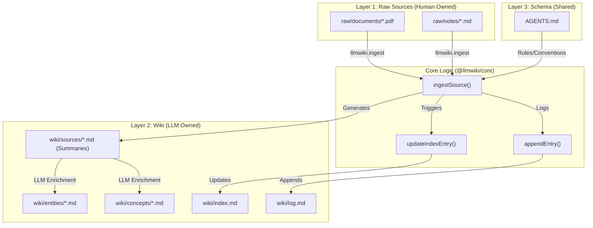
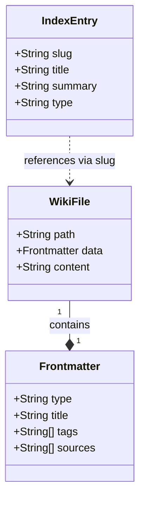

<!-- source: DeepWiki mcp.deepwiki.com · repo microsoft/llmwiki · page 1.2 Three-Layer Architecture · fetched 2026-10-26 -->

# Three-Layer Architecture

Relevant source files

The following files were used as context for generating this wiki page:

- [ARCHITECTURE.md](ARCHITECTURE.md)
- [README.md](README.md)
- [packages/core/src/constants.ts](packages/core/src/constants.ts)
- [packages/core/src/init.ts](packages/core/src/init.ts)

The LLM Wiki system operates on a persistent, structured knowledge base that resides between raw data and the user. Unlike standard RAG (Retrieval-Augmented Generation) systems that synthesize answers on-the-fly from raw chunks, LLM Wiki uses a **Three-Layer Architecture** to maintain a compiled, interlinked, and version-controlled representation of knowledge [README.md:8-12]().

## Architectural Overview

The system is designed as a "git-as-database" model where all state is stored in human-readable Markdown files within a `.wiki/` directory [packages/core/src/constants.ts:8-11](). This ensures that the knowledge base is portable, searchable by standard tools, and provides a clear separation of concerns between human curators and LLM agents [ARCHITECTURE.md:24-34]().

### Data Flow and Layer Interactions

The following diagram illustrates how data flows from the human-controlled **Raw Sources** through the LLM-driven **Ingestion Pipeline** into the structured **Wiki** layer, all governed by the **Schema**.

**Data Flow: Source to Synthesis**

**Sources:** [ARCHITECTURE.md:36-65](), [packages/core/src/init.ts:19-26](), [packages/core/src/ingest.ts:1-20]()

---

## Layer 1: Raw Sources (`raw/`)

The **Raw Sources** layer is the immutable foundation of the wiki. It contains the original evidence used to generate all subsequent knowledge [ARCHITECTURE.md:38-40]().

*   **Immutability:** The LLM is permitted to read these files but is strictly forbidden from modifying them [ARCHITECTURE.md:42]().
*   **Source of Truth:** Every page in the Wiki layer must trace back to a file in this directory via the `source_path` frontmatter field [ARCHITECTURE.md:43](), [packages/core/src/init.ts:72-73]().
*   **Structure:** Users can organize this directory using any folder hierarchy (e.g., `raw/research/papers/`). The system treats these as a flat set of sources for the purpose of ingestion [ARCHITECTURE.md:45]().

**Sources:** [ARCHITECTURE.md:38-46](), [packages/core/src/init.ts:21]()

---

## Layer 2: Wiki (`wiki/`)

The **Wiki** layer is the "Compiled Knowledge" produced and maintained by the LLM. It consists of structured Markdown files with YAML frontmatter [ARCHITECTURE.md:48-53]().

### Directory Structure
The `.wiki/wiki/` directory is partitioned by page type to allow for efficient scanning and organization [packages/core/src/init.ts:19-26]():
*   `wiki/entities/`: Pages for people, organizations, and places [packages/core/src/init.ts:45]().
*   `wiki/concepts/`: Pages for abstract ideas and theories [packages/core/src/init.ts:46]().
*   `wiki/sources/`: Summary pages that act as a bridge between the raw file and the wiki [packages/core/src/init.ts:47-48]().

### Metadata and Persistence
The system uses two specialized files to manage the state of the wiki:
1.  **`wiki/index.md`**: A master catalog used for weighted search and linting. It organizes entries under `## Entities`, `## Concepts`, and `## Sources` headers [ARCHITECTURE.md:55](), [packages/core/src/init.ts:28-36]().
2.  **`wiki/log.md`**: An append-only chronological record of every operation performed by the system (e.g., `initialized`, `ingested`) [ARCHITECTURE.md:56](), [packages/core/src/init.ts:178-184]().

**Entity Mapping: Code to Wiki Space**

**Sources:** [packages/core/src/init.ts:61-86](), [ARCHITECTURE.md:53-56]()

---

## Layer 3: Schema (`AGENTS.md`)

The **Schema** layer defines the "Constitution" of the wiki. It is a Markdown file named `AGENTS.md` located at the root of the `.wiki/` directory [packages/core/src/init.ts:187-188]().

### Purpose
`AGENTS.md` provides the LLM with the necessary context to maintain consistency across different sessions and different LLM models. It defines:
*   **Naming Conventions:** Rules for generating slugs (e.g., lowercasing, stripping extensions) [packages/core/src/init.ts:102-111]().
*   **Frontmatter Requirements:** Mandatory fields like `type` and `title` [packages/core/src/init.ts:61-66]().
*   **Workflows:** Step-by-step instructions for ingestion and cross-referencing [packages/core/src/init.ts:113-118]().
*   **Lint Rules:** Definitions for what constitutes a "healthy" wiki (e.g., `broken-links`, `orphan-pages`) [packages/core/src/init.ts:120-128]().

### Co-Evolution
While the `llmwiki.init` command provides a starter template [packages/core/src/init.ts:39-137](), the schema is intended to be co-evolved. As users or LLMs identify new patterns or requirements, they update `AGENTS.md` to codify these new rules [ARCHITECTURE.md:62-65]().

**Sources:** [ARCHITECTURE.md:58-65](), [packages/core/src/init.ts:39-137]()

---

## Technical Implementation Details

### File I/O and Path Resolution
The `@llmwiki/core` package manages all interactions with the three layers. It uses a `WIKI_DIR_NAME` constant (set to `.wiki`) to locate the root [packages/core/src/constants.ts:11](). 

Key functions include:
*   `initWiki(targetPath)`: Scaffolds the directory structure and creates the initial `index.md`, `log.md`, and `AGENTS.md` [packages/core/src/init.ts:147-199]().
*   `slugify(text)`: Implements the naming conventions defined in the schema to ensure consistent file paths [packages/core/src/init.ts:102-108]().

### The Git-as-Database Approach
By using Markdown and a standard directory structure, LLM Wiki leverages Git for:
1.  **Version Control:** Every LLM change is a commit, allowing for easy reverts.
2.  **Concurrency:** Git handles merging changes if multiple agents (or a human and an agent) edit the wiki simultaneously.
3.  **Auditability:** The `wiki/log.md` combined with git history provides a full audit trail of how knowledge was derived [ARCHITECTURE.md:24-34](), [ARCHITECTURE.md:56]().

**Sources:** [packages/core/src/constants.ts:1-12](), [packages/core/src/init.ts:147-199](), [ARCHITECTURE.md:24-34]()

---

