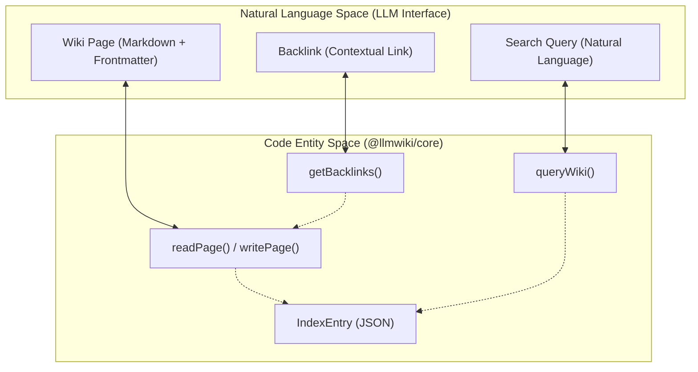
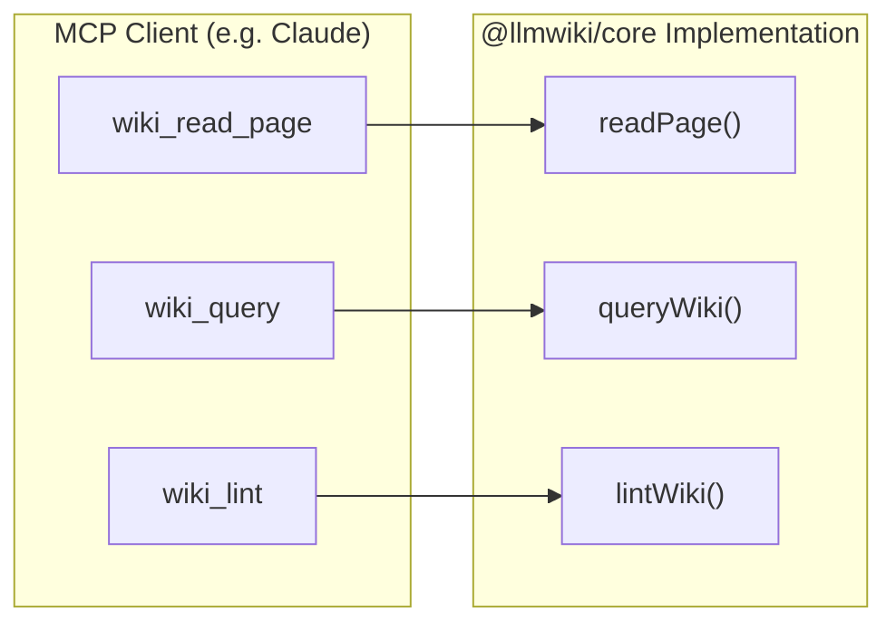

<!-- source: DeepWiki mcp.deepwiki.com · repo microsoft/llmwiki · page 2 Core Library (@llmwiki/core) · fetched 2026-10-26 -->

# Core Library (@llmwiki/core)

Relevant source files

The following files were used as context for generating this wiki page:

- [.vscode/mcp.json](.vscode/mcp.json)
- [packages/core/README.md](packages/core/README.md)
- [packages/core/package.json](packages/core/package.json)
- [packages/core/src/backlinks.ts](packages/core/src/backlinks.ts)
- [packages/core/src/index.ts](packages/core/src/index.ts)
- [packages/core/tsconfig.json](packages/core/tsconfig.json)

The `@llmwiki/core` package serves as the engine for the LLM Wiki ecosystem. It provides a headless implementation of all wiki operations, including file I/O, search, ingestion, and linting. It is consumed by the [VS Code Extension](#4) and also provides a standalone [MCP Server](#3) to allow LLM agents to interact with the wiki directly via standard tools.

Sources: [packages/core/package.json:2-4](), [packages/core/README.md:3-5]()

## Module Organization

The library is organized into functional modules that handle specific aspects of the wiki lifecycle. The public API is consolidated in `src/index.ts`.

| Module | Primary Responsibility |
| :--- | :--- |
| `wiki.ts`, `index-ops.ts` | Low-level filesystem operations and index management. |
| `ingest.ts`, `bulk-ingest.ts` | Transformation of raw source files into wiki pages. |
| `search.ts`, `query.ts` | Full-text search and weighted query algorithms. |
| `lint.ts` | Validation of wiki health and integrity. |
| `mcp/` | Implementation of the Model Context Protocol server. |
| `backlinks.ts` | Discovery of relationships between pages. |

Sources: [packages/core/src/index.ts:1-17]()

## Core Data Flow

The following diagram illustrates how the core library bridges the gap between the filesystem (Code Entity Space) and the logical wiki structure (Natural Language Space) used by LLMs.

### Entity Relationship Diagram

Sources: [packages/core/src/wiki.ts:2-3](), [packages/core/src/backlinks.ts:23-26](), [packages/core/src/query.ts:14-14](), [packages/core/src/index-ops.ts:4-4]()

## Sub-Systems

### Wiki File I/O and Index Operations
This sub-system manages the physical storage of the wiki. It handles reading and writing markdown files with frontmatter, maintaining the `index.json` for fast lookups, and managing the append-only `log.json` for change tracking.
*   **Key Entities**: `readPage`, `writePage`, `IndexEntry`, `updateIndexEntry`.
*   **Details**: See [Wiki File I/O and Index Operations](#2.1).

Sources: [packages/core/src/wiki.ts:2-3](), [packages/core/src/index-ops.ts:4-4]()

### Ingestion Pipeline
The ingestion pipeline converts raw data (e.g., source code, documents) into structured wiki entities and concepts. It handles slug generation to ensure unique identifiers and manages the `raw/` directory synchronization.
*   **Key Entities**: `ingestSource`, `bulkIngest`, `IngestResult`.
*   **Details**: See [Ingestion Pipeline](#2.2).

Sources: [packages/core/src/ingest.ts:11-11](), [packages/core/src/bulk-ingest.ts:13-13]()

### Search, Query, and Status
Provides the intelligence for retrieving information. The system uses a weighted scoring algorithm where matches in the title are prioritized over the summary and body.
*   **Key Entities**: `queryWiki`, `getWikiStatus`, `search.ts`.
*   **Details**: See [Search, Query, and Status](#2.3).

Sources: [packages/core/src/query.ts:14-14](), [packages/core/src/status.ts:15-15]()

### Linting and Health Checks
Ensures the wiki remains consistent as it grows. The linter identifies broken links, orphaned pages, and stale index entries, providing an automated `lintFix` mechanism for common issues.
*   **Key Entities**: `lintWiki`, `lintFix`, `LintFinding`.
*   **Details**: See [Linting and Health Checks](#2.4).

Sources: [packages/core/src/lint.ts:8-8]()

## Model Context Protocol (MCP) Integration

The core library exports a binary, `llmwiki-mcp`, which wraps the core functions into executable tools for LLMs. This allows any MCP-compatible client to perform wiki operations using the same logic as the VS Code extension.

### MCP Tool Mapping

Sources: [packages/core/package.json:28-30](), [packages/core/README.md:27-30](), [packages/core/src/mcp/index.js:16-16]()

For a complete reference of available MCP tools, see [MCP Server](#3).

---

