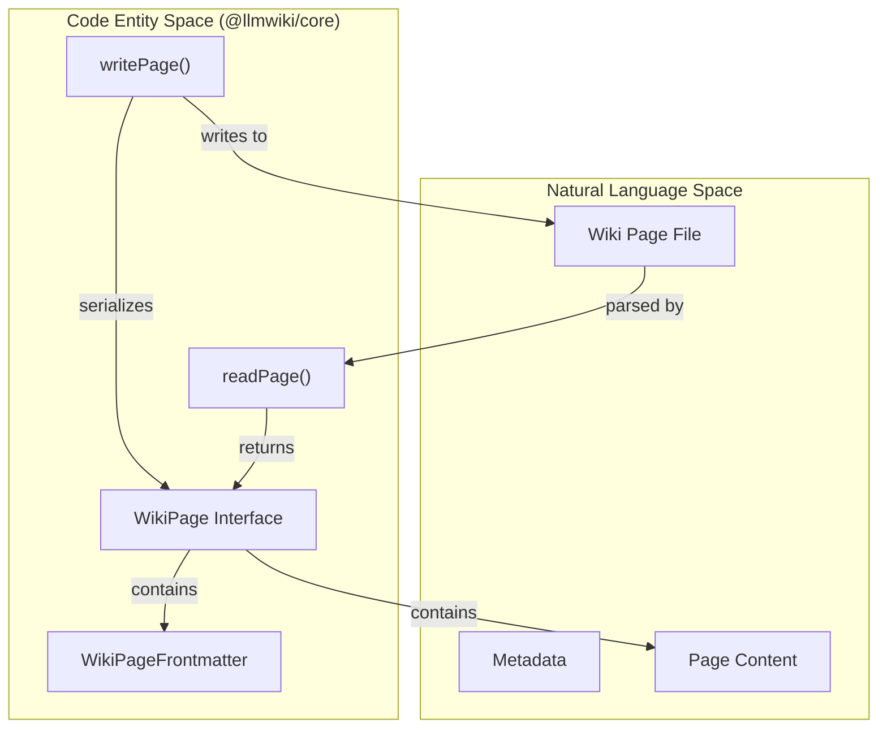
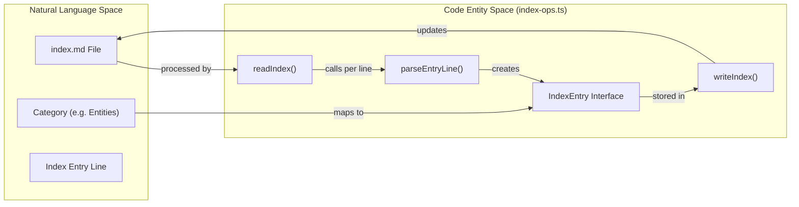
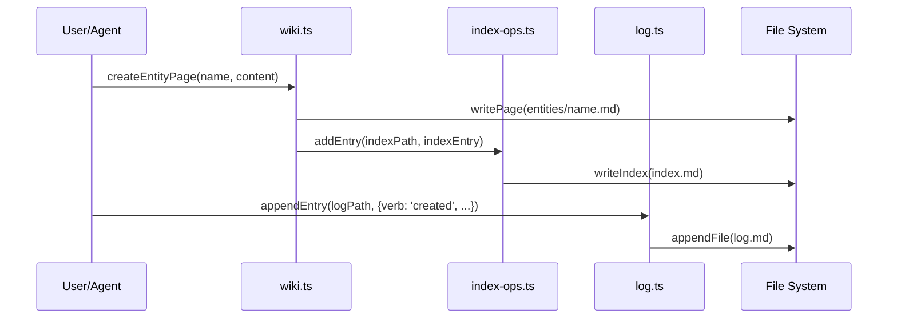

<!-- source: DeepWiki mcp.deepwiki.com · repo microsoft/llmwiki · page 2.1 Wiki File I/O and Index Operations · fetched 2026-10-26 -->

# Wiki File I/O and Index Operations

Relevant source files

The following files were used as context for generating this wiki page:

- [packages/core/src/index-ops.ts](packages/core/src/index-ops.ts)
- [packages/core/src/log.ts](packages/core/src/log.ts)
- [packages/core/src/sources.ts](packages/core/src/sources.ts)
- [packages/core/src/wiki.ts](packages/core/src/wiki.ts)
- [tests/shared/backlinks.test.ts](tests/shared/backlinks.test.ts)
- [tests/shared/index.test.ts](tests/shared/index.test.ts)
- [tests/shared/log.test.ts](tests/shared/log.test.ts)
- [tests/shared/sources.test.ts](tests/shared/sources.test.ts)
- [tests/shared/wiki.test.ts](tests/shared/wiki.test.ts)
- [tsconfig.json](tsconfig.json)

This page details the core library functions within `@llmwiki/core` responsible for managing the physical storage and indexing of the wiki. The system treats a directory of Markdown files as a structured database, utilizing YAML frontmatter for metadata and a centralized `index.md` for fast lookups.

## Wiki Page Operations

The primary interface for interacting with individual wiki pages is located in `wiki.ts`. These functions handle the serialization and deserialization of Markdown files containing YAML frontmatter.

### Implementation Details
*   **Data Structure**: The `WikiPage` interface [packages/core/src/wiki.ts:21-24]() encapsulates both the metadata (`frontmatter`) and the markdown content (`body`).
*   **Serialization**: The system uses the `gray-matter` library [packages/core/src/wiki.ts:1-1]() to parse and stringify pages.
*   **I/O Operations**: 
    *   `readPage`: Reads a file and parses it into a `WikiPage` object [packages/core/src/wiki.ts:26-33]().
    *   `writePage`: Ensures the target directory exists via `mkdir` before writing the stringified content [packages/core/src/wiki.ts:35-39]().
    *   `listPages`: Recursively scans a directory for all `.md` files [packages/core/src/wiki.ts:41-51]().

### Natural Language to Code Entity Mapping: Pages
The following diagram maps the logical concept of a "Wiki Page" to the specific code entities that handle its lifecycle.

"Wiki Page Data Flow"

Sources: [packages/core/src/wiki.ts:11-39]()

## Index Operations

The `index.md` file serves as a registry for all pages in the wiki. It is organized by categories (e.g., "Entities", "Concepts") using H2 headers.

### Index Entry Format
Each entry in the index follows a specific Markdown list format:
`- [Title](path) — Summary text #tag1 #tag2`

The `IndexEntry` interface [packages/core/src/index-ops.ts:5-11]() tracks the relative `path`, `title`, `summary`, `category`, and `tags`.

### Key Functions in `index-ops.ts`
| Function | Description |
| :--- | :--- |
| `readIndex` | Parses `index.md` into `IndexEntry[]`, detecting categories via `##` headers [packages/core/src/index-ops.ts:89-121](). |
| `writeIndex` | Groups entries by category and writes them back to `index.md` [packages/core/src/index-ops.ts:127-151](). |
| `updateIndexEntry` | Modifies specific fields of an existing entry based on its `pagePath` [packages/core/src/index-ops.ts:183-200](). |
| `addEntry` | Appends a new entry and persists the change [packages/core/src/index-ops.ts:157-164](). |

### Natural Language to Code Entity Mapping: Indexing
This diagram illustrates how the logical "Wiki Index" is managed by the `index-ops.ts` module.

"Index Management Logic"

Sources: [packages/core/src/index-ops.ts:5-151]()

## Append-Only Log

The system maintains a chronological record of changes in `log.md`. This is handled by `log.ts`.

*   **Format**: Entries are stored under H2 headers containing the date, verb, and subject: `## [YYYY-MM-DD] verb | subject` [packages/core/src/log.ts:22-22]().
*   **Operations**:
    *   `appendEntry`: Adds a new log entry to the end of the file, auto-generating the date if omitted [packages/core/src/log.ts:17-26]().
    *   `readLog`: Parses the entire log into `LogEntry` objects [packages/core/src/log.ts:32-83]().
    *   `getRecentEntries`: Retrieves the last $N$ entries for display in UIs or status reports [packages/core/src/log.ts:89-98]().

Sources: [packages/core/src/log.ts:5-98]()

## Source File Helpers

The `sources.ts` module provides utilities for managing the "Raw Sources" layer (files that have not yet been ingested into the wiki).

### `listSources`
The `listSources` function [packages/core/src/sources.ts:22-53]() scans the `raw/` directory and returns a `SourceFile` object for every file found. Metadata collected includes:
*   `size`: File size in bytes [packages/core/src/sources.ts:11-11]().
*   `modified`: ISO string of the last modification time [packages/core/src/sources.ts:12-12]().
*   `extension`: File extension including the dot [packages/core/src/sources.ts:15-15]().

Sources: [packages/core/src/sources.ts:5-53]()

## Summary of Data Flow

"Wiki Data Interaction Flow"

Sources: [packages/core/src/wiki.ts:104-137](), [packages/core/src/index-ops.ts:157-164](), [packages/core/src/log.ts:17-26]()

---

