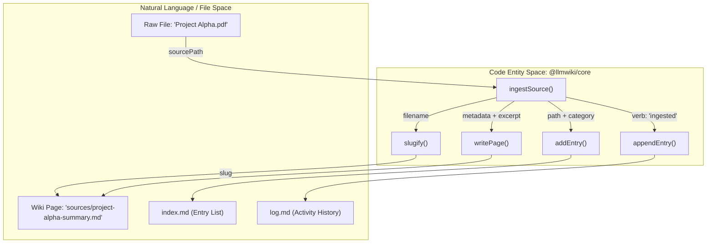
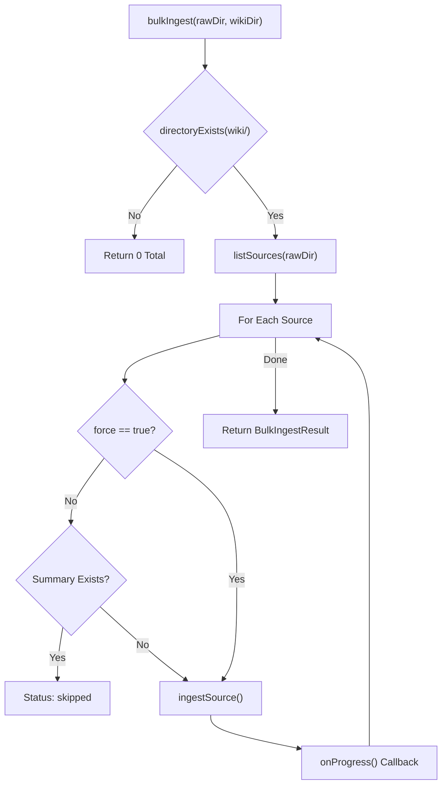

<!-- source: DeepWiki mcp.deepwiki.com · repo microsoft/llmwiki · page 2.2 Ingestion Pipeline · fetched 2026-10-26 -->

# Ingestion Pipeline

<details>
<summary>Relevant source files</summary>

The following files were used as context for generating this wiki page:

- [packages/core/src/bulk-ingest.ts](packages/core/src/bulk-ingest.ts)
- [packages/core/src/ingest-context.ts](packages/core/src/ingest-context.ts)
- [packages/core/src/ingest.ts](packages/core/src/ingest.ts)
- [packages/core/src/utils.ts](packages/core/src/utils.ts)
- [tests/shared/bulk-ingest.test.ts](tests/shared/bulk-ingest.test.ts)
- [tests/shared/delete.test.ts](tests/shared/delete.test.ts)
- [tests/shared/ingest-context.test.ts](tests/shared/ingest-context.test.ts)

</details>


The ingestion pipeline is responsible for transforming raw source files into structured wiki pages. This lifecycle involves path validation, content extraction, slug generation, and indexing. The pipeline supports both individual file ingestion and high-throughput batch processing.

## Core Ingestion Lifecycle

The primary entry point for ingestion is `ingestSource`. It performs a mechanical transformation of a raw file into a `source` type wiki page.

### Ingestion Data Flow
The following diagram illustrates the transition from a raw file on disk to a structured entity in the Wiki Layer.

**Diagram: Raw Source to Wiki Entity Mapping**

Sources: [packages/core/src/ingest.ts:30-35](), [packages/core/src/utils.ts:5-11](), [packages/core/src/ingest.ts:134-166]()

### Key Implementation Steps
1.  **Path Validation**: The system ensures the `wiki/` directory is initialized [packages/core/src/ingest.ts:42-52]() and validates that the source path does not escape the project root to prevent path traversal [packages/core/src/ingest.ts:55-68]().
2.  **Slug Generation**: The `slugify` function converts filenames (e.g., `Technical Doc v1.pdf`) into clean identifiers (e.g., `technical-doc-v1`) by stripping extensions and replacing non-alphanumeric characters with hyphens [packages/core/src/utils.ts:5-11]().
3.  **Duplicate Detection**: By default, if a summary page for the slug already exists in `wiki/sources/`, the process returns a `skipped` status [packages/core/src/ingest.ts:98-117]().
4.  **Content Preview**: An excerpt of the first 500 characters is generated for the summary page body [packages/core/src/ingest.ts:120-122]().
5.  **Side Effects**:
    *   **Page Creation**: Writes a Markdown file with `type: source` frontmatter [packages/core/src/ingest.ts:134-144]().
    *   **Index Update**: Calls `addEntry` to register the new page in `index.md` [packages/core/src/ingest.ts:151-157]().
    *   **Logging**: Calls `appendEntry` to record the "ingested" event in `log.md` [packages/core/src/ingest.ts:161-165]().

## Bulk Ingestion

The `bulkIngest` function allows for batch processing of entire directories. It iterates through files discovered via `listSources` and invokes `ingestSource` for each.

**Diagram: Bulk Ingest Control Flow**

Sources: [packages/core/src/bulk-ingest.ts:33-107](), [packages/core/src/bulk-ingest.ts:73-89]()

### BulkIngestResult Schema
The function returns a comprehensive report of the batch operation:
| Property | Type | Description |
| :--- | :--- | :--- |
| `total` | `number` | Total files discovered in the raw directory. |
| `ingested` | `number` | Number of files successfully written to the wiki. |
| `skipped` | `number` | Number of files skipped (already existed and `force: false`). |
| `failed` | `number` | Number of files that encountered errors during ingestion. |
| `files` | `Array` | List of objects containing individual `file` path and `status`. |

Sources: [packages/core/src/bulk-ingest.ts:22-31]()

## Contextual Enrichment (`ingestWithContext`)

While `ingestSource` handles the mechanical file operations, `ingestWithContext` provides the "Smart Ingest" capabilities used by LLM agents. It enriches the standard `IngestResult` with semantic metadata.

### Enrichment Steps
1.  **Content Type Detection**: Maps file extensions to internal types like `markdown`, `pdf`, `word`, or `latex` [packages/core/src/ingest-context.ts:44-64]().
2.  **Keyword Extraction**: Extracts up to 200 unique, non-stop-word keywords from the first 2000 characters of the text [packages/core/src/ingest-context.ts:74-91]().
3.  **Related Page Discovery**: Uses the extracted keywords to perform a `queryWiki` call, identifying existing pages that might be relevant to the new source [packages/core/src/ingest-context.ts:187-197]().
4.  **Action Suggestions**: Generates a list of `suggested_actions` (e.g., "Create entity pages", "Add crosslinks") based on whether related pages were found [packages/core/src/ingest-context.ts:95-132]().

### IngestWithContextResult Schema
```typescript
export interface IngestWithContextResult {
  ingest: IngestResult;           // The mechanical result from ingestSource
  source_word_count: number;      // Total words in the source
  source_content_type: string;    // Detected type (e.g., 'pdf')
  related_pages: PageInfo[];      // Search results for keyword overlap
  suggested_actions: string[];    // Recommended next steps for the agent
}
```
Sources: [packages/core/src/ingest-context.ts:16-27](), [packages/core/src/ingest-context.ts:146-151]()

## Summary of Key Entities

| Function | File | Role |
| :--- | :--- | :--- |
| `ingestSource` | `ingest.ts` | Core logic for single-file ingestion and indexing. |
| `bulkIngest` | `bulk-ingest.ts` | Orchestrator for batch processing multiple sources. |
| `ingestWithContext` | `ingest-context.ts` | High-level wrapper providing semantic enrichment for LLMs. |
| `slugify` | `utils.ts` | Standardizes filenames into URL/file-friendly slugs. |
| `detectContentType` | `ingest-context.ts` | Heuristic mapping of extensions to content categories. |

Sources: [packages/core/src/ingest.ts:30](), [packages/core/src/bulk-ingest.ts:33](), [packages/core/src/ingest-context.ts:146](), [packages/core/src/utils.ts:5](), [packages/core/src/ingest-context.ts:44]()

---

