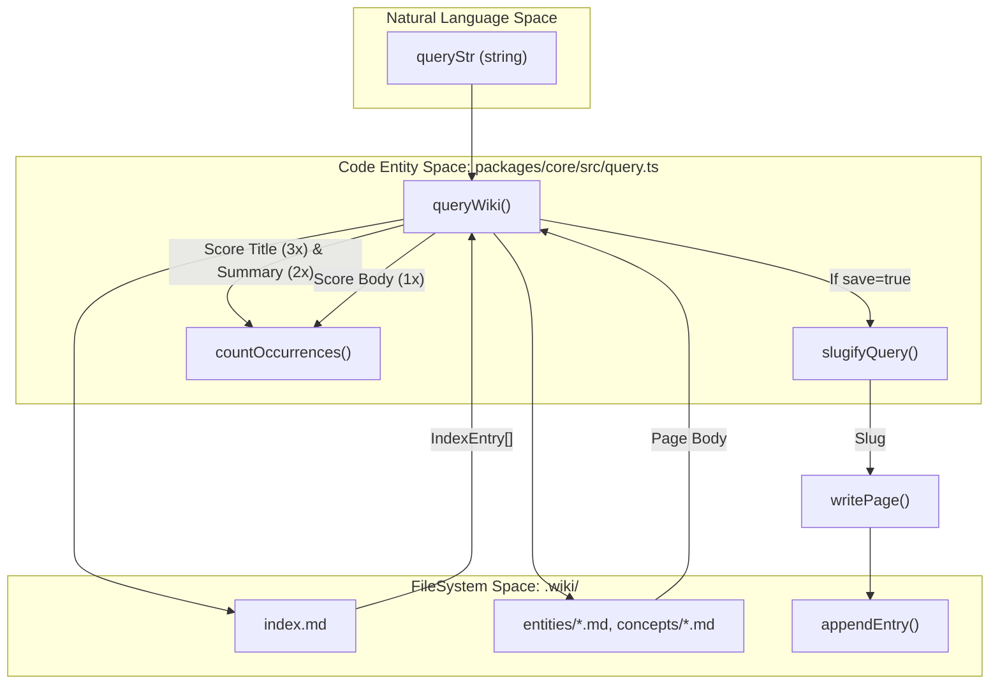
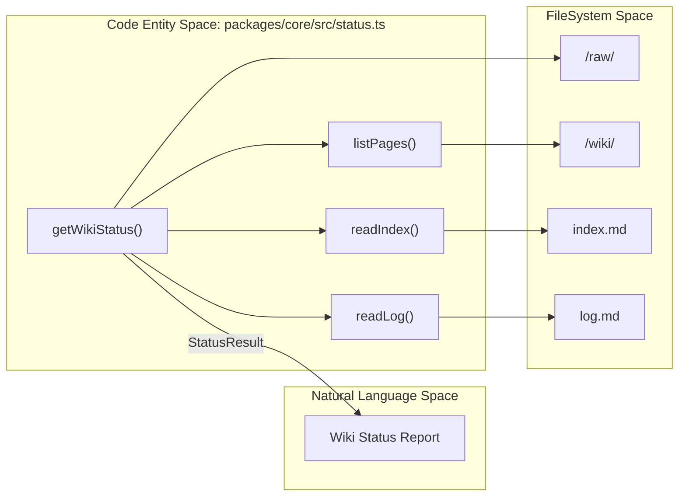

<!-- source: DeepWiki mcp.deepwiki.com · repo microsoft/llmwiki · page 2.3 Search, Query, and Status · fetched 2026-10-26 -->

# Search, Query, and Status

<details>
<summary>Relevant source files</summary>

The following files were used as context for generating this wiki page:

- [packages/core/src/query.ts](packages/core/src/query.ts)
- [packages/core/src/search.ts](packages/core/src/search.ts)
- [packages/core/src/status.ts](packages/core/src/status.ts)
- [tests/shared/index.test.ts](tests/shared/index.test.ts)
- [tests/shared/log.test.ts](tests/shared/log.test.ts)
- [tests/shared/wiki.test.ts](tests/shared/wiki.test.ts)
- [tsconfig.json](tsconfig.json)

</details>


This section documents the discovery and introspection capabilities of `@llmwiki/core`. It covers the weighted full-text search algorithm, the structured query engine that generates persistence-ready results, and the status aggregation logic used to monitor the health of the wiki workspace.

## Weighted Search Algorithm

The fundamental unit of discovery in LLM Wiki is a case-insensitive occurrence counter located in `search.ts`. This utility provides the basis for the weighted scoring system used during queries.

### Occurrence Counting
The `countOccurrences` function [packages/core/src/search.ts:4-15]() performs a non-overlapping search for a specific term within a block of text. It normalizes both the haystack and the needle to lowercase before iterating with `indexOf`.

### Scoring Heuristics
When a query is executed via `queryWiki` [packages/core/src/query.ts:41-161](), the system applies a 3-2-1 weighting strategy to determine the relevance of a page based on where the search terms appear:

| Field | Weight | Source |
| :--- | :--- | :--- |
| **Title** | 3× | `IndexEntry.title` from `index.md` |
| **Summary** | 2× | `IndexEntry.summary` from `index.md` |
| **Body** | 1× | Full text of the `.md` file |

Sources: [packages/core/src/search.ts:1-16](), [packages/core/src/query.ts:73-109]()

## Query Engine (`query.ts`)

The `queryWiki` function provides a high-level interface for searching the wiki. It integrates the `index.md` file for fast metadata lookup and falls back to reading individual page bodies for deep content analysis.

### Data Flow: Query Execution
The following diagram illustrates how a natural language query string is transformed into a scored `QueryOutput` object.

**Query Execution Flow**

Sources: [packages/core/src/query.ts:41-161](), [packages/core/src/search.ts:4-15](), [packages/core/src/index-ops.ts:20-82]()

### Result Persistence
If the `save` parameter is set to `true`, the engine:
1.  **Slugifies** the query string into a filename (e.g., "Neural Networks" → `queries/neural-networks.md`) [packages/core/src/query.ts:30-36]().
2.  **Generates** a new wiki page with `type: query` in the frontmatter [packages/core/src/query.ts:140-148]().
3.  **Logs** the action in `log.md` with the verb `queried` [packages/core/src/query.ts:151-155]().

## Wiki Status Aggregation (`status.ts`)

The `getWikiStatus` function [packages/core/src/status.ts:27-97]() provides a snapshot of the workspace's health and scale. It aggregates data from the `raw/` directory, the `wiki/` directory, the index, and the append-only log.

### Status Metrics
The `StatusResult` interface [packages/core/src/status.ts:12-21]() includes the following calculated fields:

*   **Source Count**: Total files in the `raw/` directory [packages/core/src/status.ts:35-42]().
*   **Wiki Page Count**: Total `.md` files in `wiki/`, excluding `index.md` and `log.md` [packages/core/src/status.ts:45-50]().
*   **Last Ingest/Lint Dates**: Extracted by filtering `log.md` entries for specific verbs [packages/core/src/status.ts:53-69]().
*   **Orphan Page Count**: Number of wiki pages that exist on disk but are not listed in `index.md` [packages/core/src/status.ts:72-78]().
*   **Index Coverage**: Percentage of wiki pages that are correctly indexed [packages/core/src/status.ts:81-85]().

### Status Data Flow
The status module bridges high-level workspace concepts to low-level file system operations.

**Status Aggregation Logic**

Sources: [packages/core/src/status.ts:27-97](), [packages/core/src/wiki.ts:89-105](), [packages/core/src/log.ts:14-68]()

## Implementation Details

### Query Output Structure
The `QueryOutput` [packages/core/src/query.ts:18-25]() ensures that agents and UI components receive standardized data, including excerpts generated by the `excerpt` utility [packages/core/src/query.ts:107]().

```typescript
export interface QueryOutput {
  command: string;      // Always 'query'
  api_version: string;  // Current API version
  query: string;        // The original query string
  matches: number;      // Count of results
  results: QueryResult[];
  saved?: string;       // Path to saved query page, if applicable
}
```
Sources: [packages/core/src/query.ts:11-25]()

### Error Handling
The query and status functions are designed to be resilient to uninitialized workspaces. If `wiki/` or `raw/` directories are missing, the functions return empty results or zeroed metrics rather than throwing, using the `isNotFoundError` helper [packages/core/src/query.ts:50-58](), [packages/core/src/status.ts:39-42]().

Sources: [packages/core/src/query.ts:98-101](), [packages/core/src/status.ts:39-42]()

---

