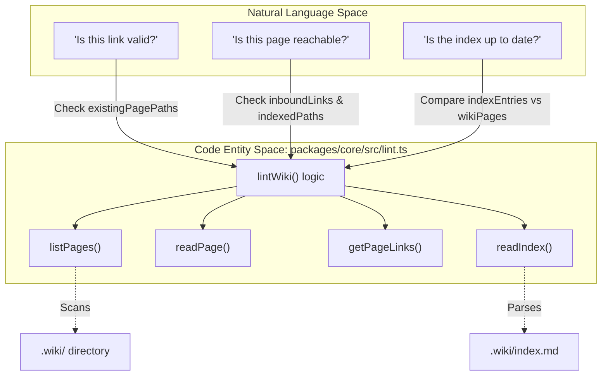
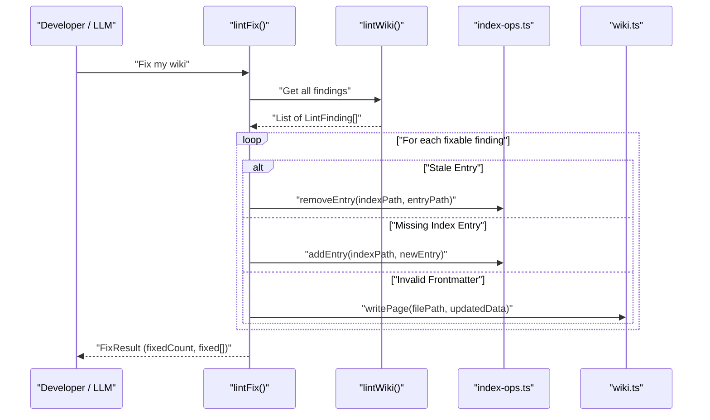

<!-- source: DeepWiki mcp.deepwiki.com · repo microsoft/llmwiki · page 2.4 Linting and Health Checks · fetched 2026-10-26 -->

# Linting and Health Checks

Relevant source files

The following files were used as context for generating this wiki page:

- [packages/core/src/lint.ts](packages/core/src/lint.ts)
- [tests/shared/crosslinks.test.ts](tests/shared/crosslinks.test.ts)
- [tests/shared/lint-fix.test.ts](tests/shared/lint-fix.test.ts)
- [tests/shared/lint.test.ts](tests/shared/lint.test.ts)
- [tests/shared/mcp/crosslinks-index.test.ts](tests/shared/mcp/crosslinks-index.test.ts)
- [tests/shared/update-index-entry.test.ts](tests/shared/update-index-entry.test.ts)
- [tests/shared/wiki-rename.test.ts](tests/shared/wiki-rename.test.ts)

The LLM Wiki system includes a robust linting and health check engine designed to maintain the integrity of the knowledge base. This system identifies structural issues, missing metadata, and broken relationships between pages, providing both diagnostic reports and automated repair capabilities.

## Overview

The linting system is primarily implemented in `packages/core/src/lint.ts`. It operates by scanning the `.wiki/` directory, analyzing the `index.md` file, and parsing the frontmatter and body of all Markdown pages to build a graph of the wiki's health.

### Key Data Structures

#### LintFinding
The `LintFinding` interface represents a single issue discovered during a scan.
[packages/core/src/lint.ts:8-13]()

| Property | Type | Description |
| :--- | :--- | :--- |
| `severity` | `'error' \| 'warning' \| 'info'` | The impact level of the finding. |
| `category` | `string` | The type of check (e.g., `broken-links`). |
| `message` | `string` | Human-readable description of the issue. |
| `file` | `string` (optional) | Relative path to the file where the issue was found. |

#### LintResult
The `LintResult` interface provides a comprehensive summary of a linting run, including aggregate counts and versioning information.
[packages/core/src/lint.ts:15-23]()

**Sources:** [packages/core/src/lint.ts:8-23]()

---

## Lint Categories

The system implements six distinct linting categories. Each category targets a specific aspect of wiki health.

### 1. Broken Links (`broken-links`)
Identifies Markdown links that point to files that do not exist within the wiki directory. It resolves relative paths based on the source page's location and ignores external URLs (http/https).
[packages/core/src/lint.ts:102-116](), [tests/shared/lint.test.ts:77-90]()

### 2. Orphan Pages (`orphan-pages`)
Detects "lost" content. A page is considered an orphan if it has no inbound links from other pages AND is not listed in the `index.md`.
[packages/core/src/lint.ts:119-130]()

### 3. Index Completeness (`index-completeness`)
Ensures that every physical `.md` file in the wiki (excluding `index.md` and `log.md`) has a corresponding entry in the `index.md` file.
[packages/core/src/lint.ts:133-144]()

### 4. Stale Entries (`stale-entries`)
The inverse of index completeness. It identifies entries in `index.md` that point to file paths that no longer exist on disk.
[packages/core/src/lint.ts:147-160]()

### 5. Missing Pages (`missing-pages`)
A specialized "info" category that dedupes unique missing link targets across the entire wiki, highlighting content gaps that may need to be created.
[packages/core/src/lint.ts:163-178]()

### 6. Frontmatter Validation (`frontmatter-validation`)
Validates the YAML frontmatter of pages. It checks for:
- Presence of required fields: `type` and `title`.
- Validity of `type` (must be one of: `entity`, `concept`, `source`, `summary`, `query`).
- Presence of the `tags` array.
[packages/core/src/lint.ts:181-218]()

**Sources:** [packages/core/src/lint.ts:102-218](), [tests/shared/lint.test.ts:9-155]()

---

## Data Flow and Implementation

The `lintWiki` function follows a multi-step pipeline to gather the necessary context before executing individual checks.

### Natural Language Space to Code Entity Space: Linting Logic
The following diagram maps the logical health checks to the internal functions and state used to evaluate them.

Title: Linting Logic Flow

**Sources:** [packages/core/src/lint.ts:46-100]()

### Implementation Detail: `lintWiki`
The function first filters out non-content files (like the index and log) using `listPages` [packages/core/src/lint.ts:60-64](). It then populates several maps:
- `pageContents`: Maps full paths to body text.
- `pageFrontmatter`: Maps paths to parsed frontmatter objects.
- `pageLinks`: Maps pages to their resolved relative link targets.
- `inboundLinks`: A set of all paths that are referenced by at least one other page.
[packages/core/src/lint.ts:72-95]()

---

## Automated Repair: `lintFix`

The `lintFix` function provides an "auto-repair" capability that attempts to resolve findings discovered by `lintWiki`.

### Fix Strategies
| Category | Repair Action |
| :--- | :--- |
| `stale-entries` | Removes the entry from `index.md` using `removeEntry`. [packages/core/src/lint.ts:285-288]() |
| `index-completeness` | Adds a new entry to `index.md` using `addEntry`, deriving the title from frontmatter or the filename. [packages/core/src/lint.ts:291-306]() |
| `frontmatter-validation` | Injects missing fields (default `type: 'entity'`, empty `tags: []`, or derived `title`) into the file using `writePage`. [packages/core/src/lint.ts:311-344]() |

### Natural Language Space to Code Entity Space: Auto-Repair
The following diagram illustrates how the system transitions from identifying a problem to applying a persistent fix.

Title: Auto-Repair (lintFix) Sequence

**Sources:** [packages/core/src/lint.ts:255-356](), [tests/shared/lint-fix.test.ts:21-182]()

---

## Integration and Usage

### MCP Integration
The linting engine is exposed to LLMs via the Model Context Protocol.
- `wiki_lint`: Calls `lintWiki` and returns a JSON summary.
- `wiki_fix`: Calls `lintFix` to perform automated maintenance.

### VS Code Integration
The VS Code extension uses `lintWiki` to populate the **Lint Findings** tree view. The `llmwiki.fix` command triggers the `lintFix` function and provides progress reporting.

**Sources:** [packages/core/src/lint.ts:46-49](), [packages/core/src/lint.ts:255-258]()

---

