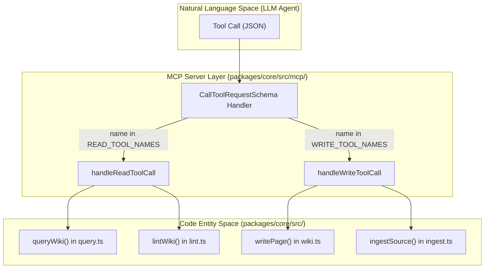
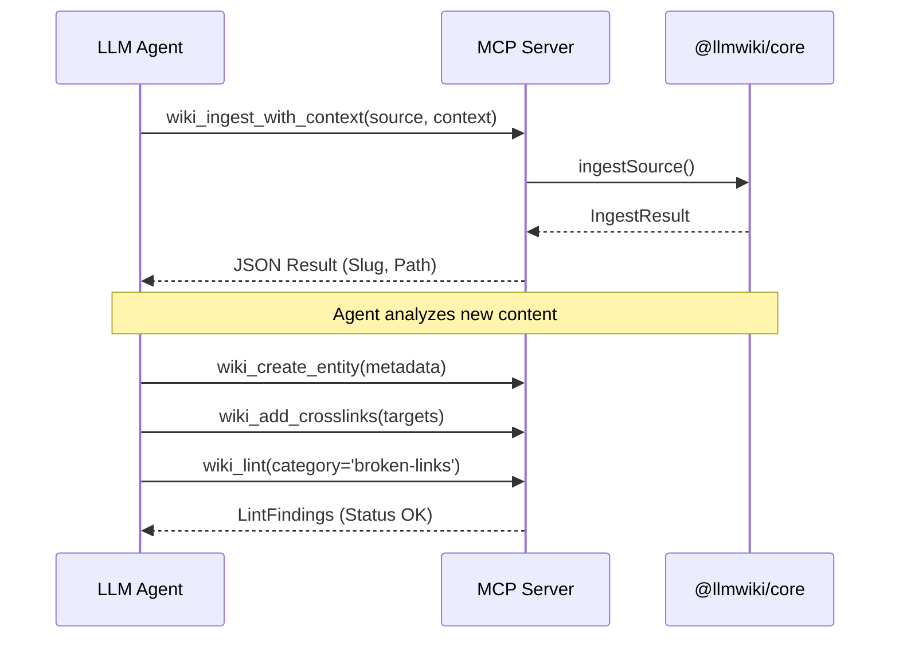

<!-- source: DeepWiki mcp.deepwiki.com · repo microsoft/llmwiki · page 3 MCP Server · fetched 2026-10-26 -->

# MCP Server

Relevant source files

The following files were used as context for generating this wiki page:

- [docs/mcp-tools.md](docs/mcp-tools.md)
- [packages/core/src/mcp/bin.ts](packages/core/src/mcp/bin.ts)
- [packages/core/src/mcp/index.ts](packages/core/src/mcp/index.ts)
- [packages/core/src/mcp/server.ts](packages/core/src/mcp/server.ts)

The `llmwiki` MCP server implements the [Model Context Protocol](https://modelcontextprotocol.io/) to expose wiki operations to LLM agents. It allows tools like GitHub Copilot, Claude Desktop, or Cursor to programmatically interact with the wiki's structured knowledge base. The server is implemented in `@llmwiki/core` and typically runs as a sidecar process using **stdio transport**.

### Architecture Overview

The server is built using the `@modelcontextprotocol/sdk` and acts as a bridge between the **Natural Language Space** (LLM prompts/tools) and the **Code Entity Space** (the wiki filesystem and core logic).

#### Process Lifecycle
1.  **Launcher**: The `llmwiki-mcp` binary [packages/core/src/mcp/bin.ts:1-23]() resolves the wiki root and initializes the server.
2.  **Creation**: `createMcpServer` [packages/core/src/mcp/server.ts:25-65]() instantiates the MCP `Server` class, registering tools, resources, and prompts.
3.  **Transport**: It connects via `StdioServerTransport` [packages/core/src/mcp/bin.ts:44-45](), allowing standard I/O communication with the host application.
4.  **Dispatch**: The server uses a unified request handler [packages/core/src/mcp/server.ts:37-56]() to route incoming tool calls to either `handleReadToolCall` or `handleWriteToolCall`.

#### Natural Language to Code Entity Mapping

This diagram illustrates how the MCP Server maps protocol-level requests to specific implementation functions within the `@llmwiki/core` library.

**MCP Tool Dispatch Map**

Sources: [packages/core/src/mcp/server.ts:37-56](), [packages/core/src/mcp/read-tools.ts:1-20](), [packages/core/src/mcp/write-tools.ts:1-20]()

---

### Tool Categories

The server exposes **14 tools** in total, split between read-only inspection and state-modifying operations.

| Category | Tool Count | Primary Responsibility |
| :--- | :--- | :--- |
| **Read Tools** | 7 | Search, status reporting, linting, and content retrieval. |
| **Write Tools** | 7 | Page creation, cross-linking, and the context-aware ingestion workflow. |

For a full list of tool definitions, see [docs/mcp-tools.md:7-26]().

#### Read Tools
Read tools allow the agent to explore the wiki without modifying files. They wrap core functions like `queryWiki` for search and `lintWiki` for health checks.
*   **Key Tools**: `wiki_status`, `wiki_query`, `wiki_lint`, `wiki_read_page`.
*   For details, see [MCP Read Tools Reference](#3.1).

#### Write Tools
Write tools enable the agent to build the wiki. These tools enforce the schema defined in `AGENTS.md` by providing specific helpers for "entities" and "concepts."
*   **Key Tools**: `wiki_write_page`, `wiki_create_entity`, `wiki_add_crosslinks`, `wiki_ingest_with_context`.
*   For details, see [MCP Write Tools Reference](#3.2).

---

### Data Flow: Smart Ingest Workflow

The most complex interaction in the MCP server is the **Smart Ingest** pattern. Instead of simple file copying, the agent uses a multi-step process to ensure the wiki remains a "High-Density Knowledge Base."

**Smart Ingest Sequence**

Sources: [docs/mcp-tools.md:253-280](), [packages/core/src/ingest.ts:1-50]()

For a step-by-step guide on implementing this flow in an agent, see [Smart Ingest Workflow](#3.3).

---

### Security and Constraints

The MCP server implements a strict security model to prevent agents from accessing files outside the designated wiki workspace.
*   **Path Validation**: Every tool that accepts a path argument calls `assertWithinDir` [packages/core/src/mcp/read-tools.ts:1-10]() to ensure the operation is confined to the `wikiRoot`.
*   **Stdio Isolation**: By using stdio, the server inherits the permissions of the host process (e.g., VS Code or the terminal user).
*   **JSON Only**: All tool outputs are returned as JSON text content [docs/mcp-tools.md:41-42](), ensuring structured data is always available for agent parsing.

Sources: [docs/mcp-tools.md:30-43](), [packages/core/src/mcp/server.ts:49-56]()

---

