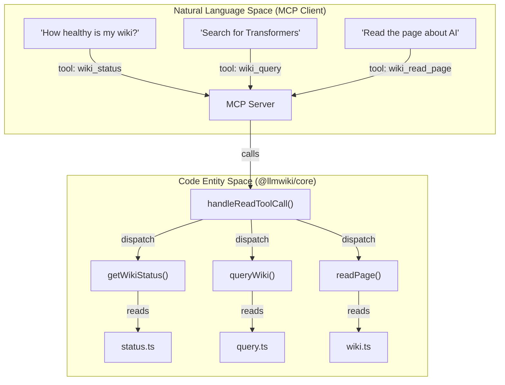
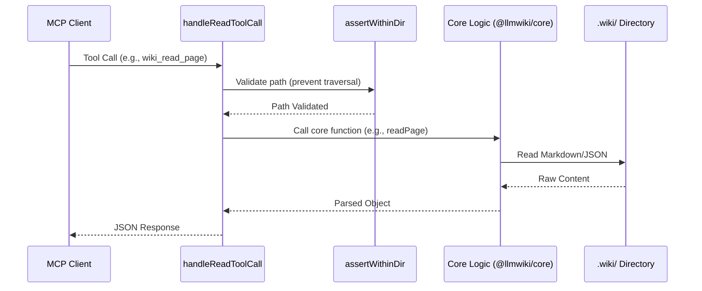

<!-- source: DeepWiki mcp.deepwiki.com · repo microsoft/llmwiki · page 3.1 MCP Read Tools Reference · fetched 2026-10-26 -->

# MCP Read Tools Reference

Relevant source files

The following files were used as context for generating this wiki page:

- [docs/mcp-tools.md](docs/mcp-tools.md)
- [packages/core/src/mcp/prompts.ts](packages/core/src/mcp/prompts.ts)
- [packages/core/src/mcp/read-tools.ts](packages/core/src/mcp/read-tools.ts)
- [packages/core/src/mcp/resources.ts](packages/core/src/mcp/resources.ts)
- [tests/shared/mcp/prompts.test.ts](tests/shared/mcp/prompts.test.ts)
- [tests/shared/mcp/resources.test.ts](tests/shared/mcp/resources.test.ts)

The `llmwiki` MCP server provides 7 read-only tools designed to allow Model Context Protocol (MCP) clients—such as LLM agents—to inspect, query, and audit the wiki workspace. These tools bridge the gap between the natural language intent of an agent and the underlying file-based storage of the wiki.

## Architecture and Data Flow

Read tools are implemented in `@llmwiki/core` and follow a request-response pattern over the MCP stdio transport. When a tool is called, the `handleReadToolCall` function dispatches the request to the appropriate core logic function.

### Natural Language to Code Entity Mapping

The following diagram illustrates how natural language tool requests are mapped to specific code entities and data structures within the `@llmwiki/core` package.

**Read Tool Mapping**

**Sources:** [packages/core/src/mcp/read-tools.ts:149-205](), [docs/mcp-tools.md:30-43]()

### Tool Execution Flow

Every read tool request passes through a validation layer to ensure path safety and argument integrity before interacting with the file system.

**Read Tool Data Flow**

**Sources:** [packages/core/src/mcp/read-tools.ts:139-146](), [packages/core/src/mcp/read-tools.ts:149-205]()

---

## Tool Reference

### 1. `wiki_status`
Returns high-level health and size metrics for the wiki workspace.

*   **Input**: `{}` (No parameters)
*   **Implementation**: Calls `getWikiStatus(wikiRoot)` [packages/core/src/mcp/read-tools.ts:160-160]().
*   **Output Shape**:
    | Field | Type | Description |
    | :--- | :--- | :--- |
    | `sourceCount` | `number` | Total raw source files in `raw/` |
    | `wikiPageCount` | `number` | Total generated pages in `wiki/` |
    | `lastIngestDate` | `string` | ISO timestamp of last ingest |
    | `lastLintDate` | `string` | ISO timestamp of last lint |
    | `orphanPageCount` | `number` | Pages not in `index.md` |
    | `indexCoveragePct`| `number` | Percentage of pages indexed |

**Sources:** [docs/mcp-tools.md:69-105](), [packages/core/src/mcp/read-tools.ts:19-29]()

### 2. `wiki_query`
Performs a weighted full-text search across all wiki pages.

*   **Input**: `{ "query": string }`
*   **Implementation**: Calls `queryWiki(query, wikiRoot)` [packages/core/src/mcp/read-tools.ts:162-165]().
*   **Relevance Scoring**:
    *   Title Match: 3x weight
    *   Summary Match: 2x weight
    *   Body Match: 1x weight
*   **Output**: Array of `{ title, path, score, excerpt }`.

**Sources:** [docs/mcp-tools.md:109-151](), [packages/core/src/mcp/read-tools.ts:31-42]()

### 3. `wiki_lint`
Audits the wiki for structural integrity issues.

*   **Input**: `{ "category"?: string }`
*   **Categories**: `broken-links`, `orphan-pages`, `index-completeness`, `stale-entries`, `missing-pages`, `frontmatter-validation`.
*   **Implementation**: Calls `lintWiki(wikiRoot, categories)` [packages/core/src/mcp/read-tools.ts:167-172]().
*   **Output**: Object containing `findings` array and `errorCount`, `warningCount`, `infoCount`.

**Sources:** [docs/mcp-tools.md:155-194](), [packages/core/src/mcp/read-tools.ts:44-58]()

### 4. `wiki_list_pages`
Lists all generated wiki pages and their metadata.

*   **Input**: `{}`
*   **Implementation**: Iterates over `listPages()` and calls `readPage()` for each to extract frontmatter [packages/core/src/mcp/read-tools.ts:174-188]().
*   **Output**: Array of `{ path, frontmatter }`.

**Sources:** [docs/mcp-tools.md:198-234](), [packages/core/src/mcp/read-tools.ts:60-69]()

### 5. `wiki_list_sources`
Lists all files in the `raw/` directory that are available for ingestion.

*   **Input**: `{}`
*   **Implementation**: Calls `listSources(rawDir)` [packages/core/src/mcp/read-tools.ts:190-191]().
*   **Output**: Array of `{ name, path, size, mtime, extension }`.

**Sources:** [docs/mcp-tools.md:238-242](), [packages/core/src/mcp/read-tools.ts:71-80]()

### 6. `wiki_read_page`
Retrieves the full content and metadata of a specific wiki page.

*   **Input**: `{ "path": string }` (e.g., `"entities/openai.md"`)
*   **Security**: Uses `assertWithinDir` to prevent path traversal attacks [packages/core/src/mcp/read-tools.ts:195-195]().
*   **Implementation**: Calls `readPage(fullPath)` [packages/core/src/mcp/read-tools.ts:196-196]().
*   **Output**: `{ frontmatter: object, body: string }`.

**Sources:** [packages/core/src/mcp/read-tools.ts:82-96](), [packages/core/src/mcp/read-tools.ts:139-146]()

### 7. `wiki_read_index`
Reads the central `index.md` file which serves as the wiki's registry.

*   **Input**: `{}`
*   **Implementation**: Calls `readIndex(indexPath)` [packages/core/src/mcp/read-tools.ts:200-200]().
*   **Output**: Array of `IndexEntry` objects (path, title, summary, category, tags).

**Sources:** [packages/core/src/mcp/read-tools.ts:98-107](), [packages/core/src/index-ops.ts:21-21]()

---

## Resource-Based Alternatives

In addition to tools, the MCP server exposes **Resources**, which allow agents to browse the wiki without explicit tool execution.

| Resource URI | Description | MIME Type |
| :--- | :--- | :--- |
| `resource://wiki/index` | Full wiki index | `application/json` |
| `resource://wiki/pages` | List of all pages | `application/json` |
| `resource://wiki/sources` | List of all raw sources | `application/json` |
| `resource://wiki/pages/{path}` | Single page content | `application/json` |
| `resource://wiki/sources/{path}` | Raw source content | `text/plain` |

**Sources:** [packages/core/src/mcp/resources.ts:39-85](), [tests/shared/mcp/resources.test.ts:127-155]()

---

