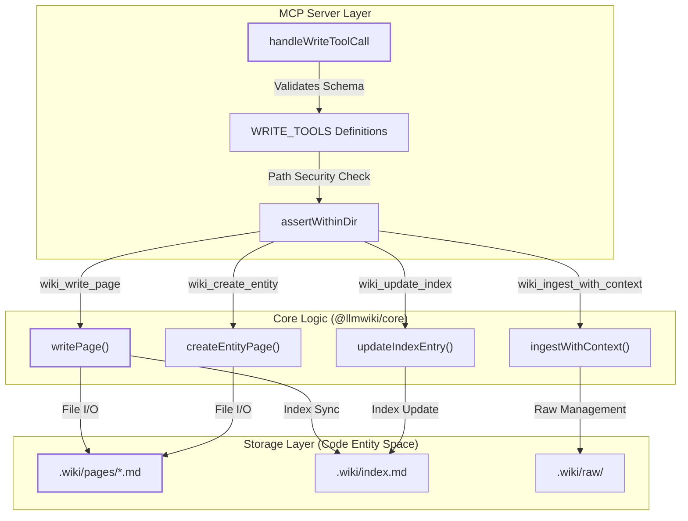
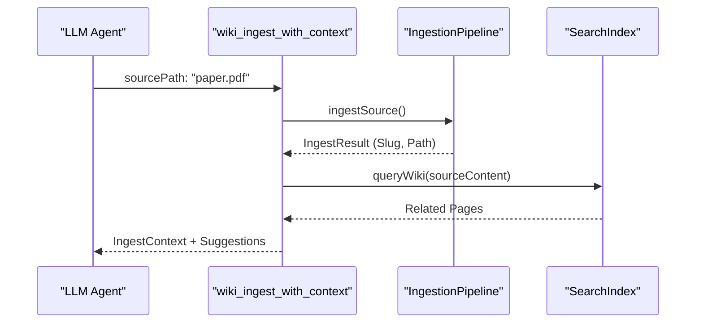

<!-- source: DeepWiki mcp.deepwiki.com · repo microsoft/llmwiki · page 3.2 MCP Write Tools Reference · fetched 2026-10-26 -->

# MCP Write Tools Reference

Relevant source files

The following files were used as context for generating this wiki page:

- [docs/mcp-tools.md](docs/mcp-tools.md)
- [packages/core/src/mcp/write-tools.ts](packages/core/src/mcp/write-tools.ts)
- [tests/shared/mcp/server-integration.test.ts](tests/shared/mcp/server-integration.test.ts)
- [tests/shared/mcp/write-tools.test.ts](tests/shared/mcp/write-tools.test.ts)
- [tests/shared/wiki-create-pages.test.ts](tests/shared/wiki-create-pages.test.ts)

The `llmwiki` MCP server exposes 7 write tools designed to allow LLM agents to programmatically modify the wiki. These tools handle the complexities of frontmatter formatting, file system operations, and index synchronization, ensuring that any programmatic change maintains the structural integrity of the wiki workspace.

## Architecture and Data Flow

Write tools are implemented in the `@llmwiki/core` package. When a tool is called, the server validates the input against a JSON schema, performs path traversal checks, and then invokes the corresponding core library function.

### Write Operation Lifecycle

The following diagram illustrates the data flow from an MCP tool call through the core logic to the filesystem.

**Figure: MCP Write Tool Data Flow**

Sources: [packages/core/src/mcp/write-tools.ts:15-213](), [packages/core/src/wiki.ts:60-120](), [packages/core/src/index-ops.ts:90-115]()

## Security Model

The write tools enforce several security constraints to prevent workspace corruption:
1.  **Path Traversal Protection**: The `assertWithinDir` utility ensures all file operations remain within the `.wiki/` or project root directories [packages/core/src/mcp/read-tools.ts:316-328]().
2.  **Input Size Limits**: Maximum body content is capped at 1,000,000 characters (`MAX_BODY_SIZE`) to prevent DoS attacks via unbounded input [packages/core/src/mcp/write-tools.ts:219-221]().
3.  **Schema Validation**: Every tool call is strictly validated against `inputSchema` before execution [packages/core/src/mcp/write-tools.ts:16-213]().

Sources: [packages/core/src/mcp/write-tools.ts:219-225](), [packages/core/src/mcp/read-tools.ts:316-328]()

---

## Tool Reference

### `wiki_write_page`
Creates or overwrites a wiki page. This is the primary tool for general content creation. It automatically generates the required frontmatter and updates the `index.md` entry.

| Parameter | Type | Required | Description |
| :--- | :--- | :--- | :--- |
| `pagePath` | string | Yes | Path relative to `wiki/` (e.g., `concepts/ai.md`) |
| `title` | string | Yes | The display title of the page |
| `type` | string | Yes | Metadata type (e.g., `entity`, `concept`, `source`) |
| `tags` | string[] | No | Optional array of tags |
| `body` | string | Yes | Markdown content |

**Implementation Detail**: This tool calls `writePage` [packages/core/src/wiki.ts:60-75]() and then derives a category from the `pagePath` to call `addEntry` in `index-ops.ts` [packages/core/src/index-ops.ts:117-145]().

Sources: [packages/core/src/mcp/write-tools.ts:18-49](), [tests/shared/mcp/write-tools.test.ts:29-56]()

### `wiki_create_entity` & `wiki_create_concept`
Specialized wrappers for creating standard wiki types. They handle slugification of the name automatically (e.g., "Artificial Intelligence" becomes `concepts/artificial-intelligence.md`).

| Parameter | Type | Required | Description |
| :--- | :--- | :--- | :--- |
| `name` | string | Yes | Name used for title and slugified filename |
| `content` | string | Yes | Markdown body content |
| `tags` | string[] | No | Optional tags |

**Logic Flow**:
1.  Slugify the `name` using `slugify()` [packages/core/src/utils.ts:1-10]().
2.  Call `createEntityPage` or `createConceptPage` [packages/core/src/wiki.ts:230-280]().
3.  Update the index with a new `IndexEntry`.

Sources: [packages/core/src/mcp/write-tools.ts:50-99](), [tests/shared/wiki-create-pages.test.ts:21-50]()

### `wiki_update_page`
Performs partial updates to an existing page. It can merge frontmatter (title, type, tags) and either append to or replace the body.

| Parameter | Type | Required | Description |
| :--- | :--- | :--- | :--- |
| `pagePath` | string | Yes | Target page path |
| `title` | string | No | New title (merges if provided) |
| `bodyAppend` | string | No | Appends to existing body |
| `bodyReplace` | string | No | Replaces entire body |

Sources: [packages/core/src/mcp/write-tools.ts:100-136](), [tests/shared/mcp/write-tools.test.ts:168-200]()

### `wiki_add_crosslinks`
Appends a "See also" section to the bottom of a page with links to other wiki pages. It validates that all target pages exist before writing.

**Code Entity Mapping**:
-   **Source**: `handleWriteToolCall` for `wiki_add_crosslinks` [packages/core/src/mcp/write-tools.ts:370-400]()
-   **Internal Function**: `addCrosslinks` in `wiki.ts` [packages/core/src/wiki.ts:300-330]()

Sources: [packages/core/src/mcp/write-tools.ts:138-157](), [packages/core/src/wiki.ts:300-330]()

### `wiki_update_index`
Directly modifies the metadata for a page entry in `index.md` without necessarily changing the page file itself. Useful for batch tagging or summary generation.

| Parameter | Type | Description |
| :--- | :--- | :--- |
| `summary` | string | Updates the `summary` field in `IndexEntry` |
| `category` | string | Moves the entry to a different index category |

Sources: [packages/core/src/mcp/write-tools.ts:159-186](), [packages/core/src/index-ops.ts:90-115]()

### `wiki_ingest_with_context`
An advanced ingestion tool that not only imports a raw source but also returns an `IngestContext` object. This context includes:
-   `relatedPages`: Existing wiki pages that share tags or keywords.
-   `suggestedActions`: Recommended next steps (e.g., "Create entity X").
-   `contentAnalysis`: Word count and detected content type.

**Figure: Smart Ingest Pipeline**

Sources: [packages/core/src/mcp/write-tools.ts:188-212](), [packages/core/src/ingest-context.ts:10-50]()

## Integration Example

When an agent needs to add new information about a person discovered in a source file, it follows this sequence:

1.  **Ingest**: `wiki_ingest_with_context(sourcePath: "interview.txt")`
2.  **Create**: `wiki_create_entity(name: "John Doe", content: "...")`
3.  **Link**: `wiki_add_crosslinks(pagePath: "entities/john-doe.md", targetPages: ["concepts/engineering.md"])`
4.  **Index**: `wiki_update_index(pagePath: "entities/john-doe.md", summary: "Lead engineer at X")`

Sources: [tests/shared/mcp/server-integration.test.ts:155-165](), [docs/mcp-tools.md:25-27]()

---

