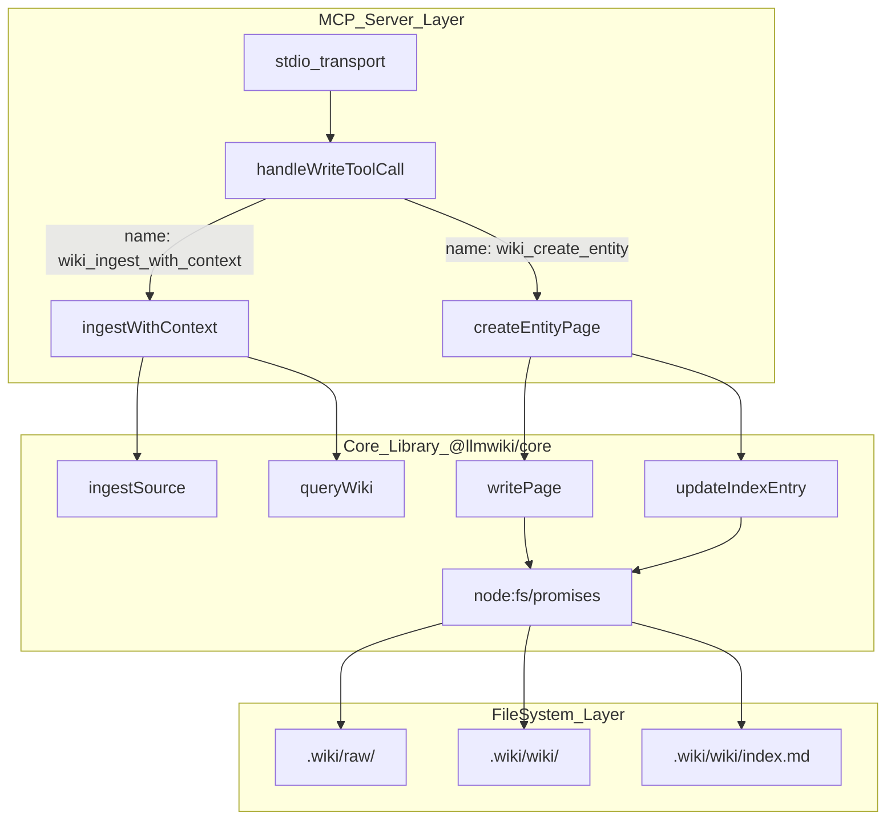

<!-- source: DeepWiki mcp.deepwiki.com · repo microsoft/llmwiki · page 3.3 Smart Ingest Workflow · fetched 2026-10-26 -->

# Smart Ingest Workflow

Relevant source files

The following files were used as context for generating this wiki page:

- [docs/workflows/smart-ingest.md](docs/workflows/smart-ingest.md)
- [packages/core/src/mcp/read-tools.ts](packages/core/src/mcp/read-tools.ts)
- [packages/core/src/mcp/write-tools.ts](packages/core/src/mcp/write-tools.ts)
- [tests/shared/mcp/smart-ingest-workflow.test.ts](tests/shared/mcp/smart-ingest-workflow.test.ts)

The **Smart Ingest Workflow** is the primary pattern for expanding a wiki using LLM assistance. While standard ingestion is a mechanical process of copying files and generating summaries, "Smart Ingest" uses contextual signals to connect new information to existing knowledge [docs/workflows/smart-ingest.md:5-17](). This workflow is facilitated by the Model Context Protocol (MCP) server provided by `@llmwiki/core` [docs/workflows/smart-ingest.md:19-23]().

## Workflow Overview

The workflow consists of a 7-step structured pipeline where an LLM agent moves from raw data ingestion to knowledge graph enrichment and health verification [docs/workflows/smart-ingest.md:40-79]().

### Natural Language to Code Entity Mapping: Ingest Pipeline
This diagram maps the conceptual "Smart Ingest" steps to the specific MCP tool definitions and core functions that execute them.

| Step | MCP Tool Name | Core Function / Implementation |
| :--- | :--- | :--- |
| **1. Ingest** | `wiki_ingest_with_context` | `ingestWithContext` in [packages/core/src/ingest-context.ts:18-115]() |
| **2. Read** | `wiki_read_page` | `readPage` in [packages/core/src/wiki.ts:46-64]() |
| **3. Create Entity** | `wiki_create_entity` | `createEntityPage` in [packages/core/src/wiki.ts:133-149]() |
| **4. Create Concept** | `wiki_create_concept` | `createConceptPage` in [packages/core/src/wiki.ts:151-167]() |
| **5. Crosslink** | `wiki_add_crosslinks` | `addCrosslinks` in [packages/core/src/wiki.ts:183-213]() |
| **6. Update** | `wiki_update_page` | `writePage` in [packages/core/src/wiki.ts:66-93]() |
| **7. Health Check** | `wiki_lint` | `lintWiki` in [packages/core/src/lint.ts:68-112]() |

**Sources:** [docs/workflows/smart-ingest.md:40-79](), [packages/core/src/mcp/write-tools.ts:16-213](), [packages/core/src/mcp/read-tools.ts:18-108]().

## Step-by-Step Technical Detail

### 1. Contextual Ingestion
The agent calls `wiki_ingest_with_context` [packages/core/src/mcp/write-tools.ts:188-212](). Unlike a standard ingest, this tool returns `related_pages` (discovered via `queryWiki`) and `suggested_actions` [packages/core/src/ingest-context.ts:18-115]().

### 2. Analysis & Inspection
The agent analyzes the `related_pages` and `source_word_count`. It may use `wiki_read_page` to fetch the full content of existing pages to determine how to merge new information without duplication [docs/workflows/smart-ingest.md:165-185]().

### 3. Entity & Concept Creation
The agent extracts named entities (people, orgs) and technical concepts. It uses:
- `wiki_create_entity`: Generates a page in `wiki/entities/{slug}.md` [packages/core/src/wiki.ts:133-149]().
- `wiki_create_concept`: Generates a page in `wiki/concepts/{slug}.md` [packages/core/src/wiki.ts:151-167]().

Both tools automatically update the `index.md` via `updateIndexEntry` [packages/core/src/index-ops.ts:80-111]().

### 4. Knowledge Graph Connection
To prevent "orphan pages," the agent calls `wiki_add_crosslinks` [packages/core/src/mcp/write-tools.ts:138-157](). This function appends a "See also" section to the `pagePath` containing links to the `targetPages` [packages/core/src/wiki.ts:183-213]().

### 5. Verification
Finally, the agent calls `wiki_lint` to ensure the ingestion didn't introduce broken links or missing metadata [packages/core/src/mcp/read-tools.ts:44-58]().

## Data Flow Diagram: MCP to Core
This diagram illustrates how an MCP tool request flows through the server dispatchers into the core library functions.

**Sources:** [packages/core/src/mcp/write-tools.ts:241-320](), [packages/core/src/ingest-context.ts:40-115](), [packages/core/src/wiki.ts:133-149](), [packages/core/src/index-ops.ts:80-111]().

## Implementation Reference

### Key Tool Definitions
| Tool | Input Requirement | Behavior |
| :--- | :--- | :--- |
| `wiki_ingest_with_context` | `sourcePath` (string) | Ingests, then runs a search for similar content [packages/core/src/mcp/write-tools.ts:188-212](). |
| `wiki_update_page` | `pagePath` (string) | Supports `bodyAppend` or `bodyReplace` to modify existing content [packages/core/src/mcp/write-tools.ts:101-136](). |
| `wiki_lint` | `category` (optional) | Validates the health of the entire `.wiki` directory [packages/core/src/mcp/read-tools.ts:44-58](). |

### Security and Validation
- **Path Traversal:** All tools use `assertWithinDir` to ensure file operations remain inside the `.wiki` folder [packages/core/src/mcp/read-tools.ts:139-146]().
- **Input Limits:** `wiki_write_page` and `wiki_update_page` enforce a `MAX_BODY_LENGTH` of 100,000 characters to prevent DoS [packages/core/src/mcp/write-tools.ts:219-223]().

**Sources:** [packages/core/src/mcp/read-tools.ts:139-146](), [packages/core/src/mcp/write-tools.ts:16-223](), [packages/core/src/wiki.ts:183-213]().

---

