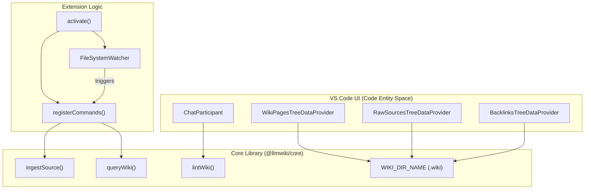
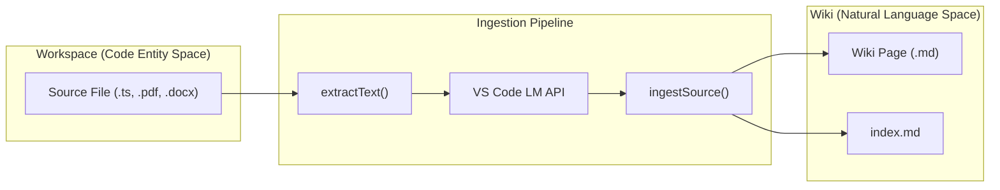

<!-- source: DeepWiki mcp.deepwiki.com · repo microsoft/llmwiki · page 4 VS Code Extension · fetched 2026-10-26 -->

# VS Code Extension

Relevant source files

The following files were used as context for generating this wiki page:

- [packages/vscode/README.md](packages/vscode/README.md)
- [packages/vscode/package.json](packages/vscode/package.json)
- [packages/vscode/src/extension.ts](packages/vscode/src/extension.ts)

The `llmwiki` VS Code extension provides the primary user interface for interacting with an LLM Wiki. It serves as a thin UI layer that orchestrates the capabilities of `@llmwiki/core` within the VS Code environment, offering tree views, commands, status bar integration, and a GitHub Copilot Chat participant.

## Overview and Activation

The extension's lifecycle is managed in `extension.ts`. It activates based on several triggers defined in `package.json`, including the presence of a wiki index file or the execution of the `llmwiki.init` command [packages/vscode/package.json:20-27]().

Upon activation, the extension performs a "bootstrap" check to determine if the current workspace is a valid LLM Wiki workspace by looking for the `.wiki/wiki` directory [packages/vscode/src/extension.ts:38-46](). 

- **If no wiki exists**: The extension displays a "Welcome View" in the Activity Bar with an "Initialize LLM Wiki" button [packages/vscode/package.json:199-204]().
- **If a wiki exists**: It sets the `llmwiki.isWikiWorkspace` context key and initializes the full suite of UI providers and file watchers [packages/vscode/src/extension.ts:44-46]().

### Extension Component Relationship

The following diagram illustrates how the VS Code extension components bridge the user's workspace (Code Entity Space) with the structured wiki (Natural Language Space).

**VS Code Extension Architecture**

Sources: [packages/vscode/src/extension.ts:16-36](), [packages/vscode/src/extension.ts:74-133](), [packages/vscode/src/extension.ts:130-131]()

For details on the activation sequence and context management, see [Extension Activation and File Watchers](#4.1).

## Core Dependencies

The extension is designed to be a "thin" consumer of the core library. It does not implement wiki logic itself but delegates to `@llmwiki/core` for all data operations [packages/vscode/README.md:97-100]().

| Feature | Extension Implementation | Core Delegate |
|---------|--------------------------|---------------|
| Ingestion | `llmIngest.ts` | `ingestSource` |
| Search | `llmwiki.query` command | `queryWiki` |
| Health | `@wiki /lint` chat cmd | `lintWiki` |
| Filesystem | `vscode.workspace.fs` | `WIKI_DIR_NAME` |

Sources: [packages/vscode/src/extension.ts:12-13](), [packages/vscode/src/extension.ts:131]()

## Key Subsystems

### Commands and Progress
The extension registers a variety of commands for initializing, querying, and maintaining the wiki. These commands often wrap long-running operations in `vscode.window.withProgress` to provide visual feedback during LLM ingestion or bulk scans [packages/vscode/src/extension.ts:49-53]().

For details, see [Commands](#4.2).

### LLM-Powered Ingestion
Ingestion is handled by a specialized pipeline that uses the VS Code Language Model API (GitHub Copilot) to enrich raw text with summaries, tags, and entity extraction before passing it to the core library [packages/vscode/src/llmIngest.ts:9-11](). It also supports extracting text from PDFs and DOCX files [packages/vscode/package.json:226-227]().

For details, see [LLM Ingestion and Text Extraction](#4.3).

### Tree Views and Navigation
The extension contributes an "LLM Wiki" Activity Bar container containing four specialized views:
- **Entities**: Key people, projects, or objects.
- **Concepts**: Abstract ideas and themes.
- **Raw Sources**: The underlying files in the `.wiki/raw/` directory.
- **Backlinks**: Contextual links to the current page.

For details, see [Tree Views and UI Providers](#4.4).

### Chat and MCP Integration
The `@wiki` chat participant allows users to query and modify the wiki using natural language via GitHub Copilot Chat [packages/vscode/package.json:35-41](). Additionally, the extension automatically registers an MCP (Model Context Protocol) server, making wiki tools available to Copilot and other MCP-compatible agents [packages/vscode/src/mcpProvider.ts:10-10]().

For details, see [@wiki Chat Participant and MCP Provider](#4.5).

**Data Flow: Workspace to Wiki**

Sources: [packages/vscode/src/llmIngest.ts:9-11](), [packages/vscode/package.json:68-71](), [packages/vscode/src/extension.ts:120-122]()

---

