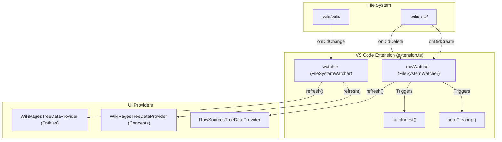
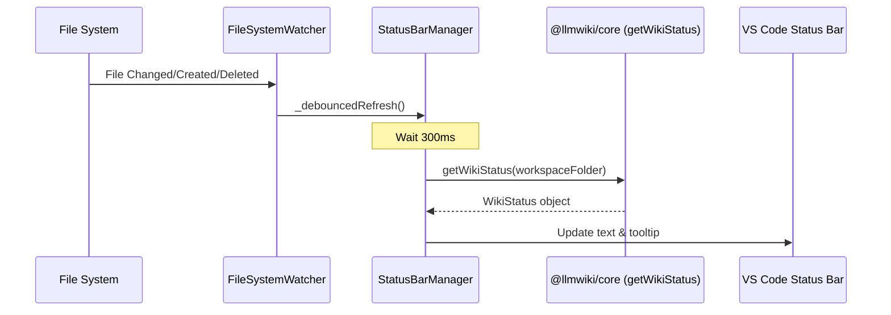

<!-- source: DeepWiki mcp.deepwiki.com · repo microsoft/llmwiki · page 4.1 Extension Activation and File Watchers · fetched 2026-10-26 -->

# Extension Activation and File Watchers

Relevant source files

The following files were used as context for generating this wiki page:

- [packages/vscode/src/extension.ts](packages/vscode/src/extension.ts)
- [packages/vscode/src/statusBar.ts](packages/vscode/src/statusBar.ts)
- [tests/vscode/statusBar.test.ts](tests/vscode/statusBar.test.ts)

The LLM Wiki extension follows a specific lifecycle to transform a standard VS Code workspace into a structured knowledge base. The activation process handles environment detection, context state management, and the orchestration of multiple file watchers that drive the automated ingestion and cleanup pipelines.

## Extension Entrypoint and Bootstrapping

The `activate()` function in [packages/vscode/src/extension.ts:16-36]() serves as the primary entrypoint. It initializes the output channel and determines if the current workspace contains a valid LLM Wiki project by checking for the existence of the `.wiki/wiki` directory.

### Workspace Context Management
The extension uses VS Code "context keys" to control the visibility of UI elements (like the "Initialize Wiki" button in the welcome view).

| Context Key | Logic | File Reference |
| :--- | :--- | :--- |
| `llmwiki.noFolder` | `true` if no workspace folder is open. | [packages/vscode/src/extension.ts:25-29]() |
| `llmwiki.isWikiWorkspace` | `true` if the `.wiki/wiki` directory exists. | [packages/vscode/src/extension.ts:45-45]() |

### Bootstrapping Sequence
The `bootstrapViews` function handles two distinct states:
1.  **Uninitialized Workspace**: If `.wiki/wiki` is missing, it registers a temporary `llmwiki.init` command. Once the user clicks "Initialize", it calls `initWiki` from `@llmwiki/core`, disposes of the temporary command, and proceeds to `registerFullViews` [packages/vscode/src/extension.ts:47-69]().
2.  **Existing Workspace**: If the directory is present, it immediately invokes `registerFullViews` to set up the tree providers and watchers [packages/vscode/src/extension.ts:71-71]().

**Sources:** [packages/vscode/src/extension.ts:16-72]()

---

## File System Watchers

The extension maintains two primary categories of watchers to ensure the UI and the underlying Wiki data stay synchronized with the file system.

### Wiki Content Watcher
This watcher monitors the `.wiki/wiki/` directory for changes to generated Markdown pages.
*   **Pattern**: `${WIKI_DIR_NAME}/wiki/**/*.md` [packages/vscode/src/extension.ts:90-92]().
*   **Action**: On any change, creation, or deletion, it triggers a `refresh()` on the `WikiPagesTreeDataProvider` (Entities and Concepts) and the `BacklinksTreeDataProvider` [packages/vscode/src/extension.ts:93-95]().

### Raw Sources Watcher
This watcher monitors the `.wiki/raw/` directory. It is critical for the automated ingestion workflow.
*   **Pattern**: `${WIKI_DIR_NAME}/raw/**` [packages/vscode/src/extension.ts:107-109]().
*   **Implementation Note**: It uses `vscode.RelativePattern` to bypass default `files.watcherExclude` settings that might otherwise ignore the dot-prefixed `.wiki` folder [packages/vscode/src/extension.ts:103-106]().

### Watcher Interaction Diagram

Title: File System Watcher Event Flow

**Sources:** [packages/vscode/src/extension.ts:80-128]()

---

## Automated Handlers

The `rawWatcher` hooks into two specific lifecycle handlers to manage the relationship between source files and wiki pages.

### Auto-Ingest Handler
When a new file is added to `.wiki/raw/` (either via drag-and-drop or manual copy), the `onDidCreate` event triggers `autoIngest`.
*   **Function**: `autoIngest(uri, wikiProjectRoot, outputChannel, wikiProviders)` [packages/vscode/src/extension.ts:121-121]().
*   **Logic**: It invokes the `llmIngest` pipeline to extract text, generate a summary, and create the corresponding `.md` page in the wiki.

### Auto-Cleanup Handler
When a source file is deleted from `.wiki/raw/`, the `onDidDelete` event triggers `autoCleanup`.
*   **Function**: `autoCleanup(uri, wikiProjectRoot, outputChannel, wikiProviders)` [packages/vscode/src/extension.ts:127-127]().
*   **Logic**: It identifies all wiki pages derived from the deleted source (using the `source` field in the page frontmatter) and removes them to prevent stale information.

**Sources:** [packages/vscode/src/extension.ts:117-128]()

---

## Status Bar Management

The `StatusBarManager` provides real-time feedback on the wiki's health and size. It implements its own set of debounced watchers to avoid performance degradation during bulk operations.

### Implementation Details
*   **Class**: `StatusBarManager` [packages/vscode/src/statusBar.ts:7-88]().
*   **Debouncing**: Events are debounced by 300ms (`DEBOUNCE_MS`) to handle rapid file changes [packages/vscode/src/statusBar.ts:5-5]().
*   **Data Retrieval**: It calls `getWikiStatus` from `@llmwiki/core` to fetch the page count, source count, and index coverage percentage [packages/vscode/src/statusBar.ts:69-69]().

Title: Status Bar Update Logic

**Sources:** [packages/vscode/src/statusBar.ts:15-88](), [tests/vscode/statusBar.test.ts:187-199]()

---

## Registering Full Views

The `registerFullViews` function is the final step of the activation sequence, responsible for wiring up all UI components.

1.  **Tree Data Providers**: Initializes `WikiPagesTreeDataProvider` for both 'Entities' and 'Concepts', `BacklinksTreeDataProvider`, and `RawSourcesTreeDataProvider` [packages/vscode/src/extension.ts:81-101]().
2.  **Command Registration**: Calls `registerCommands` to bind all `llmwiki.*` commands [packages/vscode/src/extension.ts:131-131]().
3.  **Integrations**: Registers the `@wiki` chat participant and the MCP server provider [packages/vscode/src/extension.ts:132-133]().
4.  **Startup Scan**: Executes `scanRawForUningested` to find any files added while the extension was inactive [packages/vscode/src/extension.ts:155-155]().

**Sources:** [packages/vscode/src/extension.ts:74-156]()

---

