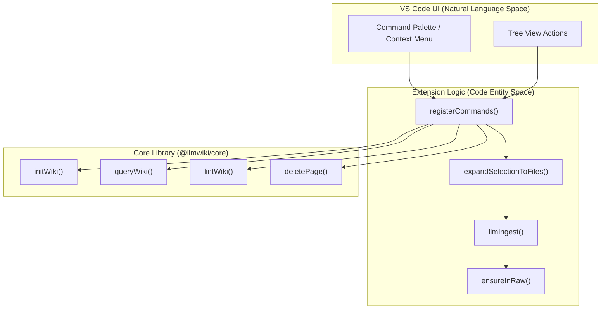
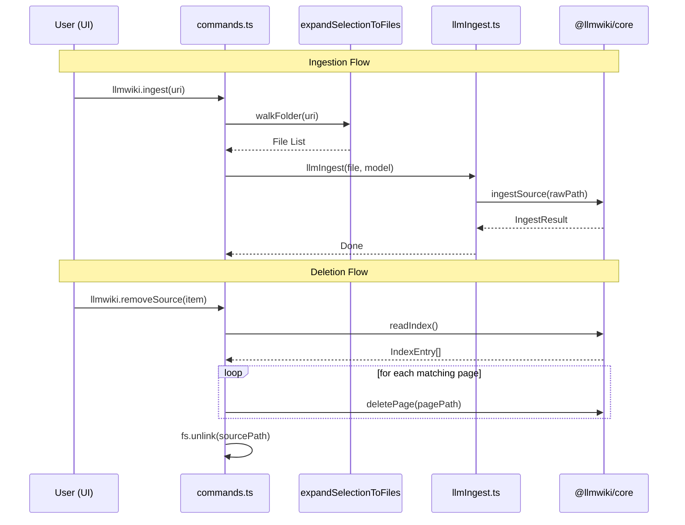

<!-- source: DeepWiki mcp.deepwiki.com · repo microsoft/llmwiki · page 4.2 Commands · fetched 2026-10-26 -->

# Commands

Relevant source files

The following files were used as context for generating this wiki page:

- [packages/vscode/src/commands.ts](packages/vscode/src/commands.ts)
- [tests/vscode/commands.test.ts](tests/vscode/commands.test.ts)

The LLM Wiki VS Code extension exposes a set of registered commands that bridge the VS Code UI (Explorer, Command Palette, and Tree Views) to the `@llmwiki/core` library and the LLM-powered ingestion pipeline. These commands handle file system expansion, progress reporting via the VS Code API, and cascading data operations.

## Command Registration

Commands are registered within the `registerCommands` function, which binds specific IDs to asynchronous handlers. Each handler is wrapped in a try-catch block that routes errors to both the `LLM Wiki` Output Channel and a user-facing error message [packages/vscode/src/commands.ts:121-140]().

### Command Architecture and Data Flow

The following diagram illustrates how VS Code commands interact with the core library and the local file system.

**Natural Language to Code Entity Space: Command Execution**

**Sources:** [packages/vscode/src/commands.ts:121-140](), [packages/vscode/src/commands.ts:90-113](), [packages/vscode/src/llmIngest.ts:31-40]()

## Core Commands

### llmwiki.init
Initializes a new wiki workspace. It checks for the existence of the `wiki/` directory to prevent accidental overwrites [packages/vscode/src/commands.ts:148-153]().
- **Logic:** Calls `initWiki(projectFolder)` from `@llmwiki/core`.
- **Side Effects:** Creates the `.wiki/` structure, `wiki/index.md`, and `wiki/log.md`.
- **UI:** Refreshes the Entity and Concept tree providers upon completion [packages/vscode/src/commands.ts:160-160]().

### llmwiki.ingest
The primary entry point for adding content to the wiki. It supports three invocation modes: Command Palette (prompts for picker), Explorer context (uses selected files), and Programmatic (direct URI passing) [packages/vscode/src/commands.ts:170-191]().

- **File Expansion:** Uses `expandSelectionToFiles` to recursively walk folders while skipping hidden directories and common build artifacts like `node_modules` or `dist` [packages/vscode/src/commands.ts:45-45](), [packages/vscode/src/commands.ts:62-84]().
- **External Files:** If a file is outside the workspace, `ensureInRaw` copies it into the `raw/` directory before processing [packages/vscode/src/commands.ts:27-42]().
- **Progress Reporting:** Uses `vscode.window.withProgress` to provide a non-blocking notification during the multi-step LLM enrichment process [packages/vscode/src/commands.ts:233-238]().

### llmwiki.removeSource
Handles the deletion of a source file and its associated wiki pages.
- **Cascading Delete:** It reads the `wiki/index.md` to find all pages associated with the source file's slug [packages/vscode/src/commands.ts:297-308]().
- **Logic:** For every matching page, it calls `deletePage()` and then unlinks the physical source file from the `raw/` directory [packages/vscode/src/commands.ts:311-320]().

### llmwiki.query
Provides a search interface for the wiki.
- **UI:** Opens a `showInputBox` for the user's search term [packages/vscode/src/commands.ts:335-337]().
- **Logic:** Invokes `queryWiki()` which performs weighted full-text scoring [packages/vscode/src/commands.ts:340-340]().
- **Output:** Displays results in a QuickPick; selecting a result opens the corresponding Markdown file [packages/vscode/src/commands.ts:352-362]().

### llmwiki.fix
Executes the auto-repair logic for linting findings.
- **Logic:** Calls `lintWiki()` to identify issues and then `lintFix()` to apply automated resolutions (e.g., removing stale index entries or fixing broken links) [packages/vscode/src/commands.ts:420-424]().

## Command Interaction Mapping

The following diagram maps the internal function calls for the `llmwiki.ingest` and `llmwiki.removeSource` commands, showing the relationship between VS Code Uris and the Core library's file operations.

**Natural Language to Code Entity Space: Ingestion and Deletion Flow**

**Sources:** [packages/vscode/src/commands.ts:90-113](), [packages/vscode/src/commands.ts:233-276](), [packages/vscode/src/commands.ts:290-325](), [packages/vscode/src/llmIngest.ts:31-60]()

## Utility Functions

| Function | Purpose | Source |
| :--- | :--- | :--- |
| `ensureInRaw` | Ensures files are inside the workspace `raw/` folder before ingestion. | [packages/vscode/src/commands.ts:27-42]() |
| `walkFolder` | Recursively finds files while ignoring `SKIP_DIRS` (`node_modules`, `.wiki`, etc.). | [packages/vscode/src/commands.ts:62-84]() |
| `expandSelectionToFiles` | Flattens a mix of file and folder URIs into a unique list of file URIs. | [packages/vscode/src/commands.ts:90-113]() |
| `isUri` | Type guard to validate VS Code URI objects in command arguments. | [packages/vscode/src/commands.ts:48-56]() |

## Summary Table of Commands

| Command ID | Entry Point | Primary Core Dependency |
| :--- | :--- | :--- |
| `llmwiki.init` | Command Palette | `initWiki` |
| `llmwiki.ingest` | Explorer / Palette | `ingestSource` (via `llmIngest`) |
| `llmwiki.removeSource` | Raw Sources Tree | `deletePage`, `readIndex` |
| `llmwiki.query` | Command Palette | `queryWiki` |
| `llmwiki.refresh` | Tree View Toolbar | N/A (UI Refresh) |
| `llmwiki.scanRaw` | Raw Sources Tree | `readdir` |
| `llmwiki.fix` | Lint Tree / Palette | `lintWiki`, `lintFix` |

**Sources:** [packages/vscode/src/commands.ts:148-430]()

---

