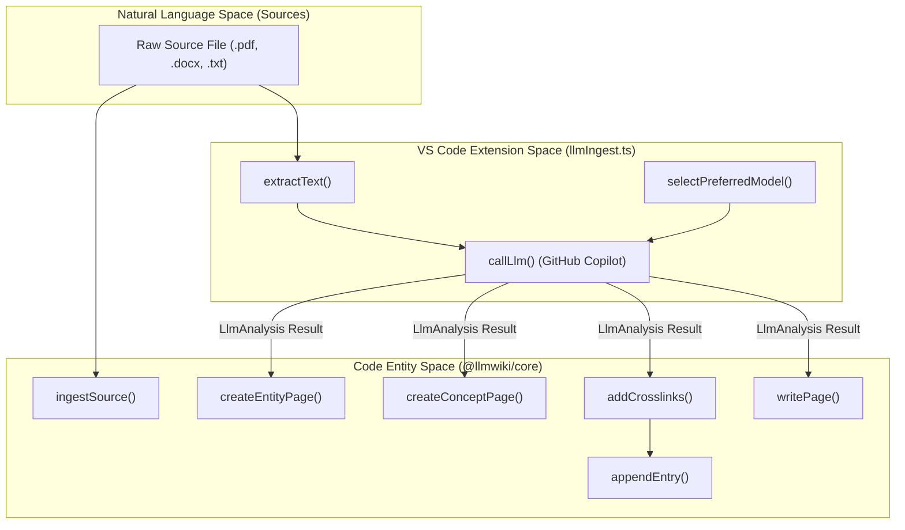
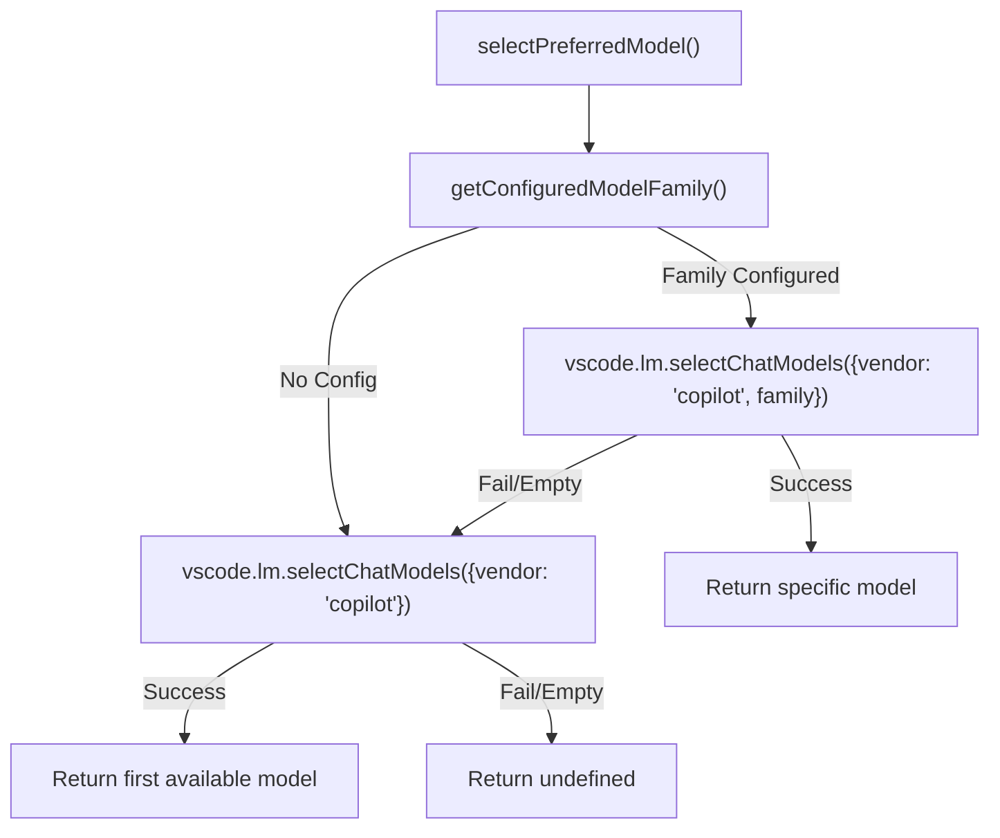

<!-- source: DeepWiki mcp.deepwiki.com · repo microsoft/llmwiki · page 4.3 LLM Ingestion and Text Extraction · fetched 2026-10-26 -->

# LLM Ingestion and Text Extraction

Relevant source files

The following files were used as context for generating this wiki page:

- [NOTICE](NOTICE)
- [SUPPORT.md](SUPPORT.md)
- [packages/vscode/src/extractText.ts](packages/vscode/src/extractText.ts)
- [packages/vscode/src/llmIngest.ts](packages/vscode/src/llmIngest.ts)
- [packages/vscode/src/modelSelection.ts](packages/vscode/src/modelSelection.ts)

The LLM Ingestion and Text Extraction module is responsible for converting raw source files into structured wiki pages. It bridges the gap between unstructured data (PDFs, DOCX, text) and the semantic knowledge graph of the wiki by utilizing VS Code's GitHub Copilot Language Models.

## LLM-Powered Ingestion Pipeline

The `llmIngest` function implements an 8-step pipeline that combines mechanical file processing with generative AI enrichment [packages/vscode/src/llmIngest.ts:33-40]().

### Ingestion Data Flow

The following diagram illustrates the flow from a raw source file to a set of enriched wiki pages, showing the interaction between the VS Code extension and the core library.

**Diagram: Ingestion Pipeline Data Flow**

**Sources:** [packages/vscode/src/llmIngest.ts:33-155](), [packages/vscode/src/extractText.ts:10-22]()

### Pipeline Steps

1.  **Mechanical Ingest**: Calls `ingestSource` from `@llmwiki/core` to create initial stubs and update the index [packages/vscode/src/llmIngest.ts:48-58]().
2.  **Text Extraction**: Extracts raw text from the source file using `extractText` [packages/vscode/src/llmIngest.ts:61-62]().
3.  **Context Preparation**: Reads the existing wiki `index.md` to provide the LLM with context about currently known entities and concepts [packages/vscode/src/llmIngest.ts:64-73]().
4.  **LLM Analysis**: Sends the source text (truncated to 60,000 characters if necessary) and wiki context to the selected Copilot model [packages/vscode/src/llmIngest.ts:78-177]().
5.  **Summary Enrichment**: Overwrites the initial mechanical stub body with the LLM-generated summary [packages/vscode/src/llmIngest.ts:85-98]().
6.  **Entity Creation**: Iterates through `analysis.entities` to create new entity pages, tagging them with the source file path for future cleanup [packages/vscode/src/llmIngest.ts:102-116]().
7.  **Concept Creation**: Iterates through `analysis.concepts` to create new concept pages [packages/vscode/src/llmIngest.ts:119-133]().
8.  **Crosslinking**: Applies suggested crosslinks using `addCrosslinks` to link the new pages to existing wiki content [packages/vscode/src/llmIngest.ts:136-145]().

## Text Extraction

The `extractText` utility provides a unified interface for reading various file formats. It dispatches to specific extractors based on file extensions [packages/vscode/src/extractText.ts:10-22]().

| Extension | Implementation Method | Library Used |
| :--- | :--- | :--- |
| `.pdf` | `extractPdf` | `pdfjs-dist` [packages/vscode/src/extractText.ts:24-47]() |
| `.docx` | `extractDocx` | `mammoth` [packages/vscode/src/extractText.ts:49-53]() |
| `.txt`, `.md`, etc. | `readFile` (UTF-8) | Node.js `fs/promises` [packages/vscode/src/extractText.ts:20]() |

### PDF Extraction Details
The PDF extractor utilizes `pdfjs-dist/legacy/build/pdf.mjs` and requires a specific worker configuration using `pathToFileURL` to resolve the worker script in the VS Code environment [packages/vscode/src/extractText.ts:25-28](). It iterates through all pages and joins text items with spaces [packages/vscode/src/extractText.ts:35-46]().

**Sources:** [packages/vscode/src/extractText.ts:1-54](), [NOTICE:6]()

## Model Selection

The `modelSelection.ts` module manages the resolution of GitHub Copilot chat models. It allows users to pin specific model families (e.g., `claude-3.5-sonnet`) or fallback to any available model.

### Model Selection Logic

**Diagram: Model Resolution Logic**

**Sources:** [packages/vscode/src/modelSelection.ts:26-58]()

### Key Functions
- `getConfiguredModelFamily()`: Reads the `llmwiki.modelFamily` setting from VS Code configuration [packages/vscode/src/modelSelection.ts:11-15]().
- `selectPreferredModel()`: The primary entry point for acquiring a `LanguageModelChat` instance. It attempts to find the user's preferred family before falling back to any Copilot-vendor model [packages/vscode/src/modelSelection.ts:26-58]().
- `selectModelInteractively()`: Invokes a `QuickPick` UI to let users choose from installed Copilot models, displaying metadata like `maxInputTokens` [packages/vscode/src/modelSelection.ts:67-151]().

**Sources:** [packages/vscode/src/modelSelection.ts:1-152]()

---

