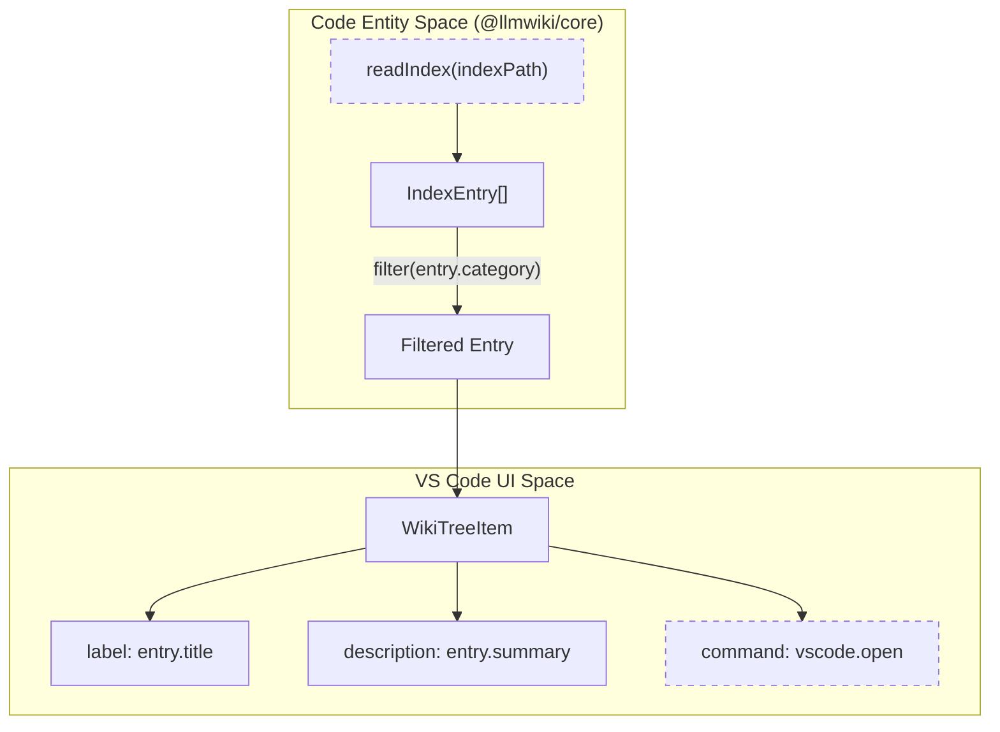
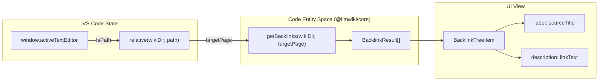

<!-- source: DeepWiki mcp.deepwiki.com · repo microsoft/llmwiki · page 4.4 Tree Views and UI Providers · fetched 2026-10-26 -->

# Tree Views and UI Providers

Relevant source files

The following files were used as context for generating this wiki page:

- [packages/vscode/src/backlinksTree.ts](packages/vscode/src/backlinksTree.ts)
- [packages/vscode/src/lintFindingsTree.ts](packages/vscode/src/lintFindingsTree.ts)
- [packages/vscode/src/rawSourcesTree.ts](packages/vscode/src/rawSourcesTree.ts)
- [packages/vscode/src/wikiPagesTree.ts](packages/vscode/src/wikiPagesTree.ts)
- [tests/vscode/backlinksTree.test.ts](tests/vscode/backlinksTree.test.ts)
- [tests/vscode/lintFindingsTree.test.ts](tests/vscode/lintFindingsTree.test.ts)
- [tests/vscode/rawSourcesTree.test.ts](tests/vscode/rawSourcesTree.test.ts)
- [tests/vscode/wikiPagesTree.test.ts](tests/vscode/wikiPagesTree.test.ts)

The LLM Wiki VS Code extension provides four primary tree views in the Activity Bar to facilitate wiki navigation, source management, and health monitoring. These views are powered by `vscode.TreeDataProvider` implementations that bridge the `@llmwiki/core` logic with the VS Code user interface.

## Overview of Tree Providers

| Provider | Purpose | Data Source |
| :--- | :--- | :--- |
| `WikiPagesTreeDataProvider` | Displays filtered lists of Entities or Concepts. | `index.md` via `readIndex` |
| `RawSourcesTreeDataProvider` | Manages files in the `raw/` directory with drag-and-drop support. | File system via `listSources` |
| `BacklinksTreeDataProvider` | Shows pages linking to the currently active editor. | Wiki files via `getBacklinks` |
| `LintFindingsTreeDataProvider` | Categorizes and displays wiki health issues. | In-memory `LintFinding[]` array |

---

## Wiki Pages Navigation

The `WikiPagesTreeDataProvider` is used to instantiate two separate views: **Entities** and **Concepts**. It filters the global wiki index by category and provides direct access to markdown files.

### Implementation Details
The provider reads the central `index.md` file using the core library's `readIndex` function [packages/vscode/src/wikiPagesTree.ts:64-67](). It then filters the resulting `IndexEntry` array based on the `category` string passed during construction [packages/vscode/src/wikiPagesTree.ts:69-70]().

Each item in the tree is a `WikiTreeItem`, which stores the `pagePath` and configures a `vscode.open` command to open the corresponding file in the editor [packages/vscode/src/wikiPagesTree.ts:22-28]().

### Wiki Page Data Flow
The following diagram illustrates how the `WikiPagesTreeDataProvider` transforms the core `IndexEntry` into a UI element.

Title: Wiki Index to UI Mapping

Sources: [packages/vscode/src/wikiPagesTree.ts:61-79](), [tests/vscode/wikiPagesTree.test.ts:147-160]()

---

## Raw Sources and Drag-and-Drop

The `RawSourcesTreeDataProvider` manages the `raw/` directory. It is unique among the providers because it implements `vscode.TreeDragAndDropController` to allow users to ingest files by dragging them directly from the OS or the VS Code Explorer into the tree view [packages/vscode/src/rawSourcesTree.ts:67-69]().

### Drag-and-Drop Logic
1.  **MIME Support**: The provider accepts `text/uri-list` and `application/vnd.code.uri-list` [packages/vscode/src/rawSourcesTree.ts:83]().
2.  **File Processing**: In `handleDrop`, URIs are parsed and copied into the workspace's `raw/` directory [packages/vscode/src/rawSourcesTree.ts:109-118]().
3.  **Recursive Copy**: If a folder is dropped, the provider recursively copies its contents while preserving the top-level folder name [packages/vscode/src/rawSourcesTree.ts:129-138]().
4.  **Auto-Ingest**: Once files are successfully copied, a notification is shown, and the extension's file watchers typically trigger automatic ingestion [packages/vscode/src/rawSourcesTree.ts:150-155]().

### Empty State Placeholder
To ensure the drop target remains active even when no files exist, the provider returns a "placeholder" item instead of an empty list [packages/vscode/src/rawSourcesTree.ts:178-186](). This prevents VS Code from replacing the view with a standard "Welcome" panel that lacks drop support [packages/vscode/src/rawSourcesTree.ts:36-39]().

Sources: [packages/vscode/src/rawSourcesTree.ts:98-165](), [packages/vscode/src/rawSourcesTree.ts:171-195]()

---

## Backlinks Provider

The `BacklinksTreeDataProvider` provides context-aware navigation by showing which wiki pages link to the file currently being edited.

### Context Sensitivity
The provider listens for `onDidChangeActiveTextEditor` events [packages/vscode/src/backlinksTree.ts:48-53](). When the active editor changes, it triggers a `refresh()` (debounced by 200ms) to update the list [packages/vscode/src/backlinksTree.ts:49-52]().

### Data Retrieval
If the active file is within the `wiki/` directory, the provider calculates the relative path and calls `getBacklinks(wikiDir, targetPage)` from the core library [packages/vscode/src/backlinksTree.ts:87-88](). If no backlinks are found or the active file is not a wiki page, it displays a guidance message [packages/vscode/src/backlinksTree.ts:63-84]().

Title: Backlinks Context Resolution

Sources: [packages/vscode/src/backlinksTree.ts:60-108](), [tests/vscode/backlinksTree.test.ts:106-120]()

---

## Lint Findings Provider

The `LintFindingsTreeDataProvider` displays the results of the `llmwiki.lint` command. Unlike other providers, it does not fetch its own data; it provides a `setFindings(findings: LintFinding[])` method that is called by the lint command handler [packages/vscode/src/lintFindingsTree.ts:128-131]().

### Grouping and Severity
Findings are grouped into three top-level categories: **Errors**, **Warnings**, and **Info** [packages/vscode/src/lintFindingsTree.ts:90-91]().
*   **Severity Groups**: Show the count of findings as a description [packages/vscode/src/lintFindingsTree.ts:37]().
*   **Finding Items**: Display the specific lint message and the relative path of the file containing the issue [packages/vscode/src/lintFindingsTree.ts:43-44]().
*   **Navigation**: Clicking a finding item executes `vscode.open` on the target file [packages/vscode/src/lintFindingsTree.ts:47-52]().

Sources: [packages/vscode/src/lintFindingsTree.ts:78-107](), [packages/vscode/src/lintFindingsTree.ts:109-123](), [tests/vscode/lintFindingsTree.test.ts:98-110]()

---

