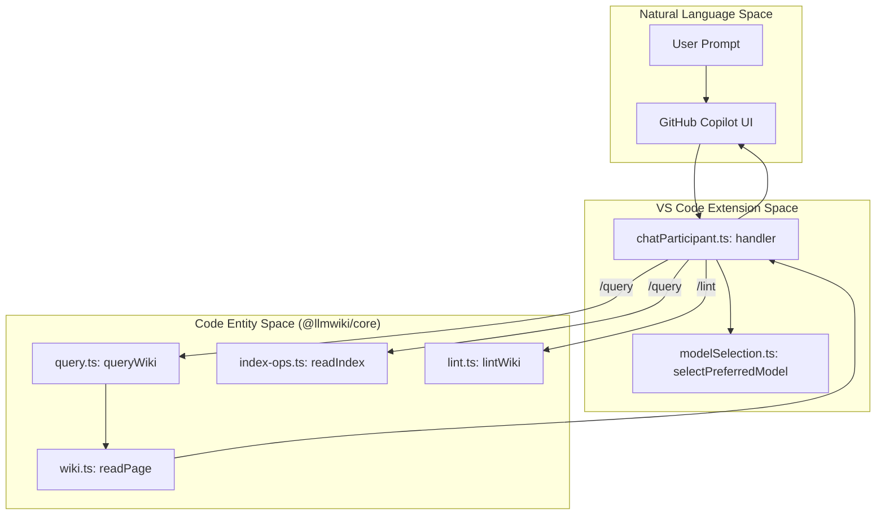
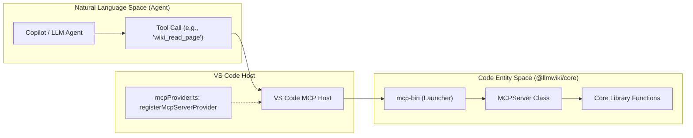

<!-- source: DeepWiki mcp.deepwiki.com · repo microsoft/llmwiki · page 4.5 @wiki Chat Participant and MCP Provider · fetched 2026-10-26 -->

# @wiki Chat Participant and MCP Provider

Relevant source files

The following files were used as context for generating this wiki page:

- [packages/vscode/src/chatParticipant.ts](packages/vscode/src/chatParticipant.ts)
- [packages/vscode/src/mcpProvider.ts](packages/vscode/src/mcpProvider.ts)

This page details the integration of LLM Wiki with GitHub Copilot and the Model Context Protocol (MCP). The extension provides two primary interfaces for LLM interaction: the `@wiki` chat participant for direct user interaction and an MCP server provider that allows Copilot Chat to autonomously access wiki tools.

## @wiki Chat Participant

The `@wiki` chat participant is defined in `chatParticipant.ts` and registered via `registerChatParticipant` [packages/vscode/src/chatParticipant.ts:43-47](). It acts as a specialized assistant that leverages the wiki's indexed knowledge to answer queries and perform maintenance tasks.

### Slash Commands

The participant supports several slash commands to manage the wiki lifecycle directly from the chat interface.

| Command | Function | Description |
| :--- | :--- | :--- |
| `/status` | `handleStatus` | Provides a summary of the wiki, including page counts and raw source status [packages/vscode/src/chatParticipant.ts:66-68](). |
| `/lint` | `handleLint` | Runs the `lintWiki` core function and reports findings (broken links, orphans, etc.) [packages/vscode/src/chatParticipant.ts:70-72](). |
| `/fix` | `handleFix` | Executes `lintFix` to automatically repair common wiki issues [packages/vscode/src/chatParticipant.ts:74-76](). |
| `/save` | `handleSave` | Saves the previous chat response as a new wiki page [packages/vscode/src/chatParticipant.ts:78-80](). |
| (default) | `handleQuery` | The primary RAG (Retrieval-Augmented Generation) flow for answering questions [packages/vscode/src/chatParticipant.ts:83-92](). |

### The Query Workflow (RAG)

The `handleQuery` function implements a multi-step retrieval process to provide grounded answers:

1.  **Index Lookup**: It reads the global wiki index using `readIndex` to get a high-level overview of available knowledge [packages/vscode/src/chatParticipant.ts:120-126]().
2.  **Keyword Search**: It calls `queryWiki` with the user's prompt to find the top 8 most relevant pages [packages/vscode/src/chatParticipant.ts:129-130]().
3.  **Content Extraction**: It reads the actual body content of these pages using `readPage`, capping each at 3,000 characters to manage token limits [packages/vscode/src/chatParticipant.ts:133-146]().
4.  **LLM Prompt Construction**: It assembles a system prompt containing the Wiki Index and the Relevant Pages content, instructing the LLM to cite its sources [packages/vscode/src/chatParticipant.ts:149-181]().
5.  **Response Streaming**: The response is streamed back to the user using the preferred model selected via `selectPreferredModel` [packages/vscode/src/chatParticipant.ts:207-214]().

### Chat Logic and Data Flow

The following diagram illustrates how the `chatParticipant.ts` coordinates between the VS Code Chat API and the `@llmwiki/core` library.

**Chat Participant Data Flow**

**Sources:** [packages/vscode/src/chatParticipant.ts:52-93](), [packages/vscode/src/chatParticipant.ts:120-146](), [packages/vscode/src/modelSelection.ts:9-15]()

## MCP Provider

The `mcpProvider.ts` file implements the `registerMcpServerProvider` function, which exposes the `llmwiki-mcp` server to VS Code's internal Model Context Protocol host [packages/vscode/src/mcpProvider.ts:19-23]().

### Registration and Discovery

The provider uses the `vscode.lm.registerMcpServerDefinitionProvider` API (available in VS Code 1.101+) to register the server [packages/vscode/src/mcpProvider.ts:79]().

1.  **Launcher Resolution**: The extension first looks for a bundled `out/mcp-server.cjs`. If not found (e.g., in development), it resolves the `@llmwiki/core/mcp-bin` entry point [packages/vscode/src/mcpProvider.ts:41-55]().
2.  **Stdio Transport**: The server is defined as a `vscode.McpStdioServerDefinition`, running on the editor's own Node.js executable (`process.execPath`) [packages/vscode/src/mcpProvider.ts:62-69]().
3.  **Workspace Context**: The `wikiRoot` (the `.wiki` directory) is passed as a command-line argument to the MCP launcher, ensuring the server knows which wiki to operate on [packages/vscode/src/mcpProvider.ts:66]().

### Bridging Agentic Tools to Code

This registration allows LLMs (like Copilot) to call core wiki functions as "tools."

**MCP Integration Architecture**

**Sources:** [packages/vscode/src/mcpProvider.ts:59-73](), [packages/vscode/src/mcpProvider.ts:79-81]()

## Model Selection

Both the chat participant and the MCP server rely on `modelSelection.ts` to identify the best available LLM. The `selectPreferredModel` function checks the `llmwiki.modelFamily` configuration setting [packages/vscode/src/chatParticipant.ts:24-34](). It attempts to locate a model matching that family via `vscode.lm.selectChatModels`. If no specific model is configured or found, it falls back to the default model provided by the chat request [packages/vscode/src/chatParticipant.ts:32-33]().

**Sources:** [packages/vscode/src/chatParticipant.ts:24-34](), [packages/vscode/src/modelSelection.ts:9-15]()

---

