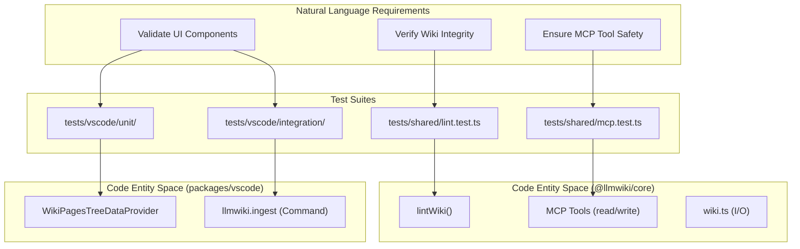
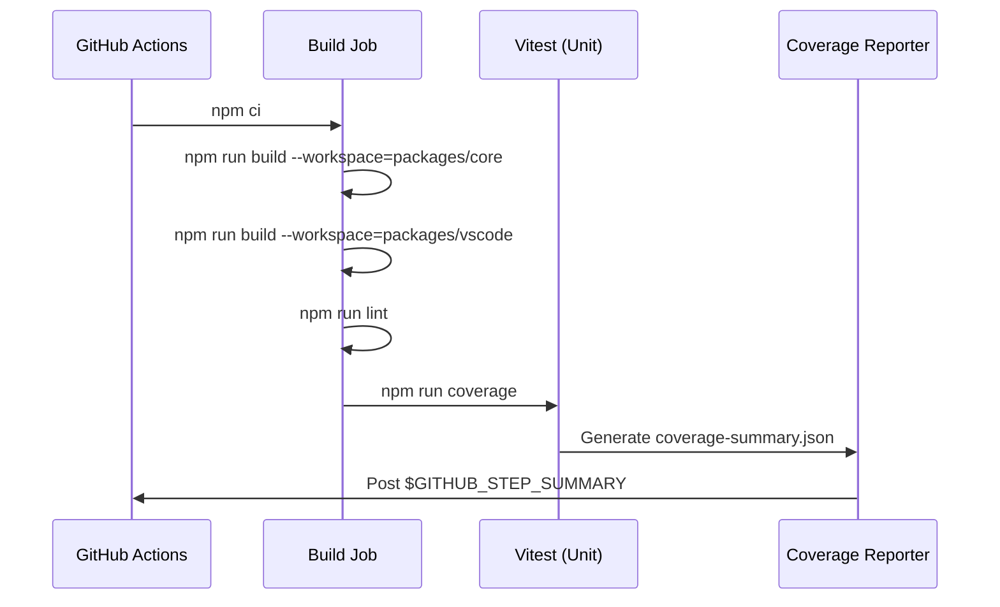

<!-- source: DeepWiki mcp.deepwiki.com · repo microsoft/llmwiki · page 5 Testing Infrastructure · fetched 2026-10-26 -->

# Testing Infrastructure

Relevant source files

The following files were used as context for generating this wiki page:

- [.github/workflows/ci.yml](.github/workflows/ci.yml)
- [.github/workflows/release.yml](.github/workflows/release.yml)
- [.gitignore](.gitignore)
- [package.json](package.json)
- [vitest.config.ts](vitest.config.ts)

The LLM Wiki project utilizes a multi-layered testing strategy to ensure the reliability of both the core library and the VS Code extension. The infrastructure is built around **Vitest** for unit and integration testing, supplemented by **v8** for coverage reporting and GitHub Actions for continuous integration.

## Testing Strategy Overview

The codebase is divided into two primary test suites:
1.  **Shared Core Tests**: Unit tests for the `@llmwiki/core` logic, executed in a standard Node.js environment.
2.  **VS Code Extension Tests**: A combination of unit tests (using a mocked VS Code environment) and integration tests (requiring a live VS Code host).

### Test Environment Mapping

The following diagram illustrates how the test suites bridge the gap between Natural Language requirements (e.g., "validating links") and the specific code entities that implement them.

**Diagram: Test-to-Entity Mapping**

Sources: [package.json:22-25](), [vitest.config.ts:4-6](), [.github/workflows/ci.yml:40-41]()

## Unit Testing with Vitest

The project uses `vitest` as the primary test runner [package.json:22-25](). The configuration in `vitest.config.ts` includes all files matching `tests/**/*.test.ts` while specifically excluding the VS Code integration suite from the standard unit run [vitest.config.ts:5-6]().

### Coverage Thresholds
Code coverage is enforced via the `v8` provider [vitest.config.ts:8](). The project maintains strict minimum thresholds to ensure core logic remains tested:
*   **Lines**: 60%
*   **Functions**: 60%
*   **Statements**: 60%
*   **Branches**: 50%

Specific files, such as entry points (`packages/core/src/init.ts`) and glue code for the VS Code API (`packages/vscode/src/extension.ts`), are excluded from unit coverage as they are intended to be covered by integration tests [vitest.config.ts:11-31]().

Sources: [vitest.config.ts:7-38](), [package.json:40-42]()

## Continuous Integration (CI) Pipeline

The CI pipeline, defined in `.github/workflows/ci.yml`, executes on every push and pull request to the `main` branch [.github/workflows/ci.yml:3-7]().

**Diagram: CI Workflow Execution**

Sources: [.github/workflows/ci.yml:9-58]()

## Sub-Package Testing

The testing infrastructure is split to handle the differing requirements of the core library and the VS Code extension.

### Core Unit Tests
The `tests/shared/` directory contains tests for the `@llmwiki/core` package. These tests cover critical path operations including file I/O, the append-only log, linting, and MCP server tool interactions. 
For details, see [Core Unit Tests](#5.1).

### VS Code Extension Tests and Fixtures
The `packages/vscode` package requires specialized testing. Unit tests handle UI providers and command registration, while the `tests/vscode/integration/` suite runs within a real VS Code host to verify end-to-end functionality like file watching and LLM-powered ingestion.
For details, see [VS Code Extension Tests and Fixtures](#5.2).

Sources: [vitest.config.ts:5-6](), [package.json:16-19]()

---

