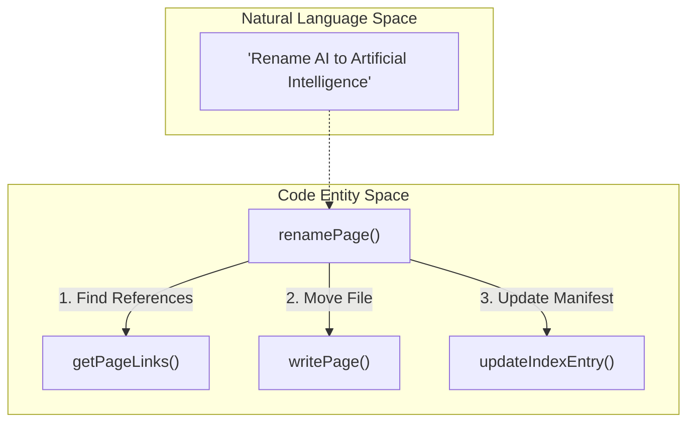
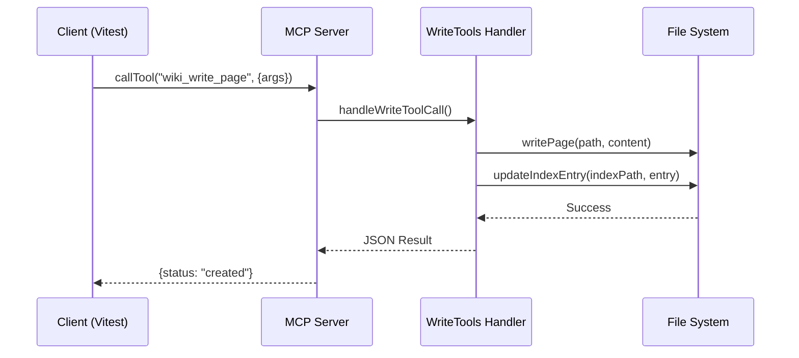

<!-- source: DeepWiki mcp.deepwiki.com · repo microsoft/llmwiki · page 5.1 Core Unit Tests · fetched 2026-10-26 -->

# Core Unit Tests

Relevant source files

The following files were used as context for generating this wiki page:

- [tests/shared/backlinks.test.ts](tests/shared/backlinks.test.ts)
- [tests/shared/bulk-ingest.test.ts](tests/shared/bulk-ingest.test.ts)
- [tests/shared/crosslinks.test.ts](tests/shared/crosslinks.test.ts)
- [tests/shared/delete.test.ts](tests/shared/delete.test.ts)
- [tests/shared/index.test.ts](tests/shared/index.test.ts)
- [tests/shared/ingest-context.test.ts](tests/shared/ingest-context.test.ts)
- [tests/shared/lint-fix.test.ts](tests/shared/lint-fix.test.ts)
- [tests/shared/lint.test.ts](tests/shared/lint.test.ts)
- [tests/shared/log.test.ts](tests/shared/log.test.ts)
- [tests/shared/mcp/crosslinks-index.test.ts](tests/shared/mcp/crosslinks-index.test.ts)
- [tests/shared/mcp/prompts.test.ts](tests/shared/mcp/prompts.test.ts)
- [tests/shared/mcp/resources.test.ts](tests/shared/mcp/resources.test.ts)
- [tests/shared/mcp/server-integration.test.ts](tests/shared/mcp/server-integration.test.ts)
- [tests/shared/mcp/write-tools.test.ts](tests/shared/mcp/write-tools.test.ts)
- [tests/shared/sources.test.ts](tests/shared/sources.test.ts)
- [tests/shared/update-index-entry.test.ts](tests/shared/update-index-entry.test.ts)
- [tests/shared/wiki-create-pages.test.ts](tests/shared/wiki-create-pages.test.ts)
- [tests/shared/wiki-rename.test.ts](tests/shared/wiki-rename.test.ts)
- [tests/shared/wiki.test.ts](tests/shared/wiki.test.ts)
- [tsconfig.json](tsconfig.json)

The `llmwiki` codebase utilizes a comprehensive suite of unit and integration tests located under `tests/shared/`. These tests validate the core library (`@llmwiki/core`) logic, ensuring that file I/O, index management, linting, and the Model Context Protocol (MCP) server operate correctly across different environments.

## Overview of Test Suite

The tests are executed using **Vitest** and follow a pattern of creating temporary directories for each test case to ensure isolation.

| Test File | Primary Focus |
| :--- | :--- |
| `wiki.test.ts` | Fundamental CRUD operations for wiki pages. |
| `index.test.ts` | Serialization and deserialization of `index.md`. |
| `log.test.ts` | Append-only audit log verification. |
| `lint.test.ts` | Detection of broken links, orphans, and schema violations. |
| `lint-fix.test.ts` | Automated repair logic for common wiki issues. |
| `delete.test.ts` | Safe deletion of pages with backlink warnings. |
| `wiki-rename.test.ts` | Renaming pages and updating all relative backlinks. |
| `mcp/server-integration.test.ts` | E2E testing of the MCP server via `InMemoryTransport`. |

Sources: [tests/shared/mcp/server-integration.test.ts:1-7](), [tests/shared/delete.test.ts:8-15]()

---

## Page and Index Operations

Tests for page management ensure that the relationship between the filesystem and the `index.md` manifest remains consistent.

### Renaming and Deletion Logic
The `renamePage` function is heavily tested to ensure that moving a file also updates every markdown link pointing to it. The `deletePage` function is verified to return `backlinkWarnings` if other pages still reference the target.

**Renaming Data Flow**

Sources: [tests/shared/wiki-rename.test.ts:21-39](), [tests/shared/wiki-rename.test.ts:41-63](), [tests/shared/delete.test.ts:58-79]()

### Index Completeness
Tests in `update-index-entry.test.ts` verify that partial updates (e.g., changing only a `summary` or `tags`) do not corrupt other fields in the `IndexEntry`.

Sources: [tests/shared/update-index-entry.test.ts:50-60](), [tests/shared/update-index-entry.test.ts:96-109]()

---

## Linting and Automated Fixes

The linting suite validates the six categories of health checks. `lint.test.ts` focuses on detection, while `lint-fix.test.ts` validates the state transitions during repair.

| Category | Test Scenario | Expected Outcome |
| :--- | :--- | :--- |
| **broken-links** | Link to `ghost.md` in `alpha.md` | `severity: error` [tests/shared/lint.test.ts:41-58]() |
| **orphan-pages** | Page exists but not in index/links | `severity: warning` [tests/shared/lint.test.ts:119-133]() |
| **stale-entries** | Index points to deleted file | `lintFix` removes entry [tests/shared/lint-fix.test.ts:21-45]() |
| **frontmatter-validation** | Missing `type` field | `lintFix` adds default `entity` [tests/shared/lint-fix.test.ts:140-160]() |

Sources: [tests/shared/lint.test.ts:9-91](), [tests/shared/lint-fix.test.ts:10-63]()

---

## Ingestion Context Enrichment

The `ingest-context.test.ts` file validates the logic used to provide "smart" metadata during the ingestion process.

*   **Content Detection**: `detectContentType` is tested against 15+ extensions including `.pdf`, `.docx`, and `.md` [tests/shared/ingest-context.test.ts:17-90]().
*   **Keyword Extraction**: `extractKeywords` is verified to filter "stop words" (e.g., "the", "is") and strip non-alphanumeric characters [tests/shared/ingest-context.test.ts:126-180]().
*   **Word Counting**: `countWords` handles multiple spaces, tabs, and newlines [tests/shared/ingest-context.test.ts:96-120]().

Sources: [tests/shared/ingest-context.test.ts:5-10]()

---

## MCP Server Integration

The MCP integration tests simulate a real client-server interaction using `InMemoryTransport`.

### Tool Execution Flow
The `server-integration.test.ts` validates that all 14 tools (7 read, 7 write) are registered and reachable.

**MCP Tool Call Sequence**

Sources: [tests/shared/mcp/server-integration.test.ts:91-101](), [tests/shared/mcp/write-tools.test.ts:29-56]()

### Resource and Prompt Templates
*   **Resources**: `resources.test.ts` ensures the server correctly exposes `resource://wiki/index` and URI templates for individual pages [tests/shared/mcp/resources.test.ts:127-154]().
*   **Prompts**: `prompts.test.ts` verifies the availability of complex workflow templates like `ingest-and-integrate`, which instructs an agent to call multiple tools in sequence [tests/shared/mcp/prompts.test.ts:62-93]().

Sources: [tests/shared/mcp/resources.test.ts:172-196](), [tests/shared/mcp/prompts.test.ts:110-132]()

---

