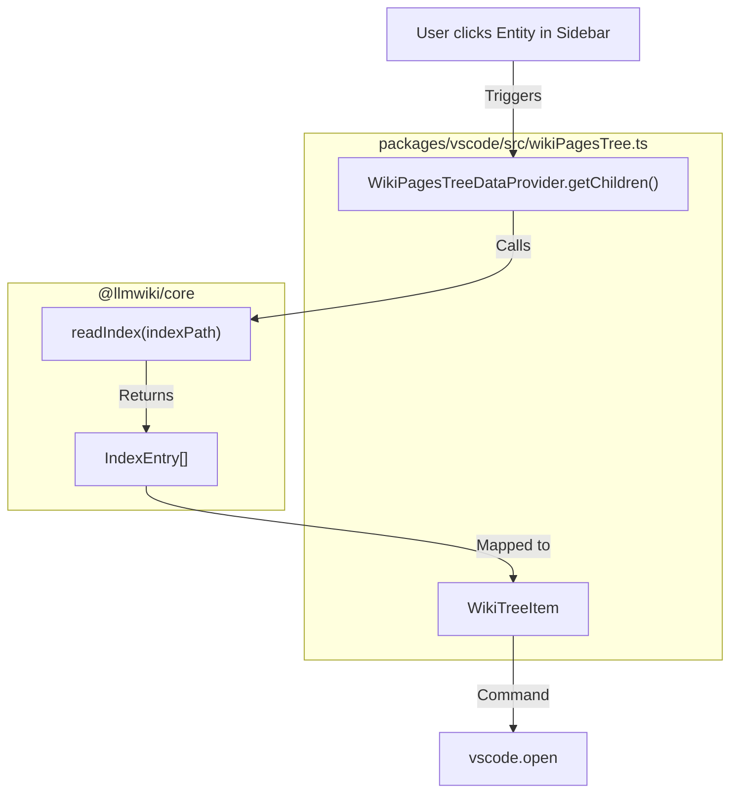
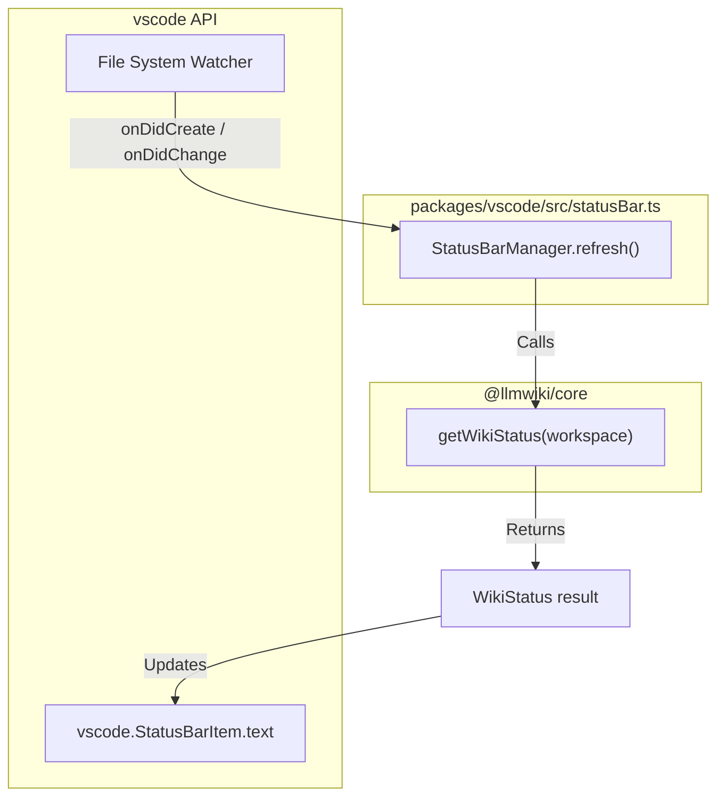

<!-- source: DeepWiki mcp.deepwiki.com · repo microsoft/llmwiki · page 5.2 VS Code Extension Tests and Fixtures · fetched 2026-10-26 -->

# VS Code Extension Tests and Fixtures

Relevant source files

The following files were used as context for generating this wiki page:

- [packages/vscode/src/backlinksTree.ts](packages/vscode/src/backlinksTree.ts)
- [packages/vscode/src/lintFindingsTree.ts](packages/vscode/src/lintFindingsTree.ts)
- [packages/vscode/src/wikiPagesTree.ts](packages/vscode/src/wikiPagesTree.ts)
- [tests/fixtures/index/valid-index.md](tests/fixtures/index/valid-index.md)
- [tests/fixtures/log/empty-log.md](tests/fixtures/log/empty-log.md)
- [tests/fixtures/log/single-entry.md](tests/fixtures/log/single-entry.md)
- [tests/fixtures/log/valid-log.md](tests/fixtures/log/valid-log.md)
- [tests/fixtures/wiki/empty.md](tests/fixtures/wiki/empty.md)
- [tests/fixtures/wiki/minimal-page.md](tests/fixtures/wiki/minimal-page.md)
- [tests/fixtures/wiki/no-frontmatter.md](tests/fixtures/wiki/no-frontmatter.md)
- [tests/fixtures/wiki/subdir/nested-page.md](tests/fixtures/wiki/subdir/nested-page.md)
- [tests/fixtures/wiki/valid-page.md](tests/fixtures/wiki/valid-page.md)
- [tests/vscode/backlinksTree.test.ts](tests/vscode/backlinksTree.test.ts)
- [tests/vscode/commands.test.ts](tests/vscode/commands.test.ts)
- [tests/vscode/integration/runTest.ts](tests/vscode/integration/runTest.ts)
- [tests/vscode/integration/suite/extension.test.ts](tests/vscode/integration/suite/extension.test.ts)
- [tests/vscode/integration/suite/index.ts](tests/vscode/integration/suite/index.ts)
- [tests/vscode/lintFindingsTree.test.ts](tests/vscode/lintFindingsTree.test.ts)
- [tests/vscode/rawSourcesTree.test.ts](tests/vscode/rawSourcesTree.test.ts)
- [tests/vscode/statusBar.test.ts](tests/vscode/statusBar.test.ts)
- [tests/vscode/wikiPagesTree.test.ts](tests/vscode/wikiPagesTree.test.ts)

This section covers the testing infrastructure for the `llmwiki` VS Code extension. The test suite is divided into unit tests (using Vitest and extensive mocking of the VS Code API), integration tests (using a real VS Code host), and standardized test fixtures.

## Unit Testing Strategy

The unit tests in `tests/vscode/` validate the logic of command handlers, tree providers, and the status bar without requiring a running VS Code instance. This is achieved by mocking the `vscode` namespace and `@llmwiki/core` functions [tests/vscode/commands.test.ts:7-60]().

### Command Handler Testing
The command tests verify that UI interactions (like showing warnings or quick picks) correctly trigger underlying core library functions.

| Command | Test Scenario | Mocked Interaction |
| :--- | :--- | :--- |
| `llmwiki.init` | Already initialized | `vscode.window.showWarningMessage` called [tests/vscode/commands.test.ts:150-159]() |
| `llmwiki.ingest` | Not initialized | Prompts user to "Initialize Now" [tests/vscode/commands.test.ts:162-172]() |
| `llmwiki.ingest` | Manual selection | Triggers `vscode.window.showOpenDialog` [tests/vscode/commands.test.ts:183-199]() |
| `llmwiki.ingest` | Explorer Context | Accepts `Uri` or `Uri[]` directly [tests/vscode/commands.test.ts:201-220]() |

**Sources:** [tests/vscode/commands.test.ts:130-220]()

### Tree Provider Testing
Tree providers are tested by verifying that `getChildren` returns the expected `TreeItem` objects based on the state of the wiki index or filesystem.

*   **WikiPagesTreeDataProvider**: Validates that it filters `IndexEntry` items by category (e.g., "Entities" vs "Concepts") and assigns the correct `vscode.open` command [tests/vscode/wikiPagesTree.test.ts:100-175]().
*   **BacklinksTreeDataProvider**: Tests the debounce logic for editor changes and the generation of guidance messages when no wiki page is active [tests/vscode/backlinksTree.test.ts:80-119]().
*   **RawSourcesTreeDataProvider**: Ensures that the "No sources yet" placeholder appears and that file sizes are formatted correctly for display [tests/vscode/rawSourcesTree.test.ts:113-122]().
*   **LintFindingsTreeDataProvider**: Verifies grouping of findings by severity (`error`, `warning`, `info`) [tests/vscode/lintFindingsTree.test.ts:103-110]().

**Sources:** [packages/vscode/src/wikiPagesTree.ts:37-88](), [packages/vscode/src/backlinksTree.ts:33-119](), [packages/vscode/src/lintFindingsTree.ts:61-140]()

## Integration Tests

Integration tests located in `tests/vscode/integration/` use `@vscode/test-electron` to launch a real VS Code instance with the extension loaded.

*   **Runner**: `runTest.ts` resolves paths for the extension development host and the test suite [tests/vscode/integration/runTest.ts:11-26]().
*   **Suite Entry**: `suite/index.ts` uses Mocha to discover and execute `*.test.js` files [tests/vscode/integration/suite/index.ts:9-32]().
*   **Smoke Tests**: `extension.test.ts` verifies that the extension is present in the host and can be activated successfully [tests/vscode/integration/suite/extension.test.ts:8-21]().

**Sources:** [tests/vscode/integration/runTest.ts:1-27](), [tests/vscode/integration/suite/extension.test.ts:1-22]()

## Data Flow: UI to Code Entity Mapping

The following diagrams illustrate how VS Code UI events map to specific class implementations and core library calls during testing.

### Tree View Interaction Flow
"Natural Language Space" (User clicking a tree item) to "Code Entity Space".

**Sources:** [packages/vscode/src/wikiPagesTree.ts:61-79](), [tests/vscode/wikiPagesTree.test.ts:161-175]()

### Status Bar Update Flow
Mapping of background file changes to Status Bar display updates.

**Sources:** [tests/vscode/statusBar.test.ts:187-214](), [packages/vscode/src/statusBar.ts:48-54]()

## Test Fixtures

The `tests/fixtures/` directory contains standardized Markdown files and directory structures used across both core and VS Code tests to ensure consistency.

| Fixture Path | Purpose |
| :--- | :--- |
| `tests/fixtures/log/` | Contains `valid-log.md`, `empty-log.md`, and `single-entry.md` for testing ingestion history [tests/fixtures/log/valid-log.md](). |
| `tests/fixtures/index/` | Standard `index.md` files used to test tree provider filtering and search [tests/fixtures/index/valid-index.md](). |
| `tests/fixtures/wiki/` | Various wiki pages: `valid-page.md`, `minimal-page.md`, and `no-frontmatter.md` for linting and I/O tests [tests/fixtures/wiki/valid-page.md](). |
| `tests/fixtures/wiki/subdir/` | Nested structures for testing recursive file discovery [tests/fixtures/wiki/subdir/nested-page.md](). |

**Sources:** [tests/vscode/commands.test.ts:43-60](), [tests/vscode/wikiPagesTree.test.ts:57-86]()

---

