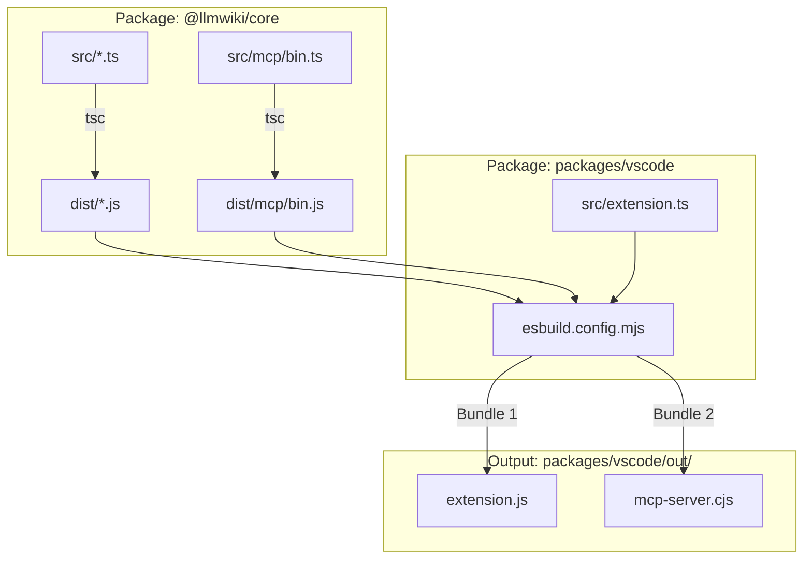
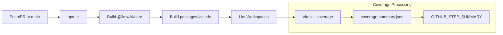

<!-- source: DeepWiki mcp.deepwiki.com · repo microsoft/llmwiki · page 6 Build, CI/CD, and Release · fetched 2026-10-26 -->

# Build, CI/CD, and Release

Relevant source files

The following files were used as context for generating this wiki page:

- [.github/workflows/ci.yml](.github/workflows/ci.yml)
- [.github/workflows/release.yml](.github/workflows/release.yml)
- [.gitignore](.gitignore)
- [LICENSE](LICENSE)
- [SECURITY.md](SECURITY.md)
- [package.json](package.json)
- [packages/core/tsconfig.json](packages/core/tsconfig.json)
- [packages/vscode/.gitignore](packages/vscode/.gitignore)
- [packages/vscode/.vscodeignore](packages/vscode/.vscodeignore)
- [packages/vscode/CHANGELOG.md](packages/vscode/CHANGELOG.md)
- [packages/vscode/LICENSE](packages/vscode/LICENSE)
- [packages/vscode/esbuild.config.mjs](packages/vscode/esbuild.config.mjs)
- [packages/vscode/tsconfig.json](packages/vscode/tsconfig.json)
- [tsconfig.base.json](tsconfig.base.json)
- [vitest.config.ts](vitest.config.ts)

This section details the infrastructure supporting the LLM Wiki monorepo. It covers the build orchestration between the core library and the VS Code extension, the bundling strategy using `esbuild`, and the automated workflows for continuous integration and release.

## Monorepo Build Orchestration

The project is structured as an NPM monorepo using the `workspaces` field in the root `package.json` [package.json:16-19](). It contains two primary packages: `@llmwiki/core` and `llmwiki` (the VS Code extension).

Because the VS Code extension depends on the core library, the build process must follow a strict order: `packages/core` must be compiled before `packages/vscode` [package.json:21]().

### Build Sequence and Dependencies

| Step | Command | Package | Purpose |
| :--- | :--- | :--- | :--- |
| 1 | `npm run build --workspace=packages/core` | `@llmwiki/core` | Compiles TypeScript to JS/ESM in `dist/`. |
| 2 | `npm run build --workspace=packages/vscode` | `llmwiki` | Invokes `esbuild` to bundle the extension and MCP server. |

### Build Entity Relationship
The following diagram illustrates how the build outputs from the core package are consumed by the extension bundling process.

**Diagram: Build Artifact Flow**

Sources: [package.json:21](), [packages/vscode/esbuild.config.mjs:6-34](), [packages/vscode/tsconfig.json:13-14]()

## VS Code Extension Bundling

The extension uses `esbuild` for bundling to ensure that all dependencies (except those provided by the VS Code host) are included in the final VSIX. This is critical for the MCP server, which must run as a standalone process.

### Extension Bundle (`out/extension.js`)
The main entry point `src/extension.ts` is bundled into CommonJS format [packages/vscode/esbuild.config.mjs:7-13](). 
- **External Dependencies**: `vscode` and `pdfjs-dist` are marked as external [packages/vscode/esbuild.config.mjs:11](). `pdfjs-dist` is specifically excluded from bundling but included in the VSIX via `.vscodeignore` patterns [packages/vscode/.vscodeignore:4]().
- **Target**: Node 20 [packages/vscode/esbuild.config.mjs:10]().

### MCP Server Bundle (`out/mcp-server.cjs`)
The MCP server is bundled into a self-contained script [packages/vscode/esbuild.config.mjs:23-34]().
- **Problem**: In a production VSIX, `node_modules` are not typically shipped. If the extension tried to launch the MCP server via `require.resolve('@llmwiki/core/dist/mcp/bin.js')`, it would fail [packages/vscode/esbuild.config.mjs:19-22]().
- **Solution**: `esbuild` takes the compiled core binary `../core/dist/mcp/bin.js` and bundles it (and all its dependencies) into `out/mcp-server.cjs` [packages/vscode/esbuild.config.mjs:24-30](). This allows the extension's `McpServerDefinitionProvider` to spawn the server using a stable local path [packages/vscode/CHANGELOG.md:16-17]().

Sources: [packages/vscode/esbuild.config.mjs:1-47](), [packages/vscode/.vscodeignore:1-14](), [packages/vscode/CHANGELOG.md:8-17]()

## CI Workflow (GitHub Actions)

The CI pipeline is defined in `.github/workflows/ci.yml` and triggers on every push or pull request to the `main` branch [.github/workflows/ci.yml:3-7]().

### Pipeline Stages
1. **Environment Setup**: Uses Node.js 20 and caches `npm` dependencies [.github/workflows/ci.yml:19-23]().
2. **Installation**: Performs a clean install using `npm ci` [.github/workflows/ci.yml:26]().
3. **Build**: Executes the monorepo build order (Core then VS Code) [.github/workflows/ci.yml:28-32]().
4. **Lint**: Runs `eslint` across both packages [.github/workflows/ci.yml:34-38]().
5. **Test & Coverage**: Executes `vitest run --coverage` [.github/workflows/ci.yml:40-41]().

### Coverage Reporting
The CI workflow extracts coverage data from `coverage/coverage-summary.json` and posts a formatted Markdown table to the GitHub Step Summary [.github/workflows/ci.yml:43-58]().
The project enforces specific coverage thresholds in `vitest.config.ts`:
- **Lines**: 60%
- **Functions**: 60%
- **Statements**: 60%
- **Branches**: 50%

**Diagram: CI Pipeline Data Flow**

Sources: [.github/workflows/ci.yml:1-59](), [vitest.config.ts:7-38]()

## Release Workflow

The release workflow automates the creation of GitHub Releases and the packaging of the VS Code extension (`.vsix`). It is triggered by version tags (e.g., `v1.0.0`) or manual dispatch [.github/workflows/release.yml:3-7]().

### VSIX Production
The workflow performs the following steps:
1. **Build Core**: Ensures the core library is built for the extension to consume [.github/workflows/release.yml:26-27]().
2. **Package**: Runs `npm run package --workspace=packages/vscode` [.github/workflows/release.yml:30](). This generates a versioned `.vsix` file.
3. **Asset Preparation**: Copies the versioned VSIX to `llmwiki-latest.vsix` for stable download links [.github/workflows/release.yml:32-37]().
4. **Artifact Upload**: Uploads all `.vsix` files as workflow artifacts [.github/workflows/release.yml:39-44]().
5. **GitHub Release**: If triggered by a tag, it creates a new GitHub Release, uploads the assets, and generates release notes automatically [.github/workflows/release.yml:46-57]().

### Release Assets
| File | Description |
| :--- | :--- |
| `llmwiki-X.Y.Z.vsix` | The versioned extension package. |
| `llmwiki-latest.vsix` | A copy of the latest build for easy reference. |

Sources: [.github/workflows/release.yml:1-58](), [package.json:2-3]()

---

