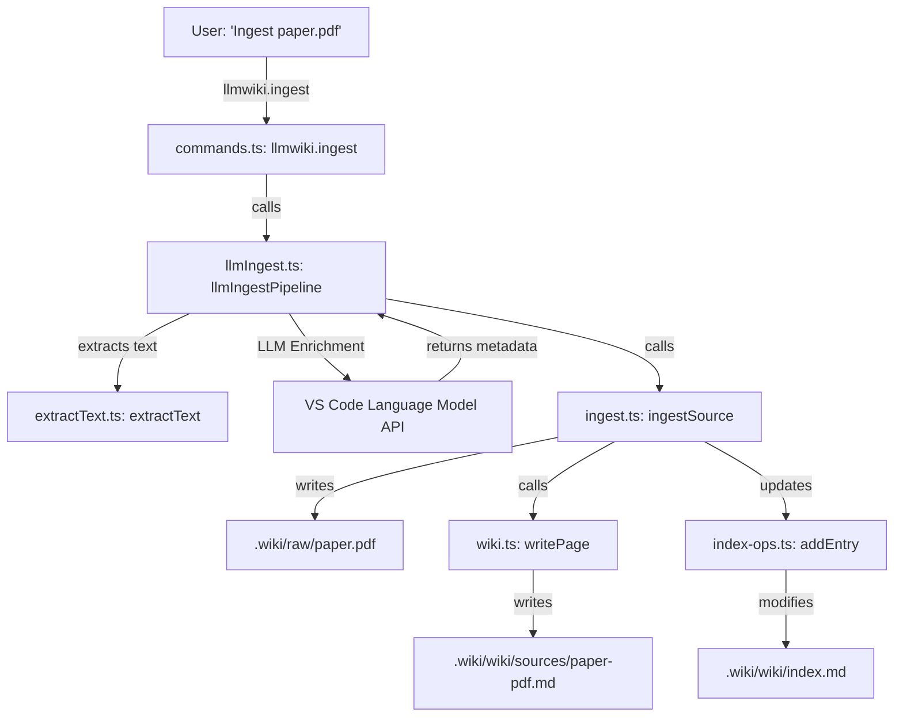
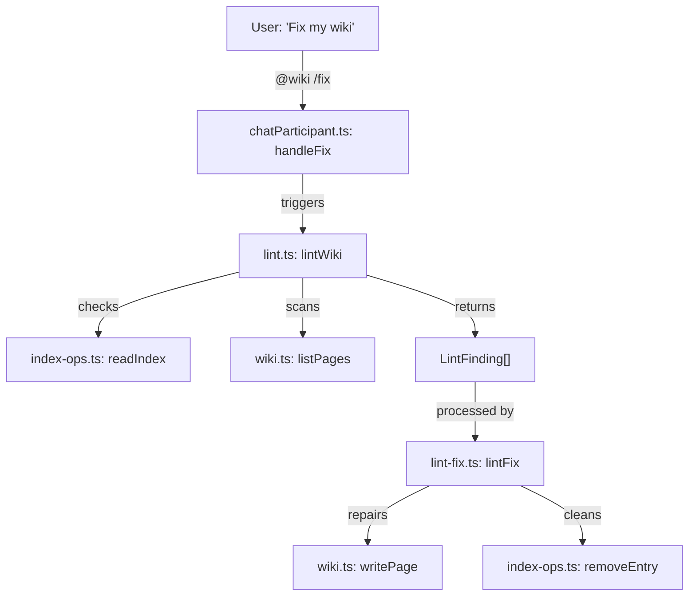

<!-- source: DeepWiki mcp.deepwiki.com · repo microsoft/llmwiki · page 7 Glossary · fetched 2026-10-26 -->

# Glossary

Relevant source files

The following files were used as context for generating this wiki page:

- [ARCHITECTURE.md](ARCHITECTURE.md)
- [README.md](README.md)
- [docs/mcp-tools.md](docs/mcp-tools.md)
- [packages/core/src/constants.ts](packages/core/src/constants.ts)
- [packages/core/src/errors.ts](packages/core/src/errors.ts)
- [packages/core/src/index-ops.ts](packages/core/src/index-ops.ts)
- [packages/core/src/lint.ts](packages/core/src/lint.ts)
- [packages/core/src/utils.ts](packages/core/src/utils.ts)
- [packages/core/src/wiki.ts](packages/core/src/wiki.ts)
- [packages/vscode/package.json](packages/vscode/package.json)

This glossary defines the technical terms, abbreviations, and domain concepts used throughout the LLM Wiki codebase. It serves as a reference for onboarding engineers to understand how natural language concepts map to specific implementation details in the `@llmwiki/core` and `llmwiki` VS Code extension.

## Core Concepts

### Raw Source
An immutable document provided by the human user. These are the "source of truth" for the wiki.
*   **Storage**: Located in `.wiki/raw/` [packages/core/src/constants.ts:11-11]().
*   **Behavior**: The system reads these files during ingestion but never modifies them [README.md:26-26]().
*   **Implementation**: Handled by `sources.ts` which provides metadata like size and modified dates [packages/core/src/sources.ts:1-1]().

### Wiki Page
An LLM-generated Markdown file stored in the `.wiki/wiki/` directory.
*   **Types**: Defined in frontmatter as `entity`, `concept`, `source`, `summary`, or `query` [packages/core/src/lint.ts:182-182]().
*   **Structure**: Consists of YAML frontmatter (parsed via `gray-matter`) and a Markdown body [packages/core/src/wiki.ts:21-24]().
*   **Implementation**: Managed via `readPage` and `writePage` in `wiki.ts` [packages/core/src/wiki.ts:26-39]().

### The Index (`index.md`)
A central catalog of all wiki pages used for fast lookup and navigation.
*   **Format**: A categorized Markdown file where each entry follows the pattern: `- [Title](path) — Summary #tag` [packages/core/src/index-ops.ts:33-65]().
*   **Categories**: Entries are grouped under H2 headers like `## Entities` and `## Concepts` [packages/core/src/index-ops.ts:105-107]().
*   **Implementation**: Functions `readIndex`, `writeIndex`, and `updateIndexEntry` in `index-ops.ts` [packages/core/src/index-ops.ts:89-200]().

### The Log (`log.md`)
A chronological, append-only record of every operation performed on the wiki.
*   **Format**: Uses a specific header format `## [YYYY-MM-DD] verb | subject` [ARCHITECTURE.md:56-56]().
*   **Implementation**: Managed by `log.ts` [packages/core/src/log.ts:1-1]().

## Technical Terms & Abbreviations

| Term | Definition | Code Pointer |
| :--- | :--- | :--- |
| **MCP** | Model Context Protocol. The standard used to expose wiki tools to LLMs. | `packages/core/src/mcp/` |
| **Slug** | A URL-friendly, lowercase, alphanumeric version of a title used for filenames. | [packages/core/src/utils.ts:5-11]() |
| **Frontmatter** | Metadata at the top of Markdown files delimited by `---`. | [packages/core/src/wiki.ts:11-19]() |
| **Backlink** | A reference from another page pointing to the current page. | [packages/core/src/backlinks.ts:1-1]() |
| **Lint Finding** | A health issue (Error, Warning, or Info) detected in the wiki structure. | [packages/core/src/lint.ts:8-13]() |

## Data Flow Diagrams

### Natural Language to Code Entity Mapping: Ingestion
This diagram shows how a user's request to "ingest a file" translates into specific code entities and file system changes.

"Ingestion Flow: User to Disk"

Sources: [packages/vscode/src/commands.ts:68-71](), [packages/core/src/ingest.ts:1-1](), [packages/core/src/wiki.ts:35-39](), [packages/core/src/index-ops.ts:157-164]()

### Natural Language to Code Entity Mapping: Maintenance
This diagram shows how "Wiki Health" is maintained through linting and automated fixes.

"Maintenance Flow: Health Checks"

Sources: [packages/core/src/lint.ts:46-49](), [packages/core/src/wiki.ts:41-41](), [packages/core/src/index-ops.ts:170-177](), [packages/vscode/package.json:56-58]()

## Domain Concepts

### Ingestion Pipeline
The multi-step process of moving a file into the wiki.
1.  **Text Extraction**: Converting PDFs, DOCX, or images into plain text using `extractText.ts`.
2.  **LM Enrichment**: Using the VS Code Language Model API to generate a title, summary, and tags [packages/vscode/src/llmIngest.ts:1-1]().
3.  **Wiki Creation**: Creating the source page and updating the `index.md` and `log.md`.

### Lint Categories
The specific checks performed by `lintWiki` [packages/core/src/lint.ts:46-49]():
*   `broken-links`: Links pointing to non-existent `.md` files.
*   `orphan-pages`: Pages with no inbound links and no entry in the index.
*   `index-completeness`: Ensuring every file in `wiki/` is listed in `index.md`.
*   `stale-entries`: Index entries pointing to files that have been deleted.
*   `missing-pages`: Pages referenced by links that haven't been created yet.
*   `frontmatter-validation`: Ensuring required fields like `type` and `title` exist.

### Search Scoring
The `queryWiki` function [packages/core/src/query.ts:1-1]() uses a weighted algorithm to rank results:
*   **Title Match**: 3x weight.
*   **Summary Match**: 2x weight.
*   **Body Match**: 1x weight.

Sources: [README.md:1-100](), [ARCHITECTURE.md:1-150](), [docs/mcp-tools.md:1-100](), [packages/core/src/constants.ts:1-12](), [packages/core/src/errors.ts:1-8](), [packages/core/src/index-ops.ts:1-224](), [packages/core/src/lint.ts:1-214](), [packages/core/src/utils.ts:1-20](), [packages/core/src/wiki.ts:1-250]()