# Page: LLM Wiki — Project Overview

# LLM Wiki — Project Overview

<details>
<summary>Relevant source files</summary>

The following files were used as context for generating this wiki page:

- [.github/workflows/release.yml](.github/workflows/release.yml)
- [ARCHITECTURE.md](ARCHITECTURE.md)
- [README.md](README.md)
- [package-lock.json](package-lock.json)
- [package.json](package.json)

</details>


LLM Wiki is a technical solution for building personal knowledge bases where the burden of maintenance—summarization, cross-referencing, and indexing—is shifted from the human to a Large Language Model (LLM). Unlike traditional RAG (Retrieval-Augmented Generation) systems that synthesize information from raw documents at query time, LLM Wiki maintains a persistent, structured markdown-based wiki that evolves as new sources are added [README.md:8-12]().

## System Architecture

The system is built on a **Three-Layer Architecture** designed to separate human-curated data from LLM-generated synthesis, governed by a shared schema [ARCHITECTURE.md:21-33]().

| Layer | Owner | Purpose |
| :--- | :--- | :--- |
| **Raw Sources** | Human | Immutable source documents (PDFs, notes, articles) [ARCHITECTURE.md:38-46](). |
| **Wiki** | LLM | Generated markdown files (Entities, Concepts) and internal tracking (`index.md`, `log.md`) [ARCHITECTURE.md:47-57](). |
| **Schema** | Human + LLM | The `AGENTS.md` file defining structure, naming conventions, and workflows [ARCHITECTURE.md:58-66](). |

### Logical Data Flow

The following diagram illustrates how raw information is transformed into structured knowledge through the system's core entities.

**Diagram: Data Transformation Pipeline**
```mermaid
graph TD
    subgraph "Natural Language Space (Human)"
        [RawSource] --> [IngestPipeline]
    end

    subgraph "Code Entity Space (@llmwiki/core)"
        [IngestPipeline] -- "ingestSource()" --> [WikiPage]
        [WikiPage] -- "updateIndexEntry()" --> [IndexEntry]
        [IndexEntry] -- "appendEntry()" --> [WikiLog]
    end

    subgraph "Storage Layer (.wiki/)"
        [WikiPage] --> [wiki_dir/"*.md"]
        [IndexEntry] --> [wiki_index/"index.md"]
        [WikiLog] --> [wiki_log/"log.md"]
    end

    [AGENTS.md] -. "Governs" .-> [IngestPipeline]
```
Sources: [ARCHITECTURE.md:7-34](), [packages/core/src/ingest.ts:1-10](), [packages/core/src/index-ops.ts:1-10]()

## Monorepo Layout

The project is managed as an npm workspaces monorepo [package.json:16-19]().

*   **`packages/core` (`@llmwiki/core`)**: The engine of the system. It contains the logic for file I/O, search, linting, and the Model Context Protocol (MCP) server [README.md:38]().
*   **`packages/vscode` (`llmwiki`)**: The VS Code extension providing the user interface, tree views, and integration with GitHub Copilot [README.md:39]().

**Diagram: Package Dependency and Components**
```mermaid
graph LR
    subgraph "packages/vscode"
        [extension.ts] -- "uses" --> [llmIngest.ts]
        [extension.ts] -- "renders" --> [WikiPagesTreeDataProvider]
        [extension.ts] -- "registers" --> [chatParticipant.ts]
    end

    subgraph "packages/core"
        [wiki.ts] -- "IO" --> [index-ops.ts]
        [lint.ts] -- "validates" --> [wiki.ts]
        [mcp/server.ts] -- "exposes" --> [wiki.ts]
    end

    [packages/vscode] -- "depends on" --> [packages/core]
```
Sources: [README.md:41-43](), [ARCHITECTURE.md:84-125]()

## Key Features

*   **Zero-Bookkeeping Maintenance**: The LLM handles the creation of entity/concept pages and maintains the `index.md` catalog [README.md:8-12]().
*   **Weighted Search**: A custom query engine in `query.ts` that scores matches across titles, summaries, and body text [ARCHITECTURE.md:105]().
*   **Automated Health Checks**: A linting system in `lint.ts` that detects broken links, orphaned pages, and stale index entries [ARCHITECTURE.md:98]().
*   **MCP Integration**: An MCP server allowing any compatible agent (like Claude Desktop) to interact with the wiki via standard tools [README.md:122-124]().

## Child Pages

For detailed technical documentation, refer to the following sections:

*   **[Getting Started](#1.1)**: Prerequisites, installation, and workspace initialization [README.md:45-68]().
*   **[Three-Layer Architecture](#1.2)**: Deep dive into the relationship between `raw/`, `wiki/`, and `AGENTS.md` [ARCHITECTURE.md:36-66]().

Sources: [README.md:1-125](), [ARCHITECTURE.md:1-130](), [package.json:1-48]()

---

# Page: Getting Started

# Getting Started

<details>
<summary>Relevant source files</summary>

The following files were used as context for generating this wiki page:

- [.github/workflows/ci.yml](.github/workflows/ci.yml)
- [.github/workflows/release.yml](.github/workflows/release.yml)
- [.gitignore](.gitignore)
- [.vscode/launch.json](.vscode/launch.json)
- [.vscode/tasks.json](.vscode/tasks.json)
- [package.json](package.json)
- [packages/vscode/README.md](packages/vscode/README.md)
- [vitest.config.ts](vitest.config.ts)

</details>


This guide provides step-by-step instructions for setting up the **LLM Wiki** development environment. It covers prerequisites, repository configuration, workspace initialization, and running the VS Code extension in development mode.

## Prerequisites

Before contributing or running the system from source, ensure your environment meets the following requirements:

| Requirement | Version / Detail |
| :--- | :--- |
| **Node.js** | `v20.x` or later [[package.json:35-37]]() |
| **npm** | Included with Node.js; used for workspace management [[package.json:16-19]]() |
| **VS Code** | `v1.93` or later [[packages/vscode/README.md:91-92]]() |
| **GitHub Copilot** | Required for LLM-powered ingestion and chat features [[packages/vscode/README.md:93-95]]() |

## Repository Setup

LLM Wiki is managed as a monorepo using npm workspaces. The two primary packages are `@llmwiki/core` (the logic engine and MCP server) and `llmwiki` (the VS Code extension) [[package.json:16-19]]().

### 1. Clone the Repository
```bash
git clone https://github.com/microsoft/llmwiki.git
cd llmwiki
```
[[packages/vscode/README.md:27-28]]()

### 2. Install Dependencies
Install all package dependencies from the root directory. This will link the local `@llmwiki/core` package for use by the extension.
```bash
npm ci
```
[[packages/vscode/README.md:29-29]]()

### 3. Build the Monorepo
The core library must be built before the VS Code extension can be bundled, as the extension depends on the compiled output of core [[package.json:21-21]]().
```bash
npm run build
```
[[package.json:21-21]](), [[.github/workflows/ci.yml:28-32]]()

## Development Workflow

### Running the Extension
To debug the extension, use the provided VS Code launch configurations:

1. Open the `llmwiki` root folder in VS Code.
2. Press `F5` or go to the **Run and Debug** view and select **Run Extension** [[.vscode/launch.json:5-18]]().
3. This task executes `preLaunchTask: build-extension` [[.vscode/launch.json:14-14]](), which triggers the build script in `packages/vscode` [[.vscode/tasks.json:5-11]]().
4. A new **Extension Development Host** window will open.

### Initializing a Wiki Workspace
The extension activates when it detects a `.wiki/wiki/` directory or when the initialization command is manually triggered [[packages/vscode/README.md:87-89]]().

1. In the Extension Development Host, open a folder you wish to use as your wiki workspace.
2. Open the Command Palette (`Ctrl+Shift+P`).
3. Run `LLM Wiki: Initialize Wiki` (`llmwiki.init`) [[packages/vscode/README.md:39-39]]().
4. This creates the `.wiki/` directory structure, including the `raw/` and `wiki/` subdirectories.

### Data Flow: From Source to Wiki Entity
The following diagram illustrates the flow from a raw file on disk to a processed wiki entity managed by the extension.

**System Entity Mapping: Ingestion Flow**
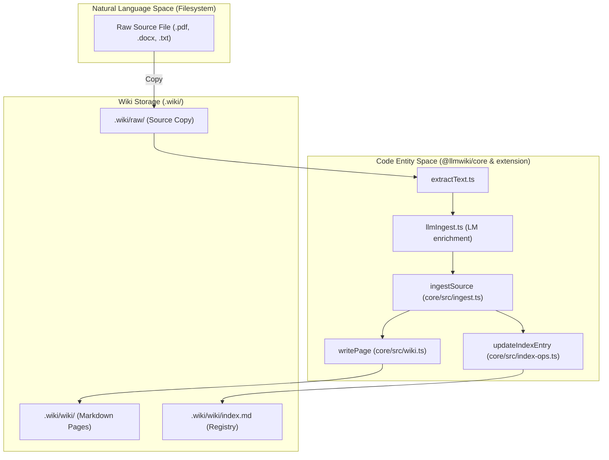
Sources: [[packages/vscode/README.md:59-64]](), [[packages/vscode/README.md:97-98]](), [[vitest.config.ts:27-28]]()

## Testing and Quality Control

### Running Unit Tests
Unit tests are powered by Vitest and cover core logic like indexing, linting, and search [[package.json:22-22]]().
```bash
npm test
```
[[package.json:22-22]]()

### Coverage Requirements
The project enforces minimum coverage thresholds for CI to pass:
* **Lines/Functions/Statements**: 60%
* **Branches**: 50%
[[vitest.config.ts:32-37]]()

### CI/CD Pipeline
The GitHub Actions workflow automates the following sequence on every push to `main`:
1. **Linting**: Runs `npm run lint` for both core and vscode [[.github/workflows/ci.yml:34-38]]().
2. **Building**: Compiles TypeScript sources [[.github/workflows/ci.yml:28-32]]().
3. **Testing**: Executes the Vitest suite with coverage reporting [[.github/workflows/ci.yml:40-41]]().

**Code-to-CI Mapping**
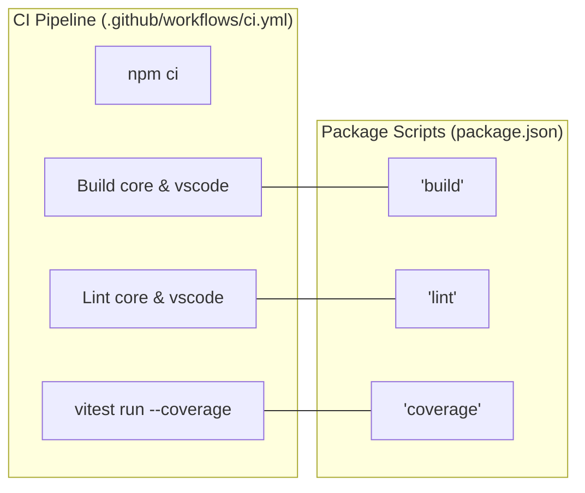
Sources: [[.github/workflows/ci.yml:25-41]](), [[package.json:20-26]]()

## Troubleshooting Initialization
* **Extension not activating**: Ensure you are in a trusted workspace and have GitHub Copilot enabled. The extension requires the VS Code Language Model API [[packages/vscode/README.md:93-95]]().
* **Build failures**: Ensure you have run `npm ci` at the root to correctly link the `@llmwiki/core` workspace [[packages/vscode/README.md:29-30]]().
* **Missing .wiki folder**: If the `.wiki` folder is missing, run `llmwiki.init` from the Command Palette [[packages/vscode/README.md:39-39]](). Note that `.wiki/` is ignored by git by default [[.gitignore:10-10]]().

Sources: [[package.json:1-48]](), [[packages/vscode/README.md:1-122]](), [[vitest.config.ts:1-41]](), [[.github/workflows/ci.yml:1-59]](), [[.github/workflows/release.yml:1-58]](), [[.gitignore:1-27]](), [[.vscode/tasks.json:1-21]](), [[.vscode/launch.json:1-19]]()

---

# Page: Three-Layer Architecture

# Three-Layer Architecture

<details>
<summary>Relevant source files</summary>

The following files were used as context for generating this wiki page:

- [ARCHITECTURE.md](ARCHITECTURE.md)
- [README.md](README.md)
- [packages/core/src/constants.ts](packages/core/src/constants.ts)
- [packages/core/src/init.ts](packages/core/src/init.ts)

</details>


The LLM Wiki system operates on a persistent, structured knowledge base that resides between raw data and the user. Unlike standard RAG (Retrieval-Augmented Generation) systems that synthesize answers on-the-fly from raw chunks, LLM Wiki uses a **Three-Layer Architecture** to maintain a compiled, interlinked, and version-controlled representation of knowledge [README.md:8-12]().

## Architectural Overview

The system is designed as a "git-as-database" model where all state is stored in human-readable Markdown files within a `.wiki/` directory [packages/core/src/constants.ts:8-11](). This ensures that the knowledge base is portable, searchable by standard tools, and provides a clear separation of concerns between human curators and LLM agents [ARCHITECTURE.md:24-34]().

### Data Flow and Layer Interactions

The following diagram illustrates how data flows from the human-controlled **Raw Sources** through the LLM-driven **Ingestion Pipeline** into the structured **Wiki** layer, all governed by the **Schema**.

**Data Flow: Source to Synthesis**
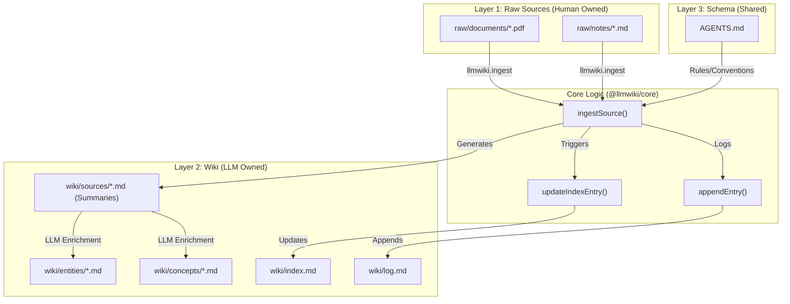
**Sources:** [ARCHITECTURE.md:36-65](), [packages/core/src/init.ts:19-26](), [packages/core/src/ingest.ts:1-20]()

---

## Layer 1: Raw Sources (`raw/`)

The **Raw Sources** layer is the immutable foundation of the wiki. It contains the original evidence used to generate all subsequent knowledge [ARCHITECTURE.md:38-40]().

*   **Immutability:** The LLM is permitted to read these files but is strictly forbidden from modifying them [ARCHITECTURE.md:42]().
*   **Source of Truth:** Every page in the Wiki layer must trace back to a file in this directory via the `source_path` frontmatter field [ARCHITECTURE.md:43](), [packages/core/src/init.ts:72-73]().
*   **Structure:** Users can organize this directory using any folder hierarchy (e.g., `raw/research/papers/`). The system treats these as a flat set of sources for the purpose of ingestion [ARCHITECTURE.md:45]().

**Sources:** [ARCHITECTURE.md:38-46](), [packages/core/src/init.ts:21]()

---

## Layer 2: Wiki (`wiki/`)

The **Wiki** layer is the "Compiled Knowledge" produced and maintained by the LLM. It consists of structured Markdown files with YAML frontmatter [ARCHITECTURE.md:48-53]().

### Directory Structure
The `.wiki/wiki/` directory is partitioned by page type to allow for efficient scanning and organization [packages/core/src/init.ts:19-26]():
*   `wiki/entities/`: Pages for people, organizations, and places [packages/core/src/init.ts:45]().
*   `wiki/concepts/`: Pages for abstract ideas and theories [packages/core/src/init.ts:46]().
*   `wiki/sources/`: Summary pages that act as a bridge between the raw file and the wiki [packages/core/src/init.ts:47-48]().

### Metadata and Persistence
The system uses two specialized files to manage the state of the wiki:
1.  **`wiki/index.md`**: A master catalog used for weighted search and linting. It organizes entries under `## Entities`, `## Concepts`, and `## Sources` headers [ARCHITECTURE.md:55](), [packages/core/src/init.ts:28-36]().
2.  **`wiki/log.md`**: An append-only chronological record of every operation performed by the system (e.g., `initialized`, `ingested`) [ARCHITECTURE.md:56](), [packages/core/src/init.ts:178-184]().

**Entity Mapping: Code to Wiki Space**
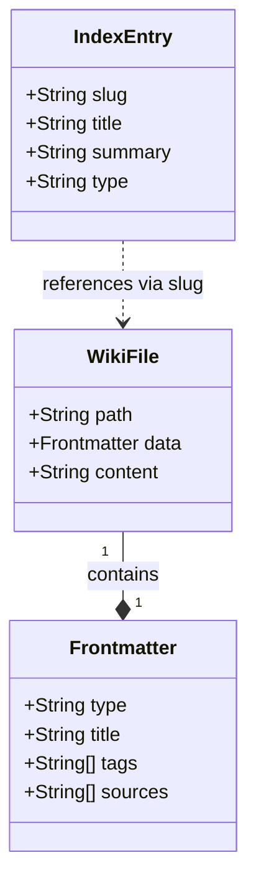
**Sources:** [packages/core/src/init.ts:61-86](), [ARCHITECTURE.md:53-56]()

---

## Layer 3: Schema (`AGENTS.md`)

The **Schema** layer defines the "Constitution" of the wiki. It is a Markdown file named `AGENTS.md` located at the root of the `.wiki/` directory [packages/core/src/init.ts:187-188]().

### Purpose
`AGENTS.md` provides the LLM with the necessary context to maintain consistency across different sessions and different LLM models. It defines:
*   **Naming Conventions:** Rules for generating slugs (e.g., lowercasing, stripping extensions) [packages/core/src/init.ts:102-111]().
*   **Frontmatter Requirements:** Mandatory fields like `type` and `title` [packages/core/src/init.ts:61-66]().
*   **Workflows:** Step-by-step instructions for ingestion and cross-referencing [packages/core/src/init.ts:113-118]().
*   **Lint Rules:** Definitions for what constitutes a "healthy" wiki (e.g., `broken-links`, `orphan-pages`) [packages/core/src/init.ts:120-128]().

### Co-Evolution
While the `llmwiki.init` command provides a starter template [packages/core/src/init.ts:39-137](), the schema is intended to be co-evolved. As users or LLMs identify new patterns or requirements, they update `AGENTS.md` to codify these new rules [ARCHITECTURE.md:62-65]().

**Sources:** [ARCHITECTURE.md:58-65](), [packages/core/src/init.ts:39-137]()

---

## Technical Implementation Details

### File I/O and Path Resolution
The `@llmwiki/core` package manages all interactions with the three layers. It uses a `WIKI_DIR_NAME` constant (set to `.wiki`) to locate the root [packages/core/src/constants.ts:11](). 

Key functions include:
*   `initWiki(targetPath)`: Scaffolds the directory structure and creates the initial `index.md`, `log.md`, and `AGENTS.md` [packages/core/src/init.ts:147-199]().
*   `slugify(text)`: Implements the naming conventions defined in the schema to ensure consistent file paths [packages/core/src/init.ts:102-108]().

### The Git-as-Database Approach
By using Markdown and a standard directory structure, LLM Wiki leverages Git for:
1.  **Version Control:** Every LLM change is a commit, allowing for easy reverts.
2.  **Concurrency:** Git handles merging changes if multiple agents (or a human and an agent) edit the wiki simultaneously.
3.  **Auditability:** The `wiki/log.md` combined with git history provides a full audit trail of how knowledge was derived [ARCHITECTURE.md:24-34](), [ARCHITECTURE.md:56]().

**Sources:** [packages/core/src/constants.ts:1-12](), [packages/core/src/init.ts:147-199](), [ARCHITECTURE.md:24-34]()

---

# Page: Core Library (@llmwiki/core)

# Core Library (@llmwiki/core)

<details>
<summary>Relevant source files</summary>

The following files were used as context for generating this wiki page:

- [.vscode/mcp.json](.vscode/mcp.json)
- [packages/core/README.md](packages/core/README.md)
- [packages/core/package.json](packages/core/package.json)
- [packages/core/src/backlinks.ts](packages/core/src/backlinks.ts)
- [packages/core/src/index.ts](packages/core/src/index.ts)
- [packages/core/tsconfig.json](packages/core/tsconfig.json)

</details>


The `@llmwiki/core` package serves as the engine for the LLM Wiki ecosystem. It provides a headless implementation of all wiki operations, including file I/O, search, ingestion, and linting. It is consumed by the [VS Code Extension](#4) and also provides a standalone [MCP Server](#3) to allow LLM agents to interact with the wiki directly via standard tools.

Sources: [packages/core/package.json:2-4](), [packages/core/README.md:3-5]()

## Module Organization

The library is organized into functional modules that handle specific aspects of the wiki lifecycle. The public API is consolidated in `src/index.ts`.

| Module | Primary Responsibility |
| :--- | :--- |
| `wiki.ts`, `index-ops.ts` | Low-level filesystem operations and index management. |
| `ingest.ts`, `bulk-ingest.ts` | Transformation of raw source files into wiki pages. |
| `search.ts`, `query.ts` | Full-text search and weighted query algorithms. |
| `lint.ts` | Validation of wiki health and integrity. |
| `mcp/` | Implementation of the Model Context Protocol server. |
| `backlinks.ts` | Discovery of relationships between pages. |

Sources: [packages/core/src/index.ts:1-17]()

## Core Data Flow

The following diagram illustrates how the core library bridges the gap between the filesystem (Code Entity Space) and the logical wiki structure (Natural Language Space) used by LLMs.

### Entity Relationship Diagram
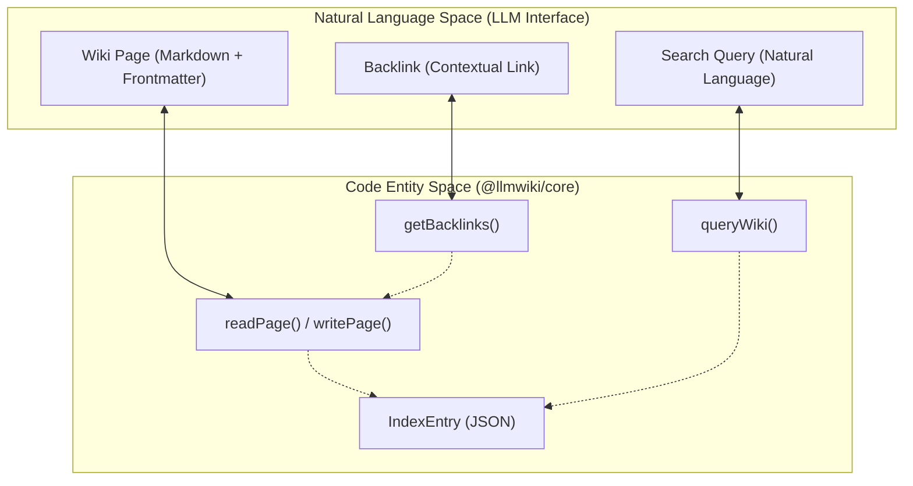
Sources: [packages/core/src/wiki.ts:2-3](), [packages/core/src/backlinks.ts:23-26](), [packages/core/src/query.ts:14-14](), [packages/core/src/index-ops.ts:4-4]()

## Sub-Systems

### Wiki File I/O and Index Operations
This sub-system manages the physical storage of the wiki. It handles reading and writing markdown files with frontmatter, maintaining the `index.json` for fast lookups, and managing the append-only `log.json` for change tracking.
*   **Key Entities**: `readPage`, `writePage`, `IndexEntry`, `updateIndexEntry`.
*   **Details**: See [Wiki File I/O and Index Operations](#2.1).

Sources: [packages/core/src/wiki.ts:2-3](), [packages/core/src/index-ops.ts:4-4]()

### Ingestion Pipeline
The ingestion pipeline converts raw data (e.g., source code, documents) into structured wiki entities and concepts. It handles slug generation to ensure unique identifiers and manages the `raw/` directory synchronization.
*   **Key Entities**: `ingestSource`, `bulkIngest`, `IngestResult`.
*   **Details**: See [Ingestion Pipeline](#2.2).

Sources: [packages/core/src/ingest.ts:11-11](), [packages/core/src/bulk-ingest.ts:13-13]()

### Search, Query, and Status
Provides the intelligence for retrieving information. The system uses a weighted scoring algorithm where matches in the title are prioritized over the summary and body.
*   **Key Entities**: `queryWiki`, `getWikiStatus`, `search.ts`.
*   **Details**: See [Search, Query, and Status](#2.3).

Sources: [packages/core/src/query.ts:14-14](), [packages/core/src/status.ts:15-15]()

### Linting and Health Checks
Ensures the wiki remains consistent as it grows. The linter identifies broken links, orphaned pages, and stale index entries, providing an automated `lintFix` mechanism for common issues.
*   **Key Entities**: `lintWiki`, `lintFix`, `LintFinding`.
*   **Details**: See [Linting and Health Checks](#2.4).

Sources: [packages/core/src/lint.ts:8-8]()

## Model Context Protocol (MCP) Integration

The core library exports a binary, `llmwiki-mcp`, which wraps the core functions into executable tools for LLMs. This allows any MCP-compatible client to perform wiki operations using the same logic as the VS Code extension.

### MCP Tool Mapping
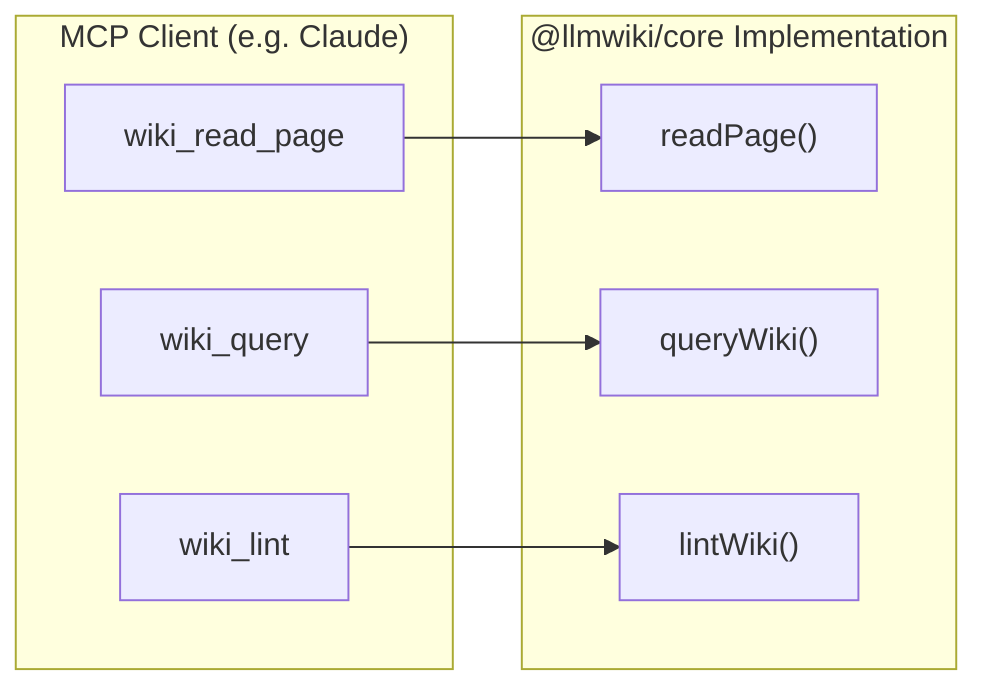
Sources: [packages/core/package.json:28-30](), [packages/core/README.md:27-30](), [packages/core/src/mcp/index.js:16-16]()

For a complete reference of available MCP tools, see [MCP Server](#3).

---

# Page: Wiki File I/O and Index Operations

# Wiki File I/O and Index Operations

<details>
<summary>Relevant source files</summary>

The following files were used as context for generating this wiki page:

- [packages/core/src/index-ops.ts](packages/core/src/index-ops.ts)
- [packages/core/src/log.ts](packages/core/src/log.ts)
- [packages/core/src/sources.ts](packages/core/src/sources.ts)
- [packages/core/src/wiki.ts](packages/core/src/wiki.ts)
- [tests/shared/backlinks.test.ts](tests/shared/backlinks.test.ts)
- [tests/shared/index.test.ts](tests/shared/index.test.ts)
- [tests/shared/log.test.ts](tests/shared/log.test.ts)
- [tests/shared/sources.test.ts](tests/shared/sources.test.ts)
- [tests/shared/wiki.test.ts](tests/shared/wiki.test.ts)
- [tsconfig.json](tsconfig.json)

</details>


This page details the core library functions within `@llmwiki/core` responsible for managing the physical storage and indexing of the wiki. The system treats a directory of Markdown files as a structured database, utilizing YAML frontmatter for metadata and a centralized `index.md` for fast lookups.

## Wiki Page Operations

The primary interface for interacting with individual wiki pages is located in `wiki.ts`. These functions handle the serialization and deserialization of Markdown files containing YAML frontmatter.

### Implementation Details
*   **Data Structure**: The `WikiPage` interface [packages/core/src/wiki.ts:21-24]() encapsulates both the metadata (`frontmatter`) and the markdown content (`body`).
*   **Serialization**: The system uses the `gray-matter` library [packages/core/src/wiki.ts:1-1]() to parse and stringify pages.
*   **I/O Operations**: 
    *   `readPage`: Reads a file and parses it into a `WikiPage` object [packages/core/src/wiki.ts:26-33]().
    *   `writePage`: Ensures the target directory exists via `mkdir` before writing the stringified content [packages/core/src/wiki.ts:35-39]().
    *   `listPages`: Recursively scans a directory for all `.md` files [packages/core/src/wiki.ts:41-51]().

### Natural Language to Code Entity Mapping: Pages
The following diagram maps the logical concept of a "Wiki Page" to the specific code entities that handle its lifecycle.

"Wiki Page Data Flow"
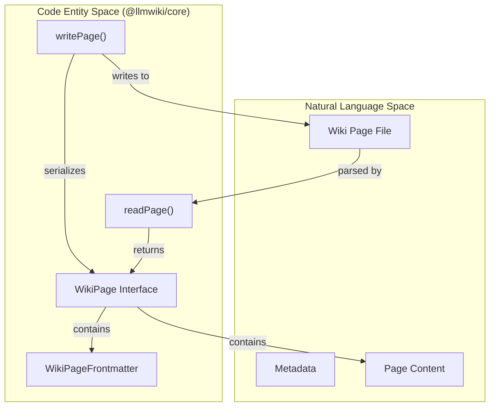
Sources: [packages/core/src/wiki.ts:11-39]()

## Index Operations

The `index.md` file serves as a registry for all pages in the wiki. It is organized by categories (e.g., "Entities", "Concepts") using H2 headers.

### Index Entry Format
Each entry in the index follows a specific Markdown list format:
`- [Title](path) — Summary text #tag1 #tag2`

The `IndexEntry` interface [packages/core/src/index-ops.ts:5-11]() tracks the relative `path`, `title`, `summary`, `category`, and `tags`.

### Key Functions in `index-ops.ts`
| Function | Description |
| :--- | :--- |
| `readIndex` | Parses `index.md` into `IndexEntry[]`, detecting categories via `##` headers [packages/core/src/index-ops.ts:89-121](). |
| `writeIndex` | Groups entries by category and writes them back to `index.md` [packages/core/src/index-ops.ts:127-151](). |
| `updateIndexEntry` | Modifies specific fields of an existing entry based on its `pagePath` [packages/core/src/index-ops.ts:183-200](). |
| `addEntry` | Appends a new entry and persists the change [packages/core/src/index-ops.ts:157-164](). |

### Natural Language to Code Entity Mapping: Indexing
This diagram illustrates how the logical "Wiki Index" is managed by the `index-ops.ts` module.

"Index Management Logic"
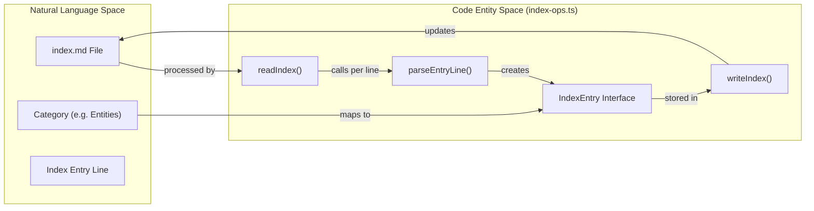
Sources: [packages/core/src/index-ops.ts:5-151]()

## Append-Only Log

The system maintains a chronological record of changes in `log.md`. This is handled by `log.ts`.

*   **Format**: Entries are stored under H2 headers containing the date, verb, and subject: `## [YYYY-MM-DD] verb | subject` [packages/core/src/log.ts:22-22]().
*   **Operations**:
    *   `appendEntry`: Adds a new log entry to the end of the file, auto-generating the date if omitted [packages/core/src/log.ts:17-26]().
    *   `readLog`: Parses the entire log into `LogEntry` objects [packages/core/src/log.ts:32-83]().
    *   `getRecentEntries`: Retrieves the last $N$ entries for display in UIs or status reports [packages/core/src/log.ts:89-98]().

Sources: [packages/core/src/log.ts:5-98]()

## Source File Helpers

The `sources.ts` module provides utilities for managing the "Raw Sources" layer (files that have not yet been ingested into the wiki).

### `listSources`
The `listSources` function [packages/core/src/sources.ts:22-53]() scans the `raw/` directory and returns a `SourceFile` object for every file found. Metadata collected includes:
*   `size`: File size in bytes [packages/core/src/sources.ts:11-11]().
*   `modified`: ISO string of the last modification time [packages/core/src/sources.ts:12-12]().
*   `extension`: File extension including the dot [packages/core/src/sources.ts:15-15]().

Sources: [packages/core/src/sources.ts:5-53]()

## Summary of Data Flow

"Wiki Data Interaction Flow"
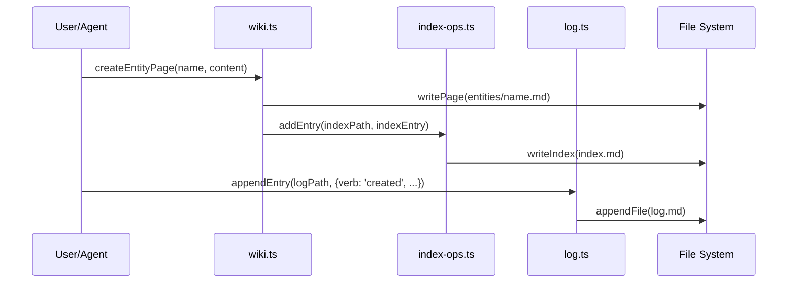
Sources: [packages/core/src/wiki.ts:104-137](), [packages/core/src/index-ops.ts:157-164](), [packages/core/src/log.ts:17-26]()

---

# Page: Ingestion Pipeline

# Ingestion Pipeline

<details>
<summary>Relevant source files</summary>

The following files were used as context for generating this wiki page:

- [packages/core/src/bulk-ingest.ts](packages/core/src/bulk-ingest.ts)
- [packages/core/src/ingest-context.ts](packages/core/src/ingest-context.ts)
- [packages/core/src/ingest.ts](packages/core/src/ingest.ts)
- [packages/core/src/utils.ts](packages/core/src/utils.ts)
- [tests/shared/bulk-ingest.test.ts](tests/shared/bulk-ingest.test.ts)
- [tests/shared/delete.test.ts](tests/shared/delete.test.ts)
- [tests/shared/ingest-context.test.ts](tests/shared/ingest-context.test.ts)

</details>


The ingestion pipeline is responsible for transforming raw source files into structured wiki pages. This lifecycle involves path validation, content extraction, slug generation, and indexing. The pipeline supports both individual file ingestion and high-throughput batch processing.

## Core Ingestion Lifecycle

The primary entry point for ingestion is `ingestSource`. It performs a mechanical transformation of a raw file into a `source` type wiki page.

### Ingestion Data Flow
The following diagram illustrates the transition from a raw file on disk to a structured entity in the Wiki Layer.

**Diagram: Raw Source to Wiki Entity Mapping**
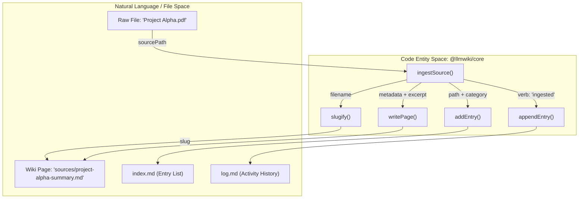
Sources: [packages/core/src/ingest.ts:30-35](), [packages/core/src/utils.ts:5-11](), [packages/core/src/ingest.ts:134-166]()

### Key Implementation Steps
1.  **Path Validation**: The system ensures the `wiki/` directory is initialized [packages/core/src/ingest.ts:42-52]() and validates that the source path does not escape the project root to prevent path traversal [packages/core/src/ingest.ts:55-68]().
2.  **Slug Generation**: The `slugify` function converts filenames (e.g., `Technical Doc v1.pdf`) into clean identifiers (e.g., `technical-doc-v1`) by stripping extensions and replacing non-alphanumeric characters with hyphens [packages/core/src/utils.ts:5-11]().
3.  **Duplicate Detection**: By default, if a summary page for the slug already exists in `wiki/sources/`, the process returns a `skipped` status [packages/core/src/ingest.ts:98-117]().
4.  **Content Preview**: An excerpt of the first 500 characters is generated for the summary page body [packages/core/src/ingest.ts:120-122]().
5.  **Side Effects**:
    *   **Page Creation**: Writes a Markdown file with `type: source` frontmatter [packages/core/src/ingest.ts:134-144]().
    *   **Index Update**: Calls `addEntry` to register the new page in `index.md` [packages/core/src/ingest.ts:151-157]().
    *   **Logging**: Calls `appendEntry` to record the "ingested" event in `log.md` [packages/core/src/ingest.ts:161-165]().

## Bulk Ingestion

The `bulkIngest` function allows for batch processing of entire directories. It iterates through files discovered via `listSources` and invokes `ingestSource` for each.

**Diagram: Bulk Ingest Control Flow**
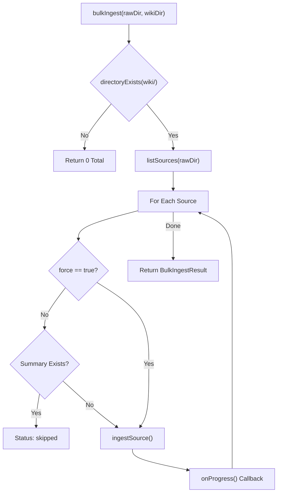
Sources: [packages/core/src/bulk-ingest.ts:33-107](), [packages/core/src/bulk-ingest.ts:73-89]()

### BulkIngestResult Schema
The function returns a comprehensive report of the batch operation:
| Property | Type | Description |
| :--- | :--- | :--- |
| `total` | `number` | Total files discovered in the raw directory. |
| `ingested` | `number` | Number of files successfully written to the wiki. |
| `skipped` | `number` | Number of files skipped (already existed and `force: false`). |
| `failed` | `number` | Number of files that encountered errors during ingestion. |
| `files` | `Array` | List of objects containing individual `file` path and `status`. |

Sources: [packages/core/src/bulk-ingest.ts:22-31]()

## Contextual Enrichment (`ingestWithContext`)

While `ingestSource` handles the mechanical file operations, `ingestWithContext` provides the "Smart Ingest" capabilities used by LLM agents. It enriches the standard `IngestResult` with semantic metadata.

### Enrichment Steps
1.  **Content Type Detection**: Maps file extensions to internal types like `markdown`, `pdf`, `word`, or `latex` [packages/core/src/ingest-context.ts:44-64]().
2.  **Keyword Extraction**: Extracts up to 200 unique, non-stop-word keywords from the first 2000 characters of the text [packages/core/src/ingest-context.ts:74-91]().
3.  **Related Page Discovery**: Uses the extracted keywords to perform a `queryWiki` call, identifying existing pages that might be relevant to the new source [packages/core/src/ingest-context.ts:187-197]().
4.  **Action Suggestions**: Generates a list of `suggested_actions` (e.g., "Create entity pages", "Add crosslinks") based on whether related pages were found [packages/core/src/ingest-context.ts:95-132]().

### IngestWithContextResult Schema
```typescript
export interface IngestWithContextResult {
  ingest: IngestResult;           // The mechanical result from ingestSource
  source_word_count: number;      // Total words in the source
  source_content_type: string;    // Detected type (e.g., 'pdf')
  related_pages: PageInfo[];      // Search results for keyword overlap
  suggested_actions: string[];    // Recommended next steps for the agent
}
```
Sources: [packages/core/src/ingest-context.ts:16-27](), [packages/core/src/ingest-context.ts:146-151]()

## Summary of Key Entities

| Function | File | Role |
| :--- | :--- | :--- |
| `ingestSource` | `ingest.ts` | Core logic for single-file ingestion and indexing. |
| `bulkIngest` | `bulk-ingest.ts` | Orchestrator for batch processing multiple sources. |
| `ingestWithContext` | `ingest-context.ts` | High-level wrapper providing semantic enrichment for LLMs. |
| `slugify` | `utils.ts` | Standardizes filenames into URL/file-friendly slugs. |
| `detectContentType` | `ingest-context.ts` | Heuristic mapping of extensions to content categories. |

Sources: [packages/core/src/ingest.ts:30](), [packages/core/src/bulk-ingest.ts:33](), [packages/core/src/ingest-context.ts:146](), [packages/core/src/utils.ts:5](), [packages/core/src/ingest-context.ts:44]()

---

# Page: Search, Query, and Status

# Search, Query, and Status

<details>
<summary>Relevant source files</summary>

The following files were used as context for generating this wiki page:

- [packages/core/src/query.ts](packages/core/src/query.ts)
- [packages/core/src/search.ts](packages/core/src/search.ts)
- [packages/core/src/status.ts](packages/core/src/status.ts)
- [tests/shared/index.test.ts](tests/shared/index.test.ts)
- [tests/shared/log.test.ts](tests/shared/log.test.ts)
- [tests/shared/wiki.test.ts](tests/shared/wiki.test.ts)
- [tsconfig.json](tsconfig.json)

</details>


This section documents the discovery and introspection capabilities of `@llmwiki/core`. It covers the weighted full-text search algorithm, the structured query engine that generates persistence-ready results, and the status aggregation logic used to monitor the health of the wiki workspace.

## Weighted Search Algorithm

The fundamental unit of discovery in LLM Wiki is a case-insensitive occurrence counter located in `search.ts`. This utility provides the basis for the weighted scoring system used during queries.

### Occurrence Counting
The `countOccurrences` function [packages/core/src/search.ts:4-15]() performs a non-overlapping search for a specific term within a block of text. It normalizes both the haystack and the needle to lowercase before iterating with `indexOf`.

### Scoring Heuristics
When a query is executed via `queryWiki` [packages/core/src/query.ts:41-161](), the system applies a 3-2-1 weighting strategy to determine the relevance of a page based on where the search terms appear:

| Field | Weight | Source |
| :--- | :--- | :--- |
| **Title** | 3× | `IndexEntry.title` from `index.md` |
| **Summary** | 2× | `IndexEntry.summary` from `index.md` |
| **Body** | 1× | Full text of the `.md` file |

Sources: [packages/core/src/search.ts:1-16](), [packages/core/src/query.ts:73-109]()

## Query Engine (`query.ts`)

The `queryWiki` function provides a high-level interface for searching the wiki. It integrates the `index.md` file for fast metadata lookup and falls back to reading individual page bodies for deep content analysis.

### Data Flow: Query Execution
The following diagram illustrates how a natural language query string is transformed into a scored `QueryOutput` object.

**Query Execution Flow**
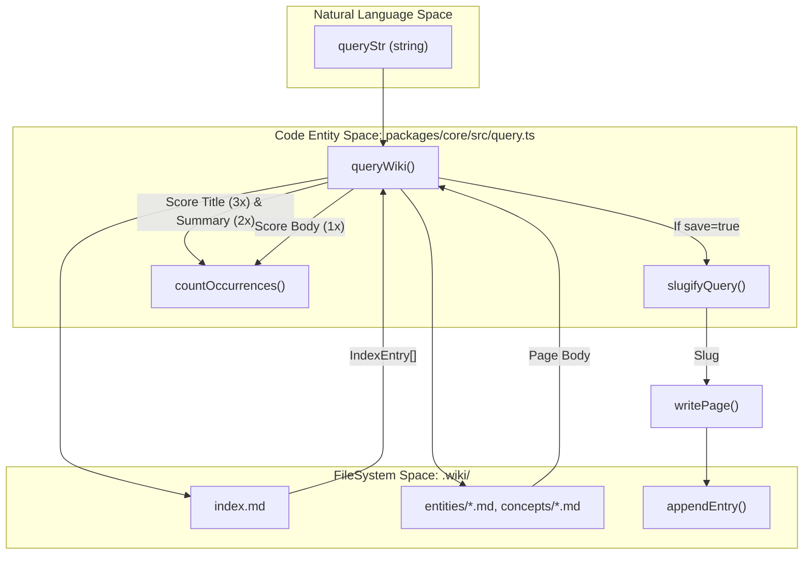
Sources: [packages/core/src/query.ts:41-161](), [packages/core/src/search.ts:4-15](), [packages/core/src/index-ops.ts:20-82]()

### Result Persistence
If the `save` parameter is set to `true`, the engine:
1.  **Slugifies** the query string into a filename (e.g., "Neural Networks" → `queries/neural-networks.md`) [packages/core/src/query.ts:30-36]().
2.  **Generates** a new wiki page with `type: query` in the frontmatter [packages/core/src/query.ts:140-148]().
3.  **Logs** the action in `log.md` with the verb `queried` [packages/core/src/query.ts:151-155]().

## Wiki Status Aggregation (`status.ts`)

The `getWikiStatus` function [packages/core/src/status.ts:27-97]() provides a snapshot of the workspace's health and scale. It aggregates data from the `raw/` directory, the `wiki/` directory, the index, and the append-only log.

### Status Metrics
The `StatusResult` interface [packages/core/src/status.ts:12-21]() includes the following calculated fields:

*   **Source Count**: Total files in the `raw/` directory [packages/core/src/status.ts:35-42]().
*   **Wiki Page Count**: Total `.md` files in `wiki/`, excluding `index.md` and `log.md` [packages/core/src/status.ts:45-50]().
*   **Last Ingest/Lint Dates**: Extracted by filtering `log.md` entries for specific verbs [packages/core/src/status.ts:53-69]().
*   **Orphan Page Count**: Number of wiki pages that exist on disk but are not listed in `index.md` [packages/core/src/status.ts:72-78]().
*   **Index Coverage**: Percentage of wiki pages that are correctly indexed [packages/core/src/status.ts:81-85]().

### Status Data Flow
The status module bridges high-level workspace concepts to low-level file system operations.

**Status Aggregation Logic**
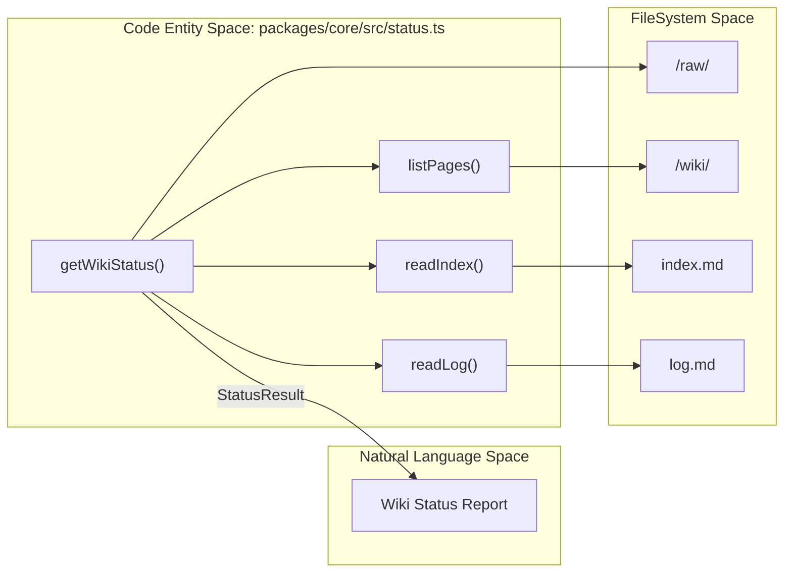
Sources: [packages/core/src/status.ts:27-97](), [packages/core/src/wiki.ts:89-105](), [packages/core/src/log.ts:14-68]()

## Implementation Details

### Query Output Structure
The `QueryOutput` [packages/core/src/query.ts:18-25]() ensures that agents and UI components receive standardized data, including excerpts generated by the `excerpt` utility [packages/core/src/query.ts:107]().

```typescript
export interface QueryOutput {
  command: string;      // Always 'query'
  api_version: string;  // Current API version
  query: string;        // The original query string
  matches: number;      // Count of results
  results: QueryResult[];
  saved?: string;       // Path to saved query page, if applicable
}
```
Sources: [packages/core/src/query.ts:11-25]()

### Error Handling
The query and status functions are designed to be resilient to uninitialized workspaces. If `wiki/` or `raw/` directories are missing, the functions return empty results or zeroed metrics rather than throwing, using the `isNotFoundError` helper [packages/core/src/query.ts:50-58](), [packages/core/src/status.ts:39-42]().

Sources: [packages/core/src/query.ts:98-101](), [packages/core/src/status.ts:39-42]()

---

# Page: Linting and Health Checks

# Linting and Health Checks

<details>
<summary>Relevant source files</summary>

The following files were used as context for generating this wiki page:

- [packages/core/src/lint.ts](packages/core/src/lint.ts)
- [tests/shared/crosslinks.test.ts](tests/shared/crosslinks.test.ts)
- [tests/shared/lint-fix.test.ts](tests/shared/lint-fix.test.ts)
- [tests/shared/lint.test.ts](tests/shared/lint.test.ts)
- [tests/shared/mcp/crosslinks-index.test.ts](tests/shared/mcp/crosslinks-index.test.ts)
- [tests/shared/update-index-entry.test.ts](tests/shared/update-index-entry.test.ts)
- [tests/shared/wiki-rename.test.ts](tests/shared/wiki-rename.test.ts)

</details>


The LLM Wiki system includes a robust linting and health check engine designed to maintain the integrity of the knowledge base. This system identifies structural issues, missing metadata, and broken relationships between pages, providing both diagnostic reports and automated repair capabilities.

## Overview

The linting system is primarily implemented in `packages/core/src/lint.ts`. It operates by scanning the `.wiki/` directory, analyzing the `index.md` file, and parsing the frontmatter and body of all Markdown pages to build a graph of the wiki's health.

### Key Data Structures

#### LintFinding
The `LintFinding` interface represents a single issue discovered during a scan.
[packages/core/src/lint.ts:8-13]()

| Property | Type | Description |
| :--- | :--- | :--- |
| `severity` | `'error' \| 'warning' \| 'info'` | The impact level of the finding. |
| `category` | `string` | The type of check (e.g., `broken-links`). |
| `message` | `string` | Human-readable description of the issue. |
| `file` | `string` (optional) | Relative path to the file where the issue was found. |

#### LintResult
The `LintResult` interface provides a comprehensive summary of a linting run, including aggregate counts and versioning information.
[packages/core/src/lint.ts:15-23]()

**Sources:** [packages/core/src/lint.ts:8-23]()

---

## Lint Categories

The system implements six distinct linting categories. Each category targets a specific aspect of wiki health.

### 1. Broken Links (`broken-links`)
Identifies Markdown links that point to files that do not exist within the wiki directory. It resolves relative paths based on the source page's location and ignores external URLs (http/https).
[packages/core/src/lint.ts:102-116](), [tests/shared/lint.test.ts:77-90]()

### 2. Orphan Pages (`orphan-pages`)
Detects "lost" content. A page is considered an orphan if it has no inbound links from other pages AND is not listed in the `index.md`.
[packages/core/src/lint.ts:119-130]()

### 3. Index Completeness (`index-completeness`)
Ensures that every physical `.md` file in the wiki (excluding `index.md` and `log.md`) has a corresponding entry in the `index.md` file.
[packages/core/src/lint.ts:133-144]()

### 4. Stale Entries (`stale-entries`)
The inverse of index completeness. It identifies entries in `index.md` that point to file paths that no longer exist on disk.
[packages/core/src/lint.ts:147-160]()

### 5. Missing Pages (`missing-pages`)
A specialized "info" category that dedupes unique missing link targets across the entire wiki, highlighting content gaps that may need to be created.
[packages/core/src/lint.ts:163-178]()

### 6. Frontmatter Validation (`frontmatter-validation`)
Validates the YAML frontmatter of pages. It checks for:
- Presence of required fields: `type` and `title`.
- Validity of `type` (must be one of: `entity`, `concept`, `source`, `summary`, `query`).
- Presence of the `tags` array.
[packages/core/src/lint.ts:181-218]()

**Sources:** [packages/core/src/lint.ts:102-218](), [tests/shared/lint.test.ts:9-155]()

---

## Data Flow and Implementation

The `lintWiki` function follows a multi-step pipeline to gather the necessary context before executing individual checks.

### Natural Language Space to Code Entity Space: Linting Logic
The following diagram maps the logical health checks to the internal functions and state used to evaluate them.

Title: Linting Logic Flow
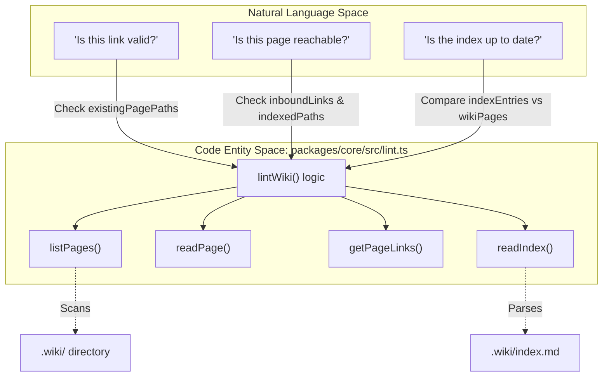
**Sources:** [packages/core/src/lint.ts:46-100]()

### Implementation Detail: `lintWiki`
The function first filters out non-content files (like the index and log) using `listPages` [packages/core/src/lint.ts:60-64](). It then populates several maps:
- `pageContents`: Maps full paths to body text.
- `pageFrontmatter`: Maps paths to parsed frontmatter objects.
- `pageLinks`: Maps pages to their resolved relative link targets.
- `inboundLinks`: A set of all paths that are referenced by at least one other page.
[packages/core/src/lint.ts:72-95]()

---

## Automated Repair: `lintFix`

The `lintFix` function provides an "auto-repair" capability that attempts to resolve findings discovered by `lintWiki`.

### Fix Strategies
| Category | Repair Action |
| :--- | :--- |
| `stale-entries` | Removes the entry from `index.md` using `removeEntry`. [packages/core/src/lint.ts:285-288]() |
| `index-completeness` | Adds a new entry to `index.md` using `addEntry`, deriving the title from frontmatter or the filename. [packages/core/src/lint.ts:291-306]() |
| `frontmatter-validation` | Injects missing fields (default `type: 'entity'`, empty `tags: []`, or derived `title`) into the file using `writePage`. [packages/core/src/lint.ts:311-344]() |

### Natural Language Space to Code Entity Space: Auto-Repair
The following diagram illustrates how the system transitions from identifying a problem to applying a persistent fix.

Title: Auto-Repair (lintFix) Sequence
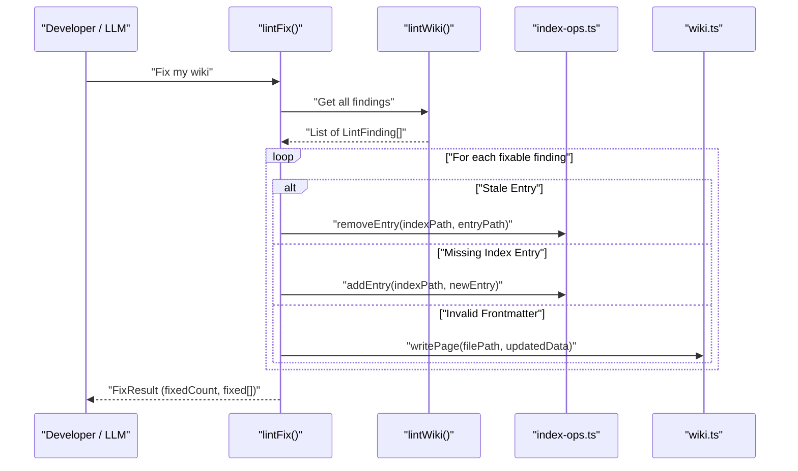
**Sources:** [packages/core/src/lint.ts:255-356](), [tests/shared/lint-fix.test.ts:21-182]()

---

## Integration and Usage

### MCP Integration
The linting engine is exposed to LLMs via the Model Context Protocol.
- `wiki_lint`: Calls `lintWiki` and returns a JSON summary.
- `wiki_fix`: Calls `lintFix` to perform automated maintenance.

### VS Code Integration
The VS Code extension uses `lintWiki` to populate the **Lint Findings** tree view. The `llmwiki.fix` command triggers the `lintFix` function and provides progress reporting.

**Sources:** [packages/core/src/lint.ts:46-49](), [packages/core/src/lint.ts:255-258]()

---

# Page: MCP Server

# MCP Server

<details>
<summary>Relevant source files</summary>

The following files were used as context for generating this wiki page:

- [docs/mcp-tools.md](docs/mcp-tools.md)
- [packages/core/src/mcp/bin.ts](packages/core/src/mcp/bin.ts)
- [packages/core/src/mcp/index.ts](packages/core/src/mcp/index.ts)
- [packages/core/src/mcp/server.ts](packages/core/src/mcp/server.ts)

</details>


The `llmwiki` MCP server implements the [Model Context Protocol](https://modelcontextprotocol.io/) to expose wiki operations to LLM agents. It allows tools like GitHub Copilot, Claude Desktop, or Cursor to programmatically interact with the wiki's structured knowledge base. The server is implemented in `@llmwiki/core` and typically runs as a sidecar process using **stdio transport**.

### Architecture Overview

The server is built using the `@modelcontextprotocol/sdk` and acts as a bridge between the **Natural Language Space** (LLM prompts/tools) and the **Code Entity Space** (the wiki filesystem and core logic).

#### Process Lifecycle
1.  **Launcher**: The `llmwiki-mcp` binary [packages/core/src/mcp/bin.ts:1-23]() resolves the wiki root and initializes the server.
2.  **Creation**: `createMcpServer` [packages/core/src/mcp/server.ts:25-65]() instantiates the MCP `Server` class, registering tools, resources, and prompts.
3.  **Transport**: It connects via `StdioServerTransport` [packages/core/src/mcp/bin.ts:44-45](), allowing standard I/O communication with the host application.
4.  **Dispatch**: The server uses a unified request handler [packages/core/src/mcp/server.ts:37-56]() to route incoming tool calls to either `handleReadToolCall` or `handleWriteToolCall`.

#### Natural Language to Code Entity Mapping

This diagram illustrates how the MCP Server maps protocol-level requests to specific implementation functions within the `@llmwiki/core` library.

**MCP Tool Dispatch Map**
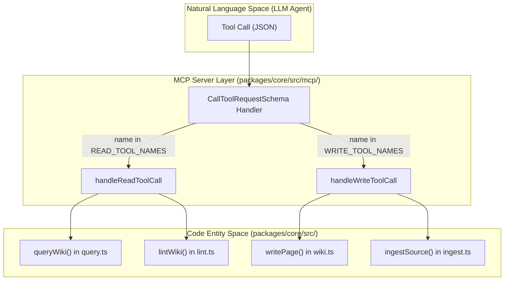
Sources: [packages/core/src/mcp/server.ts:37-56](), [packages/core/src/mcp/read-tools.ts:1-20](), [packages/core/src/mcp/write-tools.ts:1-20]()

---

### Tool Categories

The server exposes **14 tools** in total, split between read-only inspection and state-modifying operations.

| Category | Tool Count | Primary Responsibility |
| :--- | :--- | :--- |
| **Read Tools** | 7 | Search, status reporting, linting, and content retrieval. |
| **Write Tools** | 7 | Page creation, cross-linking, and the context-aware ingestion workflow. |

For a full list of tool definitions, see [docs/mcp-tools.md:7-26]().

#### Read Tools
Read tools allow the agent to explore the wiki without modifying files. They wrap core functions like `queryWiki` for search and `lintWiki` for health checks.
*   **Key Tools**: `wiki_status`, `wiki_query`, `wiki_lint`, `wiki_read_page`.
*   For details, see [MCP Read Tools Reference](#3.1).

#### Write Tools
Write tools enable the agent to build the wiki. These tools enforce the schema defined in `AGENTS.md` by providing specific helpers for "entities" and "concepts."
*   **Key Tools**: `wiki_write_page`, `wiki_create_entity`, `wiki_add_crosslinks`, `wiki_ingest_with_context`.
*   For details, see [MCP Write Tools Reference](#3.2).

---

### Data Flow: Smart Ingest Workflow

The most complex interaction in the MCP server is the **Smart Ingest** pattern. Instead of simple file copying, the agent uses a multi-step process to ensure the wiki remains a "High-Density Knowledge Base."

**Smart Ingest Sequence**
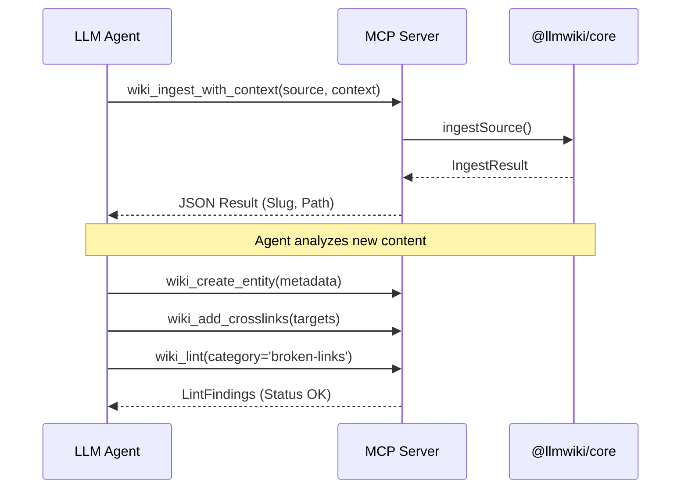
Sources: [docs/mcp-tools.md:253-280](), [packages/core/src/ingest.ts:1-50]()

For a step-by-step guide on implementing this flow in an agent, see [Smart Ingest Workflow](#3.3).

---

### Security and Constraints

The MCP server implements a strict security model to prevent agents from accessing files outside the designated wiki workspace.
*   **Path Validation**: Every tool that accepts a path argument calls `assertWithinDir` [packages/core/src/mcp/read-tools.ts:1-10]() to ensure the operation is confined to the `wikiRoot`.
*   **Stdio Isolation**: By using stdio, the server inherits the permissions of the host process (e.g., VS Code or the terminal user).
*   **JSON Only**: All tool outputs are returned as JSON text content [docs/mcp-tools.md:41-42](), ensuring structured data is always available for agent parsing.

Sources: [docs/mcp-tools.md:30-43](), [packages/core/src/mcp/server.ts:49-56]()

---

# Page: MCP Read Tools Reference

# MCP Read Tools Reference

<details>
<summary>Relevant source files</summary>

The following files were used as context for generating this wiki page:

- [docs/mcp-tools.md](docs/mcp-tools.md)
- [packages/core/src/mcp/prompts.ts](packages/core/src/mcp/prompts.ts)
- [packages/core/src/mcp/read-tools.ts](packages/core/src/mcp/read-tools.ts)
- [packages/core/src/mcp/resources.ts](packages/core/src/mcp/resources.ts)
- [tests/shared/mcp/prompts.test.ts](tests/shared/mcp/prompts.test.ts)
- [tests/shared/mcp/resources.test.ts](tests/shared/mcp/resources.test.ts)

</details>


The `llmwiki` MCP server provides 7 read-only tools designed to allow Model Context Protocol (MCP) clients—such as LLM agents—to inspect, query, and audit the wiki workspace. These tools bridge the gap between the natural language intent of an agent and the underlying file-based storage of the wiki.

## Architecture and Data Flow

Read tools are implemented in `@llmwiki/core` and follow a request-response pattern over the MCP stdio transport. When a tool is called, the `handleReadToolCall` function dispatches the request to the appropriate core logic function.

### Natural Language to Code Entity Mapping

The following diagram illustrates how natural language tool requests are mapped to specific code entities and data structures within the `@llmwiki/core` package.

**Read Tool Mapping**
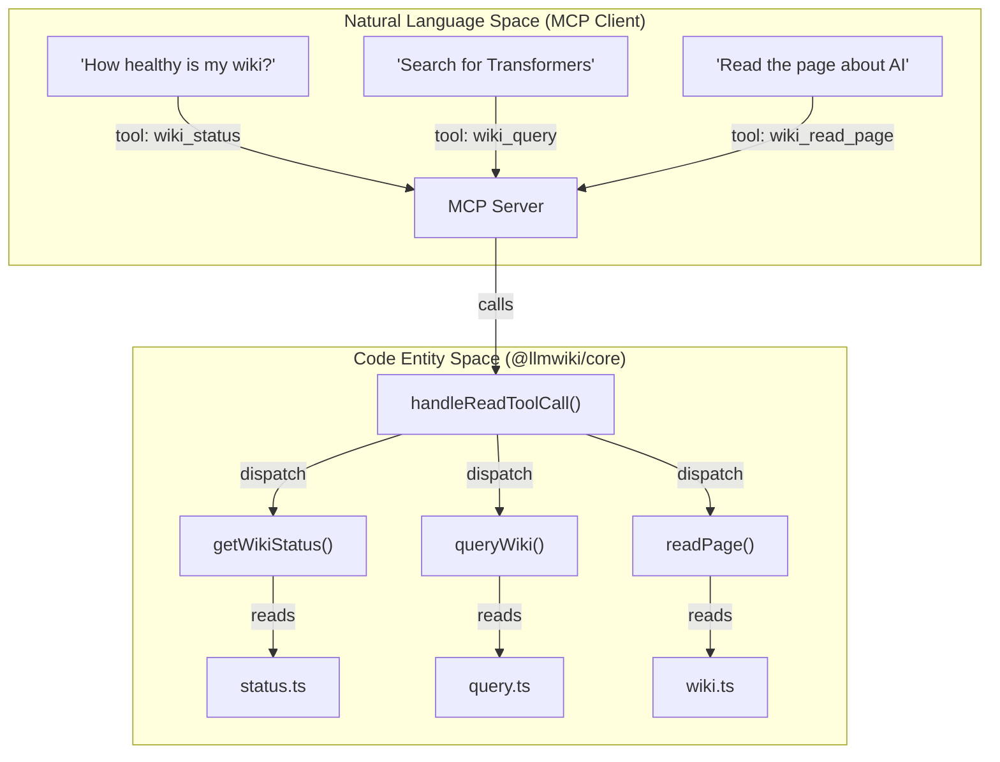
**Sources:** [packages/core/src/mcp/read-tools.ts:149-205](), [docs/mcp-tools.md:30-43]()

### Tool Execution Flow

Every read tool request passes through a validation layer to ensure path safety and argument integrity before interacting with the file system.

**Read Tool Data Flow**
```mermaid
sequenceDiagram
    participant Agent as MCP Client
    participant Server as handleReadToolCall
    participant Guard as assertWithinDir
    participant Core as Core Logic (@llmwiki/core)
    participant FS as .wiki/ Directory

    Agent->>Server: Tool Call (e.g., wiki_read_page)
    Server->>Guard: Validate path (prevent traversal)
    Guard-->>Server: Path Validated
    Server->>Core: Call core function (e.g., readPage)
    Core->>FS: Read Markdown/JSON
    FS-->>Core: Raw Content
    Core-->>Server: Parsed Object
    Server-->>Agent: JSON Response
```
**Sources:** [packages/core/src/mcp/read-tools.ts:139-146](), [packages/core/src/mcp/read-tools.ts:149-205]()

---

## Tool Reference

### 1. `wiki_status`
Returns high-level health and size metrics for the wiki workspace.

*   **Input**: `{}` (No parameters)
*   **Implementation**: Calls `getWikiStatus(wikiRoot)` [packages/core/src/mcp/read-tools.ts:160-160]().
*   **Output Shape**:
    | Field | Type | Description |
    | :--- | :--- | :--- |
    | `sourceCount` | `number` | Total raw source files in `raw/` |
    | `wikiPageCount` | `number` | Total generated pages in `wiki/` |
    | `lastIngestDate` | `string` | ISO timestamp of last ingest |
    | `lastLintDate` | `string` | ISO timestamp of last lint |
    | `orphanPageCount` | `number` | Pages not in `index.md` |
    | `indexCoveragePct`| `number` | Percentage of pages indexed |

**Sources:** [docs/mcp-tools.md:69-105](), [packages/core/src/mcp/read-tools.ts:19-29]()

### 2. `wiki_query`
Performs a weighted full-text search across all wiki pages.

*   **Input**: `{ "query": string }`
*   **Implementation**: Calls `queryWiki(query, wikiRoot)` [packages/core/src/mcp/read-tools.ts:162-165]().
*   **Relevance Scoring**:
    *   Title Match: 3x weight
    *   Summary Match: 2x weight
    *   Body Match: 1x weight
*   **Output**: Array of `{ title, path, score, excerpt }`.

**Sources:** [docs/mcp-tools.md:109-151](), [packages/core/src/mcp/read-tools.ts:31-42]()

### 3. `wiki_lint`
Audits the wiki for structural integrity issues.

*   **Input**: `{ "category"?: string }`
*   **Categories**: `broken-links`, `orphan-pages`, `index-completeness`, `stale-entries`, `missing-pages`, `frontmatter-validation`.
*   **Implementation**: Calls `lintWiki(wikiRoot, categories)` [packages/core/src/mcp/read-tools.ts:167-172]().
*   **Output**: Object containing `findings` array and `errorCount`, `warningCount`, `infoCount`.

**Sources:** [docs/mcp-tools.md:155-194](), [packages/core/src/mcp/read-tools.ts:44-58]()

### 4. `wiki_list_pages`
Lists all generated wiki pages and their metadata.

*   **Input**: `{}`
*   **Implementation**: Iterates over `listPages()` and calls `readPage()` for each to extract frontmatter [packages/core/src/mcp/read-tools.ts:174-188]().
*   **Output**: Array of `{ path, frontmatter }`.

**Sources:** [docs/mcp-tools.md:198-234](), [packages/core/src/mcp/read-tools.ts:60-69]()

### 5. `wiki_list_sources`
Lists all files in the `raw/` directory that are available for ingestion.

*   **Input**: `{}`
*   **Implementation**: Calls `listSources(rawDir)` [packages/core/src/mcp/read-tools.ts:190-191]().
*   **Output**: Array of `{ name, path, size, mtime, extension }`.

**Sources:** [docs/mcp-tools.md:238-242](), [packages/core/src/mcp/read-tools.ts:71-80]()

### 6. `wiki_read_page`
Retrieves the full content and metadata of a specific wiki page.

*   **Input**: `{ "path": string }` (e.g., `"entities/openai.md"`)
*   **Security**: Uses `assertWithinDir` to prevent path traversal attacks [packages/core/src/mcp/read-tools.ts:195-195]().
*   **Implementation**: Calls `readPage(fullPath)` [packages/core/src/mcp/read-tools.ts:196-196]().
*   **Output**: `{ frontmatter: object, body: string }`.

**Sources:** [packages/core/src/mcp/read-tools.ts:82-96](), [packages/core/src/mcp/read-tools.ts:139-146]()

### 7. `wiki_read_index`
Reads the central `index.md` file which serves as the wiki's registry.

*   **Input**: `{}`
*   **Implementation**: Calls `readIndex(indexPath)` [packages/core/src/mcp/read-tools.ts:200-200]().
*   **Output**: Array of `IndexEntry` objects (path, title, summary, category, tags).

**Sources:** [packages/core/src/mcp/read-tools.ts:98-107](), [packages/core/src/index-ops.ts:21-21]()

---

## Resource-Based Alternatives

In addition to tools, the MCP server exposes **Resources**, which allow agents to browse the wiki without explicit tool execution.

| Resource URI | Description | MIME Type |
| :--- | :--- | :--- |
| `resource://wiki/index` | Full wiki index | `application/json` |
| `resource://wiki/pages` | List of all pages | `application/json` |
| `resource://wiki/sources` | List of all raw sources | `application/json` |
| `resource://wiki/pages/{path}` | Single page content | `application/json` |
| `resource://wiki/sources/{path}` | Raw source content | `text/plain` |

**Sources:** [packages/core/src/mcp/resources.ts:39-85](), [tests/shared/mcp/resources.test.ts:127-155]()

---

# Page: MCP Write Tools Reference

# MCP Write Tools Reference

<details>
<summary>Relevant source files</summary>

The following files were used as context for generating this wiki page:

- [docs/mcp-tools.md](docs/mcp-tools.md)
- [packages/core/src/mcp/write-tools.ts](packages/core/src/mcp/write-tools.ts)
- [tests/shared/mcp/server-integration.test.ts](tests/shared/mcp/server-integration.test.ts)
- [tests/shared/mcp/write-tools.test.ts](tests/shared/mcp/write-tools.test.ts)
- [tests/shared/wiki-create-pages.test.ts](tests/shared/wiki-create-pages.test.ts)

</details>


The `llmwiki` MCP server exposes 7 write tools designed to allow LLM agents to programmatically modify the wiki. These tools handle the complexities of frontmatter formatting, file system operations, and index synchronization, ensuring that any programmatic change maintains the structural integrity of the wiki workspace.

## Architecture and Data Flow

Write tools are implemented in the `@llmwiki/core` package. When a tool is called, the server validates the input against a JSON schema, performs path traversal checks, and then invokes the corresponding core library function.

### Write Operation Lifecycle

The following diagram illustrates the data flow from an MCP tool call through the core logic to the filesystem.

**Figure: MCP Write Tool Data Flow**
```mermaid
graph TD
    subgraph "MCP Server Layer"
        A["handleWriteToolCall"] -- "Validates Schema" --> B["WRITE_TOOLS Definitions"]
        B -- "Path Security Check" --> C["assertWithinDir"]
    end

    subgraph "Core Logic (@llmwiki/core)"
        C -- "wiki_write_page" --> D["writePage()"]
        C -- "wiki_create_entity" --> E["createEntityPage()"]
        C -- "wiki_update_index" --> F["updateIndexEntry()"]
        C -- "wiki_ingest_with_context" --> G["ingestWithContext()"]
    end

    subgraph "Storage Layer (Code Entity Space)"
        D -- "File I/O" --> H[".wiki/pages/*.md"]
        E -- "File I/O" --> H
        D -- "Index Sync" --> I[".wiki/index.md"]
        F -- "Index Update" --> I
        G -- "Raw Management" --> J[".wiki/raw/"]
    end

    style A stroke-width:2px
    style D stroke-width:2px
    style H stroke-width:2px
```
Sources: [packages/core/src/mcp/write-tools.ts:15-213](), [packages/core/src/wiki.ts:60-120](), [packages/core/src/index-ops.ts:90-115]()

## Security Model

The write tools enforce several security constraints to prevent workspace corruption:
1.  **Path Traversal Protection**: The `assertWithinDir` utility ensures all file operations remain within the `.wiki/` or project root directories [packages/core/src/mcp/read-tools.ts:316-328]().
2.  **Input Size Limits**: Maximum body content is capped at 1,000,000 characters (`MAX_BODY_SIZE`) to prevent DoS attacks via unbounded input [packages/core/src/mcp/write-tools.ts:219-221]().
3.  **Schema Validation**: Every tool call is strictly validated against `inputSchema` before execution [packages/core/src/mcp/write-tools.ts:16-213]().

Sources: [packages/core/src/mcp/write-tools.ts:219-225](), [packages/core/src/mcp/read-tools.ts:316-328]()

---

## Tool Reference

### `wiki_write_page`
Creates or overwrites a wiki page. This is the primary tool for general content creation. It automatically generates the required frontmatter and updates the `index.md` entry.

| Parameter | Type | Required | Description |
| :--- | :--- | :--- | :--- |
| `pagePath` | string | Yes | Path relative to `wiki/` (e.g., `concepts/ai.md`) |
| `title` | string | Yes | The display title of the page |
| `type` | string | Yes | Metadata type (e.g., `entity`, `concept`, `source`) |
| `tags` | string[] | No | Optional array of tags |
| `body` | string | Yes | Markdown content |

**Implementation Detail**: This tool calls `writePage` [packages/core/src/wiki.ts:60-75]() and then derives a category from the `pagePath` to call `addEntry` in `index-ops.ts` [packages/core/src/index-ops.ts:117-145]().

Sources: [packages/core/src/mcp/write-tools.ts:18-49](), [tests/shared/mcp/write-tools.test.ts:29-56]()

### `wiki_create_entity` & `wiki_create_concept`
Specialized wrappers for creating standard wiki types. They handle slugification of the name automatically (e.g., "Artificial Intelligence" becomes `concepts/artificial-intelligence.md`).

| Parameter | Type | Required | Description |
| :--- | :--- | :--- | :--- |
| `name` | string | Yes | Name used for title and slugified filename |
| `content` | string | Yes | Markdown body content |
| `tags` | string[] | No | Optional tags |

**Logic Flow**:
1.  Slugify the `name` using `slugify()` [packages/core/src/utils.ts:1-10]().
2.  Call `createEntityPage` or `createConceptPage` [packages/core/src/wiki.ts:230-280]().
3.  Update the index with a new `IndexEntry`.

Sources: [packages/core/src/mcp/write-tools.ts:50-99](), [tests/shared/wiki-create-pages.test.ts:21-50]()

### `wiki_update_page`
Performs partial updates to an existing page. It can merge frontmatter (title, type, tags) and either append to or replace the body.

| Parameter | Type | Required | Description |
| :--- | :--- | :--- | :--- |
| `pagePath` | string | Yes | Target page path |
| `title` | string | No | New title (merges if provided) |
| `bodyAppend` | string | No | Appends to existing body |
| `bodyReplace` | string | No | Replaces entire body |

Sources: [packages/core/src/mcp/write-tools.ts:100-136](), [tests/shared/mcp/write-tools.test.ts:168-200]()

### `wiki_add_crosslinks`
Appends a "See also" section to the bottom of a page with links to other wiki pages. It validates that all target pages exist before writing.

**Code Entity Mapping**:
-   **Source**: `handleWriteToolCall` for `wiki_add_crosslinks` [packages/core/src/mcp/write-tools.ts:370-400]()
-   **Internal Function**: `addCrosslinks` in `wiki.ts` [packages/core/src/wiki.ts:300-330]()

Sources: [packages/core/src/mcp/write-tools.ts:138-157](), [packages/core/src/wiki.ts:300-330]()

### `wiki_update_index`
Directly modifies the metadata for a page entry in `index.md` without necessarily changing the page file itself. Useful for batch tagging or summary generation.

| Parameter | Type | Description |
| :--- | :--- | :--- |
| `summary` | string | Updates the `summary` field in `IndexEntry` |
| `category` | string | Moves the entry to a different index category |

Sources: [packages/core/src/mcp/write-tools.ts:159-186](), [packages/core/src/index-ops.ts:90-115]()

### `wiki_ingest_with_context`
An advanced ingestion tool that not only imports a raw source but also returns an `IngestContext` object. This context includes:
-   `relatedPages`: Existing wiki pages that share tags or keywords.
-   `suggestedActions`: Recommended next steps (e.g., "Create entity X").
-   `contentAnalysis`: Word count and detected content type.

**Figure: Smart Ingest Pipeline**
```mermaid
sequenceDiagram
    participant Agent as "LLM Agent"
    participant Tool as "wiki_ingest_with_context"
    participant Pipe as "IngestionPipeline"
    participant Search as "SearchIndex"

    Agent->>Tool: sourcePath: "paper.pdf"
    Tool->>Pipe: ingestSource()
    Pipe-->>Tool: IngestResult (Slug, Path)
    Tool->>Search: queryWiki(sourceContent)
    Search-->>Tool: Related Pages
    Tool-->>Agent: IngestContext + Suggestions
```
Sources: [packages/core/src/mcp/write-tools.ts:188-212](), [packages/core/src/ingest-context.ts:10-50]()

## Integration Example

When an agent needs to add new information about a person discovered in a source file, it follows this sequence:

1.  **Ingest**: `wiki_ingest_with_context(sourcePath: "interview.txt")`
2.  **Create**: `wiki_create_entity(name: "John Doe", content: "...")`
3.  **Link**: `wiki_add_crosslinks(pagePath: "entities/john-doe.md", targetPages: ["concepts/engineering.md"])`
4.  **Index**: `wiki_update_index(pagePath: "entities/john-doe.md", summary: "Lead engineer at X")`

Sources: [tests/shared/mcp/server-integration.test.ts:155-165](), [docs/mcp-tools.md:25-27]()

---

# Page: Smart Ingest Workflow

# Smart Ingest Workflow

<details>
<summary>Relevant source files</summary>

The following files were used as context for generating this wiki page:

- [docs/workflows/smart-ingest.md](docs/workflows/smart-ingest.md)
- [packages/core/src/mcp/read-tools.ts](packages/core/src/mcp/read-tools.ts)
- [packages/core/src/mcp/write-tools.ts](packages/core/src/mcp/write-tools.ts)
- [tests/shared/mcp/smart-ingest-workflow.test.ts](tests/shared/mcp/smart-ingest-workflow.test.ts)

</details>


The **Smart Ingest Workflow** is the primary pattern for expanding a wiki using LLM assistance. While standard ingestion is a mechanical process of copying files and generating summaries, "Smart Ingest" uses contextual signals to connect new information to existing knowledge [docs/workflows/smart-ingest.md:5-17](). This workflow is facilitated by the Model Context Protocol (MCP) server provided by `@llmwiki/core` [docs/workflows/smart-ingest.md:19-23]().

## Workflow Overview

The workflow consists of a 7-step structured pipeline where an LLM agent moves from raw data ingestion to knowledge graph enrichment and health verification [docs/workflows/smart-ingest.md:40-79]().

### Natural Language to Code Entity Mapping: Ingest Pipeline
This diagram maps the conceptual "Smart Ingest" steps to the specific MCP tool definitions and core functions that execute them.

| Step | MCP Tool Name | Core Function / Implementation |
| :--- | :--- | :--- |
| **1. Ingest** | `wiki_ingest_with_context` | `ingestWithContext` in [packages/core/src/ingest-context.ts:18-115]() |
| **2. Read** | `wiki_read_page` | `readPage` in [packages/core/src/wiki.ts:46-64]() |
| **3. Create Entity** | `wiki_create_entity` | `createEntityPage` in [packages/core/src/wiki.ts:133-149]() |
| **4. Create Concept** | `wiki_create_concept` | `createConceptPage` in [packages/core/src/wiki.ts:151-167]() |
| **5. Crosslink** | `wiki_add_crosslinks` | `addCrosslinks` in [packages/core/src/wiki.ts:183-213]() |
| **6. Update** | `wiki_update_page` | `writePage` in [packages/core/src/wiki.ts:66-93]() |
| **7. Health Check** | `wiki_lint` | `lintWiki` in [packages/core/src/lint.ts:68-112]() |

**Sources:** [docs/workflows/smart-ingest.md:40-79](), [packages/core/src/mcp/write-tools.ts:16-213](), [packages/core/src/mcp/read-tools.ts:18-108]().

## Step-by-Step Technical Detail

### 1. Contextual Ingestion
The agent calls `wiki_ingest_with_context` [packages/core/src/mcp/write-tools.ts:188-212](). Unlike a standard ingest, this tool returns `related_pages` (discovered via `queryWiki`) and `suggested_actions` [packages/core/src/ingest-context.ts:18-115]().

### 2. Analysis & Inspection
The agent analyzes the `related_pages` and `source_word_count`. It may use `wiki_read_page` to fetch the full content of existing pages to determine how to merge new information without duplication [docs/workflows/smart-ingest.md:165-185]().

### 3. Entity & Concept Creation
The agent extracts named entities (people, orgs) and technical concepts. It uses:
- `wiki_create_entity`: Generates a page in `wiki/entities/{slug}.md` [packages/core/src/wiki.ts:133-149]().
- `wiki_create_concept`: Generates a page in `wiki/concepts/{slug}.md` [packages/core/src/wiki.ts:151-167]().

Both tools automatically update the `index.md` via `updateIndexEntry` [packages/core/src/index-ops.ts:80-111]().

### 4. Knowledge Graph Connection
To prevent "orphan pages," the agent calls `wiki_add_crosslinks` [packages/core/src/mcp/write-tools.ts:138-157](). This function appends a "See also" section to the `pagePath` containing links to the `targetPages` [packages/core/src/wiki.ts:183-213]().

### 5. Verification
Finally, the agent calls `wiki_lint` to ensure the ingestion didn't introduce broken links or missing metadata [packages/core/src/mcp/read-tools.ts:44-58]().

## Data Flow Diagram: MCP to Core
This diagram illustrates how an MCP tool request flows through the server dispatchers into the core library functions.

```mermaid
graph TD
    subgraph "MCP_Server_Layer"
        A["stdio_transport"] --> B["handleWriteToolCall"]
        B -- "name: wiki_ingest_with_context" --> C["ingestWithContext"]
        B -- "name: wiki_create_entity" --> D["createEntityPage"]
    end

    subgraph "Core_Library_@llmwiki/core"
        C --> E["ingestSource"]
        C --> F["queryWiki"]
        D --> G["writePage"]
        D --> H["updateIndexEntry"]
        G --> I["node:fs/promises"]
        H --> I
    end

    subgraph "FileSystem_Layer"
        I --> J[".wiki/raw/"]
        I --> K[".wiki/wiki/"]
        I --> L[".wiki/wiki/index.md"]
    end
```
**Sources:** [packages/core/src/mcp/write-tools.ts:241-320](), [packages/core/src/ingest-context.ts:40-115](), [packages/core/src/wiki.ts:133-149](), [packages/core/src/index-ops.ts:80-111]().

## Implementation Reference

### Key Tool Definitions
| Tool | Input Requirement | Behavior |
| :--- | :--- | :--- |
| `wiki_ingest_with_context` | `sourcePath` (string) | Ingests, then runs a search for similar content [packages/core/src/mcp/write-tools.ts:188-212](). |
| `wiki_update_page` | `pagePath` (string) | Supports `bodyAppend` or `bodyReplace` to modify existing content [packages/core/src/mcp/write-tools.ts:101-136](). |
| `wiki_lint` | `category` (optional) | Validates the health of the entire `.wiki` directory [packages/core/src/mcp/read-tools.ts:44-58](). |

### Security and Validation
- **Path Traversal:** All tools use `assertWithinDir` to ensure file operations remain inside the `.wiki` folder [packages/core/src/mcp/read-tools.ts:139-146]().
- **Input Limits:** `wiki_write_page` and `wiki_update_page` enforce a `MAX_BODY_LENGTH` of 100,000 characters to prevent DoS [packages/core/src/mcp/write-tools.ts:219-223]().

**Sources:** [packages/core/src/mcp/read-tools.ts:139-146](), [packages/core/src/mcp/write-tools.ts:16-223](), [packages/core/src/wiki.ts:183-213]().

---

# Page: VS Code Extension

# VS Code Extension

<details>
<summary>Relevant source files</summary>

The following files were used as context for generating this wiki page:

- [packages/vscode/README.md](packages/vscode/README.md)
- [packages/vscode/package.json](packages/vscode/package.json)
- [packages/vscode/src/extension.ts](packages/vscode/src/extension.ts)

</details>


The `llmwiki` VS Code extension provides the primary user interface for interacting with an LLM Wiki. It serves as a thin UI layer that orchestrates the capabilities of `@llmwiki/core` within the VS Code environment, offering tree views, commands, status bar integration, and a GitHub Copilot Chat participant.

## Overview and Activation

The extension's lifecycle is managed in `extension.ts`. It activates based on several triggers defined in `package.json`, including the presence of a wiki index file or the execution of the `llmwiki.init` command [packages/vscode/package.json:20-27]().

Upon activation, the extension performs a "bootstrap" check to determine if the current workspace is a valid LLM Wiki workspace by looking for the `.wiki/wiki` directory [packages/vscode/src/extension.ts:38-46](). 

- **If no wiki exists**: The extension displays a "Welcome View" in the Activity Bar with an "Initialize LLM Wiki" button [packages/vscode/package.json:199-204]().
- **If a wiki exists**: It sets the `llmwiki.isWikiWorkspace` context key and initializes the full suite of UI providers and file watchers [packages/vscode/src/extension.ts:44-46]().

### Extension Component Relationship

The following diagram illustrates how the VS Code extension components bridge the user's workspace (Code Entity Space) with the structured wiki (Natural Language Space).

**VS Code Extension Architecture**
```mermaid
graph TD
    subgraph "VS Code UI (Code Entity Space)"
        A["WikiPagesTreeDataProvider"]
        B["RawSourcesTreeDataProvider"]
        C["BacklinksTreeDataProvider"]
        D["ChatParticipant"]
    end

    subgraph "Extension Logic"
        E["activate()"]
        F["registerCommands()"]
        G["FileSystemWatcher"]
    end

    subgraph "Core Library (@llmwiki/core)"
        H["ingestSource()"]
        I["queryWiki()"]
        J["lintWiki()"]
        K["WIKI_DIR_NAME (.wiki)"]
    end

    E --> F
    E --> G
    F --> H
    F --> I
    D --> J
    A & B & C --> K
    G -- "triggers" --> F
```
Sources: [packages/vscode/src/extension.ts:16-36](), [packages/vscode/src/extension.ts:74-133](), [packages/vscode/src/extension.ts:130-131]()

For details on the activation sequence and context management, see [Extension Activation and File Watchers](#4.1).

## Core Dependencies

The extension is designed to be a "thin" consumer of the core library. It does not implement wiki logic itself but delegates to `@llmwiki/core` for all data operations [packages/vscode/README.md:97-100]().

| Feature | Extension Implementation | Core Delegate |
|---------|--------------------------|---------------|
| Ingestion | `llmIngest.ts` | `ingestSource` |
| Search | `llmwiki.query` command | `queryWiki` |
| Health | `@wiki /lint` chat cmd | `lintWiki` |
| Filesystem | `vscode.workspace.fs` | `WIKI_DIR_NAME` |

Sources: [packages/vscode/src/extension.ts:12-13](), [packages/vscode/src/extension.ts:131]()

## Key Subsystems

### Commands and Progress
The extension registers a variety of commands for initializing, querying, and maintaining the wiki. These commands often wrap long-running operations in `vscode.window.withProgress` to provide visual feedback during LLM ingestion or bulk scans [packages/vscode/src/extension.ts:49-53]().

For details, see [Commands](#4.2).

### LLM-Powered Ingestion
Ingestion is handled by a specialized pipeline that uses the VS Code Language Model API (GitHub Copilot) to enrich raw text with summaries, tags, and entity extraction before passing it to the core library [packages/vscode/src/llmIngest.ts:9-11](). It also supports extracting text from PDFs and DOCX files [packages/vscode/package.json:226-227]().

For details, see [LLM Ingestion and Text Extraction](#4.3).

### Tree Views and Navigation
The extension contributes an "LLM Wiki" Activity Bar container containing four specialized views:
- **Entities**: Key people, projects, or objects.
- **Concepts**: Abstract ideas and themes.
- **Raw Sources**: The underlying files in the `.wiki/raw/` directory.
- **Backlinks**: Contextual links to the current page.

For details, see [Tree Views and UI Providers](#4.4).

### Chat and MCP Integration
The `@wiki` chat participant allows users to query and modify the wiki using natural language via GitHub Copilot Chat [packages/vscode/package.json:35-41](). Additionally, the extension automatically registers an MCP (Model Context Protocol) server, making wiki tools available to Copilot and other MCP-compatible agents [packages/vscode/src/mcpProvider.ts:10-10]().

For details, see [@wiki Chat Participant and MCP Provider](#4.5).

**Data Flow: Workspace to Wiki**
```mermaid
graph LR
    subgraph "Workspace (Code Entity Space)"
        File["Source File (.ts, .pdf, .docx)"]
    end

    subgraph "Ingestion Pipeline"
        EP["extractText()"]
        LM["VS Code LM API"]
        IS["ingestSource()"]
    end

    subgraph "Wiki (Natural Language Space)"
        WP["Wiki Page (.md)"]
        IDX["index.md"]
    end

    File --> EP
    EP --> LM
    LM --> IS
    IS --> WP
    IS --> IDX
```
Sources: [packages/vscode/src/llmIngest.ts:9-11](), [packages/vscode/package.json:68-71](), [packages/vscode/src/extension.ts:120-122]()

---

# Page: Extension Activation and File Watchers

# Extension Activation and File Watchers

<details>
<summary>Relevant source files</summary>

The following files were used as context for generating this wiki page:

- [packages/vscode/src/extension.ts](packages/vscode/src/extension.ts)
- [packages/vscode/src/statusBar.ts](packages/vscode/src/statusBar.ts)
- [tests/vscode/statusBar.test.ts](tests/vscode/statusBar.test.ts)

</details>


The LLM Wiki extension follows a specific lifecycle to transform a standard VS Code workspace into a structured knowledge base. The activation process handles environment detection, context state management, and the orchestration of multiple file watchers that drive the automated ingestion and cleanup pipelines.

## Extension Entrypoint and Bootstrapping

The `activate()` function in [packages/vscode/src/extension.ts:16-36]() serves as the primary entrypoint. It initializes the output channel and determines if the current workspace contains a valid LLM Wiki project by checking for the existence of the `.wiki/wiki` directory.

### Workspace Context Management
The extension uses VS Code "context keys" to control the visibility of UI elements (like the "Initialize Wiki" button in the welcome view).

| Context Key | Logic | File Reference |
| :--- | :--- | :--- |
| `llmwiki.noFolder` | `true` if no workspace folder is open. | [packages/vscode/src/extension.ts:25-29]() |
| `llmwiki.isWikiWorkspace` | `true` if the `.wiki/wiki` directory exists. | [packages/vscode/src/extension.ts:45-45]() |

### Bootstrapping Sequence
The `bootstrapViews` function handles two distinct states:
1.  **Uninitialized Workspace**: If `.wiki/wiki` is missing, it registers a temporary `llmwiki.init` command. Once the user clicks "Initialize", it calls `initWiki` from `@llmwiki/core`, disposes of the temporary command, and proceeds to `registerFullViews` [packages/vscode/src/extension.ts:47-69]().
2.  **Existing Workspace**: If the directory is present, it immediately invokes `registerFullViews` to set up the tree providers and watchers [packages/vscode/src/extension.ts:71-71]().

**Sources:** [packages/vscode/src/extension.ts:16-72]()

---

## File System Watchers

The extension maintains two primary categories of watchers to ensure the UI and the underlying Wiki data stay synchronized with the file system.

### Wiki Content Watcher
This watcher monitors the `.wiki/wiki/` directory for changes to generated Markdown pages.
*   **Pattern**: `${WIKI_DIR_NAME}/wiki/**/*.md` [packages/vscode/src/extension.ts:90-92]().
*   **Action**: On any change, creation, or deletion, it triggers a `refresh()` on the `WikiPagesTreeDataProvider` (Entities and Concepts) and the `BacklinksTreeDataProvider` [packages/vscode/src/extension.ts:93-95]().

### Raw Sources Watcher
This watcher monitors the `.wiki/raw/` directory. It is critical for the automated ingestion workflow.
*   **Pattern**: `${WIKI_DIR_NAME}/raw/**` [packages/vscode/src/extension.ts:107-109]().
*   **Implementation Note**: It uses `vscode.RelativePattern` to bypass default `files.watcherExclude` settings that might otherwise ignore the dot-prefixed `.wiki` folder [packages/vscode/src/extension.ts:103-106]().

### Watcher Interaction Diagram

Title: File System Watcher Event Flow
```mermaid
graph TD
    subgraph "File System"
        RAW_DIR[".wiki/raw/"]
        WIKI_DIR[".wiki/wiki/"]
    end

    subgraph "VS Code Extension (extension.ts)"
        RAW_WATCHER["rawWatcher (FileSystemWatcher)"]
        WIKI_WATCHER["watcher (FileSystemWatcher)"]
        
        AUTO_INGEST["autoIngest()"]
        AUTO_CLEANUP["autoCleanup()"]
    end

    subgraph "UI Providers"
        ENTITIES["WikiPagesTreeDataProvider (Entities)"]
        CONCEPTS["WikiPagesTreeDataProvider (Concepts)"]
        RAW_TREE["RawSourcesTreeDataProvider"]
    end

    RAW_DIR -- "onDidCreate" --> RAW_WATCHER
    RAW_DIR -- "onDidDelete" --> RAW_WATCHER
    
    RAW_WATCHER -- "Triggers" --> AUTO_INGEST
    RAW_WATCHER -- "Triggers" --> AUTO_CLEANUP
    RAW_WATCHER -- "refresh()" --> RAW_TREE

    WIKI_DIR -- "onDidChange" --> WIKI_WATCHER
    WIKI_WATCHER -- "refresh()" --> ENTITIES
    WIKI_WATCHER -- "refresh()" --> CONCEPTS
```

**Sources:** [packages/vscode/src/extension.ts:80-128]()

---

## Automated Handlers

The `rawWatcher` hooks into two specific lifecycle handlers to manage the relationship between source files and wiki pages.

### Auto-Ingest Handler
When a new file is added to `.wiki/raw/` (either via drag-and-drop or manual copy), the `onDidCreate` event triggers `autoIngest`.
*   **Function**: `autoIngest(uri, wikiProjectRoot, outputChannel, wikiProviders)` [packages/vscode/src/extension.ts:121-121]().
*   **Logic**: It invokes the `llmIngest` pipeline to extract text, generate a summary, and create the corresponding `.md` page in the wiki.

### Auto-Cleanup Handler
When a source file is deleted from `.wiki/raw/`, the `onDidDelete` event triggers `autoCleanup`.
*   **Function**: `autoCleanup(uri, wikiProjectRoot, outputChannel, wikiProviders)` [packages/vscode/src/extension.ts:127-127]().
*   **Logic**: It identifies all wiki pages derived from the deleted source (using the `source` field in the page frontmatter) and removes them to prevent stale information.

**Sources:** [packages/vscode/src/extension.ts:117-128]()

---

## Status Bar Management

The `StatusBarManager` provides real-time feedback on the wiki's health and size. It implements its own set of debounced watchers to avoid performance degradation during bulk operations.

### Implementation Details
*   **Class**: `StatusBarManager` [packages/vscode/src/statusBar.ts:7-88]().
*   **Debouncing**: Events are debounced by 300ms (`DEBOUNCE_MS`) to handle rapid file changes [packages/vscode/src/statusBar.ts:5-5]().
*   **Data Retrieval**: It calls `getWikiStatus` from `@llmwiki/core` to fetch the page count, source count, and index coverage percentage [packages/vscode/src/statusBar.ts:69-69]().

Title: Status Bar Update Logic
```mermaid
sequenceDiagram
    participant FS as File System
    participant W as FileSystemWatcher
    participant SBM as StatusBarManager
    participant CORE as @llmwiki/core (getWikiStatus)
    participant UI as VS Code Status Bar

    FS->>W: File Changed/Created/Deleted
    W->>SBM: _debouncedRefresh()
    Note over SBM: Wait 300ms
    SBM->>CORE: getWikiStatus(workspaceFolder)
    CORE-->>SBM: WikiStatus object
    SBM->>UI: Update text & tooltip
```

**Sources:** [packages/vscode/src/statusBar.ts:15-88](), [tests/vscode/statusBar.test.ts:187-199]()

---

## Registering Full Views

The `registerFullViews` function is the final step of the activation sequence, responsible for wiring up all UI components.

1.  **Tree Data Providers**: Initializes `WikiPagesTreeDataProvider` for both 'Entities' and 'Concepts', `BacklinksTreeDataProvider`, and `RawSourcesTreeDataProvider` [packages/vscode/src/extension.ts:81-101]().
2.  **Command Registration**: Calls `registerCommands` to bind all `llmwiki.*` commands [packages/vscode/src/extension.ts:131-131]().
3.  **Integrations**: Registers the `@wiki` chat participant and the MCP server provider [packages/vscode/src/extension.ts:132-133]().
4.  **Startup Scan**: Executes `scanRawForUningested` to find any files added while the extension was inactive [packages/vscode/src/extension.ts:155-155]().

**Sources:** [packages/vscode/src/extension.ts:74-156]()

---

# Page: Commands

# Commands

<details>
<summary>Relevant source files</summary>

The following files were used as context for generating this wiki page:

- [packages/vscode/src/commands.ts](packages/vscode/src/commands.ts)
- [tests/vscode/commands.test.ts](tests/vscode/commands.test.ts)

</details>


The LLM Wiki VS Code extension exposes a set of registered commands that bridge the VS Code UI (Explorer, Command Palette, and Tree Views) to the `@llmwiki/core` library and the LLM-powered ingestion pipeline. These commands handle file system expansion, progress reporting via the VS Code API, and cascading data operations.

## Command Registration

Commands are registered within the `registerCommands` function, which binds specific IDs to asynchronous handlers. Each handler is wrapped in a try-catch block that routes errors to both the `LLM Wiki` Output Channel and a user-facing error message [packages/vscode/src/commands.ts:121-140]().

### Command Architecture and Data Flow

The following diagram illustrates how VS Code commands interact with the core library and the local file system.

**Natural Language to Code Entity Space: Command Execution**
```mermaid
graph TD
    subgraph "VS Code UI (Natural Language Space)"
        A["Command Palette / Context Menu"]
        B["Tree View Actions"]
    end

    subgraph "Extension Logic (Code Entity Space)"
        C["registerCommands()"]
        D["expandSelectionToFiles()"]
        E["llmIngest()"]
        F["ensureInRaw()"]
    end

    subgraph "Core Library (@llmwiki/core)"
        G["initWiki()"]
        H["queryWiki()"]
        I["lintWiki()"]
        J["deletePage()"]
    end

    A --> C
    B --> C
    C --> D
    D --> E
    C --> G
    C --> H
    C --> I
    C --> J
    E --> F
```
**Sources:** [packages/vscode/src/commands.ts:121-140](), [packages/vscode/src/commands.ts:90-113](), [packages/vscode/src/llmIngest.ts:31-40]()

## Core Commands

### llmwiki.init
Initializes a new wiki workspace. It checks for the existence of the `wiki/` directory to prevent accidental overwrites [packages/vscode/src/commands.ts:148-153]().
- **Logic:** Calls `initWiki(projectFolder)` from `@llmwiki/core`.
- **Side Effects:** Creates the `.wiki/` structure, `wiki/index.md`, and `wiki/log.md`.
- **UI:** Refreshes the Entity and Concept tree providers upon completion [packages/vscode/src/commands.ts:160-160]().

### llmwiki.ingest
The primary entry point for adding content to the wiki. It supports three invocation modes: Command Palette (prompts for picker), Explorer context (uses selected files), and Programmatic (direct URI passing) [packages/vscode/src/commands.ts:170-191]().

- **File Expansion:** Uses `expandSelectionToFiles` to recursively walk folders while skipping hidden directories and common build artifacts like `node_modules` or `dist` [packages/vscode/src/commands.ts:45-45](), [packages/vscode/src/commands.ts:62-84]().
- **External Files:** If a file is outside the workspace, `ensureInRaw` copies it into the `raw/` directory before processing [packages/vscode/src/commands.ts:27-42]().
- **Progress Reporting:** Uses `vscode.window.withProgress` to provide a non-blocking notification during the multi-step LLM enrichment process [packages/vscode/src/commands.ts:233-238]().

### llmwiki.removeSource
Handles the deletion of a source file and its associated wiki pages.
- **Cascading Delete:** It reads the `wiki/index.md` to find all pages associated with the source file's slug [packages/vscode/src/commands.ts:297-308]().
- **Logic:** For every matching page, it calls `deletePage()` and then unlinks the physical source file from the `raw/` directory [packages/vscode/src/commands.ts:311-320]().

### llmwiki.query
Provides a search interface for the wiki.
- **UI:** Opens a `showInputBox` for the user's search term [packages/vscode/src/commands.ts:335-337]().
- **Logic:** Invokes `queryWiki()` which performs weighted full-text scoring [packages/vscode/src/commands.ts:340-340]().
- **Output:** Displays results in a QuickPick; selecting a result opens the corresponding Markdown file [packages/vscode/src/commands.ts:352-362]().

### llmwiki.fix
Executes the auto-repair logic for linting findings.
- **Logic:** Calls `lintWiki()` to identify issues and then `lintFix()` to apply automated resolutions (e.g., removing stale index entries or fixing broken links) [packages/vscode/src/commands.ts:420-424]().

## Command Interaction Mapping

The following diagram maps the internal function calls for the `llmwiki.ingest` and `llmwiki.removeSource` commands, showing the relationship between VS Code Uris and the Core library's file operations.

**Natural Language to Code Entity Space: Ingestion and Deletion Flow**
```mermaid
sequenceDiagram
    participant U as User (UI)
    participant C as commands.ts
    participant E as expandSelectionToFiles
    participant L as llmIngest.ts
    participant Core as @llmwiki/core

    Note over U, Core: Ingestion Flow
    U->>C: llmwiki.ingest(uri)
    C->>E: walkFolder(uri)
    E-->>C: File List
    C->>L: llmIngest(file, model)
    L->>Core: ingestSource(rawPath)
    Core-->>L: IngestResult
    L-->>C: Done

    Note over U, Core: Deletion Flow
    U->>C: llmwiki.removeSource(item)
    C->>Core: readIndex()
    Core-->>C: IndexEntry[]
    loop for each matching page
        C->>Core: deletePage(pagePath)
    end
    C->>C: fs.unlink(sourcePath)
```
**Sources:** [packages/vscode/src/commands.ts:90-113](), [packages/vscode/src/commands.ts:233-276](), [packages/vscode/src/commands.ts:290-325](), [packages/vscode/src/llmIngest.ts:31-60]()

## Utility Functions

| Function | Purpose | Source |
| :--- | :--- | :--- |
| `ensureInRaw` | Ensures files are inside the workspace `raw/` folder before ingestion. | [packages/vscode/src/commands.ts:27-42]() |
| `walkFolder` | Recursively finds files while ignoring `SKIP_DIRS` (`node_modules`, `.wiki`, etc.). | [packages/vscode/src/commands.ts:62-84]() |
| `expandSelectionToFiles` | Flattens a mix of file and folder URIs into a unique list of file URIs. | [packages/vscode/src/commands.ts:90-113]() |
| `isUri` | Type guard to validate VS Code URI objects in command arguments. | [packages/vscode/src/commands.ts:48-56]() |

## Summary Table of Commands

| Command ID | Entry Point | Primary Core Dependency |
| :--- | :--- | :--- |
| `llmwiki.init` | Command Palette | `initWiki` |
| `llmwiki.ingest` | Explorer / Palette | `ingestSource` (via `llmIngest`) |
| `llmwiki.removeSource` | Raw Sources Tree | `deletePage`, `readIndex` |
| `llmwiki.query` | Command Palette | `queryWiki` |
| `llmwiki.refresh` | Tree View Toolbar | N/A (UI Refresh) |
| `llmwiki.scanRaw` | Raw Sources Tree | `readdir` |
| `llmwiki.fix` | Lint Tree / Palette | `lintWiki`, `lintFix` |

**Sources:** [packages/vscode/src/commands.ts:148-430]()

---

# Page: LLM Ingestion and Text Extraction

# LLM Ingestion and Text Extraction

<details>
<summary>Relevant source files</summary>

The following files were used as context for generating this wiki page:

- [NOTICE](NOTICE)
- [SUPPORT.md](SUPPORT.md)
- [packages/vscode/src/extractText.ts](packages/vscode/src/extractText.ts)
- [packages/vscode/src/llmIngest.ts](packages/vscode/src/llmIngest.ts)
- [packages/vscode/src/modelSelection.ts](packages/vscode/src/modelSelection.ts)

</details>


The LLM Ingestion and Text Extraction module is responsible for converting raw source files into structured wiki pages. It bridges the gap between unstructured data (PDFs, DOCX, text) and the semantic knowledge graph of the wiki by utilizing VS Code's GitHub Copilot Language Models.

## LLM-Powered Ingestion Pipeline

The `llmIngest` function implements an 8-step pipeline that combines mechanical file processing with generative AI enrichment [packages/vscode/src/llmIngest.ts:33-40]().

### Ingestion Data Flow

The following diagram illustrates the flow from a raw source file to a set of enriched wiki pages, showing the interaction between the VS Code extension and the core library.

**Diagram: Ingestion Pipeline Data Flow**
```mermaid
graph TD
    subgraph "Natural Language Space (Sources)"
        SourceFile["Raw Source File (.pdf, .docx, .txt)"]
    end

    subgraph "VS Code Extension Space (llmIngest.ts)"
        Extract["extractText()"]
        Model["selectPreferredModel()"]
        LLM["callLlm() (GitHub Copilot)"]
    end

    subgraph "Code Entity Space (@llmwiki/core)"
        MechIngest["ingestSource()"]
        CreateEnt["createEntityPage()"]
        CreateCon["createConceptPage()"]
        AddLinks["addCrosslinks()"]
        WritePage["writePage()"]
        AppendLog["appendEntry()"]
    end

    SourceFile --> MechIngest
    SourceFile --> Extract
    Extract --> LLM
    Model --> LLM
    LLM -- "LlmAnalysis Result" --> WritePage
    LLM -- "LlmAnalysis Result" --> CreateEnt
    LLM -- "LlmAnalysis Result" --> CreateCon
    LLM -- "LlmAnalysis Result" --> AddLinks
    AddLinks --> AppendLog
```
**Sources:** [packages/vscode/src/llmIngest.ts:33-155](), [packages/vscode/src/extractText.ts:10-22]()

### Pipeline Steps

1.  **Mechanical Ingest**: Calls `ingestSource` from `@llmwiki/core` to create initial stubs and update the index [packages/vscode/src/llmIngest.ts:48-58]().
2.  **Text Extraction**: Extracts raw text from the source file using `extractText` [packages/vscode/src/llmIngest.ts:61-62]().
3.  **Context Preparation**: Reads the existing wiki `index.md` to provide the LLM with context about currently known entities and concepts [packages/vscode/src/llmIngest.ts:64-73]().
4.  **LLM Analysis**: Sends the source text (truncated to 60,000 characters if necessary) and wiki context to the selected Copilot model [packages/vscode/src/llmIngest.ts:78-177]().
5.  **Summary Enrichment**: Overwrites the initial mechanical stub body with the LLM-generated summary [packages/vscode/src/llmIngest.ts:85-98]().
6.  **Entity Creation**: Iterates through `analysis.entities` to create new entity pages, tagging them with the source file path for future cleanup [packages/vscode/src/llmIngest.ts:102-116]().
7.  **Concept Creation**: Iterates through `analysis.concepts` to create new concept pages [packages/vscode/src/llmIngest.ts:119-133]().
8.  **Crosslinking**: Applies suggested crosslinks using `addCrosslinks` to link the new pages to existing wiki content [packages/vscode/src/llmIngest.ts:136-145]().

## Text Extraction

The `extractText` utility provides a unified interface for reading various file formats. It dispatches to specific extractors based on file extensions [packages/vscode/src/extractText.ts:10-22]().

| Extension | Implementation Method | Library Used |
| :--- | :--- | :--- |
| `.pdf` | `extractPdf` | `pdfjs-dist` [packages/vscode/src/extractText.ts:24-47]() |
| `.docx` | `extractDocx` | `mammoth` [packages/vscode/src/extractText.ts:49-53]() |
| `.txt`, `.md`, etc. | `readFile` (UTF-8) | Node.js `fs/promises` [packages/vscode/src/extractText.ts:20]() |

### PDF Extraction Details
The PDF extractor utilizes `pdfjs-dist/legacy/build/pdf.mjs` and requires a specific worker configuration using `pathToFileURL` to resolve the worker script in the VS Code environment [packages/vscode/src/extractText.ts:25-28](). It iterates through all pages and joins text items with spaces [packages/vscode/src/extractText.ts:35-46]().

**Sources:** [packages/vscode/src/extractText.ts:1-54](), [NOTICE:6]()

## Model Selection

The `modelSelection.ts` module manages the resolution of GitHub Copilot chat models. It allows users to pin specific model families (e.g., `claude-3.5-sonnet`) or fallback to any available model.

### Model Selection Logic

**Diagram: Model Resolution Logic**
```mermaid
graph TD
    Start["selectPreferredModel()"] --> GetConfig["getConfiguredModelFamily()"]
    GetConfig -- "Family Configured" --> TryConfig["vscode.lm.selectChatModels({vendor: 'copilot', family})"]
    GetConfig -- "No Config" --> TryAny["vscode.lm.selectChatModels({vendor: 'copilot'})"]
    
    TryConfig -- "Success" --> ReturnConfig["Return specific model"]
    TryConfig -- "Fail/Empty" --> TryAny
    
    TryAny -- "Success" --> ReturnAny["Return first available model"]
    TryAny -- "Fail/Empty" --> ReturnNull["Return undefined"]
```
**Sources:** [packages/vscode/src/modelSelection.ts:26-58]()

### Key Functions
- `getConfiguredModelFamily()`: Reads the `llmwiki.modelFamily` setting from VS Code configuration [packages/vscode/src/modelSelection.ts:11-15]().
- `selectPreferredModel()`: The primary entry point for acquiring a `LanguageModelChat` instance. It attempts to find the user's preferred family before falling back to any Copilot-vendor model [packages/vscode/src/modelSelection.ts:26-58]().
- `selectModelInteractively()`: Invokes a `QuickPick` UI to let users choose from installed Copilot models, displaying metadata like `maxInputTokens` [packages/vscode/src/modelSelection.ts:67-151]().

**Sources:** [packages/vscode/src/modelSelection.ts:1-152]()

---

# Page: Tree Views and UI Providers

# Tree Views and UI Providers

<details>
<summary>Relevant source files</summary>

The following files were used as context for generating this wiki page:

- [packages/vscode/src/backlinksTree.ts](packages/vscode/src/backlinksTree.ts)
- [packages/vscode/src/lintFindingsTree.ts](packages/vscode/src/lintFindingsTree.ts)
- [packages/vscode/src/rawSourcesTree.ts](packages/vscode/src/rawSourcesTree.ts)
- [packages/vscode/src/wikiPagesTree.ts](packages/vscode/src/wikiPagesTree.ts)
- [tests/vscode/backlinksTree.test.ts](tests/vscode/backlinksTree.test.ts)
- [tests/vscode/lintFindingsTree.test.ts](tests/vscode/lintFindingsTree.test.ts)
- [tests/vscode/rawSourcesTree.test.ts](tests/vscode/rawSourcesTree.test.ts)
- [tests/vscode/wikiPagesTree.test.ts](tests/vscode/wikiPagesTree.test.ts)

</details>


The LLM Wiki VS Code extension provides four primary tree views in the Activity Bar to facilitate wiki navigation, source management, and health monitoring. These views are powered by `vscode.TreeDataProvider` implementations that bridge the `@llmwiki/core` logic with the VS Code user interface.

## Overview of Tree Providers

| Provider | Purpose | Data Source |
| :--- | :--- | :--- |
| `WikiPagesTreeDataProvider` | Displays filtered lists of Entities or Concepts. | `index.md` via `readIndex` |
| `RawSourcesTreeDataProvider` | Manages files in the `raw/` directory with drag-and-drop support. | File system via `listSources` |
| `BacklinksTreeDataProvider` | Shows pages linking to the currently active editor. | Wiki files via `getBacklinks` |
| `LintFindingsTreeDataProvider` | Categorizes and displays wiki health issues. | In-memory `LintFinding[]` array |

---

## Wiki Pages Navigation

The `WikiPagesTreeDataProvider` is used to instantiate two separate views: **Entities** and **Concepts**. It filters the global wiki index by category and provides direct access to markdown files.

### Implementation Details
The provider reads the central `index.md` file using the core library's `readIndex` function [packages/vscode/src/wikiPagesTree.ts:64-67](). It then filters the resulting `IndexEntry` array based on the `category` string passed during construction [packages/vscode/src/wikiPagesTree.ts:69-70]().

Each item in the tree is a `WikiTreeItem`, which stores the `pagePath` and configures a `vscode.open` command to open the corresponding file in the editor [packages/vscode/src/wikiPagesTree.ts:22-28]().

### Wiki Page Data Flow
The following diagram illustrates how the `WikiPagesTreeDataProvider` transforms the core `IndexEntry` into a UI element.

Title: Wiki Index to UI Mapping
```mermaid
graph TD
    subgraph "Code Entity Space (@llmwiki/core)"
        A["readIndex(indexPath)"] --> B["IndexEntry[]"]
        B -- "filter(entry.category)" --> C["Filtered Entry"]
    end

    subgraph "VS Code UI Space"
        C --> D["WikiTreeItem"]
        D --> E["label: entry.title"]
        D --> F["description: entry.summary"]
        D --> G["command: vscode.open"]
    end

    style A stroke-dasharray: 5 5
    style G stroke-dasharray: 5 5
```
Sources: [packages/vscode/src/wikiPagesTree.ts:61-79](), [tests/vscode/wikiPagesTree.test.ts:147-160]()

---

## Raw Sources and Drag-and-Drop

The `RawSourcesTreeDataProvider` manages the `raw/` directory. It is unique among the providers because it implements `vscode.TreeDragAndDropController` to allow users to ingest files by dragging them directly from the OS or the VS Code Explorer into the tree view [packages/vscode/src/rawSourcesTree.ts:67-69]().

### Drag-and-Drop Logic
1.  **MIME Support**: The provider accepts `text/uri-list` and `application/vnd.code.uri-list` [packages/vscode/src/rawSourcesTree.ts:83]().
2.  **File Processing**: In `handleDrop`, URIs are parsed and copied into the workspace's `raw/` directory [packages/vscode/src/rawSourcesTree.ts:109-118]().
3.  **Recursive Copy**: If a folder is dropped, the provider recursively copies its contents while preserving the top-level folder name [packages/vscode/src/rawSourcesTree.ts:129-138]().
4.  **Auto-Ingest**: Once files are successfully copied, a notification is shown, and the extension's file watchers typically trigger automatic ingestion [packages/vscode/src/rawSourcesTree.ts:150-155]().

### Empty State Placeholder
To ensure the drop target remains active even when no files exist, the provider returns a "placeholder" item instead of an empty list [packages/vscode/src/rawSourcesTree.ts:178-186](). This prevents VS Code from replacing the view with a standard "Welcome" panel that lacks drop support [packages/vscode/src/rawSourcesTree.ts:36-39]().

Sources: [packages/vscode/src/rawSourcesTree.ts:98-165](), [packages/vscode/src/rawSourcesTree.ts:171-195]()

---

## Backlinks Provider

The `BacklinksTreeDataProvider` provides context-aware navigation by showing which wiki pages link to the file currently being edited.

### Context Sensitivity
The provider listens for `onDidChangeActiveTextEditor` events [packages/vscode/src/backlinksTree.ts:48-53](). When the active editor changes, it triggers a `refresh()` (debounced by 200ms) to update the list [packages/vscode/src/backlinksTree.ts:49-52]().

### Data Retrieval
If the active file is within the `wiki/` directory, the provider calculates the relative path and calls `getBacklinks(wikiDir, targetPage)` from the core library [packages/vscode/src/backlinksTree.ts:87-88](). If no backlinks are found or the active file is not a wiki page, it displays a guidance message [packages/vscode/src/backlinksTree.ts:63-84]().

Title: Backlinks Context Resolution
```mermaid
graph LR
    subgraph "VS Code State"
        A["window.activeTextEditor"] -- "fsPath" --> B["relative(wikiDir, path)"]
    end

    subgraph "Code Entity Space (@llmwiki/core)"
        B -- "targetPage" --> C["getBacklinks(wikiDir, targetPage)"]
        C --> D["BacklinkResult[]"]
    end

    subgraph "UI View"
        D --> E["BacklinkTreeItem"]
        E --> F["label: sourceTitle"]
        E --> G["description: linkText"]
    end
```
Sources: [packages/vscode/src/backlinksTree.ts:60-108](), [tests/vscode/backlinksTree.test.ts:106-120]()

---

## Lint Findings Provider

The `LintFindingsTreeDataProvider` displays the results of the `llmwiki.lint` command. Unlike other providers, it does not fetch its own data; it provides a `setFindings(findings: LintFinding[])` method that is called by the lint command handler [packages/vscode/src/lintFindingsTree.ts:128-131]().

### Grouping and Severity
Findings are grouped into three top-level categories: **Errors**, **Warnings**, and **Info** [packages/vscode/src/lintFindingsTree.ts:90-91]().
*   **Severity Groups**: Show the count of findings as a description [packages/vscode/src/lintFindingsTree.ts:37]().
*   **Finding Items**: Display the specific lint message and the relative path of the file containing the issue [packages/vscode/src/lintFindingsTree.ts:43-44]().
*   **Navigation**: Clicking a finding item executes `vscode.open` on the target file [packages/vscode/src/lintFindingsTree.ts:47-52]().

Sources: [packages/vscode/src/lintFindingsTree.ts:78-107](), [packages/vscode/src/lintFindingsTree.ts:109-123](), [tests/vscode/lintFindingsTree.test.ts:98-110]()

---

# Page: @wiki Chat Participant and MCP Provider

# @wiki Chat Participant and MCP Provider

<details>
<summary>Relevant source files</summary>

The following files were used as context for generating this wiki page:

- [packages/vscode/src/chatParticipant.ts](packages/vscode/src/chatParticipant.ts)
- [packages/vscode/src/mcpProvider.ts](packages/vscode/src/mcpProvider.ts)

</details>


This page details the integration of LLM Wiki with GitHub Copilot and the Model Context Protocol (MCP). The extension provides two primary interfaces for LLM interaction: the `@wiki` chat participant for direct user interaction and an MCP server provider that allows Copilot Chat to autonomously access wiki tools.

## @wiki Chat Participant

The `@wiki` chat participant is defined in `chatParticipant.ts` and registered via `registerChatParticipant` [packages/vscode/src/chatParticipant.ts:43-47](). It acts as a specialized assistant that leverages the wiki's indexed knowledge to answer queries and perform maintenance tasks.

### Slash Commands

The participant supports several slash commands to manage the wiki lifecycle directly from the chat interface.

| Command | Function | Description |
| :--- | :--- | :--- |
| `/status` | `handleStatus` | Provides a summary of the wiki, including page counts and raw source status [packages/vscode/src/chatParticipant.ts:66-68](). |
| `/lint` | `handleLint` | Runs the `lintWiki` core function and reports findings (broken links, orphans, etc.) [packages/vscode/src/chatParticipant.ts:70-72](). |
| `/fix` | `handleFix` | Executes `lintFix` to automatically repair common wiki issues [packages/vscode/src/chatParticipant.ts:74-76](). |
| `/save` | `handleSave` | Saves the previous chat response as a new wiki page [packages/vscode/src/chatParticipant.ts:78-80](). |
| (default) | `handleQuery` | The primary RAG (Retrieval-Augmented Generation) flow for answering questions [packages/vscode/src/chatParticipant.ts:83-92](). |

### The Query Workflow (RAG)

The `handleQuery` function implements a multi-step retrieval process to provide grounded answers:

1.  **Index Lookup**: It reads the global wiki index using `readIndex` to get a high-level overview of available knowledge [packages/vscode/src/chatParticipant.ts:120-126]().
2.  **Keyword Search**: It calls `queryWiki` with the user's prompt to find the top 8 most relevant pages [packages/vscode/src/chatParticipant.ts:129-130]().
3.  **Content Extraction**: It reads the actual body content of these pages using `readPage`, capping each at 3,000 characters to manage token limits [packages/vscode/src/chatParticipant.ts:133-146]().
4.  **LLM Prompt Construction**: It assembles a system prompt containing the Wiki Index and the Relevant Pages content, instructing the LLM to cite its sources [packages/vscode/src/chatParticipant.ts:149-181]().
5.  **Response Streaming**: The response is streamed back to the user using the preferred model selected via `selectPreferredModel` [packages/vscode/src/chatParticipant.ts:207-214]().

### Chat Logic and Data Flow

The following diagram illustrates how the `chatParticipant.ts` coordinates between the VS Code Chat API and the `@llmwiki/core` library.

**Chat Participant Data Flow**
```mermaid
graph TD
    subgraph "Natural Language Space"
        User["User Prompt"]
        Copilot["GitHub Copilot UI"]
    end

    subgraph "VS Code Extension Space"
        CP["chatParticipant.ts: handler"]
        Model["modelSelection.ts: selectPreferredModel"]
    end

    subgraph "Code Entity Space (@llmwiki/core)"
        QW["query.ts: queryWiki"]
        RI["index-ops.ts: readIndex"]
        RP["wiki.ts: readPage"]
        LW["lint.ts: lintWiki"]
    end

    User --> Copilot
    Copilot --> CP
    CP --> Model
    CP -- "/query" --> RI
    CP -- "/query" --> QW
    QW --> RP
    CP -- "/lint" --> LW
    RP --> CP
    CP --> Copilot
```
**Sources:** [packages/vscode/src/chatParticipant.ts:52-93](), [packages/vscode/src/chatParticipant.ts:120-146](), [packages/vscode/src/modelSelection.ts:9-15]()

## MCP Provider

The `mcpProvider.ts` file implements the `registerMcpServerProvider` function, which exposes the `llmwiki-mcp` server to VS Code's internal Model Context Protocol host [packages/vscode/src/mcpProvider.ts:19-23]().

### Registration and Discovery

The provider uses the `vscode.lm.registerMcpServerDefinitionProvider` API (available in VS Code 1.101+) to register the server [packages/vscode/src/mcpProvider.ts:79]().

1.  **Launcher Resolution**: The extension first looks for a bundled `out/mcp-server.cjs`. If not found (e.g., in development), it resolves the `@llmwiki/core/mcp-bin` entry point [packages/vscode/src/mcpProvider.ts:41-55]().
2.  **Stdio Transport**: The server is defined as a `vscode.McpStdioServerDefinition`, running on the editor's own Node.js executable (`process.execPath`) [packages/vscode/src/mcpProvider.ts:62-69]().
3.  **Workspace Context**: The `wikiRoot` (the `.wiki` directory) is passed as a command-line argument to the MCP launcher, ensuring the server knows which wiki to operate on [packages/vscode/src/mcpProvider.ts:66]().

### Bridging Agentic Tools to Code

This registration allows LLMs (like Copilot) to call core wiki functions as "tools."

**MCP Integration Architecture**
```mermaid
graph LR
    subgraph "Natural Language Space (Agent)"
        Agent["Copilot / LLM Agent"]
        ToolCall["Tool Call (e.g., 'wiki_read_page')"]
    end

    subgraph "VS Code Host"
        MCPHost["VS Code MCP Host"]
        Provider["mcpProvider.ts: registerMcpServerProvider"]
    end

    subgraph "Code Entity Space (@llmwiki/core)"
        Launcher["mcp-bin (Launcher)"]
        MCPServer["MCPServer Class"]
        CoreTools["Core Library Functions"]
    end

    Agent --> ToolCall
    ToolCall --> MCPHost
    Provider -.-> MCPHost
    MCPHost --> Launcher
    Launcher --> MCPServer
    MCPServer --> CoreTools
```
**Sources:** [packages/vscode/src/mcpProvider.ts:59-73](), [packages/vscode/src/mcpProvider.ts:79-81]()

## Model Selection

Both the chat participant and the MCP server rely on `modelSelection.ts` to identify the best available LLM. The `selectPreferredModel` function checks the `llmwiki.modelFamily` configuration setting [packages/vscode/src/chatParticipant.ts:24-34](). It attempts to locate a model matching that family via `vscode.lm.selectChatModels`. If no specific model is configured or found, it falls back to the default model provided by the chat request [packages/vscode/src/chatParticipant.ts:32-33]().

**Sources:** [packages/vscode/src/chatParticipant.ts:24-34](), [packages/vscode/src/modelSelection.ts:9-15]()

---

# Page: Testing Infrastructure

# Testing Infrastructure

<details>
<summary>Relevant source files</summary>

The following files were used as context for generating this wiki page:

- [.github/workflows/ci.yml](.github/workflows/ci.yml)
- [.github/workflows/release.yml](.github/workflows/release.yml)
- [.gitignore](.gitignore)
- [package.json](package.json)
- [vitest.config.ts](vitest.config.ts)

</details>


The LLM Wiki project utilizes a multi-layered testing strategy to ensure the reliability of both the core library and the VS Code extension. The infrastructure is built around **Vitest** for unit and integration testing, supplemented by **v8** for coverage reporting and GitHub Actions for continuous integration.

## Testing Strategy Overview

The codebase is divided into two primary test suites:
1.  **Shared Core Tests**: Unit tests for the `@llmwiki/core` logic, executed in a standard Node.js environment.
2.  **VS Code Extension Tests**: A combination of unit tests (using a mocked VS Code environment) and integration tests (requiring a live VS Code host).

### Test Environment Mapping

The following diagram illustrates how the test suites bridge the gap between Natural Language requirements (e.g., "validating links") and the specific code entities that implement them.

**Diagram: Test-to-Entity Mapping**
```mermaid
graph TD
    subgraph "Natural Language Requirements"
        R1["Verify Wiki Integrity"]
        R2["Ensure MCP Tool Safety"]
        R3["Validate UI Components"]
    end

    subgraph "Code Entity Space (@llmwiki/core)"
        E1["lintWiki()"]
        E2["MCP Tools (read/write)"]
        E3["wiki.ts (I/O)"]
    end

    subgraph "Code Entity Space (packages/vscode)"
        V1["WikiPagesTreeDataProvider"]
        V2["llmwiki.ingest (Command)"]
    end

    subgraph "Test Suites"
        T1["tests/shared/lint.test.ts"]
        T2["tests/shared/mcp.test.ts"]
        T3["tests/vscode/unit/"]
        T4["tests/vscode/integration/"]
    end

    R1 --> T1
    T1 --> E1
    R2 --> T2
    T2 --> E2
    R3 --> T3
    R3 --> T4
    T3 --> V1
    T4 --> V2
```

Sources: [package.json:22-25](), [vitest.config.ts:4-6](), [.github/workflows/ci.yml:40-41]()

## Unit Testing with Vitest

The project uses `vitest` as the primary test runner [package.json:22-25](). The configuration in `vitest.config.ts` includes all files matching `tests/**/*.test.ts` while specifically excluding the VS Code integration suite from the standard unit run [vitest.config.ts:5-6]().

### Coverage Thresholds
Code coverage is enforced via the `v8` provider [vitest.config.ts:8](). The project maintains strict minimum thresholds to ensure core logic remains tested:
*   **Lines**: 60%
*   **Functions**: 60%
*   **Statements**: 60%
*   **Branches**: 50%

Specific files, such as entry points (`packages/core/src/init.ts`) and glue code for the VS Code API (`packages/vscode/src/extension.ts`), are excluded from unit coverage as they are intended to be covered by integration tests [vitest.config.ts:11-31]().

Sources: [vitest.config.ts:7-38](), [package.json:40-42]()

## Continuous Integration (CI) Pipeline

The CI pipeline, defined in `.github/workflows/ci.yml`, executes on every push and pull request to the `main` branch [.github/workflows/ci.yml:3-7]().

**Diagram: CI Workflow Execution**
```mermaid
sequenceDiagram
    participant GH as GitHub Actions
    participant B as Build Job
    participant V as Vitest (Unit)
    participant C as Coverage Reporter

    GH->>B: npm ci
    B->>B: npm run build --workspace=packages/core
    B->>B: npm run build --workspace=packages/vscode
    B->>B: npm run lint
    B->>V: npm run coverage
    V->>C: Generate coverage-summary.json
    C->>GH: Post $GITHUB_STEP_SUMMARY
```

Sources: [.github/workflows/ci.yml:9-58]()

## Sub-Package Testing

The testing infrastructure is split to handle the differing requirements of the core library and the VS Code extension.

### Core Unit Tests
The `tests/shared/` directory contains tests for the `@llmwiki/core` package. These tests cover critical path operations including file I/O, the append-only log, linting, and MCP server tool interactions. 
For details, see [Core Unit Tests](#5.1).

### VS Code Extension Tests and Fixtures
The `packages/vscode` package requires specialized testing. Unit tests handle UI providers and command registration, while the `tests/vscode/integration/` suite runs within a real VS Code host to verify end-to-end functionality like file watching and LLM-powered ingestion.
For details, see [VS Code Extension Tests and Fixtures](#5.2).

Sources: [vitest.config.ts:5-6](), [package.json:16-19]()

---

# Page: Core Unit Tests

# Core Unit Tests

<details>
<summary>Relevant source files</summary>

The following files were used as context for generating this wiki page:

- [tests/shared/backlinks.test.ts](tests/shared/backlinks.test.ts)
- [tests/shared/bulk-ingest.test.ts](tests/shared/bulk-ingest.test.ts)
- [tests/shared/crosslinks.test.ts](tests/shared/crosslinks.test.ts)
- [tests/shared/delete.test.ts](tests/shared/delete.test.ts)
- [tests/shared/index.test.ts](tests/shared/index.test.ts)
- [tests/shared/ingest-context.test.ts](tests/shared/ingest-context.test.ts)
- [tests/shared/lint-fix.test.ts](tests/shared/lint-fix.test.ts)
- [tests/shared/lint.test.ts](tests/shared/lint.test.ts)
- [tests/shared/log.test.ts](tests/shared/log.test.ts)
- [tests/shared/mcp/crosslinks-index.test.ts](tests/shared/mcp/crosslinks-index.test.ts)
- [tests/shared/mcp/prompts.test.ts](tests/shared/mcp/prompts.test.ts)
- [tests/shared/mcp/resources.test.ts](tests/shared/mcp/resources.test.ts)
- [tests/shared/mcp/server-integration.test.ts](tests/shared/mcp/server-integration.test.ts)
- [tests/shared/mcp/write-tools.test.ts](tests/shared/mcp/write-tools.test.ts)
- [tests/shared/sources.test.ts](tests/shared/sources.test.ts)
- [tests/shared/update-index-entry.test.ts](tests/shared/update-index-entry.test.ts)
- [tests/shared/wiki-create-pages.test.ts](tests/shared/wiki-create-pages.test.ts)
- [tests/shared/wiki-rename.test.ts](tests/shared/wiki-rename.test.ts)
- [tests/shared/wiki.test.ts](tests/shared/wiki.test.ts)
- [tsconfig.json](tsconfig.json)

</details>


The `llmwiki` codebase utilizes a comprehensive suite of unit and integration tests located under `tests/shared/`. These tests validate the core library (`@llmwiki/core`) logic, ensuring that file I/O, index management, linting, and the Model Context Protocol (MCP) server operate correctly across different environments.

## Overview of Test Suite

The tests are executed using **Vitest** and follow a pattern of creating temporary directories for each test case to ensure isolation.

| Test File | Primary Focus |
| :--- | :--- |
| `wiki.test.ts` | Fundamental CRUD operations for wiki pages. |
| `index.test.ts` | Serialization and deserialization of `index.md`. |
| `log.test.ts` | Append-only audit log verification. |
| `lint.test.ts` | Detection of broken links, orphans, and schema violations. |
| `lint-fix.test.ts` | Automated repair logic for common wiki issues. |
| `delete.test.ts` | Safe deletion of pages with backlink warnings. |
| `wiki-rename.test.ts` | Renaming pages and updating all relative backlinks. |
| `mcp/server-integration.test.ts` | E2E testing of the MCP server via `InMemoryTransport`. |

Sources: [tests/shared/mcp/server-integration.test.ts:1-7](), [tests/shared/delete.test.ts:8-15]()

---

## Page and Index Operations

Tests for page management ensure that the relationship between the filesystem and the `index.md` manifest remains consistent.

### Renaming and Deletion Logic
The `renamePage` function is heavily tested to ensure that moving a file also updates every markdown link pointing to it. The `deletePage` function is verified to return `backlinkWarnings` if other pages still reference the target.

**Renaming Data Flow**
```mermaid
graph TD
    subgraph "Natural Language Space"
        UserRequest["'Rename AI to Artificial Intelligence'"]
    end

    subgraph "Code Entity Space"
        RenameFn["renamePage()"]
        GetLinks["getPageLinks()"]
        WritePage["writePage()"]
        UpdateIdx["updateIndexEntry()"]
        
        RenameFn -->|1. Find References| GetLinks
        RenameFn -->|2. Move File| WritePage
        RenameFn -->|3. Update Manifest| UpdateIdx
    end
    
    UserRequest -.-> RenameFn
```
Sources: [tests/shared/wiki-rename.test.ts:21-39](), [tests/shared/wiki-rename.test.ts:41-63](), [tests/shared/delete.test.ts:58-79]()

### Index Completeness
Tests in `update-index-entry.test.ts` verify that partial updates (e.g., changing only a `summary` or `tags`) do not corrupt other fields in the `IndexEntry`.

Sources: [tests/shared/update-index-entry.test.ts:50-60](), [tests/shared/update-index-entry.test.ts:96-109]()

---

## Linting and Automated Fixes

The linting suite validates the six categories of health checks. `lint.test.ts` focuses on detection, while `lint-fix.test.ts` validates the state transitions during repair.

| Category | Test Scenario | Expected Outcome |
| :--- | :--- | :--- |
| **broken-links** | Link to `ghost.md` in `alpha.md` | `severity: error` [tests/shared/lint.test.ts:41-58]() |
| **orphan-pages** | Page exists but not in index/links | `severity: warning` [tests/shared/lint.test.ts:119-133]() |
| **stale-entries** | Index points to deleted file | `lintFix` removes entry [tests/shared/lint-fix.test.ts:21-45]() |
| **frontmatter-validation** | Missing `type` field | `lintFix` adds default `entity` [tests/shared/lint-fix.test.ts:140-160]() |

Sources: [tests/shared/lint.test.ts:9-91](), [tests/shared/lint-fix.test.ts:10-63]()

---

## Ingestion Context Enrichment

The `ingest-context.test.ts` file validates the logic used to provide "smart" metadata during the ingestion process.

*   **Content Detection**: `detectContentType` is tested against 15+ extensions including `.pdf`, `.docx`, and `.md` [tests/shared/ingest-context.test.ts:17-90]().
*   **Keyword Extraction**: `extractKeywords` is verified to filter "stop words" (e.g., "the", "is") and strip non-alphanumeric characters [tests/shared/ingest-context.test.ts:126-180]().
*   **Word Counting**: `countWords` handles multiple spaces, tabs, and newlines [tests/shared/ingest-context.test.ts:96-120]().

Sources: [tests/shared/ingest-context.test.ts:5-10]()

---

## MCP Server Integration

The MCP integration tests simulate a real client-server interaction using `InMemoryTransport`.

### Tool Execution Flow
The `server-integration.test.ts` validates that all 14 tools (7 read, 7 write) are registered and reachable.

**MCP Tool Call Sequence**
```mermaid
sequenceDiagram
    participant C as Client (Vitest)
    participant S as MCP Server
    participant W as WriteTools Handler
    participant IO as File System

    C->>S: callTool("wiki_write_page", {args})
    S->>W: handleWriteToolCall()
    W->>IO: writePage(path, content)
    W->>IO: updateIndexEntry(indexPath, entry)
    IO-->>W: Success
    W-->>S: JSON Result
    S-->>C: {status: "created"}
```
Sources: [tests/shared/mcp/server-integration.test.ts:91-101](), [tests/shared/mcp/write-tools.test.ts:29-56]()

### Resource and Prompt Templates
*   **Resources**: `resources.test.ts` ensures the server correctly exposes `resource://wiki/index` and URI templates for individual pages [tests/shared/mcp/resources.test.ts:127-154]().
*   **Prompts**: `prompts.test.ts` verifies the availability of complex workflow templates like `ingest-and-integrate`, which instructs an agent to call multiple tools in sequence [tests/shared/mcp/prompts.test.ts:62-93]().

Sources: [tests/shared/mcp/resources.test.ts:172-196](), [tests/shared/mcp/prompts.test.ts:110-132]()

---

# Page: VS Code Extension Tests and Fixtures

# VS Code Extension Tests and Fixtures

<details>
<summary>Relevant source files</summary>

The following files were used as context for generating this wiki page:

- [packages/vscode/src/backlinksTree.ts](packages/vscode/src/backlinksTree.ts)
- [packages/vscode/src/lintFindingsTree.ts](packages/vscode/src/lintFindingsTree.ts)
- [packages/vscode/src/wikiPagesTree.ts](packages/vscode/src/wikiPagesTree.ts)
- [tests/fixtures/index/valid-index.md](tests/fixtures/index/valid-index.md)
- [tests/fixtures/log/empty-log.md](tests/fixtures/log/empty-log.md)
- [tests/fixtures/log/single-entry.md](tests/fixtures/log/single-entry.md)
- [tests/fixtures/log/valid-log.md](tests/fixtures/log/valid-log.md)
- [tests/fixtures/wiki/empty.md](tests/fixtures/wiki/empty.md)
- [tests/fixtures/wiki/minimal-page.md](tests/fixtures/wiki/minimal-page.md)
- [tests/fixtures/wiki/no-frontmatter.md](tests/fixtures/wiki/no-frontmatter.md)
- [tests/fixtures/wiki/subdir/nested-page.md](tests/fixtures/wiki/subdir/nested-page.md)
- [tests/fixtures/wiki/valid-page.md](tests/fixtures/wiki/valid-page.md)
- [tests/vscode/backlinksTree.test.ts](tests/vscode/backlinksTree.test.ts)
- [tests/vscode/commands.test.ts](tests/vscode/commands.test.ts)
- [tests/vscode/integration/runTest.ts](tests/vscode/integration/runTest.ts)
- [tests/vscode/integration/suite/extension.test.ts](tests/vscode/integration/suite/extension.test.ts)
- [tests/vscode/integration/suite/index.ts](tests/vscode/integration/suite/index.ts)
- [tests/vscode/lintFindingsTree.test.ts](tests/vscode/lintFindingsTree.test.ts)
- [tests/vscode/rawSourcesTree.test.ts](tests/vscode/rawSourcesTree.test.ts)
- [tests/vscode/statusBar.test.ts](tests/vscode/statusBar.test.ts)
- [tests/vscode/wikiPagesTree.test.ts](tests/vscode/wikiPagesTree.test.ts)

</details>


This section covers the testing infrastructure for the `llmwiki` VS Code extension. The test suite is divided into unit tests (using Vitest and extensive mocking of the VS Code API), integration tests (using a real VS Code host), and standardized test fixtures.

## Unit Testing Strategy

The unit tests in `tests/vscode/` validate the logic of command handlers, tree providers, and the status bar without requiring a running VS Code instance. This is achieved by mocking the `vscode` namespace and `@llmwiki/core` functions [tests/vscode/commands.test.ts:7-60]().

### Command Handler Testing
The command tests verify that UI interactions (like showing warnings or quick picks) correctly trigger underlying core library functions.

| Command | Test Scenario | Mocked Interaction |
| :--- | :--- | :--- |
| `llmwiki.init` | Already initialized | `vscode.window.showWarningMessage` called [tests/vscode/commands.test.ts:150-159]() |
| `llmwiki.ingest` | Not initialized | Prompts user to "Initialize Now" [tests/vscode/commands.test.ts:162-172]() |
| `llmwiki.ingest` | Manual selection | Triggers `vscode.window.showOpenDialog` [tests/vscode/commands.test.ts:183-199]() |
| `llmwiki.ingest` | Explorer Context | Accepts `Uri` or `Uri[]` directly [tests/vscode/commands.test.ts:201-220]() |

**Sources:** [tests/vscode/commands.test.ts:130-220]()

### Tree Provider Testing
Tree providers are tested by verifying that `getChildren` returns the expected `TreeItem` objects based on the state of the wiki index or filesystem.

*   **WikiPagesTreeDataProvider**: Validates that it filters `IndexEntry` items by category (e.g., "Entities" vs "Concepts") and assigns the correct `vscode.open` command [tests/vscode/wikiPagesTree.test.ts:100-175]().
*   **BacklinksTreeDataProvider**: Tests the debounce logic for editor changes and the generation of guidance messages when no wiki page is active [tests/vscode/backlinksTree.test.ts:80-119]().
*   **RawSourcesTreeDataProvider**: Ensures that the "No sources yet" placeholder appears and that file sizes are formatted correctly for display [tests/vscode/rawSourcesTree.test.ts:113-122]().
*   **LintFindingsTreeDataProvider**: Verifies grouping of findings by severity (`error`, `warning`, `info`) [tests/vscode/lintFindingsTree.test.ts:103-110]().

**Sources:** [packages/vscode/src/wikiPagesTree.ts:37-88](), [packages/vscode/src/backlinksTree.ts:33-119](), [packages/vscode/src/lintFindingsTree.ts:61-140]()

## Integration Tests

Integration tests located in `tests/vscode/integration/` use `@vscode/test-electron` to launch a real VS Code instance with the extension loaded.

*   **Runner**: `runTest.ts` resolves paths for the extension development host and the test suite [tests/vscode/integration/runTest.ts:11-26]().
*   **Suite Entry**: `suite/index.ts` uses Mocha to discover and execute `*.test.js` files [tests/vscode/integration/suite/index.ts:9-32]().
*   **Smoke Tests**: `extension.test.ts` verifies that the extension is present in the host and can be activated successfully [tests/vscode/integration/suite/extension.test.ts:8-21]().

**Sources:** [tests/vscode/integration/runTest.ts:1-27](), [tests/vscode/integration/suite/extension.test.ts:1-22]()

## Data Flow: UI to Code Entity Mapping

The following diagrams illustrate how VS Code UI events map to specific class implementations and core library calls during testing.

### Tree View Interaction Flow
"Natural Language Space" (User clicking a tree item) to "Code Entity Space".

```mermaid
graph TD
    User["User clicks Entity in Sidebar"] -- "Triggers" --> UI["WikiPagesTreeDataProvider.getChildren()"]
    UI -- "Calls" --> Core["readIndex(indexPath)"]
    Core -- "Returns" --> Entry["IndexEntry[]"]
    Entry -- "Mapped to" --> Item["WikiTreeItem"]
    Item -- "Command" --> Open["vscode.open"]
    
    subgraph "packages/vscode/src/wikiPagesTree.ts"
        UI
        Item
    end
    subgraph "@llmwiki/core"
        Core
        Entry
    end
```
**Sources:** [packages/vscode/src/wikiPagesTree.ts:61-79](), [tests/vscode/wikiPagesTree.test.ts:161-175]()

### Status Bar Update Flow
Mapping of background file changes to Status Bar display updates.

```mermaid
graph TD
    FS["File System Watcher"] -- "onDidCreate / onDidChange" --> SBM["StatusBarManager.refresh()"]
    SBM -- "Calls" --> Status["getWikiStatus(workspace)"]
    Status -- "Returns" --> Data["WikiStatus result"]
    Data -- "Updates" --> SBI["vscode.StatusBarItem.text"]
    
    subgraph "packages/vscode/src/statusBar.ts"
        SBM
    end
    subgraph "@llmwiki/core"
        Status
    end
    subgraph "vscode API"
        FS
        SBI
    end
```
**Sources:** [tests/vscode/statusBar.test.ts:187-214](), [packages/vscode/src/statusBar.ts:48-54]()

## Test Fixtures

The `tests/fixtures/` directory contains standardized Markdown files and directory structures used across both core and VS Code tests to ensure consistency.

| Fixture Path | Purpose |
| :--- | :--- |
| `tests/fixtures/log/` | Contains `valid-log.md`, `empty-log.md`, and `single-entry.md` for testing ingestion history [tests/fixtures/log/valid-log.md](). |
| `tests/fixtures/index/` | Standard `index.md` files used to test tree provider filtering and search [tests/fixtures/index/valid-index.md](). |
| `tests/fixtures/wiki/` | Various wiki pages: `valid-page.md`, `minimal-page.md`, and `no-frontmatter.md` for linting and I/O tests [tests/fixtures/wiki/valid-page.md](). |
| `tests/fixtures/wiki/subdir/` | Nested structures for testing recursive file discovery [tests/fixtures/wiki/subdir/nested-page.md](). |

**Sources:** [tests/vscode/commands.test.ts:43-60](), [tests/vscode/wikiPagesTree.test.ts:57-86]()

---

# Page: Build, CI/CD, and Release

# Build, CI/CD, and Release

<details>
<summary>Relevant source files</summary>

The following files were used as context for generating this wiki page:

- [.github/workflows/ci.yml](.github/workflows/ci.yml)
- [.github/workflows/release.yml](.github/workflows/release.yml)
- [.gitignore](.gitignore)
- [LICENSE](LICENSE)
- [SECURITY.md](SECURITY.md)
- [package.json](package.json)
- [packages/core/tsconfig.json](packages/core/tsconfig.json)
- [packages/vscode/.gitignore](packages/vscode/.gitignore)
- [packages/vscode/.vscodeignore](packages/vscode/.vscodeignore)
- [packages/vscode/CHANGELOG.md](packages/vscode/CHANGELOG.md)
- [packages/vscode/LICENSE](packages/vscode/LICENSE)
- [packages/vscode/esbuild.config.mjs](packages/vscode/esbuild.config.mjs)
- [packages/vscode/tsconfig.json](packages/vscode/tsconfig.json)
- [tsconfig.base.json](tsconfig.base.json)
- [vitest.config.ts](vitest.config.ts)

</details>


This section details the infrastructure supporting the LLM Wiki monorepo. It covers the build orchestration between the core library and the VS Code extension, the bundling strategy using `esbuild`, and the automated workflows for continuous integration and release.

## Monorepo Build Orchestration

The project is structured as an NPM monorepo using the `workspaces` field in the root `package.json` [package.json:16-19](). It contains two primary packages: `@llmwiki/core` and `llmwiki` (the VS Code extension).

Because the VS Code extension depends on the core library, the build process must follow a strict order: `packages/core` must be compiled before `packages/vscode` [package.json:21]().

### Build Sequence and Dependencies

| Step | Command | Package | Purpose |
| :--- | :--- | :--- | :--- |
| 1 | `npm run build --workspace=packages/core` | `@llmwiki/core` | Compiles TypeScript to JS/ESM in `dist/`. |
| 2 | `npm run build --workspace=packages/vscode` | `llmwiki` | Invokes `esbuild` to bundle the extension and MCP server. |

### Build Entity Relationship
The following diagram illustrates how the build outputs from the core package are consumed by the extension bundling process.

**Diagram: Build Artifact Flow**
```mermaid
graph TD
  subgraph "Package: @llmwiki/core" ["Package: @llmwiki/core"]
    Core_TS["src/*.ts"] -- "tsc" --> Core_JS["dist/*.js"]
    Core_MCP["src/mcp/bin.ts"] -- "tsc" --> Core_MCP_JS["dist/mcp/bin.js"]
  end

  subgraph "Package: packages/vscode" ["Package: packages/vscode"]
    Ext_TS["src/extension.ts"]
    ESConfig["esbuild.config.mjs"]
  end

  Core_JS --> ESConfig
  Core_MCP_JS --> ESConfig
  Ext_TS --> ESConfig

  subgraph "Output: packages/vscode/out/" ["Output: packages/vscode/out/"]
    ESConfig -- "Bundle 1" --> Out_Ext["extension.js"]
    ESConfig -- "Bundle 2" --> Out_MCP["mcp-server.cjs"]
  end
```
Sources: [package.json:21](), [packages/vscode/esbuild.config.mjs:6-34](), [packages/vscode/tsconfig.json:13-14]()

## VS Code Extension Bundling

The extension uses `esbuild` for bundling to ensure that all dependencies (except those provided by the VS Code host) are included in the final VSIX. This is critical for the MCP server, which must run as a standalone process.

### Extension Bundle (`out/extension.js`)
The main entry point `src/extension.ts` is bundled into CommonJS format [packages/vscode/esbuild.config.mjs:7-13](). 
- **External Dependencies**: `vscode` and `pdfjs-dist` are marked as external [packages/vscode/esbuild.config.mjs:11](). `pdfjs-dist` is specifically excluded from bundling but included in the VSIX via `.vscodeignore` patterns [packages/vscode/.vscodeignore:4]().
- **Target**: Node 20 [packages/vscode/esbuild.config.mjs:10]().

### MCP Server Bundle (`out/mcp-server.cjs`)
The MCP server is bundled into a self-contained script [packages/vscode/esbuild.config.mjs:23-34]().
- **Problem**: In a production VSIX, `node_modules` are not typically shipped. If the extension tried to launch the MCP server via `require.resolve('@llmwiki/core/dist/mcp/bin.js')`, it would fail [packages/vscode/esbuild.config.mjs:19-22]().
- **Solution**: `esbuild` takes the compiled core binary `../core/dist/mcp/bin.js` and bundles it (and all its dependencies) into `out/mcp-server.cjs` [packages/vscode/esbuild.config.mjs:24-30](). This allows the extension's `McpServerDefinitionProvider` to spawn the server using a stable local path [packages/vscode/CHANGELOG.md:16-17]().

Sources: [packages/vscode/esbuild.config.mjs:1-47](), [packages/vscode/.vscodeignore:1-14](), [packages/vscode/CHANGELOG.md:8-17]()

## CI Workflow (GitHub Actions)

The CI pipeline is defined in `.github/workflows/ci.yml` and triggers on every push or pull request to the `main` branch [.github/workflows/ci.yml:3-7]().

### Pipeline Stages
1. **Environment Setup**: Uses Node.js 20 and caches `npm` dependencies [.github/workflows/ci.yml:19-23]().
2. **Installation**: Performs a clean install using `npm ci` [.github/workflows/ci.yml:26]().
3. **Build**: Executes the monorepo build order (Core then VS Code) [.github/workflows/ci.yml:28-32]().
4. **Lint**: Runs `eslint` across both packages [.github/workflows/ci.yml:34-38]().
5. **Test & Coverage**: Executes `vitest run --coverage` [.github/workflows/ci.yml:40-41]().

### Coverage Reporting
The CI workflow extracts coverage data from `coverage/coverage-summary.json` and posts a formatted Markdown table to the GitHub Step Summary [.github/workflows/ci.yml:43-58]().
The project enforces specific coverage thresholds in `vitest.config.ts`:
- **Lines**: 60%
- **Functions**: 60%
- **Statements**: 60%
- **Branches**: 50%

**Diagram: CI Pipeline Data Flow**
```mermaid
graph LR
  Trigger["Push/PR to main"] --> Install["npm ci"]
  Install --> BuildCore["Build @llmwiki/core"]
  BuildCore --> BuildVS["Build packages/vscode"]
  BuildVS --> Lint["Lint Workspaces"]
  Lint --> Vitest["Vitest --coverage"]
  
  subgraph "Coverage Processing" ["Coverage Processing"]
    Vitest --> JSON["coverage-summary.json"]
    JSON --> Summary["GITHUB_STEP_SUMMARY"]
  end
```
Sources: [.github/workflows/ci.yml:1-59](), [vitest.config.ts:7-38]()

## Release Workflow

The release workflow automates the creation of GitHub Releases and the packaging of the VS Code extension (`.vsix`). It is triggered by version tags (e.g., `v1.0.0`) or manual dispatch [.github/workflows/release.yml:3-7]().

### VSIX Production
The workflow performs the following steps:
1. **Build Core**: Ensures the core library is built for the extension to consume [.github/workflows/release.yml:26-27]().
2. **Package**: Runs `npm run package --workspace=packages/vscode` [.github/workflows/release.yml:30](). This generates a versioned `.vsix` file.
3. **Asset Preparation**: Copies the versioned VSIX to `llmwiki-latest.vsix` for stable download links [.github/workflows/release.yml:32-37]().
4. **Artifact Upload**: Uploads all `.vsix` files as workflow artifacts [.github/workflows/release.yml:39-44]().
5. **GitHub Release**: If triggered by a tag, it creates a new GitHub Release, uploads the assets, and generates release notes automatically [.github/workflows/release.yml:46-57]().

### Release Assets
| File | Description |
| :--- | :--- |
| `llmwiki-X.Y.Z.vsix` | The versioned extension package. |
| `llmwiki-latest.vsix` | A copy of the latest build for easy reference. |

Sources: [.github/workflows/release.yml:1-58](), [package.json:2-3]()

---

# Page: Glossary

# Glossary

<details>
<summary>Relevant source files</summary>

The following files were used as context for generating this wiki page:

- [ARCHITECTURE.md](ARCHITECTURE.md)
- [README.md](README.md)
- [docs/mcp-tools.md](docs/mcp-tools.md)
- [packages/core/src/constants.ts](packages/core/src/constants.ts)
- [packages/core/src/errors.ts](packages/core/src/errors.ts)
- [packages/core/src/index-ops.ts](packages/core/src/index-ops.ts)
- [packages/core/src/lint.ts](packages/core/src/lint.ts)
- [packages/core/src/utils.ts](packages/core/src/utils.ts)
- [packages/core/src/wiki.ts](packages/core/src/wiki.ts)
- [packages/vscode/package.json](packages/vscode/package.json)

</details>


This glossary defines the technical terms, abbreviations, and domain concepts used throughout the LLM Wiki codebase. It serves as a reference for onboarding engineers to understand how natural language concepts map to specific implementation details in the `@llmwiki/core` and `llmwiki` VS Code extension.

## Core Concepts

### Raw Source
An immutable document provided by the human user. These are the "source of truth" for the wiki.
*   **Storage**: Located in `.wiki/raw/` [packages/core/src/constants.ts:11-11]().
*   **Behavior**: The system reads these files during ingestion but never modifies them [README.md:26-26]().
*   **Implementation**: Handled by `sources.ts` which provides metadata like size and modified dates [packages/core/src/sources.ts:1-1]().

### Wiki Page
An LLM-generated Markdown file stored in the `.wiki/wiki/` directory.
*   **Types**: Defined in frontmatter as `entity`, `concept`, `source`, `summary`, or `query` [packages/core/src/lint.ts:182-182]().
*   **Structure**: Consists of YAML frontmatter (parsed via `gray-matter`) and a Markdown body [packages/core/src/wiki.ts:21-24]().
*   **Implementation**: Managed via `readPage` and `writePage` in `wiki.ts` [packages/core/src/wiki.ts:26-39]().

### The Index (`index.md`)
A central catalog of all wiki pages used for fast lookup and navigation.
*   **Format**: A categorized Markdown file where each entry follows the pattern: `- [Title](path) — Summary #tag` [packages/core/src/index-ops.ts:33-65]().
*   **Categories**: Entries are grouped under H2 headers like `## Entities` and `## Concepts` [packages/core/src/index-ops.ts:105-107]().
*   **Implementation**: Functions `readIndex`, `writeIndex`, and `updateIndexEntry` in `index-ops.ts` [packages/core/src/index-ops.ts:89-200]().

### The Log (`log.md`)
A chronological, append-only record of every operation performed on the wiki.
*   **Format**: Uses a specific header format `## [YYYY-MM-DD] verb | subject` [ARCHITECTURE.md:56-56]().
*   **Implementation**: Managed by `log.ts` [packages/core/src/log.ts:1-1]().

## Technical Terms & Abbreviations

| Term | Definition | Code Pointer |
| :--- | :--- | :--- |
| **MCP** | Model Context Protocol. The standard used to expose wiki tools to LLMs. | `packages/core/src/mcp/` |
| **Slug** | A URL-friendly, lowercase, alphanumeric version of a title used for filenames. | [packages/core/src/utils.ts:5-11]() |
| **Frontmatter** | Metadata at the top of Markdown files delimited by `---`. | [packages/core/src/wiki.ts:11-19]() |
| **Backlink** | A reference from another page pointing to the current page. | [packages/core/src/backlinks.ts:1-1]() |
| **Lint Finding** | A health issue (Error, Warning, or Info) detected in the wiki structure. | [packages/core/src/lint.ts:8-13]() |

## Data Flow Diagrams

### Natural Language to Code Entity Mapping: Ingestion
This diagram shows how a user's request to "ingest a file" translates into specific code entities and file system changes.

"Ingestion Flow: User to Disk"
```mermaid
graph TD
    User["User: 'Ingest paper.pdf'"] -- "llmwiki.ingest" --> CMD["commands.ts: llmwiki.ingest"]
    CMD -- "calls" --> LLI["llmIngest.ts: llmIngestPipeline"]
    LLI -- "extracts text" --> EXT["extractText.ts: extractText"]
    LLI -- "LLM Enrichment" --> LM["VS Code Language Model API"]
    LM -- "returns metadata" --> LLI
    LLI -- "calls" --> CORE["ingest.ts: ingestSource"]
    CORE -- "writes" --> RAW[".wiki/raw/paper.pdf"]
    CORE -- "calls" --> WIKI["wiki.ts: writePage"]
    WIKI -- "writes" --> PAGE[".wiki/wiki/sources/paper-pdf.md"]
    CORE -- "updates" --> IDX["index-ops.ts: addEntry"]
    IDX -- "modifies" --> IDXF[".wiki/wiki/index.md"]
```
Sources: [packages/vscode/src/commands.ts:68-71](), [packages/core/src/ingest.ts:1-1](), [packages/core/src/wiki.ts:35-39](), [packages/core/src/index-ops.ts:157-164]()

### Natural Language to Code Entity Mapping: Maintenance
This diagram shows how "Wiki Health" is maintained through linting and automated fixes.

"Maintenance Flow: Health Checks"
```mermaid
graph TD
    User["User: 'Fix my wiki'"] -- "@wiki /fix" --> CP["chatParticipant.ts: handleFix"]
    CP -- "triggers" --> LINT["lint.ts: lintWiki"]
    LINT -- "checks" --> IDX["index-ops.ts: readIndex"]
    LINT -- "scans" --> WIKI["wiki.ts: listPages"]
    LINT -- "returns" --> FIND["LintFinding[]"]
    FIND -- "processed by" --> FIX["lint-fix.ts: lintFix"]
    FIX -- "repairs" --> WWRITE["wiki.ts: writePage"]
    FIX -- "cleans" --> IREM["index-ops.ts: removeEntry"]
```
Sources: [packages/core/src/lint.ts:46-49](), [packages/core/src/wiki.ts:41-41](), [packages/core/src/index-ops.ts:170-177](), [packages/vscode/package.json:56-58]()

## Domain Concepts

### Ingestion Pipeline
The multi-step process of moving a file into the wiki.
1.  **Text Extraction**: Converting PDFs, DOCX, or images into plain text using `extractText.ts`.
2.  **LM Enrichment**: Using the VS Code Language Model API to generate a title, summary, and tags [packages/vscode/src/llmIngest.ts:1-1]().
3.  **Wiki Creation**: Creating the source page and updating the `index.md` and `log.md`.

### Lint Categories
The specific checks performed by `lintWiki` [packages/core/src/lint.ts:46-49]():
*   `broken-links`: Links pointing to non-existent `.md` files.
*   `orphan-pages`: Pages with no inbound links and no entry in the index.
*   `index-completeness`: Ensuring every file in `wiki/` is listed in `index.md`.
*   `stale-entries`: Index entries pointing to files that have been deleted.
*   `missing-pages`: Pages referenced by links that haven't been created yet.
*   `frontmatter-validation`: Ensuring required fields like `type` and `title` exist.

### Search Scoring
The `queryWiki` function [packages/core/src/query.ts:1-1]() uses a weighted algorithm to rank results:
*   **Title Match**: 3x weight.
*   **Summary Match**: 2x weight.
*   **Body Match**: 1x weight.

Sources: [README.md:1-100](), [ARCHITECTURE.md:1-150](), [docs/mcp-tools.md:1-100](), [packages/core/src/constants.ts:1-12](), [packages/core/src/errors.ts:1-8](), [packages/core/src/index-ops.ts:1-224](), [packages/core/src/lint.ts:1-214](), [packages/core/src/utils.ts:1-20](), [packages/core/src/wiki.ts:1-250]()