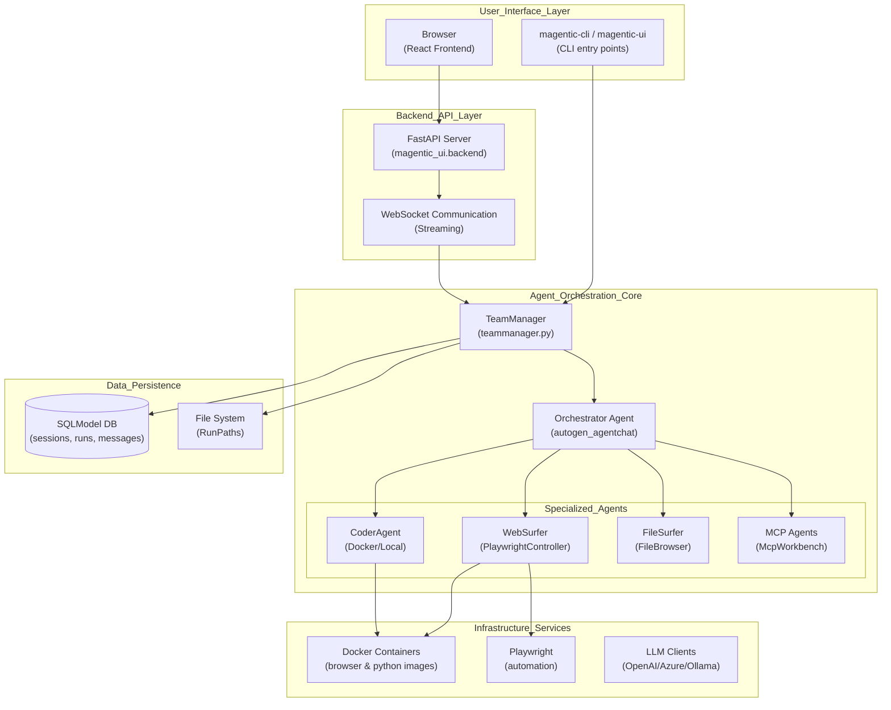
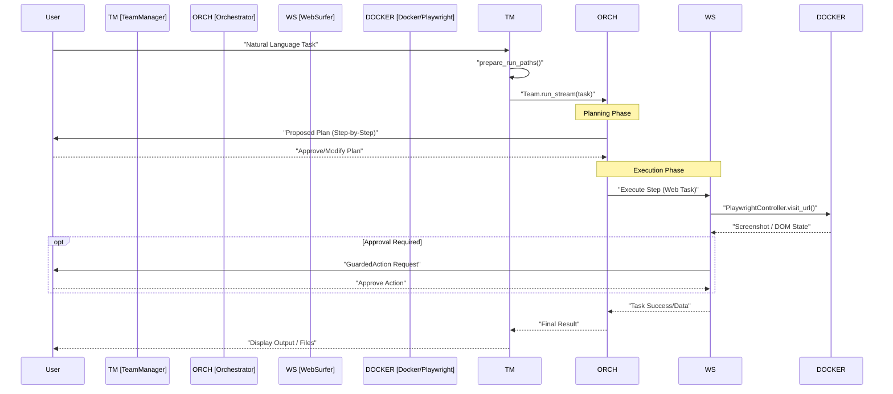

<!-- source: DeepWiki mcp.deepwiki.com · repo microsoft/magentic-ui · page 1 Overview · fetched 2026-10-26 -->

# Overview

<details>
<summary>Relevant source files</summary>

The following files were used as context for generating this wiki page:

- [README.md](README.md)
- [TRANSPARENCY_NOTE.md](TRANSPARENCY_NOTE.md)
- [docs/img/magenticui.jpg](docs/img/magenticui.jpg)
- [docs/img/magenticui_running.png](docs/img/magenticui_running.png)
- [docs/img/magui-actionguard.png](docs/img/magui-actionguard.png)
- [docs/img/magui-coplanning.png](docs/img/magui-coplanning.png)
- [docs/img/magui-cotasking.png](docs/img/magui-cotasking.png)
- [docs/img/magui-landing.png](docs/img/magui-landing.png)
- [pyproject.toml](pyproject.toml)
- [src/magentic_ui/__init__.py](src/magentic_ui/__init__.py)
- [src/magentic_ui/backend/__init__.py](src/magentic_ui/backend/__init__.py)
- [src/magentic_ui/backend/teammanager/teammanager.py](src/magentic_ui/backend/teammanager/teammanager.py)
- [src/magentic_ui/version.py](src/magentic_ui/version.py)
- [uv.lock](uv.lock)

</details>


Magentic-UI is a research prototype for human-centered AI agent systems that automates web and coding tasks while keeping humans in control. Built on the [AutoGen](https://github.com/microsoft/autogen) framework, the system uses a multi-agent architecture where specialized agents collaborate under an orchestrator to handle tasks ranging from simple web queries to long-running monitoring workflows that span minutes to days. [README.md:16-17](), [README.md:131-132]()

For detailed information about specific capabilities, see [Key Features and Capabilities](#1.1). For step-by-step instructions on getting started, see [Installation and Setup](#1.2).

## Design Philosophy

Magentic-UI differentiates itself from black-box agents through three core principles: [README.md:16-17](), [TRANSPARENCY_NOTE.md:5-13]()

*   **Co-Planning**: The system reveals its structured plan before execution, letting users guide actions and modify steps through a dedicated plan editor interface. [README.md:133](), [TRANSPARENCY_NOTE.md:9-10]()
*   **Co-Tasking**: Users can interrupt and guide task execution using the web browser directly (via noVNC) or through the chat interface. The system can also ask for clarifications when needed. [README.md:134]()
*   **Action Guards**: Sensitive or high-risk actions are only executed with explicit user approval, managed by a configurable guard system. [README.md:135](), [src/magentic_ui/approval_guard.py:4-8]()

The system is particularly effective for:
*   Web automation requiring deep navigation through non-indexed sites. [README.md:129]()
*   Tasks combining web data extraction with code execution (e.g., generating charts from online data). [README.md:129]()
*   Long-running monitoring tasks using **"Tell me When"** sentinel steps (e.g., "notify me when a specific event occurs on a website"). [README.md:24]()

**Sources:** [README.md:16-24](), [README.md:131-137](), [TRANSPARENCY_NOTE.md:5-21]()

## System Architecture Overview

Magentic-UI follows a layered architecture separating user interfaces, backend API coordination, multi-agent orchestration, and infrastructure services. The `TeamManager` class serves as the central coordinator managing agent team lifecycle, workspace paths, and execution state. [src/magentic_ui/backend/teammanager/teammanager.py:49-69]()

### Layered Architecture



**Key Components:**

| Component | Code Entity | Responsibility |
|-----------|----------|----------------|
| **Orchestrator** | `OrchestratorConfig` | Planning, coordination, and replanning logic. [src/magentic_ui/teams/orchestrator/orchestrator_config.py:2]() |
| **Team Manager** | `TeamManager` | Managing team operations, configs, and workspace paths. [src/magentic_ui/backend/teammanager/teammanager.py:49]() |
| **Workspace** | `RunPaths` | Managing internal/external directory mapping for Docker. [src/magentic_ui/types.py:26]() |
| **Configuration** | `MagenticUIConfig` | Centralized settings for models and agent behavior. [src/magentic_ui/magentic_ui_config.py:10]() |

**Sources:** [src/magentic_ui/backend/teammanager/teammanager.py:49-113](), [src/magentic_ui/__init__.py:1-32](), [pyproject.toml:82-85]()

### Task Execution Flow

The following sequence shows how a user task flows through the system, bridging natural language input to code execution.



**Key Methods and Classes:**

| Component | Method/Class | Purpose |
|-----------|--------------|---------|
| `TeamManager` | `run_stream` | Entry point for executing tasks with streaming updates. [src/magentic_ui/backend/teammanager/teammanager.py:353]() |
| `TeamManager` | `prepare_run_paths` | Initializes the directory structure for a specific run. [src/magentic_ui/backend/teammanager/teammanager.py:77]() |
| `WebSurfer` | `PlaywrightController` | Manages the actual browser interaction via Playwright. [src/magentic_ui/agents/web_surfer/web_surfer.py:29]() |
| `GuardedAction` | `GuardedAction` | Wraps sensitive actions for human approval. [src/magentic_ui/guarded_action.py:9]() |

**Sources:** [src/magentic_ui/backend/teammanager/teammanager.py:77-113](), [src/magentic_ui/backend/teammanager/teammanager.py:353-365](), [README.md:16-17]()

## Installation and Quick Start

Magentic-UI requires **Python 3.10+** and **Docker**. [README.md:49]()

```bash
# 1. Setup environment
python3 -m venv .venv
source .venv/bin/activate
pip install magentic-ui --upgrade

# 2. Set API key
export OPENAI_API_KEY="your-api-key-here"

# 3. Launch
magentic-ui --port 8081
```

For details on configuration and local model support (Azure, Ollama), see [Installation and Setup](#1.2).

**Sources:** [README.md:34-45](), [pyproject.toml:11]()

## Related Pages

*   [Key Features and Capabilities](#1.1) — Detailed look at co-planning, co-tasking, and monitoring.
*   [Installation and Setup](#1.2) — Detailed instructions for various environments and model providers.

**Sources:** [README.md:19-27](), [README.md:131-137]()

---

