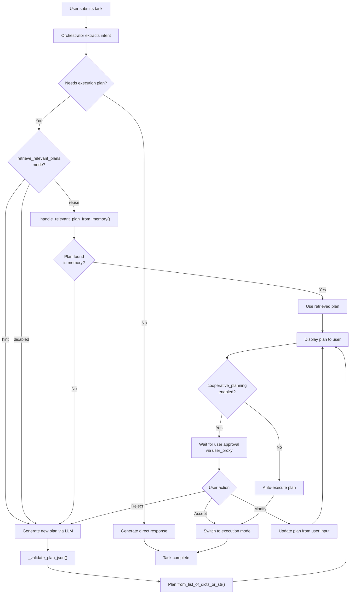
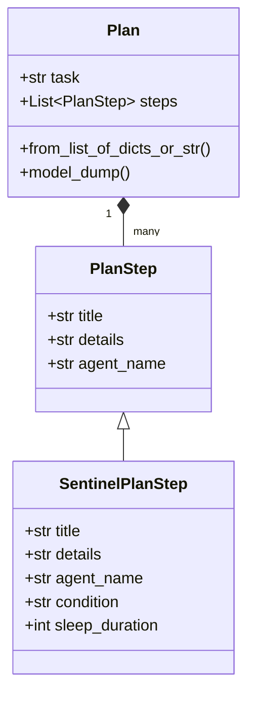
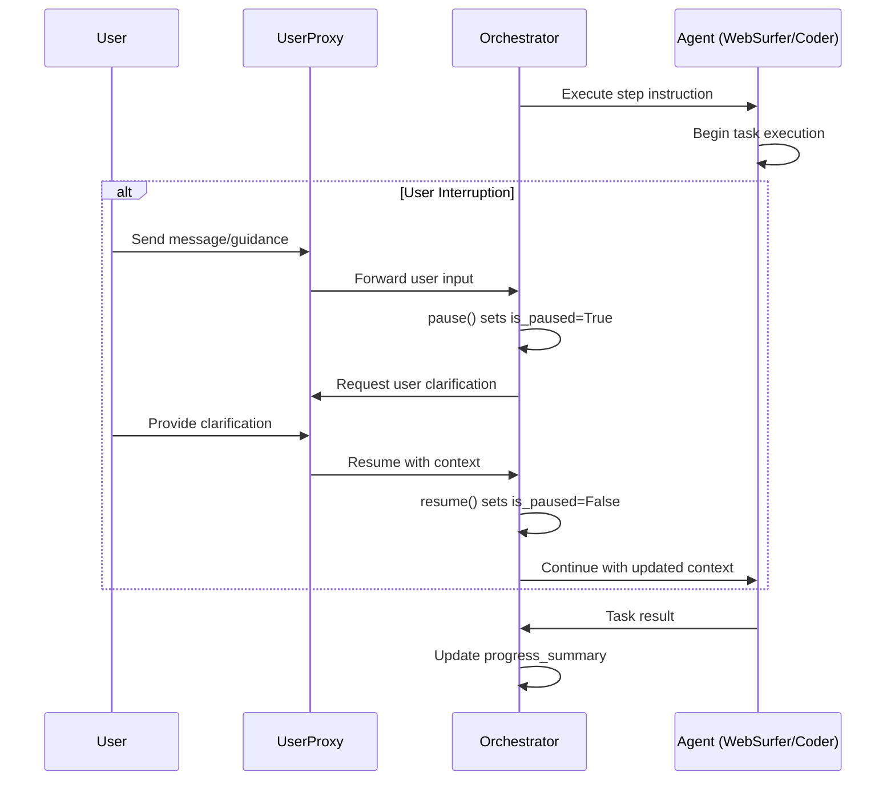
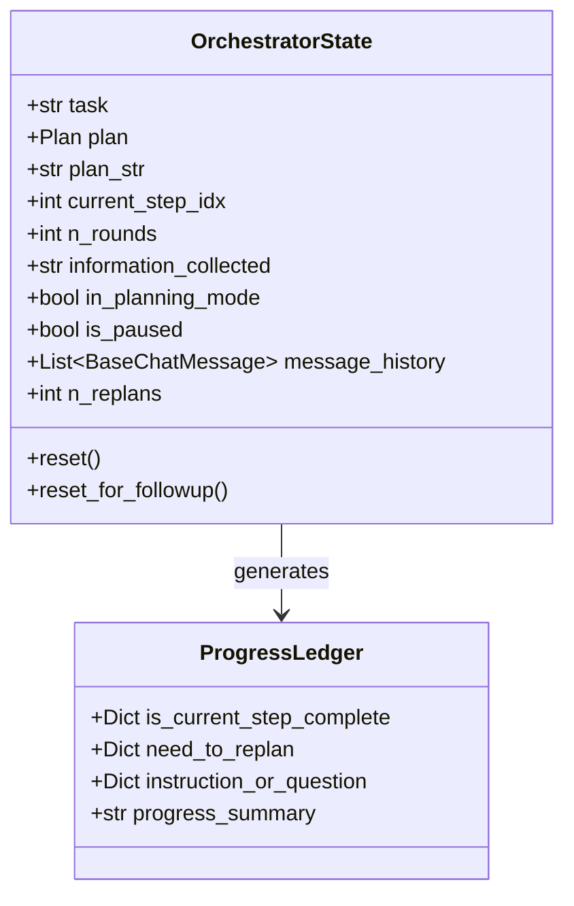
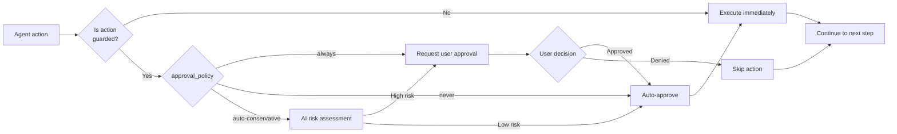
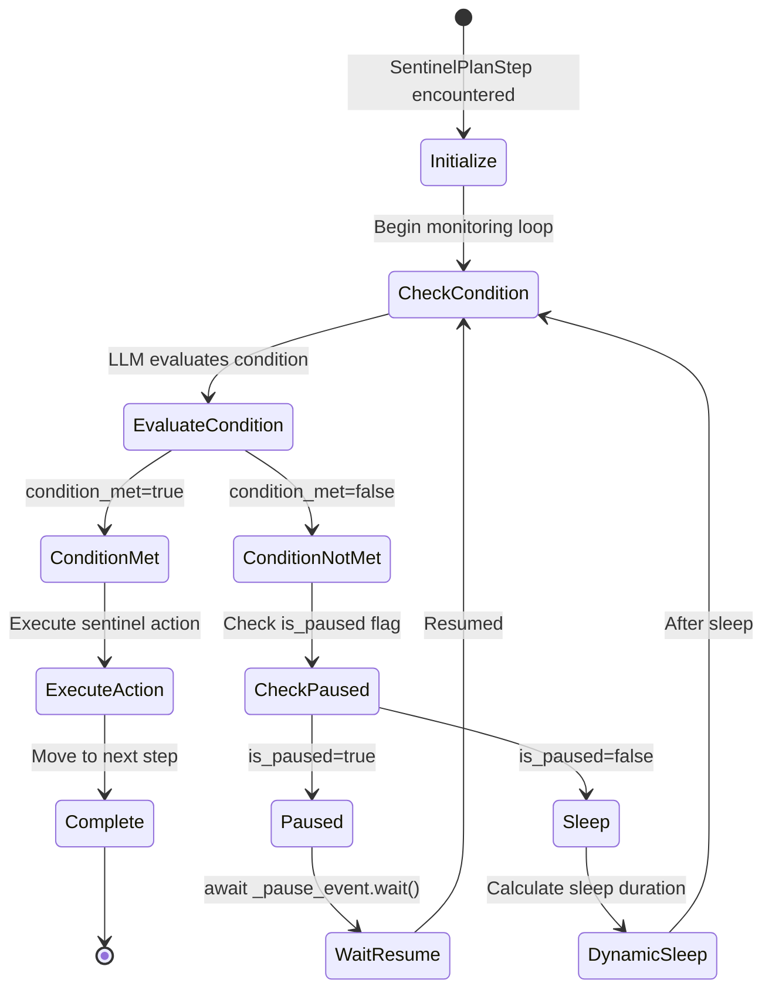
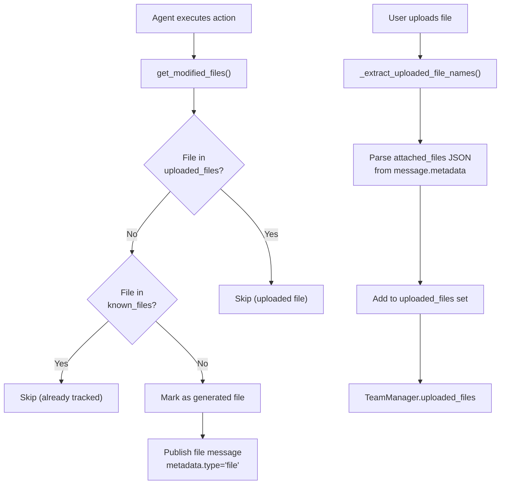
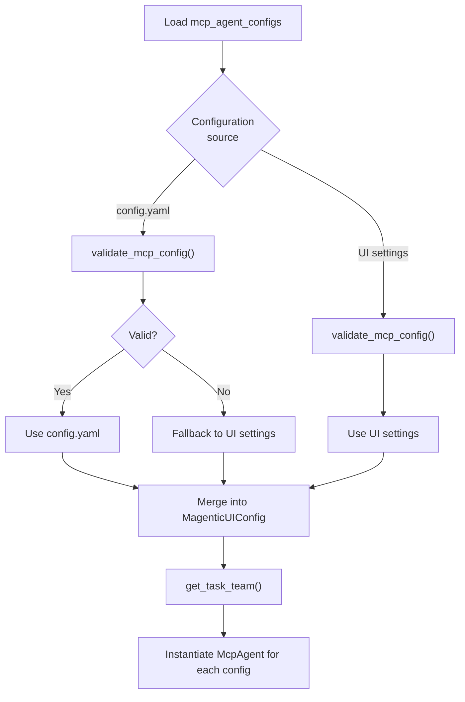
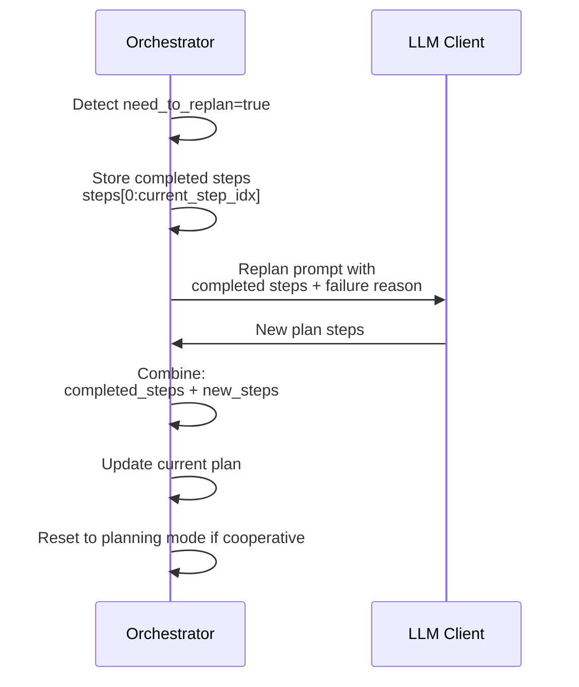

<!-- source: DeepWiki mcp.deepwiki.com · repo microsoft/magentic-ui · page 1.1 Key Features and Capabilities · fetched 2026-10-26 -->

# Key Features and Capabilities

Relevant source files

The following files were used as context for generating this wiki page:

- [README.md](README.md)
- [src/magentic_ui/approval_guard.py](src/magentic_ui/approval_guard.py)
- [src/magentic_ui/backend/teammanager/teammanager.py](src/magentic_ui/backend/teammanager/teammanager.py)
- [uv.lock](uv.lock)

This page documents the core features and capabilities of Magentic-UI, focusing on user-facing functionality and the underlying mechanisms that enable human-centered AI agent workflows. This covers the system's operational modes, interaction patterns, and extensibility points.

For details on the underlying orchestration architecture, see [Multi-Agent Orchestration](#2.2). For specific agent implementations, see [Agent System](#4). For planning mechanisms, see [Planning and Execution](#5).

---

## Overview of Capabilities

Magentic-UI provides five primary capabilities that differentiate it from autonomous-only AI agent systems:

| Feature | Purpose | Implementation |
|---------|---------|----------------|
| **Co-Planning** | Collaborative plan creation and approval | `Orchestrator` planning mode with user review workflow |
| **Co-Tasking** | Real-time guidance during execution | User proxy interruption and clarification requests |
| **Action Guards** | Safety gates for sensitive operations | `ActionGuard` with configurable approval policies |
| **Monitoring Tasks** | Long-running condition-based workflows | `SentinelPlanStep` with periodic condition evaluation |
| **Plan Learning** | Memory-based plan retrieval and reuse | `MemoryControllerProvider` with vector storage |

**Sources:** [README.md:131-137](), [src/magentic_ui/teams/orchestrator/_orchestrator.py:70-111]()

---

## Co-Planning: Collaborative Plan Creation

### Planning Workflow

**Co-Planning Architecture: From user task to approved execution plan**

The planning system operates through the `Orchestrator` class's planning mode. When `OrchestratorState.in_planning_mode` is `True`, the orchestrator enters a collaborative planning workflow.

**Sources:** [src/magentic_ui/teams/orchestrator/_orchestrator.py:709-942]()

### Plan Structure and Validation

Plans consist of sequential steps, each with specific agent assignments. The system supports two step types:

1. **PlanStep** - Standard action step
   - `title`: Brief step description
   - `details`: Comprehensive instructions for the assigned agent
   - `agent_name`: Name of agent responsible for execution

2. **SentinelPlanStep** - Monitoring step with condition evaluation
   - All PlanStep fields, plus:
   - `condition`: Termination condition or repetition count
   - `sleep_duration`: Wait time between condition checks (seconds)

**Plan Type Hierarchy**

Plan validation occurs in `validate_plan_json()` which checks:
- Required fields presence
- Agent name validity against `_agent_execution_names`
- SentinelPlanStep-specific fields when `sentinel_tasks_enabled=True`

**Sources:** [src/magentic_ui/teams/orchestrator/_prompts.py:471-511](), [src/magentic_ui/types.py]()

### Memory-Based Plan Retrieval

The system can retrieve previously successful plans from vector memory:

| Mode | Behavior | Code Path |
|------|----------|-----------|
| `"reuse"` | Automatically use retrieved plan if found | `_handle_relevant_plan_from_memory()` returns plan directly |
| `"hint"` | Provide retrieved plan as context for LLM | Appends plan to context as `UserMessage` |
| Disabled | Generate new plan without memory | Skip memory retrieval |

Configuration: `OrchestratorConfig.retrieve_relevant_plans`

**Sources:** [src/magentic_ui/teams/orchestrator/_orchestrator.py:673-707](), [src/magentic_ui/teams/orchestrator/_orchestrator.py:736-744]()

---

## Co-Tasking: Human-in-the-Loop Execution

### Interruption and Guidance Mechanisms

During execution, users can interrupt the agent workflow through multiple channels:

1. **Direct Chat Input**: User sends messages to `user_proxy` agent
2. **Browser Interaction**: Actions in the shared browser session trigger updates
3. **Plan Modification**: User edits plan steps via Plan Editor UI

**User Interruption Flow During Execution**

The `OrchestratorState.is_paused` flag controls execution flow. When paused:
- LLM requests are blocked: `if self._state.is_paused: raise ValueError("Operation paused")`
- Next speaker defaults to `user_proxy`: `await self._request_next_speaker(self._user_agent_topic, ...)`

**Sources:** [src/magentic_ui/teams/orchestrator/_orchestrator.py:543-552](), [src/magentic_ui/teams/orchestrator/_orchestrator.py:578-588]()

### Progress Tracking and Status Updates

The orchestrator maintains execution state through the progress ledger:

**Orchestrator State Management**

At each step, `_orchestrate_step_execution()` generates a progress ledger via `_get_json_response()` that determines:
- Whether current step is complete
- Whether replanning is needed
- Next instruction for assigned agent
- Progress summary for user visibility

**Sources:** [src/magentic_ui/teams/orchestrator/_orchestrator.py:70-111](), [src/magentic_ui/teams/orchestrator/_orchestrator.py:987-995]()

---

## Action Guards: Approval System

### Approval Policies

The `ApprovalGuard` system implements several approval policies via `ApprovalConfig`:

| Policy | Behavior | Use Case |
|--------|----------|----------|
| `always` | Request approval for all guarded actions | Maximum user control |
| `auto-conservative` | AI risk assessment via `requires_approval()` → conditional approval | Balanced automation |
| `never` | Auto-approve all actions | Autonomous execution |

Configuration: `MagenticUIConfig.approval_policy`

**Sources:** [src/magentic_ui/approval_guard.py:75-80]()

### Guarded Operations

**Action Guard Decision Flow**

Actions requiring approval include:
- **WebSurfer**: Form submissions, sensitive information entry, making purchases.
- **Coder**: Code execution that creates files or potentially leaks system info.

The `ApprovalGuard` uses `ACTION_GUARD_SYSTEM_MESSAGE` to prompt the LLM for risk assessment when using "auto" policies. It checks criteria like real-world consequences, irreversibility, and data integrity.

**Sources:** [src/magentic_ui/approval_guard.py:116-145](), [src/magentic_ui/teams/orchestrator/_orchestrator.py:1378-1450]()

---

## Monitoring Tasks: "Tell me When"

### Sentinel Step Architecture

Sentinel steps enable long-running monitoring workflows through periodic condition evaluation. These are useful for tasks that span minutes to days.

**Sentinel Step Execution Lifecycle**

### Condition Evaluation

The `_execute_sentinel_step()` method orchestrates monitoring:

1. **Gather Context**: Collect current page info via `_get_websurfer_page_info()`.
2. **LLM Evaluation**: Send condition check prompt to model using `SENTINEL_CONDITION_CHECK_PROMPT`.
3. **Decision**: 
   - If `condition_met=true`: Execute action and advance to next step.
   - If `condition_met=false`: Sleep for `sleep_duration` seconds and repeat.

**Sources:** [src/magentic_ui/teams/orchestrator/_orchestrator.py:1344-1495](), [README.md:24]()

---

## File Upload and Tracking

### File Classification

The system distinguishes between uploaded and generated files to ensure only relevant new data is highlighted to the user.

**File Tracking and Classification Logic**

### Implementation Details

`TeamManager` maintains file tracking across the conversation lifecycle:

- `uploaded_files`: Set of file names uploaded by user, extracted in `_extract_uploaded_file_names`.
- Generated files are tracked via `get_modified_files()` which compares current workspace state against known files.

**Sources:** [src/magentic_ui/backend/teammanager/teammanager.py:115-165](), [src/magentic_ui/backend/teammanager/teammanager.py:420-457]()

---

## MCP Agent Integration

### Configuration and Validation

MCP (Model Context Protocol) agents allow Magentic-UI to use external tools via MCP servers.

**MCP Agent Configuration Resolution**

### Runtime Integration

Each `McpAgent` is an `AssistantAgent` equipped with tools provided by MCP servers. The `TeamManager` handles the instantiation of these agents during team creation based on the provided `mcp_agent_configs`.

**Sources:** [src/magentic_ui/backend/teammanager/teammanager.py:218-275](), [README.md:26]()

---

## Execution Model: Planning vs Execution

### Mode Switching

The orchestrator operates in two mutually exclusive modes controlled by `OrchestratorState.in_planning_mode`:

| Mode | Purpose | Key Methods |
|------|---------|-------------|
| Planning | Generate and refine execution plan | `_orchestrate_step_planning()` |
| Execution | Execute plan steps sequentially | `_orchestrate_step_execution()` |

**Sources:** [src/magentic_ui/teams/orchestrator/_orchestrator.py:709-942](), [src/magentic_ui/teams/orchestrator/_orchestrator.py:943-1118]()

### Replanning Mechanism

Replanning preserves completed steps while generating new steps for remaining work. This is triggered when the `ProgressLedger` indicates `need_to_replan=true`.

**Sources:** [src/magentic_ui/teams/orchestrator/_orchestrator.py:1119-1195](), [src/magentic_ui/teams/orchestrator/_orchestrator.py:998-1020]()

---

