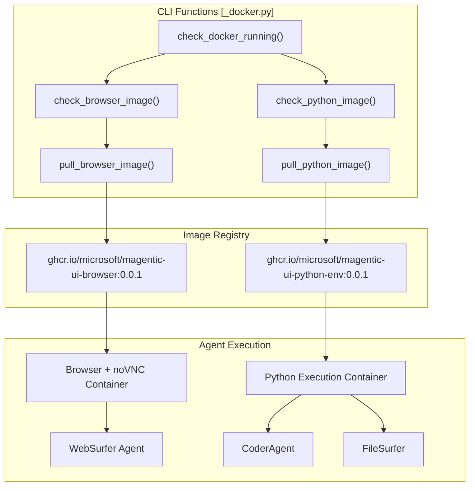
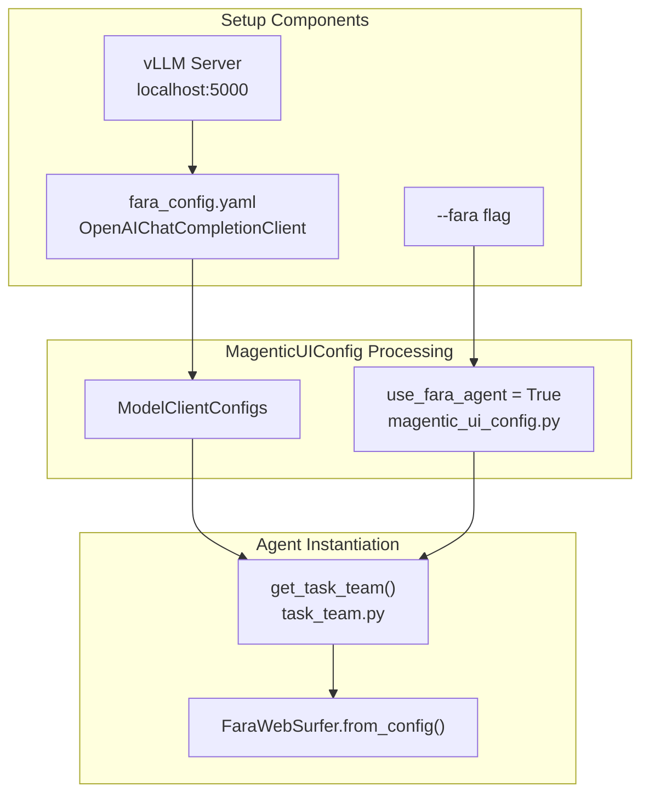

<!-- source: DeepWiki mcp.deepwiki.com · repo microsoft/magentic-ui · page 1.2 Installation and Setup · fetched 2026-10-26 -->

# Installation and Setup

<details>
<summary>Relevant source files</summary>

The following files were used as context for generating this wiki page:

- [CONTRIBUTING.md](CONTRIBUTING.md)
- [README.md](README.md)
- [pyproject.toml](pyproject.toml)
- [src/magentic_ui/__init__.py](src/magentic_ui/__init__.py)
- [src/magentic_ui/backend/__init__.py](src/magentic_ui/backend/__init__.py)
- [src/magentic_ui/backend/teammanager/teammanager.py](src/magentic_ui/backend/teammanager/teammanager.py)
- [src/magentic_ui/version.py](src/magentic_ui/version.py)
- [uv.lock](uv.lock)

</details>


This page provides step-by-step installation instructions for Magentic-UI, covering prerequisites, dependency requirements, and initial configuration. The guide focuses on getting the system operational for first use.

For advanced model configuration and MCP server setup, see page 3.2 (Configuration Files). For Docker deployment details, see page 8 (Docker and Deployment).

## Prerequisites and System Requirements

Magentic-UI requires Docker for containerized agent execution and Python 3.10 or higher for the main application. The system automatically pulls required Docker images on first run.

### Core Requirements

| Component | Requirement | Notes |
|-----------|-------------|-------|
| Python | 3.10, 3.11, 3.12, or 3.13 | Main application runtime [pyproject.toml:11]() |
| Docker | Desktop (Win/Mac) or Engine (Linux) | Required unless using `--run-without-docker` [README.md:49-56]() |
| Operating System | Linux, macOS, Windows (WSL2) | Windows users must use WSL2 [README.md:49]() |
| API Key | OpenAI API key (or alternative) | Required for LLM functionality [README.md:41]() |

### Docker Infrastructure

The system uses two Docker images that are automatically pulled from GitHub Container Registry on first run:

**Docker Image Management**



The CLI automatically checks for and pulls missing images during startup as implemented in `_cli.py`.

Sources: [README.md:27](), [README.md:49](), [src/magentic_ui/backend/teammanager/teammanager.py:56-57]()

### Platform-Specific Requirements

**Windows**: WSL2 (Windows Subsystem for Linux) is required for Docker and file path compatibility. Configure Docker Desktop to enable WSL2 integration under Settings > Resources > WSL Integration [README.md:49]().

**macOS**: Use Docker Desktop. Ensure it's running before starting Magentic-UI.

**Linux**: Install Docker Engine and add your user to the `docker` group: `sudo usermod -aG docker $USER` (requires logout/login to take effect).

Sources: [README.md:49](), [pyproject.toml:19]()

## Installation via pip

### Base Installation

The primary installation method uses pip with a virtual environment:

```bash
# 1. Create and activate virtual environment
python3 -m venv .venv
source .venv/bin/activate

# 2. Install magentic-ui
pip install magentic-ui --upgrade
```

The base installation includes support for OpenAI API models via `autogen-ext` [pyproject.toml:30]().

### Optional Dependencies

Additional package extras are available for specific model providers and features:

| Extra | Installation Command | Purpose |
|-------|---------------------|---------|
| Azure | `pip install magentic-ui[azure]` | Azure OpenAI and Azure AI Foundry support [pyproject.toml:65-67]() |
| Ollama | `pip install magentic-ui[ollama]` | Local model execution via Ollama [pyproject.toml:69-71]() |
| FARA | `pip install magentic-ui[fara]` | Microsoft's FARA-7B agentic model [pyproject.toml:73-80]() |
| Eval | `pip install magentic-ui[eval]` | Benchmark and evaluation tools [pyproject.toml:59-63]() |

Multiple extras can be installed together: `pip install magentic-ui[azure,ollama,fara]`.

Sources: [README.md:34-38](), [README.md:63-70](), [pyproject.toml:58-80]()

## Initial Configuration

### API Key Setup

Set your API key before running Magentic-UI:

```bash
# For OpenAI (default provider)
export OPENAI_API_KEY="your-api-key-here"
```

API keys can also be configured through the web UI after startup (Settings > Model Configuration) or via the `MagenticUIConfig` class [src/magentic_ui/magentic_ui_config.py:10]().

### FARA-7B Model Setup

Microsoft's FARA-7B is an efficient agentic model specialized for computer use tasks [README.md:21](). Setup requires serving the model via vLLM:

**1. Install FARA extras:**
```bash
pip install magentic-ui[fara]
```

**2. Serve FARA-7B using vLLM in a separate terminal:**
```bash
vllm serve "microsoft/Fara-7B" --port 5000 --dtype auto
```

**3. Launch with FARA configuration:**
The system uses the `use_fara_agent` flag to toggle the specialized agent [src/magentic_ui/magentic_ui_config.py:116]().

**FARA-7B Configuration Pipeline:**



Sources: [README.md:21](), [pyproject.toml:73-80](), [src/magentic_ui/magentic_ui_config.py:116]()

## Running Magentic-UI

### Standard Web UI Mode

Launch the web interface with Docker support:

```bash
magentic-ui --port 8081
```

Once running, access the interface at `http://localhost:8081` [README.md:44-47](). The command triggers the backend CLI entry point defined in [pyproject.toml:84]().

**Startup Sequence:**

```mermaid
sequenceDiagram
    participant User
    participant CLI["magentic-ui CLI<br/>backend/cli.py"]
    participant TeamMgr["TeamManager<br/>teammanager.py"]
    participant FastAPI["FastAPI Server"]
    participant Browser["Web Browser"]
    
    User->>CLI: "magentic-ui --port 8081"
    CLI->>TeamMgr: "Initialize with workspace paths"
    TeamMgr->>TeamMgr: "prepare_run_paths()"
    CLI->>FastAPI: "Start Uvicorn"
    User->>Browser: "Navigate to localhost:8081"
    Browser-->>FastAPI: "Serve UI"
```

The `TeamManager` prepares the internal and external workspace directories for agent file handling [src/magentic_ui/backend/teammanager/teammanager.py:77-113]().

### Alternative Usage Modes

| Mode | Command | Use Case |
|------|---------|----------|
| **Without Docker** | `magentic-ui --run-without-docker --port 8081` | Limited functionality: no code execution [README.md:53-56]() |
| **Command Line Interface** | `magentic-cli --work-dir PATH` | Terminal-based interaction without web UI [README.md:58-61]() |

The `magentic-cli` command maps to the `_cli.py` main function [pyproject.toml:85]().

Sources: [README.md:44-61](), [pyproject.toml:83-85](), [src/magentic_ui/backend/teammanager/teammanager.py:52-69]()

## Verification and Troubleshooting

### System Health Checks

1. **Version Check**: Verify installation with `magentic-ui --version` [src/magentic_ui/version.py:1-2]().
2. **Docker Status**: Ensure Docker is running to allow `TeamManager` to mount volumes for `CoderAgent` and `WebSurfer` [src/magentic_ui/backend/teammanager/teammanager.py:102-105]().
3. **Workspace Access**: Confirm the application has write permissions to the workspace directory for creating run paths [src/magentic_ui/backend/teammanager/teammanager.py:103-105]().

### Common Issues

- **Port Conflict**: If port 8081 is in use, specify a different port using `--port` [README.md:44]().
- **Docker Permission**: On Linux, ensure the user is in the `docker` group to avoid permission errors when `TeamManager` attempts to manage containers.
- **Model Configuration**: If agents fail to initialize, check the `ModelClientConfigs` provided during startup [src/magentic_ui/magentic_ui_config.py:27]().

Sources: [README.md:74](), [src/magentic_ui/version.py:1-4](), [src/magentic_ui/backend/teammanager/teammanager.py:97-113]()

---

