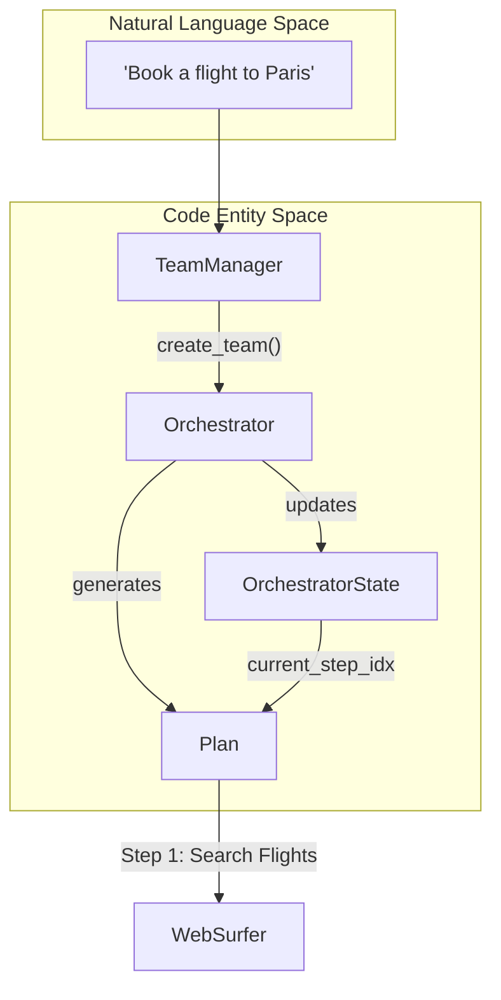
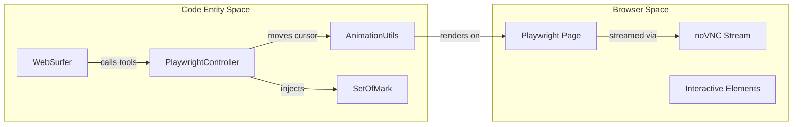

<!-- source: DeepWiki mcp.deepwiki.com · repo microsoft/magentic-ui · page 10 Glossary · fetched 2026-10-26 -->

# Glossary

Relevant source files

The following files were used as context for generating this wiki page:

- [README.md](README.md)
- [frontend/src/components/views/api.ts](frontend/src/components/views/api.ts)
- [src/magentic_ui/_cli.py](src/magentic_ui/_cli.py)
- [src/magentic_ui/agents/_coder.py](src/magentic_ui/agents/_coder.py)
- [src/magentic_ui/agents/file_surfer/_file_surfer.py](src/magentic_ui/agents/file_surfer/_file_surfer.py)
- [src/magentic_ui/agents/web_surfer/_web_surfer.py](src/magentic_ui/agents/web_surfer/_web_surfer.py)
- [src/magentic_ui/approval_guard.py](src/magentic_ui/approval_guard.py)
- [src/magentic_ui/backend/datamodel/db.py](src/magentic_ui/backend/datamodel/db.py)
- [src/magentic_ui/backend/datamodel/types.py](src/magentic_ui/backend/datamodel/types.py)
- [src/magentic_ui/backend/teammanager/teammanager.py](src/magentic_ui/backend/teammanager/teammanager.py)
- [src/magentic_ui/backend/utils/utils.py](src/magentic_ui/backend/utils/utils.py)
- [src/magentic_ui/backend/web/deps.py](src/magentic_ui/backend/web/deps.py)
- [src/magentic_ui/backend/web/managers/connection.py](src/magentic_ui/backend/web/managers/connection.py)
- [src/magentic_ui/backend/web/routes/settingsroute.py](src/magentic_ui/backend/web/routes/settingsroute.py)
- [src/magentic_ui/magentic_ui_config.py](src/magentic_ui/magentic_ui_config.py)
- [src/magentic_ui/task_team.py](src/magentic_ui/task_team.py)
- [src/magentic_ui/teams/orchestrator/_orchestrator.py](src/magentic_ui/teams/orchestrator/_orchestrator.py)
- [src/magentic_ui/teams/orchestrator/_prompts.py](src/magentic_ui/teams/orchestrator/_prompts.py)
- [src/magentic_ui/teams/orchestrator/orchestrator_config.py](src/magentic_ui/teams/orchestrator/orchestrator_config.py)
- [src/magentic_ui/tools/playwright/playwright_controller.py](src/magentic_ui/tools/playwright/playwright_controller.py)
- [src/magentic_ui/types.py](src/magentic_ui/types.py)
- [uv.lock](uv.lock)

This glossary provides definitions for codebase-specific terms, jargon, and domain concepts used within Magentic-UI. It is intended to help onboarding engineers navigate the multi-agent orchestration, state management, and UI-to-backend communication patterns.

## Core Agent Roles

The system uses a multi-agent architecture where specialized agents collaborate to solve tasks.

| Term | Definition | Code Pointer |
| :--- | :--- | :--- |
| **Orchestrator** | The central manager that handles planning, replanning, and agent dispatching. It operates in two modes: `planning` and `execution`. | [`src/magentic_ui/teams/orchestrator/_orchestrator.py:113-123`]() |
| **WebSurfer** | An agent capable of browser automation using Playwright. It can click, type, scroll, and extract information from websites. | [`src/magentic_ui/agents/web_surfer/_web_surfer.py:160-180`]() |
| **CoderAgent** | An agent that generates and executes Python code, typically within a Docker container, to perform data analysis or automation. | [`src/magentic_ui/agents/_coder.py:21-34`]() |
| **FileSurfer** | A specialized agent for navigating local file systems and converting various file formats to Markdown for LLM consumption. | [`src/magentic_ui/agents/file_surfer/_file_surfer.py:94-108`]() |
| **UserProxy** | An agent that represents the human user. It can be a `DummyUserProxy` (always approves), `MetadataUserProxy` (automated for evals), or a standard proxy that prompts for real input. | [`src/magentic_ui/task_team.py:137-165`]() |

**Sources:** [`src/magentic_ui/teams/orchestrator/_orchestrator.py`](), [`src/magentic_ui/agents/web_surfer/_web_surfer.py`](), [`src/magentic_ui/agents/_coder.py`](), [`src/magentic_ui/agents/file_surfer/_file_surfer.py`](), [`src/magentic_ui/task_team.py`]()

## System Components & Architecture

### 1. Orchestration Flow
The following diagram bridges the high-level concept of "Planning" to the specific code entities that manage the lifecycle of a task.

**Orchestrator Task Lifecycle**

**Sources:** [`src/magentic_ui/backend/teammanager/teammanager.py:174-183`](), [`src/magentic_ui/teams/orchestrator/_orchestrator.py:70-86`]()

### 2. Execution Environment
| Term | Definition | Code Pointer |
| :--- | :--- | :--- |
| **Workspace Root** | The base directory where all user files, session data, and run outputs are stored. It is split into `internal` (inside Docker) and `external` (host machine) paths. | [`src/magentic_ui/backend/teammanager/teammanager.py:54-55`]() |
| **RunPaths** | A data structure that encapsulates the directory hierarchy for a specific execution run, ensuring consistency between host and container. | [`src/magentic_ui/types.py:26-31`]() |
| **Action Guard** | A security layer that intercepts sensitive agent actions (like clicking a "Buy" button) and requires explicit user approval based on an `ApprovalPolicy`. | [`src/magentic_ui/approval_guard.py:18-23`]() |
| **MCP Agent** | An agent configured to use the Model Context Protocol (MCP) to interact with external tools and servers. | [`src/magentic_ui/agents/mcp/_config.py:26-30`]() |

**Sources:** [`src/magentic_ui/backend/teammanager/teammanager.py`](), [`src/magentic_ui/magentic_ui_config.py:110-112`]()

## Data Models & Configuration

### MagenticUIConfig
The primary configuration object used to initialize the system. It handles everything from model selection to Docker settings.

*   **`cooperative_planning`**: If `True`, the Orchestrator stops to let the user review and edit the plan before execution. [`src/magentic_ui/magentic_ui_config.py:70-70`]()
*   **`autonomous_execution`**: If `True`, the system attempts to complete the entire plan without asking for step-by-step approval (unless an Action Guard is triggered). [`src/magentic_ui/magentic_ui_config.py:71-71`]()
*   **`approval_policy`**: Defines the threshold for Action Guards (e.g., `always`, `never`, `auto-conservative`). [`src/magentic_ui/magentic_ui_config.py:110-112`]()

### Sentinel Steps
Specialized plan steps used for long-running monitoring tasks.
*   **`SentinelPlanStep`**: A plan step that includes a `sentinel_condition` (e.g., "Check if price < $500") and a `sleep_seconds` interval. [`src/magentic_ui/types.py:45-45`]()
*   **`dynamic_sentinel_sleep`**: A feature where the Orchestrator adjusts the wait time between checks based on the agent's progress. [`src/magentic_ui/magentic_ui_config.py:15-19`]()

**Sources:** [`src/magentic_ui/magentic_ui_config.py`](), [`src/magentic_ui/types.py`]()

## Web & UI Concepts

### 1. Browser Interaction
The **WebSurfer** interacts with the browser via a `PlaywrightController`.

**Code-to-Browser Mapping**

**Sources:** [`src/magentic_ui/agents/web_surfer/_web_surfer.py:105-105`](), [`src/magentic_ui/tools/playwright/playwright_controller.py:131-133`]()

### 2. Session Persistence
*   **`Run`**: A single execution attempt of a task within a session. Persisted in the DB. [`src/magentic_ui/backend/datamodel/db.py:32-32`]()
*   **`LLMCallEvent`**: A logging event captured whenever an LLM is queried, allowing the UI to show token usage and raw prompts. [`src/magentic_ui/backend/teammanager/teammanager.py:45-46`]()
*   **`BrowserState`**: A serialized snapshot of the browser (cookies, storage, open tabs) used to resume sessions. [`src/magentic_ui/tools/playwright/playwright_state.py:107-109`]()

**Sources:** [`src/magentic_ui/backend/teammanager/teammanager.py`](), [`src/magentic_ui/tools/playwright/playwright_state.py`]()

## Abbreviations & Jargon

| Abbreviation | Full Term | Context |
| :--- | :--- | :--- |
| **SOM** | Set-of-Mark | A visual prompting technique where interactive elements on a webpage are labeled with numbers for the LLM. |
| **MCP** | Model Context Protocol | A protocol for agents to communicate with external tools/servers. |
| **vNC** | Virtual Network Computing | Used to stream the Dockerized browser's visual output to the frontend. |
| **uv** | UV Package Manager | The fast Python package installer used for dependency resolution in `uv.lock`. |

**Sources:** [`README.md:26-26`](), [`uv.lock:1-1`](), [`src/magentic_ui/agents/web_surfer/_set_of_mark.py:78-78`]()