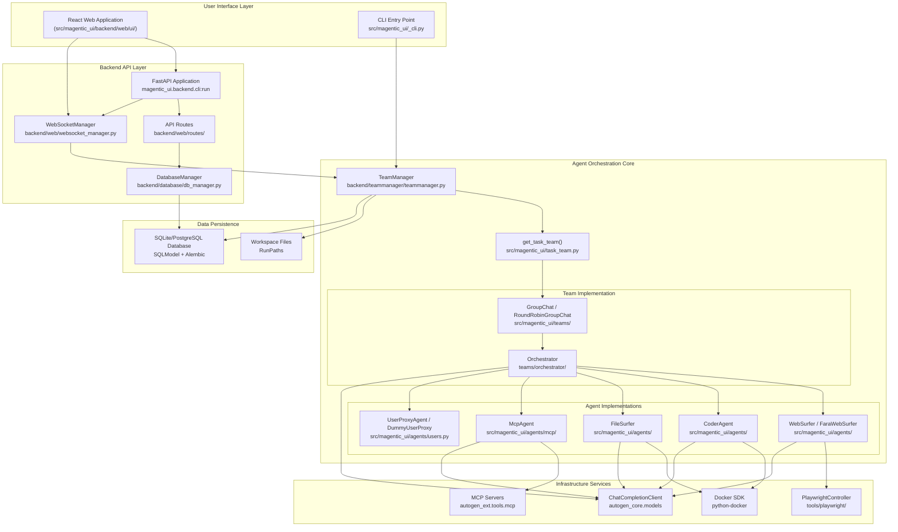
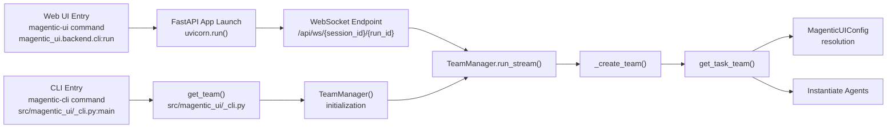
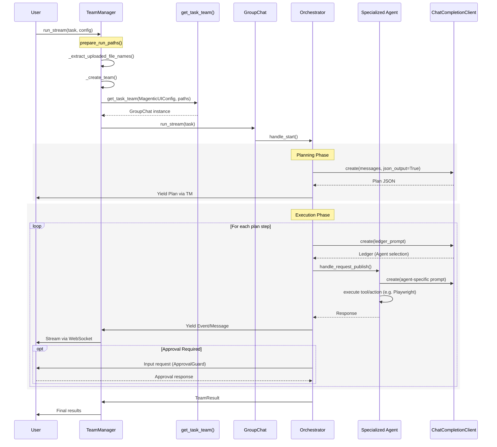
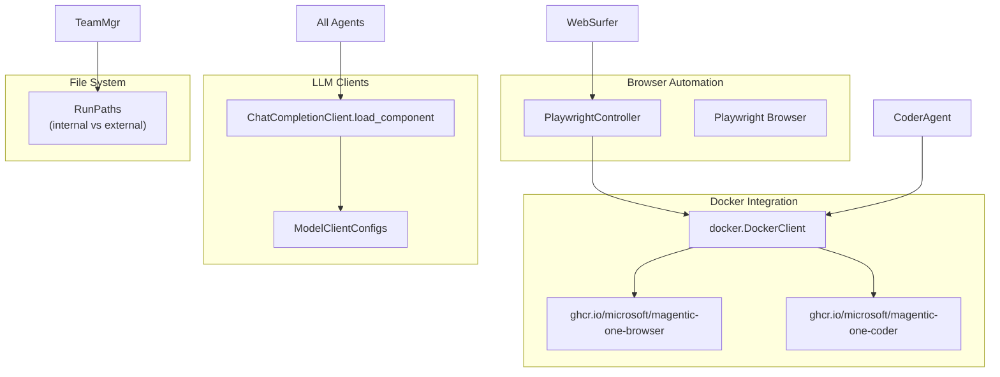

<!-- source: DeepWiki mcp.deepwiki.com · repo microsoft/magentic-ui · page 2 System Architecture · fetched 2026-10-26 -->

# System Architecture

Relevant source files

The following files were used as context for generating this wiki page:

- [README.md](README.md)
- [pyproject.toml](pyproject.toml)
- [src/magentic_ui/__init__.py](src/magentic_ui/__init__.py)
- [src/magentic_ui/_cli.py](src/magentic_ui/_cli.py)
- [src/magentic_ui/backend/__init__.py](src/magentic_ui/backend/__init__.py)
- [src/magentic_ui/backend/teammanager/teammanager.py](src/magentic_ui/backend/teammanager/teammanager.py)
- [src/magentic_ui/magentic_ui_config.py](src/magentic_ui/magentic_ui_config.py)
- [src/magentic_ui/task_team.py](src/magentic_ui/task_team.py)
- [src/magentic_ui/teams/orchestrator/orchestrator_config.py](src/magentic_ui/teams/orchestrator/orchestrator_config.py)
- [src/magentic_ui/version.py](src/magentic_ui/version.py)
- [uv.lock](uv.lock)

## Purpose and Scope

This document describes the overall system architecture of Magentic-UI, explaining how components are organized into layers, how they relate to each other, and the flow of execution from user interface to agent execution. For detailed information on specific subsystems, see:
- Configuration details: [Configuration System](#2.1)
- Multi-agent coordination: [Multi-Agent Orchestration](#2.2)
- Team lifecycle management: [Task Team Assembly and Management](#2.3)

**Sources:** [README.md:1-158]()

## Layered Architecture Overview

Magentic-UI follows a layered architecture pattern with clear separation of concerns across four primary layers: User Interface, Backend API, Agent Orchestration, and Infrastructure Services.

**Sources:** [pyproject.toml:27-51](), [src/magentic_ui/__init__.py:1-33](), [src/magentic_ui/backend/__init__.py:1-7](), [src/magentic_ui/task_team.py:34-49]()

## Core Components

### Component Responsibilities

| Component | Primary Class/Module | Responsibilities |
|-----------|---------------------|------------------|
| **Frontend Application** | `src/magentic_ui/backend/web/ui/` | React-based UI, WebSocket client, session management, plan visualization |
| **API Server** | `FastAPI` (via `magentic-ui` command) | HTTP endpoints, WebSocket handling, request routing [src/magentic_ui/backend/cli.py:84]() |
| **Database Manager** | `DatabaseManager` | Database operations for sessions, runs, messages, settings [src/magentic_ui/backend/__init__.py:1]() |
| **Team Manager** | `TeamManager` | Team creation, run orchestration, file tracking, path preparation [src/magentic_ui/backend/teammanager/teammanager.py:49]() |
| **Task Team Factory** | `get_task_team()` | Agent instantiation, configuration assembly, team composition [src/magentic_ui/task_team.py:34]() |
| **Orchestrator** | `Orchestrator` | Planning, execution coordination, agent selection, replanning [src/magentic_ui/teams/orchestrator/orchestrator_config.py:7]() |
| **Specialized Agents** | `WebSurfer`, `CoderAgent`, `FileSurfer`, `McpAgent` | Domain-specific task execution (web, code, files, MCP tools) [src/magentic_ui/task_team.py:8-15]() |

**Sources:** [src/magentic_ui/backend/teammanager/teammanager.py:49-113](), [src/magentic_ui/task_team.py:34-166]()

### Entry Points and Initialization

The system provides two primary entry points that converge on the same core execution path:

**Sources:** [pyproject.toml:82-86](), [src/magentic_ui/backend/teammanager/teammanager.py:174-185](), [src/magentic_ui/_cli.py:117-145]()

## Execution Flow

### Run Lifecycle: From Request to Completion

The following diagram traces the complete execution flow from a user task submission through agent execution to final result delivery, showing actual method calls and class interactions:

**Sources:** [src/magentic_ui/backend/teammanager/teammanager.py:353-507](), [src/magentic_ui/task_team.py:34-166](), [src/magentic_ui/magentic_ui_config.py:63-130]()

## Infrastructure Integration

### Resource Management Components

**Sources:** [src/magentic_ui/backend/teammanager/teammanager.py:77-113](), [src/magentic_ui/task_team.py:89-100](), [src/magentic_ui/magentic_ui_config.py:22-61]()

### Docker Configuration Resolution

The system supports multiple execution modes based on Docker availability:

| Mode | Configuration | Behavior |
|------|--------------|----------|
| **Standard** | `run_without_docker=False` | Full Docker integration for browser and code execution [src/magentic_ui/magentic_ui_config.py:97]() |
| **No Docker** | `run_without_docker=True` | Limited functionality: browser/coder agents may be disabled or local [src/magentic_ui/magentic_ui_config.py:97]() |
| **Inside Docker** | `inside_docker=True` | Magentic-UI itself running in container, paths adjusted [src/magentic_ui/magentic_ui_config.py:93]() |

**Sources:** [src/magentic_ui/magentic_ui_config.py:63-130](), [src/magentic_ui/backend/teammanager/teammanager.py:52-68]()

## Configuration Resolution

### Configuration Priority and Assembly

The system resolves configuration from multiple sources with a clear precedence hierarchy:

1. **YAML Config**: Provided via `--config` CLI argument [src/magentic_ui/_cli.py:132]().
2. **UI Settings**: Passed via the backend API during run initiation [src/magentic_ui/backend/teammanager/teammanager.py:180]().
3. **Environment Variables**: Such as `OPENAI_API_KEY` [README.md:41]().
4. **Defaults**: Hardcoded in `MagenticUIConfig` and `ModelClientConfigs` [src/magentic_ui/magentic_ui_config.py:39-52]().

**Sources:** [src/magentic_ui/magentic_ui_config.py:63-130](), [src/magentic_ui/backend/teammanager/teammanager.py:174-351]()

## Workspace and File Management

### Path Resolution System

The system maintains separate internal and external workspace paths to support Docker container execution:

| Path Type | Purpose | Source |
|-----------|---------|--------|
| `internal_run_dir` | Path visible inside Docker containers | `RunPaths.internal_run_dir` |
| `external_run_dir` | Path on host system | `RunPaths.external_run_dir` |
| `run_suffix` | Unique run identifier path | `RunPaths.run_suffix` |

Path structure: `files/user/{user_id}/{session_id}/{run_id}` [src/magentic_ui/backend/teammanager/teammanager.py:85-91]().

**Sources:** [src/magentic_ui/backend/teammanager/teammanager.py:77-113](), [src/magentic_ui/types.py]()

### File Tracking and Generated Files

The `TeamManager` tracks files to distinguish user-uploaded files from agent-generated outputs. This is handled by `_extract_uploaded_file_names` and `add_uploaded_files` to ensure proper metadata attribution in the UI.

**Sources:** [src/magentic_ui/backend/teammanager/teammanager.py:115-165]()

---

