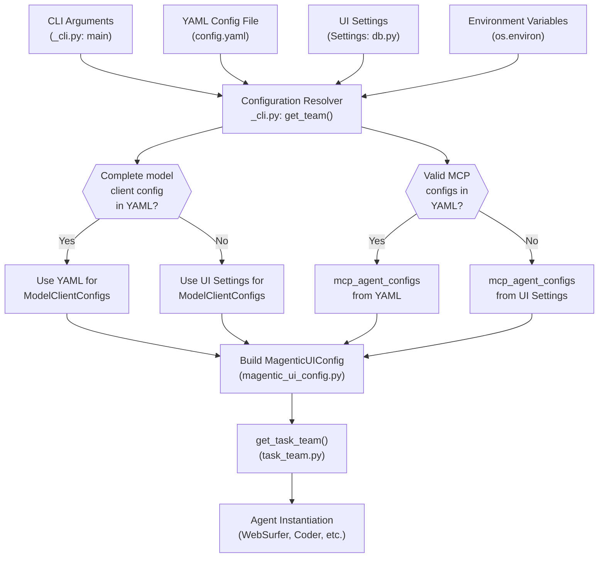
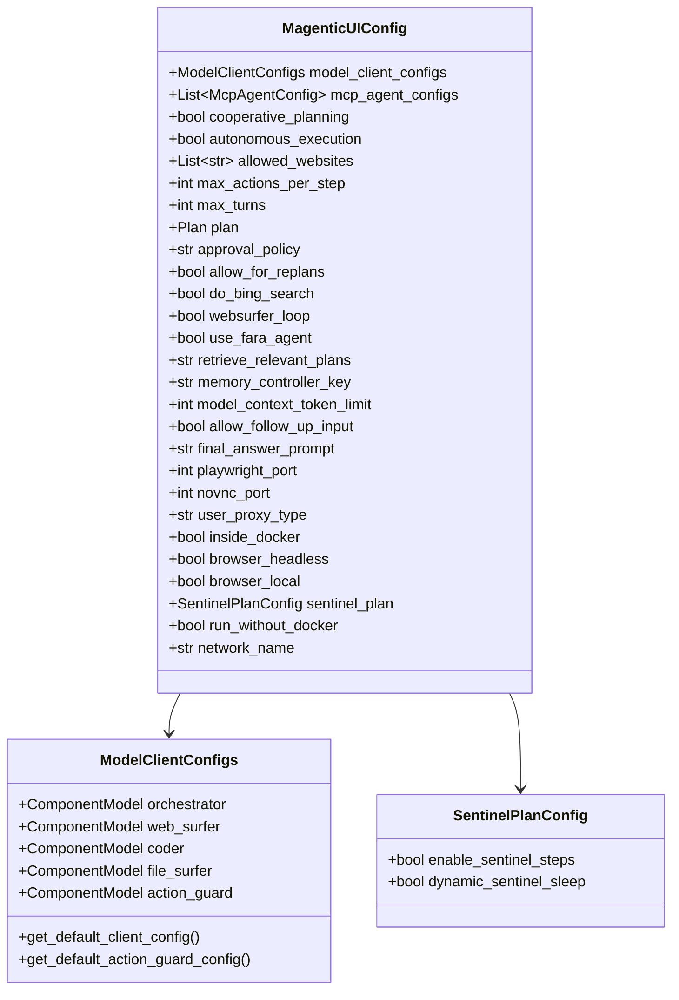
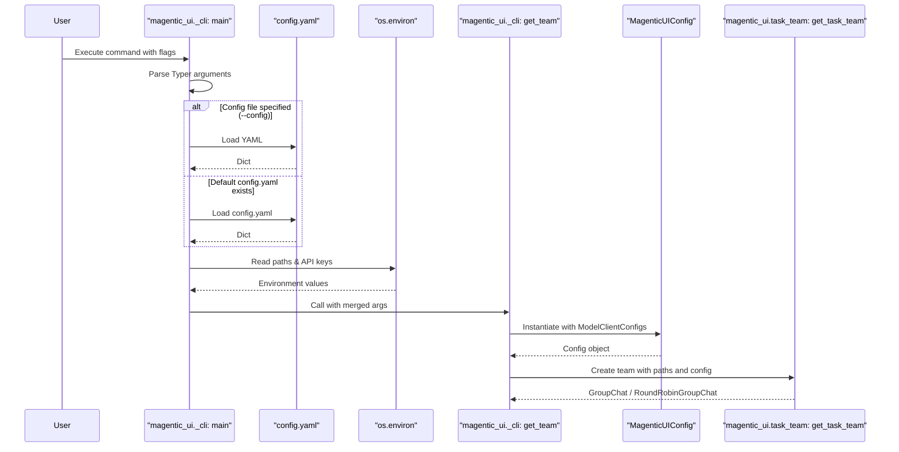
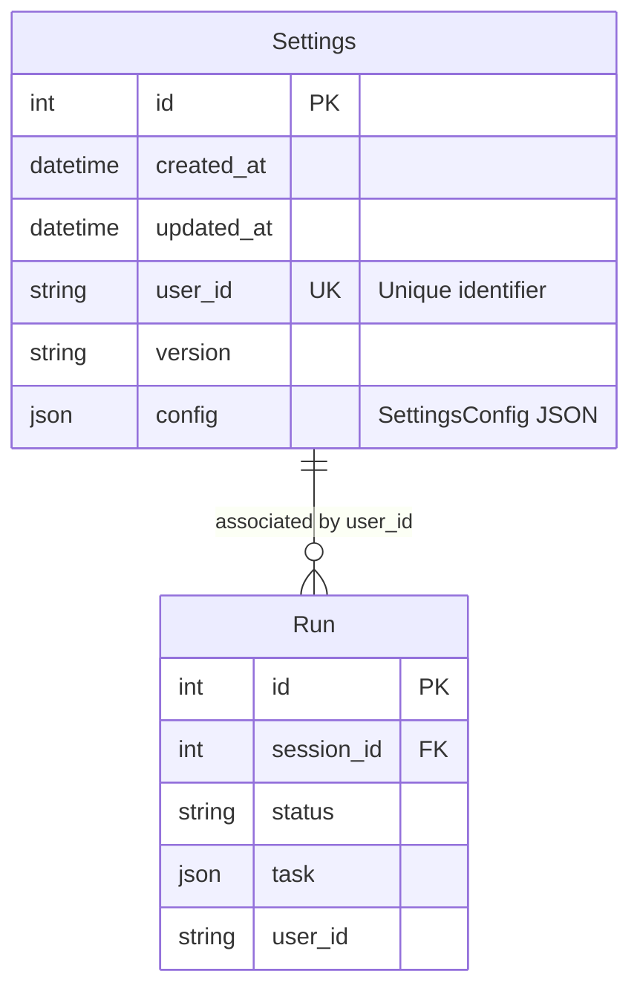

<!-- source: DeepWiki mcp.deepwiki.com · repo microsoft/magentic-ui · page 2.1 Configuration System · fetched 2026-10-26 -->

# Configuration System

Relevant source files

The following files were used as context for generating this wiki page:

- [src/magentic_ui/_cli.py](src/magentic_ui/_cli.py)
- [src/magentic_ui/backend/cli.py](src/magentic_ui/backend/cli.py)
- [src/magentic_ui/backend/database/db_manager.py](src/magentic_ui/backend/database/db_manager.py)
- [src/magentic_ui/backend/datamodel/db.py](src/magentic_ui/backend/datamodel/db.py)
- [src/magentic_ui/backend/datamodel/types.py](src/magentic_ui/backend/datamodel/types.py)
- [src/magentic_ui/backend/web/app.py](src/magentic_ui/backend/web/app.py)
- [src/magentic_ui/backend/web/config.py](src/magentic_ui/backend/web/config.py)
- [src/magentic_ui/backend/web/deps.py](src/magentic_ui/backend/web/deps.py)
- [src/magentic_ui/backend/web/managers/connection.py](src/magentic_ui/backend/web/managers/connection.py)
- [src/magentic_ui/backend/web/routes/settingsroute.py](src/magentic_ui/backend/web/routes/settingsroute.py)
- [src/magentic_ui/magentic_ui_config.py](src/magentic_ui/magentic_ui_config.py)
- [src/magentic_ui/task_team.py](src/magentic_ui/task_team.py)
- [src/magentic_ui/teams/orchestrator/orchestrator_config.py](src/magentic_ui/teams/orchestrator/orchestrator_config.py)

The Configuration System in Magentic-UI manages all runtime parameters that control agent behavior, model selection, planning strategies, and execution policies. It implements a priority-based resolution mechanism that allows configuration to be specified through multiple sources (CLI arguments, YAML files, UI settings, environment variables) with a well-defined precedence order. This page covers the configuration hierarchy, resolution logic, and the core configuration classes that drive the system.

---

## Configuration Sources and Priority

Magentic-UI accepts configuration from four sources, with the following priority order (highest to lowest):

| Priority | Source | Use Case | Scope |
|----------|--------|----------|-------|
| 1 | CLI Arguments | Overriding specific parameters at runtime | Single run |
| 2 | YAML Config File | Complete model client configuration | Per-invocation |
| 3 | UI Settings | User preferences and model clients | Per-user |
| 4 | Environment Variables | API keys and infrastructure paths | System-wide |

**Key Priority Rules:**
- For **model client configurations**: A complete YAML config file (specified via `--config` or found at `config.yaml`) takes precedence over UI settings [src/magentic_ui/backend/web/routes/settingsroute.py:53-75]().
- For **individual parameters**: CLI arguments override YAML config which overrides UI settings [src/magentic_ui/_cli.py:659-715]().
- For **API keys**: Environment variables are the primary source, though they can be defined within the `ComponentModel` config in YAML [src/magentic_ui/magentic_ui_config.py:39-52]().
- For **MCP agent configs**: YAML config takes precedence over UI settings if validation passes [src/magentic_ui/backend/web/app.py:41-64]().

Sources: [src/magentic_ui/_cli.py:659-715](), [src/magentic_ui/backend/web/routes/settingsroute.py:53-75](), [src/magentic_ui/magentic_ui_config.py:39-52]()

---

## Configuration Resolution Flow

Configuration resolution bridges the gap between raw input (CLI/YAML) and the structured `MagenticUIConfig` used by the `get_task_team` factory.

### Resolution Diagram

Title: Configuration Resolution and Data Flow

**Configuration Resolution Steps in CLI/Backend:**

1. **Load model client configs from YAML**: [src/magentic_ui/_cli.py:224-243]() checks for `orchestrator_client`, `web_surfer_client`, etc.
2. **Merge settings with priority**: In the CLI, values from `typer.Option` override those loaded from the YAML dictionary [src/magentic_ui/_cli.py:674-715]().
3. **Build MagenticUIConfig**: The `MagenticUIConfig` object is instantiated with the merged parameters [src/magentic_ui/_cli.py:245-270]().
4. **Pass to Team Factory**: The config object is passed to `get_task_team` [src/magentic_ui/task_team.py:34-49]() to assemble the multi-agent system.

Sources: [src/magentic_ui/_cli.py:224-270](), [src/magentic_ui/_cli.py:674-715](), [src/magentic_ui/task_team.py:34-49]()

---

## Core Configuration Classes

### MagenticUIConfig

The `MagenticUIConfig` class is the central configuration object containing all parameters needed to instantiate the agent team.

Title: MagenticUIConfig Entity Relationships

**Key Configuration Groups:**

| Group | Parameters | Purpose |
|-------|-----------|---------|
| **Planning** | `cooperative_planning`, `autonomous_execution`, `plan`, `allow_for_replans`, `retrieve_relevant_plans` | Control plan generation and user interaction [src/magentic_ui/magentic_ui_config.py:103-117](). |
| **Model Clients** | `model_client_configs`, `use_fara_agent`, `model_context_token_limit` | Specify LLM clients for each agent [src/magentic_ui/magentic_ui_config.py:101-119](). |
| **Agent Behavior** | `max_actions_per_step`, `max_turns`, `approval_policy`, `allowed_websites` | Control agent execution constraints [src/magentic_ui/magentic_ui_config.py:105-112](). |
| **Infrastructure** | `inside_docker`, `run_without_docker`, `playwright_port`, `novnc_port`, `browser_headless` | Configure execution environment [src/magentic_ui/magentic_ui_config.py:122-132](). |
| **Monitoring** | `sentinel_plan`, `allow_follow_up_input`, `final_answer_prompt` | Enable long-running tasks and output customization [src/magentic_ui/magentic_ui_config.py:120-131](). |

Sources: [src/magentic_ui/magentic_ui_config.py:63-134]()

---

### ModelClientConfigs

The `ModelClientConfigs` class specifies which LLM client each agent should use. It allows different agents to use different models or providers.

**Structure:**
The class holds `ComponentModel` objects or dictionaries that `ChatCompletionClient.load_component()` can process [src/magentic_ui/magentic_ui_config.py:22-37]().

**Default Configuration:**
All agents default to `gpt-4.1-2025-04-14` via `OpenAIChatCompletionClient`, except the `action_guard` which defaults to `gpt-4.1-nano-2025-04-14` [src/magentic_ui/magentic_ui_config.py:39-52]().

Sources: [src/magentic_ui/magentic_ui_config.py:22-61](), [src/magentic_ui/task_team.py:53-63]()

---

## Configuration Loading in CLI

The CLI (`magentic-cli`) serves as the primary entry point for headless execution and benchmarking.

Title: CLI Configuration Loading Sequence

**CLI Configuration Loading Steps:**

1. **Argument Parsing**: Typer parses command line options [src/magentic_ui/_cli.py:439-593]().
2. **YAML Loading**: If a config file exists, it is loaded using `yaml.safe_load` [src/magentic_ui/_cli.py:224-231]().
3. **Model Client Mapping**: YAML keys like `orchestrator_client` are mapped to `ModelClientConfigs` fields [src/magentic_ui/_cli.py:233-243]().
4. **Team Instantiation**: The `get_team` function initializes the `RunPaths` and calls the team factory [src/magentic_ui/_cli.py:245-280]().

Sources: [src/magentic_ui/_cli.py:224-280](), [src/magentic_ui/_cli.py:439-593]()

---

## Configuration in Web UI

The web UI uses a database-backed settings system that persists user preferences and allows for dynamic reconfiguration.

### Settings Database Model

The `Settings` table in the database stores configuration as a JSON blob mapped to a `user_id` [src/magentic_ui/backend/datamodel/db.py:185-199]().

Title: UI Settings Data Model

**Settings Resolution in WebSocket Manager:**

When a run starts via WebSocket, the `WebSocketManager` loads settings and merges them with the execution request [src/magentic_ui/backend/web/managers/connection.py:115-170]().

1. **Load Settings**: Retrieves `Settings` from the database for the current user.
2. **Merge Config**: Combines `team_config` (from UI request) and `settings_config` (from DB) [src/magentic_ui/backend/web/managers/connection.py:119-121]().
3. **Initialize TeamManager**: Passes the merged config to the `TeamManager` which eventually calls the team factory [src/magentic_ui/backend/web/managers/connection.py:138-145]().

Sources: [src/magentic_ui/backend/datamodel/db.py:185-199](), [src/magentic_ui/backend/web/managers/connection.py:115-170]()

---

## OrchestratorConfig

The `OrchestratorConfig` is a specialized subset of configuration used specifically by the Orchestrator agent to manage its internal state and planning logic [src/magentic_ui/teams/orchestrator/orchestrator_config.py:7-29]().

**Key Attributes:**
- `cooperative_planning`: Whether to involve the user in plan approval [src/magentic_ui/teams/orchestrator/orchestrator_config.py:31]().
- `autonomous_execution`: If true, suppresses human-in-the-loop during step execution [src/magentic_ui/teams/orchestrator/orchestrator_config.py:32]().
- `max_turns`: Limit on the number of turns before termination [src/magentic_ui/teams/orchestrator/orchestrator_config.py:35]().
- `sentinel_plan`: Configuration for periodic monitoring tasks [src/magentic_ui/teams/orchestrator/orchestrator_config.py:47]().

Sources: [src/magentic_ui/teams/orchestrator/orchestrator_config.py:7-48](), [src/magentic_ui/task_team.py:102-114]()

---

## Environment Variables

Environment variables are handled during the application lifespan and CLI startup.

| Variable | Purpose | Location |
|----------|---------|----------|
| `INTERNAL_WORKSPACE_ROOT` | Container path for workspace | [src/magentic_ui/_cli.py:165-170]() |
| `EXTERNAL_WORKSPACE_ROOT` | Host path for workspace | [src/magentic_ui/_cli.py:171-176]() |
| `_CONFIG` | Path to the YAML configuration file | [src/magentic_ui/backend/web/app.py:43-47]() |
| `FARA_AGENT` | Flag to use the FARA-flavored web surfer | [src/magentic_ui/backend/web/app.py:51-52]() |
| `MAGENTIC_UI_DATABASE_URI` | Database connection string | [src/magentic_ui/backend/web/config.py:7-15]() |

Sources: [src/magentic_ui/_cli.py:165-176](), [src/magentic_ui/backend/web/app.py:41-52](), [src/magentic_ui/backend/web/config.py:6-18]()

---

