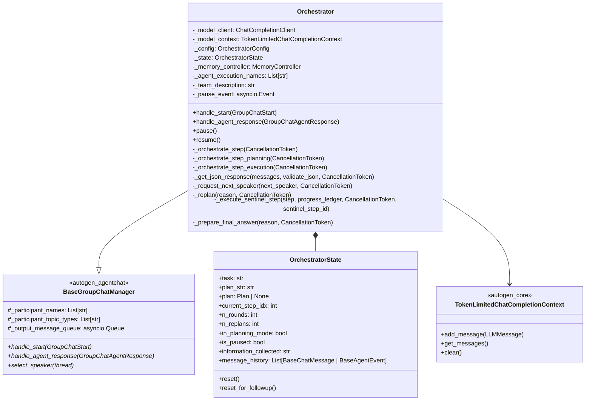
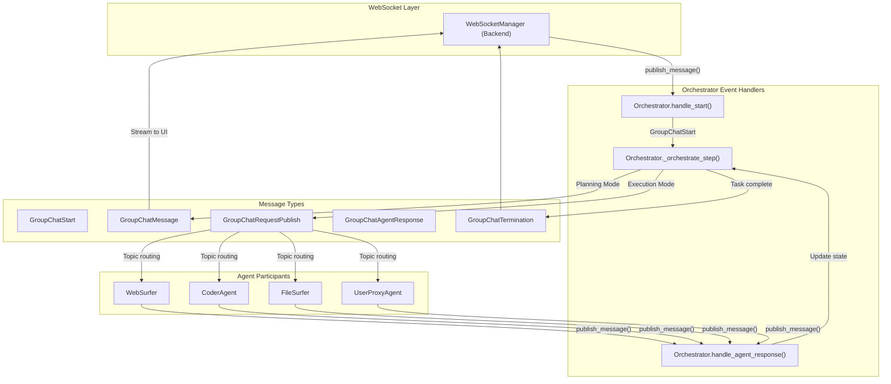
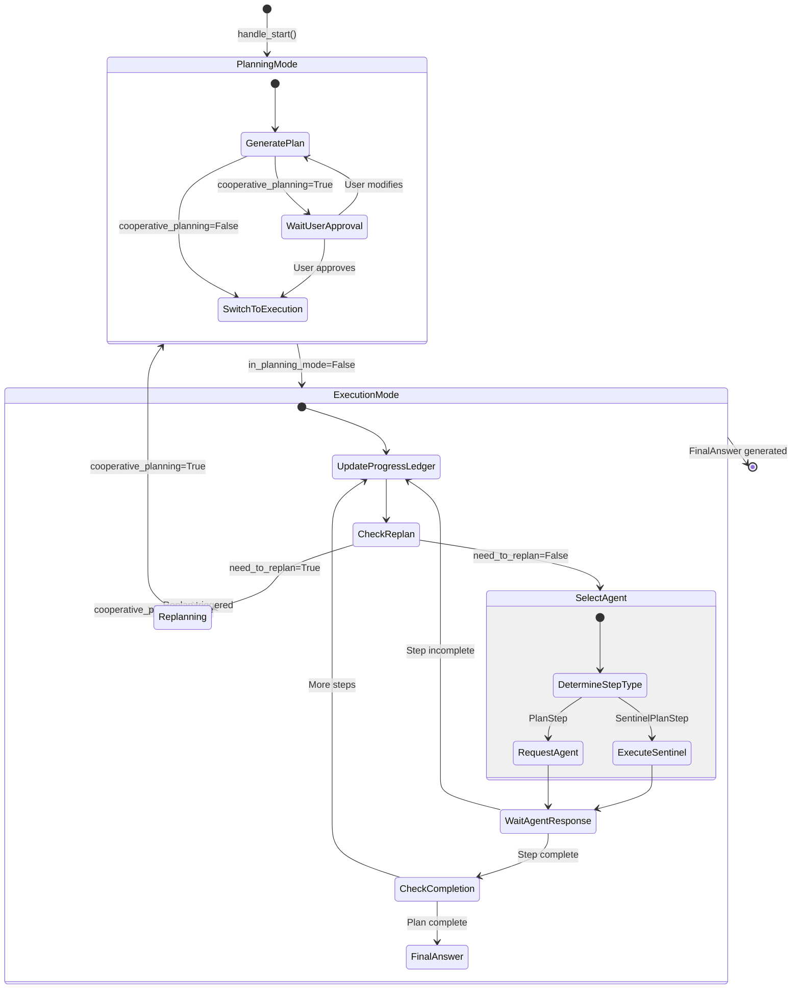
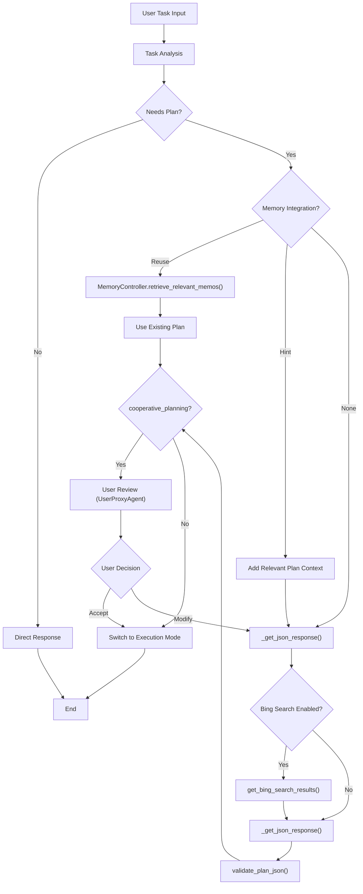
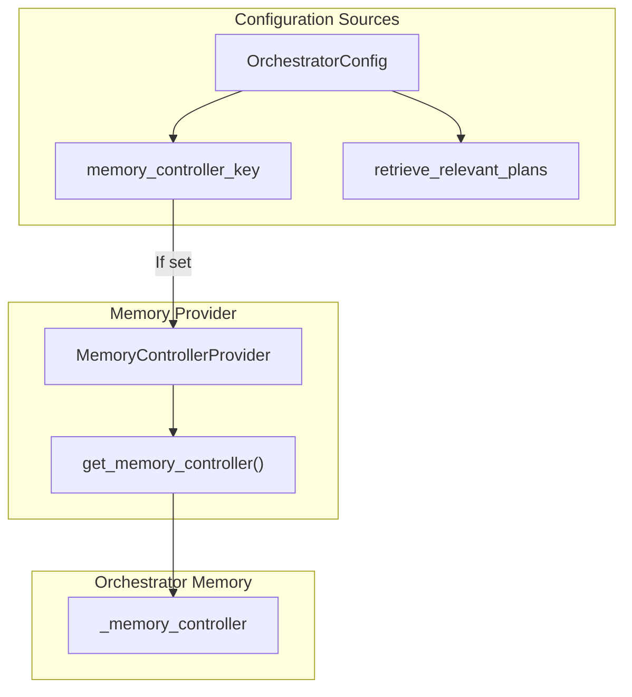
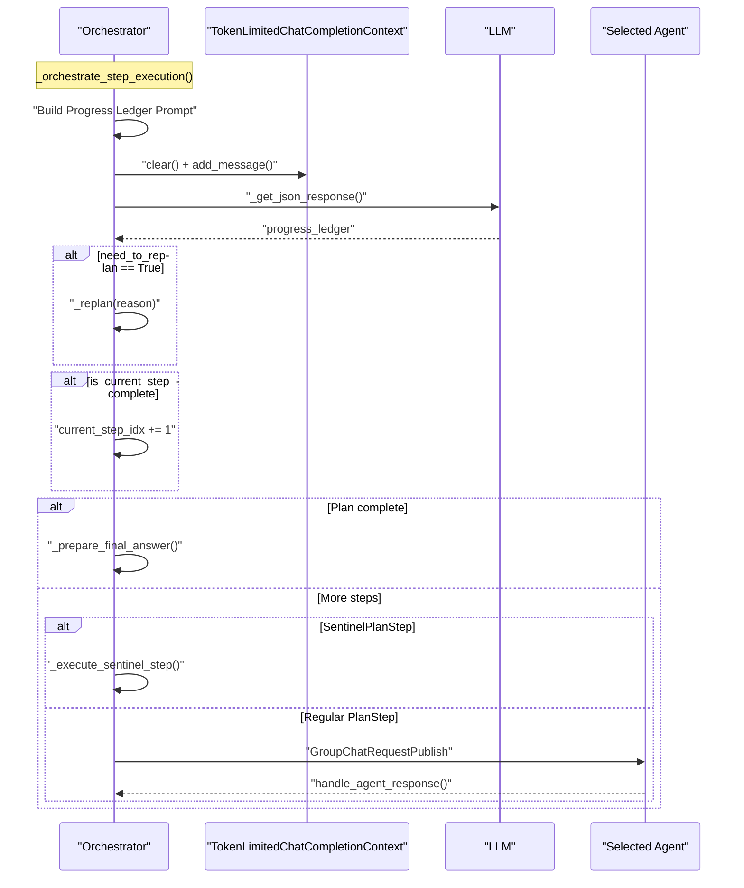
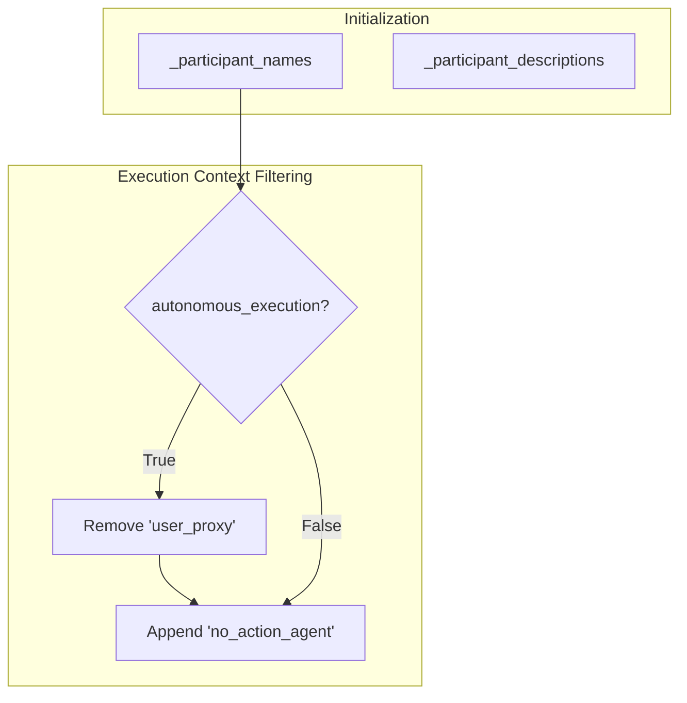
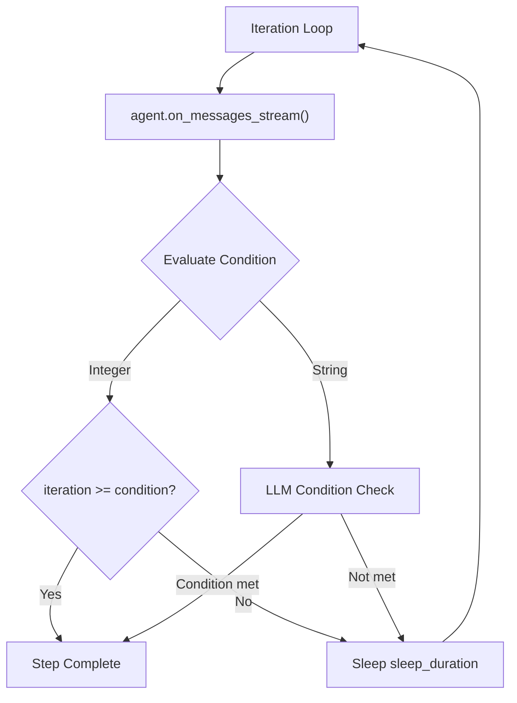

<!-- source: DeepWiki mcp.deepwiki.com · repo microsoft/magentic-ui · page 2.2 Multi-Agent Orchestration · fetched 2026-10-26 -->

# Multi-Agent Orchestration

Relevant source files

The following files were used as context for generating this wiki page:

- [src/magentic_ui/_cli.py](src/magentic_ui/_cli.py)
- [src/magentic_ui/magentic_ui_config.py](src/magentic_ui/magentic_ui_config.py)
- [src/magentic_ui/task_team.py](src/magentic_ui/task_team.py)
- [src/magentic_ui/teams/orchestrator/_group_chat.py](src/magentic_ui/teams/orchestrator/_group_chat.py)
- [src/magentic_ui/teams/orchestrator/_orchestrator.py](src/magentic_ui/teams/orchestrator/_orchestrator.py)
- [src/magentic_ui/teams/orchestrator/_prompts.py](src/magentic_ui/teams/orchestrator/_prompts.py)
- [src/magentic_ui/teams/orchestrator/orchestrator_config.py](src/magentic_ui/teams/orchestrator/orchestrator_config.py)

The `Orchestrator` is the central coordination agent in Magentic-UI that manages conversation flow between specialized agents, decomposes user tasks into executable plans, and orchestrates step-by-step execution. It acts as a group chat manager that selects appropriate agents for each task step and maintains execution state throughout the conversation.

The orchestrator operates within the multi-agent system layer (see [System Architecture](2)) and is instantiated by the `TeamManager` (see [Task Team Assembly and Management](2.3)). Individual agent capabilities are documented in [Agent System](4), while configuration options are covered in [Configuration System](2.1).

## Overview

The `Orchestrator` class extends `BaseGroupChatManager` from AutoGen and serves as the primary decision-maker in the agent team. It coordinates multiple specialized agents by operating in two distinct modes:

- **Planning Mode**: Decomposes user requests into structured plans with discrete steps.
- **Execution Mode**: Routes each plan step to the appropriate agent and tracks progress.

Key capabilities include:
- **Cooperative Planning**: Allows users to review and modify AI-generated plans before execution [src/magentic_ui/magentic_ui_config.py:70-71]().
- **Autonomous Execution**: Executes plans without user intervention when configured [src/magentic_ui/magentic_ui_config.py:71-72]().
- **Dynamic Replanning**: Regenerates plans when the current approach fails [src/magentic_ui/teams/orchestrator/_orchestrator.py:1119-1121]().
- **Sentinel Steps**: Supports long-running monitoring tasks that check conditions periodically [src/magentic_ui/teams/orchestrator/_orchestrator.py:1270-1272]().
- **Memory Integration**: Learns from previous tasks to suggest relevant plans [src/magentic_ui/teams/orchestrator/_orchestrator.py:171-187]().

Sources: [src/magentic_ui/teams/orchestrator/_orchestrator.py:113-189](), [src/magentic_ui/magentic_ui_config.py:63-99]()

## Core Architecture

### Orchestrator Class Hierarchy

The `Orchestrator` inherits from AutoGen's `BaseGroupChatManager` and adds planning, execution, and memory capabilities:

Sources: [src/magentic_ui/teams/orchestrator/_orchestrator.py:70-194]()

### Key Components

| Component | Type | Purpose |
|-----------|------|---------|
| `_model_client` | `ChatCompletionClient` | LLM client for planning and decision-making [src/magentic_ui/teams/orchestrator/_orchestrator.py:155]() |
| `_model_context` | `TokenLimitedChatCompletionContext` | Manages conversation history within token limits [src/magentic_ui/teams/orchestrator/_orchestrator.py:156-158]() |
| `_state` | `OrchestratorState` | Maintains execution state (plan, progress, mode) [src/magentic_ui/teams/orchestrator/_orchestrator.py:199]() |
| `_memory_controller` | `MemoryController | None` | Optional memory system for plan learning [src/magentic_ui/teams/orchestrator/_orchestrator.py:171-187]() |
| `_agent_execution_names` | `List[str]` | Filtered list of agents available for execution [src/magentic_ui/teams/orchestrator/_orchestrator.py:202]() |
| `_output_message_queue` | `asyncio.Queue` | Queue for streaming messages to frontend [src/magentic_ui/teams/orchestrator/_orchestrator.py:150]() |
| `_pause_event` | `asyncio.Event` | Synchronization primitive for pause/resume [src/magentic_ui/teams/orchestrator/_orchestrator.py:193]() |

Sources: [src/magentic_ui/teams/orchestrator/_orchestrator.py:125-194]()

## Conversation Flow Management

The orchestrator manages conversation flow through event-driven message passing using AutoGen's group chat primitives.

### Message Flow Architecture

Sources: [src/magentic_ui/teams/orchestrator/_orchestrator.py:514-576](), [src/magentic_ui/task_team.py:102-166]()

### Topic-Based Agent Routing

The orchestrator uses AutoGen's topic-based routing to coordinate agents:

| Method | Message Type | Purpose |
|--------|-------------|---------|
| `publish_message(GroupChatStart)` | Broadcast | Initializes all agents with task context [src/magentic_ui/teams/orchestrator/_orchestrator.py:514-523]() |
| `publish_message(GroupChatRequestPublish)` | Targeted | Requests specific agent to perform action [src/magentic_ui/teams/orchestrator/_orchestrator.py:486-501]() |
| `publish_message(GroupChatMessage)` | Broadcast | Shares information with all participants [src/magentic_ui/teams/orchestrator/_orchestrator.py:525-542]() |
| `publish_message(GroupChatAgentResponse)` | Internal | Propagates agent responses back to orchestrator [src/magentic_ui/teams/orchestrator/_orchestrator.py:544-576]() |

Sources: [src/magentic_ui/teams/orchestrator/_orchestrator.py:418-432]()

### State Transitions

Sources: [src/magentic_ui/teams/orchestrator/_orchestrator.py:709-941](), [src/magentic_ui/teams/orchestrator/_orchestrator.py:943-1117]()

## Planning System

### Plan Types and Structure

The orchestrator supports two types of plan steps with different execution characteristics [src/magentic_ui/types.py:45]():

| Step Type | Duration | Use Cases | Required Fields |
|-----------|----------|-----------|-----------------|
| `PlanStep` | Immediate | File operations, web navigation, code execution | `title`, `details`, `agent_name` |
| `SentinelPlanStep` | Long-running | Monitoring, periodic checks, condition waiting | `title`, `details`, `agent_name`, `sleep_duration`, `condition` |

### Planning Process Flow

Sources: [src/magentic_ui/teams/orchestrator/_orchestrator.py:678-905](), [src/magentic_ui/teams/orchestrator/_orchestrator.py:559-583]()

## Memory Integration

The orchestrator integrates with a memory system to reuse previous plans [src/magentic_ui/teams/orchestrator/_orchestrator.py:171-187]().

### Memory Controller Initialization

Sources: [src/magentic_ui/teams/orchestrator/_orchestrator.py:171-187]()

### Memory Retrieval Modes

| Mode | Behavior | Use Case |
|------|----------|----------|
| `"reuse"` | Replaces entire plan with most relevant stored plan | Exact task repetition [src/magentic_ui/teams/orchestrator/_orchestrator.py:696-697]() |
| `"hint"` | Adds relevant plan as context in LLM prompt | Similar but not identical tasks [src/magentic_ui/teams/orchestrator/_orchestrator.py:698-702]() |
| `"never"` | No memory integration | Default behavior [src/magentic_ui/teams/orchestrator/orchestrator_config.py:43]() |

Sources: [src/magentic_ui/teams/orchestrator/_orchestrator.py:673-707]()

## Execution System

### Step Execution Coordination

The execution system manages step-by-step task completion with progress tracking.

Sources: [src/magentic_ui/teams/orchestrator/_orchestrator.py:943-1117]()

### Progress Ledger System

The orchestrator uses a **progress ledger** JSON structure to track execution state [src/magentic_ui/teams/orchestrator/_prompts.py:427-468]().

**Ledger Generation Process:**
1. **Build Context**: Compile `_thread_to_context()` with history [src/magentic_ui/teams/orchestrator/_orchestrator.py:288-316]().
2. **LLM Query**: Call `_get_json_response()` with `validate_ledger_json()` [src/magentic_ui/teams/orchestrator/_orchestrator.py:968-984]().
3. **Parse Response**: Extract `is_current_step_complete` and `need_to_replan` [src/magentic_ui/teams/orchestrator/_orchestrator.py:986-1002]().

Sources: [src/magentic_ui/teams/orchestrator/_prompts.py:356-424]()

## Agent Selection and Coordination

### Agent List Management

The orchestrator filters the participant list based on configuration.

Sources: [src/magentic_ui/teams/orchestrator/_orchestrator.py:195-232]()

### Agent Selection During Execution

The orchestrator selects agents through LLM-generated JSON specifying the `agent_name` field [src/magentic_ui/teams/orchestrator/_prompts.py:461]().

**Agent Instruction Format:**
Instructions are formatted using `INSTRUCTION_AGENT_FORMAT` to include step context [src/magentic_ui/teams/orchestrator/_prompts.py:36-42]().

Sources: [src/magentic_ui/teams/orchestrator/_orchestrator.py:324-333]()

## Advanced Features

### Sentinel Step Execution

Sentinel steps enable long-running monitoring [src/magentic_ui/teams/orchestrator/_orchestrator.py:1270-1421]().

Sources: [src/magentic_ui/teams/orchestrator/_orchestrator.py:1270-1421]()

### Replanning System

The orchestrator supports dynamic replanning when failures occur [src/magentic_ui/teams/orchestrator/_orchestrator.py:1119-1194]().

**Replan Process:**
1. **Preserve History**: Keep `completed_steps` [src/magentic_ui/teams/orchestrator/_orchestrator.py:1131-1135]().
2. **Generate New Steps**: Call LLM with replan prompt [src/magentic_ui/teams/orchestrator/_orchestrator.py:1152-1158]().
3. **Combine Plans**: Append new steps to completed ones [src/magentic_ui/teams/orchestrator/_orchestrator.py:1162-1166]().

Sources: [src/magentic_ui/teams/orchestrator/_orchestrator.py:1119-1194](), [src/magentic_ui/teams/orchestrator/_prompts.py:336-353]()

---

