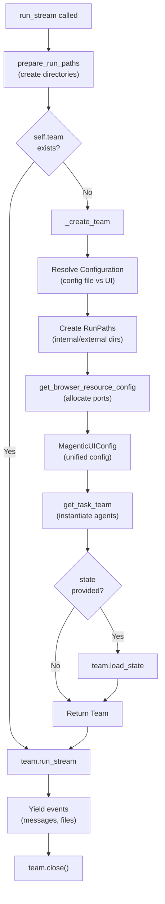
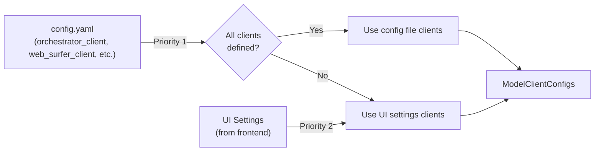
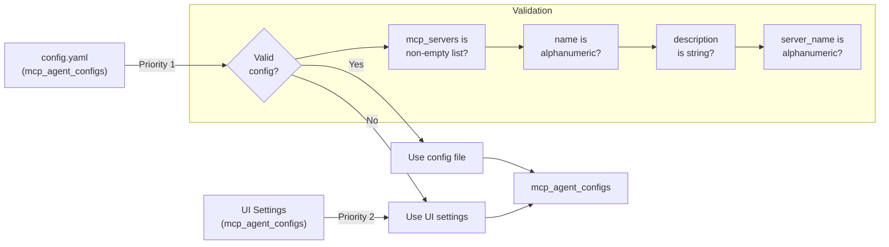
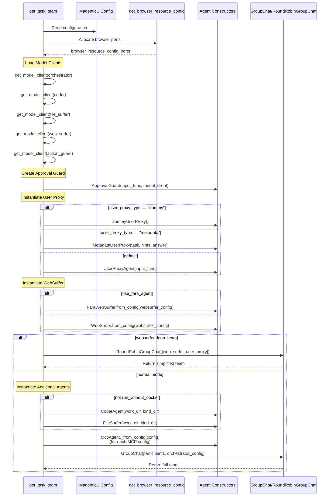
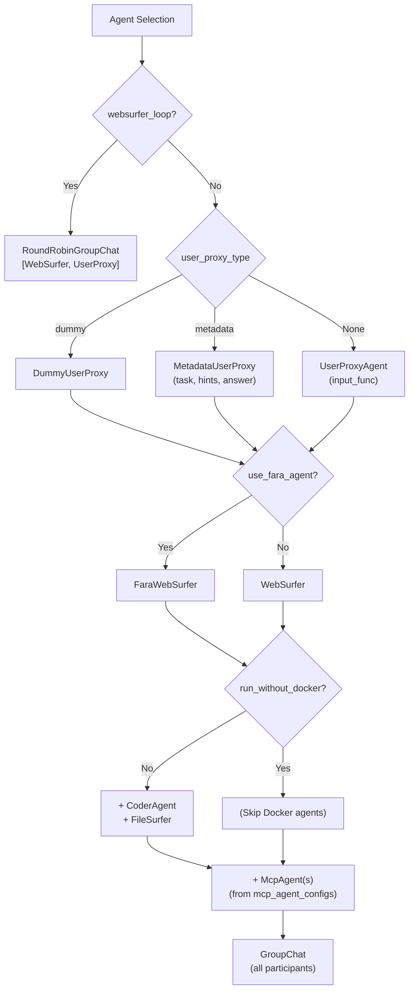
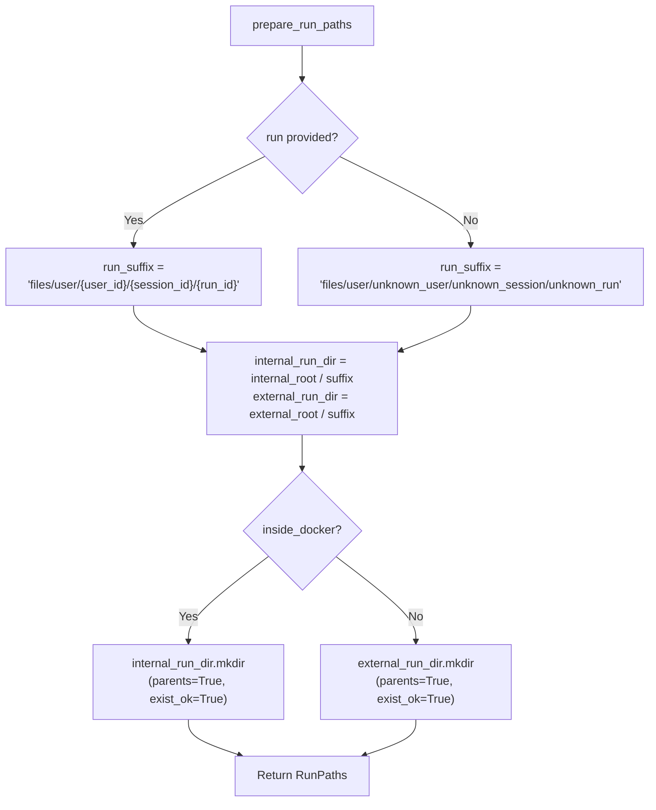
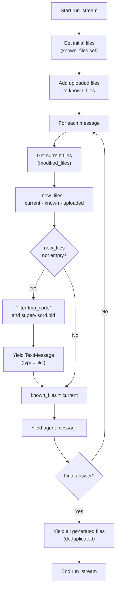

<!-- source: DeepWiki mcp.deepwiki.com · repo microsoft/magentic-ui · page 2.3 Task Team Assembly and Management · fetched 2026-10-26 -->

# Task Team Assembly and Management

<details>
<summary>Relevant source files</summary>

The following files were used as context for generating this wiki page:

- [README.md](README.md)
- [pyproject.toml](pyproject.toml)
- [src/magentic_ui/__init__.py](src/magentic_ui/__init__.py)
- [src/magentic_ui/_cli.py](src/magentic_ui/_cli.py)
- [src/magentic_ui/backend/__init__.py](src/magentic_ui/backend/__init__.py)
- [src/magentic_ui/backend/teammanager/teammanager.py](src/magentic_ui/backend/teammanager/teammanager.py)
- [src/magentic_ui/magentic_ui_config.py](src/magentic_ui/magentic_ui_config.py)
- [src/magentic_ui/task_team.py](src/magentic_ui/task_team.py)
- [src/magentic_ui/teams/orchestrator/orchestrator_config.py](src/magentic_ui/teams/orchestrator/orchestrator_config.py)
- [src/magentic_ui/version.py](src/magentic_ui/version.py)
- [uv.lock](uv.lock)

</details>


## Purpose and Scope

This page describes how the `TeamManager` class creates and manages multi-agent teams in Magentic-UI. It covers the team assembly process, agent instantiation logic, configuration precedence rules, and lifecycle management. For details on how the orchestrator coordinates agents after team creation, see [Multi-Agent Orchestration](2.2). For configuration file format details, see [Configuration System](2.1).

---

## TeamManager Overview

The `TeamManager` class is responsible for creating agent teams, managing their lifecycle, and handling workspace paths. It serves as the primary interface between the backend server and the multi-agent system. [src/magentic_ui/backend/teammanager/teammanager.py:49-50]()

### Core Responsibilities

| Responsibility | Description |
|---------------|-------------|
| **Team Creation** | Instantiates `Team` objects with appropriate agent configurations. [src/magentic_ui/backend/teammanager/teammanager.py:174-184]() |
| **Configuration Resolution** | Merges config file settings with UI settings according to precedence rules. [src/magentic_ui/backend/teammanager/teammanager.py:194-213]() |
| **Path Management** | Creates and manages internal/external workspace directories via `prepare_run_paths`. [src/magentic_ui/backend/teammanager/teammanager.py:77-113]() |
| **State Persistence** | Coordinates team state loading and saving. [src/magentic_ui/backend/teammanager/teammanager.py:328-346]() |
| **File Tracking** | Monitors workspace for generated files and distinguishes them from uploaded files. [src/magentic_ui/backend/teammanager/teammanager.py:115-166]() |
| **Lifecycle Management** | Handles team initialization, execution, and cleanup. [src/magentic_ui/backend/teammanager/teammanager.py:353-507]() |

### Initialization Parameters

```python
TeamManager(
    internal_workspace_root: Path,     # Docker-visible workspace path
    external_workspace_root: Path,     # Host-visible workspace path
    run_without_docker: bool,          # Disable Docker-dependent agents
    inside_docker: bool = True,        # Whether backend runs in Docker
    config: dict[str, Any] = {}        # Configuration from config.yaml
)
```

**Sources:** [src/magentic_ui/backend/teammanager/teammanager.py:52-69]()

---

## Team Assembly Architecture

### High-Level Assembly Flow



**Sources:** [src/magentic_ui/backend/teammanager/teammanager.py:174-352](), [src/magentic_ui/backend/teammanager/teammanager.py:353-507]()

---

## Configuration Precedence Rules

The system resolves configuration from multiple sources with a well-defined precedence order.

### Model Client Configuration Precedence

The system validates completeness by checking if all required client configurations are provided in the config file. [src/magentic_ui/backend/teammanager/teammanager.py:194-213]()



**Sources:** [src/magentic_ui/backend/teammanager/teammanager.py:194-213](), [src/magentic_ui/magentic_ui_config.py:22-38]()

### MCP Agent Configuration Precedence

Validation logic ensures MCP configurations are well-formed before accepting them from the config file. [src/magentic_ui/backend/teammanager/teammanager.py:214-275]()



**Sources:** [src/magentic_ui/backend/teammanager/teammanager.py:214-275]()

### Other Configuration Parameters

| Parameter | Priority 1 (Highest) | Priority 2 | Default |
|-----------|---------------------|-----------|---------|
| `use_fara_agent` | UI settings | CLI `--fara` flag | `False`. [src/magentic_ui/magentic_ui_config.py:81]() |
| `run_without_docker` | CLI flag | UI settings | `False`. [src/magentic_ui/magentic_ui_config.py:97]() |
| `browser_headless` | UI settings | CLI flag | `False`. [src/magentic_ui/magentic_ui_config.py:94]() |
| `approval_policy` | UI settings | CLI flag | `"auto-conservative"`. [src/magentic_ui/magentic_ui_config.py:110-112]() |

**Sources:** [src/magentic_ui/backend/teammanager/teammanager.py:277-313](), [src/magentic_ui/magentic_ui_config.py:63-128]()

---

## Agent Instantiation Process

The `get_task_team` function in `src/magentic_ui/task_team.py` orchestrates agent creation. [src/magentic_ui/task_team.py:34-49]()

### Agent Creation Sequence



**Sources:** [src/magentic_ui/task_team.py:50-267]()

### Agent Type Selection Logic



**Sources:** [src/magentic_ui/task_team.py:137-267]()

---

## Agent Configuration Details

### WebSurfer Configuration

The `WebSurfer` or `FaraWebSurfer` agent requires extensive configuration via `WebSurferConfig`. [src/magentic_ui/task_team.py:118-135]()

| Configuration Field | Source | Description |
|--------------------|--------|-------------|
| `model_client` | `model_client_configs.web_surfer` | LLM for web navigation. [src/magentic_ui/task_team.py:115-117]() |
| `browser` | `get_browser_resource_config()` | Browser connection details. [src/magentic_ui/task_team.py:89-100]() |
| `url_statuses` | `allowed_websites` | Pre-approved URLs. [src/magentic_ui/task_team.py:124-126]() |
| `url_block_list` | `get_internal_urls()` | Internal URLs to block. [src/magentic_ui/task_team.py:127]() |
| `downloads_folder` | `paths.internal_run_dir` | File download location. [src/magentic_ui/task_team.py:129]() |
| `debug_dir` | `paths.internal_run_dir` | Debug artifacts location. [src/magentic_ui/task_team.py:130]() |

### CoderAgent and FileSurfer Configuration

The `CoderAgent` and `FileSurfer` are only instantiated when Docker is available. [src/magentic_ui/task_team.py:209-228]()

```python
if not magentic_ui_config.run_without_docker:
    coder_agent = CoderAgent(
        name="coder_agent",
        model_client=model_client_coder,
        work_dir=paths.internal_run_dir,      # Docker-visible path
        bind_dir=paths.external_run_dir,      # Host-visible path
        # ...
    )
    file_surfer = FileSurfer(
        name="file_surfer",
        model_client=model_client_file_surfer,
        work_dir=paths.internal_run_dir,
        bind_dir=paths.external_run_dir,
        # ...
    )
```

**Sources:** [src/magentic_ui/task_team.py:209-228]()

---

## Workspace Path Management

### RunPaths Structure

The `RunPaths` dataclass encapsulates all workspace path information. [src/magentic_ui/types.py]() (referred in [src/magentic_ui/backend/teammanager/teammanager.py:26]())

### Path Creation Logic

`TeamManager.prepare_run_paths` calculates and creates the directory structure for a specific run. [src/magentic_ui/backend/teammanager/teammanager.py:77-113]()



**Sources:** [src/magentic_ui/backend/teammanager/teammanager.py:77-113]()

---

## Team Lifecycle Management

### State Loading and Saving

When resuming a session, `TeamManager` loads the team state from a provided dictionary or JSON string. [src/magentic_ui/backend/teammanager/teammanager.py:328-346]()

### File Tracking During Execution

The `TeamManager` tracks generated files to distinguish them from uploaded files during the `run_stream` loop. [src/magentic_ui/backend/teammanager/teammanager.py:376-496]()



**Sources:** [src/magentic_ui/backend/teammanager/teammanager.py:115-166](), [src/magentic_ui/backend/teammanager/teammanager.py:376-496]()

### Cleanup Process

Cleanup is handled by the `close()` method and ensured via `finally` blocks in `run_stream`. [src/magentic_ui/backend/teammanager/teammanager.py:497-517]()

---

## CLI Integration

The CLI interface uses the same team assembly mechanism through direct calls to `get_task_team` in `src/magentic_ui/_cli.py`. [src/magentic_ui/_cli.py:117-289]()

The CLI creates a consistent workspace structure for file exchange: [src/magentic_ui/_cli.py:186-222]()

```python
cli_files_path = os.path.join(internal_workspace_root, "cli_files")
paths = RunPaths(
    internal_root_dir=Path(internal_workspace_root),
    external_root_dir=Path(external_workspace_root),
    run_suffix="run",
    internal_run_dir=Path(cli_files_path),
    external_run_dir=Path(os.path.join(external_workspace_root, "cli_files")),
)
```

**Sources:** [src/magentic_ui/_cli.py:117-289]()

---

