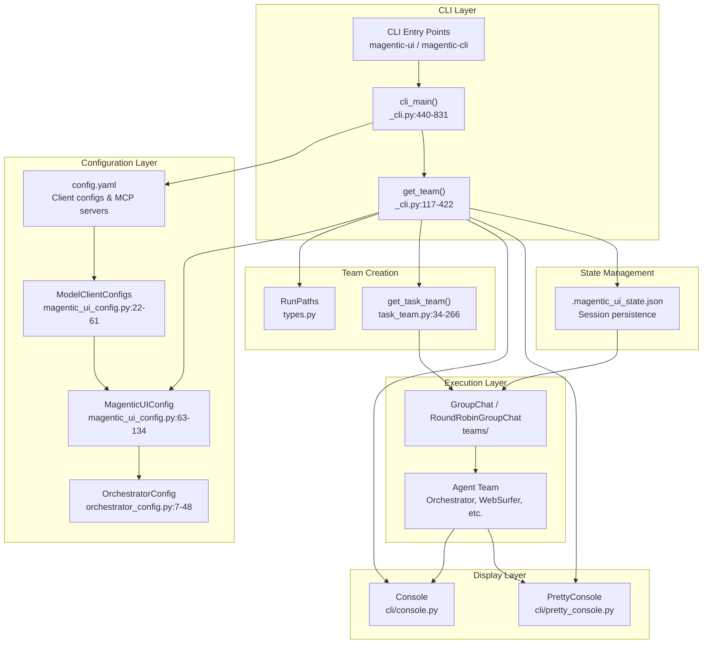
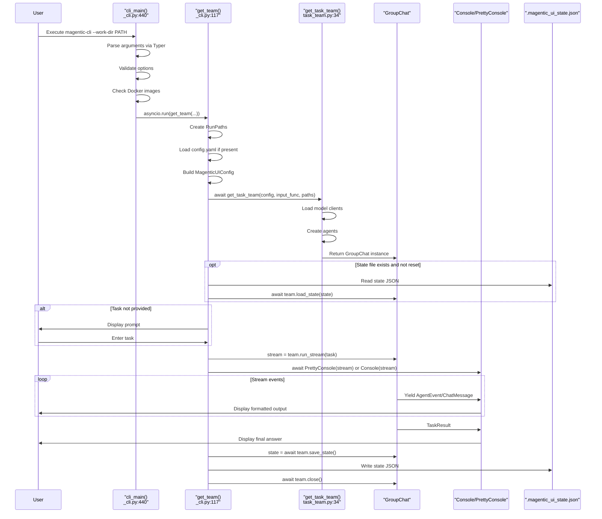
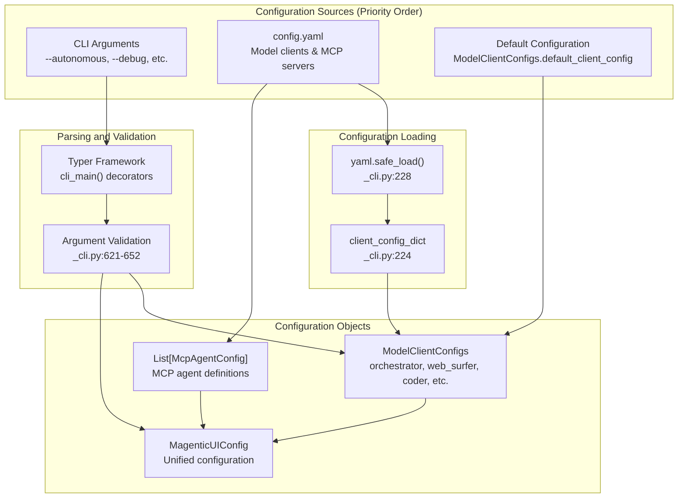
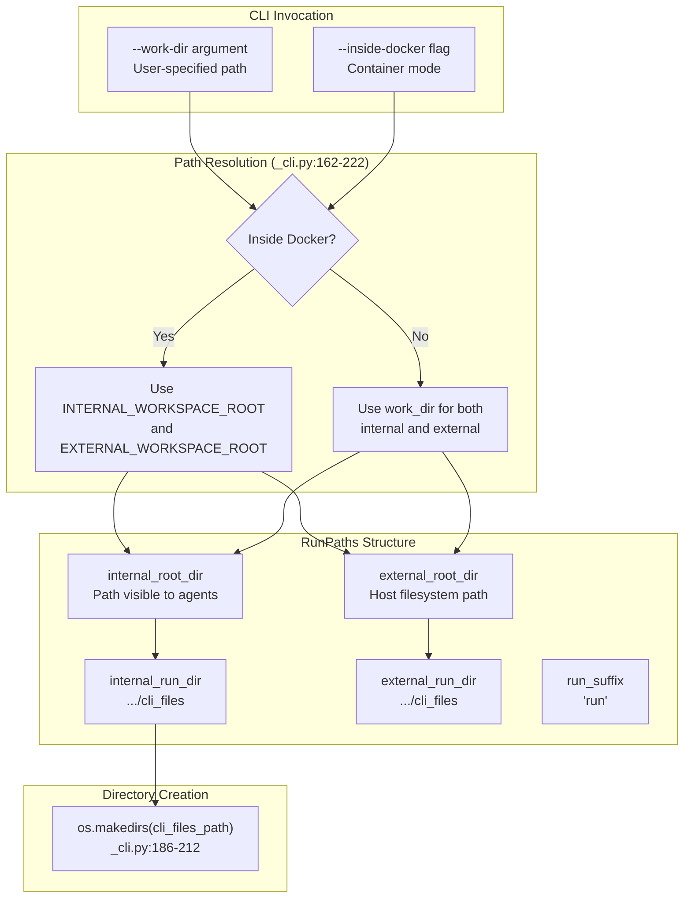
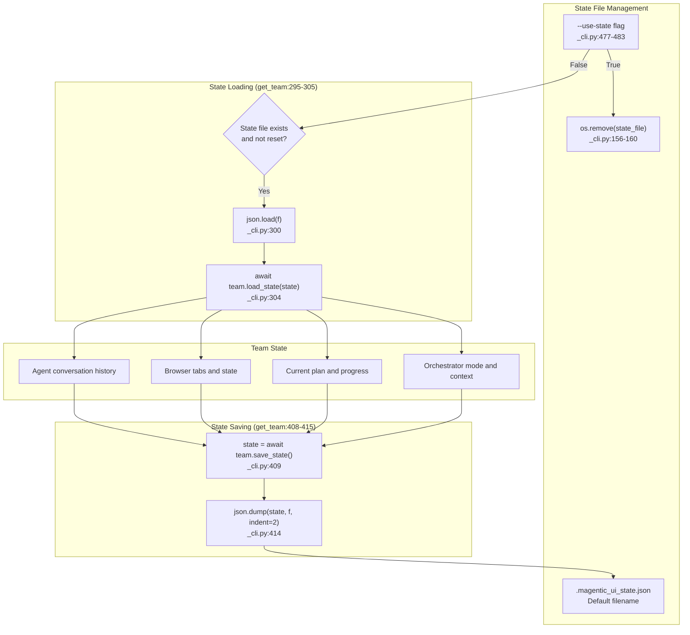

<!-- source: DeepWiki mcp.deepwiki.com · repo microsoft/magentic-ui · page 3 Command Line Interface · fetched 2026-10-26 -->

# Command Line Interface

Relevant source files

The following files were used as context for generating this wiki page:

- [src/magentic_ui/_cli.py](src/magentic_ui/_cli.py)
- [src/magentic_ui/backend/cli.py](src/magentic_ui/backend/cli.py)
- [src/magentic_ui/backend/web/app.py](src/magentic_ui/backend/web/app.py)
- [src/magentic_ui/magentic_ui_config.py](src/magentic_ui/magentic_ui_config.py)
- [src/magentic_ui/task_team.py](src/magentic_ui/task_team.py)
- [src/magentic_ui/teams/orchestrator/orchestrator_config.py](src/magentic_ui/teams/orchestrator/orchestrator_config.py)

The Command Line Interface provides a direct, terminal-based method for running Magentic-UI tasks without the web browser interface. The CLI bypasses the web server and WebSocket infrastructure, invoking the multi-agent system directly through the `TeamManager` or the `get_task_team` utility.

This page covers the CLI architecture, execution flow, and console display system. For detailed command-line options and flags, see [CLI Usage and Options](#3.1). For information about configuration file structure, see [Configuration Files](#3.2). For the web-based interface, see [Frontend Interface](#6).

## Architecture Overview

The CLI operates as a standalone interface that directly instantiates and manages agent teams:

**Sources:** [src/magentic_ui/_cli.py:1-843](), [src/magentic_ui/task_team.py:34-266](), [src/magentic_ui/magentic_ui_config.py:63-134]()

## Command Entry Points

Magentic-UI provides two primary CLI entry points with distinct purposes:

| Command | Purpose | Main Function | Implementation File |
|---------|---------|---------------|---------------------|
| `magentic-ui` | Launches FastAPI web server & UI | `main()` | [src/magentic_ui/backend/cli.py:53-102]() |
| `magentic-cli` | Direct agent execution in terminal | `cli_main()` | [src/magentic_ui/_cli.py:439-831]() |

The `magentic-ui` command (aliased as `ui` in subcommands) initializes the backend environment, checks Docker status, and starts the Uvicorn server at [src/magentic_ui/backend/cli.py:122-134]().

The `magentic-cli` command is built using the Typer framework at [src/magentic_ui/_cli.py:44]() and provides a purely terminal-driven experience for running tasks, ideal for benchmarks and headless environments.

**Sources:** [src/magentic_ui/_cli.py:43-44](), [src/magentic_ui/backend/cli.py:24-119](), [src/magentic_ui/backend/cli.py:157-185]()

## Execution Flow

The `magentic-cli` execution follows a sequential flow from argument parsing through team creation to task streaming:

**Sources:** [src/magentic_ui/_cli.py:440-831](), [src/magentic_ui/_cli.py:117-422](), [src/magentic_ui/task_team.py:34-266]()

## Configuration Resolution

The CLI uses a hierarchical configuration system that merges CLI arguments, environment variables, and YAML configuration files:

The configuration resolution follows these rules:

1. **Model Client Configs**: `config.yaml` values are loaded at [src/magentic_ui/_cli.py:224-240]() and override defaults defined in `ModelClientConfigs` at [src/magentic_ui/magentic_ui_config.py:39-52]().
2. **Planning/Execution Modes**: CLI arguments for `cooperative-planning` and `autonomous-execution` override file-based settings at [src/magentic_ui/_cli.py:245-270]().
3. **Approval Policy**: The `--action-policy` flag (Literal: always, never, auto-conservative, auto-permissive) is mapped to the `MagenticUIConfig` at [src/magentic_ui/_cli.py:566-569]().
4. **Docker Settings**: The `--run-without-docker` flag determines if agents requiring Docker (Coder, FileSurfer) are instantiated at [src/magentic_ui/task_team.py:214-230]().

**Sources:** [src/magentic_ui/_cli.py:224-270](), [src/magentic_ui/magentic_ui_config.py:63-134](), [src/magentic_ui/magentic_ui_config.py:22-61](), [src/magentic_ui/task_team.py:214-230]()

## Working Directory and Paths

The CLI uses a `RunPaths` structure to manage file locations across Docker and non-Docker environments.

Unlike the web UI which creates unique folders per session, the CLI uses a consistent `cli_files` directory to facilitate input file placement for benchmarks at [src/magentic_ui/_cli.py:183-196]().

**Sources:** [src/magentic_ui/_cli.py:162-222](), [src/magentic_ui/types.py:20-26]()

## Console Display System

The CLI provides two display modes for streaming agent output, controlled by the `--pretty-cli` flag at [src/magentic_ui/_cli.py:576-582]().

### Display Mode Selection

| Mode | Class | Features |
|------|-------|----------|
| **Pretty** | `PrettyConsole` | Rich terminal formatting, colored boxes, and logo display at [src/magentic_ui/_cli.py:424-436](). |
| **Old** | `Console` | Minimalist text-only stream processing. |

### Console Initialization Flow

Both console implementations consume the async stream from `team.run_stream()` at [src/magentic_ui/_cli.py:393]() and display events as they occur. The `PrettyConsole` specifically uses helpers like `display_initial_user_task` and `display_orchestrator_welcome` to structure the terminal output.

**Sources:** [src/magentic_ui/_cli.py:139](), [src/magentic_ui/_cli.py:290-404](), [src/magentic_ui/_cli.py:424-436]()

## State Persistence

The CLI maintains session state across runs using a JSON file, typically `.magentic_ui_state.json`.

State is automatically saved after the stream completes at [src/magentic_ui/_cli.py:408-415](). Users can resume the previous state by omitting the `--reset` flag or using the state-related arguments.

**Sources:** [src/magentic_ui/_cli.py:156-160](), [src/magentic_ui/_cli.py:295-305](), [src/magentic_ui/_cli.py:408-415]()

## Input Handling

The CLI implements a `cancellable_input` mechanism at [src/magentic_ui/_cli.py:63-96]() that allows standard terminal input to be interrupted by the `CancellationToken` system.

### Task Input Methods
1. **Interactive Prompt**: Prompt user if no task is provided via CLI arguments at [src/magentic_ui/_cli.py:307-391]().
2. **CLI Argument**: Direct task string via `--task` at [src/magentic_ui/_cli.py:503-507]().
3. **File Input**: Read from file if the task argument is a path to an existing file at [src/magentic_ui/_cli.py:684-691]().
4. **Stdin**: Read from stdin if the task argument is `-` at [src/magentic_ui/_cli.py:677-683]().

**Sources:** [src/magentic_ui/_cli.py:63-96](), [src/magentic_ui/_cli.py:307-391](), [src/magentic_ui/_cli.py:677-698]()

## Logging and Debugging

The CLI provides debug logging and LLM call tracking capabilities.

### Debug Mode
The `--debug` flag enables verbose output through the `log_debug()` helper at [src/magentic_ui/_cli.py:49-53](). This includes tracing configuration resolution and team initialization.

### LLM Call Logging
The `setup_llm_logging` function at [src/magentic_ui/_cli.py:99-114]() configures a file handler that filters for `LLMCallFilter` events. This captures every prompt and response exchanged with the LLM providers in a timestamped log file.

**Sources:** [src/magentic_ui/_cli.py:49-53](), [src/magentic_ui/_cli.py:99-114](), [src/magentic_ui/utils.py]()

## Docker Integration

The CLI performs pre-flight checks on Docker status and required images at [src/magentic_ui/_cli.py:700-735]().

- **`check_docker_running`**: Verifies the Docker daemon is active.
- **`check_browser_image` / `check_python_image`**: Ensures Playwright and Python execution images are present.
- **`pull_browser_image` / `pull_python_image`**: Automatically pulls missing images unless disabled.

If `--run-without-docker` is used, these checks are bypassed, and the system removes the Coder and FileSurfer agents from the team assembly at [src/magentic_ui/task_team.py:214-230]().

**Sources:** [src/magentic_ui/_cli.py:700-735](), [src/magentic_ui/_docker.py](), [src/magentic_ui/task_team.py:214-230]()

---

